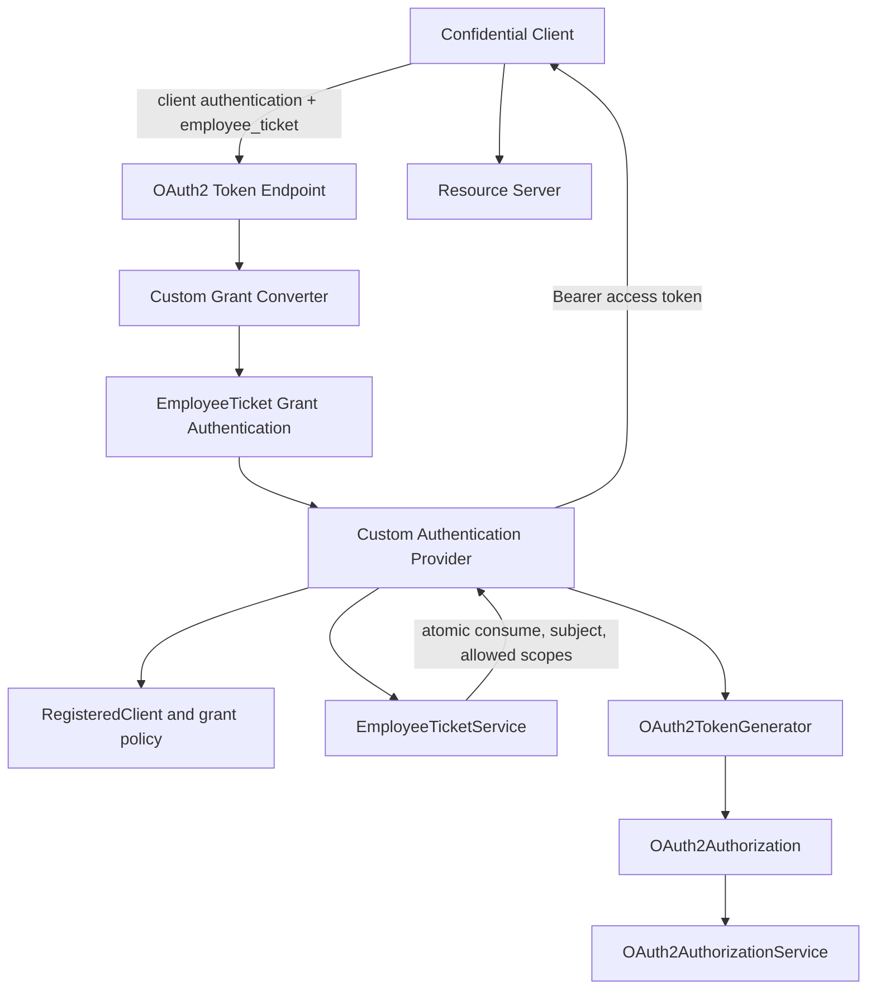

# Mở rộng custom grant hoặc lưu trữ tùy chỉnh có kiểm thử

Spring Authorization Server cung cấp các grant type và dịch vụ lưu trữ phổ biến, nhưng hệ thống thực tế đôi khi cần tích hợp với quy trình cấp quyền riêng hoặc một kho dữ liệu đã có. Ví dụ, một hệ thống nhân sự có thể phát hành vé xác thực dùng một lần từ một identity broker; ứng dụng cần đổi vé đó lấy access token theo một grant type nội bộ. Một hệ thống khác có thể cần lưu authorization vào kho dữ liệu riêng để đáp ứng yêu cầu phân vùng, mã hóa hoặc tích hợp dữ liệu.

Bài thực hành này đưa ra hai hướng mở rộng độc lập: **A. custom grant type** để đổi employee ticket dùng một lần lấy access token; **B. custom authorization storage** bằng cách triển khai `OAuth2AuthorizationService`. Chọn một hướng phù hợp với bài toán của bạn và hoàn thành các kiểm thử tương ứng. Cả hai hướng đều phải giữ nguyên các quy tắc xác thực client, giới hạn scope, chống replay và lưu trạng thái authorization nhất quán.

Sau bài thực hành, bạn có thể:

- Đăng ký một grant type mở rộng và kết nối nó với token endpoint.
- Xác thực dữ liệu nghiệp vụ của grant bằng một service có kiểm soát.
- Tạo token qua `OAuth2TokenGenerator` và lưu authorization qua abstraction của Spring Authorization Server.
- Hoặc triển khai `OAuth2AuthorizationService` cho kho dữ liệu riêng.
- Viết unit test, integration test và kiểm thử các trường hợp âm tính quan trọng.
- Đánh giá các rủi ro khi lưu token, xử lý đồng thời và nâng cấp schema.

## 1. Chọn bài thực hành

| Hướng | Khi nào nên chọn | Kết quả cần hoàn thành |
|---|---|---|
| A. Custom grant `employee_ticket` | Cần trao đổi một credential nghiệp vụ với Authorization Server để cấp access token | Grant converter, grant authentication token, authentication provider, ticket service và test đầu cuối |
| B. Custom authorization storage | Cần thay kho lưu authorization/token mặc định bằng database hoặc storage adapter riêng | Implementation `OAuth2AuthorizationService`, mapping dữ liệu, transaction và test hợp đồng lưu trữ |

Hướng A phù hợp khi muốn tích hợp một cơ chế xác thực/ủy quyền mới. Hướng B phù hợp khi yêu cầu chính nằm ở persistence. Không cần triển khai cả hai trong cùng một lần thực hành; nếu triển khai cả hai, hoàn thành và kiểm thử từng lớp độc lập trước khi tích hợp.

## 2. Hướng A: Xây dựng custom grant đổi employee ticket

### 2.1. Bài toán và hợp đồng

Giả sử một identity broker nội bộ đã xác thực nhân viên và phát hành một `employee_ticket` ngắn hạn, dùng một lần. Một confidential client đã được đăng ký tại Authorization Server gửi ticket đến token endpoint để nhận access token đại diện cho nhân viên đó.

Grant type minh họa:

```text
urn:example:params:oauth:grant-type:employee-ticket
```

Request form gửi đến token endpoint:

```text
grant_type=urn:example:params:oauth:grant-type:employee-ticket
employee_ticket=<one-time-ticket>
scope=orders.read profile.read
```

Client phải xác thực theo phương thức đã đăng ký, ví dụ `client_secret_basic` hoặc `private_key_jwt`. Ticket chứng minh danh tính/ủy quyền của subject theo hợp đồng với identity broker; ticket không thay thế client authentication. Authorization Server chỉ cấp token khi cả client và ticket đều hợp lệ.

Quy tắc nghiệp vụ của lab:

- Ticket được phát hành bởi identity broker đáng tin cậy, có thời hạn ngắn và chỉ dùng một lần.
- Ticket được ràng buộc với `client_id` được phép đổi.
- Ticket xác định subject đã được xác thực; client không được tự gửi subject tùy ý.
- Scope yêu cầu phải nằm trong tập scope của RegisteredClient và tập scope mà ticket/subject được phép nhận.
- Ticket đã hết hạn, đã dùng, sai client hoặc không hợp lệ phải bị từ chối bằng `invalid_grant`.
- Scope không được phép phải bị từ chối bằng `invalid_scope`.
- Grant chỉ phát hành access token trong bài lab; không tự cấp refresh token nếu chưa thiết kế và kiểm thử chính sách vòng đời refresh token.

### 2.2. Kiến trúc xử lý



Converter chuyển HTTP form request thành một đối tượng Authentication chưa được xác thực. Provider kiểm tra client, grant type, scope và ticket. Khi ticket service trả về subject đã xác thực, provider tạo token context, gọi token generator, lưu authorization và trả token response theo định dạng chuẩn của Spring Authorization Server.

### 2.3. Đăng ký grant type

Tạo một `AuthorizationGrantType` riêng. Giá trị phải ổn định giữa các phiên bản và không trùng grant type đã được định nghĩa:

```java
public final class EmployeeTicketGrant {
    public static final AuthorizationGrantType GRANT_TYPE =
            new AuthorizationGrantType(
                    "urn:example:params:oauth:grant-type:employee-ticket");

    public static final String TICKET_PARAMETER = "employee_ticket";

    private EmployeeTicketGrant() {
    }
}
```

Khi tạo `RegisteredClient`, chỉ bật grant này cho confidential client được phép sử dụng:

```java
RegisteredClient client = RegisteredClient.withId(UUID.randomUUID().toString())
        .clientId("employee-portal")
        .clientSecret(passwordEncoder.encode(testClientSecret))
        .clientAuthenticationMethod(ClientAuthenticationMethod.CLIENT_SECRET_BASIC)
        .authorizationGrantType(EmployeeTicketGrant.GRANT_TYPE)
        .scope("orders.read")
        .scope("profile.read")
        .build();
```

Đây là fixture tối giản. Trong ứng dụng, thêm tên client, thời gian sống token, phương thức xác thực được phê duyệt và các thuộc tính vận hành cần thiết. Không dùng secret dạng rõ trong cấu hình production.

### 2.4. Tạo grant Authentication token

Đối tượng này giữ client principal đã được xác thực, ticket và scope yêu cầu. Nó chưa phải kết quả xác thực người dùng:

```java
public final class EmployeeTicketAuthenticationToken
        extends OAuth2AuthorizationGrantAuthenticationToken {

    private final String ticket;
    private final Set<String> requestedScopes;

    public EmployeeTicketAuthenticationToken(
            Authentication clientPrincipal,
            String ticket,
            Set<String> requestedScopes) {
        super(EmployeeTicketGrant.GRANT_TYPE, clientPrincipal, Map.of());
        this.ticket = ticket;
        this.requestedScopes = Set.copyOf(requestedScopes);
    }

    public String getTicket() {
        return this.ticket;
    }

    public Set<String> getRequestedScopes() {
        return this.requestedScopes;
    }
}
```

Không đặt ticket vào `toString()`, log hoặc additional parameters sẽ được ghi lại. Ticket là credential dùng một lần và phải được xử lý như bí mật.

### 2.5. Viết AuthenticationConverter

Converter chỉ xử lý request có đúng `grant_type` của custom grant. Các grant type khác phải được converter mặc định của Spring Authorization Server xử lý.

```java
public final class EmployeeTicketAuthenticationConverter
        implements AuthenticationConverter {

    @Override
    public Authentication convert(HttpServletRequest request) {
        String grantType = request.getParameter(OAuth2ParameterNames.GRANT_TYPE);
        if (!EmployeeTicketGrant.GRANT_TYPE.getValue().equals(grantType)) {
            return null;
        }

        String[] tickets = request.getParameterValues(
                EmployeeTicketGrant.TICKET_PARAMETER);
        if (tickets == null || tickets.length != 1 || !StringUtils.hasText(tickets[0])) {
            throw invalidRequest();
        }

        String[] scopeValues = request.getParameterValues(OAuth2ParameterNames.SCOPE);
        if (scopeValues != null && scopeValues.length != 1) {
            throw invalidRequest();
        }

        Set<String> scopes = new LinkedHashSet<>();
        if (scopeValues != null && StringUtils.hasText(scopeValues[0])) {
            scopes.addAll(Arrays.asList(scopeValues[0].trim().split("\\s+")));
        }
        if (scopes.isEmpty()) {
            throw new OAuth2AuthenticationException(
                    new OAuth2Error(OAuth2ErrorCodes.INVALID_SCOPE));
        }

        Authentication clientPrincipal =
                SecurityContextHolder.getContext().getAuthentication();
        return new EmployeeTicketAuthenticationToken(
                clientPrincipal, tickets[0], scopes);
    }

    private static OAuth2AuthenticationException invalidRequest() {
        return new OAuth2AuthenticationException(
                new OAuth2Error(OAuth2ErrorCodes.INVALID_REQUEST));
    }
}
```

Các import được lược bỏ để tập trung vào luồng xử lý. Converter kiểm tra số lượng parameter để tránh request mơ hồ có nhiều giá trị cho cùng một field. Trong triển khai thật, có thể bổ sung giới hạn độ dài ticket và scope string trước khi tạo đối tượng Authentication.

### 2.6. Xây dựng service tiêu thụ ticket

Không để AuthenticationProvider tự truy cập bảng ticket hoặc tự xác minh định dạng ticket. Đưa nghiệp vụ vào một service có hợp đồng rõ ràng:

```java
public interface EmployeeTicketService {
    EmployeeTicketIdentity consume(
            String ticket,
            String clientId,
            Set<String> requestedScopes);
}

public record EmployeeTicketIdentity(
        Authentication principal,
        Set<String> allowedScopes) {
}
```

`consume` cần thực hiện trong một transaction có thao tác tiêu thụ nguyên tử. Một cách triển khai với database là tìm theo digest của ticket và cập nhật trạng thái `consumed_at` với điều kiện ticket chưa dùng, chưa hết hạn và được ràng buộc với đúng client. Chỉ request cập nhật được đúng một bản ghi mới được nhận ticket. Kiểm tra scope phải diễn ra trong cùng transaction trước khi đánh dấu ticket đã dùng, để request scope sai không làm tiêu thụ ticket hợp lệ ngoài ý muốn.

Ticket service cần kiểm tra:

- Ticket được phát hành bởi identity broker tin cậy và chữ ký/nguồn phát hành hợp lệ theo cơ chế đã chọn.
- Thời hạn và thời điểm hiệu lực của ticket.
- `client_id`, audience hoặc tenant binding phù hợp.
- Ticket chưa bị tiêu thụ hoặc thu hồi.
- Subject có trạng thái được phép truy cập.
- `requestedScopes` là tập con của scope được phép cấp cho subject.

Với ticket ngẫu nhiên có entropy cao, có thể lưu digest thay vì giá trị ticket thô để giảm rủi ro khi database bị đọc trái phép. Không ghi ticket hoặc digest nhạy cảm vào log. Nếu ticket là JWT do identity broker ký, xác minh chữ ký, issuer, audience, `exp`, `nbf` và `jti`; vẫn cần kho replay để bảo đảm ticket chỉ được dùng một lần nếu hợp đồng yêu cầu one-time use.

Service trả về một `Authentication` đã được xác thực với principal lấy từ nguồn tin cậy. Không tạo principal từ một `subject` do client gửi trong form request. Nếu ticket không hợp lệ hoặc đã dùng, service trả lỗi nghiệp vụ để provider chuyển thành `invalid_grant`.

### 2.7. Viết AuthenticationProvider

Provider kiểm tra client authentication và grant permission trước khi tiêu thụ ticket. Sau đó tạo token qua `OAuth2TokenGenerator` để giữ nguyên cấu hình signing, thời hạn và customizer của Authorization Server.

```java
public final class EmployeeTicketAuthenticationProvider
        implements AuthenticationProvider {

    private final EmployeeTicketService ticketService;
    private final OAuth2AuthorizationService authorizationService;
    private final OAuth2TokenGenerator<? extends OAuth2Token> tokenGenerator;

    public EmployeeTicketAuthenticationProvider(
            EmployeeTicketService ticketService,
            OAuth2AuthorizationService authorizationService,
            OAuth2TokenGenerator<? extends OAuth2Token> tokenGenerator) {
        this.ticketService = ticketService;
        this.authorizationService = authorizationService;
        this.tokenGenerator = tokenGenerator;
    }

    @Override
    public Authentication authenticate(Authentication authentication)
            throws AuthenticationException {
        EmployeeTicketAuthenticationToken grant =
                (EmployeeTicketAuthenticationToken) authentication;

        if (!(grant.getPrincipal() instanceof OAuth2ClientAuthenticationToken clientPrincipal)
                || !clientPrincipal.isAuthenticated()) {
            throw new OAuth2AuthenticationException(
                    new OAuth2Error(OAuth2ErrorCodes.INVALID_CLIENT));
        }

        RegisteredClient registeredClient = clientPrincipal.getRegisteredClient();
        if (registeredClient == null || !registeredClient.getAuthorizationGrantTypes()
                .contains(EmployeeTicketGrant.GRANT_TYPE)) {
            throw new OAuth2AuthenticationException(
                    new OAuth2Error(OAuth2ErrorCodes.UNAUTHORIZED_CLIENT));
        }

        Set<String> requestedScopes = grant.getRequestedScopes();
        if (!registeredClient.getScopes().containsAll(requestedScopes)) {
            throw new OAuth2AuthenticationException(
                    new OAuth2Error(OAuth2ErrorCodes.INVALID_SCOPE));
        }

        EmployeeTicketIdentity identity;
        try {
            identity = this.ticketService.consume(
                    grant.getTicket(), registeredClient.getClientId(), requestedScopes);
        } catch (InvalidEmployeeTicketException ex) {
            throw new OAuth2AuthenticationException(
                    new OAuth2Error(OAuth2ErrorCodes.INVALID_GRANT));
        } catch (EmployeeTicketScopeException ex) {
            throw new OAuth2AuthenticationException(
                    new OAuth2Error(OAuth2ErrorCodes.INVALID_SCOPE));
        }

        if (identity == null) {
            throw new OAuth2AuthenticationException(
                    new OAuth2Error(OAuth2ErrorCodes.INVALID_GRANT));
        }
        if (!identity.allowedScopes().containsAll(requestedScopes)) {
            throw new OAuth2AuthenticationException(
                    new OAuth2Error(OAuth2ErrorCodes.INVALID_SCOPE));
        }

        Authentication subjectPrincipal = identity.principal();
        if (subjectPrincipal == null || !subjectPrincipal.isAuthenticated()) {
            throw new OAuth2AuthenticationException(
                    new OAuth2Error(OAuth2ErrorCodes.INVALID_GRANT));
        }

        OAuth2TokenContext tokenContext = DefaultOAuth2TokenContext.builder()
                .registeredClient(registeredClient)
                .principal(subjectPrincipal)
                .authorizationServerContext(
                        AuthorizationServerContextHolder.getContext())
                .authorizedScopes(requestedScopes)
                .tokenType(OAuth2TokenType.ACCESS_TOKEN)
                .authorizationGrantType(EmployeeTicketGrant.GRANT_TYPE)
                .authorizationGrant(grant)
                .build();

        OAuth2Token generatedToken = this.tokenGenerator.generate(tokenContext);
        if (generatedToken == null) {
            throw new OAuth2AuthenticationException(
                    new OAuth2Error(OAuth2ErrorCodes.SERVER_ERROR));
        }

        OAuth2AccessToken accessToken = new OAuth2AccessToken(
                OAuth2AccessToken.TokenType.BEARER,
                generatedToken.getTokenValue(),
                generatedToken.getIssuedAt(),
                generatedToken.getExpiresAt(),
                requestedScopes);

        OAuth2Authorization.Builder authorizationBuilder =
                OAuth2Authorization.withRegisteredClient(registeredClient)
                        .principalName(subjectPrincipal.getName())
                        .authorizationGrantType(EmployeeTicketGrant.GRANT_TYPE)
                        .authorizedScopes(requestedScopes)
                        .token(accessToken, metadata -> {
                            if (generatedToken instanceof ClaimAccessor claimAccessor) {
                                metadata.put(
                                        OAuth2Authorization.Token.CLAIMS_METADATA_NAME,
                                        claimAccessor.getClaims());
                            }
                        });

        this.authorizationService.save(authorizationBuilder.build());

        return new OAuth2AccessTokenAuthenticationToken(
                registeredClient,
                clientPrincipal,
                accessToken,
                null,
                Map.of());
    }

    @Override
    public boolean supports(Class<?> authentication) {
        return EmployeeTicketAuthenticationToken.class.isAssignableFrom(authentication);
    }
}
```

Đây là khung triển khai minh họa; khai báo exception nghiệp vụ, import và chi tiết constructor cần khớp phiên bản Spring Authorization Server mà dự án đang sử dụng. `EmployeeTicketScopeException` và `InvalidEmployeeTicketException` là exception do ứng dụng định nghĩa. Provider không tự tạo JWT hoặc tự ký bằng private key; token generator được cấu hình chung quyết định định dạng và chữ ký.

Nếu cần phát hành refresh token, phải thiết kế thêm chính sách riêng: client được phép dùng `refresh_token`, token settings phù hợp, lưu trạng thái refresh token, xử lý rotation/reuse và test replay. Không thêm refresh token chỉ bằng cách đặt một field vào response.

### 2.8. Đăng ký converter và provider vào token endpoint

Thêm custom converter và provider vào cấu hình Authorization Server hiện tại:

```java
http.with(authorizationServerConfigurer, authorizationServer ->
        authorizationServer.tokenEndpoint(tokenEndpoint ->
                tokenEndpoint
                        .accessTokenRequestConverter(employeeTicketConverter)
                        .authenticationProvider(employeeTicketProvider)));
```

`authorizationServerConfigurer`, converter và provider là các bean/đối tượng đã tạo trong cấu hình ứng dụng. Giữ lại các converter và provider mặc định của token endpoint để authorization code, refresh token, client credentials và các grant type chuẩn tiếp tục hoạt động. Kiểm tra API cấu hình đúng phiên bản dependency đang dùng; không thay toàn bộ danh sách converter mặc định bằng duy nhất custom converter.

### 2.9. Kiểm thử custom grant

Viết test ở ba lớp.

**Unit test cho converter:**

| Input | Assertion |
|---|---|
| Grant type khác | Converter trả `null` để converter khác xử lý |
| Đúng grant type và có một ticket | Tạo `EmployeeTicketAuthenticationToken` |
| Thiếu ticket hoặc ticket rỗng | `invalid_request` |
| Có nhiều `employee_ticket` parameter | `invalid_request` |
| Scope thiếu hoặc rỗng theo policy của lab | `invalid_scope` |
| Có nhiều scope parameter | `invalid_request` |

**Unit test cho provider:**

- Client chưa xác thực hoặc không phải OAuth2 client đã xác thực: `invalid_client`.
- Client chưa đăng ký custom grant: `unauthorized_client`.
- Scope ngoài RegisteredClient: `invalid_scope`.
- Ticket không tồn tại, hết hạn, sai client hoặc đã dùng: `invalid_grant`.
- Ticket service trả subject đã xác thực và scope hợp lệ: token generator được gọi với đúng principal, grant type và scopes.
- Token generator trả `null`: `server_error`, không lưu authorization.
- Authorization được lưu với đúng RegisteredClient, principal, grant type, scope và access token.

**Integration test qua token endpoint:**

```java
mockMvc.perform(post("/oauth2/token")
        .with(httpBasic("employee-portal", testClientSecret))
        .contentType(MediaType.APPLICATION_FORM_URLENCODED)
        .param("grant_type", EmployeeTicketGrant.GRANT_TYPE.getValue())
        .param("employee_ticket", validTicket)
        .param("scope", "orders.read profile.read"))
    .andExpect(status().isOk())
    .andExpect(jsonPath("$.access_token").isNotEmpty())
    .andExpect(jsonPath("$.token_type").value("Bearer"))
        .andExpect(jsonPath("$.scope", containsString("orders.read")))
        .andExpect(jsonPath("$.scope", containsString("profile.read")));
```

Sau khi lấy token, gọi Resource Server test để xác minh chữ ký, issuer, audience và scope/authority. Sau đó thử gửi lại cùng ticket và xác minh server trả `invalid_grant`. Kiểm thử thêm ticket gắn với client khác, ticket hết hạn, scope không được phép và client không được cấp custom grant.

Một test concurrency quan trọng là gửi hai request đồng thời với cùng ticket. Chỉ một request được cấp token; request còn lại phải bị từ chối. Test này cần database hoặc ticket store thật trong môi trường integration, vì mock service không chứng minh thao tác consume nguyên tử.

Hãy xác định ranh giới transaction giữa ticket store và `OAuth2AuthorizationService`. Nếu cả hai dùng chung transaction manager/database, có thể đặt bước consume và lưu authorization trong cùng transaction để rollback khi lưu authorization thất bại. Nếu chúng nằm ở hai hệ thống riêng, không giả định một `@Transactional` cục bộ tạo ra giao dịch phân tán. Thiết kế redemption idempotent hoặc một trạng thái reservation có thể đối soát để xử lý trường hợp ticket đã được tiêu thụ nhưng việc lưu authorization thất bại. Chính sách phải ưu tiên không cấp hai token cho cùng một ticket.

## 3. Hướng B: Triển khai authorization storage tùy chỉnh

Nếu yêu cầu là thay kho lưu authorization, abstraction cần triển khai là `OAuth2AuthorizationService`. Đây là nơi Spring Authorization Server lưu và truy xuất authorization cùng các token liên quan.

### 3.1. Hợp đồng của OAuth2AuthorizationService

Interface có các thao tác cốt lõi:

```java
public interface OAuth2AuthorizationService {
    void save(OAuth2Authorization authorization);
    void remove(OAuth2Authorization authorization);
    OAuth2Authorization findById(String id);
    OAuth2Authorization findByToken(String token, OAuth2TokenType tokenType);
}
```

Implementation phải bảo toàn đầy đủ thông tin mà framework cần, không chỉ lưu chuỗi access token. Một authorization có thể chứa principal name, registered client, grant type, scopes, attributes, authorization code, access token, refresh token, ID token và metadata của từng token.

`OAuth2AuthorizationConsentService` là abstraction riêng cho consent. Nếu bài toán yêu cầu thay cả consent store, cần triển khai và kiểm thử interface đó riêng; không gộp consent vào `OAuth2AuthorizationService` theo cách làm mất hợp đồng của framework.

### 3.2. Thiết kế schema và mapping

Một thiết kế lưu trữ thường có bảng authorization chính và các trường token được lập chỉ mục:

| Nhóm dữ liệu | Ví dụ field |
|---|---|
| Authorization | `id`, `registered_client_id`, `principal_name`, `grant_type`, `authorized_scopes`, `attributes`, `version` |
| Authorization code | token value được bảo vệ, issued/expiry time, metadata, invalidated flag |
| Access token | token value được bảo vệ, token hash/index, issued/expiry time, scopes, metadata, invalidated flag |
| Refresh token | token value được bảo vệ, token hash/index, issued/expiry time, metadata, invalidated flag |
| ID token | token value được bảo vệ, issued/expiry time và metadata/claims cần thiết |

Schema thực tế phụ thuộc grant type đang bật. Nếu hỗ trợ device authorization hoặc token type tùy chỉnh, phải bổ sung trường và mapping tương ứng. Đặt foreign key đến RegisteredClient hoặc bảo đảm lookup client ổn định theo chiến lược lưu trữ đã chọn.

Không serialize đối tượng Java tùy ý bằng native Java serialization để lưu lâu dài. Cách đó dễ gắn dữ liệu với class name và phiên bản thư viện, đồng thời có thể tạo rủi ro khi deserialize dữ liệu không tin cậy. Ưu tiên schema có version và mapping tường minh cho các field được hỗ trợ. Với attributes mở rộng, dùng JSON có kiểm soát kiểu dữ liệu và quy tắc migration.

Token là credential. Mã hóa dữ liệu nhạy cảm khi lưu, giới hạn quyền truy cập database, không ghi token vào log và có quy trình xoay encryption key. Nếu cần tìm theo token, có thể lưu thêm digest để lập chỉ mục tra cứu và lưu giá trị token đã mã hóa để dựng lại `OAuth2Authorization`. Không chỉ lưu hash nếu framework cần đọc lại token value từ authorization object.

### 3.3. Triển khai các phương thức

`save` cần insert hoặc update authorization một cách nhất quán. Nếu authorization đã tồn tại, update phải giữ đúng trạng thái của token và metadata mới nhất. Dùng transaction để tránh lưu một phần authorization.

`remove` xóa hoặc đánh dấu xóa authorization theo chính sách retention và audit của hệ thống. Nếu dùng soft delete, các phương thức tìm kiếm phải bảo đảm bản ghi đã bị xóa không được xem là authorization đang hoạt động.

`findById` truy xuất đúng authorization theo ID.

`findByToken` phải tìm theo token value và loại token nếu được chỉ định. Nếu `tokenType` là `null`, implementation cần tìm trong các loại token mà hệ thống hỗ trợ theo đúng semantics của phiên bản framework. Không chỉ tìm access token rồi bỏ qua authorization code, refresh token hoặc ID token nếu các luồng đang sử dụng cần chúng.

Khi ánh xạ token, giữ nguyên issued-at, expires-at, scopes, claims metadata và trạng thái invalidated. Không tự đánh dấu token hợp lệ chỉ vì tìm thấy bản ghi; việc kiểm tra thời hạn, trạng thái và chính sách grant vẫn thuộc luồng xử lý của framework.

### 3.4. Tính nguyên tử và xử lý đồng thời

Authorization code chỉ được sử dụng một lần. Refresh token rotation cũng có thể yêu cầu cập nhật trạng thái nguyên tử. Nếu hai instance cùng đọc một authorization rồi cùng ghi trạng thái mới, implementation phải tránh lost update và replay.

Các cơ chế có thể dùng:

- Transaction với row lock khi xử lý thao tác cần đọc rồi cập nhật trạng thái.
- Optimistic locking với cột `version` và kiểm tra số dòng được cập nhật.
- Unique constraint cho token digest hoặc `jti` nếu cần chống trùng/replay.
- Conditional update, ví dụ chỉ cập nhật khi token chưa bị invalidated và chưa được tiêu thụ.

Không dựa vào đồng bộ trong bộ nhớ của một JVM nếu ứng dụng chạy nhiều instance. Kiểm thử đồng thời phải chạy trên storage thật hoặc một adapter có semantics transaction tương đương.

### 3.5. Kiểm thử storage adapter

Viết contract test cho mọi method:

| Method | Test | Kết quả mong đợi |
|---|---|---|
| `save` | Lưu authorization mới | Có thể truy xuất bằng ID và token |
| `save` | Lưu lại authorization đã cập nhật | Trạng thái/metadata mới được giữ |
| `findById` | ID tồn tại và không tồn tại | Trả object đúng hoặc `null` |
| `findByToken` | Tìm access token đúng loại | Trả đúng authorization |
| `findByToken` | Tìm refresh token/authorization code | Trả đúng authorization theo token type |
| `findByToken` | Token không tồn tại | Trả `null` |
| `remove` | Xóa authorization | Bản ghi không còn được tìm thấy như authorization đang hoạt động |
| Round-trip | Lưu rồi dựng lại authorization | Principal, grant, scopes, attributes và token metadata được bảo toàn |
| Concurrency | Hai request dùng cùng code hoặc refresh token | Chỉ một thao tác thành công theo policy |
| Encryption | Kiểm tra dữ liệu vật lý trong storage | Không lộ token rõ hoặc secret nhạy cảm |

Test round-trip cần bao gồm nhiều token trong cùng authorization nếu grant flow có thể tạo access token và refresh token. Kiểm tra cả metadata/claims được thêm bởi token customizer. Với migration, tạo dữ liệu bằng schema/adapter phiên bản cũ rồi nâng cấp và xác minh implementation mới vẫn đọc được.

## 4. Quy trình hoàn thành bài thực hành

Thực hiện theo thứ tự sau cho hướng A hoặc B:

1. Viết contract ngắn cho input, output, lỗi và trạng thái cần lưu.
2. Xác định trust boundary: client nào được gọi, credential nào được tin cậy và nguồn nào xác thực subject.
3. Implement một adapter/service nhỏ, không đưa logic nghiệp vụ vào controller hoặc filter.
4. Kết nối với abstraction Spring Authorization Server phù hợp.
5. Viết unit test cho nhánh thành công và các lỗi đầu vào.
6. Viết integration test với database/token endpoint hoặc storage thật.
7. Kiểm thử request đồng thời và replay.
8. Kiểm tra log, secret handling, token expiry và scope boundary.
9. Chạy lại các grant type chuẩn đang được sử dụng để bảo đảm phần mở rộng không làm hỏng luồng hiện có.

## 5. Tiêu chí nghiệm thu

### Nếu chọn hướng A — Custom grant

- [ ] Grant type có định danh ổn định và được đăng ký đúng cho client được phép.
- [ ] Client authentication vẫn bắt buộc và được kiểm tra độc lập với ticket.
- [ ] Converter chỉ xử lý custom grant và từ chối parameter thiếu/trùng.
- [ ] Ticket được xác minh từ nguồn tin cậy, có expiry và client binding.
- [ ] Ticket chỉ được tiêu thụ một lần kể cả khi có request đồng thời.
- [ ] Subject lấy từ ticket service, không lấy từ request client.
- [ ] Scope nằm trong giới hạn của client và subject.
- [ ] Token được tạo qua `OAuth2TokenGenerator`.
- [ ] Authorization được lưu qua `OAuth2AuthorizationService`.
- [ ] Token dùng được tại Resource Server và các trường hợp âm tính bị từ chối.
- [ ] Grant type chuẩn hiện có vẫn hoạt động.
- [ ] Ticket, access token và client secret không xuất hiện trong log.

### Nếu chọn hướng B — Custom storage

- [ ] Triển khai đủ `save`, `remove`, `findById` và `findByToken`.
- [ ] Hỗ trợ đầy đủ loại token/grant type đang được bật.
- [ ] Round-trip giữ nguyên authorization, token và metadata cần thiết.
- [ ] Update và remove có semantics rõ ràng.
- [ ] Ghi dữ liệu và cập nhật trạng thái có transaction/locking phù hợp.
- [ ] Token được bảo vệ khi lưu và không xuất hiện trong log.
- [ ] Có test đồng thời cho authorization code hoặc refresh token.
- [ ] Có test migration từ dữ liệu của phiên bản trước.
- [ ] Các luồng authorization, token, introspection/revocation đang dùng vẫn hoạt động.

## 6. Lỗi thường gặp và cách khắc phục

| Lỗi | Nguyên nhân thường gặp | Cách xử lý |
|---|---|---|
| Custom grant luôn trả `unsupported_grant_type` | Converter không được đăng ký hoặc grant type không khớp chính xác | Kiểm tra converter chain và giá trị grant type |
| Client bị từ chối dù ticket hợp lệ | Client chưa đăng ký grant type hoặc chưa xác thực đúng phương thức | Kiểm tra RegisteredClient và client authentication |
| Ticket có thể dùng hai lần | Consume không nguyên tử hoặc chỉ kiểm tra trước rồi update sau | Dùng conditional update/transaction và test đồng thời |
| Token có scope quá rộng | Không giao nhau giữa scope client, subject và request | Kiểm tra tập con trước khi tạo token |
| Resource Server từ chối token | Sai signing configuration, issuer, audience hoặc JWKS | Dùng token generator chung và kiểm thử decoder thực |
| Introspection không tìm thấy token | `findByToken` chỉ hỗ trợ access token hoặc mapping sai | Bổ sung lookup theo loại token và contract test |
| Refresh token bị replay | Rotation/reuse policy không được lưu nguyên tử | Lưu trạng thái và cập nhật có kiểm soát |
| Sau nâng cấp không đọc được authorization cũ | Serialization phụ thuộc class/version hoặc migration thiếu | Dùng schema có version và test dữ liệu cũ |

## Kết luận

Custom grant và custom storage đều mở rộng một phần quan trọng của Authorization Server, vì vậy phải tích hợp qua các abstraction của Spring Authorization Server và giữ nguyên những hợp đồng OAuth/OIDC đang được client sử dụng. Với custom grant, trọng tâm là client authentication, nguồn xác thực subject, scope và chống replay. Với custom storage, trọng tâm là round-trip dữ liệu, lookup theo token type, transaction và tương thích schema. Chỉ xem bài thực hành hoàn tất khi các test chức năng, test lỗi và test đồng thời đều chứng minh được hành vi mong đợi.
