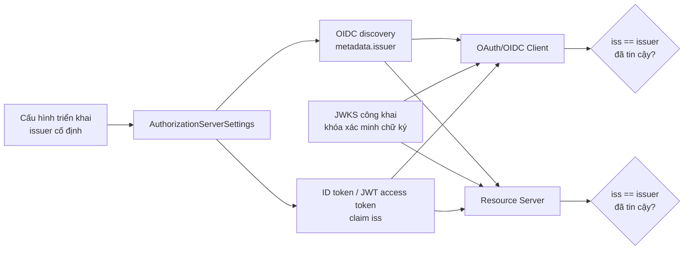
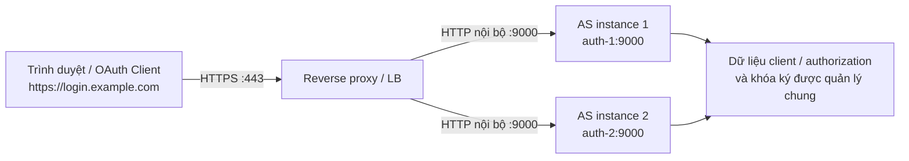

# AuthorizationServerSettings và cấu hình issuer tường minh

Khi thiết kế **OAuth 2.0/OpenID Connect Authorization Server** bằng Spring Security và Spring Authorization Server trong Spring Boot, bạn phải xác định **máy chủ tự nhận mình là ai** và **công bố các endpoint nào**. Hai trách nhiệm đó tập trung ở `AuthorizationServerSettings`. Đặc biệt, thuộc tính `issuer` ảnh hưởng trực tiếp đến khả năng client và Resource Server xác minh token, đọc discovery metadata và tin cậy đúng máy chủ phát hành.

Một hệ thống có thể khởi động, hiển thị trang đăng nhập và trả token nhưng vẫn thất bại ở client nếu `issuer` bị cấu hình sai. Ví dụ: Authorization Server chạy trong container tại `http://auth-server:9000`, người dùng truy cập qua `https://login.example.com`, còn JWT lại khai `iss` là địa chỉ nội bộ. Khi Resource Server chỉ chấp nhận `https://login.example.com`, token sẽ bị từ chối dù chữ ký hợp lệ.

**Mục tiêu học tập:**

- Giải thích ý nghĩa của issuer trong OAuth 2.0/OIDC và phân biệt issuer với host thực thi, client ID, redirect URI, audience và địa chỉ JWKS.
- Cấu hình `AuthorizationServerSettings` với issuer tường minh, hiểu các endpoint mặc định và tác động của việc đổi đường dẫn.
- Thiết lập issuer thống nhất khi Spring Boot chạy trực tiếp, sau reverse proxy/load balancer hoặc trong container.
- Đối chiếu issuer giữa discovery metadata, token, OAuth client và Resource Server; kiểm thử các lỗi sai lệch thường gặp.
- Biết giới hạn của cấu hình demo và các quy tắc vận hành khi đổi issuer hoặc chạy nhiều instance.

## 1. Issuer là danh tính giao thức của Authorization Server

Trong OIDC, **issuer identifier** là URL định danh OpenID Provider/Authorization Server. ID token do server phát hành mang claim `iss` thể hiện danh tính đó. OAuth Authorization Server cũng có thể công bố `issuer` trong metadata và JWT access token do nó phát hành thường chứa `iss`. Client/Resource Server phải kiểm tra issuer nhận được có đúng với **issuer đã cấu hình tin cậy** hay không.

Ví dụ:

```text
Issuer được tin cậy:  https://login.example.com
ID token claim "iss":  https://login.example.com
Metadata "issuer":    https://login.example.com
=> Cùng một danh tính: có thể tiếp tục các bước xác minh khác.
```

Nếu ID token ghi `https://internal-auth:9000` hoặc `http://login.example.com` thì **không khớp** với issuer đã cấu hình `https://login.example.com`. Bên xác minh phải từ chối token không khớp, không tự sửa claim hay bỏ qua xác minh.

**Issuer là danh tính logic ổn định**, không nhất thiết là địa chỉ mà tiến trình Java bind vào. Một issuer có thể được phục vụ bởi nhiều instance phía sau load balancer, miễn là chúng có cấu hình, dữ liệu và khóa phù hợp để tạo thành cùng một Authorization Server logic.

### 1.1. Issuer khác những địa chỉ và định danh nào?

| Khái niệm | Ví dụ | Chức năng | Có thể thay thế issuer không? |
| --- | --- | --- | --- |
| **Issuer** | `https://login.example.com` | Định danh AS/OP mà client và RS tin cậy. | Đây là giá trị phải cấu hình nhất quán. |
| **Địa chỉ bind nội bộ** | `http://auth-service:9000` | Địa chỉ container/pod/JVM lắng nghe. | Không; thường không truy cập được từ bên ngoài. |
| **Authorization endpoint** | `https://login.example.com/oauth2/authorize` | Nơi trình duyệt bắt đầu xin quyền. | Không; là một endpoint thuộc AS. |
| **Token endpoint** | `https://login.example.com/oauth2/token` | Nơi client đổi code để lấy token. | Không; là một endpoint thuộc AS. |
| **JWKS URI** | `https://login.example.com/oauth2/jwks` | Cung cấp khóa công khai xác minh chữ ký JWT. | Không; việc lấy được khóa chưa đủ chứng minh issuer mong đợi. |
| **Client ID** | `web-portal` | Định danh OAuth client đã đăng ký. | Không; client và AS là hai vai trò khác nhau. |
| **Redirect URI** | `https://portal.example.com/login/oauth2/code/portal` | Callback mà AS được phép đưa trình duyệt về. | Không; là địa chỉ của client. |
| **Audience (`aud`)** | `orders-api` | Đối tượng mà token hướng đến. | Không; `iss` nói ai phát hành, `aud` nói token dành cho ai. |

**Lưu ý bảo mật:** JWT có thể có chữ ký mật mã hợp lệ nhưng vẫn sai `iss` hoặc `aud`. Xác minh chữ ký, issuer, thời hạn, audience và quyền là các kiểm tra khác nhau. `AuthorizationServerSettings` xác lập danh tính máy chủ; nó không tự thay thế việc kiểm tra những điều kiện đó tại Resource Server.

### 1.2. Các yêu cầu với giá trị issuer

Issuer public của OIDC nên là URL **HTTPS**, có host rõ ràng, ổn định, không có query hoặc fragment. Nó có thể chứa path khi triển khai có tiền tố đường dẫn, nhưng cần chắc chắn discovery metadata và toàn bộ routing nhất quán với path đó.

Các giá trị dưới đây **khác nhau** khi so khớp định danh:

```text
https://login.example.com
http://login.example.com
https://login.example.com/
https://login.example.com/auth
https://LOGIN.example.com
http://localhost:9000
http://127.0.0.1:9000
```

Trong thực hành, hãy thống nhất **một chuỗi issuer canonical**, công bố nó qua metadata và cấu hình **đúng cùng chuỗi** ở các bên kiểm tra. Không viết logic tự động “chuẩn hóa” hoặc sửa `iss` tùy tiện bên nhận. Với OIDC, quy tắc so sánh issuer phải tuân theo đặc tả; không dựa vào giả định hai URL trỏ về cùng IP thì tương đương.

HTTP chỉ thích hợp cho ví dụ chạy trong **môi trường phát triển loopback**, như `http://127.0.0.1:9000`. Issuer public cho người dùng và API thật cần HTTPS.

## 2. AuthorizationServerSettings cấu hình những gì?

`AuthorizationServerSettings` là đối tượng cấu hình tập trung các thuộc tính giao thức của Spring Authorization Server, nổi bật nhất là:

1. `issuer`: URL định danh Authorization Server.
2. Các đường dẫn endpoint OAuth 2.0: authorization, token, introspection, revocation, JWK Set và các endpoint liên quan.
3. Các đường dẫn endpoint OIDC khi bật OpenID Connect, ví dụ UserInfo và logout.
4. Đường dẫn cho một số luồng bổ sung như Device Authorization Flow, tùy khả năng của phiên bản đang dùng.

Một số endpoint thông dụng với cấu hình mặc định ở Spring Authorization Server 1.x:

| Chức năng | Đường dẫn mặc định | Ghi chú |
| --- | --- | --- |
| Cấp quyền bằng trình duyệt | `/oauth2/authorize` | Authorization endpoint. |
| Đổi mã ủy quyền, nhận token | `/oauth2/token` | Token endpoint. |
| Tra cứu token opaque/trạng thái | `/oauth2/introspect` | Yêu cầu quyền và xác thực phù hợp của bên gọi. |
| Thu hồi token | `/oauth2/revoke` | Revocation endpoint. |
| Công bố khóa công khai | `/oauth2/jwks` | Khả dụng khi cấu hình `JWKSource<SecurityContext>`. |
| Cấp quyền cho thiết bị | `/oauth2/device_authorization` | Dành cho grant/device flow đã được hỗ trợ và cấu hình. |
| Trang xác minh mã thiết bị | `/oauth2/device_verification` | Người dùng nhập/duyệt mã trên thiết bị khác. |
| OIDC UserInfo | `/userinfo` | Chỉ áp dụng khi bật OIDC và có cấu hình cần thiết. |
| OIDC RP-Initiated Logout | `/connect/logout` | Chỉ áp dụng khi bật OIDC. |

**Không phải endpoint nào có trong bảng cũng tự hoạt động trong mọi cấu hình.** Ví dụ JWKS cần `JWKSource`, OIDC cần bật `oidc(...)`, và việc grant có được phép hay không còn phụ thuộc `RegisteredClient` cùng các service liên quan.

Discovery metadata cũng quan trọng:

- `/.well-known/openid-configuration` là địa chỉ khám phá thông tin của **OIDC Provider** khi OIDC được bật, trong ví dụ issuer ở root.
- `/.well-known/oauth-authorization-server` là địa chỉ metadata OAuth Authorization Server theo quy tắc discovery phù hợp.

Với issuer có path component, URL discovery có thể được xây dựng theo quy tắc khác việc nối trực tiếp `issuer + "/.well-known/..."`. Khi triển khai dưới tiền tố path, hãy kiểm tra URL thực tế theo đặc tả và metadata server trả về.

### 2.1. Vì sao nên khai báo issuer?

Nếu không đặt issuer trong `AuthorizationServerSettings`, Spring Authorization Server có thể suy ra issuer từ thông tin của HTTP request hiện tại. Cách này tiện trong demo trực tiếp nhưng gây rủi ro khi môi trường gồm reverse proxy, container, nhiều hostname hoặc nhiều cổng. Request mà ứng dụng nhìn thấy có thể là `http://auth-server:9000` trong khi client dùng `https://login.example.com`.

Cấu hình tường minh khiến issuer được chọn theo **chính sách triển khai** thay vì tùy thuộc host/scheme của từng request. Tuy nhiên, cấu hình này chỉ ổn định danh tính; bạn vẫn phải bảo vệ ứng dụng khỏi header giả mạo, cấu hình HTTPS/redirect đúng và giữ endpoint public truy cập được.

## 3. Cấu hình issuer tường minh trong Spring Boot

Ví dụ dưới đây áp dụng cho **Spring Boot 3.x tương thích Spring Authorization Server 1.x**. API có thể thay đổi giữa các dòng phiên bản; cần đối chiếu tài liệu của bản Spring Boot/SAS đang sử dụng.

Giả định dự án đã có dependencies và các bean cần thiết để chạy Authorization Server: `RegisteredClientRepository`, `UserDetailsService`, `JWKSource`, `JwtDecoder` cùng hai `SecurityFilterChain` cho giao thức và form login. Bài này tập trung vào **settings và issuer**, vì vậy không lặp lại toàn bộ cấu hình đăng ký client hay tạo khóa ký.

### 3.1. Khai báo thuộc tính trong application.yml

Tạo hoặc bổ sung `src/main/resources/application.yml`:

```yaml
spring:
  application:
    name: auth-server

server:
  port: 9000

app:
  security:
    authorization-server:
      issuer: ${AUTH_SERVER_ISSUER}
```

`AUTH_SERVER_ISSUER` là biến môi trường bắt buộc khi khởi động theo ví dụ này. Tránh tạo fallback về URL nội bộ trong production, vì điều đó có thể khiến ứng dụng âm thầm phát hành token với issuer sai.

Chạy thử cục bộ:

**PowerShell (Windows):**

```powershell
$env:AUTH_SERVER_ISSUER = 'http://127.0.0.1:9000'
.\mvnw.cmd spring-boot:run
```

**Bash (macOS/Linux):**

```bash
export AUTH_SERVER_ISSUER='http://127.0.0.1:9000'
./mvnw spring-boot:run
```

Trên môi trường vận hành thật, giá trị sẽ là issuer public HTTPS, ví dụ `https://login.example.com`. Biến môi trường có thể được cấp qua cấu hình triển khai hoặc secret/config management; issuer tự nó không phải bí mật, nhưng cần được quản trị như một cấu hình nhận dạng quan trọng.

### 3.2. Tạo bean AuthorizationServerSettings

```java
package com.example.authserver.config;

import org.springframework.beans.factory.annotation.Value;
import org.springframework.context.annotation.Bean;
import org.springframework.context.annotation.Configuration;
import org.springframework.security.oauth2.server.authorization.settings.AuthorizationServerSettings;

@Configuration(proxyBeanMethods = false)
public class AuthorizationServerSettingsConfig {

    @Bean
    AuthorizationServerSettings authorizationServerSettings(
            @Value("${app.security.authorization-server.issuer}") String issuer) {

        return AuthorizationServerSettings.builder()
                .issuer(issuer)
                .build();
    }
}
```

Ý nghĩa:

- `@Configuration` đăng ký cấu hình vào Spring context. Package cấu hình phải nằm trong vùng component scan hoặc được import tường minh.
- `@Value(...)` lấy issuer từ cấu hình ứng dụng, không lấy từ header `Host`/`X-Forwarded-Host` của request.
- `AuthorizationServerSettings.builder().issuer(issuer).build()` đóng băng giá trị issuer được chọn tại lúc cấu hình bean.
- Vì không ghi đè đường dẫn endpoint, Spring Authorization Server sử dụng các đường dẫn mặc định tương ứng của phiên bản.

**Không cần khai báo lại mọi endpoint mặc định.** Càng ít giá trị tùy biến thì càng ít chỗ có thể gây lệch giữa đường dẫn được đăng ký, metadata công bố, reverse proxy và cấu hình phía client.

### 3.3. Đảm bảo SecurityFilterChain bật những chức năng cần thiết

`AuthorizationServerSettings` không tự bật OIDC hoặc tự cung cấp token signer. Để có discovery OIDC, cấu hình chain AS cần bật OIDC, ví dụ:

```java
import org.springframework.core.annotation.Order;
import org.springframework.context.annotation.Bean;
import org.springframework.context.annotation.Configuration;
import org.springframework.security.config.Customizer;
import org.springframework.security.config.annotation.web.builders.HttpSecurity;
import org.springframework.security.oauth2.server.authorization.config.annotation.web.configurers.OAuth2AuthorizationServerConfigurer;
import org.springframework.security.web.SecurityFilterChain;

@Configuration(proxyBeanMethods = false)
class AuthorizationEndpointsSecurityConfig {

    @Bean
    @Order(1)
    SecurityFilterChain authorizationServerSecurityFilterChain(
            HttpSecurity http) throws Exception {

        OAuth2AuthorizationServerConfigurer configurer =
                OAuth2AuthorizationServerConfigurer.authorizationServer();

        http
            .securityMatcher(configurer.getEndpointsMatcher())
            .with(configurer, server ->
                server.oidc(Customizer.withDefaults())
            )
            .authorizeHttpRequests(authorize ->
                authorize.anyRequest().authenticated()
            );

        return http.build();
    }
}
```

Đoạn trên **chỉ minh họa phần chain endpoint liên quan**. Ứng dụng đầy đủ còn phải cấu hình login entry point, filter chain cho `/login`, `RegisteredClientRepository`, ký token/JWKS và các thành phần khác. Khi dùng OIDC UserInfo endpoint cần thêm cấu hình xác minh JWT phù hợp theo phiên bản và cách tích hợp. Không hiểu đoạn riêng này là một Authorization Server hoàn chỉnh.

Vị trí của bean `AuthorizationServerSettings` và cấu hình endpoint có thể ở hai lớp Java khác nhau; Spring nạp chúng từ application context. Chỉ nên tạo **một** cấu hình settings hợp lệ cho một Authorization Server logic.

## 4. Từ issuer đến metadata và token

Xét issuer:

```text
https://login.example.com
```

Khi đường dẫn endpoint dùng mặc định, discovery OIDC của AS tại `https://login.example.com/.well-known/openid-configuration` sẽ cung cấp các trường đại diện như:

```json
{
  "issuer": "https://login.example.com",
  "authorization_endpoint": "https://login.example.com/oauth2/authorize",
  "token_endpoint": "https://login.example.com/oauth2/token",
  "jwks_uri": "https://login.example.com/oauth2/jwks",
  "userinfo_endpoint": "https://login.example.com/userinfo"
}
```

Đây là JSON **rút gọn để minh họa**, không phải toàn bộ metadata thực tế. Các trường và giá trị cụ thể phụ thuộc cấu hình endpoint, OIDC và phiên bản sử dụng.

Trong Authorization Code Flow có scope `openid`, một ID token có các claim khái niệm như:

```json
{
  "iss": "https://login.example.com",
  "sub": "user-123",
  "aud": "web-portal",
  "exp": 1980003600,
  "iat": 1980000000
}
```

Thời gian ở đây là số minh họa, không phải token có thật. OIDC client phải xác minh **chữ ký, issuer, audience, thời hạn và các ràng buộc giao thức khác** như nonce khi đã yêu cầu.

Resource Server thường nhận access token, ví dụ JWT có claim `iss` bằng cùng issuer. Tuy nhiên không phải mọi access token đều là JWT: khi dùng opaque token, Resource Server cần introspection hoặc cơ chế xác minh phù hợp. Đừng đọc claim ở token opaque như thể nó luôn là JWT.

### 4.1. Mối liên hệ với khóa công khai và Resource Server

`jwks_uri` cho biết nơi lấy **public key** để xác minh JWT được ký bằng khóa riêng của AS. Đường dẫn khóa công khai có thể được công bố dưới issuer; nó không thay thế việc kiểm tra issuer.

Ví dụ cấu hình một Spring Resource Server tin cậy issuer này:

```yaml
spring:
  security:
    oauth2:
      resourceserver:
        jwt:
          issuer-uri: https://login.example.com
```

Với JWT Resource Server được cấu hình theo issuer URI, Spring Security có thể dùng discovery để tìm metadata/JWKS và xác thực chữ ký, thời hạn, issuer. **Audience của API và quyền nghiệp vụ thường cần cấu hình/kiểm tra riêng**: issuer đúng không có nghĩa token được phép dùng tại mọi API.

Trên phía OAuth2/OIDC Client của Spring Security, cấu hình provider cũng có thể khai báo:

```yaml
spring:
  security:
    oauth2:
      client:
        provider:
          company-identity:
            issuer-uri: https://login.example.com
```

Đây chỉ là phần **provider**; client hoàn chỉnh còn cần registration (`client-id`, authentication method, grant, redirect URI và scope). OIDC client lấy metadata từ issuer để biết endpoint, sau đó xác minh phản hồi dựa trên thông tin đã tin cậy.

### 4.2. Sơ đồ chuỗi tin cậy



Nếu metadata, token và cấu hình phía bên nhận không thống nhất issuer, hệ thống phải báo lỗi xác minh. **Không chữa lỗi bằng cách tắt validation issuer**: việc đó làm mất ranh giới tin cậy giữa hai nhà phát hành token khác nhau.

## 5. Chạy sau reverse proxy, load balancer hoặc trong container

Kiến trúc thực tế thường có nhiều lớp:



Tại đây:

- **Issuer công khai:** `https://login.example.com`.
- **Địa chỉ nội bộ:** `http://auth-1:9000` hoặc `http://auth-2:9000`.
- **Giá trị cấu hình cho cả hai instance:** `AUTH_SERVER_ISSUER=https://login.example.com`.
- Client và Resource Server luôn dùng issuer công khai; chúng không sử dụng hostname của pod/container làm issuer.

Nếu chỉ một instance có issuer khác, token phát hành từ instance đó có thể bị client/RS từ chối ngẫu nhiên theo load balancing. Ngoài issuer, các instance cần có **khóa ký phù hợp**, trạng thái ủy quyền/consent/authorization code dùng chung hoặc có mô hình phân phối nhất quán, và chiến lược phiên phù hợp. Chỉ đồng nhất issuer chưa đủ để triển khai HA.

### 5.1. Forwarded headers và URL chuyển hướng

Reverse proxy có thể chuyển thông tin origin public về backend thông qua `Forwarded` hoặc `X-Forwarded-Proto`, `X-Forwarded-Host`, `X-Forwarded-Port`. Ứng dụng có thể cần chúng để tạo redirect và cookie đúng scheme/host.

Trong Spring Boot, một lựa chọn cấu hình là:

```yaml
server:
  forward-headers-strategy: framework
```

**Chỉ bật cách xử lý forwarded header khi ranh giới proxy đã được kiểm soát.** Proxy cần loại bỏ/ghi đè header forwarded do người dùng Internet gửi và backend không được phơi trực tiếp tới client không tin cậy. Nếu tin header giả mạo, ứng dụng có thể tạo URL/redirect hoặc xử lý origin sai. Issuer tường minh giúp tránh suy diễn danh tính từ một request nhưng không tự xử lý toàn bộ rủi ro forwarded header.

Nếu bạn dùng cơ chế forward-header native của hạ tầng/Servlet container, chọn chiến lược phù hợp cấu hình triển khai; không bật nhiều bộ xử lý chồng chéo mà chưa kiểm tra URL thực tế.

### 5.2. Trường hợp issuer có tiền tố đường dẫn

Giả sử muốn issuer là `https://login.example.com/auth` trong khi backend chạy tại root. Khi đó bạn phải xác định rõ:

- Proxy đưa `/auth/...` về backend ra sao: giữ prefix hay strip prefix.
- `server.servlet.context-path` có được dùng không và đường dẫn endpoint thực tế trên backend là gì.
- URL discovery theo quy tắc dành cho issuer có path component.
- Metadata công bố `authorization_endpoint`, `token_endpoint`, `jwks_uri` có **truy cập được từ Internet** và phù hợp route thật hay không.

Không chỉ thêm `/auth` vào issuer rồi giả định proxy và Spring tự sắp xếp mọi đường dẫn. Với yêu cầu đơn giản, issuer ở root của một subdomain chuyên dụng (ví dụ `https://login.example.com`) giảm độ phức tạp routing.

## 6. Khi nào cần thay đổi đường dẫn endpoint?

`AuthorizationServerSettings` cho phép điều chỉnh đường dẫn một số endpoint. Ví dụ muốn token endpoint là `/identity/token`:

```java
@Bean
AuthorizationServerSettings authorizationServerSettings(
        @Value("${app.security.authorization-server.issuer}") String issuer) {

    return AuthorizationServerSettings.builder()
            .issuer(issuer)
            .authorizationEndpoint("/oauth2/authorize")
            .tokenEndpoint("/identity/token")
            .jwkSetEndpoint("/oauth2/jwks")
            .build();
}
```

Đây là **tùy biến**, không cần thiết với cấu hình tối thiểu. Khi làm vậy:

1. Kiểm tra metadata mới công bố `token_endpoint` đúng `https://login.example.com/identity/token`.
2. Cập nhật rule của reverse proxy/WAF và cấu hình client không dùng discovery (nếu có) để truy cập endpoint mới.
3. Kiểm tra token request, client authentication, CORS (khi có public client) và giám sát/metrics theo URL mới.
4. Đảm bảo không có cấu hình filter chain hoặc endpoint servlet tùy biến khác tranh chấp cùng đường dẫn.

**Đổi đường dẫn endpoint** khác với **đổi issuer**: client có thể cập nhật endpoint từ metadata trong khi issuer vẫn giữ nguyên. Ngược lại, đổi issuer làm thay đổi danh tính tin cậy, có thể yêu cầu thay đổi client/Resource Server và ảnh hưởng đến token đã phát hành.

## 7. Kiểm tra issuer trước khi chạy end-to-end

### 7.1. Smoke test discovery metadata

Trong môi trường local có issuer `http://127.0.0.1:9000`, AS đã bật OIDC và khởi chạy:

```bash
curl -i http://127.0.0.1:9000/.well-known/openid-configuration
```

Kỳ vọng: HTTP `200`, JSON có `issuer` bằng **chính xác** `http://127.0.0.1:9000`. Tiếp tục đối chiếu `authorization_endpoint`, `token_endpoint` và `jwks_uri`.

Ở môi trường public, kiểm tra từ **máy nằm ngoài mạng nội bộ**:

```bash
curl -fsS https://login.example.com/.well-known/openid-configuration
curl -fsS https://login.example.com/oauth2/jwks
```

Nếu cài `jq`, có thể xem các trường chính:

```bash
curl -fsS https://login.example.com/.well-known/openid-configuration \
  | jq '{issuer, authorization_endpoint, token_endpoint, jwks_uri}'
```

Một phản hồi ví dụ:

```json
{
  "issuer": "https://login.example.com",
  "authorization_endpoint": "https://login.example.com/oauth2/authorize",
  "token_endpoint": "https://login.example.com/oauth2/token",
  "jwks_uri": "https://login.example.com/oauth2/jwks"
}
```

Nếu `/.well-known/openid-configuration` không được phục vụ, cần xác minh OIDC đã bật trong `SecurityFilterChain`, các bean cần thiết có mặt và routing của proxy đúng. Không kết luận issuer sai chỉ từ HTTP 404; dịch vụ có thể chưa bật OIDC hoặc proxy chưa forward endpoint.

### 7.2. Kiểm tra token thực tế

Với một OAuth client đã đăng ký và hoàn tất Authorization Code Flow:

1. Nhận ID token khi yêu cầu `openid`.
2. Dùng thư viện JWT đáng tin cậy để xác minh chữ ký và các claim; có thể giải mã payload **trên máy phát triển** để quan sát `iss` nhưng không coi giải mã đơn thuần là xác minh.
3. Đối chiếu `iss` với `issuer` của discovery và issuer được cấu hình ở client.
4. Với JWT access token, kiểm tra claim `iss` và cấu hình Resource Server; với opaque token kiểm tra qua cơ chế introspection phù hợp.
5. Gửi token đến API yêu cầu đúng audience/scope để thấy luồng xác minh thành công; thử issuer sai phải bị từ chối.

**Tránh** dán token thật lên công cụ JWT công cộng, ghi token vào log hoặc gửi thông tin xác thực qua chat để nhờ kiểm tra.

### 7.3. Bộ trường hợp kiểm thử cấu hình

| Kiểm thử | Kết quả mong đợi |
| --- | --- |
| Metadata issuer trùng cấu hình AS | Khớp chính xác. |
| Client khai issuer `https://login.example.com`, token ghi `http://login.example.com` | Client/RS từ chối token. |
| Client dùng `localhost`, AS cấu hình `127.0.0.1` làm issuer | Nếu bên xác minh kỳ vọng URL còn lại, kiểm tra issuer thất bại. |
| Hai instance phát JWT với issuer khác nhau | Test phát hiện sai lệch ở từng instance; triển khai phải thống nhất. |
| AS trả metadata với endpoint nội bộ `http://auth-1:9000` | Phát hiện cấu hình public URL/proxy sai; sửa routing/settings. |
| Thay `Host` hoặc `X-Forwarded-Host` gửi từ Internet | Metadata issuer cố định, proxy phải loại bỏ/ghi đè header không tin cậy. |
| Đổi đường dẫn token endpoint | Metadata và đường đi request phản ánh endpoint mới. |
| JWKS không có hoặc ký bằng khóa bị thay sau restart | Client/RS không xác minh được chữ ký; kiểm tra JWKSource/rotation. |
| Token `iss` đúng nhưng `aud` không dành cho API | API vẫn từ chối; issuer không thay audience. |
| Tắt OIDC nhưng client yêu cầu OIDC discovery | Không thể giả định `openid-configuration` vẫn sẵn có; cần bật chức năng phù hợp. |

Nếu có test tự động, đặt assertion cho issuer tại **discovery metadata** và claim `iss` trong token thực sự phát hành. Test “ứng dụng khởi động được” không xác nhận được hợp đồng danh tính với client.

## 8. Các lỗi cấu hình phổ biến và cách xác định nguyên nhân

### Lỗi 1: Resource Server báo issuer không khớp

**Triệu chứng:** JWT được ký hợp lệ nhưng API trả `401`, validator báo `iss` không bằng issuer tin cậy.

**Kiểm tra:** đọc giá trị issuer trong metadata; kiểm tra claim `iss` trong token tại môi trường phát triển; so sánh chính xác với `spring.security.oauth2.resourceserver.jwt.issuer-uri`. Khắc phục ở cấu hình issuer AS hoặc cấu hình bên nhận đúng theo danh tính chính thức. Không tắt kiểm tra `iss`.

### Lỗi 2: Discovery công bố HTTP hoặc hostname nội bộ

**Triệu chứng:** client truy cập trang đăng nhập qua HTTPS nhưng metadata chỉ đến `http://auth:9000/oauth2/token`.

**Kiểm tra:** bean `AuthorizationServerSettings` có tồn tại không, issuer lấy từ đâu và đang chạy profile nào. Nếu issuer bỏ trống, AS có thể suy ra URL từ request phía proxy. Khai báo issuer tường minh bằng URL public và kiểm tra cấu hình proxy/forwarded header.

### Lỗi 3: `localhost` và `127.0.0.1` không thống nhất

**Triệu chứng:** truy cập cả hai URL đều được, nhưng client/Resource Server không công nhận token.

**Nguyên nhân:** hostname là một phần của chuỗi issuer. Cấu hình tất cả thành phần trên cùng một issuer; chẳng hạn thống nhất `http://127.0.0.1:9000` trong local.

### Lỗi 4: Sau khi thay issuer, token cũ bị từ chối

**Nguyên nhân:** token có claim `iss` được gắn lúc phát hành. Đổi issuer từ `https://old-login.example.com` sang `https://login.example.com` không thay claim trong token đã cấp.

**Hướng xử lý:** xem việc thay issuer là thay đổi **danh tính giao thức**. Lên kế hoạch truyền thông/cập nhật client, Resource Server, metadata và điều kiện chấp nhận token trong giai đoạn chuyển đổi. Với hệ thống lớn, có thể cần chạy song song issuer cũ/mới dưới cơ chế quản trị rõ ràng; không tùy ý chấp nhận issuer lạ trong mọi API.

### Lỗi 5: Redirect login trỏ tới HTTP hoặc host không mong muốn

**Nguyên nhân có thể:** reverse proxy gửi thiếu/không chuẩn forwarded headers, ứng dụng tin header giả mạo, hoặc public origin không nhất quán.

**Phân biệt:** issuer cố định làm rõ danh tính máy chủ, nhưng URL chuyển hướng và cookie vẫn phụ thuộc cấu hình HTTP/proxy. Kiểm tra trực tiếp `Location` của phản hồi `302`, các header được proxy truyền, `Secure`/`SameSite` cookie và TLS termination. Không sửa issuer theo từng redirect.

### Lỗi 6: Có issuer đúng nhưng không có JWKS hoặc lỗi xác minh chữ ký

**Nguyên nhân:** `JWKSource`/khóa ký chưa được cấu hình, bộ khóa thay đổi khi restart hoặc các instance ký bằng khóa khác nhau. Cấu hình issuer không tự tạo khóa ký nhất quán. Cần kiểm tra JWKS, `kid` và chính sách quản lý/rotation khóa.

## 9. Nguyên tắc vận hành issuer ổn định

1. **Chọn issuer trước khi tích hợp client:** ưu tiên một hostname HTTPS công khai, ổn định và được quản trị; tránh hostname hạ tầng có thể đổi.
2. **Khai báo đúng một nguồn cấu hình:** phát hành `AUTH_SERVER_ISSUER` từ hệ thống deploy/config; kiểm tra tất cả instance cùng một giá trị.
3. **Tách địa chỉ public và private:** private address chỉ dùng kết nối nội bộ; client và RS luôn dựa trên issuer public đã tin cậy.
4. **Kiểm tra metadata khi triển khai:** so sánh `issuer`, `authorization_endpoint`, `token_endpoint` và `jwks_uri` với cấu hình dự kiến.
5. **Bảo vệ proxy boundary:** HTTPS ở entry point, chuyển tiếp header tin cậy, chặn kết nối trực tiếp từ Internet vào backend.
6. **Quản trị khóa ký và trạng thái chung:** nhiều instance cùng issuer cần phối hợp khóa, authorization code, consent và phiên phù hợp.
7. **Giám sát lỗi validation:** theo dõi tỷ lệ `invalid_token`, issuer mismatch và lỗi discovery; không ghi access token, ID token, authorization code hoặc secret vào log.
8. **Xem đổi issuer là migration:** đồng bộ cấu hình OAuth clients/Resource Servers, chiến lược token cũ và thời điểm cutover.

## 10. Bài thực hành gợi ý

Để kiểm tra khả năng vận dụng, tự thực hiện các thay đổi sau trong môi trường phát triển:

1. Chạy AS với `AUTH_SERVER_ISSUER=http://127.0.0.1:9000`. Ghi lại `issuer` và `token_endpoint` của discovery.
2. Cố tình cấu hình OAuth client hoặc Resource Server tin `http://localhost:9000` và quan sát kết quả xác minh issuer.
3. Sửa bên nhận cho khớp chính xác, rồi xác minh lại một ID token hoặc JWT access token hợp lệ.
4. Đổi đường dẫn token endpoint trong `AuthorizationServerSettings`, khởi động lại và kiểm tra metadata có phản ánh URL mới không.
5. Vẽ sơ đồ khi AS đứng sau proxy `https://login.example.com` nhưng JVM ở `http://auth-1:9000`. Chỉ rõ nơi cấu hình issuer, nơi kiểm tra URL metadata và nơi chặn forwarded header giả mạo.

**Câu hỏi tự đánh giá:** Nếu cùng một khóa RSA ký hai JWT nhưng token A có `iss=https://login.example.com` và token B có `iss=https://other.example.com`, một API chỉ tin issuer đầu tiên có chấp nhận cả hai không? **Không.** Chữ ký là một bước xác minh; token B vẫn sai danh tính bên phát hành mà API đã chấp nhận.

---

**Ghi nhớ:** `AuthorizationServerSettings` định nghĩa các thông số nhận diện và endpoint của Spring Authorization Server. Cấu hình **issuer tường minh** giúp các thành phần chia sẻ một danh tính ổn định dù máy chủ chạy sau proxy, trong container hoặc nhiều instance. Mỗi client và Resource Server vẫn phải **xác minh issuer** theo giá trị đã tin cậy, bên cạnh chữ ký, thời hạn, audience và quyền truy cập.

**Tham khảo học thuật và kỹ thuật:** Spring Authorization Server Reference — `AuthorizationServerSettings` và Configuration Model; Spring Security Reference — OAuth2 Client/OIDC Login và OAuth2 Resource Server; OpenID Connect Core 1.0 (issuer và ID Token validation); OpenID Connect Discovery 1.0; RFC 8414 (OAuth 2.0 Authorization Server Metadata); RFC 9068 (JWT Profile for OAuth 2.0 Access Tokens).
