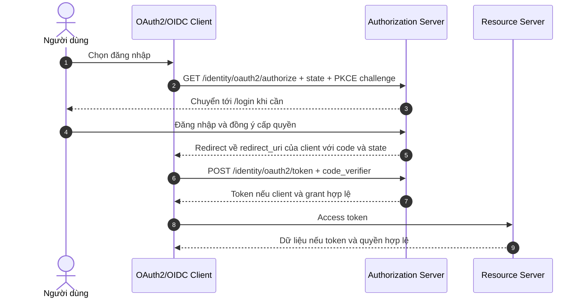

# Tùy chỉnh đường dẫn các endpoint OAuth2

## Mục tiêu bài học

Trong chương **Cấu hình máy chủ** của module **SPRING_SECURITY_OAUTH2_OIDC_AUTHORIZATION_SERVER**, bài học này tập trung vào việc thiết kế và đổi đường dẫn các endpoint OAuth 2.0/OpenID Connect (OIDC) do **Spring Authorization Server** cung cấp trong ứng dụng **Spring Boot** dùng **Spring Security**.

Sau bài học, bạn có thể:

- Phân biệt `issuer`, endpoint của Authorization Server, `redirect_uri` của client và URL giao diện đăng nhập.
- Sử dụng `AuthorizationServerSettings` để thay đổi các endpoint giao thức có hỗ trợ.
- Phối hợp đường dẫn mới với `SecurityFilterChain`, metadata discovery, OAuth2 Client và Resource Server.
- Nhận diện lỗi khi đặt ứng dụng sau reverse proxy, kết hợp servlet context path hoặc thay issuer.
- Kiểm thử và triển khai thay đổi URL một cách an toàn mà không làm giảm yêu cầu xác thực client, PKCE và bảo vệ token.

> **Bối cảnh ví dụ:** Authorization Server có issuer công khai `https://login.example.com`, đang cung cấp `/oauth2/authorize` và `/oauth2/token`. Nhóm muốn chuyển các endpoint OAuth2 sang `/identity/oauth2/*`, các endpoint OIDC tùy chọn sang `/identity/oidc/*`, đồng thời giữ nguyên issuer.

## 1. Hiểu đúng phạm vi của việc đổi đường dẫn

Một OAuth 2.0 Authorization Server phát hành token cho client; OIDC bổ sung lớp xác thực người dùng thông qua ID Token và các endpoint/metadata tương ứng. Mỗi endpoint có hợp đồng giao thức riêng về method, tham số, xác thực và mã lỗi. Đổi địa chỉ HTTP **không tự thay đổi chức năng của endpoint**.

Các lý do hợp lý để tùy chỉnh đường dẫn gồm chuẩn hóa URL, thích ứng API gateway hiện có, phân tách không gian tên với ứng dụng khác, hỗ trợ kế hoạch chuyển từ IdP cũ hoặc tuân thủ hợp đồng tích hợp đã công bố. Ngược lại, thay URL chỉ để làm hệ thống trông khác mặc định tạo thêm chi phí cập nhật client, tài liệu, gateway và monitoring.

### 1.1. Bốn loại URL thường bị nhầm lẫn

| Khái niệm | Ví dụ | Vai trò |
|---|---|---|
| **Issuer** | `https://login.example.com` | Danh tính ổn định của nhà phát hành token; dùng trong metadata và claim `iss` khi áp dụng. |
| **Endpoint của Authorization Server** | `https://login.example.com/identity/oauth2/token` | Địa chỉ client gửi yêu cầu cấp token. |
| **Redirect URI của OAuth2 Client** | `https://app.example.com/login/oauth2/code/company` | Địa chỉ callback của ứng dụng khách sau Authorization Code flow. |
| **Login UI** | `https://login.example.com/login` | Đường dẫn xác thực người dùng, được cấu hình bởi phần đăng nhập của ứng dụng. |

**Đổi `authorizationEndpoint(...)` không tự đổi `redirect_uri` hay trang `/login`**. Redirect URI vẫn phải được đăng ký và đối chiếu theo yêu cầu giao thức; OIDC client vẫn phải xác minh đúng issuer. Khi chỉ thay path của token endpoint trong cùng một trust domain, thông thường không cần thay issuer.

### 1.2. Luồng Authorization Code + PKCE khi dùng URL mới



Ở bước đổi code lấy token, client phải gọi **token endpoint mới**. Nếu thư viện client vẫn giữ URL cũ, việc đăng nhập có thể thành công ở trình duyệt nhưng thất bại ngay tại bước token exchange.

## 2. Danh sách endpoint mặc định và điểm cấu hình

Bảng dưới nêu các đường dẫn phổ biến ở **Spring Authorization Server 1.x**. Tính năng có thể phụ thuộc phiên bản, Bean đã cấu hình và trạng thái bật/tắt OIDC hoặc giao thức mở rộng. Luôn đối chiếu API của dependency thực tế.

| Chức năng | Đường dẫn mặc định phổ biến | HTTP method chính | Builder method |
|---|---|---|---|
| Authorization | `/oauth2/authorize` | GET (và POST khi luồng yêu cầu) | `authorizationEndpoint(...)` |
| Token | `/oauth2/token` | POST | `tokenEndpoint(...)` |
| Token Introspection | `/oauth2/introspect` | POST | `tokenIntrospectionEndpoint(...)` |
| Token Revocation | `/oauth2/revoke` | POST | `tokenRevocationEndpoint(...)` |
| JWK Set | `/oauth2/jwks` | GET | `jwkSetEndpoint(...)` |
| Device Authorization | `/oauth2/device_authorization` | POST | `deviceAuthorizationEndpoint(...)` |
| Device Verification | `/oauth2/device_verification` | GET/POST tùy bước | `deviceVerificationEndpoint(...)` |
| Pushed Authorization Request (PAR) | `/oauth2/par` ở bản hỗ trợ | POST | `pushedAuthorizationRequestEndpoint(...)` nếu phiên bản cung cấp |
| OIDC UserInfo | `/userinfo` | GET/POST theo yêu cầu | `oidcUserInfoEndpoint(...)` |
| OIDC Logout | `/connect/logout` | GET/POST theo luồng | `oidcLogoutEndpoint(...)` |
| OIDC Dynamic Client Registration | `/connect/register` | POST | `oidcClientRegistrationEndpoint(...)` |
| OAuth2 Authorization Server Metadata | `/.well-known/oauth-authorization-server` với issuer không có path | GET | Tạo từ issuer và thông tin endpoint |
| OIDC Discovery | `/.well-known/openid-configuration` với issuer không có path | GET | Tạo từ issuer và cấu hình OIDC |

**Hai lưu ý về endpoint discovery:**

- `/.well-known/oauth-authorization-server` thuộc RFC 8414; `/.well-known/openid-configuration` thuộc OIDC Discovery. Không có phương thức builder tổng quát để tùy ý đặt lại từng path well-known giống `tokenEndpoint(...)`. Nếu issuer có thành phần path, cách xây URL discovery còn phụ thuộc quy tắc riêng của từng tiêu chuẩn.
- Những URL OIDC chỉ hoạt động khi tính năng liên quan được cấu hình. Đặc biệt, cấu hình `oidcClientRegistrationEndpoint(...)` **không đồng nghĩa Dynamic Client Registration đã được bật**. JWK Set cần nguồn khóa/JWK phù hợp; PAR chỉ cấu hình được nếu phiên bản thực tế cung cấp API tương ứng.

Phần lớn endpoint OAuth2 có thể dùng một prefix thống nhất, nhưng **không bắt buộc** phải cùng prefix theo chuẩn. Token Endpoint, Revocation, Introspection và JWKS có mô hình xử lý khác nhau; việc gom chung đường dẫn không cho phép áp dụng cùng một quy tắc `permitAll()` cho mọi endpoint.

## 3. Thiết kế hợp đồng đường dẫn trước khi viết code

Giữ issuer ở `https://login.example.com` và chọn các đường dẫn:

| Endpoint | URL công khai mới |
|---|---|
| Authorization | `https://login.example.com/identity/oauth2/authorize` |
| Token | `https://login.example.com/identity/oauth2/token` |
| Introspection | `https://login.example.com/identity/oauth2/introspect` |
| Revocation | `https://login.example.com/identity/oauth2/revoke` |
| JWK Set | `https://login.example.com/identity/oauth2/jwks` |
| Device Authorization | `https://login.example.com/identity/oauth2/device_authorization` |
| Device Verification | `https://login.example.com/identity/oauth2/device_verification` |
| OIDC UserInfo (nếu bật) | `https://login.example.com/identity/oidc/userinfo` |
| OIDC Logout (nếu bật) | `https://login.example.com/identity/oidc/logout` |
| OIDC Client Registration (nếu bật) | `https://login.example.com/identity/oidc/register` |

Đối với issuer không có path, OIDC discovery thường vẫn ở `https://login.example.com/.well-known/openid-configuration` và OAuth2 Authorization Server Metadata ở `https://login.example.com/.well-known/oauth-authorization-server`.

Đánh giá thiết kế URL theo các tiêu chí: path bắt đầu bằng `/`, không trùng nhau hoặc va chạm `/login`/`/admin/**`/`/actuator/**`; không có query, fragment hoặc phần `..`; client có thể truy cập bằng HTTPS; reverse proxy có quy tắc chuyển tiếp rõ ràng; người sở hữu client biết được URL công khai cuối cùng.

## 4. Tùy chỉnh bằng `AuthorizationServerSettings`

Spring Authorization Server cung cấp `AuthorizationServerSettings.Builder` để đặt đường dẫn endpoint. Ví dụ sau minh họa API của dòng **Spring Authorization Server 1.x** (cần dùng phiên bản Spring Security/Spring Boot tương thích với dependency thực tế).

```java
package com.example.authserver.config;

import org.springframework.beans.factory.annotation.Value;
import org.springframework.context.annotation.Bean;
import org.springframework.context.annotation.Configuration;
import org.springframework.security.oauth2.server.authorization.settings.AuthorizationServerSettings;

@Configuration(proxyBeanMethods = false)
public class AuthorizationServerEndpointsConfiguration {

    @Bean
    AuthorizationServerSettings authorizationServerSettings(
            @Value("${app.authorization-server.issuer}") String issuer) {

        return AuthorizationServerSettings.builder()
                .issuer(issuer)
                // OAuth 2.0
                .authorizationEndpoint("/identity/oauth2/authorize")
                .tokenEndpoint("/identity/oauth2/token")
                .tokenIntrospectionEndpoint("/identity/oauth2/introspect")
                .tokenRevocationEndpoint("/identity/oauth2/revoke")
                .jwkSetEndpoint("/identity/oauth2/jwks")
                .deviceAuthorizationEndpoint("/identity/oauth2/device_authorization")
                .deviceVerificationEndpoint("/identity/oauth2/device_verification")
                // OIDC (chỉ hoạt động khi feature tương ứng được bật)
                .oidcUserInfoEndpoint("/identity/oidc/userinfo")
                .oidcLogoutEndpoint("/identity/oidc/logout")
                .oidcClientRegistrationEndpoint("/identity/oidc/register")
                .build();
    }
}
```

Định nghĩa issuer trong `application.yml`, đưa giá trị cụ thể qua biến môi trường:

```yaml
app:
  authorization-server:
    issuer: ${AUTH_ISSUER}
```

Ví dụ tại production, `AUTH_ISSUER=https://login.example.com`; tại local có thể dùng `http://localhost:9000` cho mục đích phát triển. **Không đặt issuer production theo hostname của pod, gateway nội bộ hoặc một URL thay đổi sau mỗi deployment.** Tách issuer theo môi trường đồng thời tách database, khóa ký, client credentials và các tài khoản tương ứng.

### 4.1. Chỉ đổi một endpoint được không?

Được. Ví dụ chỉ thay đường dẫn cấp token:

```java
@Bean
AuthorizationServerSettings authorizationServerSettings() {
    return AuthorizationServerSettings.builder()
            .issuer("https://login.example.com")
            .tokenEndpoint("/identity/oauth2/token")
            .build();
}
```

Những endpoint không được cấu hình lại vẫn dùng mặc định phù hợp với phiên bản framework. Tuy nhiên, mọi client đang hard-code `/oauth2/token` cần được cập nhật hoặc có giải pháp tương thích được kiểm thử. Thông thường nên giữ **một Bean `AuthorizationServerSettings` có hiệu lực** trong cùng application context để tránh mâu thuẫn.

### 4.2. Với PAR hoặc tính năng mới hơn

Một số phiên bản cung cấp builder method bổ sung cho Pushed Authorization Request:

```java
// Dòng bổ sung trong AuthorizationServerSettings.builder(), khi được hỗ trợ:
.pushedAuthorizationRequestEndpoint("/identity/oauth2/par")
```

Đây chỉ là **minh họa phần mở rộng**: kiểm tra phiên bản dependency có API hay không, tính năng đã bật và metadata công bố `pushed_authorization_request_endpoint` đúng địa chỉ mới. Không tự thêm MVC controller làm token/PAR endpoint thay framework khi chưa có lý do kiến trúc và kiểm thử giao thức đầy đủ.

### 4.3. Không dùng method builder để thay trang đăng nhập

`/login`, giao diện đồng ý cấp quyền, UI kích hoạt thiết bị và trang quản trị là các phần ứng dụng có cấu hình routing/security riêng. Một số luồng Device Verification liên quan giao diện người dùng, cần giữ đường dẫn giao thức và đường dẫn UI nhất quán theo thiết kế cụ thể. `authorizationEndpoint(...)` chỉ thay endpoint cấp quyền, **không tự viết lại login form**.

## 5. Bảo vệ endpoint mới bằng `SecurityFilterChain`

Khi đổi path sang `/identity/oauth2/**`, một SecurityFilterChain tự viết chỉ match `/oauth2/**` sẽ không còn phản ánh đủ các endpoint thực tế.

Nên dùng matcher của chính `OAuth2AuthorizationServerConfigurer`:

```java
package com.example.authserver.config;

import org.springframework.context.annotation.Bean;
import org.springframework.context.annotation.Configuration;
import org.springframework.core.annotation.Order;
import org.springframework.http.MediaType;
import org.springframework.security.config.Customizer;
import org.springframework.security.config.annotation.web.builders.HttpSecurity;
import org.springframework.security.oauth2.server.authorization.config.annotation.web.configurers.OAuth2AuthorizationServerConfigurer;
import org.springframework.security.web.SecurityFilterChain;
import org.springframework.security.web.authentication.LoginUrlAuthenticationEntryPoint;
import org.springframework.security.web.util.matcher.MediaTypeRequestMatcher;

@Configuration(proxyBeanMethods = false)
public class SecurityConfiguration {

    @Bean
    @Order(1)
    SecurityFilterChain authorizationServerFilterChain(HttpSecurity http)
            throws Exception {

        OAuth2AuthorizationServerConfigurer authorizationServer =
                OAuth2AuthorizationServerConfigurer.authorizationServer();

        http.securityMatcher(authorizationServer.getEndpointsMatcher())
                .with(authorizationServer,
                        configurer -> configurer.oidc(Customizer.withDefaults()))
                .authorizeHttpRequests(authorize ->
                        authorize.anyRequest().authenticated())
                .exceptionHandling(exceptions -> exceptions
                        .defaultAuthenticationEntryPointFor(
                                new LoginUrlAuthenticationEntryPoint("/login"),
                                new MediaTypeRequestMatcher(MediaType.TEXT_HTML)))
                .oauth2ResourceServer(resourceServer ->
                        resourceServer.jwt(Customizer.withDefaults()));

        return http.build();
    }

    @Bean
    @Order(2)
    SecurityFilterChain applicationFilterChain(HttpSecurity http)
            throws Exception {

        http.authorizeHttpRequests(authorize -> authorize
                        .requestMatchers("/assets/**").permitAll()
                        .requestMatchers("/admin/**")
                            .hasAuthority("AUTH_SERVER_ADMIN")
                        .anyRequest().authenticated())
                .formLogin(Customizer.withDefaults());

        return http.build();
    }
}
```

Đây là ví dụ **wiring minh họa**, chưa phải ứng dụng chạy production: ngoài filter chain và settings, dự án còn cần cấu hình người dùng/authentication, `RegisteredClientRepository`, `OAuth2AuthorizationService`, lưu consent nếu dùng, `JWKSource`, `JwtDecoder` theo yêu cầu OIDC/JWT và các Bean liên quan. API `.with(...)` được dùng ở Spring Security 6.2+; khi dùng dòng framework khác phải đối chiếu tài liệu version tương ứng.

### 5.1. `getEndpointsMatcher()` có lợi ích gì?

`getEndpointsMatcher()` đại diện cho các request giao thức do Authorization Server xử lý, bao gồm các endpoint tùy chỉnh được kết nối đúng với cấu hình. Điều này hạn chế việc tự hard-code pattern `/oauth2/**` khiến endpoint dưới `/identity/**` rơi vào nhầm application chain.

Dù vậy, **phải kiểm chứng thực tế** sau khi cấu hình. Nếu request `POST /identity/oauth2/token` bị redirect tới login UI, có thể SecurityFilterChain chưa match đúng, thứ tự `@Order` sai hoặc endpoint không được tạo như mong đợi.

### 5.2. Không hạ mức bảo mật để sửa lỗi đường dẫn

| Endpoint | Cơ chế bảo vệ cần chú ý |
|---|---|
| Authorization | Xác thực người dùng, đăng ký client, redirect URI, state, PKCE và consent theo luồng. |
| Token | HTTP POST, xác thực client phù hợp và validation grant/token. |
| Introspection/Revocation | Xác thực client và quyền được phép dùng endpoint theo giao thức/chính sách. |
| JWKS | Chỉ công bố khóa công khai; không đưa private key hoặc bí mật ra response. |
| OIDC UserInfo | Access token hợp lệ và xử lý scope/claim phù hợp. |
| Client Registration | Chính sách đăng ký có kiểm soát, chỉ bật khi nghiệp vụ yêu cầu. |

Không biến `/identity/**` thành `permitAll()` cho mọi request, tắt CSRF toàn ứng dụng hoặc vô hiệu hóa xác thực client để loại bỏ lỗi 401/403. Endpoint của framework có filter giao thức riêng; hãy sửa matcher và wiring đúng nguyên nhân.

## 6. Discovery metadata phải phản ánh URL công khai

OAuth 2.0 Authorization Server Metadata (RFC 8414) và OIDC Discovery giúp client tự tìm endpoint thay vì hard-code URL. Với issuer trong ví dụ:

```text
GET https://login.example.com/.well-known/openid-configuration
GET https://login.example.com/.well-known/oauth-authorization-server
```

Khi bật OIDC và các Bean cần thiết, các trường trong discovery document dự kiến có dạng (đây là **trích mẫu**, không phải tài liệu JSON đầy đủ):

```json
{
  "issuer": "https://login.example.com",
  "authorization_endpoint": "https://login.example.com/identity/oauth2/authorize",
  "token_endpoint": "https://login.example.com/identity/oauth2/token",
  "jwks_uri": "https://login.example.com/identity/oauth2/jwks",
  "userinfo_endpoint": "https://login.example.com/identity/oidc/userinfo"
}
```

Kiểm tra qua HTTP:

```bash
curl --fail --silent --show-error \
  https://login.example.com/.well-known/openid-configuration

curl --fail --silent --show-error \
  https://login.example.com/.well-known/oauth-authorization-server
```

Nếu OIDC chưa được kích hoạt, không nên mặc định discovery OIDC sẽ trả 200. Nếu issuer **có thành phần path**, vị trí metadata well-known của OIDC và RFC 8414 có quy tắc khác trường hợp issuer chỉ gồm scheme + host; phải áp dụng đúng spec thay vì tự cộng tiền tố endpoint.

### 6.1. Ảnh hưởng tới OAuth2 Client và Resource Server

Khi một OAuth2 Client Spring Security đăng ký provider bằng `issuer-uri`, client OIDC có thể tự lấy URL authorize/token từ metadata:

```yaml
spring:
  security:
    oauth2:
      client:
        registration:
          internal-login:
            provider: internal-oidc
            client-id: ${OIDC_CLIENT_ID}
            client-secret: ${OIDC_CLIENT_SECRET}
            authorization-grant-type: authorization_code
            scope: openid,profile
        provider:
          internal-oidc:
            issuer-uri: https://login.example.com
```

Client vẫn cần đăng ký callback `redirect_uri` chính xác trên Authorization Server. Những client cấu hình trực tiếp `authorization-uri` hoặc `token-uri` phải được cập nhật thủ công. Một số thư viện cache discovery, vì vậy cần kiểm tra thời điểm reload metadata khi rollout.

Với Resource Server xác minh JWT, đổi đường dẫn JWKS làm thay đổi `jwks_uri` trong metadata. **Không cần đổi `iss` chỉ để di chuyển JWKS**, nhưng cần bảo đảm các API truy cập được nguồn public keys mới và có chiến lược cập nhật cache. Nếu đồng thời đổi khóa ký, cần key rotation có chồng lấp đủ cho token cũ còn hạn.

## 7. Đường dẫn và reverse proxy / servlet context path

Giả sử client ngoài Internet gọi:

```text
POST https://login.example.com/identity/oauth2/token
```

Trong khi container Spring Boot lắng nghe `http://auth-server:9000`.

**Phương án A — gateway giữ path:**

```text
Public:   /identity/oauth2/token
Gateway:  forward nguyên path
Spring:   /identity/oauth2/token
```

Khi đó `AuthorizationServerSettings.tokenEndpoint("/identity/oauth2/token")` phù hợp với route ứng dụng. Đây thường là sơ đồ dễ kiểm tra.

**Phương án B — gateway viết lại path:**

```text
Public:   /identity/oauth2/token
Gateway:  rewrite thành /oauth2/token
Spring:   /oauth2/token
```

Nếu gateway đã bỏ prefix, ứng dụng không nên đồng thời chờ `/identity/oauth2/token`. Cần đặc biệt kiểm tra metadata có công bố **URL public** hay không; vì rewrite có thể khiến đường dẫn công bố khác đường dẫn client thực sự truy cập.

`server.servlet.context-path=/auth` thêm ngữ cảnh đường dẫn cho **cả ứng dụng**, khác với `tokenEndpoint("/identity/oauth2/token")` là path giao thức bên trong ứng dụng. Kết hợp cả context path, configurer path và gateway prefix có thể tạo URL bị nhân đôi. Hãy xác định rõ tầng nào sở hữu prefix và kiểm thử qua public gateway.

### 7.1. Issuer và forwarded headers

Issuer phải đại diện cho URL public ổn định của Authorization Server. Khi TLS kết thúc ở gateway, server nội bộ thường thấy kết nối HTTP; cần cấu hình xử lý forwarded headers phù hợp, **chỉ tin header do proxy được kiểm soát đặt**. Không chấp nhận `Forwarded`/`X-Forwarded-*` tùy ý từ bên ngoài khiến ứng dụng phát sinh URL nội bộ, chuyển hướng sai host hoặc tạo metadata không đáng tin.

Với nhiều replica, dùng cùng issuer và đường dẫn đã được phê duyệt. Đồng thời bảo đảm nguồn khóa ký và authorization state phù hợp để token/authorization code không hỏng khi request chuyển giữa hai instance.

## 8. Kiểm thử đầy đủ sau khi đổi endpoint

Một URL xuất hiện trong file YAML hay code **không chứng minh** rằng endpoint hoạt động. Cần kiểm thử theo nhiều tầng.

### 8.1. Kiểm tra metadata tự động

Giả sử dự án test đã khai báo đầy đủ client registry, signing keys và bật OIDC, có thể dùng Spring Boot + MockMvc:

```java
@SpringBootTest(
        properties = "app.authorization-server.issuer=https://login.example.com"
)
@AutoConfigureMockMvc
class CustomizedEndpointsTest {

    @Autowired
    MockMvc mockMvc;

    @Test
    void oidcDiscoveryContainsNewUrls() throws Exception {
        mockMvc.perform(get("/.well-known/openid-configuration"))
                .andExpect(status().isOk())
                .andExpect(jsonPath("$.issuer")
                        .value("https://login.example.com"))
                .andExpect(jsonPath("$.authorization_endpoint")
                        .value("https://login.example.com/identity/oauth2/authorize"))
                .andExpect(jsonPath("$.token_endpoint")
                        .value("https://login.example.com/identity/oauth2/token"))
                .andExpect(jsonPath("$.jwks_uri")
                        .value("https://login.example.com/identity/oauth2/jwks"));
    }
}
```

Imports và test fixtures được lược bỏ. Test chỉ xác minh metadata trong application context; nó **không thay thế** HTTP E2E thật đi qua gateway và luồng cấp token.

### 8.2. Ma trận kiểm thử chức năng và an toàn

| Bài thử | Kết quả mong đợi |
|---|---|
| OIDC discovery/AS metadata | Đúng issuer và URL công khai mới. |
| Authorization Code + PKCE | Authorize dùng path mới, callback `redirect_uri` hợp lệ, token exchange ở path mới. |
| PKCE sai hoặc thiếu | Từ chối đổi code lấy token theo chính sách giao thức. |
| Redirect URI không đăng ký | Từ chối yêu cầu không hợp lệ, không redirect tới host tùy ý. |
| Client Credentials (nếu bật) | Client hợp lệ nhận token theo scope/audience; client sai bị từ chối. |
| Token endpoint gọi GET | Không trả token; method không hợp lệ cần được xử lý đúng. |
| Introspection/Revocation | POST ở path mới; yêu cầu xác thực/ủy quyền client phù hợp. |
| JWKS | Chỉ public keys, `kid` phù hợp; JWT còn hạn vẫn xác minh được. |
| OIDC UserInfo/Logout (nếu bật) | URL mới hoạt động đúng token, phiên và chính sách. |
| Device flow/PAR (nếu bật) | Client nhận endpoint đúng, các request của luồng hoạt động. |
| URL cũ | Hành vi phù hợp chính sách migration, không âm thầm cấp token qua route ngoài kiểm soát. |
| Gateway, nhiều instance, restart | Cùng URL/issuer/key set; không mất state khi request đổi instance. |

**Đừng dùng `GET /identity/oauth2/token` rồi kỳ vọng HTTP 200** để quyết định cấu hình đúng. Token Endpoint chủ yếu dùng POST và có client authentication. Với response 400/401/405/302 phải đọc trong bối cảnh method, chain và lỗi giao thức; cần thử request hợp lệ bằng OAuth2 Client hoặc test fixture.

### 8.3. Kiểm chứng cấu hình theo môi trường

Có thể dùng issuer khác nhau theo môi trường nhưng cùng đoạn cấu hình endpoint. Ví dụ:

```yaml
# application-local.yml
app:
  authorization-server:
    issuer: http://localhost:9000
```

```yaml
# application-prod.yml
app:
  authorization-server:
    issuer: ${AUTH_ISSUER}
```

Production cần issuer HTTPS thật, khóa ký bảo vệ và state bền vững. Khi startup nên phát hiện thiếu issuer, sai URI hoặc dùng nhầm host localhost ở production. Không cho phép fallback issuer production sang local. Cùng một artifact có thể đi qua staging và production, inject giá trị issuer/secret ở thời điểm deploy.

## 9. Chuyển đổi endpoint trong hệ thống đang chạy

Đường dẫn là hợp đồng được client sử dụng. Thay đường dẫn mà không có kế hoạch có thể làm đăng nhập, refresh token, introspection và xác minh JWT gián đoạn.

Quy trình gợi ý:

1. **Kiểm kê** client dùng discovery và client hard-code authorize/token/JWKS, các API gọi introspection, revocation, cùng luật gateway/WAF/monitor.
2. **Thử staging** với issuer riêng, endpoint mới, browser-based flow, machine-to-machine flow và cả request không hợp lệ.
3. **Giữ tính liên tục** của issuer/keys/state nếu chỉ thay path; đừng vô tình thay khóa ký cùng lúc khi không có kế hoạch rotation.
4. **Hỗ trợ client cũ có kiểm soát** nếu cần: cân nhắc reverse proxy rewrite nội bộ từ URL cũ tới endpoint mới, giữ method, body, xác thực và audit.
5. **Cập nhật metadata/client**: phát hành hợp đồng mới, làm mới cache discovery/JWKS, thử qua các thư viện client thực tế.
6. **Theo dõi và dỡ bỏ route cũ**: đo request còn lại, xác định ứng dụng chưa chuyển, định nghĩa mốc ngừng hỗ trợ và quy trình rollback.

`AuthorizationServerSettings` thường chỉ nhận **một path chính cho mỗi endpoint**. Gọi `.tokenEndpoint(...)` hai lần không đăng ký hai URL: lời gọi sau ghi đè lời gọi trước. Nếu cần hỗ trợ URL cũ và mới song song, đừng tự viết controller nhận client secret rồi redirect sang token endpoint; cách đó có thể làm lộ credential, đổi method/body hoặc phá client authentication. HTTP 301/302/307/308 cũng không là giải pháp tương đương đáng tin cho POST token request. Đường đi tương thích phải được thiết kế, giới hạn và kiểm thử riêng.

### 9.1. Khi nào phải đổi issuer?

Chỉ khi tổ chức chủ ý đổi **danh tính nhà phát hành** (chẳng hạn chuyển trust domain hoặc phân tách issuer). Việc đổi issuer lớn hơn đổi endpoint: OIDC Client và Resource Server phải tin issuer mới, token `iss` đổi, user identity thường ánh xạ theo cặp `issuer + subject`, và token/session cũ cần chiến lược chuyển đổi. Nếu chỉ đổi `/oauth2/token` sang `/identity/oauth2/token`, nên **giữ nguyên issuer** khi không có yêu cầu khác.

## 10. Các lỗi cấu hình thường gặp

| Hiện tượng | Nguyên nhân điển hình | Cách xử lý |
|---|---|---|
| HTTP 404 ở path mới | Settings chưa dùng, OIDC chưa bật hoặc gateway rewrite sai. | Đọc settings, kiểm tra matcher và route public/internal. |
| HTTP 302 tới login khi POST token | Request bị application filter chain xử lý. | Kiểm tra `@Order`, `getEndpointsMatcher()`, method và chain. |
| `invalid_client` / HTTP 401 | Client secret, phương thức xác thực hoặc client registry sai. | Kiểm tra client registration đúng môi trường. |
| `invalid_grant` | Authorization code đã dùng/hết hạn, PKCE sai, redirect URI không khớp. | Thử lại flow đầy đủ từ authorize, kiểm tra state/clock. |
| HTTP 405 | Gửi GET vào endpoint chỉ cho POST. | Dùng đúng HTTP method và content type. |
| Metadata vẫn chứa path cũ | Config không áp dụng, cache cũ, instance lệch cấu hình. | Lấy metadata từ từng môi trường/replica; kiểm tra deployment. |
| Metadata chứa hostname nội bộ | Thiếu issuer public hoặc xử lý proxy headers không đúng. | Đặt issuer rõ ràng và cấu hình trusted proxy. |
| Client báo issuer mismatch | Issuer trong metadata/token khác cấu hình client. | So sánh chính xác scheme, host, path, dấu slash theo hợp đồng. |
| API không xác minh JWT sau đổi JWKS | Cache/jwks_uri chưa cập nhật hoặc khóa ký bị thay ngoài ý muốn. | Kiểm tra discovery, `kid`, key rotation và Resource Server. |
| Admin/UI login bị lỗi | Endpoint prefix trùng controller hoặc chain. | Tách URL UI và AS protocol, xác nhận matcher/CSRF. |

Không log trực tiếp `Authorization` header, client secret, authorization code, refresh token hay private key khi tìm lỗi. Có thể log request ID, client ID đã được kiểm soát, method, path, loại lỗi và thời gian để hỗ trợ điều tra.

## 11. Bài tập thực hành

**Đề bài:** Từ một Spring Authorization Server đang chạy với URL mặc định, chuyển các endpoint Authorization, Token, Introspection, Revocation và JWKS sang `/gateway/oauth2/*`. Giữ issuer `https://auth.demo.example` và trang đăng nhập `/login`.

Yêu cầu thực hiện:

1. Liệt kê URL cũ/mới, xác định những URL **không** đổi: issuer, client callback `redirect_uri`, login UI và discovery well-known.
2. Tạo Bean `AuthorizationServerSettings` với các endpoint vừa chọn.
3. Bảo đảm Authorization Server chain dùng `getEndpointsMatcher()` và login UI thuộc application chain.
4. Khởi chạy với client registry, signing key, authorization state và tài khoản test thích hợp.
5. Kiểm tra OIDC discovery/AS metadata, xác minh `authorization_endpoint`, `token_endpoint` và `jwks_uri`.
6. Hoàn thành một Authorization Code + PKCE flow hoặc Client Credentials flow (khi được hỗ trợ) qua endpoint mới.
7. Thử sai redirect URI, PKCE, client secret và gửi GET tới token endpoint; ghi nhận cách framework từ chối.
8. Thử chạy sau reverse proxy, phát hiện trường hợp prefix bị nhân đôi rồi chỉnh lại URL public/internal.
9. Viết một Architecture Decision Record ngắn về lý do đổi path, danh sách client bị ảnh hưởng, phương án migration và rollback.

**Kết quả đạt:** client lấy được endpoint mới từ metadata hoặc cấu hình đúng URL mới, token tiếp tục có issuer hợp lệ, Resource Server vẫn xác minh được JWT và không có bí mật trong logs.

## 12. Checklist triển khai

- [ ] Đã phân biệt issuer, endpoint, redirect URI và login UI.
- [ ] Danh sách path mới không trùng nhau hoặc xung đột với URL quản trị.
- [ ] Có một cấu hình `AuthorizationServerSettings` có hiệu lực.
- [ ] Đã cập nhật `SecurityFilterChain` bằng endpoint matcher của framework.
- [ ] Metadata discovery trả URL public đúng; OIDC/PAR/Device được bật nếu sử dụng.
- [ ] Đã chạy ít nhất một flow cấp token hợp lệ và các flow sai để kiểm tra bảo mật.
- [ ] OAuth2 Client, Resource Server, WAF/gateway, cache và monitoring đã được đồng bộ.
- [ ] Đã xác nhận issuer public và forwarded headers chỉ nhận từ proxy tin cậy.
- [ ] Đã có kế hoạch URL cũ, quan sát client còn phụ thuộc, key/JWKS rotation và rollback.
- [ ] Không tắt xác thực client, PKCE, redirect URI validation hoặc các kiểm soát giao thức khi xử lý lỗi.

## Tổng kết

Trong Spring Authorization Server, `AuthorizationServerSettings` là điểm cấu hình chính để tùy chỉnh **đường dẫn các endpoint OAuth2/OIDC**. Tuy nhiên, một URL mới chỉ có ích khi security matcher, metadata discovery, OAuth2 Client, Resource Server và tầng proxy đều nhất quán.

Việc đổi đường dẫn nên giữ nguyên issuer khi chỉ thay route, tuân thủ đầy đủ giao thức, không làm giảm bảo mật và được kiểm thử qua public HTTPS endpoint trước khi triển khai cho client thật.

## Tài liệu tham khảo

1. [Spring Authorization Server — Configuration Model](https://docs.spring.io/spring-authorization-server/reference/configuration-model.html): `AuthorizationServerSettings` và cấu hình endpoint của Spring Authorization Server.
2. [Spring Authorization Server — Protocol Endpoints](https://docs.spring.io/spring-authorization-server/reference/protocol-endpoints.html): các endpoint và cơ chế tùy chỉnh.
3. [Spring Security — Authorization Server Configuration Model](https://docs.spring.io/spring-security/reference/servlet/oauth2/authorization-server/configuration-model.html): API cấu hình tương ứng ở dòng Spring Security tích hợp Authorization Server.
4. [RFC 8414 — OAuth 2.0 Authorization Server Metadata](https://www.rfc-editor.org/rfc/rfc8414): quy tắc metadata và URL discovery.
5. [OpenID Connect Discovery 1.0](https://openid.net/specs/openid-connect-discovery-1_0.html): issuer, OIDC Provider Configuration và endpoint discovery.
6. [RFC 6749 — The OAuth 2.0 Authorization Framework](https://www.rfc-editor.org/rfc/rfc6749): authorization/token endpoints, client và redirect URI.
7. [Spring Security — OAuth 2.0 Client](https://docs.spring.io/spring-security/reference/servlet/oauth2/client/index.html): cấu hình client và provider discovery.

