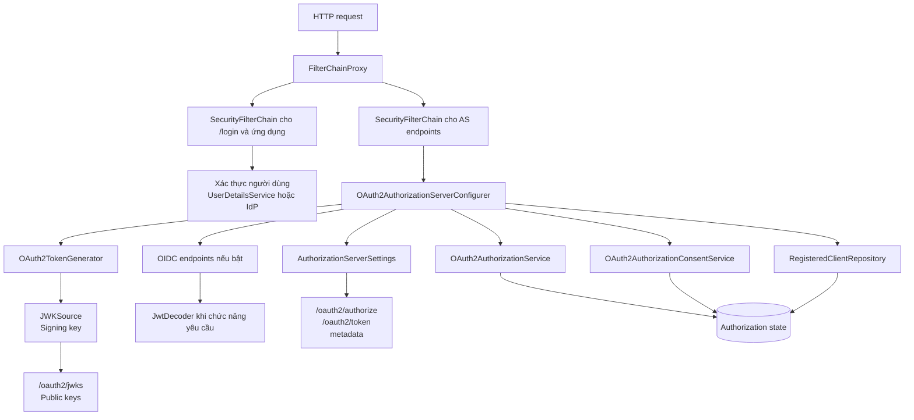
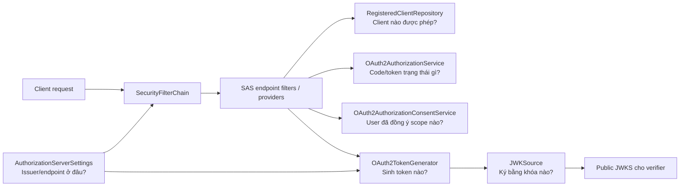

# Đăng ký các bean hạ tầng bắt buộc và tùy chọn

## 1. Mục tiêu và bối cảnh

Trong chương **Cấu hình máy chủ** của module **SPRING_SECURITY_OAUTH2_OIDC_AUTHORIZATION_SERVER**, việc khai báo bean là bước nối giao thức OAuth 2.0/OpenID Connect (OIDC) với các dịch vụ thật của ứng dụng **Spring Boot**. Spring Authorization Server (SAS) cung cấp filter, converter, provider và endpoint giao thức; ứng dụng phải quyết định cách đăng ký client, lưu authorization/consent, phát hành token, xác thực người dùng và quản lý khóa ký.

Sau bài này, bạn có thể:

- Nhận biết bean **phải có**, bean **framework có thể tạo mặc định** và bean **chỉ cần trong cấu hình cụ thể**.
- Hiểu quan hệ giữa `SecurityFilterChain`, `RegisteredClientRepository`, `OAuth2AuthorizationService`, `OAuth2AuthorizationConsentService`, `OAuth2TokenGenerator`, `JWKSource`, `JwtDecoder` và `AuthorizationServerSettings`.
- Tạo một Authorization Server local có Authorization Code + PKCE và OIDC, sau đó xác minh endpoint, metadata và JWKS.
- Thay lưu trữ trong bộ nhớ bằng JDBC mà không thay đổi các endpoint hoặc trách nhiệm của tầng giao thức.
- Nhận diện lỗi thiếu bean, khai báo trùng bean, cấu hình sai issuer, lỗi JWT/JWK và lỗi thứ tự security filter chain.

**Phạm vi phiên bản:** Ví dụ dùng API lập trình thường gặp của **Spring Boot 3.x**, **Spring Security 6.x** và **Spring Authorization Server 1.x**. API, auto-configuration và điều kiện bean có thể khác ở phiên bản mới hơn, nhất là khi chuyển thế hệ framework. Hãy đối chiếu dependency và tài liệu đúng phiên bản đang dùng. Ví dụ minh họa cấu hình thủ công để thấy rõ trách nhiệm của từng bean.

> Cần phân biệt: **một bean bắt buộc về mặt thiết kế** không nhất thiết phải do bạn tự khai báo với `@Bean`, vì framework/auto-configuration có thể tạo bean mặc định. Ngược lại, một bean tùy chọn ở mức giao thức có thể là bắt buộc đối với tính năng bạn đã bật, chẳng hạn khóa ký JWT và OIDC.

## 2. Bản đồ bean và đường đi của request



Sơ đồ mô tả **phụ thuộc và trách nhiệm**, không phải trình tự gọi cố định cho mọi request. Ví dụ `GET /oauth2/jwks` công bố phần công khai của khóa mà không cần sinh token; `POST /oauth2/token` cần kiểm tra client, grant và authorization state; `GET /oauth2/authorize` còn liên quan authentication session và consent.

Trong Spring Security, `FilterChainProxy` chọn `SecurityFilterChain` phù hợp theo matcher và thứ tự. Với ứng dụng AS có form login, thường cần **hai chain**: một chain ưu tiên cao cho endpoint giao thức, và một chain cho `/login`/trang ứng dụng. Chain chỉ định tuyến và bảo vệ HTTP; các repository/service mới là nơi giữ dữ liệu nghiệp vụ của authorization.

## 3. Phân loại các bean cần đăng ký

### 3.1. Bảng quyết định

| Bean / thành phần | Mức độ cần thiết | Vai trò và ghi chú |
| --- | --- | --- |
| `RegisteredClientRepository` | **Bắt buộc đối với AS** | Tra cứu client đã đăng ký: client ID, secret/method, grant, redirect URI, scope, client settings và token settings. Cần có repository được cung cấp cho SAS. |
| `SecurityFilterChain` cấu hình SAS | **Cần có cơ chế đăng ký filter** | Gắn các endpoint và chính sách Spring Security. Ví dụ tự khai báo khi cấu hình thủ công; Boot starter có thể có auto-configuration theo phiên bản. |
| `OAuth2AuthorizationService` | Cần cho trạng thái authorization; SAS có thể cấp mặc định trong bộ nhớ | Lưu authorization code, token và trạng thái/metadata liên quan; **production nên tự đăng ký persistence**. |
| `OAuth2AuthorizationConsentService` | Cần khi quản lý consent; SAS có thể cấp mặc định trong bộ nhớ | Lưu các scope người dùng đã chấp thuận cho client; nên dùng persistence khi consent cần bền vững. |
| `OAuth2TokenGenerator<?>` | Cần cho phát hành token; SAS có thể tạo bộ sinh mặc định | Phối hợp JWT, opaque access token và refresh token tùy cấu hình. Chỉ tự viết bean khi cần điều khiển cách sinh token. |
| `AuthorizationServerSettings` | Có thể dùng mặc định; nên cấu hình rõ | Issuer và các endpoint path. Cố định issuer để metadata và `iss` nhất quán. |
| `JWKSource<SecurityContext>` | **Cần khi ký JWT và công bố JWKS** | Cung cấp khóa dùng cho JWT; AS chỉ công bố public JWK. Không bắt buộc cho mọi triển khai OAuth2 chỉ dùng opaque token. |
| `JwtDecoder` | **Cần cho các tính năng OIDC yêu cầu giải mã/xác minh JWT** | Đặc biệt UserInfo và Dynamic Client Registration theo cấu hình SAS; thường tạo từ `JWKSource`. |
| `UserDetailsService` hoặc identity integration | Cần một cơ chế xác thực end user khi có login tương tác | Không phải bean giao thức OAuth2 bắt buộc nếu ứng dụng không có người dùng đăng nhập tương tác (ví dụ machine-to-machine). |
| `PasswordEncoder` | Cần khi lưu/so sánh password và client secret dạng mã hóa | Dùng BCrypt/Argon2 theo chính sách; không hard-code plaintext credential. |
| `OAuth2TokenCustomizer<JwtEncodingContext>` | Tùy chọn | Bổ sung hoặc điều chỉnh claims của JWT theo chính sách và token type. |
| `OAuth2TokenCustomizer<OAuth2TokenClaimsContext>` | Tùy chọn | Tùy biến claims cho access token dạng opaque khi dùng generator phù hợp. |
| `OAuth2AuthorizationServerConfigurer` | Thành phần cấu hình hạ tầng | Thường tạo trong phương thức cấu hình `HttpSecurity`; **không cần mặc định khai báo thành một bean độc lập**. |
| `RegisteredClient`, `ClientSettings`, `TokenSettings` | Các đối tượng cấu hình client | Thường được tạo và lưu **qua `RegisteredClientRepository`**, không cần tạo một Spring bean riêng cho từng client. |

**Điểm cốt lõi:** Tài liệu hoặc ví dụ có thể gọi một nhóm bean là “required components” theo nghĩa hệ thống cần sử dụng chúng. Khi khai báo cấu hình thủ công trong SAS 1.x, một số dependency thường được framework tạo mặc định nếu bạn không đăng ký; không nên hiểu rằng tất cả dòng trong bảng đều cần `@Bean` riêng. Tương tự, Spring Boot starter có thể tự cấu hình thêm thành phần, phụ thuộc classpath và điều kiện auto-configuration.

### 3.2. Những bean mặc định có thể gây hiểu lầm

Khi thiếu bean tùy chỉnh, cấu hình phổ biến của SAS 1.x sử dụng:

- `InMemoryOAuth2AuthorizationService` để giữ authorization state trong bộ nhớ.
- `InMemoryOAuth2AuthorizationConsentService` để giữ consent.
- Một `DelegatingOAuth2TokenGenerator` kết hợp các generator thích hợp theo dependency hiện có; JWT generator phụ thuộc khả năng mã hóa/ký JWT.
- `AuthorizationServerSettings` với các endpoint mặc định và issuer có thể được suy ra theo ngữ cảnh request nếu không được đặt tường minh.

Điều này tiện để khởi động demo nhưng **không phải kiến trúc lưu trữ production**. Với nhiều instance hoặc sau restart, authorization code, refresh token, consent và trạng thái khác phải được chia sẻ hoặc có chính sách tồn tại rõ ràng. Nếu AS đứng sau reverse proxy, issuer suy từ request cũng có thể sai URL công khai.

Đối với một môi trường local có OIDC, nên tự đăng ký tối thiểu: **registered clients, signing key/JWKSource, JwtDecoder, AuthorizationServerSettings và cấu hình các security chain**. Chọn rõ cách xác thực người dùng và nơi lưu state thay vì trông chờ vào mặc định trong một hệ thống cần vận hành bền vững.

## 4. Nhóm bean bảo vệ HTTP: `SecurityFilterChain`

### 4.1. Chain dành cho endpoint Authorization Server

Ví dụ dùng cấu hình lập trình của SAS 1.x:

```java
@Configuration(proxyBeanMethods = false)
@EnableWebSecurity
public class AuthorizationServerSecurityConfig {

    @Bean
    @Order(1)
    SecurityFilterChain authorizationServerChain(HttpSecurity http)
            throws Exception {

        OAuth2AuthorizationServerConfigurer authorizationServer =
                OAuth2AuthorizationServerConfigurer.authorizationServer();

        http
            .securityMatcher(authorizationServer.getEndpointsMatcher())
            .with(authorizationServer, configurer ->
                    configurer.oidc(Customizer.withDefaults()))
            .authorizeHttpRequests(authorize ->
                    authorize.anyRequest().authenticated())
            .exceptionHandling(exceptions ->
                    exceptions.defaultAuthenticationEntryPointFor(
                            new LoginUrlAuthenticationEntryPoint("/login"),
                            new MediaTypeRequestMatcher(MediaType.TEXT_HTML)))
            .oauth2ResourceServer(resourceServer ->
                    resourceServer.jwt(Customizer.withDefaults()));

        return http.build();
    }

    @Bean
    @Order(2)
    SecurityFilterChain applicationChain(HttpSecurity http)
            throws Exception {

        http
            .authorizeHttpRequests(authorize ->
                    authorize.anyRequest().authenticated())
            .formLogin(Customizer.withDefaults());

        return http.build();
    }
}
```

Đoạn mã lược bỏ `import` để làm rõ wiring; những type chính nằm trong `org.springframework.security.*` và `org.springframework.security.oauth2.server.authorization.*`.

- `@Order(1)` bảo đảm chain giao thức được xét trước. `authorizationServer.getEndpointsMatcher()` giúp giới hạn phạm vi chain vào các endpoint SAS.
- `.oidc(Customizer.withDefaults())` bật hỗ trợ OIDC của SAS; không đồng nghĩa tự bật tất cả chức năng mở rộng như Dynamic Client Registration.
- `.exceptionHandling(...)` chuyển những request browser cần xác thực đến `/login`; không biến mọi lỗi JSON của token endpoint thành redirect.
- `.oauth2ResourceServer(...jwt(...))` cần khi chain AS phải tiếp nhận Bearer access token cho chức năng OIDC như UserInfo.
- `@Order(2)` xử lý `/login` và các request khác, dùng form login mẫu cho local.

**Sai lầm phổ biến:** Khai báo chain AS với matcher bao phủ toàn bộ `/**`, khiến `/login` không tới chain ứng dụng, dẫn đến vòng redirect hoặc 403. Ngược lại, đặt application chain bắt mọi request trước AS chain có thể làm endpoint `/oauth2/token` không được xử lý đúng.

Spring Security có sẵn CSRF protection phù hợp với form login và các request qua browser. Không tắt CSRF toàn cục chỉ để token endpoint hoạt động. Kiểm tra policy riêng cho endpoint giao thức và endpoint tương tác.

## 5. Bean đăng ký client: `RegisteredClientRepository`

### 5.1. Những dữ liệu quan trọng trong `RegisteredClient`

Một client đăng ký thường chứa:

| Thuộc tính | Công dụng |
| --- | --- |
| `id` / `clientId` | Khóa nội bộ và định danh client dùng trong OAuth2 request. |
| `clientSecret` | Bí mật được mã hóa đối với confidential client; không sử dụng cho public client không có khả năng giữ bí mật. |
| `clientAuthenticationMethods` | Ví dụ `client_secret_basic`, `private_key_jwt` hoặc `none`. |
| `authorizationGrantTypes` | Grant được phép, ví dụ `authorization_code`, `refresh_token`, `client_credentials`. |
| `redirectUris` | Địa chỉ callback phải được đăng ký chính xác. |
| `scopes` | Những scope client được phép yêu cầu, ví dụ `openid` và `profile`. |
| `ClientSettings` | Bắt buộc PKCE, consent, JWK Set URL hoặc chính sách khác của client. |
| `TokenSettings` | Thời hạn access token, refresh token, ID token và chính sách token liên quan. |

**`RegisteredClientRepository` là nơi tra cứu thông tin đăng ký**, không phải nơi lưu từng authorization code hay refresh token đã phát hành. Việc lưu authorization state thuộc `OAuth2AuthorizationService`.

### 5.2. Đăng ký client local

Ví dụ chạy local bằng confidential client `local-web` và yêu cầu PKCE:

```java
@Bean
PasswordEncoder passwordEncoder() {
    return new BCryptPasswordEncoder();
}

@Bean
RegisteredClientRepository registeredClientRepository(
        PasswordEncoder encoder,
        @Value("${LOCAL_AS_CLIENT_SECRET}") String clientSecret) {

    RegisteredClient client = RegisteredClient.withId(
                    UUID.randomUUID().toString())
            .clientId("local-web")
            .clientSecret(encoder.encode(clientSecret))
            .clientAuthenticationMethod(
                    ClientAuthenticationMethod.CLIENT_SECRET_BASIC)
            .authorizationGrantType(
                    AuthorizationGrantType.AUTHORIZATION_CODE)
            .authorizationGrantType(
                    AuthorizationGrantType.REFRESH_TOKEN)
            .redirectUri(
                    "http://127.0.0.1:8080/login/oauth2/code/local-web")
            .scope(OidcScopes.OPENID)
            .scope(OidcScopes.PROFILE)
            .clientSettings(ClientSettings.builder()
                    .requireProofKey(true)
                    .requireAuthorizationConsent(true)
                    .build())
            .tokenSettings(TokenSettings.builder()
                    .accessTokenTimeToLive(Duration.ofMinutes(5))
                    .reuseRefreshTokens(false)
                    .build())
            .build();

    return new InMemoryRegisteredClientRepository(client);
}
```

Ở đây `LOCAL_AS_CLIENT_SECRET` là biến môi trường được truyền cho JVM; không ghi secret thật trong source. `PasswordEncoder` băm secret trước khi đưa vào repository. Mật khẩu không được đưa vào URL hoặc log.

**Điểm cần phân biệt:** `client_secret_basic` xác thực confidential client tại token endpoint, còn **PKCE** bảo vệ Authorization Code Flow bằng `code_verifier`/`code_challenge`. Hai cơ chế bổ sung cho nhau. Public client thường đăng ký phương thức `none` và cũng cần PKCE; không phát client secret cho JavaScript frontend hay ứng dụng mobile rồi coi đó là bí mật an toàn.

**Lưu ý restart:** `UUID.randomUUID()` tạo ID nội bộ mới mỗi lần khởi động, phù hợp demo in-memory. Với JDBC hoặc nhiều instance, dùng ID ổn định được lưu trong kho và quy trình migration/đăng ký, không tạo lại client một cách tùy tiện sau mỗi startup.

## 6. Các bean lưu trạng thái: authorization và consent

### 6.1. `OAuth2AuthorizationService`

Service này cung cấp các thao tác lưu, tìm và xóa authorization. Tùy grant/token, một bản ghi có thể liên quan đến principal, registered client, authorization code, access token, refresh token, ID token và metadata của chúng.

Ví dụ local, đăng ký tường minh để người học thấy bean:

```java
@Bean
OAuth2AuthorizationService authorizationService() {
    return new InMemoryOAuth2AuthorizationService();
}
```

SAS 1.x có thể cung cấp mặc định in-memory nếu bạn chưa có bean này; ví dụ khai báo rõ để thấy nơi thay implementation. Khi một client dùng lại code đã cấp hoặc dùng refresh token, service chịu trách nhiệm truy xuất trạng thái. Dữ liệu không được chia sẻ giữa các instance in-memory.

### 6.2. `OAuth2AuthorizationConsentService`

Service này lưu sự đồng ý cấp scope cho từng kết hợp user/client theo chính sách. Consent **không phải** session đăng nhập và **không phải** repository của registered clients.

```java
@Bean
OAuth2AuthorizationConsentService authorizationConsentService() {
    return new InMemoryOAuth2AuthorizationConsentService();
}
```

Nếu client yêu cầu `requireAuthorizationConsent(true)`, việc hiển thị và lưu consent cần được thiết kế theo luồng browser. Trong ứng dụng production, dữ liệu consent phải bền vững nếu người dùng không được yêu cầu cấp lại sau mỗi restart.

### 6.3. Không nhầm ba loại dữ liệu

| Repository/service | Đối tượng được lưu | Ví dụ thời điểm truy cập |
| --- | --- | --- |
| `RegisteredClientRepository` | Cấu hình **client được phép** | Xác minh `client_id`, secret, grant, scope, redirect URI. |
| `OAuth2AuthorizationService` | **Authorization đã cấp** và token/code liên quan | Phát code, đổi code, refresh token, revoke, introspection. |
| `OAuth2AuthorizationConsentService` | **Consent** của principal với client | Hiện form đồng ý và lưu scope được duyệt. |

Ba nhóm dữ liệu có vòng đời và phân quyền truy cập khác nhau. Không dùng bản ghi registered client để thay thế một authorization đã phát hành.

## 7. Bean sinh token và ký JWT

### 7.1. `OAuth2TokenGenerator` là điểm phối hợp token

Ở cấu hình thông thường, SAS có thể tạo bộ sinh token phù hợp. Các thành phần tiêu biểu:

- `JwtGenerator`: sinh JWT được ký, thường dùng cho ID token OIDC và access token nếu chọn định dạng JWT.
- `OAuth2AccessTokenGenerator`: sinh access token không tự chứa claim JWT (opaque/reference token) theo cấu hình.
- `OAuth2RefreshTokenGenerator`: sinh refresh token theo chính sách.

`DelegatingOAuth2TokenGenerator` chuyển nhiệm vụ tới generator có khả năng xử lý loại token hiện tại. Không nên viết một `OAuth2TokenGenerator` mới chỉ để thêm một claim thông thường vào JWT; hãy ưu tiên customizer.

### 7.2. `JWKSource<SecurityContext>` và JWKS

Khi dùng JWT ký bất đối xứng, cần private key cho AS và public key cho verifier. Ví dụ local **sinh khóa RSA khi startup**:

```java
@Bean
JWKSource<SecurityContext> jwkSource()
        throws NoSuchAlgorithmException {

    KeyPairGenerator generator = KeyPairGenerator.getInstance("RSA");
    generator.initialize(3072);
    KeyPair pair = generator.generateKeyPair();

    RSAKey rsaKey = new RSAKey.Builder(
            (RSAPublicKey) pair.getPublic())
            .privateKey((RSAPrivateKey) pair.getPrivate())
            .keyID(UUID.randomUUID().toString())
            .keyUse(KeyUse.SIGNATURE)
            .algorithm(JWSAlgorithm.RS256)
            .build();

    JWKSet jwkSet = new JWKSet(rsaKey);
    return (selector, context) -> selector.select(jwkSet);
}
```

Các lớp RSA/JWK đến từ Java Security và Nimbus JOSE. `JWKSource` được SAS dùng để chọn signing key; endpoint `/oauth2/jwks` chỉ được công bố phần **public** của tập khóa. JWT header chứa `kid` để Resource Server chọn khóa tương ứng trong JWKS.

**Giới hạn demo:** Hàm trên sinh private key và `kid` mới mỗi lần khởi động, làm JWT đã phát hành không còn xác minh được bằng JWKS sau restart. Với hệ thống cần kiểm thử lặp lại, dùng keystore PKCS#12 được bảo vệ, KMS/HSM hoặc cơ chế lưu khóa bền vững. Không đưa private key vào `application.yml`, Git hoặc log. Khi xoay khóa, cần chuẩn bị cả khoảng thời gian công bố public key cũ và mới.

### 7.3. `JwtDecoder` phục vụ OIDC

Một số tính năng OIDC cần `JwtDecoder`, ví dụ xử lý UserInfo hoặc Dynamic Client Registration theo khả năng được bật. Với `JWKSource` đã đăng ký:

```java
@Bean
JwtDecoder jwtDecoder(JWKSource<SecurityContext> jwkSource) {
    return OAuth2AuthorizationServerConfiguration.jwtDecoder(jwkSource);
}
```

Đừng nhầm `JwtDecoder` trong Authorization Server với cấu hình verifier của **Resource Server bên ngoài**. API vẫn cần bộ xác minh access token, issuer, audience, expiry và scope riêng. Không nên ép mọi Resource Server phải gọi AS để decode từng JWT nếu hệ thống được thiết kế xác minh offline bằng JWKS.

### 7.4. Tùy biến JWT claim bằng `OAuth2TokenCustomizer`

Khi muốn bổ sung claim tin cậy cho **access token JWT**, đăng ký:

```java
@Bean
OAuth2TokenCustomizer<JwtEncodingContext> jwtTokenCustomizer() {
    return context -> {
        if (OAuth2TokenType.ACCESS_TOKEN.equals(
                context.getTokenType())) {

            context.getClaims().claim(
                    "app_environment", "local");
        }
    };
}
```

Ở ví dụ này claim cố định chỉ dùng để thử. Trong ứng dụng thật, giá trị phụ thuộc danh tính/quyền phải lấy từ nguồn đã xác thực và được phê duyệt, không sao chép dữ liệu do client tự gửi. ID token có ý nghĩa khác access token; không đẩy tùy tiện các claim dành cho API vào ID token.

Nếu tự tạo bean `OAuth2TokenGenerator<?>` thay cho bộ generator mặc định, cần gắn customizer đúng vào `JwtGenerator`/`OAuth2AccessTokenGenerator` tương ứng; việc chỉ khai báo một bean customizer không đảm bảo bộ generator tùy chỉnh tự sử dụng bean đó.

## 8. Bean metadata và cấu hình endpoint: `AuthorizationServerSettings`

`AuthorizationServerSettings` mô tả issuer và đường dẫn của endpoint. Với local chạy trên cổng 9000:

```java
@Bean
AuthorizationServerSettings authorizationServerSettings() {
    return AuthorizationServerSettings.builder()
            .issuer("http://localhost:9000")
            .authorizationEndpoint("/oauth2/authorize")
            .tokenEndpoint("/oauth2/token")
            .jwkSetEndpoint("/oauth2/jwks")
            .tokenRevocationEndpoint("/oauth2/revoke")
            .tokenIntrospectionEndpoint("/oauth2/introspect")
            .build();
}
```

`issuer` phải khớp giá trị trong metadata discovery và claim `iss`; client/Resource Server phải dùng chính issuer đó để xác minh token. `http://localhost:9000` và `http://127.0.0.1:9000` **khác nhau về chuỗi** dù cùng trỏ loopback. Tránh thay hostname, scheme, cổng hoặc dấu `/` cuối giữa các thành phần.

| Endpoint điển hình | Khi nào cần | Liên hệ bean |
| --- | --- | --- |
| `/oauth2/authorize` | Authorization Code, login, consent | Chain AS, registered clients, authentication session, authorization/consent services. |
| `/oauth2/token` | Đổi code, refresh và các grant được bật | Client repository, authorization service, token generator, JWKSource nếu sinh JWT. |
| `/oauth2/jwks` | Cho verifier lấy khóa công khai | `JWKSource`. |
| `/.well-known/oauth-authorization-server` | OAuth2 metadata khi framework hỗ trợ | `AuthorizationServerSettings` và cấu hình endpoint. |
| `/.well-known/openid-configuration` | OIDC discovery khi bật OIDC | OIDC configurer, issuer/settings, signing algorithm metadata. |
| `/oauth2/revoke` | Thu hồi token | Client authentication và authorization service. |
| `/oauth2/introspect` | Kiểm tra trạng thái token được phép | Client authentication và authorization service. |
| `/userinfo` | OIDC UserInfo khi bật | OIDC, Bearer token processing, claim mapping và decoder cần thiết. |

Endpoint nâng cao như **Pushed Authorization Requests (PAR)**, Device Authorization, OIDC logout và Dynamic Client Registration phụ thuộc phiên bản SAS và cấu hình tính năng. Không coi chúng tự động sẵn sàng chỉ vì đã bật OIDC.

Để ứng dụng local nghe cổng tương ứng:

```yaml
server:
  port: 9000
```

Khi lên production, đặt issuer theo **HTTPS public URL**, bảo vệ forwarded headers từ reverse proxy tin cậy và đảm bảo mọi instance AS cùng dùng issuer đó.

## 9. Kết hợp thành cấu hình local hoàn chỉnh

Các phương thức trong mục 4–8 được trình bày tách nhau để giải thích. Trong dự án thật, đặt chúng trong một hoặc vài class `@Configuration` cùng `ApplicationContext`, tránh định nghĩa lặp tên/loại bean. Ví dụ tối thiểu cho Authorization Code + PKCE + OIDC cần thỏa bảng sau:

| Bean / cấu hình | Đã được cung cấp bởi | Tác dụng |
| --- | --- | --- |
| AS `SecurityFilterChain` | `authorizationServerChain` | Nhận và bảo vệ endpoint giao thức. |
| Application `SecurityFilterChain` | `applicationChain` | Xử lý form login. |
| `RegisteredClientRepository` | `registeredClientRepository` | Biết `local-web`, grant, PKCE, consent. |
| `OAuth2AuthorizationService` | `authorizationService` | Lưu code/token in-memory. |
| `OAuth2AuthorizationConsentService` | `authorizationConsentService` | Lưu scope đã đồng ý in-memory. |
| `JWKSource` | `jwkSource` | Ký JWT và công bố public JWKS. |
| `JwtDecoder` | `jwtDecoder` | Hỗ trợ tính năng OIDC cần xác minh JWT. |
| `AuthorizationServerSettings` | `authorizationServerSettings` | Issuer và endpoint path. |
| `PasswordEncoder` + `UserDetailsService` | Bean mẫu ở dưới | Xác thực người dùng local. |
| `OAuth2TokenGenerator<?>` | Mặc định SAS khi phù hợp | Sinh token; không cần bean custom trong ví dụ. |

Để form login có một người dùng demo:

```java
@Bean
UserDetailsService userDetailsService(
        PasswordEncoder encoder,
        @Value("${LOCAL_AS_USER_PASSWORD}") String userPassword) {

    UserDetails user = User.withUsername("alice")
            .password(encoder.encode(userPassword))
            .roles("USER")
            .build();

    return new InMemoryUserDetailsManager(user);
}
```

Trước khi chạy, thiết lập `LOCAL_AS_CLIENT_SECRET` và `LOCAL_AS_USER_PASSWORD` trong môi trường của JVM. Tránh gõ plaintext secret vào source hoặc đưa tham số bí mật lên URL. OAuth2 client chạy ở `127.0.0.1:8080` cần đăng ký callback và secret đúng với `RegisteredClient`.

**Quan hệ với auto-configuration:** Nếu Spring Boot starter đã tạo các bean tương đương, việc khai báo lại có thể tạo khác biệt về thứ tự chain hoặc bean candidate. Chọn rõ một cách cấu hình, kiểm tra danh sách bean/condition report khi khởi động và chỉ override thành phần mà ứng dụng cần điều chỉnh.

## 10. Thay bean in-memory bằng JDBC

Mô hình production có thể dùng `JdbcTemplate`, JDBC repository/service tương ứng và database schema dành cho phiên bản SAS đang dùng. Ví dụ (giả sử ứng dụng đã cấu hình `DataSource` và `JdbcTemplate`):

```java
@Bean
RegisteredClientRepository registeredClientRepository(
        JdbcTemplate jdbcTemplate) {
    return new JdbcRegisteredClientRepository(jdbcTemplate);
}

@Bean
OAuth2AuthorizationService authorizationService(
        JdbcTemplate jdbcTemplate,
        RegisteredClientRepository registeredClientRepository) {
    return new JdbcOAuth2AuthorizationService(
            jdbcTemplate, registeredClientRepository);
}

@Bean
OAuth2AuthorizationConsentService authorizationConsentService(
        JdbcTemplate jdbcTemplate,
        RegisteredClientRepository registeredClientRepository) {
    return new JdbcOAuth2AuthorizationConsentService(
            jdbcTemplate, registeredClientRepository);
}
```

Đây là **phương án thay thế** ba bean in-memory trong mục 5–6, không được đồng thời đăng ký chúng như hai implementation không phân biệt qualifier/primary trong cùng context. Cần:

1. Áp dụng SQL schema và database migration **đúng phiên bản SAS**; không đoán tên cột hoặc sao chép schema từ phiên bản khác.
2. Đăng ký client bền vững trong cơ sở dữ liệu (sử dụng quy trình tạo client có kiểm soát). Thay thế mã tạo `UUID` client mới mỗi lần startup.
3. Bảo vệ client secret đã hash, refresh token và authorization metadata ở tầng DB; giới hạn quyền của database account.
4. Thiết kế transaction/connection pool, chính sách xóa dữ liệu authorization hết hạn và backup/restore.
5. Xác minh các AS instance dùng cùng database và khóa ký phù hợp; tránh mỗi instance giữ một bộ authorization hoặc signing key riêng.

Trong ứng dụng lớn, có thể tự triển khai các interface `RegisteredClientRepository`, `OAuth2AuthorizationService` và `OAuth2AuthorizationConsentService` để tích hợp kho dữ liệu hiện có, miễn giữ đúng hợp đồng API. Không áp dụng kiểu dữ liệu hoặc serializer tùy tiện làm sai các metadata của token.

## 11. Những bean và extension point tùy chọn đáng cân nhắc

| Extension point | Trường hợp dùng | Cần lưu ý |
| --- | --- | --- |
| `OAuth2TokenCustomizer<JwtEncodingContext>` | Thêm claim có kiểm soát vào JWT | Chỉ thêm dữ liệu đáng tin, kiểm tra token type, không chứa PII không cần thiết. |
| `OAuth2TokenGenerator<?>` tùy chỉnh | Thay cơ chế sinh token hoặc thuật toán theo yêu cầu | Phải ghép đủ generator cho access/refresh/ID token cần hỗ trợ. |
| `AuthenticationProvider` / `AuthenticationConverter` tùy chỉnh | Tích hợp extension grant hoặc cách xác thực riêng | Đăng ký vào đúng endpoint configurer, kiểm tra client và scope, trả lỗi OAuth2 chuẩn. |
| `OAuth2AuthorizationServerConfigurer#tokenEndpoint(...)` | Tùy chỉnh token endpoint handlers/converters | Phân biệt request converter và provider; không bỏ qua client authentication. |
| `OAuth2AuthorizationServerConfigurer#clientAuthentication(...)` | Chính sách xác thực client nâng cao | Không coi secret ở public client là đáng tin cậy. |
| OIDC UserInfo customizer/mapper | Định nghĩa claim UserInfo theo scope và user | Không phát claim nhạy cảm chỉ vì access token hợp lệ. |
| Custom consent UI | Thiết kế trang chấp thuận scope | Cần xác thực principal, liên kết client và CSRF an toàn. |
| JDBC repository/service | Nhiều instance, yêu cầu bền vững | Quản lý schema migration và quyền truy cập dữ liệu. |
| `JWKSource` kết nối keystore/KMS | Khóa ký bền vững và key rotation | Private key không lộ ra JWKS hoặc log. |
| Event handling, metrics, audit | Điều tra lỗi, giám sát tấn công và vận hành | Không log credential, authorization code, access/refresh/ID token. |

**Không phải extension point nào cũng là một `@Bean` độc lập.** Một số khả năng được gắn bằng DSL vào `OAuth2AuthorizationServerConfigurer`, một số cung cấp interface bean, số khác phụ thuộc giao thức/phiên bản được sử dụng.

### 11.1. Ví dụ thêm provider cho grant mở rộng

Với grant tự thiết kế, điểm tích hợp thường nằm tại token endpoint:

```java
http.with(authorizationServer, configurer ->
        configurer.tokenEndpoint(tokenEndpoint ->
                tokenEndpoint
                    .accessTokenRequestConverter(customConverter)
                    .authenticationProvider(customProvider)));
```

`customConverter` và `customProvider` trong đoạn trên là thành phần **do ứng dụng tự xây dựng**, không phải bean mặc định. Phải triển khai đúng cách nhận biết grant, xác thực client, kiểm soát scope, chống replay và ràng buộc authorization. Khi không có nhu cầu grant mở rộng, giữ nguyên các converter/provider chuẩn của SAS sẽ ít rủi ro hơn.

### 11.2. Khi nào nên dùng `@ConditionalOnMissingBean`?

Điều kiện `@ConditionalOnMissingBean` hữu ích khi viết **starter/auto-configuration dùng lại** và muốn người sử dụng thay implementation. Trong ứng dụng thông thường, không cần đặt annotation này lên mọi bean. Cần hiểu thứ tự xử lý auto-configuration, bean name, kiểu generic và qualifier để tránh một bean mặc định vô tình ghi đè hoặc làm mơ hồ lựa chọn bean của ứng dụng.

## 12. Kiểm thử sau khi đăng ký bean

Bước đầu là kiểm tra Spring context khởi động và endpoint phản hồi, sau đó kiểm thử cả happy path và failure path.

### 12.1. Kiểm tra metadata, JWKS, đăng nhập

Trên Windows PowerShell có thể dùng `curl.exe`:

```powershell
curl.exe -i http://localhost:9000/.well-known/openid-configuration
curl.exe -i http://localhost:9000/oauth2/jwks
curl.exe -i http://localhost:9000/oauth2/authorize
```

Kỳ vọng:

- OIDC metadata trả issuer `http://localhost:9000` cùng `authorization_endpoint`, `token_endpoint` và `jwks_uri` đúng.
- JWKS có public RSA JWK, `kid` tương ứng signing key, **không chứa private RSA parameters** như `d`, `p`, `q`.
- `/oauth2/authorize` thiếu tham số thường trả **lỗi giao thức**; mục tiêu của request này là xác nhận endpoint được route tới AS, không phải nhận code thành công.

Một authorize request hợp lệ phải có client ID, registered redirect URI, `response_type=code`, scope, `state` và PKCE `code_challenge`/`code_challenge_method=S256`. Browser cần được đăng nhập và xử lý consent trước khi nhận code.

### 12.2. Ma trận kiểm thử theo bean

| Thử nghiệm | Bean/chức năng cần quan sát | Kết quả mong đợi |
| --- | --- | --- |
| Context start | Các bean và phụ thuộc của chúng | Không lỗi thiếu bean, circular dependency hoặc ambiguous bean candidates. |
| Discovery | `AuthorizationServerSettings`, OIDC configurer | Issuer và URL endpoint đúng với local config. |
| JWKS | `JWKSource` | Public JWK hợp lệ, khớp `kid`/thuật toán JWT. |
| Authorization Code | Registered client, user auth, auth service, consent service | User đăng nhập/consent, code gắn với client và redirect URI. |
| Token exchange + PKCE | Token provider, authorization service, token generator | Chỉ đúng client, code chưa dùng và `code_verifier` đúng mới nhận token. |
| Wrong redirect URI | `RegisteredClientRepository` | Từ chối request không hợp lệ, không chuyển browser đến URL tùy ý. |
| Reuse authorization code | `OAuth2AuthorizationService` | Không cấp token thêm khi code đã dùng. |
| JWT validation | `JWKSource`, verifier phía client/API | Chữ ký, `iss`, `aud`, `exp` và scope được kiểm tra. |
| Consent persistence | `OAuth2AuthorizationConsentService` | Scope đã đồng ý được lưu và tra cứu đúng chính sách. |
| Restart/multi-instance | JDBC services + kho khóa | Dữ liệu và signing key nhất quán theo kiến trúc dự kiến. |
| Revoke/refresh | Authorization service, token settings | Token bị thu hồi/hết hạn hoặc refresh sai bị từ chối theo chính sách. |

Có thể dùng **Spring Security Test + MockMvc** cho phần filter/endpoint, và **integration test với cơ sở dữ liệu thật hoặc Testcontainers** cho JDBC và transaction. Với OIDC client thực, cần kiểm tra ID token ở client (`iss`, `aud`, thời hạn, chữ ký và `nonce` nếu sử dụng). API Resource Server phải kiểm tra access token cùng audience/quyền thích hợp.

### 12.3. Phân tích lỗi theo đồ thị dependency

| Lỗi / triệu chứng | Điểm cần kiểm tra |
| --- | --- |
| `No qualifying bean of type RegisteredClientRepository` | Chưa tạo repository hoặc auto-configuration không có điều kiện phù hợp. |
| `NoUniqueBeanDefinitionException` cho service/repository | Có nhiều implementation cùng loại không dùng `@Qualifier`/`@Primary`, hoặc vô tình đăng ký bean demo và JDBC cùng lúc. |
| AS endpoint trả 404 | Matcher của `SecurityFilterChain`, `@Order`, `AuthorizationServerSettings` hoặc feature chưa bật. |
| Browser redirect vòng lặp tại `/login` | Chain ứng dụng, form login, session, authentication entry point. |
| `invalid_client` | Client authentication method, client secret, registered client state. |
| `invalid_grant` | Authorization code hết hạn/đã dùng, sai PKCE, sai redirect URI, refresh token không hợp lệ. |
| Không phát ID token | OIDC chưa bật, scope không chứa `openid`, JWT token generator/signing key chưa phù hợp. |
| OIDC UserInfo lỗi xác thực | JwtDecoder, resource-server JWT support, Bearer token, principal/scope. |
| JWT không xác minh được sau restart | Sinh lại signing key hoặc `kid`/JWKS chưa nhất quán. |
| Resource Server báo `invalid_issuer` | Issuer trên JWT khác metadata hoặc cấu hình `issuer-uri`. |
| JDBC lỗi đọc authorization | Schema/serializer/DB version không phù hợp với cấu trúc model của SAS. |

Dựa vào loại response để phân biệt lỗi OAuth2 do provider trả (như `invalid_client` và `invalid_grant`) với lỗi HTTP security do request vào sai filter chain (như 404/403). Tránh sửa ngẫu nhiên nhiều bean khi chưa xác định chặng thất bại.

## 13. Lộ trình triển khai và checklist

Một trình tự đăng ký có thể giảm lỗi phụ thuộc:

1. Chốt dependency Spring Boot/Spring Security/SAS và phương pháp cấu hình (starter auto-configuration hay cấu hình thủ công).
2. Khai báo `RegisteredClientRepository` và registered client thử nghiệm; xác định grant, redirect URI, PKCE, consent, scope.
3. Khai báo hoặc xác nhận `OAuth2AuthorizationService` và `OAuth2AuthorizationConsentService`; chọn in-memory chỉ cho local hoặc JDBC cho trạng thái bền vững.
4. Cấu hình private signing key, `JWKSource` và `JwtDecoder` nếu cần JWT/OIDC.
5. Cố định `AuthorizationServerSettings.issuer` và endpoint paths.
6. Tạo AS `SecurityFilterChain`, application login chain và nguồn xác thực người dùng nếu có luồng browser.
7. Chỉ sau khi endpoint chuẩn chạy đúng mới bổ sung token customizer, custom grant hoặc consent UI.
8. Chạy discovery/JWKS, Authorization Code + PKCE, token exchange và Resource Server validation; bổ sung kiểm thử restart, key rotation và failure paths.

**Checklist trước khi hoàn tất bài cấu hình:**

- [ ] Có đúng một `RegisteredClientRepository` hoạt động theo intended setup.
- [ ] Authorization và consent có service rõ ràng; biết dữ liệu có tồn tại qua restart hay không.
- [ ] AS chain được chọn trước application chain cho endpoint giao thức; `/login` xử lý đúng.
- [ ] Issuer cố định và khớp discovery metadata, token `iss` và Resource Server.
- [ ] Nếu dùng JWT/OIDC, `JWKSource` và `JwtDecoder` đáp ứng chức năng được bật.
- [ ] JWKS chỉ công bố public keys; private signing key được bảo vệ và có kế hoạch tồn tại/rotation.
- [ ] Client có grant/scope/redirect URI hợp lệ, PKCE và authentication method phù hợp loại client.
- [ ] Có kiểm thử cấp token thành công và các trường hợp bị từ chối (sai client, redirect, PKCE, reuse code).
- [ ] Không log password, client secret, authorization code hoặc access/refresh/ID token.
- [ ] Bean demo/in-memory được thay thế bằng persistence và kho khóa phù hợp trước khi vận hành nhiều instance.

## 14. Ghi nhớ các ranh giới trách nhiệm



Điểm phân biệt quan trọng nhất là **client registration**, **authorization state**, **consent**, **token generation**, **key management** và **HTTP security** là những trách nhiệm riêng. Đăng ký đúng các bean và nối chúng theo phụ thuộc rõ ràng giúp việc thiết kế, cấu hình, bảo mật, kiểm thử và vận hành OAuth2/OIDC Authorization Server bằng Spring Security và Spring Authorization Server nhất quán, đồng thời giảm lỗi phát sinh khi thay thế thành phần in-memory bằng hạ tầng thực tế.
