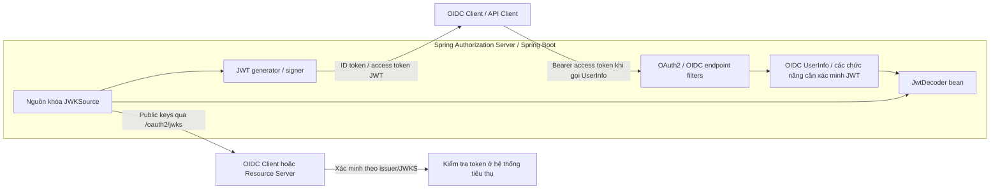
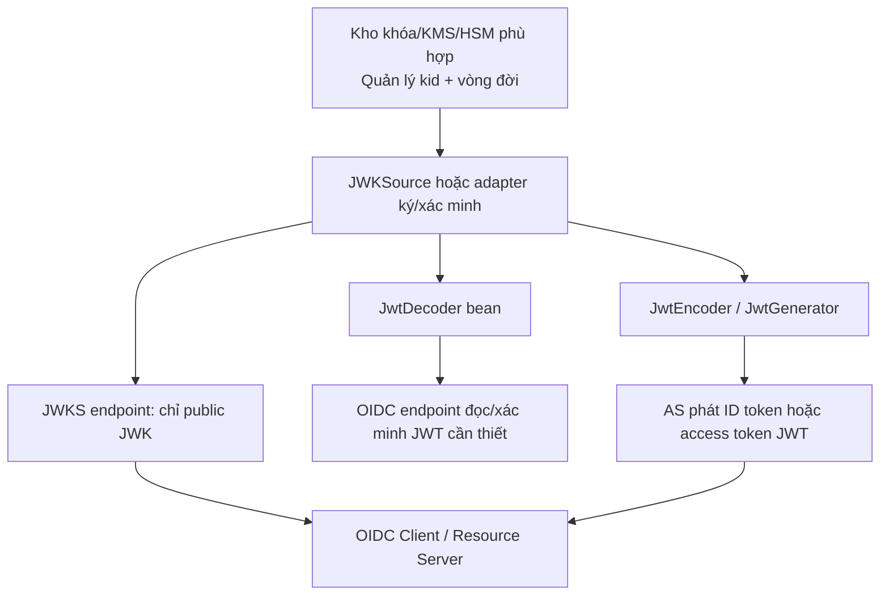
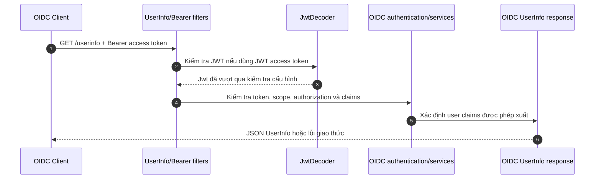

# Cấu hình JwtDecoder phục vụ các chức năng OIDC cần xác minh JWT

Trong một ứng dụng Spring Boot đóng vai trò **OAuth 2.0/OpenID Connect Authorization Server**, người học thường chú trọng việc **ký và phát hành JWT**: tạo khóa RSA/EC, công bố JWKS và trả ID token cho OIDC client. Tuy nhiên, một số chức năng của **Spring Authorization Server** còn cần **đọc, kiểm tra chữ ký và xử lý JWT nhận vào**. Thành phần Spring Security đại diện cho khả năng đó là `JwtDecoder`.

Bài thuộc chương **Cấu hình máy chủ** của mô-đun **SPRING_SECURITY_OAUTH2_OIDC_AUTHORIZATION_SERVER**. Mục tiêu của mô-đun là thiết kế, cấu hình, bảo mật, kiểm thử và vận hành OAuth 2.0/OpenID Connect Authorization Server với Spring Security và Spring Authorization Server trong ứng dụng Spring Boot. Nội dung ở đây đi từ nhu cầu có bean `JwtDecoder`, cách liên kết nó với nguồn khóa `JWKSource`, đến kiểm thử và vận hành an toàn. Các đoạn mã minh họa theo họ API phổ biến của Spring Authorization Server 1.x và Spring Security 6.x; khi dùng một phiên bản khác, cần đối chiếu API của phiên bản đã khóa trong dự án.

## 1. Vì sao Authorization Server lại cần JwtDecoder?

### 1.1. Phát hành JWT và xác minh JWT là hai trách nhiệm

Authorization Server thường giữ **khóa riêng** để ký token. OIDC client và Resource Server sử dụng **khóa công khai** để xác minh các JWT mà họ được phép nhận. Dù Authorization Server là bên phát hành, nó vẫn có thể nhận một JWT làm dữ liệu đầu vào của endpoint hoặc cần giải mã một JWT trong quá trình thực thi chức năng OIDC.

| Thành phần | Hướng dữ liệu | Vai trò |
|---|---|---|
| `JWKSource<SecurityContext>` | Cung cấp material khóa cho thành phần nội bộ | Nguồn khóa được dùng để ký và/hoặc xác minh, tùy bộ tiêu thụ |
| `JwtEncoder` / `JwtGenerator` | Claims → JWT | Mã hóa theo dạng JWT, ký token bằng khóa phù hợp |
| `JwtDecoder` | JWT → `Jwt` đã qua kiểm tra | Parse, kiểm tra chữ ký và các validator đã cấu hình |
| JWKS endpoint | AS → ứng dụng khác | Công bố **public JWK** để bên ngoài xác minh JWT |
| `OAuth2AuthorizationService` | Lưu/tra cứu trạng thái authorization | Quản lý authorization, code/token metadata; **không** thay thế JWT decoder |
| Resource Server token validation | API kiểm tra token | Kiểm tra issuer, audience, thời gian và quyền truy cập API |

Không nên coi `JwtDecoder` là “đối tượng đọc Base64”. Payload của một JWT ký dạng JWS có thể đọc được bằng Base64URL mà **không chứng minh tính xác thực**. Một decoder chỉ an toàn khi cấu hình thuật toán, nguồn khóa và các validator phù hợp. Kết quả `JwtDecoder.decode(String)` thành công nói lên rằng JWT đã vượt qua các kiểm tra mà **decoder đó thực sự áp dụng**; các yêu cầu riêng của từng giao thức vẫn phải được kiểm tra ở lớp nghiệp vụ/giao thức.

### 1.2. JwtDecoder giúp những chức năng OIDC nào?

Tài liệu cấu hình Spring Authorization Server nêu `JwtDecoder` bean là thành phần cần có cho **OpenID Connect UserInfo endpoint** và **OpenID Connect Client Registration endpoint**. Về kiến trúc, các chức năng OIDC cần đọc hoặc xác minh JWT phải có decoder phù hợp với loại token đang xử lý.

| Luồng/tính năng | JWT liên quan | Vai trò của decoder hoặc bộ kiểm tra |
|---|---|---|
| **OIDC UserInfo** (`/userinfo`) | Access token dạng JWT trong cấu hình phù hợp | Xác minh token trước khi trả thông tin người dùng |
| **OIDC Dynamic Client Registration** (`/connect/register`, nếu được bật) | Bearer token/đầu vào mà endpoint cần xác minh tùy cơ chế | Bảo đảm đầu vào đã được xác minh và client có quyền đăng ký |
| OIDC logout sử dụng `id_token_hint` (nếu được hỗ trợ và bật) | ID token hint | Kiểm tra tính phù hợp của ID token hint theo quy tắc endpoint; không suy ra mọi phiên bản dùng chung bean theo một đường code |
| **OIDC client** đăng nhập vào **một** Authorization Server | ID token nhận từ nhà cung cấp định danh | **Client** có trách nhiệm xác minh ID token; không mặc nhiên dùng decoder bean nội bộ của AS |

**Điểm dễ nhầm:** ID token là token **Authorization Server phát hành cho OIDC client**, có `aud` hướng tới client. `JwtDecoder` bean trong Authorization Server **không có nghĩa** server phải “tự xác minh mọi ID token mình vừa ký” trong luồng cấp phát. Các endpoint OIDC dùng decoder là lý do cấu hình bean; còn kiểm tra ID token tại Relying Party thuộc trách nhiệm client.

Tương tự, một HTTP request đến `/oauth2/token` với `grant_type=client_credentials` chủ yếu được xác thực bởi cơ chế **client authentication** và các provider của Authorization Server. Không nên quy mọi luồng token về việc gọi trực tiếp một `JwtDecoder` bean.

## 2. Vị trí của JwtDecoder trong kiến trúc xử lý



Sơ đồ biểu diễn luồng khái niệm. Đường đi thực tế qua authentication filters, token providers và decoder phụ thuộc endpoint, cách biểu diễn token và phiên bản Spring. Trong thiết kế chuẩn, **khóa riêng chỉ được giữ ở phía Authorization Server**, không được vô tình công bố qua JWKS. `JwtDecoder` của AS và decoder của API có thể dùng hai cách truy cập khóa khác nhau: decoder của AS dùng nguồn khóa nội bộ, còn API thường dùng metadata/`jwks_uri` công khai.

### 2.1. JWT có cấu trúc gì?

Một JWS compact có ba phần cách nhau bằng dấu chấm:

```text
BASE64URL(header).BASE64URL(payload).BASE64URL(signature)
```

Ví dụ dữ liệu minh họa sau khi parse (không phải token hợp lệ để sử dụng):

```json
{
  "header": {
    "alg": "RS256",
    "kid": "signing-key-2026-01",
    "typ": "JWT"
  },
  "claims": {
    "iss": "https://login.example.com",
    "sub": "user-123",
    "aud": "portal-client",
    "iat": 1790000000,
    "exp": 1790000600
  }
}
```

- `alg` nêu thuật toán ký; decoder phải chấp nhận **chỉ** thuật toán đã được cho phép, tránh hạ cấp thuật toán hoặc nhầm loại khóa.
- `kid` giúp tìm khóa kiểm tra chữ ký tương ứng; khi xoay khóa, nhiều khóa public có thể cùng tồn tại một khoảng thời gian.
- `iss` nhận diện issuer; `aud` xác định bên nhận dự kiến; `exp` và `nbf` (nếu có) giới hạn thời gian hợp lệ.
- Các claim OIDC như `nonce`, `auth_time`, `azp` có quy tắc xác minh theo bối cảnh. **Không có một danh sách validator chung áp dụng đúng cho mọi ID token, access token và loại JWT khác.**

JWT ký **không phải JWT mã hóa**. Không đưa mật khẩu, secret hoặc dữ liệu riêng tư không cần thiết vào claims; người giữ token có thể đọc phần payload dù không có private key.

## 3. Cách cấu hình JwtDecoder được Spring Authorization Server khuyến nghị

Spring Authorization Server cung cấp factory method `OAuth2AuthorizationServerConfiguration.jwtDecoder(...)`. Với một `JWKSource` đã được đăng ký làm bean, cách khai báo tối giản là:

```java
package example.authorizationserver.config;

import com.nimbusds.jose.jwk.source.JWKSource;
import com.nimbusds.jose.proc.SecurityContext;
import org.springframework.context.annotation.Bean;
import org.springframework.context.annotation.Configuration;
import org.springframework.security.oauth2.jwt.JwtDecoder;
import org.springframework.security.oauth2.server.authorization.config.annotation.web.configuration.OAuth2AuthorizationServerConfiguration;

@Configuration(proxyBeanMethods = false)
public class JwtDecoderConfiguration {

    @Bean
    JwtDecoder jwtDecoder(JWKSource<SecurityContext> jwkSource) {
        return OAuth2AuthorizationServerConfiguration.jwtDecoder(jwkSource);
    }
}
```

### 3.1. Ý nghĩa từng mảnh ghép

1. `@Bean JwtDecoder` đưa decoder vào Spring application context để các thành phần cần nó có thể inject.
2. `JWKSource<SecurityContext>` là nguồn khóa Nimbus. **`SecurityContext` trong generic này là `com.nimbusds.jose.proc.SecurityContext`**, hoàn toàn khác `org.springframework.security.core.context.SecurityContext` chứa danh tính người dùng.
3. Factory `OAuth2AuthorizationServerConfiguration.jwtDecoder(jwkSource)` tạo decoder dùng chính nguồn khóa của Authorization Server, tránh tự cấu hình một endpoint JWKS ngoài rồi quay lại gọi HTTP tới máy chủ của mình.
4. Bean chỉ có thể khởi tạo nếu Spring tìm được **một nguồn `JWKSource` phù hợp**. Không có source khóa hoặc có nhiều bean mơ hồ thì cấu hình không hoàn chỉnh.
5. Cấu hình JWT decoder không tự bật tất cả tính năng OIDC. Bạn còn phải bật OIDC trong Authorization Server configurer và đăng ký các thành phần cần thiết.

Factory method là cách súc tích cho các endpoint OIDC của **chính Authorization Server**. Nó không thay thế validator riêng của Resource Server và không hàm ý rằng mọi ứng dụng Spring Security trong hệ thống nên dùng cùng một bean.

### 3.2. Tại sao không dùng issuer-uri để máy chủ gọi lại chính nó?

Trong một **Resource Server**, người ta thường cấu hình:

```yaml
spring:
  security:
    oauth2:
      resourceserver:
        jwt:
          issuer-uri: https://login.example.com
```

Cách này dùng OIDC/OAuth discovery để tìm JWKS từ issuer và kiểm tra token tại **API tiêu thụ**. Nhưng Authorization Server đã có `JWKSource` nội bộ. Gắn decoder ở AS vào `issuer-uri` chính nó có thể tạo phụ thuộc HTTP vòng về chính server, gây lỗi khi khởi động, khi proxy chưa sẵn sàng hoặc khi JWKS endpoint bị giới hạn. Với **decoder dành cho OIDC endpoint của AS**, mẫu factory dùng nguồn khóa nội bộ là lựa chọn tự nhiên.

Hai mô hình không loại trừ nhau: một Authorization Server có thể đồng thời là OAuth client của IdP bên ngoài; khi đó **decoder dùng để kiểm tra token từ IdP ngoài** cần sử dụng nguồn khóa và quy tắc issuer **của IdP đó**, tách khỏi nguồn khóa của issuer nội bộ.

## 4. Cấu hình JWKSource để JwtDecoder có khóa xác minh

Một decoder không thể kiểm tra chữ ký nếu không có material khóa hợp lệ. Spring Authorization Server thường dùng Nimbus JOSE/JWT để biểu diễn JWK và hỗ trợ xây dựng `JWKSource`.

### 4.1. Ví dụ tạo RSA key trong bộ nhớ để học và thử nghiệm

Đoạn mã dưới đây minh họa đầy đủ vòng tạo nguồn khóa trong **môi trường thử nghiệm cục bộ**:

```java
package example.authorizationserver.config;

import java.security.KeyPair;
import java.security.KeyPairGenerator;
import java.security.interfaces.RSAPrivateKey;
import java.security.interfaces.RSAPublicKey;
import java.util.UUID;

import com.nimbusds.jose.JWSAlgorithm;
import com.nimbusds.jose.jwk.JWKSet;
import com.nimbusds.jose.jwk.RSAKey;
import com.nimbusds.jose.jwk.source.ImmutableJWKSet;
import com.nimbusds.jose.jwk.source.JWKSource;
import com.nimbusds.jose.proc.SecurityContext;
import org.springframework.context.annotation.Bean;
import org.springframework.context.annotation.Configuration;

@Configuration(proxyBeanMethods = false)
public class DemoSigningKeyConfiguration {

    @Bean
    JWKSource<SecurityContext> jwkSource() throws Exception {
        KeyPairGenerator generator = KeyPairGenerator.getInstance("RSA");
        generator.initialize(3072);
        KeyPair pair = generator.generateKeyPair();

        RSAKey rsaKey = new RSAKey.Builder(
                    (RSAPublicKey) pair.getPublic())
                .privateKey((RSAPrivateKey) pair.getPrivate())
                .keyID(UUID.randomUUID().toString())
                .algorithm(JWSAlgorithm.RS256)
                .build();

        JWKSet jwkSet = new JWKSet(rsaKey);
        return new ImmutableJWKSet<>(jwkSet);
    }
}
```

Ở đây, `JWKSource` chứa một RSA JWK gồm public key và private key. Nó được dùng bởi thành phần phát hành JWT và `JwtDecoder` qua nguồn khóa nội bộ. Endpoint JWKS công khai phải xuất **chỉ thông tin public** như `kty`, `kid`, `n` và `e`; private exponent `d` cùng các tham số private khác không được trả ra ngoài.

**Giới hạn rất quan trọng:** Mỗi lần khởi động ví dụ trên tạo một key pair và `kid` hoàn toàn mới. Token phát trước đó có thể mất khả năng xác minh sau restart; nếu chạy nhiều instance thì mỗi instance cũng có thể ký bằng khóa khác nhau. **Không dùng mẫu sinh khóa lúc startup trong production.**

### 4.2. Thiết kế khóa trong môi trường thực

Trong production, `JWKSource` cần dựa trên nguồn khóa và vòng đời ổn định, ví dụ:

- Nạp key pair được quản lý từ secret store, keystore phù hợp hoặc hệ thống KMS/HSM có tích hợp ký phù hợp.
- Không ghi private key/keystore password vào Git, image container, `application.yml` public hay log.
- Bảo đảm tất cả instance cùng issuer cùng công bố tập public keys hợp lệ và sử dụng chính sách ký nhất quán.
- Gán `kid` ổn định cho mỗi khóa trong thời gian sử dụng; thực hiện rotation theo quy trình có giai đoạn chồng lấn khóa cũ/mới.
- Chỉ xóa public key cũ khỏi JWKS khi không còn token hợp lệ cần xác minh bằng khóa đó, có tính đến TTL và cache JWKS của bên tiêu thụ.
- Có quy trình xử lý sự cố lộ private key, thu hồi/giảm thời gian sống token và truyền thông đến các Resource Server.

Không phải mọi KMS/HSM đều cung cấp private key cho Nimbus `JWKSource` dưới dạng có thể đọc. Nếu dùng cơ chế ký từ xa hoặc hardware-backed signing, có thể cần tích hợp `JwtEncoder`/`JWS signer` chuyên biệt. Giữ **mục tiêu tách rõ vật liệu ký bí mật và khóa xác minh công khai**, không mặc định có thể export private key.

### 4.3. Kết nối JwtEncoder, JWKSource và JwtDecoder



Sơ đồ là định hướng kiến trúc; với phần cứng ký từ xa, có thể tách adapter signer và nguồn public key thay vì một `JWKSource` chứa private key có thể đọc.

## 5. Bật OIDC và nối JwtDecoder vào security filter chain

Ngoài decoder, Authorization Server cần security filter chain cho các endpoint giao thức. Ví dụ rút gọn:

```java
@Configuration(proxyBeanMethods = false)
public class AuthorizationServerSecurityConfiguration {

    @Bean
    @Order(1)
    SecurityFilterChain authorizationServerSecurityFilterChain(
            HttpSecurity http) throws Exception {

        OAuth2AuthorizationServerConfigurer authorizationServer =
                OAuth2AuthorizationServerConfigurer.authorizationServer();

        http
            .securityMatcher(authorizationServer.getEndpointsMatcher())
            .with(authorizationServer, configurer -> configurer
                .oidc(Customizer.withDefaults()))
            .authorizeHttpRequests(authorize -> authorize
                .anyRequest().authenticated())
            .exceptionHandling(exceptions -> exceptions
                .defaultAuthenticationEntryPointFor(
                    new LoginUrlAuthenticationEntryPoint("/login"),
                    new MediaTypeRequestMatcher(MediaType.TEXT_HTML)))
            .oauth2ResourceServer(oauth2 -> oauth2
                .jwt(Customizer.withDefaults()));

        return http.build();
    }

    @Bean
    @Order(2)
    SecurityFilterChain applicationSecurityFilterChain(
            HttpSecurity http) throws Exception {
        http
            .authorizeHttpRequests(authorize -> authorize
                .anyRequest().authenticated())
            .formLogin(Customizer.withDefaults());
        return http.build();
    }
}
```

Các import cấu hình Spring Security tương ứng có thể xem ở package `org.springframework.security.config` và `org.springframework.security.web` của đúng phiên bản. Ví dụ tập trung vào wiring, chưa bao gồm toàn bộ bean cần cho chạy độc lập.

Giải thích:

1. **`authorizationServer.getEndpointsMatcher()`** chỉ chọn các request thuộc giao thức OAuth2/OIDC; Spring Security sẽ xét chain đầu tiên khớp.
2. **`oidc(Customizer.withDefaults())`** kích hoạt các chức năng OIDC mặc định theo phiên bản thư viện.
3. **`oauth2ResourceServer(...jwt(...))`** hỗ trợ kiểm tra Bearer JWT trong các endpoint thích hợp, ví dụ OIDC UserInfo. Bean `JwtDecoder` là đầu vào cần thiết cho đường xử lý tương ứng.
4. **`LoginUrlAuthenticationEntryPoint("/login")`** dành cho các request có ngữ cảnh HTML cần đăng nhập. Token endpoint của machine client cần trả phản hồi lỗi OAuth, không tự động redirect sang form.
5. **Application chain** có form login để người dùng xác thực; OIDC authorization flow có thể đưa browser qua `/login` rồi quay lại authorization endpoint bằng session.

Mẫu này vẫn cần đăng ký client (`RegisteredClientRepository`), xác thực người dùng, authorization/consent services, `AuthorizationServerSettings`, nguồn ký `JWKSource` và decoder tương ứng. Chỉ thêm `JwtDecoder` rồi gọi `/userinfo` sẽ không tự tạo một hệ thống OIDC hoạt động.

### 5.1. OIDC UserInfo xử lý Bearer token ra sao?

Giả sử Portal đã thực hiện Authorization Code Flow với scope gồm `openid` và nhận access token. Portal gọi:

```http
GET /userinfo HTTP/1.1
Host: login.example.com
Authorization: Bearer <access-token>
Accept: application/json
```

Một đường xử lý hợp lệ về mặt khái niệm:



Luồng thực tế còn liên quan đến `OAuth2AuthorizationService`, `OidcUserInfoAuthenticationProvider` và cách tạo/mapping UserInfo tùy cấu hình. Token phải còn hiệu lực, có scope/claims phù hợp và liên kết đúng authorization. Một JWT có chữ ký hợp lệ **không tự động** có quyền truy cập UserInfo. Các token opaque cũng cần cơ chế xác thực/tra cứu phù hợp; không được giả định `JwtDecoder` có thể giải mã mọi access token.

Các claims của UserInfo phải tuân theo scope được cấp và chính sách tiết lộ thông tin. Không trả toàn bộ profile nhạy cảm chỉ vì decoder đã xác minh token.

### 5.2. Dynamic Client Registration là tính năng tùy chọn

OIDC Dynamic Client Registration cho phép đăng ký client qua giao thức. Tính năng này có khả năng thay đổi **đối tượng có quyền đăng ký OAuth client**, vì vậy phải được bật có chủ đích và bảo vệ bằng cơ chế bootstrap/initial access token theo thiết kế.

Với các phiên bản hỗ trợ, có thể cấu hình cụ thể trong OIDC configurer, ví dụ:

```java
.with(authorizationServer, configurer -> configurer
    .oidc(oidc -> oidc
        .clientRegistrationEndpoint(Customizer.withDefaults())))
```

Đây là **đoạn thay thế** phần `.with(...)` ở trên, không phải chain độc lập. Không cho phép anonymous client tùy ý đăng ký redirect URI và scope quản trị. Nếu môi trường không cần dynamic registration, giữ nó tắt và đăng ký client bằng quy trình quản trị được kiểm soát.

## 6. Kiểm tra đúng claims: decoder không thay thế xác minh theo giao thức

Một JWT có thể vượt qua bước xác minh chữ ký nhưng vẫn **không dành cho endpoint đang nhận**. Các thuộc tính thường cần kiểm tra là:

| Trường/điều kiện | Ý nghĩa | Ví dụ lỗi |
|---|---|---|
| Chữ ký và `alg` | Token do nguồn khóa tin cậy ký bằng thuật toán cho phép | Chữ ký giả, thuật toán không được chấp nhận |
| `kid` và key selection | Chọn đúng public key trong tập khóa | `kid` không có hoặc trỏ khóa đã hết hiệu lực |
| `iss` | Issuer mà bên nhận tin cậy | Token từ một authorization server khác |
| `aud` | Bên nhận dự kiến | Token dành cho Portal bị dùng cho Orders API |
| `exp`, `nbf` | Thời gian hiệu lực | Token hết hạn, chưa đến thời điểm dùng |
| `scope`/`scp` và authorities | Quyền được cấp cho client/token | Token chỉ có `orders.read` nhưng gọi API ghi |
| `sub`/authorization status | Chủ thể/authorization gắn với token | Không phù hợp session hoặc đã bị thu hồi theo chính sách |
| OIDC claims bổ sung | `nonce`, `azp`, `auth_time` ... tùy flow | ID token không khớp yêu cầu đăng nhập |

**Không sao chép một validator audience chung cho tất cả loại JWT.** ID token của OIDC thường có `aud=client_id`; access token cho Orders API cần audience dành cho API. Trong một số chức năng AS, còn có JWT client assertion hoặc `id_token_hint` với ngữ cảnh xác minh riêng. Việc phát hiện loại token, xác nhận issuer, audience và mục đích cần đặt ở nơi xử lý giao thức thích hợp.

### 6.1. Trường hợp Resource Server cần decoder riêng

Trong **Orders API** (Resource Server khác với AS), có thể tạo decoder dựa trên public issuer và bổ sung validator audience:

```java
@Bean
JwtDecoder ordersApiJwtDecoder() {
    String issuer = "https://login.example.com";
    NimbusJwtDecoder decoder =
            NimbusJwtDecoder.withIssuerLocation(issuer).build();

    OAuth2TokenValidator<Jwt> audienceValidator = token ->
            token.getAudience().contains("orders-api")
                ? OAuth2TokenValidatorResult.success()
                : OAuth2TokenValidatorResult.failure(
                    new OAuth2Error(
                        "invalid_token",
                        "Access token không dành cho Orders API",
                        null));

    decoder.setJwtValidator(
        new DelegatingOAuth2TokenValidator<>(
            JwtValidators.createDefaultWithIssuer(issuer),
            audienceValidator));

    return decoder;
}
```

Đây là **ví dụ của ứng dụng API tách biệt**, không thêm bean này vào cùng application context với decoder dành cho OIDC của Authorization Server mà không giải quyết việc chọn bean và chính sách validation. API phải kiểm tra thêm scope/authority và quyền nghiệp vụ trên đối tượng tài nguyên. `JwtDecoder` không tự ra quyết định rằng user A được xem đơn hàng của user B.

Đoạn cấu hình phải được bổ sung các import thuộc `org.springframework.security.oauth2.jwt`, `org.springframework.security.oauth2.core`, `org.springframework.security.oauth2.core.validator` và phụ thuộc Resource Server phù hợp.

## 7. Ví dụ kiểm thử JwtDecoder và endpoint OIDC

Một bài test hữu ích cần kiểm tra **decoder trực tiếp**, **wiring khi ứng dụng khởi động** và **đường HTTP giao thức**, không chỉ xem bean có tồn tại.

### 7.1. Test riêng decoder với token đã ký

Giả sử test fixture có `JWKSource` chứa cặp khóa RSA và bộ phát hành JWT dùng cùng khóa. Test nên lần lượt xác minh:

1. JWT được ký bằng private key tương ứng, `alg` được phép, `kid` đúng và các claim đáp ứng validator → `decode(token)` thành công.
2. JWT bị sửa một ký tự payload nhưng giữ signature cũ → decoder từ chối chữ ký.
3. JWT ký bằng private key lạ dù có cùng `iss`/`aud` → decoder từ chối.
4. `kid` không có trong tập khóa hoặc thuật toán không được cho phép → decoder từ chối theo chính sách.
5. `exp` ở quá khứ hoặc `nbf` trong tương lai → kiểm tra bị từ chối **nếu validator thời gian áp dụng cho decoder đó**.
6. `iss`/`aud` sai → test phải đi qua **validator tương ứng**, không chỉ kiểm tra chữ ký. Trong test issuer/audience, bảo đảm các validator đã được khai báo.

Nếu decoder được tạo từ factory mẫu của Authorization Server, không tự khẳng định factory đã áp tất cả validator nghiệp vụ muốn kiểm tra. Viết test theo **hợp đồng thực tế của decoder và endpoint**.

### 7.2. Test HTTP cho OIDC

| Kiểm thử | Điều kiện | Kết quả mong đợi |
|---|---|---|
| Startup | Bật OIDC UserInfo, có `JWKSource` và `JwtDecoder` | Ứng dụng khởi tạo các thành phần liên quan thành công |
| Thiếu bean cần thiết | Bật chức năng yêu cầu decoder nhưng không khai báo | Cấu hình/test startup phát hiện lỗi, không bỏ qua |
| Discovery | `GET /.well-known/openid-configuration` | JSON đúng issuer, `jwks_uri` và endpoint được công bố |
| JWKS | `GET /oauth2/jwks` | Có public JWK, không xuất `d`/private material |
| UserInfo hợp lệ | Access token hợp lệ, scope và claims phù hợp | Response UserInfo đúng subject, chỉ claims được cho phép |
| UserInfo thiếu token | Không có `Authorization: Bearer` | Bị từ chối theo OIDC/Bearer, không trả HTML login |
| UserInfo sai chữ ký | JWT ký bằng khóa lạ | Từ chối, không tiết lộ nội dung JWT |
| UserInfo hết hạn | Token quá hạn hoặc authorization không hợp lệ | Từ chối theo chính sách xử lý token |
| Đăng ký client động | Endpoint bật, có/không có quyền đăng ký | Chỉ caller hợp lệ mới được thực hiện |
| Rotation | Token cũ còn hạn, ký bằng `kid` cũ; token mới bằng `kid` mới | Cả hai xác minh được trong giai đoạn chồng lấn hợp lệ |

Dùng `MockMvc` và `spring-security-test` để kiểm tra filter chain, HTTP status và quyền truy cập ở mức integration; đồng thời nên có bài test chạy Authorization Code + PKCE thật để phát sinh token, gọi UserInfo bằng token nhận được và so sánh claims trả về. Token mock bỏ qua chữ ký sẽ **không chứng minh** `JwtDecoder` và `JWKSource` phối hợp đúng.

### 7.3. Kiểm tra JWKS và OIDC metadata thủ công

Với Authorization Server đã chạy tại issuer minh họa:

```bash
# Kiểm tra discovery.
curl -i https://login.example.com/.well-known/openid-configuration

# Kiểm tra JWKS được công bố.
curl -i https://login.example.com/oauth2/jwks

# UserInfo: chỉ dùng token kiểm thử được phát hợp lệ.
curl -i https://login.example.com/userinfo \
  -H "Authorization: Bearer $OIDC_ACCESS_TOKEN"
```

Một phần JWKS public có thể trông như sau; dữ liệu trong ví dụ chỉ là ký hiệu:

```json
{
  "keys": [
    {
      "kty": "RSA",
      "use": "sig",
      "alg": "RS256",
      "kid": "signing-key-2026-01",
      "n": "<public-modulus-base64url>",
      "e": "AQAB"
    }
  ]
}
```

Đừng bao giờ thấy `d`, `p`, `q`, `dp`, `dq` hoặc `qi` (các tham số private RSA) trong JWKS công khai. `curl -i` chỉ giúp kiểm tra response; nó không chứng minh mọi claim và mọi policy đã đúng. Không ghi token thật vào tài liệu, công cụ chia sẻ hoặc log test không được kiểm soát.

## 8. Lỗi thường gặp khi cấu hình

| Triệu chứng | Khả năng gây ra | Hướng xử lý |
|---|---|---|
| Application context báo thiếu `JwtDecoder` | Đã bật OIDC endpoint cần decoder nhưng chưa có bean | Khai báo factory method với `JWKSource<SecurityContext>` |
| Không inject được `JWKSource` | Chưa tạo bean, sai generic/package `SecurityContext` hoặc nhiều bean mơ hồ | Kiểm tra bean declaration, Nimbus `SecurityContext` và wiring |
| `/userinfo` trả 401 dù token mới được cấp | Token khác loại, sai signature/key, hết hạn, thiếu scope hoặc token không hợp lệ | Kiểm tra token type, `kid`, nguồn khóa, authorization và error details an toàn |
| `/.well-known/openid-configuration` là 404 | OIDC chưa bật, đường dẫn/proxy hoặc phiên bản không khớp | Kiểm tra OIDC configurer, issuer, endpoint matcher |
| `/oauth2/jwks` không trả khóa | Thiếu `JWKSource` hoặc endpoint/key setup chưa đúng | Kiểm tra JWK key set và public visibility |
| Sau restart, token cũ bị từ chối | Tạo key pair mới ở mỗi lần startup | Dùng kho khóa bền vững và rollover có chồng lấn |
| Token phát từ node A không xác minh ở node B | Cluster dùng key khác nhau hoặc chưa đồng bộ metadata/cache | Đồng nhất issuer/JWKS và cách quản lý khóa |
| “Decode được” nhưng API từ chối | Audience/scope/quyền nghiệp vụ không đúng | Kiểm tra validator và resource authorization |
| “Decode được” token sai audience | Decoder không có validator audience cho mục đích đó | Bổ sung xác minh theo endpoint/token type |
| Test chỉ mock token nhưng production lỗi chữ ký | Mock bỏ qua ký/xác minh hoặc JWKS | Thêm integration test ký thật và verify thật |
| Token có `alg` khác chính sách | Key selection/algorithm policy không phù hợp | Giới hạn thuật toán, kiểm tra `kid`/JWK |
| Lộ dữ liệu trong JWT/log | Ghi token hoặc key material vào log | Redact dữ liệu nhạy cảm và kiểm tra logging |

### 8.1. Bẫy khi tùy chỉnh JwtDecoder quá sớm

Nếu thay factory của Spring Authorization Server bằng `NimbusJwtDecoder` cấu hình thủ công, bạn phải hiểu chính xác:

- Decoder lấy khóa từ đâu? Có phụ thuộc HTTP tới chính Authorization Server hoặc một issuer khác không?
- Thuật toán ký nào được phép?
- Các claim nào được xác minh tại đây và những claim nào thuộc endpoint/giao thức?
- Có vô tình đặt `aud=orders-api` rồi khiến JWT cần xử lý ở endpoint OIDC bị từ chối?
- Khi xoay khóa, decoder cập nhật key selection và JWKS như thế nào?

Vì vậy, với endpoint OIDC của chính Authorization Server, nên bắt đầu từ **factory được thư viện cung cấp**, sau đó chỉ tùy biến khi có yêu cầu và test cụ thể. Nếu muốn kiểm soát thêm client authentication JWT assertions, cần xem cơ chế xác minh **client assertion** riêng của Spring Authorization Server; không tự kết luận nó dùng mặc định cùng decoder bean ở trên.

## 9. Bảo mật và vận hành JwtDecoder

### 9.1. Chiến lược quản lý khóa

Thiết kế production nên có:

1. **Issuer duy nhất, nhất quán** giữa cấu hình `AuthorizationServerSettings`, metadata và claim `iss`.
2. **Khóa ký ổn định, được bảo vệ**; private key không gửi xuống client hoặc Resource Server.
3. **`kid` có quản lý**: mỗi khóa được nhận diện ổn định và có lịch hiệu lực, khóa mới xuất hiện trước khi chuyển ký nếu consumer cache JWKS.
4. **Thời gian chuyển tiếp**: giữ public key cũ đủ lâu để các token cũ còn hợp lệ vẫn được xác minh; tính cả thời gian lệch đồng hồ và TTL cache.
5. **Kế hoạch khôi phục**: sao lưu bảo mật các cấu hình/khóa cần thiết; khi khóa bị lộ, có quy trình sự cố khác với rotation thông thường.
6. **Nhiều node**: các node cùng issuer chia sẻ trạng thái/khóa phù hợp; không để mỗi pod tự phát sinh khóa riêng.
7. **Phân quyền vận hành**: chỉ thành phần cần thiết mới được truy cập private signing material; có audit cho thao tác khóa.

### 9.2. Quan sát và chẩn đoán an toàn

Nên theo dõi số lần lỗi xác minh token theo loại (signature mismatch, expired, invalid issuer/audience, key ID không tìm thấy) khi thư viện và chính sách logging cho phép; theo dõi tỷ lệ 401 ở UserInfo, lỗi lấy JWKS và thay đổi `kid` khi rotation.

Khi có lỗi, chỉ ghi **loại lỗi và correlation ID** cùng metadata ít nhạy cảm. Không ghi nguyên JWT, toàn bộ ID token/access token, refresh token, khóa riêng, client secret hoặc cookie. Vì JWT claims có thể chứa dữ liệu người dùng, việc dump payload vào log cũng có rủi ro dù không lưu chữ ký.

### 9.3. Điều kiện để hệ thống thực sự sẵn sàng

Cấu hình `JwtDecoder` là một phần của nền tảng; một Authorization Server OIDC vận hành cần kiểm chứng cả **client registration, policy scope, login/consent, OAuth2 token generation, issuer/discovery, JWKSource, key rotation, session/authorization storage và các resource endpoints**. Cần test khi khởi động, sau restart, sau rolling deployment và trong tình huống token cũ vẫn còn hạn.

## 10. Bài tập ứng dụng và câu hỏi tự kiểm tra

### Bài tập: cấu hình UserInfo có xác minh JWT

Một doanh nghiệp có `login.example.com` phát ID token cho `portal-client` và access token để Portal gọi `/userinfo`. Hãy thiết kế cấu hình và kiểm thử:

1. Tạo `JWKSource` ổn định cho môi trường thử nghiệm, có RSA key và `kid` xác định; đăng ký bean `JwtDecoder` bằng factory của Spring Authorization Server.
2. Bật OIDC, đăng ký Portal client với `authorization_code`/PKCE, `openid` và các scope cần thiết. Hoàn thiện kho user, authorization, consent và security chains.
3. Chạy login Authorization Code + PKCE để lấy token; dùng access token gọi UserInfo; chỉ trả claims tương ứng quyền đã cấp.
4. Thay access token bằng JWT ký từ khóa lạ rồi xác minh request bị từ chối.
5. Thử restart với key pair mới và nhận xét vì sao không phù hợp production; sau đó thay bằng nguồn khóa bền vững.
6. Phân biệt việc OIDC client xác minh **ID token** với việc Authorization Server xác minh **đầu vào UserInfo**.

### Câu hỏi tự đánh giá

1. Vì sao Authorization Server đã ký JWT vẫn có thể cần một bean `JwtDecoder`?
2. Spring Authorization Server yêu cầu decoder cho những endpoint OIDC nào theo hướng dẫn cấu hình?
3. `JWKSource<SecurityContext>` dùng kiểu `SecurityContext` của thư viện nào? Nếu import nhầm Spring Security context sẽ xảy ra vấn đề gì?
4. Sự khác biệt giữa `JwtEncoder` và `JwtDecoder` là gì? Endpoint JWKS được phép công bố phần nào của RSA JWK?
5. Vì sao decoder của AS sử dụng nguồn khóa nội bộ khác với decoder của Resource Server sử dụng `issuer-uri`?
6. Nếu ID token có `aud=portal-client` và access token có `aud=orders-api`, vì sao không nên ép một validator audience cho cả hai?
7. Vì sao sinh RSA key mới mỗi lần khởi động gây lỗi sau restart hoặc trong cluster nhiều node?
8. Làm sao chứng minh test `JwtDecoder` thật sự kiểm tra chữ ký thay vì chỉ parse JWT?

**Ghi nhớ:** Trong Spring Authorization Server, `JwtDecoder` là năng lực xác minh JWT phục vụ các chức năng OIDC cần kiểm tra token. Mẫu bean `OAuth2AuthorizationServerConfiguration.jwtDecoder(jwkSource)` gắn decoder với nguồn khóa của Authorization Server. Tuy nhiên, chữ ký hợp lệ mới là **một lớp**; issuer, audience, thời hạn, loại token, scope và chính sách endpoint vẫn phải được xử lý đúng ngữ cảnh. Quản lý khóa an toàn và kiểm thử token ký thật là điều kiện quan trọng để cấu hình này hoạt động ổn định khi triển khai.
