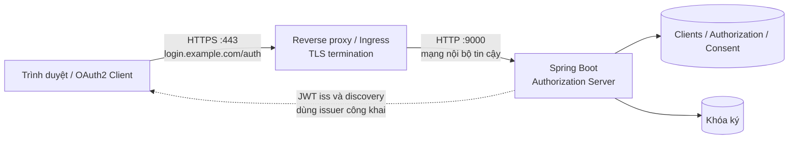
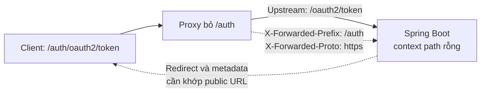

# Xác định base URL khi có context path, reverse proxy và TLS termination

## 1. Vì sao base URL là vấn đề bảo mật của Authorization Server?

Một ứng dụng Spring Boot có thể chạy ở `http://127.0.0.1:9000` nhưng người dùng và OAuth 2.0/OpenID Connect (OIDC) Client chỉ truy cập qua `https://login.example.com/auth`. Giữa hai địa chỉ có thể tồn tại **reverse proxy**, quy tắc **rewrite đường dẫn**, **servlet context path** và một điểm **TLS termination**.

Nếu máy chủ nhầm URL nội bộ với URL công khai, hệ thống có thể gặp các lỗi:

- Trang đăng nhập chuyển hướng về `http://127.0.0.1:9000` hoặc một hostname nội bộ.
- Metadata công bố `authorization_endpoint`, `token_endpoint`, `jwks_uri` không truy cập được.
- Access token/ID token mang claim `iss` khác issuer mà Client/Resource Server tin cậy.
- Đường dẫn thiếu tiền tố `/auth` hoặc bị nhân đôi thành `/auth/auth`.
- Session cookie bị đặt sai `Secure` hoặc `Path`, gây mất phiên và vòng lặp đăng nhập.

Trong chương **Cấu hình máy chủ** của module `SPRING_SECURITY_OAUTH2_OIDC_AUTHORIZATION_SERVER`, bài này tập trung vào cách thiết kế, cấu hình, bảo mật, kiểm thử và vận hành **public base URL** với Spring Security và Spring Authorization Server trên Spring Boot.

Sau bài học, bạn có thể phân biệt public origin, issuer, context path và endpoint path; chọn cấu hình proxy phù hợp; xử lý forwarded headers an toàn; và kiểm tra discovery, redirect, JWT, JWKS, cookie khi TLS kết thúc trước ứng dụng.

## 2. Phân biệt các loại URL trước khi cấu hình

| Khái niệm | Ví dụ | Ý nghĩa |
| --- | --- | --- |
| **Public origin** | `https://login.example.com` | Scheme, host và cổng mà client bên ngoài dùng |
| **Public base URL** | `https://login.example.com/auth` | URL công khai của dịch vụ, gồm tiền tố đường dẫn nếu có |
| **Issuer** | `https://login.example.com/auth` | Định danh bảo mật của Authorization Server trong token và metadata |
| **Servlet context path** | `/auth` | Tiền tố dùng để container tìm ứng dụng Spring Boot |
| **Endpoint path** | `/oauth2/token` | Path tương đối theo cấu hình giao thức Authorization Server |
| **External token URL** | `https://login.example.com/auth/oauth2/token` | Địa chỉ thực tế OAuth2 Client gọi |
| **Upstream URL** | `http://127.0.0.1:9000/auth/oauth2/token` | Địa chỉ proxy dùng để gọi Spring Boot |
| **Client redirect URI** | `https://app.example.com/login/oauth2/code/orders-web` | Nơi trình duyệt quay về sau khi người dùng cấp quyền |

**Public base URL** và **issuer** thường có cùng giá trị, nhưng ý nghĩa khác nhau. Issuer là chuỗi định danh được đối chiếu chính xác với claim `iss` và metadata; nó không nên được xây từ hostname của từng request. **Client redirect URI** thuộc ứng dụng khách và hoàn toàn khác endpoint `/oauth2/authorize` của Authorization Server.

Khi `server.servlet.context-path=/auth` và endpoint path là `/oauth2/token`, địa chỉ ngoài mong muốn là `/auth/oauth2/token`. Không gắn `/auth` thêm một lần vào `AuthorizationServerSettings.tokenEndpoint(...)` khi đã được context path hoặc proxy xử lý.

**Quy tắc quan trọng:** Chọn một **canonical public issuer** gồm scheme HTTPS, hostname, cổng nếu khác mặc định, path cần thiết và quy ước dấu gạch chéo cuối. Giữ giá trị đó thống nhất trên mọi instance.

## 3. Kiến trúc với TLS termination



Trình duyệt chỉ nhìn thấy HTTPS. Spring Boot có thể nhận HTTP nội bộ, nên từ kết nối upstream đơn thuần nó không thể biết scheme, host, port và tiền tố URL công khai. Proxy cung cấp thông tin này qua `Forwarded` (RFC 7239) hoặc `X-Forwarded-Proto`, `X-Forwarded-Host`, `X-Forwarded-Port`, `X-Forwarded-Prefix`.

Chỉ dùng HTTP giữa proxy và ứng dụng nếu mạng nội bộ thực sự được cô lập và đáp ứng yêu cầu bảo mật. Nếu các hop nội bộ nằm ngoài vùng tin cậy hoặc chính sách yêu cầu, dùng TLS/mTLS cho chặng đó.

## 4. Ba mô hình định tuyến cần phân biệt

Giả sử client luôn gọi `https://login.example.com/auth/oauth2/token`.

| Mô hình | URI ngoài proxy | URI vào Spring Boot | `server.servlet.context-path` |
| --- | --- | --- | --- |
| **A. Proxy giữ prefix** | `/auth/oauth2/token` | `/auth/oauth2/token` | `/auth` |
| **B. Proxy bỏ prefix** | `/auth/oauth2/token` | `/oauth2/token` | Rỗng |
| **C. Không có public prefix** | `/oauth2/token` | `/oauth2/token` | Rỗng |

Ở mô hình C, issuer có thể là `https://login.example.com`. Khi có hostname riêng cho Authorization Server, đây thường là lựa chọn đơn giản nhất. Mô hình A phù hợp khi ứng dụng chủ động sở hữu context path; mô hình B phù hợp khi gateway/ingress bắt buộc chuyển đổi đường dẫn.

**Hai lỗi đối xứng** thường gây 404: proxy bỏ `/auth` nhưng servlet vẫn đòi context `/auth`, hoặc proxy giữ `/auth` trong khi ứng dụng chạy root và không có xử lý prefix tương ứng.

## 5. Mô hình A: proxy giữ prefix, ứng dụng có context path

### 5.1. Cấu hình Spring Boot

```yaml
# application.yml - ví dụ Spring Boot 3.x
server:
  port: 9000
  servlet:
    context-path: /auth
    session:
      cookie:
        secure: true
        http-only: true
        same-site: lax
  forward-headers-strategy: framework

app:
  oauth2:
    issuer: https://login.example.com/auth
```

`app.oauth2.issuer` là thuộc tính **tự định nghĩa** trong ứng dụng. Spring Boot không tự chuyển nó thành issuer của Authorization Server; cần cung cấp bean `AuthorizationServerSettings`:

```java
import org.springframework.context.annotation.Bean;
import org.springframework.context.annotation.Configuration;
import org.springframework.core.env.Environment;
import org.springframework.security.oauth2.server.authorization.settings.AuthorizationServerSettings;

@Configuration
class IssuerConfiguration {

    @Bean
    AuthorizationServerSettings authorizationServerSettings(
            Environment environment) {
        String publicIssuer =
                environment.getRequiredProperty("app.oauth2.issuer");

        return AuthorizationServerSettings.builder()
                .issuer(publicIssuer)
                .build();
    }
}
```

Ví dụ dùng API **Spring Authorization Server 1.x**. Nếu dự án dùng dòng Spring Security tích hợp Authorization Server khác, cần đối chiếu package/API theo phiên bản. Nên đưa issuer vào cấu hình môi trường và quản lý nó như một giá trị có thay đổi kiểm soát, không ghép từ hostname đang chạy.

`server.forward-headers-strategy=framework` hướng dẫn Spring xử lý forwarded headers bằng cơ chế framework. Dùng tính năng này chỉ khi ứng dụng nhận request qua proxy được quản lý. `cookie.secure=true` cho phép trình duyệt chỉ gửi session cookie qua HTTPS dù backend dùng HTTP. `SameSite=Lax` phù hợp nhiều luồng điều hướng top-level, nhưng những response mode dùng cross-site POST có thể cần chính sách cookie khác; luôn kiểm thử luồng thực tế.

### 5.2. Ví dụ Nginx giữ nguyên URI

```nginx
# Đoạn cấu hình minh họa của một virtual host HTTPS
server {
    listen 443 ssl;
    server_name login.example.com;

    ssl_certificate     /etc/nginx/certs/login.example.com.crt;
    ssl_certificate_key /etc/nginx/certs/login.example.com.key;

    location /auth/ {
        # KHÔNG có "/" sau port: giữ nguyên /auth/... tới upstream.
        proxy_pass http://127.0.0.1:9000;

        # Proxy ghi đè thông tin public thay vì tin header của client.
        proxy_set_header Host login.example.com;
        proxy_set_header X-Forwarded-Host login.example.com;
        proxy_set_header X-Forwarded-Proto https;
        proxy_set_header X-Forwarded-Port 443;

        # Không nhận Forwarded/Prefix giả từ phía client.
        proxy_set_header Forwarded "";
        proxy_set_header X-Forwarded-Prefix "";

        # Chỉ dùng X-Forwarded-For với chính sách chuỗi proxy đáng tin.
        proxy_set_header X-Forwarded-For $proxy_add_x_forwarded_for;
    }
}
```

Cấu hình này là **minh họa routing**, cần bổ sung quy tắc HTTP→HTTPS, xử lý chứng chỉ thật, logging và bảo vệ upstream theo môi trường. Mô hình A **không cần** `X-Forwarded-Prefix=/auth` nếu URI upstream đã giữ `/auth` và servlet đã khai báo context đó; truyền cả hai có thể gây hành vi cộng prefix ngoài ý muốn.

Đường đi dự kiến:

```text
Browser:  https://login.example.com/auth/oauth2/authorize
  -> Nginx:     /auth/oauth2/authorize
  -> Upstream:  http://127.0.0.1:9000/auth/oauth2/authorize
  -> Context:   /auth
  -> Endpoint:  /oauth2/authorize
  -> Login:     https://login.example.com/auth/login (nếu cần)
```

Kiểm thử cả `/auth` lẫn `/auth/` nếu ứng dụng cho phép người dùng truy cập trang gốc; nhiều proxy có quy tắc redirect thêm slash. Không để hành vi đó tạo ra chuỗi redirect vô hạn.

## 6. Mô hình B: proxy strip prefix, ứng dụng chạy root

### 6.1. Khi nào dùng?

Giả sử Nginx nhận `/auth/oauth2/token` rồi chuyển cho backend `/oauth2/token`. Spring Boot không còn thấy `/auth` trong request path; vì thế **không** đặt `server.servlet.context-path=/auth`.



```yaml
server:
  port: 9000
  # Không đặt servlet.context-path: /auth
  forward-headers-strategy: framework

app:
  oauth2:
    issuer: https://login.example.com/auth
```

Bean `AuthorizationServerSettings` vẫn giữ nguyên issuer công khai. Việc thiếu `/auth` ở upstream **không** có nghĩa JWT phải mang issuer không có `/auth`.

### 6.2. Ví dụ Nginx strip prefix

```nginx
location /auth/ {
    # Có "/" ở cuối proxy_pass: /auth/oauth2/token -> /oauth2/token.
    proxy_pass http://127.0.0.1:9000/;

    proxy_set_header Host login.example.com;
    proxy_set_header X-Forwarded-Host login.example.com;
    proxy_set_header X-Forwarded-Proto https;
    proxy_set_header X-Forwarded-Port 443;
    proxy_set_header X-Forwarded-Prefix /auth;
    proxy_set_header Forwarded "";
}
```

`X-Forwarded-Prefix` phải do **proxy** điền, không lấy từ trình duyệt. Với Spring Boot, `server.forward-headers-strategy=framework` thường thích hợp khi cần Spring xử lý prefix; cách `native` của servlet container có thể xử lý scheme/host nhưng không đầy đủ cho tiền tố tùy môi trường.

Tuy vậy, không nên giả định mọi URL tự động đúng: đường dẫn hard-code trong HTML (`href="/login"`), các controller tự ghép URL, cookie path và metadata discovery có thể vẫn sai. Nếu app chạy root, session cookie mặc định có thể có `Path=/`; cân nhắc giới hạn `server.servlet.session.cookie.path` theo `/auth` nếu phù hợp và xác minh cookie còn được gửi tại login/callback.

### 6.3. Issuer không thay thế Forwarded headers

Đặt issuer tường minh giúp token/metadata dùng định danh nhất quán. Nhưng cấu hình issuer **không bảo đảm** MVC, login entry point, logout, consent page và redirect URL tự tạo đều có đúng scheme/host/path. Cần đồng thời kiểm tra:

1. URL công khai do proxy định tuyến.
2. Cách Spring xử lý `Forwarded`/`X-Forwarded-*`.
3. Context path và các controller/view tự tạo.
4. Cookie phiên và các bước redirect trên trình duyệt.

## 7. Cấu hình issuer, protocol endpoint và metadata

### 7.1. AuthorizationServerSettings

Trong Spring Authorization Server 1.x, `AuthorizationServerSettings` định nghĩa issuer và các endpoint path. Ví dụ:

```java
@Bean
AuthorizationServerSettings authorizationServerSettings() {
    return AuthorizationServerSettings.builder()
            .issuer("https://login.example.com/auth")
            .authorizationEndpoint("/oauth2/authorize")
            .tokenEndpoint("/oauth2/token")
            .jwkSetEndpoint("/oauth2/jwks")
            .build();
}
```

Nếu proxy và context path theo mô hình A/B được định tuyến đúng, URL công khai kỳ vọng:

| Thành phần | URL |
| --- | --- |
| Issuer | `https://login.example.com/auth` |
| Authorization endpoint | `https://login.example.com/auth/oauth2/authorize` |
| Token endpoint | `https://login.example.com/auth/oauth2/token` |
| JWKS | `https://login.example.com/auth/oauth2/jwks` |
| Login UI cùng ứng dụng | `https://login.example.com/auth/login` |

Không viết endpoint path thành `/auth/oauth2/token` chỉ vì issuer có path `/auth`. Endpoint path của DSL và cách proxy/container biểu diễn prefix cần được quản lý độc lập.

### 7.2. Hai quy tắc discovery khác nhau khi issuer có path

Với issuer `https://login.example.com/auth`, các chuẩn mô tả vị trí `.well-known` như sau:

| Chuẩn | URL discovery theo chuẩn |
| --- | --- |
| **RFC 8414** — OAuth 2.0 Authorization Server Metadata | `https://login.example.com/.well-known/oauth-authorization-server/auth` |
| **OIDC Discovery 1.0** | `https://login.example.com/auth/.well-known/openid-configuration` |

Đây là điểm dễ bỏ sót. **RFC 8414 chèn `/.well-known/oauth-authorization-server` trước path của issuer**, trong khi OIDC Discovery đặt `/.well-known/openid-configuration` sau path issuer.

Đặc biệt ở **mô hình A** với servlet context `/auth`, URL RFC 8414 nằm **bên ngoài** context path `/auth`. Vì vậy, proxy/ingress và phiên bản framework phải có cách phục vụ đường dẫn metadata chuẩn, có thể cần **route dành riêng cho well-known metadata**. Nếu chỉ định tuyến `location /auth/` mà bỏ qua đường dẫn `/.well-known/.../auth`, OAuth discovery có thể trả 404 dù token endpoint chạy tốt.

Đường dẫn metadata thực tế được framework cung cấp và khả năng hỗ trợ issuer có path cần được kiểm tra theo phiên bản. Nếu endpoint chưa hỗ trợ đường dẫn theo chuẩn, phải xử lý tương thích một cách chủ động; không giả định Spring tự tạo đúng mọi route hoặc sửa metadata thành URL không có thật. OIDC discovery chỉ cần khi OIDC đã được bật.

Một phản hồi metadata nhất quán phải chứa:

```json
{
  "issuer": "https://login.example.com/auth",
  "authorization_endpoint": "https://login.example.com/auth/oauth2/authorize",
  "token_endpoint": "https://login.example.com/auth/oauth2/token",
  "jwks_uri": "https://login.example.com/auth/oauth2/jwks"
}
```

Đây là **trích lược minh họa** một số field cần kiểm tra, không phải toàn bộ tài liệu metadata hợp chuẩn. Giá trị thật còn phụ thuộc endpoint được bật và thiết lập của từng phiên bản.

### 7.3. Issuer ở Client và Resource Server

JWT access token hoặc ID token có claim `iss`; OIDC Client kiểm tra issuer của ID token, còn Resource Server phải kiểm tra issuer của access token khi nhận JWT. Ví dụ cấu hình tại **ứng dụng API riêng biệt**:

```yaml
spring:
  security:
    oauth2:
      resourceserver:
        jwt:
          issuer-uri: https://login.example.com/auth
```

Giá trị `issuer-uri` phải khớp **chính xác** với metadata và claim `iss`, bao gồm path và dấu slash cuối nếu có. `https://login.example.com/auth` và `https://login.example.com/auth/` là hai chuỗi khác nhau. API cũng cần kiểm tra audience (`aud`) khi yêu cầu, scope và quyền truy cập tài nguyên; chỉ issuer hợp lệ chưa đủ.

Không được giảm mức kiểm tra issuer hoặc chấp nhận mọi issuer để che lỗi cấu hình proxy.

## 8. Forwarded headers và ranh giới tin cậy

### 8.1. Các header phổ biến

| Header | Chức năng | Ví dụ |
| --- | --- | --- |
| `Forwarded` | Header chuẩn RFC 7239 mô tả `for`, `host`, `proto` | `proto=https;host=login.example.com` |
| `X-Forwarded-Proto` | Scheme ngoài | `https` |
| `X-Forwarded-Host` | Host ngoài | `login.example.com` |
| `X-Forwarded-Port` | Cổng ngoài | `443` |
| `X-Forwarded-Prefix` | Tiền tố đường dẫn ngoài, thường khi proxy strip | `/auth` |
| `X-Forwarded-For` | Chuỗi địa chỉ IP qua các proxy | `203.0.113.5` (minh họa) |

Các header có thể mâu thuẫn nếu nhiều proxy cùng thiết lập `Forwarded` và `X-Forwarded-*`. Cần một quy tắc rõ ràng tại edge về **header nào là nguồn tin cậy**; không để request từ Internet quyết định hostname, scheme hoặc prefix mà ứng dụng dùng.

### 8.2. `server.forward-headers-strategy`

| Giá trị | Hành vi chung | Khi nào phù hợp |
| --- | --- | --- |
| `none` | Không tự xử lý forwarded headers | Không có proxy đáng tin hoặc xử lý hoàn toàn bằng phương thức khác |
| `native` | Dùng cơ chế servlet container, ví dụ Tomcat | Proxy/container được cấu hình phù hợp cho host/proto; cần kiểm tra khả năng xử lý prefix |
| `framework` | Dùng cơ chế Spring, thường qua `ForwardedHeaderFilter` | Cần xử lý scheme/host và `X-Forwarded-Prefix` |

**`framework` không tự xác minh header là đáng tin cậy.** Bật nó chỉ khi backend bị chặn khỏi truy cập trực tiếp từ mạng không tin cậy và ingress đã xóa/ghi đè header của client. Nếu tự cài thêm `ForwardedHeaderFilter` ngoài auto configuration của Boot, kiểm tra tránh áp dụng hai lần hoặc nhận các giá trị trái nhau.

### 8.3. Mối nguy Host header injection

Giả sử request bên ngoài mang header:

```http
GET /auth/oauth2/authorize HTTP/1.1
Host: login.example.com
X-Forwarded-Host: attacker.example
X-Forwarded-Proto: http
```

Nếu backend tin các giá trị chưa được proxy chuẩn hóa, các redirect/link tạo từ request có thể trỏ đến host không mong muốn. Giải pháp gồm: giới hạn host hợp lệ tại ingress, proxy ghi đè forwarded headers, không cho truy cập trực tiếp vào backend và giữ `AuthorizationServerSettings.issuer` cố định.

Không lấy `X-Forwarded-Host` hoặc `request.getServerName()` chưa được xác thực làm issuer mới theo từng request. Phát hành token với issuer biến thiên làm phá ranh giới tin cậy giữa Authorization Server và các API.

## 9. TLS termination ảnh hưởng tới những gì?

**TLS termination** khiến ứng dụng HTTP nội bộ có thể hiểu sai giao thức thực ngoài Internet. Hãy xem xét ít nhất các điểm:

1. **Redirect URL:** Khi không biết external scheme, ứng dụng có thể tạo `Location: http://...` hoặc vòng lặp chuyển HTTP→HTTPS.
2. **Session cookie:** Browser cần cookie có `Secure`, `HttpOnly`, `Path` và `SameSite` phù hợp với login, authorize và callback. `SameSite=Strict` có thể cản một số luồng đăng nhập qua chuyển hướng; `SameSite=None` phải đi kèm `Secure`.
3. **Form/CSRF:** Form login và consent phải gửi đúng origin/path; không tắt CSRF cho cả ứng dụng chỉ để giải quyết lỗi proxy.
4. **OIDC và OAuth metadata:** Client cần endpoint HTTPS bên ngoài. Không xuất `http://127.0.0.1:9000` trong discovery hay tài liệu cho client.
5. **Chặng proxy→backend:** Bảo vệ hoặc mã hóa phù hợp với vùng mạng, quản lý chứng chỉ, điều phối hostname và giới hạn truy cập upstream.
6. **HSTS:** Bật ở proxy khi mọi hostname trong phạm vi đã sẵn sàng HTTPS; tránh thay đổi phạm vi HSTS thiếu kiểm soát.

Nếu có nhiều lớp CDN → WAF → ingress → backend, phải xác định hop nào kết thúc TLS và hop nào có quyền đặt `proto`/`host`. Không giả định header do một hop bất kỳ thêm vào luôn có thể tin.

## 10. Lỗi phổ biến và phương pháp chẩn đoán

| Triệu chứng | Nguyên nhân có thể | Cách kiểm tra |
| --- | --- | --- |
| `404` tại `/auth/oauth2/token` | Proxy strip prefix nhưng app đòi `/auth`; hoặc proxy giữ prefix nhưng app không xử lý | Ghi lại URI ở client, proxy, upstream và context path |
| `Location: http://127.0.0.1:9000/...` | Scheme/host lấy từ upstream | Kiểm tra forwarded proto/host, cấu hình Boot và code tạo redirect |
| Login chuyển đến `/login` thay vì `/auth/login` | Strip prefix nhưng không xử lý `X-Forwarded-Prefix` | Kiểm tra filter, MVC URL builder, form action và link cứng |
| Path bị `/auth/auth` | Prefix bị áp hai lần | Chọn mô hình A hoặc B, gỡ prefix thừa |
| Vòng lặp 302 ở login | Cookie sai `Path`/`Secure`/`SameSite`, session thất lạc hoặc sai scheme | Xem `Set-Cookie`, `Cookie`, `Location` trong tab Network |
| `invalid_redirect_uri` | Callback URI của OAuth Client không khớp đăng ký | Đối chiếu redirect URI trong client registration |
| JWT bị từ chối vì `Invalid issuer` | `iss` khác `issuer-uri` hoặc metadata | So sánh chuỗi issuer chính xác, kể cả slash |
| OAuth metadata 404 còn token endpoint 200 | Route `.well-known` thiếu, nhất là với issuer có path | Kiểm tra đường dẫn RFC 8414 và OIDC riêng |
| JWKS ngoài Internet không mở được | Metadata `jwks_uri` sai, thiếu route hoặc chưa có `JWKSource` | Kiểm tra `jwks_uri` và chỉ public key được công bố |
| Discovery có `http` thay vì `https` | Issuer không rõ, forwarded headers sai hoặc link được ghép từ request nội bộ | Chốt public issuer, sửa cấu hình edge và đo lại |

Một `404` có thể xuất phát từ proxy **trước khi request tới Spring**, từ servlet container **không khớp context path**, hoặc từ Spring Security **không khớp endpoint matcher**. Dùng correlation ID để nối log giữa proxy và ứng dụng, thay vì chỉ nhìn vào status code.

## 11. Kiểm thử từ bên ngoài: quy trình có thể lặp lại

### 11.1. Chốt hợp đồng URL

```text
Public origin:      https://login.example.com
Issuer:             https://login.example.com/auth
External prefix:    /auth
Authorization URL:  https://login.example.com/auth/oauth2/authorize
Token URL:          https://login.example.com/auth/oauth2/token
JWKS URL:           https://login.example.com/auth/oauth2/jwks
Client callback:    https://app.example.com/login/oauth2/code/orders-web
Internal upstream:  http://127.0.0.1:9000
Routing mode:       A (keep prefix) hoặc B (strip prefix)
```

Đặt bảng này trong tài liệu deployment cho từng môi trường. Nếu chỉ chạy một lệnh `curl localhost`, bạn chưa kiểm chứng được TLS termination và URL client thực sự thấy.

### 11.2. Kiểm tra metadata/JWKS công khai

```bash
# RFC 8414: .well-known đứng trước path issuer
curl -i https://login.example.com/.well-known/oauth-authorization-server/auth

# OIDC Discovery: .well-known đứng sau path issuer (khi OIDC đã bật)
curl -i https://login.example.com/auth/.well-known/openid-configuration

# JWKS public endpoint
curl -i https://login.example.com/auth/oauth2/jwks
```

Những lệnh này chỉ thành công nếu phiên bản framework và proxy đã được cấu hình để phục vụ các route theo chuẩn; **không kết luận OIDC bị lỗi nếu dự án chưa bật OIDC**. Trong metadata cần kiểm tra `issuer`, `authorization_endpoint`, `token_endpoint`, `jwks_uri` và tính năng công bố có thực sự bật không. JWKS chỉ được công bố **phần khóa công khai**, không bao giờ private key.

### 11.3. Theo dõi luồng redirect

Với client đăng ký hợp lệ, mở Authorization Code + PKCE bằng trình duyệt trong môi trường test:

```text
GET https://login.example.com/auth/oauth2/authorize?...
  -> 302 Location: https://login.example.com/auth/login
  -> người dùng xác thực / consent
  -> 302 Location: https://app.example.com/login/oauth2/code/orders-web?code=...&state=...
  -> OAuth2 Client đổi code tại https://login.example.com/auth/oauth2/token
  -> JWT iss = https://login.example.com/auth
  -> Resource Server xác minh issuer và quyền
```

Theo dõi `Location` và `Set-Cookie` ở từng bước. Kiểm tra token bằng thư viện xác minh JWT đáng tin cậy; không coi payload tự giải mã từ JWT là thông tin đã xác thực. Không chia sẻ nguyên authorization code, access/refresh token, client secret hoặc cookie session trong log và ảnh chụp.

### 11.4. Ma trận kiểm thử lỗi

| Tình huống | Kết quả mong đợi |
| --- | --- |
| Proxy giữ prefix + context `/auth` | Endpoint/login/redirect đều mang prefix một lần |
| Proxy strip prefix + context rỗng + forwarded prefix | Redirect và metadata vẫn dùng URL công khai đúng |
| Gửi `X-Forwarded-Host` giả từ Internet | Proxy ghi đè; URL tạo ra không trỏ sang host giả |
| Truy cập backend trực tiếp ngoài mạng cho phép | Bị firewall/ingress chặn |
| Tắt xử lý forwarded headers trong môi trường test | Test phát hiện URL redirect/cookie sai nếu chúng phụ thuộc vào header |
| Đổi cookie `Path` không khớp login/callback | Test phát hiện mất session, không âm thầm bỏ kiểm tra session |
| Resource Server có issuer thiếu `/auth` | Token bị từ chối; không hạ lỏng issuer validation |
| Thử cả OAuth và OIDC metadata với issuer có path | Đường dẫn chuẩn được phục vụ hoặc lỗi được phát hiện rõ |
| Khởi động lại ứng dụng hoặc chuyển node | Issuer/keys không đổi; token và luồng dùng chung store còn hoạt động theo chính sách |
| Proxy thay chứng chỉ/chế độ TLS | HTTPS, redirects, HSTS và trust chain được xác minh lại |

## 12. Vận hành nhiều instance và thay đổi public URL

Trong hệ thống phân tán, **mọi instance Authorization Server phải có issuer giống hệt nhau**. Khóa ký nên được quản lý bền vững, có rotation và JWKS công khai đồng bộ. Authorization code, token và consent state phải ở kho dùng chung hoặc có cơ chế đảm bảo tính nhất quán; nếu phát code ở node A nhưng đổi token tại node B, kho in-memory riêng lẻ có thể làm giao dịch thất bại.

Một bản ghi deployment tối thiểu nên lưu: canonical issuer; context path; mô hình proxy A/B/C; các rewrite rule; nguồn tin cậy của forwarded headers; TLS termination; policy cookie; metadata routes; JWKS URL; danh sách client redirect URI; cấu hình `issuer-uri` của API; và phương án rollback.

**Đổi domain hoặc thay `/auth` là thay đổi định danh nếu issuer thay đổi.** Client và Resource Server có thể từ chối token cũ dù một 301 redirect làm URL mới truy cập được. Cần kế hoạch chuyển cấu hình issuer/metadata/registration và thời gian sống token; không chỉ sửa DNS hoặc thêm redirect rồi giả định mọi token vẫn hợp lệ.

## 13. Tình huống tổng hợp

Một tổ chức có `orders-web` dùng OIDC Authorization Code + PKCE, `reports-service` dùng Client Credentials và hai API kiểm tra JWT. Nhóm vận hành chọn public issuer `https://login.example.com/auth` và Nginx thực hiện TLS termination.

Với **mô hình A**, các bước triển khai:

1. Đặt `server.servlet.context-path=/auth` trên mọi node Spring Boot.
2. Nginx giữ URI `/auth/...`, chuẩn hóa `Host` và `X-Forwarded-Proto=https`, chỉ cho phép truy cập backend từ mạng proxy.
3. Khai báo `AuthorizationServerSettings.issuer("https://login.example.com/auth")`; giữ endpoint path `/oauth2/token` và `/oauth2/authorize`.
4. Đảm bảo metadata discovery với issuer path có route đúng, đặc biệt RFC 8414 đặt `/.well-known` trước `/auth`.
5. Đăng ký callback thật của `orders-web`; cấu hình `issuer-uri` cho các Resource Server.
6. Kiểm thử login, token exchange, consent, cookie, JWKS, claim `iss`, API permissions, nhiều instance và header giả mạo.

Khi hoàn thành, client bên ngoài không cần biết địa chỉ `127.0.0.1:9000`. Authorization Server phát token với issuer công khai; API xác minh issuer, audience, scope và quyền trên từng tài nguyên.

## 14. Ghi nhớ

- **Public base URL:** Dịch vụ xuất hiện ở đâu với client bên ngoài?
- **Context path:** Ứng dụng Spring Boot nhận request dưới tiền tố nào?
- **Proxy rewrite:** Đường dẫn đưa tới upstream có giữ tiền tố đó không?
- **Issuer:** Chuỗi định danh nào được công bố trong metadata và token?
- **Forwarded headers:** Ai có quyền nói cho backend biết scheme, host và prefix bên ngoài?

Để tránh lỗi, chốt issuer HTTPS trước, áp prefix **đúng một lần**, chỉ tin header do proxy kiểm soát, kiểm tra discovery ở public URL và kiểm thử redirect/cookie từ trình duyệt thật. **Định tuyến đúng là điều kiện cần; xác thực client, PKCE, quản lý khóa, token lifecycle và phân quyền API vẫn cần được cấu hình độc lập.**

### Tài liệu tham khảo

- [Spring Authorization Server — Configuration Model](https://docs.spring.io/spring-authorization-server/reference/configuration-model.html)
- [Spring Authorization Server — Core Model Components](https://docs.spring.io/spring-authorization-server/reference/core-model-components.html)
- [Spring Boot — Web Server / Reverse Proxy Guidance](https://docs.spring.io/spring-boot/how-to/webserver.html)
- [Spring Framework — Forwarded Header Handling](https://docs.spring.io/spring-framework/reference/web/webmvc/filters.html)
- [RFC 8414 — OAuth 2.0 Authorization Server Metadata](https://www.rfc-editor.org/rfc/rfc8414)
- [OpenID Connect Discovery 1.0](https://openid.net/specs/openid-connect-discovery-1_0.html)
- [RFC 9207 — Authorization Server Issuer Identification](https://www.rfc-editor.org/rfc/rfc9207)
