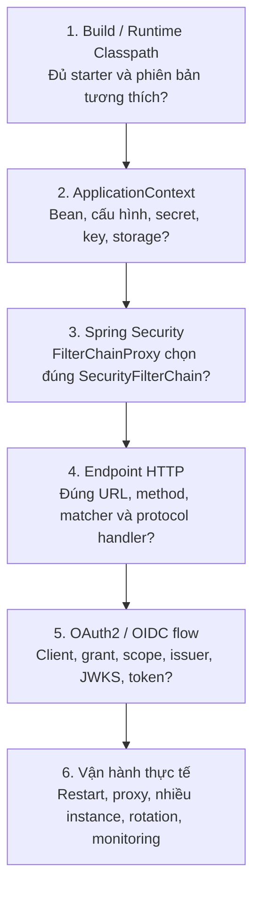
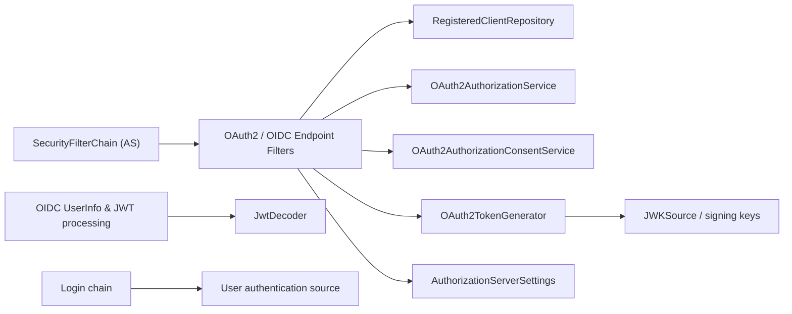

# Kiểm tra cấu hình khởi động và phát hiện bean hoặc endpoint bị thiếu

## 1. Vì sao Authorization Server khởi động thành công vẫn có thể chưa hoạt động?

Trong chương **Cấu hình máy chủ** của module `SPRING_SECURITY_OAUTH2_OIDC_AUTHORIZATION_SERVER`, mục tiêu là xác định Spring Boot đã khởi tạo đúng các thành phần để ứng dụng hoạt động như một **OAuth 2.0/OpenID Connect Authorization Server** hay chưa. Đây là kỹ năng cần thiết khi thiết kế, cấu hình, bảo mật, kiểm thử và vận hành hệ thống dựa trên **Spring Security** và **Spring Authorization Server**.

Một thông báo `Started AuthorizationServerApplication` chỉ xác nhận **Spring ApplicationContext đã khởi tạo**. Nó chưa chứng minh:

- Authorization Server có đăng ký client hợp lệ.
- Đúng `SecurityFilterChain` đang xử lý các endpoint OAuth 2.0/OIDC.
- Các bean ký JWT, lưu authorization và consent được cấu hình phù hợp.
- Các endpoint cần thiết thực sự được công bố.
- Authorization Code + PKCE, Refresh Token, Client Credentials hoặc OIDC hoạt động đúng.
- Metadata, issuer, JWKS và địa chỉ công khai nhất quán khi chạy sau reverse proxy.

Ví dụ: ứng dụng có thể trả trang `/login` bình thường nhưng `/oauth2/token` trả 404 vì filter chain của Authorization Server chưa được gắn vào hệ thống. Ngược lại, request tới `/oauth2/token` trả `invalid_client` có thể chứng minh endpoint đã nhận request và từ chối xác thực client đúng như thiết kế.

**Mục tiêu thực hành:** chẩn đoán theo thứ tự từ dependency → bean → filter chain → endpoint → luồng giao thức; phân biệt lỗi khởi tạo với lỗi truy cập do chính sách bảo mật.

> **Lưu ý phiên bản:** những ví dụ cấu hình Java dưới đây theo phong cách **Spring Boot 3.x, Spring Security 6.x, Spring Authorization Server 1.x** trên Servlet stack. Các starter, auto-configuration, tên API và các điều kiện tạo bean có thể thay đổi theo phiên bản. Khi sử dụng Spring Boot 4 hoặc phiên bản Spring Security/Spring Authorization Server mới hơn, đối chiếu tài liệu đúng phiên bản đang chạy.

## 2. Sáu tầng cần kiểm tra



| Tầng | Bằng chứng cần tìm | Ví dụ thất bại |
| --- | --- | --- |
| **Classpath** | Dependency `spring-boot-starter-oauth2-authorization-server` được resolve | `ClassNotFoundException`, xung đột thư viện |
| **Bean** | Context có các thành phần cần thiết cho cấu hình được chọn | `UnsatisfiedDependencyException`, thiếu repository/JWK |
| **Security filter** | Request match chain Authorization Server, rồi được endpoint filter xử lý | Chuỗi filter ứng dụng bắt hết request, trả HTML login thay JSON |
| **HTTP endpoint** | URL + method đúng tạo phản hồi giao thức hợp lệ | `404` do thiếu endpoint, `405` do sai method |
| **Protocol** | Client hợp lệ có thể thực hiện grant, token được kiểm tra đúng | `invalid_client`, `invalid_grant`, issuer/audience không khớp |
| **Runtime** | Khóa ký và trạng thái hoạt động nhất quán qua restart/triển khai | JWT cũ không còn kiểm tra được sau khi thay khóa ngẫu nhiên |

Không nhảy thẳng từ `404` tới kết luận thiếu dependency. Cần xác nhận request thực sự đi vào đúng ứng dụng, đúng context path và đúng chain bảo mật.

## 3. Preflight: dependency, web stack và cấu hình môi trường

### 3.1. Kiểm tra đúng vai trò ứng dụng

Với Spring Boot, Authorization Server thường bắt đầu từ:

```text
org.springframework.boot:spring-boot-starter-oauth2-authorization-server
```

Đây không phải `spring-boot-starter-oauth2-client` (client đăng nhập/gọi tài nguyên) hay `spring-boot-starter-oauth2-resource-server` (API kiểm tra bearer token). Một ứng dụng có thể kết hợp nhiều vai trò, nhưng mỗi vai trò cần cấu hình riêng.

Spring Authorization Server có cấu trúc **Servlet** dựa trên Spring Security. Nếu chỉ lắp WebFlux/Reactive Security mà sao chép cấu hình `HttpSecurity` Servlet, ứng dụng không tự có pipeline Authorization Server tương đương.

Các điều kiện nên xác minh trước:

1. JDK, Spring Boot, Spring Security và Spring Authorization Server nằm trong tổ hợp tương thích; ưu tiên BOM của Spring Boot.
2. Có web runtime và lớp cấu hình `@SpringBootApplication` được quét đúng package.
3. Không có dependency Spring Security bị override version riêng một cách ngoài ý muốn.
4. Port, context path, active profile và issuer được đọc từ đúng môi trường.
5. Biến môi trường/secret, database, certificate hoặc kho khóa cần thiết đã sẵn sàng; **không in giá trị bí mật ra log**.

Lệnh kiểm tra dành cho người phát triển (chọn Maven **hoặc** Gradle phù hợp với dự án):

```bash
# Maven
./mvnw -version
./mvnw dependency:tree -Dincludes=org.springframework.security:spring-security-oauth2-authorization-server
./mvnw spring-boot:run -Dspring-boot.run.arguments=--debug

# Gradle
./gradlew --version
./gradlew dependencyInsight --configuration runtimeClasspath --dependency spring-security-oauth2-authorization-server
./gradlew bootRun --args='--debug'
```

`--debug` bật **Condition Evaluation Report** của Spring Boot, giúp biết auto-configuration nào được áp dụng hoặc bỏ qua và vì sao. Không cần bật toàn bộ log DEBUG của thư viện bảo mật ở production. Trên Windows có thể dùng `mvnw.cmd` và `gradlew.bat`.

### 3.2. Phân biệt ba loại cấu hình thường bị trộn lẫn

| Cách cấu hình | Ý nghĩa | Điều cần kiểm tra |
| --- | --- | --- |
| **Spring Boot auto-configuration** | Boot tạo bean khi điều kiện phiên bản, classpath, property và sự vắng mặt của bean do ứng dụng tự tạo được đáp ứng | Điều kiện tạo bean và dữ liệu client/configuration properties |
| **Tự cấu hình với `OAuth2AuthorizationServerConfigurer`** | Ứng dụng chủ động đăng ký filter chain và các extension point | Có chain AS, bean nền tảng và không bị chain khác che |
| **Kết hợp auto-config với bean do người dùng cung cấp** | Boot thường lùi lại ở các điểm có bean tùy chỉnh | Các bean override có làm mất cấu hình mặc định mong đợi hay không |

**Không nên dựa vào một danh sách bean cứng áp dụng cho mọi phiên bản.** Một số bean có thể được framework/Boot cung cấp mặc định, các bean khác tùy thuộc vào việc OIDC hoặc các chức năng mở rộng đã được bật. Điều quan trọng là **xác định bean nào đang được dùng trong ứng dụng thực tế**, thay vì chỉ biết rằng cùng một class nằm trên classpath.

## 4. Những bean và thành phần phải biết để chẩn đoán

| Bean / thành phần | Vai trò | Dấu hiệu cần kiểm tra |
| --- | --- | --- |
| `RegisteredClientRepository` | Lưu và tra cứu cấu hình client (`client_id`, grant, redirect URI, scope, authentication method) | Không có client phù hợp, `invalid_client`, không tìm được bean khi custom configuration yêu cầu |
| `OAuth2AuthorizationService` | Lưu authorization code, access token, refresh token và trạng thái giao dịch | Code không tra được, token bị mất sau restart hoặc giữa nhiều node |
| `OAuth2AuthorizationConsentService` | Lưu quyền đồng ý cấp của người dùng cho client | Consent lặp lại hoặc không được ghi bền vững theo kỳ vọng |
| `AuthorizationServerSettings` | Issuer và các đường dẫn endpoint của Authorization Server | Metadata sai URL, path bị tùy chỉnh nhưng client còn gọi path cũ |
| `JWKSource<SecurityContext>` | Cung cấp khóa JWK cho ký JWT và công bố khóa phù hợp | Không cấp được JWT/ID Token, JWKS endpoint thiếu hoặc không có key mong đợi |
| `JwtDecoder` | Kiểm tra JWT trong những chức năng cần decoder, đặc biệt các phần của OIDC | Cấu hình OIDC hoặc JWT Resource Server filter không khởi tạo/hoạt động được |
| `OAuth2TokenGenerator<?>` | Sinh access token và các token tương ứng theo chính sách | Custom generator không xử lý được loại token cần phát hành |
| `SecurityFilterChain` | Gắn filter OAuth2/OIDC và quy tắc an ninh với request | Endpoint không được bắt hoặc bị chain khác xử lý |
| `AuthenticationProvider` / `AuthenticationManager` | Xác minh client, grant và xác thực người dùng theo từng trường hợp | Lỗi xác thực dù request đã vào endpoint |
| Cơ chế đăng nhập người dùng | Ví dụ form login, identity provider, MFA, `UserDetailsService` tùy kiến trúc | Browser không đăng nhập được hoặc lặp redirect `/login` |

**Phân biệt “cần trong kiến trúc” với “luôn phải khai báo `@Bean` thủ công”.** Ví dụ, một cấu hình tối thiểu có thể dùng dịch vụ lưu trữ in-memory do framework cung cấp; production có thể cần JDBC hoặc kho khác do ứng dụng khai báo. Tương tự, cách sinh khóa và cấp `JwtDecoder` thay đổi theo cấu hình đang áp dụng.

### 4.1. Các dependency hay bị quên

Mô hình tham chiếu đơn giản:



Sơ đồ diễn tả **quan hệ chức năng**, không phải biểu đồ constructor injection chính xác. Chẳng hạn endpoint filter thường đi qua `AuthenticationManager` và các `AuthenticationProvider` trước khi provider dùng repository/service hoặc token generator.

### 4.2. Lỗi thiếu bean thường gặp ở bước startup

Một log khởi tạo hỏng có thể chứa:

```text
APPLICATION FAILED TO START

Description:
Parameter 0 of method someBean ... required a bean of type
'org.springframework.security.oauth2.server.authorization.client.RegisteredClientRepository'
that could not be found.
```

Đây là **log minh họa**, không phải tên method bắt buộc của framework. Cách xử lý:

1. Đọc `Caused by` sâu nhất và tên bean đang được tạo khi xảy ra lỗi.
2. Kiểm tra bean có được khai báo, quét bởi component scan hoặc tạo có điều kiện (`@Profile`, `@ConditionalOnProperty`) không.
3. Nếu dựa vào Boot auto-configuration, xem Condition Evaluation Report để biết vì sao bean không được tạo.
4. Nếu bean cần hệ thống ngoài, kiểm tra kết nối và quyền trước khi cố tạo bean thay thế.
5. Không thêm bừa `@Bean` trùng tên hoặc bean in-memory vào production chỉ để khởi động qua lỗi.

Lỗi `NoSuchBeanDefinitionException` khác `NoUniqueBeanDefinitionException` (nhiều bean cùng kiểu, không xác định được bean cần dùng). Với lỗi trùng bean, kiểm tra `@Primary`, `@Qualifier` và chiến lược auto-configuration trước khi chỉnh sửa.

## 5. Mẫu SecurityFilterChain để đối chiếu

Trong Spring Authorization Server theo cấu hình Servlet phổ biến, nên có **chain xử lý Authorization Server endpoints** và **chain ứng dụng** dùng để đăng nhập người dùng. Ví dụ rút gọn:

```java
import org.springframework.context.annotation.Bean;
import org.springframework.context.annotation.Configuration;
import org.springframework.core.annotation.Order;
import org.springframework.http.MediaType;
import org.springframework.security.config.Customizer;
import org.springframework.security.config.annotation.web.builders.HttpSecurity;
import org.springframework.security.oauth2.server.authorization.config.annotation.web.configurers.OAuth2AuthorizationServerConfigurer;
import org.springframework.security.web.SecurityFilterChain;
import org.springframework.security.web.authentication.LoginUrlAuthenticationEntryPoint;
import org.springframework.security.web.util.matcher.MediaTypeRequestMatcher;

@Configuration
class SecurityChains {

    @Bean
    @Order(1)
    SecurityFilterChain authorizationServerSecurityFilterChain(HttpSecurity http)
            throws Exception {
        OAuth2AuthorizationServerConfigurer as =
                OAuth2AuthorizationServerConfigurer.authorizationServer();

        http.securityMatcher(as.getEndpointsMatcher())
                .with(as, configurer -> configurer
                        .oidc(Customizer.withDefaults()))
                .authorizeHttpRequests(authorize ->
                        authorize.anyRequest().authenticated())
                .exceptionHandling(exceptions ->
                        exceptions.defaultAuthenticationEntryPointFor(
                                new LoginUrlAuthenticationEntryPoint("/login"),
                                new MediaTypeRequestMatcher(MediaType.TEXT_HTML)))
                .oauth2ResourceServer(resourceServer ->
                        resourceServer.jwt(Customizer.withDefaults()));

        return http.build();
    }

    @Bean
    @Order(2)
    SecurityFilterChain applicationSecurityFilterChain(HttpSecurity http)
            throws Exception {
        http.authorizeHttpRequests(authorize ->
                        authorize.anyRequest().authenticated())
                .formLogin(Customizer.withDefaults());
        return http.build();
    }
}
```

Đây là **mẫu để đối chiếu filter chain**, chưa phải một Authorization Server độc lập chạy được: cần cấu hình client, authentication store, token signing và các bean hỗ trợ đã nêu. Phần `oauth2ResourceServer(...jwt(...))` được dùng khi phục vụ chức năng OIDC cần xác thực Bearer Access Token, chẳng hạn UserInfo; điều đó cũng làm cho `JwtDecoder` trở thành cấu hình cần xem xét. Nếu hệ thống chỉ cần OAuth2 và không bật OIDC, có thể điều chỉnh cấu hình phù hợp.

Phân tích:

- `@Order(1)` ưu tiên chain có matcher hẹp dành cho endpoint Authorization Server.
- `as.getEndpointsMatcher()` khớp các endpoint của configurer theo tính năng đang bật và các đường dẫn được khai báo.
- `@Order(2)` là chain ứng dụng, cung cấp `/login` và xử lý các URL khác.
- `.oidc(Customizer.withDefaults())` bật các chức năng OIDC được hỗ trợ; chỉ đăng ký scope `openid` mà thiếu OIDC configurer có thể không đủ.
- `MediaTypeRequestMatcher` phân biệt browser request HTML cần chuyển tới trang đăng nhập với các request giao thức nên nhận lỗi đúng chuẩn.

**Lưu ý:** `SecurityFilterChain` đầu tiên **khớp** request sẽ được chọn. Khi chain ứng dụng dùng matcher bao quát và ưu tiên cao hơn, các filter của Authorization Server có thể không được chạy. Ngược lại, một endpoint có thể xuất hiện nhưng trả `401/403` là hoàn toàn đúng nếu người gọi không được phép.

### 5.1. Không phải endpoint OAuth2 nào cũng là Spring MVC controller

Các filter trong Spring Security xử lý request **trước khi** tới `DispatcherServlet`. Vì vậy, chỉ xem danh sách `@RequestMapping`, `RequestMappingHandlerMapping`, hoặc `/actuator/mappings` rồi thấy không có `/oauth2/token` **không đủ để kết luận endpoint thiếu**. Phải kiểm tra `FilterChainProxy`, matcher của chain và thử request HTTP đúng giao thức.

## 6. Kiểm tra bean đã được tạo mà không lộ secret

### 6.1. Đọc Condition Evaluation Report

Khởi động local với `--debug`, tìm các mục:

- Cấu hình Authorization Server/Security được match hoặc không match.
- Điều kiện classpath, property, servlet web application, và `@ConditionalOnMissingBean` có được đáp ứng không.
- Những auto-configuration bị bỏ qua vì đã có bean tùy chỉnh.
- `BeanCreationException`, `UnsatisfiedDependencyException` và `Caused by` sâu nhất.

Nếu báo cáo ghi auto-configuration **không tạo** `RegisteredClientRepository` do có bean người dùng khai báo, hãy kiểm tra bean đó trước khi nghi ngờ starter.

### 6.2. Một ApplicationRunner chẩn đoán dành riêng cho môi trường local

Có thể thêm tạm lớp sau vào **source của ứng dụng thử nghiệm** và chỉ bật profile `diagnostics`. Nó in tên bean và mô tả filter chain, không in token hay secret:

```java
import java.util.Arrays;
import java.util.LinkedHashMap;
import java.util.Map;

import org.springframework.boot.ApplicationRunner;
import org.springframework.context.ApplicationContext;
import org.springframework.context.annotation.Bean;
import org.springframework.context.annotation.Configuration;
import org.springframework.context.annotation.Profile;
import org.springframework.security.oauth2.jwt.JwtDecoder;
import org.springframework.security.oauth2.server.authorization.client.RegisteredClientRepository;
import org.springframework.security.oauth2.server.authorization.OAuth2AuthorizationService;
import org.springframework.security.oauth2.server.authorization.OAuth2AuthorizationConsentService;
import org.springframework.security.oauth2.server.authorization.settings.AuthorizationServerSettings;
import org.springframework.security.web.FilterChainProxy;
import org.springframework.security.web.SecurityFilterChain;
import com.nimbusds.jose.jwk.source.JWKSource;

@Configuration(proxyBeanMethods = false)
@Profile("diagnostics")
class AuthorizationServerBeanDiagnostics {

    @Bean
    ApplicationRunner reportSecurityBeans(ApplicationContext context) {
        return args -> {
            Map<String, Class<?>> types = new LinkedHashMap<>();
            types.put("SecurityFilterChain", SecurityFilterChain.class);
            types.put("RegisteredClientRepository", RegisteredClientRepository.class);
            types.put("OAuth2AuthorizationService", OAuth2AuthorizationService.class);
            types.put("OAuth2AuthorizationConsentService", OAuth2AuthorizationConsentService.class);
            types.put("AuthorizationServerSettings", AuthorizationServerSettings.class);
            types.put("JwtDecoder", JwtDecoder.class);
            types.put("JWKSource", JWKSource.class);

            types.forEach((label, type) ->
                    System.out.printf("%s: %s%n", label,
                            Arrays.toString(context.getBeanNamesForType(type))));

            context.getBeansOfType(FilterChainProxy.class).forEach((name, proxy) -> {
                System.out.printf("FilterChainProxy: %s%n", name);
                int index = 0;
                for (SecurityFilterChain chain : proxy.getFilterChains()) {
                    System.out.printf("  chain[%d]: %s%n", ++index, chain);
                }
            });
        };
    }
}
```

Đối chiếu danh sách kết quả với các tính năng bạn đã bật. **Không phải mọi cấu hình đều phải có đúng một bean của mọi loại**, và một số thành phần mặc định có thể được tạo trong nội bộ framework thay vì xuất hiện dưới dạng bean riêng trong `ApplicationContext`. Một danh sách rỗng là dấu hiệu cần điều tra **trong ngữ cảnh cấu hình cụ thể**, không phải kết luận rằng hệ thống chắc chắn hỏng.

Có thể bật profile bằng:

```bash
./mvnw spring-boot:run -Dspring-boot.run.arguments=--spring.profiles.active=diagnostics
```

Với Gradle, có thể dùng `./gradlew bootRun --args='--spring.profiles.active=diagnostics'`. Sau khi chẩn đoán, tắt profile và loại bỏ mã debug không còn cần thiết khỏi ứng dụng triển khai.

### 6.3. Actuator có giúp được không?

Nếu dự án có Spring Boot Actuator, các endpoint `health`, `beans`, `conditions` và `mappings` có thể hỗ trợ chẩn đoán. Tuy nhiên:

- Các endpoint nhạy cảm có thể không được expose qua HTTP theo mặc định; cần cấu hình có kiểm soát cho môi trường dev.
- `beans` và `conditions` cho thấy khía cạnh **ApplicationContext/auto-configuration**.
- `mappings` không luôn cho thấy endpoint được cài đặt bằng Servlet filter.
- Không mở `/actuator/beans`, `/actuator/conditions`, cấu hình nội bộ hoặc thông tin secret ra internet công cộng.

## 7. Kiểm tra endpoint bằng request đúng giao thức

### 7.1. Bảng endpoint tham khảo

Các đường dẫn dưới đây là **mặc định thường gặp** của Spring Authorization Server; có thể đổi qua `AuthorizationServerSettings`. Tính khả dụng phụ thuộc tính năng và bean đã cấu hình.

| Endpoint | Phương thức thường dùng | Kỳ vọng khi cấu hình phù hợp |
| --- | --- | --- |
| `/oauth2/authorize` | `GET` | Xử lý authorization request; có thể chuyển đến `/login` hoặc trả OAuth error nếu yêu cầu sai |
| `/oauth2/token` | `POST` | Xử lý grant; yêu cầu thiếu/sai client có thể bị từ chối theo OAuth2 |
| `/oauth2/jwks` | `GET` | Công bố khóa **công khai** dùng cho xác minh token khi có nguồn JWK phù hợp |
| `/oauth2/introspect` | `POST` | Nhận yêu cầu introspection, thường cần client authentication |
| `/oauth2/revoke` | `POST` | Nhận yêu cầu thu hồi token, thường cần client authentication |
| `/.well-known/oauth-authorization-server` | `GET` | OAuth Authorization Server metadata, khi endpoint metadata được hỗ trợ/bật |
| `/.well-known/openid-configuration` | `GET` | OIDC Discovery metadata khi bật OIDC |
| `/userinfo` | `GET` hoặc `POST` theo cách hỗ trợ | OIDC UserInfo, cần Access Token phù hợp |
| `/login` | `GET`, `POST` | Đăng nhập người dùng; do cấu hình login ứng dụng cung cấp |

Một số endpoint khác như device authorization/verification, logout, client registration có thể xuất hiện theo phiên bản, tính năng và cấu hình bảo mật. Đừng coi sự vắng mặt của endpoint **chưa được bật** là lỗi khởi tạo.

### 7.2. Lệnh smoke test cục bộ

Ví dụ ứng dụng local chạy ở `http://localhost:9000` và đã cấu hình issuer tương ứng:

```bash
# Metadata OIDC: chỉ kỳ vọng 200 nếu OIDC đã được bật.
curl -i http://localhost:9000/.well-known/openid-configuration

# JWKS: chỉ kỳ vọng hợp lệ khi AS có cấu hình nguồn khóa/JWK phù hợp.
curl -i http://localhost:9000/oauth2/jwks

# Một POST thiếu client authentication: mong đợi lỗi OAuth2 có kiểm soát,
# không dùng request này để kỳ vọng cấp access token.
curl -i -X POST http://localhost:9000/oauth2/token \
  -H "Content-Type: application/x-www-form-urlencoded" \
  --data-urlencode "grant_type=client_credentials"
```

**Cách đọc kết quả:**

| Kết quả | Diễn giải có thể đúng | Bước tiếp theo |
| --- | --- | --- |
| `200` và JSON có `issuer`, `jwks_uri` tại discovery | OIDC Discovery đã được phục vụ | So sánh issuer/URI với giá trị bên ngoài và xác minh token thực tế |
| `200` và `keys` tại JWKS | Có endpoint công bố JWK | Kiểm tra chỉ có khóa công khai, `kid`/thuật toán phù hợp token |
| `400`/`401` kèm `invalid_client` hoặc lỗi OAuth2 từ Token Endpoint | Request có thể đã tới filter đúng và bị từ chối hợp lệ | Thử bằng registered client thực, đúng grant và scope |
| `302` đến `/login` khi gọi Authorization Endpoint từ trình duyệt | Có thể là bước đăng nhập người dùng hợp lệ | Đăng nhập rồi theo dõi redirect/consent |
| `302` đến `/login` cho request POST token | Có thể do chain sai hoặc entry point HTML bắt nhầm request | Kiểm tra thứ tự chain và response handler |
| `404` | Path sai, context path/proxy sai, endpoint chưa bật hoặc thiếu filter | Xem matcher, `AuthorizationServerSettings` và route proxy |
| `405` | Có thể là URL đúng nhưng HTTP method không được hỗ trợ | Thử method đúng trước khi điều tra dependency |
| `500` | Có lỗi bất ngờ khi xử lý | Đọc stack trace nội bộ, đừng trả trace cho client |

Không dùng quy tắc “bất kỳ mã khác 404 đều chứng minh endpoint đã tồn tại”: một security chain bao quát cũng có thể trả `401/302` cho URL không có handler. Cần đối chiếu **body/header, chain đã chạy và một request hợp lệ**.

### 7.3. Kiểm tra metadata OIDC nhất quán

Một phản hồi discovery thường chứa các trường tương tự:

```json
{
  "issuer": "https://auth.example.com",
  "authorization_endpoint": "https://auth.example.com/oauth2/authorize",
  "token_endpoint": "https://auth.example.com/oauth2/token",
  "jwks_uri": "https://auth.example.com/oauth2/jwks",
  "response_types_supported": ["code"]
}
```

Đây là **trích đoạn minh họa**, không phải danh sách field đầy đủ của discovery document. Khi chạy sau proxy:

1. `issuer` phải là URL mà client/resource server tin cậy, có scheme/host/port/path nhất quán.
2. Các endpoint được công bố phải truy cập được từ mạng của client.
3. JWKS phải công bố public keys tương ứng với chữ ký token; `kid` phải trỏ đến khóa đang sử dụng.
4. Cấu hình forwarded headers phải tin cậy proxy được kiểm soát; không tùy tiện tin `X-Forwarded-*` do client không đáng tin gửi.
5. Không đổi issuer giữa các phiên bản triển khai mà không có kế hoạch di chuyển client và token.

Ví dụ cấu hình issuer cố định trong Java:

```java
@Bean
AuthorizationServerSettings authorizationServerSettings() {
    return AuthorizationServerSettings.builder()
            .issuer("https://auth.example.com")
            .build();
}
```

Phải dùng đúng URL môi trường thực tế (ví dụ local issuer không được khai là host production). Một hệ thống có thể **khởi động bình thường nhưng tất cả client OIDC từ chối ID Token** nếu issuer trong metadata và claim `iss` không đúng giá trị đã cấu hình tại client.

## 8. Chẩn đoán lỗi startup và runtime theo triệu chứng

### 8.1. `UnsatisfiedDependencyException` / `NoSuchBeanDefinitionException`

**Triệu chứng:** Boot dừng trước khi in `Started ...`; log chỉ rõ một bean thiếu.

**Nguyên nhân thường gặp:** thiếu `RegisteredClientRepository`, `JwtDecoder` khi bật JWT resource server/OIDC, bean `JWKSource` hoặc cấu hình ký token, thành phần lưu trữ custom, hoặc bean chỉ tồn tại ở profile khác. Đôi khi gốc lỗi là **constructor của bean khác ném exception**, không phải hoàn toàn thiếu định nghĩa bean.

**Cách xử lý:** đọc `Caused by` và Condition Evaluation Report; kiểm tra annotation scanning, `@Bean`, profile, dependency và secret. Ưu tiên sửa **nguyên nhân gốc** thay vì thêm bean giả với mục tiêu làm context khởi động.

### 8.2. `BeanCreationException` khi cấu hình JWK, JWT hoặc khóa ký

**Triệu chứng:** lỗi parse key, thiếu thuật toán, `JwtDecoder`/encoder không khởi tạo hoặc token signing thất bại.

**Cần kiểm tra:** định dạng PEM/JWK, key ID (`kid`), thuật toán, private key tương ứng public key, quyền đọc keystore/KMS, secret/certificate và vòng đời khóa. JWK public set phục vụ client không được vô tình chứa private key material.

Với demo local, một số ví dụ tạo RSA key ngẫu nhiên khi mỗi lần khởi động. Cách đó **không phù hợp cho môi trường nhiều instance hoặc cần token còn hiệu lực sau restart**: token được ký bởi khóa cũ sẽ không xác minh được nếu khóa công khai cũ không còn được công bố.

### 8.3. Ứng dụng chạy nhưng `/oauth2/token` trả 404

**Chẩn đoán tuần tự:**

1. Request có đến đúng service và port không? Kiểm tra gateway, ingress, context path, base URL.
2. Có `SecurityFilterChain` gắn `OAuth2AuthorizationServerConfigurer` không?
3. Chain của ứng dụng có matcher `anyRequest()` và `@Order` ưu tiên hơn chain AS không?
4. Có tùy chỉnh token endpoint URI qua `AuthorizationServerSettings` không?
5. Đã gửi **POST** form-encoded tới đúng đường dẫn chưa?
6. Nếu vẫn 404, xem filter-chain log và request được phục vụ bởi endpoint nào, không chỉ nhìn Spring MVC mappings.

### 8.4. `/oauth2/token` trả HTML login thay vì JSON OAuth2

**Nguyên nhân điển hình:** request bị chain ứng dụng xử lý hoặc exception entry point của browser áp dụng nhầm cho endpoint token.

**Cách xử lý:** kiểm tra `@Order`, `securityMatcher`, phần `exceptionHandling`, headers `Accept`, URL đích và cách client gửi authentication. Không vô hiệu hóa xác thực hoặc `permitAll()` Token Endpoint để làm biến mất redirect.

### 8.5. OIDC discovery hoặc UserInfo không tồn tại

**Khả năng:** OIDC chưa được bật bằng `.oidc(Customizer.withDefaults())`, endpoint path bị tùy chỉnh, API khác phiên bản hoặc cấu hình thiếu các bean cần cho OIDC/JWT.

**Cách xử lý:** kiểm tra configurer OIDC, `JwtDecoder`, cấu hình client và issuer; thử discovery trước, sau đó thử UserInfo **với Access Token thích hợp**. UserInfo có thể trả `401` do thiếu token dù endpoint tồn tại; đây là hành vi bảo vệ mong đợi.

### 8.6. JWKS công bố nhưng client không xác minh được token

**Khả năng:** `kid` token khác bộ khóa công bố, khóa bị xoay không giữ giai đoạn chồng lấp, issuer/algorithm/audience sai hoặc JWKS bị cache quá lâu. Không kết luận mọi lỗi chữ ký đều do endpoint `/oauth2/jwks`.

**Cách xử lý:** đọc **header** JWT (`kid`, `alg`) ở môi trường kiểm soát; đối chiếu `kid` với JWKS; kiểm tra signature và claims qua thư viện JWT/OIDC có validation phù hợp. Payload JWT được Base64URL-encode chứ không tự mã hóa bí mật. Không dán token thật vào dịch vụ debug công khai.

### 8.7. `invalid_client`, `unauthorized_client`, `invalid_grant`

| OAuth2 error | Điều thường cần kiểm tra |
| --- | --- |
| `invalid_client` | `client_id`, client secret/assertion, phương thức client authentication được đăng ký |
| `unauthorized_client` | Grant type không nằm trong danh sách được đăng ký cho client |
| `invalid_scope` | Scope yêu cầu không hợp lệ hoặc vượt quyền client |
| `invalid_grant` | Authorization code/refresh token hết hạn, đã dùng, bị thu hồi, sai client/redirect URI/PKCE |
| `invalid_request` | Thiếu/trùng/sai định dạng tham số hoặc request không đúng quy định |

Những lỗi này có thể là **bằng chứng hệ thống đang bảo vệ đúng**, không phải bean bị thiếu. Hãy kiểm tra config `RegisteredClient` và dữ liệu giao dịch trước khi thay đổi filter chain.

## 9. Kiểm thử xác nhận endpoint thực sự cấp token

Smoke test hữu ích nhất là gọi một grant có chủ đích với **registered client trong môi trường test**, rồi xác minh có Access Token hợp lệ. Ví dụ sử dụng `client_credentials` (phù hợp cho hệ thống server-to-server):

```bash
curl -i -X POST http://localhost:9000/oauth2/token \
  -u "test-service:<client-secret>" \
  -H "Content-Type: application/x-www-form-urlencoded" \
  --data-urlencode "grant_type=client_credentials" \
  --data-urlencode "scope=reports.read"
```

Giả định client `test-service` **đã đăng ký** phương thức `client_secret_basic`, grant `client_credentials` và scope `reports.read`. Không chép secret thật vào terminal chia sẻ hoặc CI logs. Nếu mọi điều kiện đạt, phản hồi mẫu:

```json
{
  "access_token": "<opaque-or-jwt-access-token>",
  "token_type": "Bearer",
  "expires_in": 600,
  "scope": "reports.read"
}
```

Giá trị token và thời gian là ví dụ minh họa, không phải kết quả chạy thực tế. `client_credentials` **không tạo phiên người dùng và không phải OIDC login**, vì vậy không mong đợi ID Token trong luồng này.

### 9.1. Integration test bằng MockMvc

Nếu dự án có `spring-boot-starter-test`, `spring-security-test` và cấu hình client đã nêu, kiểm thử có thể dùng:

```java
import org.junit.jupiter.api.Test;
import org.springframework.beans.factory.annotation.Autowired;
import org.springframework.boot.test.autoconfigure.web.servlet.AutoConfigureMockMvc;
import org.springframework.boot.test.context.SpringBootTest;
import org.springframework.http.MediaType;
import org.springframework.test.web.servlet.MockMvc;

import static org.springframework.security.test.web.servlet.request.SecurityMockMvcRequestPostProcessors.httpBasic;
import static org.springframework.test.web.servlet.request.MockMvcRequestBuilders.post;
import static org.springframework.test.web.servlet.result.MockMvcResultMatchers.jsonPath;
import static org.springframework.test.web.servlet.result.MockMvcResultMatchers.status;

@SpringBootTest
@AutoConfigureMockMvc
class AuthorizationServerSmokeTest {

    @Autowired
    MockMvc mockMvc;

    @Test
    void registeredClientCanGetAccessToken() throws Exception {
        mockMvc.perform(post("/oauth2/token")
                        .with(httpBasic("test-service", "configured-test-secret"))
                        .contentType(MediaType.APPLICATION_FORM_URLENCODED)
                        .param("grant_type", "client_credentials")
                        .param("scope", "reports.read"))
                .andExpect(status().isOk())
                .andExpect(jsonPath("$.access_token").isNotEmpty())
                .andExpect(jsonPath("$.token_type").value("Bearer"));
    }
}
```

Phải bảo đảm secret trong test khớp secret đã được mã hóa khi đăng ký client và môi trường test có đủ JWK/TokenGenerator để phát hành token. Đây là **test tích hợp cho endpoint và grant**, không phải test chỉ kiểm tra `contextLoads()`.

Kế tiếp, nên có các test âm tính:

- Không gửi hoặc gửi sai thông tin xác thực client → request bị từ chối.
- Client hợp lệ nhưng chưa được cho phép `client_credentials` → `unauthorized_client`.
- Scope chưa đăng ký → lỗi scope theo giao thức.
- Authorization Code đã dùng lại, sai `code_verifier`, redirect URI lệch → bị từ chối theo chính sách grant.
- ID Token có issuer/audience/chữ ký đúng mới được OIDC Client chấp nhận.
- JWT còn hợp lệ được Resource Server xác minh bằng JWKS; token hết hạn hoặc thiếu quyền bị từ chối.

Đừng viết một test duy nhất kiểu “POST trả mã khác 404” rồi coi đó là proof endpoint đã cấu hình đúng: một filter chain sai vẫn có thể trả 401/302 trước khi request chạm Token Endpoint.

## 10. Xác minh trong triển khai sau gateway và nhiều instance

Trong môi trường production, nhiều lỗi không xuất hiện khi chạy local:

| Hiện tượng | Nguyên nhân cần kiểm tra | Kiểm chứng |
| --- | --- | --- |
| Discovery có URL nội bộ `http://host:port` | Issuer/forwarded headers chưa phù hợp | So sánh metadata từ mạng bên ngoài với issuer đã cấu hình |
| Client báo `invalid issuer` | URL issuer từ proxy khác claim `iss` hoặc client configuration | So sánh chính xác scheme, host, port và path |
| Token hợp lệ ở node A nhưng lỗi ở node B | Mỗi node có khóa ký hoặc authorization store riêng | Kiểm tra JWKS, key ID và storage dùng chung |
| Refresh/code thất bại sau restart | In-memory authorization store hoặc key bị tạo lại | Thử lưu hành authorization trước và sau restart ở môi trường test |
| Endpoints không truy cập được qua gateway | Rewrite path, TLS termination, route rules | So sánh direct-to-service và qua gateway |
| JWKS lỗi sau xoay khóa | Chưa công bố song song public key cũ/mới, cache chưa cập nhật | Kiểm tra `kid`, thời hạn token, chiến lược rotation |

**Vận hành an toàn:** giữ issuer cố định, dùng HTTPS ở các đường công khai, quản lý private keys bằng secret store/KMS/HSM phù hợp, lưu authorization/consent bền vững khi yêu cầu, đồng bộ thời gian máy chủ và giữ chính sách rotation đủ thời gian cho token chưa hết hạn.

Các chỉ số/nhật ký hữu ích: thời gian startup, lỗi bean theo profile, số request từng endpoint, HTTP status, mã lỗi OAuth2, tỷ lệ cấp token thành công, độ trễ database/ký token, lỗi truy cập JWKS. Không đưa Access Token, Refresh Token, authorization code, mật khẩu hoặc assertion vào log, tracing hay metrics label.

## 11. Checklist kiểm tra trước khi công bố Authorization Server

1. **Đúng classpath:** starter Authorization Server, web stack Servlet và phiên bản được Spring Boot quản lý.
2. **Startup sạch:** không còn `BeanCreationException`, `UnsatisfiedDependencyException`, lỗi cấu hình property hoặc kho khóa.
3. **Bean hợp lệ:** có client repository, authorization/consent service, issuer và các thành phần ký token/OIDC đúng với yêu cầu; biết bean nào Boot tạo và bean nào tùy chỉnh.
4. **Chain đúng:** request `/oauth2/*` được xử lý qua Authorization Server chain; `/login` qua chain ứng dụng; không có chain bao quát che endpoint.
5. **Endpoint đúng:** gọi đúng URL/method; Token Endpoint trả JSON OAuth2; OIDC discovery và JWKS công khai đúng khi tính năng được bật.
6. **Flow đúng:** thử với registered client thực trong test, cấp token hợp lệ, kiểm tra scope, PKCE, refresh, lỗi âm tính và quyền truy cập API.
7. **Bảo mật đúng:** không tắt xác thực client hoặc CSRF tùy tiện; không hard-code/log secret; kiểm tra redirect URI, token claims và khóa ký.
8. **Triển khai đúng:** issuer, metadata, JWKS hoạt động sau proxy; token còn được xác minh khi restart hoặc chuyển node; có monitoring và quy trình thay khóa.

## 12. Câu hỏi tự đánh giá và bài tập

**Tình huống A:** `/login` hoạt động, `/oauth2/token` trả 404. Bạn kiểm tra những thứ gì trước tiên? Hãy giải thích vai trò của `@Order`, `securityMatcher` và `AuthorizationServerSettings`.

**Tình huống B:** ứng dụng báo thiếu `JwtDecoder` sau khi bật OIDC và `oauth2ResourceServer().jwt()`. Bạn sẽ kiểm tra bean nào, nguồn JWK nào và vì sao lỗi có thể chỉ xảy ra khi bật tính năng mới?

**Tình huống C:** `/oauth2/token` trả `invalid_client` nhưng `/actuator/mappings` không liệt kê URL đó. Tại sao hai quan sát này không mâu thuẫn?

**Tình huống D:** Authorization Server chạy trên hai node, lúc có lúc không xác minh được token. Hãy xác định cách kiểm tra `kid`, JWKS và đồng bộ signing key.

**Bài thực hành:** trong một môi trường thử nghiệm, ghi lại (1) dependency tree, (2) danh sách bean chẩn đoán, (3) hai `SecurityFilterChain`, (4) kết quả OIDC discovery/JWKS, và (5) một phản hồi `client_credentials` thành công cùng một lỗi `invalid_client`. Từ đó lập bảng phân loại lỗi theo các tầng ở mục 2; giữ bí mật/tokens ngoài báo cáo.

## 13. Tài liệu tham khảo

- [Spring Authorization Server — Configuration Model](https://docs.spring.io/spring-authorization-server/reference/configuration-model.html)
- [Spring Authorization Server — Protocol Endpoints](https://docs.spring.io/spring-authorization-server/reference/protocol-endpoints.html)
- [Spring Authorization Server — Getting Started](https://docs.spring.io/spring-authorization-server/reference/getting-started.html)
- [Spring Security — Servlet Architecture](https://docs.spring.io/spring-security/reference/servlet/architecture.html)
- [Spring Boot — Auto-configuration](https://docs.spring.io/spring-boot/reference/using/auto-configuration.html)
- [Spring Boot — Actuator Endpoints](https://docs.spring.io/spring-boot/reference/actuator/endpoints.html)
- [RFC 6749 — OAuth 2.0](https://www.rfc-editor.org/rfc/rfc6749)
- [RFC 8414 — Authorization Server Metadata](https://www.rfc-editor.org/rfc/rfc8414)
- [OpenID Connect Discovery 1.0](https://openid.net/specs/openid-connect-discovery-1_0.html)

**Điểm cần ghi nhớ:** `ApplicationContext` khởi động thành công chỉ là bước đầu. Muốn biết Authorization Server thực sự sẵn sàng, phải chứng minh bean và filter chain đã được tạo đúng, endpoint phản hồi đúng giao thức, và một client được đăng ký có thể hoàn tất flow được phép trong khi các request sai vẫn bị từ chối an toàn.
