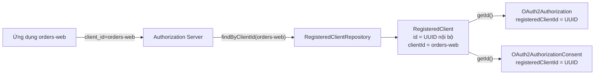
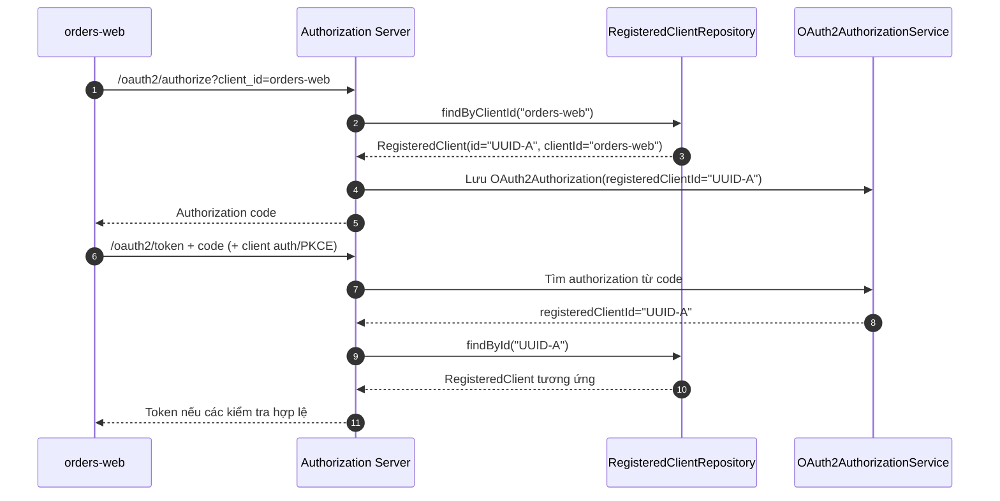
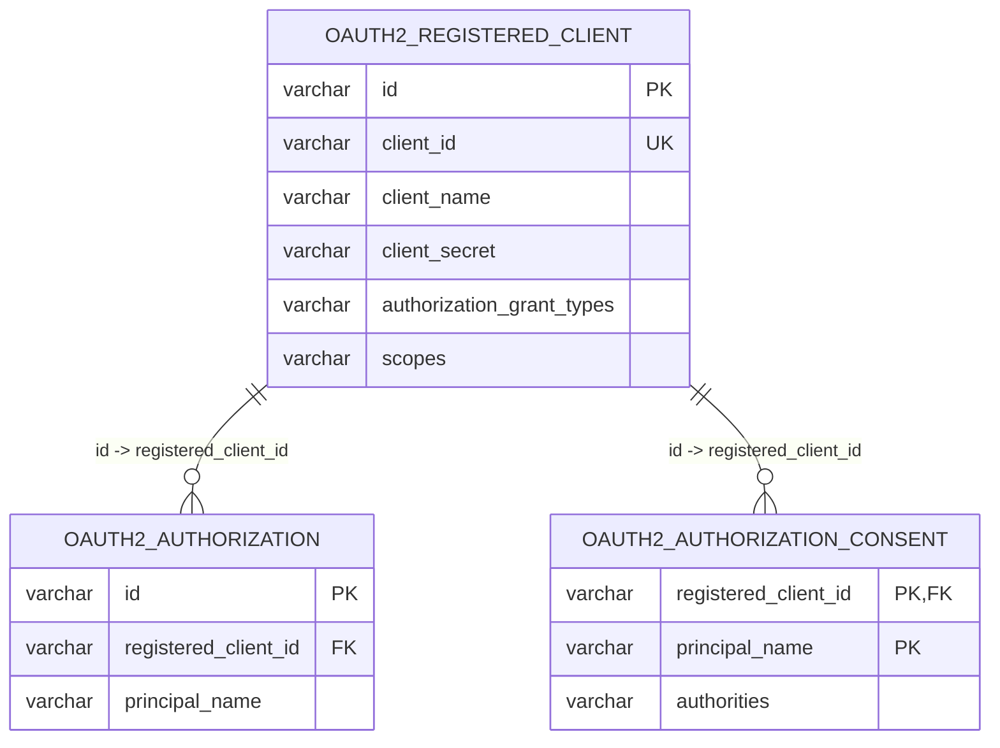

# RegisteredClient và quan hệ giữa id nội bộ với client_id

## 1. Bài toán: một OAuth client có hai định danh để làm gì?

Trong ứng dụng Spring Boot sử dụng **Spring Security** và **Spring Authorization Server (SAS)**, `RegisteredClient` là mô hình lưu thông tin của **ứng dụng khách OAuth 2.0/OpenID Connect (OIDC)** đã được Authorization Server cho phép tương tác. Đây là một trong những mô hình dữ liệu cốt lõi khi thiết kế, cấu hình, bảo mật, kiểm thử và vận hành Authorization Server.

Giả sử hệ thống có ba client:

- `orders-web`: ứng dụng web cho nhân viên đăng nhập qua Authorization Code + PKCE.
- `inventory-worker`: dịch vụ backend dùng Client Credentials.
- `customer-mobile`: ứng dụng mobile public client, đăng nhập qua Authorization Code + PKCE.

Khi `orders-web` yêu cầu ủy quyền, HTTP request mang `client_id=orders-web`. Nhưng trong kho dữ liệu của Authorization Server, bản ghi của client có thể có `id=42c6e6fa-…`. Hai giá trị này **không phải hai cách viết của một trường**, và không nên tráo đổi cho nhau.

| Định danh | Ví dụ | Thuộc tầng nào? | Sử dụng chính |
| --- | --- | --- | --- |
| `RegisteredClient.id` | `8c32d5c8-3ec4-4f7b-8b88-9ac7a3c8528f` | Định danh nội bộ của SAS / persistence | Tra cứu bản ghi bằng `findById`; liên kết authorization, consent và các bản ghi liên quan |
| `RegisteredClient.clientId` | `orders-web` | Định danh client theo giao thức OAuth 2.0/OIDC | Client gửi dưới tên tham số `client_id`; SAS tra cứu bằng `findByClientId` |

**Quy tắc ghi nhớ:** `id` giúp Authorization Server quản lý **bản ghi nội bộ**, còn `client_id` giúp giao thức xác định **ứng dụng khách nào đang đưa ra yêu cầu**. Cả hai phải được quản lý nhất quán, nhưng **`client_id` không phải mật khẩu** và `id` nội bộ cũng không có chức năng thay thế client credential.

## 2. RegisteredClient là mô hình gì?

`RegisteredClient` (gói `org.springframework.security.oauth2.server.authorization.client` trong dòng Spring Authorization Server 1.x) là mô hình đại diện cho thông tin đăng ký của một OAuth client.

Nó trả lời các câu hỏi: client có định danh nào, có phải xác thực bằng bí mật hay chữ ký không, được yêu cầu grant nào, được chuyển hướng về URI nào, được xin những scope gì, và token/chính sách consent áp dụng thế nào.

### 2.1. Các trường quan trọng

| Thuộc tính / getter | Vai trò | Ví dụ hoặc lưu ý |
| --- | --- | --- |
| `id` / `getId()` | Khóa định danh nội bộ của bản ghi | Chuỗi ổn định, thường dùng UUID; không nằm trong yêu cầu OAuth thông thường |
| `clientId` / `getClientId()` | Định danh client bên ngoài | `orders-web`; xuất hiện dưới dạng `client_id` |
| `clientIdIssuedAt` | Thời điểm phát hành client ID, khi có | Hữu ích cho quản lý vòng đời và đăng ký động |
| `clientSecret` | Bí mật xác thực **confidential client**, nếu có | Lưu dưới dạng được mã hóa một chiều phù hợp với `PasswordEncoder`; public client thường không có secret |
| `clientSecretExpiresAt` | Thời điểm secret hết hạn, khi có | Không đồng nghĩa thời hạn access token |
| `clientName` | Tên hiển thị/quản trị của client | Ví dụ `Orders Web Portal` |
| `clientAuthenticationMethods` | Cách client xác thực tại endpoint cần xác thực | `client_secret_basic`, `client_secret_post`, `private_key_jwt`, `none`… tùy cấu hình/khả năng hỗ trợ |
| `authorizationGrantTypes` | Các grant được phép | `authorization_code`, `client_credentials`, `refresh_token`… |
| `redirectUris` | Danh sách URI client được chuyển hướng tới | Phải đăng ký và kiểm tra phù hợp với chính sách OAuth |
| `postLogoutRedirectUris` | URI chuyển hướng sau đăng xuất OIDC, nếu dùng | Chỉ liên quan khi hỗ trợ và cấu hình logout tương ứng |
| `scopes` | Danh sách phạm vi yêu cầu được phép | `openid`, `profile`, `orders.read` |
| `clientSettings` | Chính sách cấp client | Ví dụ `requireProofKey`, `requireAuthorizationConsent`, thiết lập xác minh client |
| `tokenSettings` | Chính sách về token | Ví dụ thời hạn access/refresh token, định dạng access token, tái sử dụng refresh token |

**Lưu ý:** tên thuộc tính trong Java thường dùng camelCase (`clientId`), còn tham số giao thức và tên cột JDBC thường dùng snake_case (`client_id`). Không vì tên giống nhau mà đồng nhất chúng với `id` nội bộ.

### 2.2. Một RegisteredClient không phải tài khoản người dùng

`RegisteredClient` không đại diện cho `UserDetails`, người dùng đang đăng nhập hay Resource Server. Trong Authorization Code Flow, một người dùng có thể cấp quyền cho nhiều `RegisteredClient`. Trong Client Credentials Flow, client có thể được cấp access token mà **không có người dùng cuối**.



Sơ đồ thể hiện **quan hệ dữ liệu**; lúc chạy thật, `OAuth2Authorization` và `OAuth2AuthorizationConsent` được quản lý bởi service riêng. Việc ánh xạ khóa nội bộ trong các service này là lý do quan trọng khiến `RegisteredClient.id` cần ổn định.

## 3. Phân biệt chính xác id và client_id

### 3.1. `id` là khóa nội bộ của RegisteredClient

`RegisteredClient.id` được ứng dụng cung cấp khi tạo model, thường bằng `RegisteredClient.withId(...)`. Với kho JDBC tiêu chuẩn, nó tương ứng với cột `id` trong bảng `oauth2_registered_client`.

Mục đích chủ yếu:

1. Định danh bản ghi trong kho dữ liệu một cách nhất quán.
2. Hỗ trợ `RegisteredClientRepository.findById(id)`.
3. Làm khóa tham chiếu từ `OAuth2Authorization.registeredClientId` và `OAuth2AuthorizationConsent.registeredClientId`.
4. Cho phép các lớp quản trị nội bộ tìm lại đúng client ngay cả khi tên hiển thị hoặc chính sách của client thay đổi.

Giá trị `id` có thể là UUID hoặc một chuỗi duy nhất theo chính sách lưu trữ. Điều quan trọng là **duy nhất, ổn định và được lưu bền vững**. Không nên tạo lại `id` mới ở mọi lần khởi động khi client đã tồn tại.

### 3.2. `client_id` là định danh được giao thức sử dụng

Trong OAuth 2.0, client gửi `client_id` đến Authorization Server. Ví dụ:

```http
GET /oauth2/authorize?response_type=code
    &client_id=orders-web
    &redirect_uri=https%3A%2F%2Forders.example.com%2Fcallback
    &scope=openid%20orders.read
    &state=RANDOM_STATE
    &code_challenge=PKCE_CHALLENGE
    &code_challenge_method=S256
```

Các giá trị `RANDOM_STATE` và `PKCE_CHALLENGE` chỉ là placeholder minh họa.

Ở phía server, `RegisteredClientRepository.findByClientId("orders-web")` phải tìm thấy client tương ứng. Với một issuer/Authorization Server, `client_id` cần **duy nhất trong không gian định danh client** mà server phục vụ. Ở mức triển khai JDBC, nên bảo vệ tính duy nhất bằng unique constraint/index bên cạnh kiểm tra từ ứng dụng.

`client_id` **không phải secret**. Nó có thể xuất hiện trong redirect/query và tài liệu tích hợp. Một client bí mật (confidential client) phải xác thực bằng cơ chế đã đăng ký như `client_secret_basic` hoặc `private_key_jwt`; với public client, không được giả định chỉ biết `client_id` là đủ để được cấp token. Authorization Code + PKCE và các ràng buộc khác vẫn phải được thực thi.

### 3.3. Hai trường không nên dùng thay nhau

Giả sử bản ghi:

```text
RegisteredClient {
  id       = "8c32d5c8-3ec4-4f7b-8b88-9ac7a3c8528f"
  clientId = "orders-web"
  clientName = "Orders Web Portal"
}
```

Các thao tác sau có nghĩa khác nhau:

```java
RegisteredClient a = repository.findById(
        "8c32d5c8-3ec4-4f7b-8b88-9ac7a3c8528f");

RegisteredClient b = repository.findByClientId("orders-web");

// a và b cùng chỉ đến một bản ghi client nếu repository nhất quán.
// KHÔNG suy ra findById("orders-web") sẽ tìm thấy client.
```

Về mặt kỹ thuật, nhà phát triển *có thể* chủ ý đặt `id` và `clientId` cùng giá trị, nhưng điều đó làm hai vòng đời gắn chặt với nhau và gây nhầm lẫn trong schema/API. Trong hệ thống cần quản trị và di trú, nên giữ ranh giới rõ ràng: `id` là khóa ổn định bên trong, `clientId` là định danh giao tiếp với client.

### 3.4. `client_id` khác `client_secret`

Ba giá trị dễ bị gọi chung là “client credential” nhưng có vai trò riêng:

| Giá trị | Có phải bí mật? | Ai sử dụng? |
| --- | --- | --- |
| `id` của `RegisteredClient` | Không phải cơ chế xác thực; nên là định danh nội bộ | Repository, authorization/consent service, quản trị |
| `client_id` | **Không** | Client và Authorization Server để nhận diện client |
| `client_secret` | **Có** | Confidential client chứng minh danh tính ở endpoint cho phép kiểu xác thực secret |

Không được tạo chính sách “có đúng client ID thì được xem dữ liệu”. Chỉ xác thực client thành công cũng không đồng nghĩa client đã được cấp scope cụ thể hoặc có quyền đọc tài nguyên của người dùng.

## 4. Vai trò của RegisteredClientRepository

`RegisteredClientRepository` là hợp đồng repository SAS dùng để lưu và tra cứu `RegisteredClient`:

```java
public interface RegisteredClientRepository {
    void save(RegisteredClient registeredClient);
    RegisteredClient findById(String id);
    RegisteredClient findByClientId(String clientId);
}
```

Các API này thể hiện hai đường tra cứu:

- `findByClientId`: thường được dùng trong quy trình xác thực/định danh client từ yêu cầu OAuth 2.0.
- `findById`: giúp các service lấy lại `RegisteredClient` thông qua khóa nội bộ đã lưu trong trạng thái authorization hoặc consent.

SAS cung cấp những triển khai cơ bản như `InMemoryRegisteredClientRepository` và `JdbcRegisteredClientRepository` trong dòng 1.x. Nếu dùng ORM/JPA hoặc kho phân tán tự thiết kế, nhóm phát triển tự triển khai hợp đồng repository thích hợp; không nên mặc định rằng một `JpaRegisteredClientRepository` chuẩn đã được framework cung cấp.

### 4.1. Ví dụ khởi tạo hai loại client

Đoạn mã sau minh họa mô hình **Spring Authorization Server 1.x**. Các import, bean chứa secret, kho dữ liệu và cấu hình security chain được lược bỏ; ví dụ không phải cấu hình production hoàn chỉnh.

```java
RegisteredClient web = RegisteredClient.withId(
            "b843b04a-0b75-4709-ae9f-48d6ba263e12")
        .clientId("orders-web")
        .clientName("Orders Web Portal")
        .clientAuthenticationMethod(ClientAuthenticationMethod.NONE)
        .authorizationGrantType(AuthorizationGrantType.AUTHORIZATION_CODE)
        .redirectUri("https://orders.example.com/callback")
        .scope(OidcScopes.OPENID)
        .scope("orders.read")
        .clientSettings(ClientSettings.builder()
                .requireProofKey(true)
                .requireAuthorizationConsent(true)
                .build())
        .tokenSettings(TokenSettings.builder()
                .accessTokenTimeToLive(Duration.ofMinutes(10))
                .build())
        .build();

RegisteredClient worker = RegisteredClient.withId(
            "c6c10241-e427-4d31-9e48-87d03a77ec87")
        .clientId("inventory-worker")
        .clientName("Inventory Worker")
        .clientSecret(passwordEncoder.encode(secretFromSecureSource))
        .clientAuthenticationMethod(
                ClientAuthenticationMethod.CLIENT_SECRET_BASIC)
        .authorizationGrantType(
                AuthorizationGrantType.CLIENT_CREDENTIALS)
        .scope("inventory.read")
        .tokenSettings(TokenSettings.builder()
                .accessTokenTimeToLive(Duration.ofMinutes(5))
                .build())
        .build();
```

`secretFromSecureSource` minh họa một bí mật được cấp và lấy qua cơ chế quản lý secret phù hợp, **không phải hằng số cần đưa vào mã nguồn**. Với `passwordEncoder`, nên dùng cơ chế mã hóa một chiều được cấu hình đúng chuẩn Spring Security và lưu secret đã mã hóa ở server; phía client chỉ nhận raw secret qua kênh cấp phát an toàn tại thời điểm tạo/đổi credential.

Điểm cần quan sát:

1. Hai client có `id` nội bộ riêng và `clientId` riêng.
2. `orders-web` là public client; `ClientAuthenticationMethod.NONE` không làm PKCE trở nên tùy ý.
3. `inventory-worker` là confidential client, có phương thức xác thực client và chỉ được cấp scope `inventory.read`.
4. Các `id` ở đây cố định **để minh họa khóa ổn định**; khi tạo client thực tế có thể sinh UUID một lần và lưu lại trong cơ sở dữ liệu. Không sao chép cùng một bộ ID cho nhiều bản ghi trong cùng kho.
5. Thời hạn access token nằm trong `TokenSettings`, **không liên quan trực tiếp** đến hạn của client secret.

### 4.2. Ví dụ dùng JDBC repository

```java
@Bean
RegisteredClientRepository registeredClientRepository(
        JdbcTemplate jdbcTemplate) {
    return new JdbcRegisteredClientRepository(jdbcTemplate);
}
```

Ví dụ giả định ứng dụng đã cấu hình DataSource, `JdbcTemplate` và các bảng đúng schema mà phiên bản SAS đang dùng yêu cầu. Chỉ khai báo bean repository không tự tạo schema, không tự sinh client, và không thay thế `OAuth2AuthorizationService`/`OAuth2AuthorizationConsentService`.

Khi cần seed client lúc triển khai, hãy đảm bảo thao tác **idempotent**: tìm theo `clientId` trước; chỉ tạo bản ghi mới khi client chưa tồn tại. Một migration hoặc trang quản trị client thường phù hợp hơn việc chạy `save` thiếu kiểm soát trong mỗi lần startup.

## 5. Quan hệ dữ liệu với OAuth2Authorization và OAuth2AuthorizationConsent

Đây là phần trực tiếp cho thấy **vì sao không được tùy tiện đổi `id`**.

### 5.1. OAuth2Authorization tham chiếu RegisteredClient.id

`OAuth2Authorization` mô tả trạng thái của một lần ủy quyền/cấp token, có thể gồm authorization code, access token, refresh token và thông tin liên quan tùy flow. Nó có thuộc tính:

```java
String registeredClientId = authorization.getRegisteredClientId();
RegisteredClient client = registeredClientRepository.findById(registeredClientId);
```

`registeredClientId` ở đây trỏ tới **`RegisteredClient.id`**, không phải `RegisteredClient.clientId`.

Ví dụ chuỗi yêu cầu:



Sơ đồ nhấn mạnh các phép tra cứu. Bộ xử lý thực tế còn xác thực client, kiểm tra redirect URI, trạng thái code, PKCE, thời hạn, consent và các chính sách liên quan.

### 5.2. OAuth2AuthorizationConsent cũng tham chiếu RegisteredClient.id

`OAuth2AuthorizationConsent` thể hiện các authority/scope mà một principal đã chấp thuận cho client, khi flow sử dụng consent. Nó chứa **`registeredClientId`** cùng **`principalName`** để xác định chủ thể đã chấp thuận.

Ví dụ:

```text
RegisteredClient:
  id       = UUID-A
  clientId = orders-web

OAuth2AuthorizationConsent:
  registeredClientId = UUID-A
  principalName      = alice
  authorities        = SCOPE_orders.read
```

Trong ví dụ, `alice` là principal của end user. **Không nhầm** `principalName` với `client_id`; một người dùng có thể đồng ý cho nhiều client, và một client có thể được nhiều người dùng chấp thuận.

### 5.3. Nhìn từ cơ sở dữ liệu quan hệ

Trong schema JDBC tham khảo của SAS 1.x, các bảng chính thường được gọi là:



Đây là **sơ đồ logic rút gọn**, không phải DDL đầy đủ. Tùy phiên bản SAS và database, schema cung cấp sẵn có thể khác về kiểu dữ liệu, kích thước cột, index hoặc việc khai báo khóa ngoại vật lý. Nếu cần ràng buộc FK, hãy kiểm tra toàn bộ luồng xóa/di trú và schema chính thức của đúng phiên bản.

Một câu truy vấn minh họa quan hệ:

```sql
SELECT a.id AS authorization_id,
       rc.id AS internal_registered_client_id,
       rc.client_id AS oauth_client_id,
       a.principal_name
FROM oauth2_authorization AS a
JOIN oauth2_registered_client AS rc
  ON rc.id = a.registered_client_id
WHERE rc.client_id = 'orders-web';
```

Với dữ liệu `UUID-A`, câu SQL join bằng `rc.id = a.registered_client_id`. Join sai bằng `rc.client_id = a.registered_client_id` thường trả về rỗng, trừ khi vô tình gán trùng giá trị hai trường.

## 6. Tác động của việc thay đổi id, client_id và client_secret

Các trường này có vòng đời khác nhau. Khi vận hành nhiều instance Authorization Server, sự khác biệt càng quan trọng.

| Thao tác | Ảnh hưởng chính | Cách xử lý an toàn |
| --- | --- | --- |
| Đổi `clientName` | Chủ yếu thay tên hiển thị | Cập nhật đúng bản ghi hiện có |
| Điều chỉnh scope/redirect URI/grant | Thay chính sách được phép và hợp đồng tích hợp | Phê duyệt, kiểm thử request âm/dương, đánh giá authorization còn tồn tại |
| Đổi `clientSecret` | Credential của confidential client thay đổi | Rotation có kiểm soát, cập nhật phía client, quản lý thời điểm cắt chuyển |
| Đổi `client_id` | Client bên ngoài phải gửi giá trị mới; các tích hợp cũ có thể lỗi | Xem như một đợt di trú danh tính client |
| **Đổi `id` nội bộ** | Authorization/consent cũ có thể trỏ đến ID không tồn tại | **Giữ ổn định**; nếu bắt buộc chuyển ID phải di trú tất cả tham chiếu liên quan |
| Xóa client | Token, code, consent và request đang tồn tại có thể ảnh hưởng | Có kế hoạch vô hiệu hóa, lưu vết, cleanup và quản trị dữ liệu |

### 6.1. Vì sao sinh UUID mới mỗi lần startup là nguy hiểm?

Một lỗi phổ biến:

```java
// Không áp dụng nguyên dạng này mỗi lần startup với dữ liệu đã tồn tại.
RegisteredClient client = RegisteredClient.withId(UUID.randomUUID().toString())
        .clientId("orders-web")
        // ... các thiết lập khác ...
        .build();
registeredClientRepository.save(client);
```

Giả sử hôm qua bản ghi có `id=UUID-A` và `OAuth2Authorization` đang tham chiếu `UUID-A`. Hôm nay seed sai cách tạo thêm `id=UUID-B` nhưng cùng `clientId=orders-web`. Tùy cách repository/database thực thi ràng buộc, thao tác có thể **bị lỗi do trùng client ID**, tạo trạng thái không nhất quán, hoặc thay đổi dữ liệu khiến authorization/consent không còn được tham chiếu đúng.

Nguyên tắc triển khai: chỉ sinh ID **lúc tạo mới**, lưu nó bền vững, và ở lần khởi động sau phải đọc lại bản ghi đã có. Với JDBC, hãy áp dụng migration/seed transaction và unique constraint phù hợp.

### 6.2. Có được đổi client_id nhưng giữ id không?

Một kho dữ liệu có thể cho phép thay `client_id` trên cùng một `id`. Tuy nhiên, điều này **không làm client bên ngoài tự biết định danh mới**. Các ứng dụng vẫn gửi `client_id` cũ sẽ không được tra cứu như trước; cấu hình client, consent và token đang lưu cần được đánh giá theo cách SAS và API sử dụng chúng.

Nếu cần tái cấu trúc định danh, thường dễ quản trị hơn khi **đăng ký client mới**, hướng dẫn client di trú và thu hồi client cũ theo lộ trình. Không coi thay tên `client_id` là thao tác chỉnh sửa hiển thị.

### 6.3. Rotation của client secret không phải thay id

Muốn đổi credential, không nên thay `id` hoặc `client_id` chỉ vì secret hết hạn. Hãy giữ định danh client, cập nhật credential đúng cơ chế và thiết kế quá trình chuyển đổi. Trong mô hình `RegisteredClient` cơ bản, `clientSecret` là một trường; nếu yêu cầu **chấp nhận đồng thời nhiều secret** trong giai đoạn chuyển giao, cần thiết kế thêm hoặc dùng cơ chế xác thực khác phù hợp. Không mặc nhiên cho rằng SAS tự duy trì song song nhiều secret cho một bản ghi.

## 7. RegisteredClient trong các luồng OAuth 2.0/OIDC

### 7.1. Authorization Code + PKCE

Client gửi `client_id` ở authorization request; SAS tra cứu `RegisteredClient` để biết client có được dùng `authorization_code`, redirect URI có hợp lệ, scope có nằm trong danh sách cho phép và PKCE có bắt buộc hay không.

Sau khi người dùng đăng nhập/chấp thuận, SAS lưu authorization gắn với **`RegisteredClient.id`**. Khi đổi code, client cũng phải thỏa cơ chế xác thực và PKCE tương ứng. **Không bao giờ** dùng `RegisteredClient.id` làm `code_verifier`, `client_secret` hoặc thay cho `client_id`.

### 7.2. Client Credentials

Backend service sử dụng `client_id` và cơ chế client authentication thích hợp để xin access token. SAS xác minh credential với thông tin đã đăng ký, rồi kiểm tra client được phép dùng `client_credentials` và scope yêu cầu. Authorization được lưu theo ID nội bộ nếu flow/configuration tạo trạng thái tương ứng.

Trường `RegisteredClient.id` không phải danh tính người dùng cuối; `client_credentials` thường không có end user. Resource Server cần chính sách quyền thích hợp cho service.

### 7.3. OpenID Connect

Trong OIDC, `client_id` là định danh ứng dụng RP/client khi thực hiện đăng nhập liên thông. ID token thường có claim `aud` chứa **OIDC `client_id`** của bên nhận, không phải `RegisteredClient.id`.

Ở phía Authorization Server, vẫn phải liên kết authorization/consent bằng khóa nội bộ. Đừng đưa `id` nội bộ vào token như một “client identifier” thay thế trừ khi có một hợp đồng riêng được thiết kế rõ ràng. Access token có `aud` theo chính sách của Resource Server, **không mặc định đồng nhất** với `client_id` chỉ vì OIDC ID token có quy tắc audience riêng.

## 8. Lưu trữ, truy vấn và quản trị nhiều môi trường

### 8.1. InMemory và JDBC

| Tiêu chí | `InMemoryRegisteredClientRepository` | `JdbcRegisteredClientRepository` |
| --- | --- | --- |
| Trường hợp phù hợp | Demo, thử nghiệm đơn giản | Dữ liệu bền vững, quản trị và nhiều instance khi thiết kế đúng |
| Dữ liệu sau restart | Không tự bền vững | Giữ lại qua cơ sở dữ liệu |
| Khóa nội bộ | Phải quản lý như mọi client khác | `id` được lưu trong bản ghi |
| Truy vấn theo client ID | Qua `findByClientId` | Qua repository/JDBC |
| Quản trị schema | Không cần bảng DB | Cần DDL, migration, index, backup, transaction và bảo vệ secret |

Một hệ thống production còn cần `OAuth2AuthorizationService` và `OAuth2AuthorizationConsentService` phù hợp, kho khóa ký bền vững, đồng bộ chính sách và cơ chế giám sát. Chỉ thay repository client từ InMemory sang JDBC chưa đủ để giải quyết tất cả vấn đề lưu trữ Authorization Server.

### 8.2. Tính duy nhất và đa tenant

Trong phạm vi một issuer, mỗi client cần được nhận diện một cách không mơ hồ bằng `client_id`. Nếu ứng dụng cung cấp đa tenant, có thể cần lưu thêm `tenant_id` hoặc quan hệ tenant trong mô hình quản trị riêng. Đừng cho phép hai tenant vô tình đăng ký cùng `client_id` trong **cùng một không gian issuer** mà repository chỉ tra cứu theo `clientId`; kết quả sẽ mơ hồ và có nguy cơ sai chính sách.

Nếu mỗi tenant dùng issuer/Authorization Server độc lập, quy tắc tên có thể khác, nhưng phía client và Resource Server phải xác minh đúng issuer. Một `client_id` trùng nhau ở hai issuer khác nhau không tự làm hai client trở thành cùng một danh tính.

### 8.3. Cache và thay đổi cấu hình

Một ứng dụng có thể cache kết quả `findByClientId`/`findById` để giảm truy vấn. Khi thay client secret, redirect URI, scopes hoặc trạng thái client, cần có kế hoạch **vô hiệu hóa cache** trên mọi instance. Nếu không, một instance có thể chấp nhận credential vừa bị thu hồi trong khi instance khác đã dùng dữ liệu mới.

Ngoài ra nên có audit cho thao tác tạo/sửa/vô hiệu hóa client: actor, thời điểm, loại thay đổi và kết quả. **Không lưu raw client secret** trong audit log hay telemetry.

## 9. Bẫy ánh xạ khi tự triển khai RegisteredClientRepository

Nếu dùng một entity JPA, document store hoặc adapter custom, đừng đồng nhất mô hình ORM với đối tượng giao thức mà không xác định ánh xạ.

| Bẫy | Hậu quả | Cách phòng tránh |
| --- | --- | --- |
| `findById(clientId)` thay vì `findByClientId(clientId)` | Không tìm thấy client dù bản ghi tồn tại | Gọi đúng API theo loại định danh |
| Ghi `registeredClientId = registeredClient.getClientId()` | Authorization/consent trỏ sai khóa | Dùng `registeredClient.getId()` |
| Dùng `client_id` làm khóa chính rồi cho phép rename tùy ý | Hỏng liên kết dữ liệu và tăng chi phí di trú | Tách khóa nội bộ ổn định |
| Không ràng buộc unique `client_id` | Có thể tồn tại nhiều client cùng định danh | Unique constraint/index + xử lý cạnh tranh ghi |
| Sinh `id` mới ở mỗi lần seed | Trùng bản ghi, orphan authorization/consent | Seed idempotent và persist `id` |
| Lưu client secret ở dạng plaintext hoặc log raw secret | Lộ credential và khả năng giả mạo client | Secret management, encoder phù hợp, hạn chế hiển thị |
| Bỏ sót `ClientSettings`/`TokenSettings` khi mapping | Mất PKCE/consent và thời hạn token mong muốn | Round-trip mapping test |
| Chỉ lưu `authorizationGrantTypes` nhưng bỏ `clientAuthenticationMethods` | Client xác thực sai hoặc không hoạt động | Kiểm thử từng grant và phương thức xác thực |
| Thay `client_id` và mong callback/API tự cập nhật | Client cũ không tìm được hoặc bị từ chối | Kế hoạch di trú, thông báo và contract tests |

Chú ý các field tập hợp như `authorizationGrantTypes`, `redirectUris`, `scopes` cần được serialize/deserialize mà **không mất phần tử hoặc lẫn loại**. Các cấu trúc settings và token settings cần bảo toàn giá trị, bao gồm những thuộc tính mở rộng của phiên bản đang dùng. Một adapter custom có thể khởi động được nhưng vẫn lỗi bảo mật nếu không phục hồi đúng `requireProofKey`.

## 10. Kiểm thử mô hình và quan hệ định danh

Bài học về mô hình dữ liệu nên có cả unit test repository và integration test theo giao thức.

### 10.1. Test repository cơ bản

```java
@Test
void lookupByInternalIdAndClientIdReturnsSameRegistration() {
    RegisteredClient byId = repository.findById(
            "b843b04a-0b75-4709-ae9f-48d6ba263e12");
    RegisteredClient byClientId = repository.findByClientId("orders-web");

    assertThat(byId).isNotNull();
    assertThat(byClientId).isNotNull();
    assertThat(byId.getId()).isEqualTo(byClientId.getId());
    assertThat(byId.getClientId()).isEqualTo("orders-web");
}
```

Ví dụ dùng cú pháp assertion của AssertJ; test cần setup repository với client đã đăng ký. Sau đó nên thêm các kiểm tra cho dữ liệu trùng, lưu/đọc lại settings và tính bền vững qua restart.

### 10.2. Ma trận kiểm thử liên quan id và client_id

| Trường hợp | Kỳ vọng |
| --- | --- |
| Tìm `findByClientId("orders-web")` | Đúng một client với `clientId=orders-web` |
| Tìm `findById(UUID-A)` | Trả client có `id=UUID-A` |
| Tìm `findById("orders-web")` khi id khác client ID | Không trả client ngoài ý muốn |
| Đăng ký thêm client với `client_id` trùng | Bị từ chối bởi cơ chế quản trị/ràng buộc DB |
| Restart Authorization Server | Các bản ghi giữ nguyên `id`, `clientId` và policy |
| Đổi tên hiển thị của client | `id` và `clientId` không đổi |
| Client gửi `client_id` không tồn tại | Authorization Server từ chối request phù hợp với endpoint |
| Client dùng client secret sai | Bị từ chối xác thực; không cấp access token |
| Client dùng grant/scope/redirect URI chưa đăng ký | Yêu cầu bị từ chối dù `client_id` hợp lệ |
| Authorization code được tạo rồi đổi thành token | `registeredClientId` tham chiếu đúng `RegisteredClient.id` |
| Consent của người dùng được ghi | `registeredClientId` đúng; `principalName` đại diện user |
| Sửa settings và đọc lại từ JDBC/JPA adapter | Còn nguyên PKCE, consent, token policy và tập redirect URI |
| Di trú sang DB/instance khác | Mọi authorization/consent còn trỏ đúng client sau di trú |

Nếu dự án sử dụng JDBC, cần kiểm thử transaction và migration trong database thật hoặc môi trường kiểm thử có đặc tính tương đồng. Test in-memory đơn giản không đủ chứng minh unique constraint và loại cột trong DB production hoạt động đúng.

## 11. Bài tập thực hành: phân tích một lỗi sau restart

**Tình huống:** sau mỗi lần deployment, `orders-web` vẫn dùng `client_id=orders-web` và có thể mở trang đăng nhập. Tuy nhiên việc đổi một authorization code cũ hoặc truy vấn consent đang tồn tại bị lỗi. Đội phát triển phát hiện đoạn seed tạo `RegisteredClient.withId(UUID.randomUUID().toString())` ở mỗi lần ứng dụng khởi động.

Hãy trả lời:

1. Tại sao request mới vẫn có thể tìm thấy client qua `client_id`, nhưng authorization/consent cũ không còn khớp?
2. Vì sao sửa request từ `client_id=orders-web` thành `client_id=<UUID nội bộ>` không giải quyết đúng vấn đề?
3. Cần kiểm tra những bảng/trường nào trong schema JDBC?
4. Cần thay đổi quy trình seed và migration để ngăn sự cố lặp lại như thế nào?
5. Có nên cập nhật trực tiếp `registered_client_id` của mọi authorization/consent đang lưu không? Những điều kiện cần xem xét trước khi làm?

**Gợi ý phân tích:** các trạng thái `OAuth2Authorization` và `OAuth2AuthorizationConsent` tham chiếu `RegisteredClient.id`. Khi ID nội bộ thay đổi, repository có thể không còn tìm ra bản ghi tương ứng. `client_id` trong HTTP vẫn phục vụ tra cứu **bên ngoài**, không giải quyết tham chiếu bị sai trong DB. Cần kiểm tra lịch sử migration, bảng `oauth2_registered_client`, cột `registered_client_id` của authorization/consent và mọi bản ghi trùng `client_id`.

Phương án tối ưu là **khôi phục bản ghi đúng với ID nội bộ trước đó nếu phù hợp và còn tin cậy**, sửa seed cho idempotent và thực hiện thay đổi qua migration có kiểm soát. Chỉnh sửa hàng loạt khóa tham chiếu chỉ nên cân nhắc khi hiểu đầy đủ trạng thái token/code, tác động bảo mật, dữ liệu audit và khả năng rollback; không sửa DB production một cách mù quáng.

## 12. Checklist khi thiết kế RegisteredClient cho production

Trước khi đưa Authorization Server vào môi trường thật, hãy xác nhận:

1. **Mô hình:** mỗi client có `id` nội bộ duy nhất/ổn định, `client_id` duy nhất trong issuer; có chính sách tạo, sửa và ngừng hoạt động.
2. **Kho dữ liệu:** repository lưu bền vững; `findById` và `findByClientId` hoạt động nhất quán; schema và index được quản lý bằng migration.
3. **Tham chiếu:** authorization và consent dùng **`RegisteredClient.id`**; quy trình sao lưu/khôi phục giữ nguyên khóa.
4. **Client authentication:** công bố `client_id` nhưng giữ secret/khóa riêng an toàn; public client không được giả định có secret bí mật.
5. **Grant và redirect:** mỗi client chỉ có grant, scope, redirect URI và phương thức xác thực phù hợp; PKCE được yêu cầu khi cần.
6. **Lifecycle:** thay đổi client secret, `client_id`, scopes và trạng thái client có quy trình kiểm thử, audit, cache invalidation và phương án thu hồi.
7. **Token/consent:** thời hạn và cách lưu authorization, consent, refresh token nhất quán với chính sách quyền của Resource Server.
8. **Vận hành:** giám sát lỗi `invalid_client`, `unauthorized_client`, `invalid_scope`, và lỗi tra cứu client mà không tiết lộ secret/token trong log.

## 13. Tài liệu cần đối chiếu

- [Spring Authorization Server — Core Model / RegisteredClient](https://docs.spring.io/spring-authorization-server/reference/core-model-components.html#registered-client): khái niệm, builder và các repository.
- [Spring Authorization Server — Core Model / OAuth2Authorization](https://docs.spring.io/spring-authorization-server/reference/core-model-components.html#oauth2-authorization): trạng thái ủy quyền và `registeredClientId`.
- [Spring Authorization Server — Core Model / OAuth2AuthorizationConsent](https://docs.spring.io/spring-authorization-server/reference/core-model-components.html#oauth2-authorization-consent): mô hình consent và quan hệ với client.
- [Spring Authorization Server — Getting Started](https://docs.spring.io/spring-authorization-server/reference/getting-started.html): cấu hình tối thiểu, cách khai báo client.
- [RFC 6749 — OAuth 2.0 Authorization Framework](https://www.rfc-editor.org/rfc/rfc6749): vai trò `client_id` trong giao thức; [OpenID Connect Core](https://openid.net/specs/openid-connect-core-1_0.html) cho các quy tắc OIDC.

Các liên kết Spring trên mô tả mô hình trong dòng SAS 1.x; khi dự án dùng Spring Security tích hợp Authorization Server ở phiên bản mới hơn, hãy kiểm tra lại package, cấu hình và schema đúng phiên bản trước khi sao chép mã.

**Kết luận học tập:** `RegisteredClient` định nghĩa **một ứng dụng được Authorization Server đăng ký và được phép làm gì**. `RegisteredClient.clientId` là `client_id` mà client sử dụng theo OAuth 2.0/OIDC, còn `RegisteredClient.id` là khóa nội bộ mà `OAuth2Authorization` và `OAuth2AuthorizationConsent` dùng để liên kết trạng thái. Giữ hai định danh đúng vai trò, duy nhất và ổn định là điều kiện cơ bản để phát hành token an toàn, lưu trữ dữ liệu nhất quán và vận hành Spring Authorization Server không bị lỗi khi triển khai lại.
