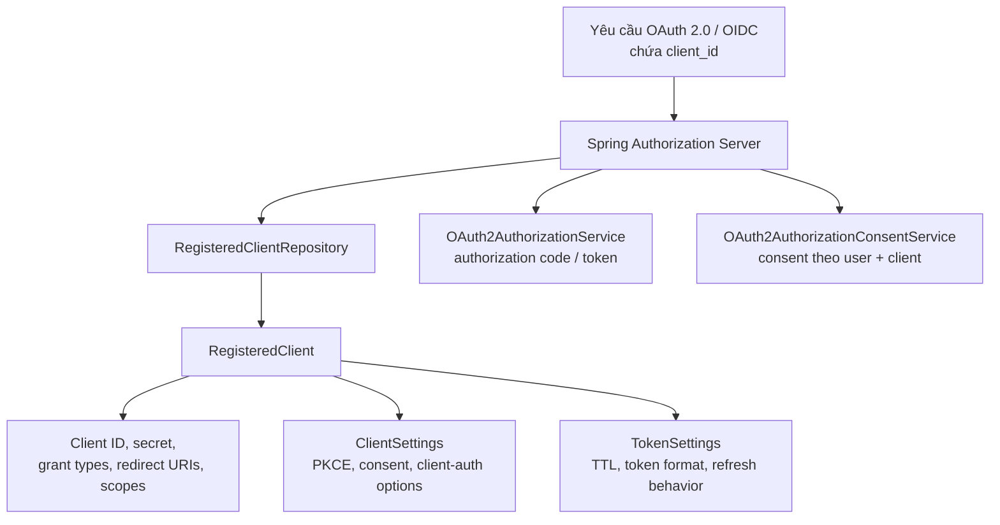
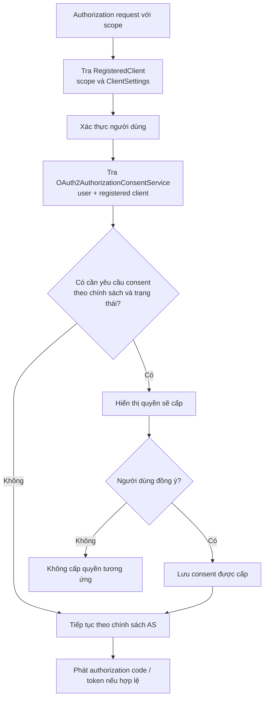

# ClientSettings và các chính sách áp dụng cho client

Trong Spring Authorization Server, **`RegisteredClient`** là mô hình biểu diễn một ứng dụng được phép sử dụng Authorization Server; **`ClientSettings`** là tập hợp những **chính sách bổ sung gắn riêng với client đó**. Nắm rõ sự khác biệt này giúp bạn cấu hình chính xác việc bắt buộc PKCE, yêu cầu người dùng đồng ý cấp quyền (consent) và một số cơ chế xác thực client nâng cao như JWT assertion hoặc chứng chỉ X.509.

Đây là bài học thuộc chương **Mô hình dữ liệu** của module **SPRING_SECURITY_OAUTH2_OIDC_AUTHORIZATION_SERVER**, hướng đến việc thiết kế, cấu hình, bảo mật, kiểm thử và vận hành OAuth 2.0/OpenID Connect Authorization Server trong Spring Boot.

Sau bài này, bạn sẽ có thể:

- Giải thích quan hệ giữa `RegisteredClient`, `ClientSettings`, `TokenSettings`, `AuthorizationServerSettings` và các service lưu trữ.
- Hiểu tác động bảo mật của `requireProofKey` và `requireAuthorizationConsent`, cùng những điều chúng **không** tự bảo vệ.
- Cấu hình confidential client và public client với chính sách phù hợp cho Authorization Code + PKCE.
- Nhận diện vai trò của `jwkSetUrl`, thuật toán ký JWT assertion khi client xác thực bằng JWT và chứng chỉ khi dùng mTLS.
- Viết kiểm thử cho các request hợp lệ, request bị từ chối và các thay đổi chính sách sau triển khai.

## 1. ClientSettings nằm ở đâu trong mô hình?

Một ứng dụng OAuth không được Authorization Server nhận diện chỉ bằng `client_id` xuất hiện trong URL. Authorization Server phải tra cứu thông tin đáng tin cậy đã đăng ký về ứng dụng đó, thường thông qua `RegisteredClientRepository`.

Trong Spring Authorization Server, `RegisteredClient` bao gồm các nhóm dữ liệu:

| Nhóm thông tin | Ví dụ | Chức năng |
| --- | --- | --- |
| **Định danh và thông tin xác thực** | `id`, `clientId`, `clientSecret`, `clientAuthenticationMethods` | Định danh client và xác định cách xác thực client tại endpoint phù hợp. |
| **Các cách cấp quyền** | `authorizationGrantTypes`: `authorization_code`, `refresh_token`, `client_credentials` | Giới hạn grant mà client được đăng ký sử dụng. |
| **Địa chỉ callback** | `redirectUris`, `postLogoutRedirectUris` | Giới hạn địa chỉ trả kết quả cấp quyền và logout. |
| **Phạm vi quyền** | `scopes`: `openid`, `profile`, `orders.read` | Giới hạn scope client có thể yêu cầu; chính sách server vẫn quyết định quyền được cấp. |
| **`ClientSettings`** | `requireProofKey`, `requireAuthorizationConsent`, `jwkSetUrl` và tùy chọn xác thực nâng cao | Quy định một số điều kiện khi client tham gia giao thức. |
| **`TokenSettings`** | TTL của code/token, định dạng access token, chính sách refresh token | Quy định cách phát hành và vòng đời token cho client. |

Sơ đồ:



**Nguyên tắc:** `RegisteredClient` nói **client được đăng ký làm gì**; `ClientSettings` quy định **một số điều kiện để thực hiện điều đó**; `TokenSettings` quy định **token được phát hành ra sao**. Việc một scope xuất hiện trong đăng ký không tự khiến người dùng có quyền truy cập mọi tài nguyên thuộc scope đó.

Ví dụ, backend client `orders-portal` đã đăng ký `authorization_code` và callback `https://portal.example.com/login/oauth2/code/orders`. Khi người dùng đăng nhập, Authorization Server vẫn phải xác thực người dùng, xác minh request, kiểm tra PKCE nếu client yêu cầu và xử lý consent theo chính sách. `client_id=orders-portal` trong request không đủ để bỏ qua các bước này.

## 2. Những chính sách chính của ClientSettings

Các phương thức dưới đây thuộc API `ClientSettings.builder()` trong dòng **Spring Authorization Server 1.x**. Tên và tính sẵn có của các lựa chọn nâng cao nên đối chiếu với phiên bản được khóa trong dự án.

| Chính sách | Cấu hình điển hình | Điều kiện được kiểm soát | Điểm cần lưu ý |
| --- | --- | --- | --- |
| **Yêu cầu PKCE** | `requireProofKey(true)` | Client sử dụng Authorization Code phải gửi PKCE challenge hợp lệ và chứng minh verifier tương ứng khi đổi code. | PKCE ràng buộc code với giao dịch; không thay thế xác thực client, `state` hoặc kiểm tra redirect URI. |
| **Yêu cầu consent** | `requireAuthorizationConsent(true)` | Khi phù hợp với request và trạng thái đồng ý đã lưu, người dùng phải chấp thuận cấp quyền cho client. | Consent khác với đăng nhập và vẫn chịu chính sách scope của server. |
| **JWK Set URI của client** | `jwkSetUrl("https://.../jwks.json")` | Cung cấp khóa công khai của client cho các cơ chế sử dụng khóa của client, chẳng hạn `private_key_jwt`. | Khác với JWKS công khai của Authorization Server dùng xác minh token AS phát hành. |
| **Thuật toán JWT client authentication** | `tokenEndpointAuthenticationSigningAlgorithm(...)` | Ràng buộc thuật toán JWS được chấp nhận cho JWT assertion do client ký khi xác thực tại token endpoint. | Không phải cấu hình thuật toán ký ID token/access token của AS. |
| **Subject DN chứng chỉ client** | `x509CertificateSubjectDN(...)` | Bổ sung ràng buộc danh tính chứng chỉ khi sử dụng mô hình client authentication bằng TLS certificate phù hợp. | Không tự thiết lập mTLS tại reverse proxy/Servlet container hay thay thế kiểm tra chứng chỉ đáng tin cậy. |

Các giá trị `requireProofKey`, `requireAuthorizationConsent` rất thường gặp trong thiết kế Authorization Code Flow. Các thiết lập khóa/JWT/chứng chỉ chỉ cần khi bạn thực sự chọn phương thức xác thực client tương ứng; đừng thêm một URL JWKS hoặc DN chỉ để “đủ cấu hình”.

Một ví dụ đơn giản:

```java
import org.springframework.security.oauth2.server.authorization.settings.ClientSettings;

ClientSettings settings = ClientSettings.builder()
    .requireProofKey(true)
    .requireAuthorizationConsent(true)
    .build();
```

Đối tượng `ClientSettings` này cần được gắn vào `RegisteredClient` qua `.clientSettings(settings)`. **Tạo bean `ClientSettings` riêng mà không gắn vào client không đồng nghĩa mọi client sẽ tự áp dụng chính sách đó.**

### 2.1. ClientSettings không tự bật hoặc cấp một grant

Ví dụ:

```java
RegisteredClient registeredClient = RegisteredClient.withId("internal-id")
    .clientId("orders-portal")
    .clientAuthenticationMethod(
        ClientAuthenticationMethod.CLIENT_SECRET_BASIC)
    .authorizationGrantType(
        AuthorizationGrantType.AUTHORIZATION_CODE)
    .redirectUri("https://portal.example.com/login/oauth2/code/orders")
    .scope("orders.read")
    .clientSettings(ClientSettings.builder()
        .requireProofKey(true)
        .build())
    .build();
```

Client này **chỉ** có `authorization_code` trong danh sách grant đăng ký. Việc đặt `requireProofKey(true)` không tự thêm `refresh_token` hay `client_credentials`. Muốn dùng grant khác, cần đăng ký grant đó rõ ràng và thỏa các điều kiện tương ứng.

Tương tự, `requireAuthorizationConsent(true)` không tự bổ sung `orders.write` vào scopes, không tạo user và không thiết lập URL callback.

## 3. requireProofKey: ràng buộc authorization code với bên yêu cầu

**PKCE (Proof Key for Code Exchange)** giảm rủi ro authorization code bị chặn hoặc đưa cho bên khác rồi bị đem đổi thành access token. Với Authorization Code Flow, client tạo một giá trị bí mật theo từng giao dịch là `code_verifier` và gửi dạng chứng minh suy ra từ giá trị đó là `code_challenge`.

Dùng phương pháp `S256`:

```text
code_verifier:  chuỗi ngẫu nhiên mạnh, giữ trong trạng thái giao dịch client
code_challenge: BASE64URL(SHA256(ASCII(code_verifier)))
code_challenge_method: S256
```

Lưu ý: đây là **hai giá trị khác nhau**. `code_verifier` không được gửi trong bước authorization request; nó được dùng tại token endpoint. PKCE không cung cấp danh tính của người dùng và cũng không làm lộ/giữ hộ secret cho public client.

### 3.1. Chu trình kiểm tra khi bật requireProofKey

```mermaid
sequenceDiagram
    autonumber
    actor U as Người dùng
    participant C as OAuth Client
    participant B as Trình duyệt
    participant AS as Authorization Server

    C->>C: Tạo code_verifier, code_challenge=S256(verifier), state
    C-->>B: Điều hướng tới authorization request
    B->>AS: /oauth2/authorize + client_id + challenge + state
    AS->>AS: Tra RegisteredClient; yêu cầu PKCE
    AS-->>B: Đăng nhập/consent nếu cần
    U->>B: Xác thực và đồng ý
    B->>AS: Gửi kết quả thao tác
    AS-->>B: Redirect với code và state
    B->>C: Callback chứa code và state
    C->>C: Đối chiếu state với giao dịch
    C->>AS: POST /oauth2/token + code_verifier (+ client auth nếu có)
    AS->>AS: Kiểm tra code, client, redirect URI, verifier
    AS-->>C: Token nếu tất cả điều kiện đều hợp lệ
```

Một request authorization rút gọn:

```http
GET /oauth2/authorize?response_type=code
    &client_id=orders-portal
    &redirect_uri=https%3A%2F%2Fportal.example.com%2Flogin%2Foauth2%2Fcode%2Forders
    &scope=openid%20orders.read
    &state=STATE_NGAU_NHIEN
    &code_challenge=CHALLENGE_BASE64URL
    &code_challenge_method=S256
```

Ví dụ trên được xuống dòng để dễ đọc. Trong HTTP thật, URL cần được mã hóa đúng và gửi trên một dòng.

Bên cạnh kiểm tra PKCE, AS vẫn cần xác minh client tồn tại, grant và scope hợp lệ, redirect URI được đăng ký, user đã xác thực và các điều kiện consent/chính sách. Tại token endpoint, AS kiểm tra code còn hạn, chưa dùng, liên kết với đúng client/callback và verifier phù hợp.

### 3.2. requireProofKey(true) bảo vệ điều gì và chưa đủ điều gì?

| Câu hỏi | Câu trả lời |
| --- | --- |
| Có giúp ngăn người khác đổi một code đánh cắp được không? | Có, nếu người tấn công không có verifier tương ứng và PKCE được kiểm tra đúng. |
| Có thay được client secret hoặc JWT client authentication không? | Không. Confidential client vẫn phải xác thực bằng phương thức đã đăng ký. |
| Có biến SPA/native app thành confidential client không? | Không. Mã JavaScript/binary nằm trong môi trường người dùng vẫn không thể giữ client secret an toàn. |
| Có thay `state` trong xử lý callback không? | Không. Client còn cần liên kết phản hồi với giao dịch đã khởi tạo và chống các kiểu injection/login CSRF phù hợp. |
| Có tự ép chỉ dùng `S256` trong mọi phiên bản/cấu hình không? | Không nên giả định. Dùng `S256`; nếu yêu cầu cấm `plain` tuyệt đối, hãy xác minh và thực thi chính sách ở điểm validation phù hợp. |
| Có bảo vệ access token khỏi XSS sau khi cấp không? | Không. Token trong JavaScript vẫn cần bảo vệ khỏi mã độc chạy cùng origin. |

**Thực hành khuyến nghị:** bật PKCE cho cả public client lẫn confidential client dùng Authorization Code Flow. Cần nhận thức rằng `requireProofKey` là một chính sách theo **đăng ký client**, không phải lời hứa mọi client trong kho đều đã bật. Việc kiểm tra registration theo từng client giúp tránh bỏ sót.

## 4. requireAuthorizationConsent: quyết định cấp quyền thuộc người dùng và AS

Trong OAuth/OIDC, **authentication** xác định người dùng là ai; **authorization/consent** liên quan việc người dùng đồng ý cấp những quyền cụ thể cho một client. Hai bước có thể xuất hiện trong cùng một luồng trình duyệt nhưng không đồng nghĩa.

Giả sử client `orders-portal` yêu cầu `openid`, `profile` và `orders.read`. AS xác thực người dùng, sau đó có thể hiển thị trang cấp quyền để họ duyệt phạm vi mà client được phép sử dụng.

Với:

```java
ClientSettings.builder()
    .requireAuthorizationConsent(true)
    .build();
```

Spring Authorization Server áp dụng yêu cầu consent theo quy tắc của nó và trạng thái đã lưu. Người dùng có thể không phải duyệt lại toàn bộ phạm vi mỗi lần nếu consent hợp lệ đã được lưu; hành vi cụ thể còn phụ thuộc scope, các tham số OIDC và cấu hình giao diện/chính sách.

### 4.1. Dòng dữ liệu liên quan đến consent



`OAuth2AuthorizationConsentService` lưu các quyền mà một principal đã chấp nhận cho client, thường thông qua `OAuth2AuthorizationConsent`. Đây là dữ liệu **theo cặp người dùng và registered client**, không phải cùng một trường được ghi trong `ClientSettings` cho mọi người dùng.

Vì vậy:

- `ClientSettings.requireAuthorizationConsent` trả lời **có yêu cầu bước đồng ý theo chính sách client hay không**.
- `OAuth2AuthorizationConsentService` trả lời **người dùng nào đã đồng ý quyền nào cho client nào**.
- `RegisteredClient.scopes` xác định **trần quyền** được đăng ký; consent không được mở rộng trần quyền đó.
- Quyết định của Resource Server còn giới hạn quyền trên từng tài nguyên/tenant, kể cả khi token đã có scope hợp lệ.

### 4.2. Các hiểu nhầm dễ gây lỗi

**“Đặt `requireAuthorizationConsent(false)` nghĩa là bỏ qua đăng nhập.”** Sai. Người dùng vẫn cần được xác thực cho Authorization Code/OIDC khi giao thức yêu cầu. Chính sách consent và form login xử lý hai câu hỏi khác nhau.

**“Có consent là token có thể gọi mọi API.”** Sai. Client chỉ có thể yêu cầu quyền đã đăng ký; AS còn kiểm tra policy và RS phải xác minh token, audience, scope và quyền đối tượng.

**“Bật consent là mỗi request chắc chắn hiện cùng một màn hình.”** Không nhất thiết. Consent đã lưu, scope mới, `prompt` OIDC và các quy tắc triển khai có thể ảnh hưởng luồng. Viết integration test theo hành vi mong đợi thay vì kiểm tra màn hình luôn xuất hiện.

**“Xóa consent cũ tự động vô hiệu hóa mọi access token còn hạn.”** Không mặc nhiên. Thu hồi consent và thu hồi token là hai thao tác/nguồn trạng thái khác nhau; thiết kế cần xét thời hạn token và yêu cầu revoke/introspection nếu muốn hiệu lực tức thời.

### 4.3. Consent trong môi trường nhiều instance

Nếu bạn dùng `InMemoryOAuth2AuthorizationConsentService`, trạng thái consent không bền vững sau restart và không được chia sẻ giữa các instance riêng. Trong môi trường nhiều replica, nên có lưu trữ chung phù hợp với các service authorization/consent, đảm bảo chính sách dữ liệu và xử lý đồng thời.

Giao diện consent tùy biến cũng phải chống CSRF và kiểm tra các tham số đầu vào. Đừng nhận danh sách scope do trình duyệt gửi rồi tự cấp quyền nếu nó vượt quá tập scope client được phép hoặc khác giao dịch đã xác thực.

## 5. Cấu hình cho confidential client và public client

Hai kiểu client có điểm khác nhau quan trọng: **confidential client** có thể giữ bí mật xác thực ở môi trường server; **public client** (SPA/native) không có nơi giữ client secret mà người dùng cuối không thể trích xuất.

| Yếu tố | Confidential web client/BFF | Public SPA/native client |
| --- | --- | --- |
| Client authentication | `client_secret_basic`, `private_key_jwt` hoặc cơ chế phù hợp khác. | Thường `none`; không có secret đáng tin cậy. |
| Authorization Code + PKCE | Nên yêu cầu `requireProofKey(true)`. | Phải dùng Authorization Code + PKCE theo thực hành hiện đại. |
| Consent | Cấu hình theo chính sách cấp quyền; thường cần khi truy cập dữ liệu người dùng từ client bên thứ ba. | Tương tự; phụ thuộc quyền cần cấp, không chỉ loại client. |
| Redirect | Callback HTTPS cố định do backend nhận. | HTTPS callback của SPA hoặc cơ chế redirect native phù hợp; phải đăng ký chặt. |
| Token storage | Ưu tiên giữ token trên backend và dùng cookie phiên bảo vệ trình duyệt. | Thực thi trong môi trường kém tin cậy hơn; cần giảm nguy cơ XSS, bảo vệ bộ nhớ/lưu trữ. |
| Refresh token | Theo grant, `TokenSettings` và chính sách client. | Không mặc nhiên được cấp trong mọi phiên bản/cấu hình; cần cơ chế bảo vệ bổ sung như rotation hoặc token sender-constrained nếu được hỗ trợ. |

Các quy tắc bảo mật còn lại như giới hạn redirect, xác minh state, chống CSRF, xác minh OIDC ID token và kiểm soát API không được thay thế bằng một cờ của `ClientSettings`.

### 5.1. Ví dụ Java: hai RegisteredClient với chính sách riêng

Đoạn này tập trung vào mô hình và cấu hình client trong **Spring Authorization Server 1.x**, dùng một kho in-memory để minh họa. Giả sử dự án đã cung cấp bean `PasswordEncoder`.

```java
package com.example.authorization.config;

import java.time.Duration;
import java.util.UUID;

import org.springframework.beans.factory.annotation.Value;
import org.springframework.context.annotation.Bean;
import org.springframework.context.annotation.Configuration;
import org.springframework.security.crypto.password.PasswordEncoder;
import org.springframework.security.oauth2.core.AuthorizationGrantType;
import org.springframework.security.oauth2.core.ClientAuthenticationMethod;
import org.springframework.security.oauth2.core.oidc.OidcScopes;
import org.springframework.security.oauth2.server.authorization.client.InMemoryRegisteredClientRepository;
import org.springframework.security.oauth2.server.authorization.client.RegisteredClient;
import org.springframework.security.oauth2.server.authorization.client.RegisteredClientRepository;
import org.springframework.security.oauth2.server.authorization.settings.ClientSettings;
import org.springframework.security.oauth2.server.authorization.settings.TokenSettings;

@Configuration(proxyBeanMethods = false)
public class ClientRegistrationConfig {

    @Bean
    RegisteredClientRepository registeredClientRepository(
            PasswordEncoder passwordEncoder,
            @Value("${demo.portal-client-secret}") String clientSecret) {

        // Backend web client có nơi lưu secret và thực hiện token request.
        RegisteredClient portal = RegisteredClient
            .withId(UUID.randomUUID().toString())
            .clientId("orders-portal")
            .clientSecret(passwordEncoder.encode(clientSecret))
            .clientAuthenticationMethod(
                ClientAuthenticationMethod.CLIENT_SECRET_BASIC)
            .authorizationGrantType(
                AuthorizationGrantType.AUTHORIZATION_CODE)
            .authorizationGrantType(
                AuthorizationGrantType.REFRESH_TOKEN)
            .redirectUri(
                "https://portal.example.com/login/oauth2/code/orders")
            .scope(OidcScopes.OPENID)
            .scope(OidcScopes.PROFILE)
            .scope("orders.read")
            .clientSettings(ClientSettings.builder()
                .requireProofKey(true)
                .requireAuthorizationConsent(true)
                .build())
            .tokenSettings(TokenSettings.builder()
                .accessTokenTimeToLive(Duration.ofMinutes(10))
                .reuseRefreshTokens(false)
                .build())
            .build();

        // SPA chạy trong trình duyệt: không khai báo client secret.
        RegisteredClient spa = RegisteredClient
            .withId(UUID.randomUUID().toString())
            .clientId("orders-spa")
            .clientAuthenticationMethod(ClientAuthenticationMethod.NONE)
            .authorizationGrantType(
                AuthorizationGrantType.AUTHORIZATION_CODE)
            .redirectUri("https://spa.example.com/callback")
            .scope(OidcScopes.OPENID)
            .scope("orders.read")
            .clientSettings(ClientSettings.builder()
                .requireProofKey(true)
                .requireAuthorizationConsent(true)
                .build())
            .build();

        return new InMemoryRegisteredClientRepository(portal, spa);
    }
}
```

Cấu hình demo trong `application.yml`:

```yaml
demo:
  portal-client-secret: ${ORDERS_PORTAL_CLIENT_SECRET}
```

Trong máy phát triển, cấp biến môi trường `ORDERS_PORTAL_CLIENT_SECRET` trước khi chạy ứng dụng. Hãy dùng `DelegatingPasswordEncoder`/`BCryptPasswordEncoder` phù hợp để mã hóa secret theo cơ chế xác thực Spring Authorization Server. Không commit client secret thật, và không log giá trị này.

Ở ví dụ trên:

1. **`orders-portal`** được xác thực bằng client secret trên backend, đồng thời phải dùng PKCE trong Authorization Code Flow. Hai lớp bảo vệ này bổ sung nhau.
2. **`orders-spa`** sử dụng `ClientAuthenticationMethod.NONE`. JavaScript chạy trên trình duyệt không có secret hợp lệ để xác thực như một confidential client. Việc bật PKCE giúp giảm nguy cơ đánh cắp code.
3. Hai client đều bật `requireAuthorizationConsent(true)`, nhưng chính sách này là **theo từng client registration**. Có thể thiết kế mức consent khác nhau tùy trường hợp nghiệp vụ, quyền và yêu cầu tổ chức.
4. `TokenSettings` được thiết lập riêng cho portal. TTL và refresh token reuse là **chính sách token**, không phải `ClientSettings`. `reuseRefreshTokens(false)` áp dụng khi refresh token được hỗ trợ/cấp và thực hiện refresh; nó không tự cấp refresh token cho mọi client.
5. `InMemoryRegisteredClientRepository` phù hợp thử nghiệm; ID nội bộ sẽ đổi khi khởi động lại trong mẫu này. Môi trường thật cần kho đăng ký bền vững và quy trình quản trị client.

**Với SPA**, đừng tự thêm `refresh_token` rồi kỳ vọng mặc định AS luôn cấp được refresh token cho public client. Khả năng cấp, rotation, sender constraint và cách bảo vệ refresh token phụ thuộc bản Spring Authorization Server và thiết kế bảo mật cụ thể. Có thể cân nhắc BFF khi cần giảm việc đưa token vào JavaScript.

### 5.2. Vì sao không chia sẻ một RegisteredClient cho mọi ứng dụng?

Giả sử cùng một `client_id`, callback và secret được sử dụng bởi SPA lẫn backend. Khi đó bạn không còn cách đáng tin cậy để phân biệt client nào được phép xác thực bằng secret và nơi nào có thể giữ secret. Một client bị rò rỉ cấu hình có thể làm ảnh hưởng client còn lại.

**Mỗi ứng dụng triển khai độc lập hoặc có mức tin cậy khác nhau nên có đăng ký client tương ứng**, với callback, grant, scope và `ClientSettings` phù hợp. Điều này tạo điều kiện thu hồi, xoay secret, kiểm toán và thử nghiệm riêng.

## 6. ClientSettings trong các phương thức xác thực nâng cao

`CLIENT_SECRET_BASIC` là lựa chọn dễ dùng cho demo backend. Những hệ thống có yêu cầu bảo mật cao có thể dùng **JWT-based client authentication** hoặc **mutual TLS (mTLS)**. Các trường nâng cao của `ClientSettings` phục vụ những cơ chế đó.

### 6.1. jwkSetUrl: khóa công khai của **client**

Khi một confidential client dùng `private_key_jwt`, client có thể tạo JWT assertion và **ký bằng private key của chính client**. Authorization Server phải tìm khóa công khai đáng tin của client để xác minh chữ ký. `jwkSetUrl` giúp gắn một địa chỉ JWKS vào đăng ký của client.

Ví dụ cấu hình cho client đối tác (minh họa):

```java
import org.springframework.security.oauth2.core.ClientAuthenticationMethod;
import org.springframework.security.oauth2.jose.jws.SignatureAlgorithm;
import org.springframework.security.oauth2.server.authorization.client.RegisteredClient;
import org.springframework.security.oauth2.server.authorization.settings.ClientSettings;

RegisteredClient partner = RegisteredClient.withId("partner-internal-id")
    .clientId("partner-backend")
    .clientAuthenticationMethod(ClientAuthenticationMethod.PRIVATE_KEY_JWT)
    .authorizationGrantType(AuthorizationGrantType.CLIENT_CREDENTIALS)
    .scope("reports.read")
    .clientSettings(ClientSettings.builder()
        .jwkSetUrl("https://partner.example.com/.well-known/jwks.json")
        .tokenEndpointAuthenticationSigningAlgorithm(SignatureAlgorithm.RS256)
        .build())
    .build();
```

Mẫu này chỉ minh họa **đăng ký client**. Ứng dụng cần cấu hình token endpoint, khóa của AS, kho client và Resource Server tương ứng để hoàn tất hệ thống. Tên API cấu hình và thuật toán được hỗ trợ cần kiểm tra theo đúng phiên bản phụ thuộc.

**Đừng nhầm hai JWKS khác nhau:**

| JWKS | Thuộc quyền kiểm soát của ai? | Dùng để xác minh điều gì? |
| --- | --- | --- |
| `ClientSettings.jwkSetUrl` | OAuth client (được AS chấp nhận trong quá trình đăng ký) | Chữ ký của JWT assertion do **client** gửi khi xác thực, ví dụ `private_key_jwt`. |
| AS `/oauth2/jwks` từ `JWKSource<SecurityContext>` | Authorization Server | Chữ ký trên ID token/JWT access token do **AS** phát hành. |

Bảo vệ URL JWKS của client là một phần của kiểm soát đăng ký: dùng HTTPS, quản lý nguồn tin cậy, giới hạn địa chỉ được phép nếu AS có khả năng truy xuất URL, chống redirect SSRF và theo dõi thời gian cache/xoay khóa. Không cho phép bất kỳ request token nào tự khai một JWKS URL tùy ý rồi được tin ngay.

### 6.2. tokenEndpointAuthenticationSigningAlgorithm: thuật toán của JWT assertion

Khi xác thực bằng `private_key_jwt` hoặc `client_secret_jwt`, client gửi JWT assertion đến token endpoint theo quy tắc của phương thức đó. AS cần xác minh chữ ký, algorithm, claim `iss`/`sub`/`aud`, thời hạn, `jti` và các ràng buộc chống replay theo giao thức và triển khai.

`ClientSettings.tokenEndpointAuthenticationSigningAlgorithm(...)` giúp diễn tả thuật toán ký JWT mà AS chấp nhận cho client. Cần phân biệt:

- **Thuật toán ký JWT assertion của client**: dùng để AS xác thực client.
- **Thuật toán ký access token/ID token của AS**: do cấu hình ký token và khóa của AS quyết định; không được thay đổi bằng `ClientSettings.tokenEndpointAuthenticationSigningAlgorithm`.

Không chấp nhận thuật toán `none` hoặc để client tự chọn thuật toán yếu trong JWT assertion. Khi đổi khóa/algorithm, phối hợp cập nhật đăng ký client, khóa JWKS và quy trình triển khai của client.

### 6.3. x509CertificateSubjectDN và mTLS client authentication

Trong mTLS, client xuất trình chứng chỉ tại tầng TLS. Máy chủ/proxy cần kiểm tra chuỗi tin cậy, hạn chứng chỉ và các thuộc tính TLS phù hợp. `ClientSettings.x509CertificateSubjectDN(...)` có thể dùng để ràng buộc subject DN mong đợi khi áp dụng cơ chế `tls_client_auth` tương ứng.

Ví dụ phần settings:

```java
ClientSettings certificateSettings = ClientSettings.builder()
    .x509CertificateSubjectDN("CN=partner-service,O=Example Corp,C=VN")
    .build();
```

Đoạn trên **chưa đủ để bật mTLS**. Đăng ký client còn phải chọn phương thức xác thực TLS phù hợp, và hạ tầng mạng/server phải yêu cầu và xác minh chứng chỉ thật. Nếu TLS được kết thúc ở reverse proxy, cần có cơ chế chuyển danh tính chứng chỉ được bảo vệ giữa proxy và ứng dụng; không tin header chứng chỉ do người dùng Internet tự gửi.

Trong những phiên bản/hình thức triển khai khác nhau, trường certificate và cơ chế xác thực có thể được hỗ trợ khác nhau. Xác minh theo tài liệu của phiên bản thực tế trước khi triển khai production.

## 7. ClientSettings so với TokenSettings và AuthorizationServerSettings

Ba khái niệm có tên tương tự nhưng ở **ba phạm vi khác nhau**:

| Đối tượng | Phạm vi | Ví dụ | Câu hỏi mà nó trả lời |
| --- | --- | --- | --- |
| `ClientSettings` | Chính sách theo **một registered client** | `requireProofKey`, `requireAuthorizationConsent`, `jwkSetUrl`. | Client này cần điều kiện gì khi cấp quyền/xác thực? |
| `TokenSettings` | Cấu hình **token cho một registered client** | Access token TTL, authorization code TTL, refresh token reuse, token format. | Token của client này được phát hành và có vòng đời thế nào? |
| `AuthorizationServerSettings` | Cấu hình **toàn Authorization Server** | Issuer; authorization/token/JWK/metadata endpoint paths. | Server mang danh tính gì và công bố endpoint ở đâu? |

Ví dụ policy cho client `orders-portal`:

```java
ClientSettings clientSettings = ClientSettings.builder()
    .requireProofKey(true)
    .requireAuthorizationConsent(true)
    .build();

TokenSettings tokenSettings = TokenSettings.builder()
    .authorizationCodeTimeToLive(Duration.ofMinutes(3))
    .accessTokenTimeToLive(Duration.ofMinutes(10))
    .reuseRefreshTokens(false)
    .build();
```

Ở nơi tạo `RegisteredClient`, gắn hai đối tượng bằng `.clientSettings(clientSettings)` và `.tokenSettings(tokenSettings)`.

**Tình huống phân biệt:** Muốn authorization code hết hạn sau ba phút → `TokenSettings`. Muốn client phải gửi `code_challenge` → `ClientSettings`. Muốn AS công bố issuer `https://login.example.com` → `AuthorizationServerSettings`. Muốn client chỉ gọi được scope `orders.read` → `RegisteredClient.scope(...)` và các chính sách server/API.

## 8. Lưu trữ, thay đổi chính sách và vòng đời đăng ký client

### 8.1. RegisteredClientRepository chịu trách nhiệm lưu ClientSettings

`RegisteredClientRepository` là nơi Spring Authorization Server tìm đăng ký client theo ID. Có thể dùng:

- `InMemoryRegisteredClientRepository` để học và kiểm thử đơn giản.
- `JdbcRegisteredClientRepository` hoặc cơ chế lưu trữ tùy biến cho triển khai có dữ liệu bền vững.

Trong mô hình lưu CSDL, các thiết lập client có thể được lưu dưới dạng map/JSON theo lược đồ và mapper của phiên bản tương ứng. Cần giữ tương thích serialization khi nâng cấp Spring Authorization Server; tránh sửa trực tiếp chuỗi JSON của `ClientSettings` nếu không hiểu mapping.

Client settings là một phần của **đăng ký client**, vì vậy thay đổi `requireProofKey` hay `requireAuthorizationConsent` thường có hiệu lực với những yêu cầu cấp quyền mới sau khi repository/configuration đã cập nhật. Tuy nhiên:

- Một authorization code đã phát hành trước thay đổi có thể có trạng thái riêng; cần đánh giá cách xử lý giao dịch đang mở.
- Access token đã phát hành không tự bị xóa hoặc thu hồi khi bạn thay cấu hình PKCE/consent.
- Consent đã lưu riêng có thể ảnh hưởng những lần xin quyền tiếp theo.
- Nhiều instance AS phải cùng đọc chính sách nhất quán; cache đăng ký client cần có cơ chế làm mới khi policy thay đổi.

Đừng đặt ra giả định “sửa flag xong là tất cả token cũ mất hiệu lực”. Nếu chính sách bảo mật yêu cầu cắt quyền ngay, cần kế hoạch thu hồi/giảm thời hạn/token introspection và quản trị phiên phù hợp.

### 8.2. Cấu hình nhạy cảm nên được kiểm soát như thế nào?

`ClientSettings` có thể chứa URL/trường ràng buộc danh tính nhưng không phải nơi lưu mật khẩu người dùng hoặc private key của client. Private key cho `private_key_jwt` phải ở phía client trong kho khóa bảo mật; AS lưu/tìm khóa **công khai** được đăng ký. Với `client_secret_basic`, client secret của confidential client được bảo vệ ở backend và AS lưu bản đã mã hóa phù hợp.

Khi thiết kế quy trình onboarding hoặc thay đổi client:

1. Phân loại client là public/confidential theo khả năng giữ bí mật thực tế.
2. Giới hạn grant, callback, scope và phương thức xác thực ngay tại `RegisteredClient`.
3. Áp dụng PKCE cho Authorization Code và chọn chính sách consent theo nhu cầu dữ liệu.
4. Với JWT/mTLS, xác định nguồn khóa hoặc chứng chỉ tin cậy, thuật toán và vòng đời rotation.
5. Lưu registration bền vững, kiểm soát ai được đổi policy, ghi audit cho thay đổi quan trọng.
6. Kiểm thử các nhánh từ chối sau khi nâng cấp Spring Authorization Server hoặc thay policy.

## 9. Kiểm thử chính sách của ClientSettings

**Kiểm thử theo từng ranh giới** giúp chắc chắn cờ được áp dụng tại endpoint đúng, không chỉ được lưu vào database.

| Ca kiểm thử | Thiết lập/đầu vào | Kết quả mong đợi |
| --- | --- | --- |
| Authorization Code có PKCE hợp lệ | `requireProofKey(true)`, challenge `S256`, verifier đúng | Được tiếp tục nếu các điều kiện khác hợp lệ. |
| Thiếu `code_challenge` | Client yêu cầu PKCE | Authorization request bị từ chối; không cấp code sử dụng được. |
| Sai `code_verifier` | Code đã gắn challenge khác | Token endpoint từ chối, không cấp token. |
| Code bị tái sử dụng | Đổi code lần thứ hai sau khi thành công | Bị từ chối vì code chỉ dùng một lần. |
| Client ID hợp lệ nhưng callback lạ | `redirect_uri` không được đăng ký | AS không phát code tới callback lạ. |
| Confidential client sai secret | `CLIENT_SECRET_BASIC`, mật khẩu không khớp | Token endpoint từ chối client authentication. |
| Public client gửi secret giả | `ClientAuthenticationMethod.NONE` | Không biến secret giả thành bằng chứng confidential client. |
| Yêu cầu scope vượt đăng ký | `orders.write` không thuộc `RegisteredClient.scopes` | AS từ chối phạm vi không được phép. |
| Consent chưa có | `requireAuthorizationConsent(true)`, scope cần chấp thuận | Luồng phải thực hiện bước consent phù hợp trước khi cấp quyền. |
| Consent bị từ chối | Người dùng từ chối cấp quyền | Không cấp quyền tương ứng; trả kết quả lỗi theo giao thức. |
| Consent đã lưu, scope cũ | Người dùng quay lại | Hành vi consent theo chính sách và trạng thái đã lưu, không cấp vượt scope. |
| JWT client assertion ký sai key/algorithm | Client đăng ký `private_key_jwt` | Xác thực client thất bại. |
| JWT assertion sai `aud` hoặc hết hạn | Client auth bằng JWT | Xác thực client thất bại. |
| Chứng chỉ client không khớp đăng ký | Client auth mTLS | Client authentication thất bại, kể cả khi request có `client_id` hợp lệ. |

Lưu ý kết quả lỗi HTTP chính xác (`invalid_request`, `invalid_client`, `invalid_grant`, `invalid_scope`, redirect hoặc error page) phụ thuộc **endpoint và loại lỗi**. Test nên xác minh giao thức trả lỗi thích hợp, không mặc định mọi lỗi đều trả cùng status code.

### 9.1. Những điều nên kiểm tra trong integration test

Một bài test end-to-end của client dùng Authorization Code + PKCE nên bao gồm:

1. Gửi `/oauth2/authorize` với `client_id` đã đăng ký, `redirect_uri` chính xác, challenge `S256` và state.
2. Xác thực người dùng, thực hiện consent nếu chính sách yêu cầu.
3. Đối chiếu `state` ở **phía OAuth client**, trích xuất code và dùng verifier để đổi token.
4. Xác minh token request thiếu verifier, sai verifier hoặc dùng lại code đều bị từ chối.
5. Kiểm tra yêu cầu callback lạ, scope không được đăng ký và client auth sai bị từ chối.
6. Nếu có Resource Server, tiếp tục thử token hết hạn, sai issuer/audience, sai scope hoặc không thuộc quyền của người dùng. Những kiểm tra này nằm ngoài bản thân `ClientSettings` nhưng cần cho an toàn hệ thống.

Trong bài tập hoặc demo, có thể chạy `InMemoryRegisteredClientRepository`. Với test cho hệ thống thật, nên bao phủ đường đọc/ghi registration từ repository đang sử dụng và behavior sau restart/cập nhật policy.

### 9.2. Các lỗi thường gặp khi cấu hình

**Đã bật PKCE nhưng OAuth client vẫn báo authorization request lỗi.** Kiểm tra client có tạo `code_challenge` và `code_challenge_method=S256` đúng chưa, redirect URI có khớp không và có sử dụng grant đã đăng ký không. PKCE verifier phải gắn với đúng giao dịch, không tái sử dụng tùy tiện.

**Consent xuất hiện liên tục mỗi lần đăng nhập.** Kiểm tra `OAuth2AuthorizationConsentService` có lưu bền vững, scope yêu cầu có thay đổi và ứng dụng có tạo registration ID mới khi restart không. Trong ví dụ dùng `UUID.randomUUID()` và kho in-memory, dữ liệu consent có thể mất hoặc không liên kết như mong đợi.

**Public SPA báo `invalid_client` khi token request.** Kiểm tra đăng ký có `ClientAuthenticationMethod.NONE`, client thực tế không gửi Basic secret giả, luồng dùng Authorization Code + PKCE, CORS/token endpoint (nếu cross-origin) và cấu hình redirect phù hợp. Public client không cần client secret được hardcode trong JavaScript.

**Đối tác dùng `private_key_jwt` nhưng AS không xác minh được assertion.** Kiểm tra JWKS URL của client, key ID/rotation, thuật toán và claim theo giao thức. Không lấy nhầm AS JWKS để xác minh JWT assertion của client.

**Sau khi cập nhật ClientSettings, một instance vẫn xử lý theo policy cũ.** Kiểm tra repository/caching và cách các instance nhận cập nhật. Cờ mới không tự đồng bộ dữ liệu giữa những kho in-memory riêng biệt.

## 10. Bài thực hành theo tình huống

Bạn đang xây Authorization Server cho ba ứng dụng:

| Client | Loại ứng dụng | Yêu cầu |
| --- | --- | --- |
| `employee-portal` | Backend/BFF do công ty vận hành | Authorization Code + PKCE; đăng nhập SSO; truy cập `employees.read`. |
| `analytics-spa` | SPA dùng bởi nhân viên | Authorization Code + PKCE, không lưu client secret; truy cập `reports.read`. |
| `partner-service` | Backend của đối tác bên ngoài | Client Credentials, xác thực bằng `private_key_jwt`; truy cập `reports.export`. |

Hãy tự thiết kế ba `RegisteredClient` riêng, rồi trả lời:

- Client nào có `ClientAuthenticationMethod.NONE`, client nào xác thực bằng secret hoặc private key JWT?
- Client nào bật `requireProofKey(true)` và vì sao setting này không có ý nghĩa tương tự cho `client_credentials`?
- Chính sách consent nào phù hợp khi quyền chỉ được dùng bởi chính công ty và khi quyền được cấp cho đối tác? Có cần consent của người dùng với machine-to-machine client credentials không?
- URL `jwkSetUrl` thuộc về bên nào trong luồng `private_key_jwt`, và AS phải bảo vệ việc tải URL ra sao?
- Khi cần giảm TTL access token của riêng `partner-service`, bạn sửa `ClientSettings` hay `TokenSettings`?
- Nếu đối tác yêu cầu đổi URL JWKS, bạn sẽ kiểm thử những trường hợp khóa cũ/khóa mới nào trước khi áp dụng?

**Gợi ý giải thích:** `employee-portal` và `analytics-spa` dùng Authorization Code nên cần PKCE; `analytics-spa` là public client. `partner-service` chỉ dùng `client_credentials` nên không có bước user authorization code và consent của người dùng trong luồng đó. Chính sách TTL nằm tại `TokenSettings`. Việc dùng `private_key_jwt` cần xác minh JWT assertion của client dựa vào nguồn khóa công khai tin cậy đã đăng ký.

## 11. Checklist trước khi đưa client vào vận hành

- [ ] Xác định rõ public/confidential client theo nơi thực thi và khả năng giữ secret.
- [ ] Mỗi client có registration và `client_id` riêng nếu mức tin cậy, callback hoặc vòng đời khác nhau.
- [ ] Chỉ bật đúng grant types, authentication methods, callback URIs và scopes cần thiết.
- [ ] Với Authorization Code, yêu cầu PKCE và sử dụng `S256`; client còn kiểm tra `state` khi nhận callback.
- [ ] Chọn `requireAuthorizationConsent` theo chính sách; consent được lưu và kiểm soát phù hợp.
- [ ] Với JWT/mTLS client auth, cấu hình khóa/chứng chỉ, thuật toán và tầng TLS theo quy trình được kiểm tra.
- [ ] Tách `ClientSettings`, `TokenSettings` và `AuthorizationServerSettings` theo đúng phạm vi.
- [ ] Lưu đăng ký client và consent bền vững khi triển khai nhiều instance.
- [ ] Kiểm thử các nhánh từ chối: thiếu PKCE, sai secret, callback lạ, scope không được phép, JWT assertion sai.
- [ ] Theo dõi thay đổi policy, xoay khóa/secret, thu hồi quyền và tác động tới token đã cấp.

**Điểm cần ghi nhớ:** `ClientSettings` gắn với **mỗi** `RegisteredClient` và xác định một số điều kiện bảo mật của client, nổi bật là **PKCE** và **consent**, đồng thời hỗ trợ các phương thức xác thực client nâng cao. Nó phải được sử dụng cùng registration, token policy, xác thực người dùng và các kiểm tra của Authorization Server/Resource Server; không có một setting đơn lẻ nào thay thế toàn bộ ranh giới tin cậy của OAuth 2.0/OIDC.

**Tài liệu đọc thêm:** Spring Authorization Server Reference — Core Model and Components (`RegisteredClient`, `ClientSettings`, `TokenSettings`, `OAuth2AuthorizationConsent`), Configuration Model, OAuth2 Client Authentication; RFC 6749 (OAuth 2.0), RFC 7636 (PKCE), RFC 9700 (OAuth 2.0 Security Best Current Practice), RFC 7523 (JWT Profile for Client Authentication), RFC 8705 (OAuth 2.0 Mutual-TLS Client Authentication), OpenID Connect Core 1.0.
