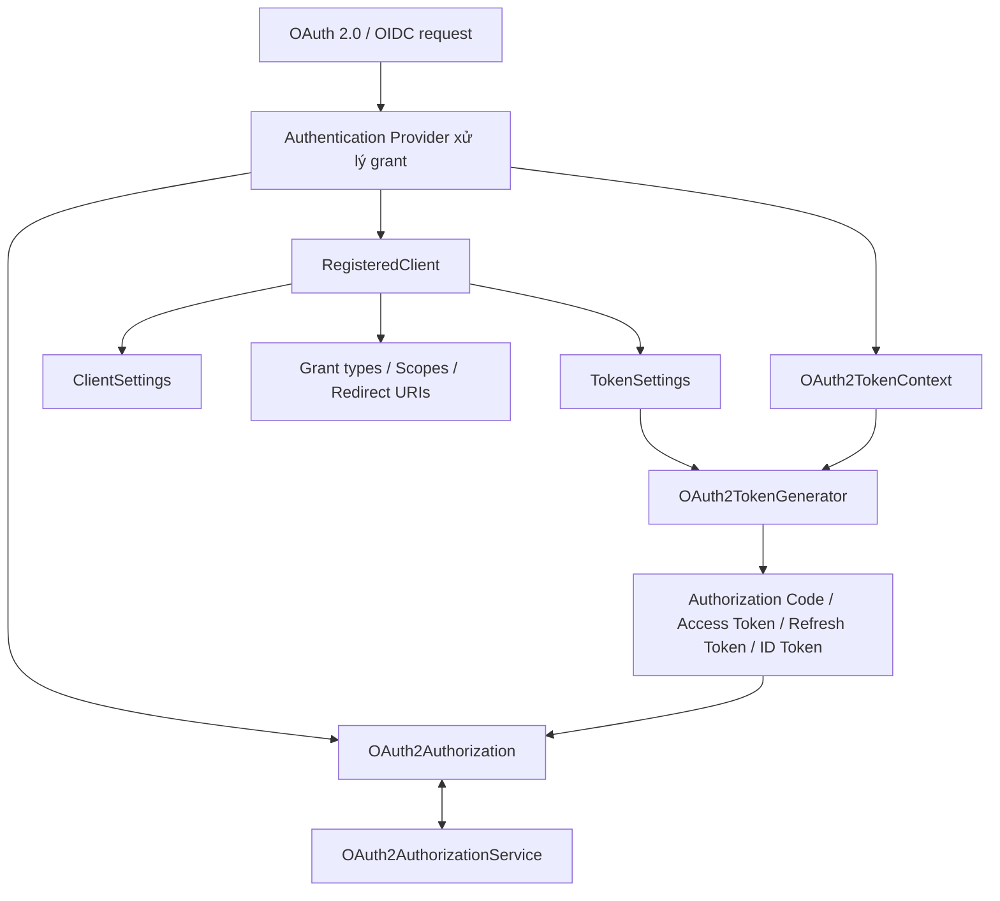
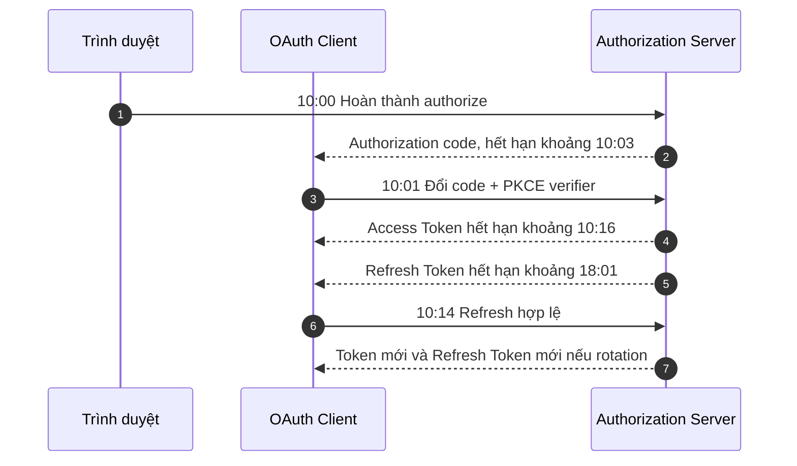
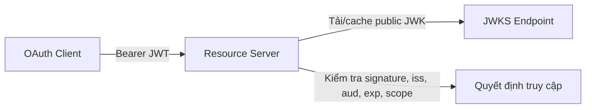
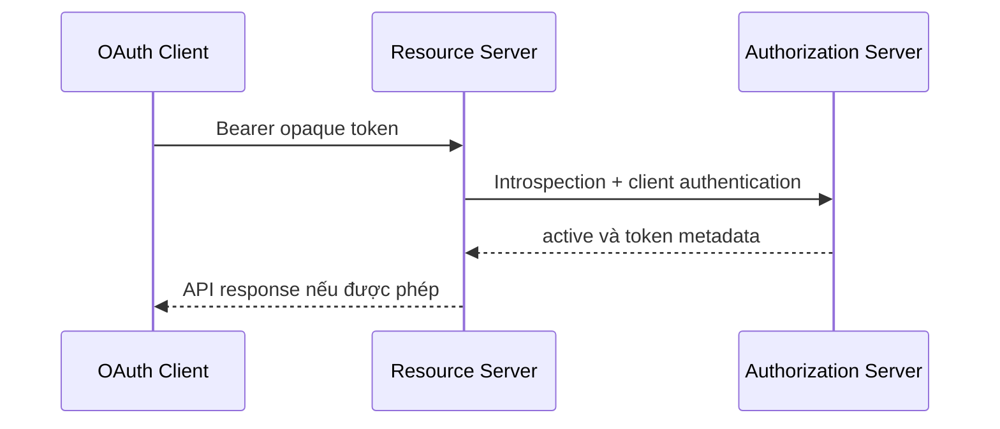
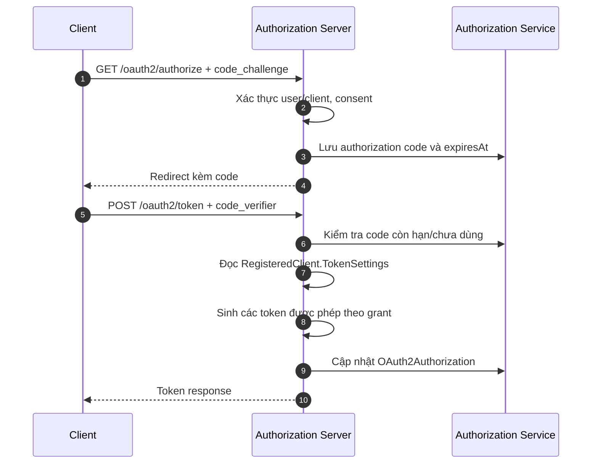

# TokenSettings và chính sách phát hành, thời hạn của token

## 1. Vai trò của TokenSettings trong Authorization Server

Trong chương **Mô hình dữ liệu** của module **SPRING_SECURITY_OAUTH2_OIDC_AUTHORIZATION_SERVER**, chúng ta tìm hiểu cách thiết kế, cấu hình, bảo mật, kiểm thử và vận hành OAuth 2.0/OpenID Connect Authorization Server bằng Spring Security và Spring Authorization Server trong ứng dụng Spring Boot.

Một câu hỏi thực tế là: **Authorization Server quyết định Access Token tồn tại bao lâu, authorization code hết hạn khi nào, Refresh Token có được dùng lại không, và Access Token được phát hành dưới dạng JWT hay opaque token bằng cách nào?**

Spring Authorization Server biểu diễn các lựa chọn đó trong `TokenSettings`, một tập thiết lập được gắn vào mỗi `RegisteredClient`. Chính sách token của từng client có thể khác nhau dựa trên loại ứng dụng, grant type, mức độ rủi ro và yêu cầu sản phẩm.

Kết thúc bài, người học có thể:

- Xác định vị trí của `TokenSettings` trong mô hình `RegisteredClient`, `OAuth2Authorization` và `OAuth2TokenGenerator`.
- Cấu hình thời hạn authorization code, Access Token, Refresh Token, Device Code và định dạng Access Token.
- Phân biệt `reuseRefreshTokens(true/false)` với chính sách thu hồi, rotation và phát hiện replay.
- Phân biệt Access Token JWT self-contained với reference/opaque token và cách Resource Server xác minh chúng.
- Triển khai client mẫu có `TokenSettings`, thực hiện kiểm tra TTL, refresh flow và những trường hợp bị từ chối.
- Giải thích giới hạn của `TokenSettings` trong bảo mật tổng thể: PKCE, audience, key rotation, session và revocation.

**Nguyên tắc cần nhớ:** `TokenSettings` điều chỉnh **cách cấp token mới** cho một client; nó không phải bảng lưu token, không tự thu hồi token đã phát hành và không thay thế kiểm tra quyền truy cập tại Resource Server.

## 2. Vị trí của TokenSettings trong mô hình dữ liệu



Sơ đồ cho thấy các mối quan hệ logic; mỗi grant thực tế chỉ phát hành các loại token tương ứng.

| Mô hình | Trách nhiệm | Ví dụ |
| --- | --- | --- |
| `RegisteredClient` | Thông tin đăng ký OAuth client, grant types, redirect URI, scope và các settings. | Client `demo-web` đăng ký `authorization_code`, `refresh_token`. |
| `ClientSettings` | Chính sách tương tác và bảo vệ client. | Yêu cầu PKCE, yêu cầu consent. |
| **`TokenSettings`** | Quy tắc phát hành, thời hạn và định dạng token của client. | Access Token 15 phút, Refresh Token 8 giờ. |
| `OAuth2TokenContext` | Thông tin của một lần sinh token: client, principal, token type, grant, scopes. | Đầu vào của token generator. |
| `OAuth2TokenGenerator` | Tạo token theo loại và ngữ cảnh được truyền vào. | Tạo JWT hoặc opaque Access Token. |
| `OAuth2Authorization` | Trạng thái một giao dịch ủy quyền, các token và metadata đã cấp. | Code đã dùng, token hết hạn lúc nào. |
| `OAuth2AuthorizationService` | Lưu/truy xuất trạng thái authorization và token. | In-memory/JDBC service. |
| `AuthorizationServerSettings` | Cấu hình chung cho Authorization Server. | Issuer, đường dẫn endpoint; không phải chính sách TTL theo client. |

### 2.1. Phân biệt chính sách và trạng thái token

Giả sử token A được cấp lúc 09:00 với TTL 30 phút. Lúc 09:05, quản trị viên thay `TokenSettings.accessTokenTimeToLive` thành 15 phút. Token B cấp lúc 09:06 sẽ dùng chính sách mới và có thể hết hạn khoảng 09:21, nhưng token A đã cấp vẫn mang mốc hết hạn cũ khoảng 09:30.

Thay đổi `TokenSettings` **không tự chỉnh lại `exp` của JWT đã phát hành**, cũng không tự ra lệnh cho mọi Resource Server ngừng chấp nhận token đó. Nếu cần xử lý token cũ khẩn cấp, hệ thống phải có cơ chế thu hồi, chặn hoặc chính sách xác minh bổ sung phù hợp.

### 2.2. Chính sách được lưu cùng RegisteredClient

Trong ứng dụng, bean `RegisteredClientRepository` có thể lưu thông tin client trong bộ nhớ hoặc database. Từng `RegisteredClient` sở hữu `TokenSettings` riêng:

```java
RegisteredClient client = registeredClientRepository.findByClientId("demo-web");
if (client == null) {
    throw new IllegalStateException("Unknown client");
}

TokenSettings settings = client.getTokenSettings();
Duration accessTtl = settings.getAccessTokenTimeToLive();
Duration refreshTtl = settings.getRefreshTokenTimeToLive();
boolean reuseRefreshToken = settings.isReuseRefreshTokens();
OAuth2TokenFormat tokenFormat = settings.getAccessTokenFormat();
```

Nếu sử dụng JDBC repository, sửa mã tạo client mẫu chưa chắc cập nhật bản ghi đã tồn tại trong database. Hãy thay chính sách thông qua quy trình cập nhật `RegisteredClient` tương ứng.

## 3. Các thuộc tính chính của TokenSettings

Các API sau phản ánh cách sử dụng thông dụng trong dòng Spring Authorization Server 1.x. Phiên bản thư viện có thể bổ sung hoặc điều chỉnh thuộc tính; khi đưa code vào dự án cần đối chiếu tài liệu chính thức của phiên bản đang dùng.

| API của builder | Tác động | Ghi chú bảo mật |
| --- | --- | --- |
| `authorizationCodeTimeToLive(Duration)` | Thời hạn authorization code. | Code ngắn hạn, chỉ dùng một lần; vẫn cần PKCE và redirect URI hợp lệ. |
| `accessTokenTimeToLive(Duration)` | Thời hạn Access Token mới. | Đánh đổi giữa rủi ro token bị lộ và tần suất cấp token. |
| `accessTokenFormat(OAuth2TokenFormat)` | Chọn `SELF_CONTAINED` hoặc `REFERENCE` cho Access Token. | Ảnh hưởng cách Resource Server kiểm tra token. |
| `refreshTokenTimeToLive(Duration)` | Thời hạn Refresh Token mới. | Cần bảo vệ lưu trữ và chính sách rotation/revocation. |
| `reuseRefreshTokens(boolean)` | Quy định có sử dụng lại Refresh Token khi refresh thành công hay không. | `false` phù hợp khi muốn luân chuyển refresh token, nhưng chưa đủ để phát hiện mọi replay. |
| `deviceCodeTimeToLive(Duration)` | Thời hạn device code trong Device Authorization Grant. | Chỉ liên quan nếu triển khai device flow. |
| `idTokenSignatureAlgorithm(SignatureAlgorithm)` | Thuật toán ký OIDC ID Token. | Không phải API để đặt TTL của ID Token. |
| `x509CertificateBoundAccessTokens(boolean)` (nếu phiên bản hỗ trợ) | Yêu cầu token ràng buộc với chứng chỉ client trong kịch bản phù hợp. | Cần thiết kế mTLS/certificate-bound token đầy đủ, không chỉ bật một flag. |

Không nên phụ thuộc vào default TTL của thư viện mà chưa kiểm tra. Giá trị cấu hình phải là `Duration` hợp lệ, thông thường là thời lượng dương.

### 3.1. Ví dụ chính sách thực hành

```java
import java.time.Duration;
import org.springframework.security.oauth2.core.OAuth2TokenFormat;
import org.springframework.security.oauth2.jose.jws.SignatureAlgorithm;
import org.springframework.security.oauth2.server.authorization.settings.TokenSettings;

TokenSettings policy = TokenSettings.builder()
        .authorizationCodeTimeToLive(Duration.ofMinutes(3))
        .accessTokenTimeToLive(Duration.ofMinutes(15))
        .accessTokenFormat(OAuth2TokenFormat.SELF_CONTAINED)
        .refreshTokenTimeToLive(Duration.ofHours(8))
        .reuseRefreshTokens(false)
        .deviceCodeTimeToLive(Duration.ofMinutes(5))
        .idTokenSignatureAlgorithm(SignatureAlgorithm.RS256)
        .build();
```

**Đây là số liệu minh họa** để quan sát rõ sự khác biệt giữa các loại token; không phải khuyến nghị TTL chung cho mọi hệ thống production.

## 4. Thời hạn phát hành và vòng đời của các loại token

### 4.1. Authorization code

Authorization code được cấp khi người dùng đã hoàn tất những bước xác thực và đồng ý cấp quyền cần thiết. Code được client dùng để đổi token tại token endpoint. Khi `authorizationCodeTimeToLive(Duration.ofMinutes(3))`, code phát hành lúc 10:00 có thể hết hạn lúc 10:03.

Một authorization code phải **ngắn hạn, khó đoán và dùng một lần**. Trong Authorization Code Flow với PKCE, client phải gửi `code_verifier` khớp với `code_challenge` đã gắn với giao dịch ban đầu. Authorization Server còn phải kiểm tra client, redirect URI và trạng thái code. TTL ngắn không thay thế PKCE, `state` hoặc quy tắc redirect.

### 4.2. Access Token

Access Token là credential để client gọi Resource Server, thường gửi bằng header:

```http
GET /api/orders HTTP/1.1
Host: api.example.com
Authorization: Bearer <access-token>
```

Với JWT Access Token, claims như `iat` và `exp` thể hiện thời điểm cấp và hết hạn. Bên nhận phải kiểm tra chữ ký/thuật toán, issuer, thời hạn, audience và quyền truy cập thích hợp. Với opaque Access Token, Resource Server thường kiểm tra hiệu lực qua introspection.

Access Token có TTL càng ngắn thì cửa sổ sử dụng token bị đánh cắp thường càng nhỏ; đổi lại client phải refresh hoặc xin token mới thường xuyên hơn. Cần lựa chọn theo mức rủi ro API, mô hình client và khả năng chịu tải.

### 4.3. Refresh Token

Refresh Token cho phép client xin token mới khi đủ điều kiện mà không cần đưa người dùng qua toàn bộ Authorization Code Flow mỗi lần. Nó là credential có mức nhạy cảm cao và thường tồn tại lâu hơn Access Token.

Refresh Token **không phải tự động được cấp cho mọi client và mọi grant**. Authorization Server xét loại grant, phương thức client authentication, client đã đăng ký, và quy tắc token generator. Chẳng hạn, `client_credentials` thường không phát hành Refresh Token vì confidential client có thể xác thực để xin Access Token mới.

Hai cấu hình có ý nghĩa khác nhau:

```java
.reuseRefreshTokens(true)   // Có thể trả lại Refresh Token hiện có khi refresh.
.reuseRefreshTokens(false)  // Luân chuyển Refresh Token khi refresh thành công.
```

Khi rotation hoạt động, client phải thay thế Refresh Token cũ bằng token mới. Token cũ không còn được dùng để refresh theo trạng thái authorization mới. **Rotation không tự bảo đảm phát hiện reuse bất thường, thu hồi cả họ token hoặc giới hạn phiên tuyệt đối**. Những yêu cầu đó cần thiết kế/kiểm thử riêng, đặc biệt với nhiều request refresh đồng thời.

### 4.4. Device Code và ID Token

`deviceCodeTimeToLive` ảnh hưởng thời hạn **device code** của Device Authorization Grant, khi thiết bị nhập liệu hạn chế cần người dùng xác nhận qua thiết bị khác. Sau khi ủy quyền thiết bị thành công, Access Token có vòng đời riêng theo `accessTokenTimeToLive`.

ID Token thuộc OpenID Connect, dùng để client xác minh kết quả đăng nhập của người dùng. `idTokenSignatureAlgorithm` điều chỉnh thuật toán ký như `RS256`. Ở các phiên bản có API như trên, `TokenSettings` không có setter `idTokenTimeToLive(...)` tương đương Access Token. **Không suy ra ID Token TTL bằng Access Token TTL**; cần kiểm tra claims thực tế và khả năng tùy chỉnh được hỗ trợ của phiên bản đang sử dụng. ID Token không được dùng thay Access Token khi gọi API.

### 4.5. Ví dụ mốc thời gian

Giả định có code TTL 3 phút, Access Token TTL 15 phút và Refresh Token TTL 8 giờ:



Mỗi token được tính thời hạn từ **thời điểm phát hành của chính token đó**. Token mới sau refresh có thể có mốc hết hạn mới theo chính sách, nhưng không suy ra rằng cứ refresh mãi sẽ được phép giữ phiên vô hạn: chính sách đăng nhập lại và absolute session lifetime là bài toán bổ sung.

## 5. SELF_CONTAINED và REFERENCE: hai kiểu Access Token

### 5.1. Access Token tự chứa (thường là JWT)

```java
.accessTokenFormat(OAuth2TokenFormat.SELF_CONTAINED)
```

Khi Spring Authorization Server có cấu hình `JwtEncoder`/JWK thích hợp, một self-contained Access Token phổ biến là JWT có chữ ký. Resource Server kiểm tra chữ ký và các claims bằng khóa công khai, thường được lấy qua JWKS.



**Ưu điểm:** API có thể xác minh token cục bộ, giảm phụ thuộc vào một lần gọi Authorization Server cho mỗi request. **Giới hạn:** nếu JWT đã được phát hành và Resource Server chỉ kiểm tra chữ ký/thời hạn, thay đổi trạng thái tại Authorization Server không tự làm JWT đó bị từ chối ngay. Có thể phải dùng TTL ngắn hoặc kiểm tra trạng thái bổ sung khi yêu cầu thu hồi tức thời.

JWT ký bằng JWS thường **không mã hóa payload**. Bất kỳ ai có chuỗi token cũng có thể decode claims, vì vậy không đưa bí mật hoặc thông tin cá nhân không cần thiết vào payload.

### 5.2. Access Token tham chiếu (opaque)

```java
.accessTokenFormat(OAuth2TokenFormat.REFERENCE)
```

Reference token là chuỗi được dùng làm tham chiếu tới trạng thái token ở Authorization Server. Resource Server thường gọi endpoint introspection qua kênh bảo mật và bằng thông tin xác thực thích hợp để biết token có còn `active` hay không.



| Tiêu chí | SELF_CONTAINED/JWT | REFERENCE/opaque |
| --- | --- | --- |
| Xác minh thường gặp | Chữ ký + claims cục bộ. | Introspection tới Authorization Server. |
| Phụ thuộc AS khi gọi API | Thường không cần sau khi lấy/cache JWK. | Thường cần, trừ khi Resource Server cache kết quả. |
| Thu hồi hiệu lực | Không tức thời nếu xác minh offline và thiếu cơ chế bổ sung. | Dễ kiểm tra trạng thái hiện tại hơn nếu introspection/caching đúng. |
| Khả năng đọc claims từ chuỗi | Payload JWT ký thường đọc được. | Opaque token không trực tiếp lộ claims bằng decode. |
| Yêu cầu vận hành | Public JWKS, key rotation, kiểm tra issuer/audience. | Introspection credentials, độ sẵn sàng, độ trễ và cache policy. |

**Chọn dạng Access Token không thay đổi mục đích của ID Token**: OIDC client vẫn phải kiểm tra ID Token theo chuẩn OIDC.

## 6. Cấu hình TokenSettings trên RegisteredClient mẫu

Ví dụ sau phù hợp với cách cấu hình phổ biến của Spring Authorization Server 1.x. Nó tạo client `demo-web` ở profile `dev`, có backend giữ client secret và sử dụng Authorization Code Flow với PKCE. Nếu dự án dùng phiên bản Spring Boot/Spring Security khác, cần đối chiếu API và dependency tương ứng.

```java
package com.example.authorizationserver.config;

import java.time.Duration;
import java.util.UUID;

import org.springframework.context.annotation.Bean;
import org.springframework.context.annotation.Configuration;
import org.springframework.context.annotation.Profile;
import org.springframework.security.crypto.factory.PasswordEncoderFactories;
import org.springframework.security.crypto.password.PasswordEncoder;
import org.springframework.security.oauth2.core.AuthorizationGrantType;
import org.springframework.security.oauth2.core.ClientAuthenticationMethod;
import org.springframework.security.oauth2.core.OAuth2TokenFormat;
import org.springframework.security.oauth2.core.oidc.OidcScopes;
import org.springframework.security.oauth2.jose.jws.SignatureAlgorithm;
import org.springframework.security.oauth2.server.authorization.client.InMemoryRegisteredClientRepository;
import org.springframework.security.oauth2.server.authorization.client.RegisteredClient;
import org.springframework.security.oauth2.server.authorization.client.RegisteredClientRepository;
import org.springframework.security.oauth2.server.authorization.settings.ClientSettings;
import org.springframework.security.oauth2.server.authorization.settings.TokenSettings;

@Configuration(proxyBeanMethods = false)
@Profile("dev")
public class DemoClientTokenPolicyConfig {

    @Bean
    PasswordEncoder passwordEncoder() {
        return PasswordEncoderFactories.createDelegatingPasswordEncoder();
    }

    @Bean
    RegisteredClientRepository registeredClientRepository(PasswordEncoder encoder) {
        TokenSettings tokens = TokenSettings.builder()
                .authorizationCodeTimeToLive(Duration.ofMinutes(3))
                .accessTokenTimeToLive(Duration.ofMinutes(15))
                .accessTokenFormat(OAuth2TokenFormat.SELF_CONTAINED)
                .refreshTokenTimeToLive(Duration.ofHours(8))
                .reuseRefreshTokens(false)
                .idTokenSignatureAlgorithm(SignatureAlgorithm.RS256)
                .build();

        RegisteredClient demoWeb = RegisteredClient.withId(UUID.randomUUID().toString())
                .clientId("demo-web")
                .clientSecret(encoder.encode("dev-secret-only-change-me"))
                .clientAuthenticationMethod(ClientAuthenticationMethod.CLIENT_SECRET_BASIC)
                .authorizationGrantType(AuthorizationGrantType.AUTHORIZATION_CODE)
                .authorizationGrantType(AuthorizationGrantType.REFRESH_TOKEN)
                .redirectUri("http://127.0.0.1:8081/login/oauth2/code/demo-web")
                .scope(OidcScopes.OPENID)
                .scope(OidcScopes.PROFILE)
                .scope("api.read")
                .clientSettings(ClientSettings.builder()
                        .requireProofKey(true)
                        .requireAuthorizationConsent(true)
                        .build())
                .tokenSettings(tokens)
                .build();

        return new InMemoryRegisteredClientRepository(demoWeb);
    }
}
```

**Các điều kiện áp dụng:**

- Ứng dụng cần dependency Spring Authorization Server, `SecurityFilterChain` cho endpoint OAuth/OIDC, user login khi dùng Authorization Code Flow, `AuthorizationServerSettings` và nguồn khóa ký/JWK phù hợp. Đoạn code trên **chỉ cấu hình client và token policy**, chưa phải toàn bộ Authorization Server.
- Nếu đã có bean `PasswordEncoder` hoặc `RegisteredClientRepository`, hãy tích hợp cấu hình thay vì tạo bean trùng lặp.
- Client mẫu là **confidential client**: chỉ backend giữ secret. Không đưa `dev-secret-only-change-me` vào JavaScript frontend, mobile app hoặc mã nguồn sản phẩm.
- `http://localhost` và `127.0.0.1` chỉ phục vụ thử nghiệm cục bộ. Production cần HTTPS, redirect URI kiểm soát chặt và secret được quản lý an toàn.
- `InMemoryRegisteredClientRepository` không lưu dữ liệu qua restart; production nên dùng repository bền vững và quy trình cập nhật chính sách có kiểm soát.

### 6.1. Cấu hình riêng cho một client opaque token

```java
TokenSettings opaquePolicy = TokenSettings.builder()
        .accessTokenTimeToLive(Duration.ofMinutes(10))
        .accessTokenFormat(OAuth2TokenFormat.REFERENCE)
        .refreshTokenTimeToLive(Duration.ofHours(2))
        .reuseRefreshTokens(false)
        .build();

// Đưa opaquePolicy vào tokenSettings(...) của RegisteredClient khác.
```

Đổi sang `REFERENCE` phải đi cùng cấu hình xác minh opaque token và introspection ở Resource Server. Không nên chỉ đổi một dòng trên Authorization Server rồi giả định API đang xác minh JWT sẽ tự hiểu reference token.

## 7. TokenSettings được sử dụng trong các grant

### 7.1. Authorization Code Flow với PKCE



Ở luồng này, code TTL được áp dụng khi phát hành code; Access Token TTL, định dạng token và Refresh Token policy được áp dụng trong bước cấp token. `ClientSettings.requireProofKey` và `requireAuthorizationConsent` là chính sách khác, không phải thuộc tính của `TokenSettings`.

### 7.2. Refresh Token Grant

```http
POST /oauth2/token HTTP/1.1
Host: auth.example.com
Authorization: Basic <base64-client-credentials>
Content-Type: application/x-www-form-urlencoded

grant_type=refresh_token&refresh_token=<refresh-token>
```

Authorization Server kiểm tra client, trạng thái refresh token, grant và những điều kiện liên quan trước khi cấp token mới. Với `reuseRefreshTokens(false)`, lần refresh thành công có thể trả token mới thay thế token cũ. Phía client cần **lưu token mới một cách nguyên tử** để tránh hai luồng refresh đồng thời ghi đè thông tin không nhất quán.

### 7.3. Client Credentials Grant

Client machine-to-machine có thể xin Access Token bằng `client_credentials` nếu được đăng ký. Grant này không có authorization code, người dùng đăng nhập hay PKCE; `accessTokenTimeToLive` vẫn quan trọng, còn `authorizationCodeTimeToLive` không ảnh hưởng yêu cầu đó.

Đây là lý do **không phải mọi thuộc tính TokenSettings đều ảnh hưởng mọi loại client hoặc grant**.

## 8. Kiểm thử thời hạn và định dạng token

### 8.1. Kiểm tra Access Token sau Authorization Code Flow

Giả sử Authorization Server demo chạy tại `http://localhost:9000`. Đầu tiên, dùng client đã đăng ký khởi tạo một Authorization Code Flow hợp lệ với `code_challenge_method=S256` và `state` ngẫu nhiên. Sau khi người dùng đăng nhập, chấp thuận scope và client nhận callback, kiểm tra `state` rồi lấy authorization code **chưa sử dụng**.

Trong PowerShell, gửi request đổi code:

```powershell
$code = '<authorization-code>'
$verifier = '<original-pkce-verifier>'
curl.exe -sS -X POST "http://localhost:9000/oauth2/token" -u "demo-web:dev-secret-only-change-me" -H "Content-Type: application/x-www-form-urlencoded" --data-urlencode "grant_type=authorization_code" --data-urlencode "code=$code" --data-urlencode "redirect_uri=http://127.0.0.1:8081/login/oauth2/code/demo-web" --data-urlencode "code_verifier=$verifier"
```

Đây là mã thử nghiệm trên localhost; giao dịch thật luôn cần HTTPS. Mật khẩu client ở ví dụ chỉ phục vụ học tập.

Response thành công có thể giống:

```json
{
  "access_token": "<access-token>",
  "token_type": "Bearer",
  "expires_in": 900,
  "refresh_token": "<refresh-token>",
  "scope": "openid profile api.read",
  "id_token": "<id-token>"
}
```

`expires_in` thường phản ánh khoảng thời gian còn hiệu lực của Access Token tính bằng giây; với 15 phút, giá trị thường gần `900`. Không yêu cầu mọi phép đo thực tế chính xác đến từng giây do xử lý và làm tròn. Refresh Token và ID Token chỉ xuất hiện khi grant, client, scopes và chính sách hỗ trợ.

Nếu Access Token là JWT, decode header/payload để **quan sát** `iat` và `exp`, rồi đối chiếu chênh lệch với TTL đã cấu hình. Việc decode **không thay thế** xác minh chữ ký, issuer, audience và quyền.

### 8.2. Kiểm tra reference token

Khi dùng `OAuth2TokenFormat.REFERENCE`, thử introspection bằng client được phép xác thực với endpoint:

```http
POST /oauth2/introspect HTTP/1.1
Host: auth.example.com
Authorization: Basic <authorized-client-credentials>
Content-Type: application/x-www-form-urlencoded

token=<opaque-access-token>
```

Resource Server phải kiểm tra trường `active` cùng metadata và chính sách của mình. Khi token hết hạn hoặc đã bị thu hồi, không được tiếp tục xem token đó là hợp lệ. Lưu ý việc cache introspection có thể làm trạng thái thu hồi truyền đến chậm hơn.

### 8.3. Kiểm tra Refresh Token rotation

Lấy Refresh Token được cấp sau Authorization Code Flow, sau đó gọi:

```powershell
$refreshToken = '<refresh-token>'
curl.exe -sS -X POST "http://localhost:9000/oauth2/token" -u "demo-web:dev-secret-only-change-me" -H "Content-Type: application/x-www-form-urlencoded" --data-urlencode "grant_type=refresh_token" --data-urlencode "refresh_token=$refreshToken"
```

Với `reuseRefreshTokens(false)`, kiểm tra token mới được phát hành khi refresh thành công, sau đó thử lại Refresh Token cũ. Theo trạng thái authorization đã cập nhật, token cũ phải không còn được dùng để refresh. Kiểm thử thêm khi hai request refresh đến gần đồng thời và khi Refresh Token hết hạn.

### 8.4. Ma trận kiểm thử

| Kịch bản | Kỳ vọng |
| --- | --- |
| Authorization code quá TTL | Token endpoint từ chối, thường `invalid_grant`. |
| Authorization code đã dùng | Không đổi lại được lần hai. |
| PKCE verifier không khớp | Không cấp token cho giao dịch sai. |
| JWT `exp` sau phát hành | Khoảng thời gian phù hợp với Access Token TTL. |
| JWT hết hạn gọi API | Resource Server từ chối, xét clock skew hợp lý. |
| Client dùng REFERENCE | Resource Server xác minh qua introspection, không decode như JWT. |
| Refresh Token rotation | Token mới thay token cũ; token cũ không tiếp tục được sử dụng. |
| Refresh Token hết hạn | Không cấp token mới bằng refresh token đó. |
| Client không đăng ký `refresh_token` grant | Request refresh bị từ chối. |
| Đổi TokenSettings | Token mới theo chính sách mới; token cũ không tự bị sửa. |
| Hai client dùng TTL khác nhau | Mỗi client nhận token theo `TokenSettings` của mình. |
| OIDC ID Token | Kiểm tra chữ ký, `iss`, `aud`, `exp`; không suy TTL từ Access Token. |

Không log hoặc dán token thật lên công cụ công khai để kiểm tra claims. Dùng credential và tài khoản giả lập trong môi trường phát triển.

## 9. Những việc TokenSettings không tự thực hiện

### 9.1. Xác thực, PKCE, consent và scope

`TokenSettings` không xác thực user, không quyết định client có được phép dùng grant nào và không tự xác định quyền ở Resource Server. Những vấn đề này thuộc `SecurityFilterChain`, user/client authentication, `RegisteredClient`, `ClientSettings`, authorization/consent services và cấu hình API.

Giảm thời hạn authorization code **không thay thế** PKCE; giảm Access Token TTL **không thay thế** kiểm tra audience hoặc scope.

### 9.2. Thu hồi và vô hiệu hóa token

Thay TTL chỉ tác động đến token phát hành theo chính sách mới. Với JWT tự chứa đã cấp, Resource Server xác minh cục bộ vẫn có thể chấp nhận đến `exp` nếu không có denylist/kiểm tra trạng thái bổ sung. Với reference token, introspection có thể phản ánh trạng thái hiện tại nhưng cần cân nhắc cache và độ sẵn sàng.

Quy trình revoke, logout, vô hiệu hóa tất cả session khi bị chiếm tài khoản và phát hiện refresh token bị replay cần thiết kế riêng. Rotation là một phần của giải pháp, không tự thực hiện đầy đủ mọi yêu cầu này.

### 9.3. Quản lý khóa và issuer

`idTokenSignatureAlgorithm(SignatureAlgorithm.RS256)` chọn thuật toán ký ID Token; việc tạo, bảo vệ, xoay và công bố public key thuộc cấu hình JWK/`JwtEncoder` và hạ tầng khóa. Khi rotate khóa, phải tiếp tục công bố public key cũ đủ lâu để các JWT còn hiệu lực có thể được xác minh theo chính sách.

Issuer công khai phải ổn định và được cấu hình qua `AuthorizationServerSettings`. Resource Server phải kiểm tra `iss` của JWT với issuer đáng tin; `TokenSettings` không tự sửa lỗi reverse proxy hoặc sai issuer.

### 9.4. Giới hạn phiên tuyệt đối và thời gian hệ thống

Refresh Token rotation có thể tạo token mới với mốc hết hạn mới; nếu sản phẩm yêu cầu người dùng **bắt buộc xác thực lại sau N giờ**, cần absolute session lifetime và chính sách riêng. Đồng thời, đồng hồ máy chủ cần được đồng bộ để phép kiểm tra `exp`/`nbf` đáng tin cậy; không nới clock skew tùy tiện để che lỗi đồng bộ thời gian.

## 10. Chọn chính sách theo loại client và vận hành

| Loại ứng dụng | Grant phổ biến | Điều nên cân nhắc |
| --- | --- | --- |
| Backend web/BFF | Authorization Code + PKCE, Refresh Token nếu cần | Secret ở backend; Access Token ngắn; refresh theo nhu cầu phiên và rủi ro. |
| SPA/public client | Authorization Code + PKCE | Không nhúng client secret; bảo vệ refresh token nếu được cấp, dùng rotation/sender-constraining theo rủi ro và chuẩn. |
| Mobile app | Authorization Code + PKCE | Lưu token an toàn bằng cơ chế nền tảng; refresh policy rõ ràng. |
| Backend service | Client Credentials | Access Token có TTL phù hợp; thường không dùng Refresh Token. |
| TV/thiết bị hạn chế nhập liệu | Device Authorization Grant | Device Code TTL và polling behavior riêng; Access Token vẫn có TTL khác. |

Quy trình thay đổi chính sách nên bao gồm đánh giá tác động, cập nhật repository chứa `RegisteredClient`, kiểm thử token mới/cũ, theo dõi tỉ lệ refresh, `invalid_grant`/`invalid_token` và tải introspection. Nếu đổi định dạng JWT sang opaque token, Resource Server cũng phải chuyển cách xác minh; đây là thay đổi kiến trúc, không chỉ là chỉnh một field.

Không nên xem các con số 3 phút/15 phút/8 giờ của bài là baseline bắt buộc cho production. TTL phù hợp phải xét độ nhạy tài nguyên, nguy cơ token bị lộ, kiểu client, lưu lượng, trải nghiệm người dùng và chính sách xác thực lại.

## 11. Bài tập tự kiểm tra

**Bài tập A — Hai client, hai chính sách.** Đăng ký `demo-web` dùng Authorization Code + PKCE (Access Token 15 phút, Refresh Token 8 giờ, rotation) và một confidential client chỉ dùng `client_credentials` (Access Token 5 phút). Giải thích vì sao refresh policy gần như không có vai trò ở client thứ hai.

**Bài tập B — Quan sát TTL.** Với code TTL 3 phút, thử đổi code sau khi hết hạn. Với JWT Access Token, đối chiếu `iat`, `exp` và `expires_in`. Đừng nhầm thời điểm cấp code với thời điểm cấp Access Token.

**Bài tập C — JWT và reference.** Cấu hình hai client với hai token format, mô tả cách Resource Server xác minh và sự khác biệt khi thực hiện revocation.

**Bài tập D — Rotation và cạnh tranh.** Refresh một lần rồi thử token cũ. Sau đó mô tả tình huống hai request refresh song song trên cùng client và cách tránh mất token mới vì cập nhật state không nguyên tử.

**Bài tập E — Chính sách thay đổi.** Hạ Access Token TTL từ 15 phút xuống 5 phút, phát hành token mới và so với token cũ; giải thích tại sao thay policy không tự làm token đã phát hành hết hạn sớm.

### Checklist hoàn thành

- [ ] Hiểu `TokenSettings` là chính sách trên `RegisteredClient`, khác `OAuth2Authorization` và `OAuth2AuthorizationService`.
- [ ] Cấu hình được authorization code, Access Token, Refresh Token và Device Code TTL khi cần.
- [ ] Phân biệt `SELF_CONTAINED` và `REFERENCE` cùng hệ quả ở Resource Server.
- [ ] Giải thích `reuseRefreshTokens(false)` và giới hạn của refresh rotation.
- [ ] Biết ID Token có chính sách ký riêng, không mặc định dùng Access Token TTL.
- [ ] Xác minh được những trường hợp code hết hạn/đã dùng, Access Token hết hạn, Refresh Token không hợp lệ.
- [ ] Nhận diện được trách nhiệm ngoài `TokenSettings`: PKCE, issuer/audience validation, key rotation, consent, session và revocation.
- [ ] Biết cách thay đổi policy mà vẫn xét vòng đời token cũ và hành vi của client.

## 12. Tài liệu tham khảo

- [Spring Authorization Server Reference](https://docs.spring.io/spring-authorization-server/reference/) — core model, `RegisteredClient`, token generator và endpoint.
- [Spring Authorization Server API: TokenSettings](https://docs.spring.io/spring-authorization-server/docs/current/api/org/springframework/security/oauth2/server/authorization/settings/TokenSettings.html) — các getter và builder cho token policy.
- [Spring Authorization Server API: RegisteredClient](https://docs.spring.io/spring-authorization-server/docs/current/api/org/springframework/security/oauth2/server/authorization/client/RegisteredClient.html) — cách gắn token settings vào đăng ký client.
- [Spring Security Reference](https://docs.spring.io/spring-security/reference/) — Resource Server JWT, opaque token và validation.
- [RFC 6749](https://www.rfc-editor.org/rfc/rfc6749) — OAuth 2.0 core: authorization code, access/refresh token và grant.
- [RFC 7636](https://www.rfc-editor.org/rfc/rfc7636) — Proof Key for Code Exchange.
- [RFC 7009](https://www.rfc-editor.org/rfc/rfc7009) — OAuth 2.0 Token Revocation.
- [RFC 7662](https://www.rfc-editor.org/rfc/rfc7662) — OAuth 2.0 Token Introspection.
- [RFC 9700](https://www.rfc-editor.org/rfc/rfc9700) — OAuth 2.0 Security Best Current Practice.
- [OpenID Connect Core 1.0](https://openid.net/specs/openid-connect-core-1_0.html) — ID Token và cách xác minh.

**Kết quả cần nhớ:** `TokenSettings` kiểm soát chính sách phát hành token cho từng OAuth client, đặc biệt là thời hạn và định dạng Access Token cùng chiến lược Refresh Token. Thiết kế an toàn đòi hỏi kết hợp đúng chính sách này với luồng grant, lưu trữ trạng thái, kiểm tra quyền ở Resource Server, quản lý khóa và cơ chế thu hồi.
