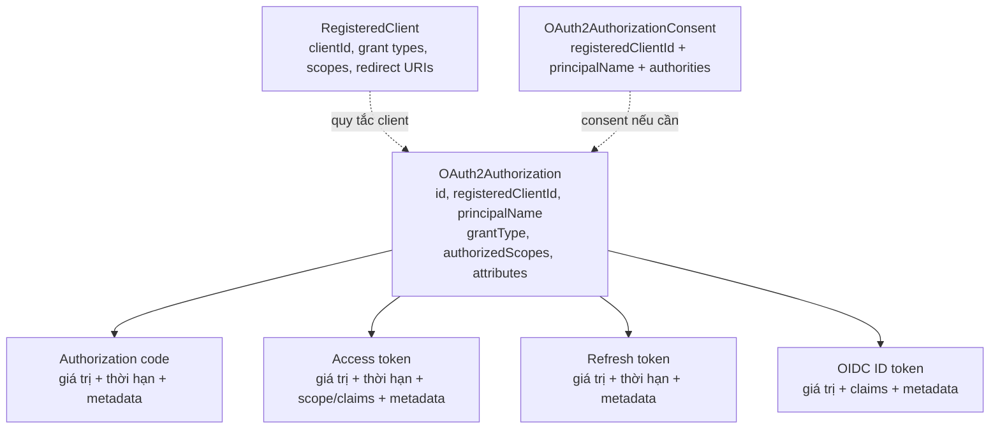
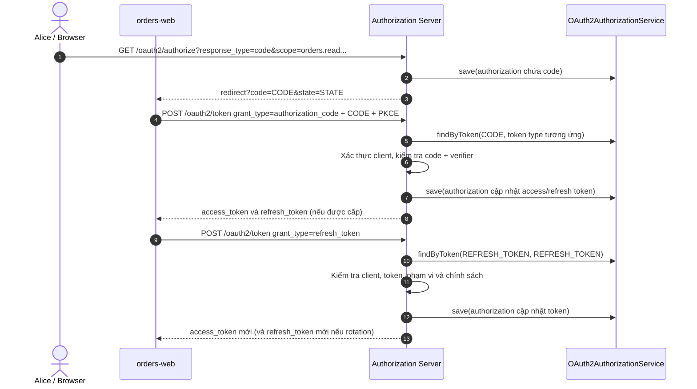

# OAuth2Authorization và tập hợp token gắn với một authorization

## 1. Bối cảnh: một lần ủy quyền có thể sinh nhiều token

Trong **Spring Security OAuth 2.0 / OpenID Connect Authorization Server** được xây bằng **Spring Boot** và **Spring Authorization Server**, một lần ứng dụng được cấp quyền không nhất thiết chỉ tạo ra một access token. Khi người dùng thực hiện Authorization Code Flow, hệ thống có thể phát sinh authorization code, access token, refresh token và, nếu dùng OpenID Connect (OIDC), ID token. Trong các lần làm mới tiếp theo, access token mới lại được phát hành mà không cần người dùng đi qua màn hình đăng nhập và chấp thuận lần nữa.

Để quản lý chuỗi sự kiện này, Spring Authorization Server sử dụng **`OAuth2Authorization`**: mô hình miền đại diện cho một **authorization đã được tạo cho một client và principal**, cùng trạng thái, phạm vi quyền và các token liên quan. Đây là nội dung trọng tâm của chương **Mô hình dữ liệu** thuộc mô-đun **SPRING_SECURITY_OAUTH2_OIDC_AUTHORIZATION_SERVER**.

Ví dụ: một ứng dụng `orders-web` xin quyền `orders.read` thay mặt `alice`. Sau khi Alice đăng nhập, Authorization Server tạo authorization code, đổi nó thành access token và có thể cấp thêm refresh token. Tất cả đều thuộc về **cùng một OAuth2Authorization** trong vòng đời authorization tương ứng.

> **Ý chính:** `OAuth2Authorization` là hồ sơ trạng thái ủy quyền phía Authorization Server; token là những giá trị và trạng thái được gắn trong hồ sơ đó. Một authorization có thể chứa nhiều **loại** token, nhưng không nên mặc định rằng một bản ghi đang giữ toàn bộ lịch sử mọi token từng phát hành.

### Mục tiêu học tập

Sau bài này, bạn có thể:

1. Nhận diện `OAuth2Authorization` và phân biệt nó với `RegisteredClient`, `OAuth2AuthorizationConsent` và JWT.
2. Đọc các thuộc tính, token wrapper, metadata và trạng thái token trong aggregate.
3. Giải thích vòng đời authorization code, access token, refresh token và OIDC ID token.
4. Dùng `OAuth2AuthorizationService` để lưu, tìm và xóa một authorization.
5. Quyết định khi nào dùng lưu trữ trong bộ nhớ, JDBC và cách vận hành trên nhiều instance.
6. Tránh nhầm lẫn giữa trạng thái đã lưu và kết quả kiểm tra Bearer token ở Resource Server.

## 2. Authorization là gì trong mô hình Spring Authorization Server?

OAuth 2.0 mô tả một **authorization grant** như căn cứ để client lấy access token. Trong Spring Authorization Server, lớp **`OAuth2Authorization`** cụ thể hóa trạng thái cấp quyền mà server cần giữ khi thực thi grant. Nó được tạo/cập nhật trong các bước liên quan tới authorization endpoint, token endpoint và các endpoint quản lý token.

Hãy phân biệt bốn thực thể:

| Thực thể | Trả lời câu hỏi | Đặc điểm |
| --- | --- | --- |
| **`RegisteredClient`** | Client **được phép** dùng grant, redirect URI, scope và cách xác thực nào? | Cấu hình đăng ký client; không phải phiên cấp token |
| **`OAuth2AuthorizationConsent`** | Resource Owner đã **chấp thuận** những quyền nào cho client? | Trạng thái consent của cặp principal–client; có thể tồn tại qua nhiều lần authorization |
| **`OAuth2Authorization`** | Authorization cụ thể này **đang ở trạng thái nào**, đã cấp/đang giữ những token gì? | Aggregate vòng đời grant/token, nhận diện bằng ID riêng |
| **Access token / JWT** | Client có bằng chứng nào để **truy cập Resource Server**? | Token được mang theo lời gọi API; JWT có thể được kiểm tra cục bộ |

Một người dùng có thể có nhiều authorization khác nhau, kể cả với cùng client, do khác lần cấp quyền, phiên hoặc loại grant. **Không coi `principalName` hoặc `registeredClientId` là khóa duy nhất của bản ghi.** `OAuth2Authorization.id` là định danh bản ghi authorization cụ thể.

### Sơ đồ quan hệ khái niệm



Các mũi tên nét đứt thể hiện mối liên hệ nghiệp vụ, **không phải khóa ngoại bắt buộc** cho mọi lựa chọn lưu trữ. Một authorization thực tế chỉ chứa những loại token phù hợp với grant và tính năng đã bật. Ví dụ, `client_credentials` không có người dùng tương tác, authorization code hoặc ID token; Authorization Code không có `id_token` nếu client không yêu cầu OIDC hợp lệ.

## 3. Thành phần và thuộc tính của `OAuth2Authorization`

Các thành phần quan trọng của mô hình:

| Thuộc tính / API | Ý nghĩa | Sử dụng |
| --- | --- | --- |
| `id` / `getId()` | Định danh của authorization | Tra cứu, cập nhật và quản lý vòng đời bản ghi |
| `registeredClientId` / `getRegisteredClientId()` | ID **nội bộ** của `RegisteredClient` liên quan | Ràng buộc authorization với client đã đăng ký |
| `principalName` / `getPrincipalName()` | Tên principal mà AS dùng cho authorization | Authorization Code thường là tên người dùng; client credentials thường đại diện chính client |
| `authorizationGrantType` / `getAuthorizationGrantType()` | Grant/cơ chế đã tạo authorization | Ví dụ `authorization_code` hoặc `client_credentials` |
| `authorizedScopes` / `getAuthorizedScopes()` | Các scope đã được cấp trong authorization | Phân biệt với scope **đề nghị** của client và scope client được đăng ký |
| `attributes` / `getAttributes()` | Dữ liệu nội bộ của quy trình ủy quyền | Chẳng hạn Authentication, request context, state hoặc thông tin được framework sử dụng |
| Tập token | Code và token được liên kết với authorization | Tra cứu token theo loại, kiểm tra hạn và trạng thái |

`registeredClientId` ở đây thường là ID nội bộ sử dụng bởi repository, **khác với** giá trị public `clientId` mà client gửi trong HTTP request. Để hiển thị client ID, có thể dùng `RegisteredClientRepository.findById(authorization.getRegisteredClientId())`.

**Scope qua hai tầng:** `RegisteredClient.scopes` là những scope client *có thể yêu cầu*. `OAuth2Authorization.authorizedScopes` là những scope được AS cho phép trong authorization đó; scope thực tế trong access token còn có thể phụ thuộc grant, token context và chính sách phát hành. Khi kiểm soát truy cập API, Resource Server phải kiểm tra **token đang được sử dụng** có scope/authority cần thiết.

### Lớp bao quanh token: `OAuth2Authorization.Token<T>`

Spring Authorization Server không chỉ giữ chuỗi ký tự của token. Bên trong `OAuth2Authorization`, mỗi token liên quan được biểu diễn dưới dạng `OAuth2Authorization.Token<T>` với `T extends OAuth2Token`:

```text
OAuth2Authorization
  ├── id / registeredClientId / principalName / grantType / scopes
  ├── attributes: thông tin thuộc quy trình ủy quyền
  ├── Token<OAuth2AuthorizationCode>
  │     ├── token: giá trị code và issuedAt/expiresAt
  │     └── metadata: trạng thái (ví dụ invalidated)
  ├── Token<OAuth2AccessToken>
  │     ├── token: giá trị, kiểu Bearer, issuedAt/expiresAt, scopes
  │     └── metadata: trạng thái và claims nếu được lưu
  ├── Token<OAuth2RefreshToken>
  │     ├── token: giá trị và issuedAt/expiresAt
  │     └── metadata: trạng thái
  └── Token<OidcIdToken> (nếu OIDC)
        ├── token: giá trị và claims ID token
        └── metadata: trạng thái
```

Khái niệm cần tách:

- **`getToken()`** trên wrapper: trả về đối tượng token có giá trị và thông tin thời gian.
- **`getMetadata()`**: metadata nội bộ gắn với token, được AS sử dụng để đánh dấu trạng thái và lưu thông tin xử lý.
- **`getClaims()`** trên wrapper: các claim đã được lưu trong metadata cho token tương ứng, **nếu có**. Đừng giả định mọi token opaque hoặc mọi phiên bản lưu trữ đều có bộ claim tương đương JWT.
- **`isExpired()`**, **`isInvalidated()`**, **`isActive()`**: các phép kiểm tra trạng thái của wrapper. Về mặt ý nghĩa, token chỉ *active* khi chưa hết hạn và chưa bị đánh dấu vô hiệu trong trạng thái lưu.

Metadata của authorization/token là **trạng thái phía server**, không đồng nghĩa dữ liệu được công khai cho client. Không đưa toàn bộ `attributes` hoặc `metadata` trực tiếp vào API response.

### Những loại token thường gặp

| Loại dữ liệu | Kiểu Java tiêu biểu | Xuất hiện trong ngữ cảnh | Công dụng |
| --- | --- | --- | --- |
| Authorization code | `OAuth2AuthorizationCode` | Authorization Code Flow | Mã ngắn hạn, một lần để đổi token |
| Access token | `OAuth2AccessToken` | Các grant phát access token | Gọi Resource Server |
| Refresh token | `OAuth2RefreshToken` | Khi client/flow/policy cho phép | Xin access token mới |
| OIDC ID token | `OidcIdToken` | Yêu cầu OIDC có scope `openid` | Chứng minh kết quả xác thực cho Relying Party |
| Device code / user code | `OAuth2DeviceCode` / `OAuth2UserCode` | Device Authorization Flow nếu được hỗ trợ/bật | Kết nối phiên trên thiết bị hạn chế nhập liệu với bước người dùng xác minh |

**Authorization code không phải access token**, còn **ID token không dành để gọi API**. Hai token có thể đều là JWT nhưng phục vụ đối tượng và mục đích bảo mật khác nhau.

## 4. Vòng đời: từ authorization code tới refresh token

Xét một client confidential tên `orders-web`, có grant `authorization_code` và `refresh_token`, được phép xin scope `orders.read`. Người dùng `alice` đã đăng nhập và, nếu chính sách yêu cầu, chấp thuận quyền.



**Giai đoạn 1 — cấp code:** sau khi authorization request được chấp nhận, AS lưu authorization với code và các thông tin để ràng buộc về sau: client, principal, scope, redirect URI/PKCE theo cơ chế xử lý. Code có thời hạn ngắn và chỉ được trao đổi một lần.

**Giai đoạn 2 — đổi code:** token endpoint tìm bản ghi có code được gửi, kiểm tra client authentication, code, redirect URI, PKCE cùng chính sách. Sau khi thành công, AS cập nhật authorization với access token và, nếu phù hợp, refresh token; code không còn được chấp nhận để đổi token lần nữa. Hệ thống có thể giữ dấu vết code ở trạng thái đã vô hiệu hóa thay vì xóa ngay.

**Giai đoạn 3 — refresh:** token endpoint tra cứu authorization bằng refresh token còn hiệu lực. AS có thể phát access token mới và tùy cấu hình quay vòng refresh token. Bản ghi authorization hiện tại được cập nhật để phản ánh token mới, thay vì mặc nhiên tạo thêm một authorization mới cho mỗi lần refresh.

**Giai đoạn 4 — hết hạn hoặc thu hồi:** token có thể hết hạn theo `expiresAt` hoặc bị đánh dấu vô hiệu. Nếu access token hết hạn trong khi refresh token còn hợp lệ, client có thể refresh theo chính sách. Khi refresh token hết hạn/thu hồi hoặc authorization bị xóa, không thể tiếp tục refresh bằng token đó.

### Trạng thái theo thời điểm

| Thời điểm | Authorization code | Access token | Refresh token |
| --- | --- | --- | --- |
| Sau authorization request thành công | Đang hợp lệ trong thời gian ngắn | Chưa phát | Chưa phát |
| Sau đổi code thành công | Không được đổi lại | Đang hoạt động | Có thể được cấp |
| Sau access token hết hạn | Không còn sử dụng | Hết hạn | Có thể vẫn hoạt động |
| Sau refresh thành công | Không đổi | Access token mới | Tiếp tục hoặc được thay mới theo chính sách |
| Sau khi refresh token bị thu hồi | Không đổi | Trạng thái tùy chính sách thu hồi | Không còn được dùng để refresh |

Các hàng mô tả hành vi điển hình của Spring Authorization Server; chi tiết rotation, lưu vết, thu hồi dây chuyền và thời hạn tùy **`TokenSettings`**, loại client và phiên bản framework. Không hiểu bảng trên là cam kết rằng hệ thống giữ mọi token cũ trong bộ nhớ vô hạn.

## 5. API đọc `OAuth2Authorization` và trạng thái token

Spring Authorization Server cung cấp API để đọc token **theo loại**, thay vì xử lý một chuỗi JSON tự thiết kế. Hai phương thức thường gặp là:

```java
OAuth2Authorization.Token<OAuth2AccessToken> access = authorization.getAccessToken();
OAuth2Authorization.Token<OAuth2RefreshToken> refresh = authorization.getRefreshToken();
```

Đối với loại token khác, sử dụng `authorization.getToken(TokenClass.class)` với lớp token tương ứng. Các phương thức này có thể trả về `null` nếu authorization chưa hoặc không bao giờ có loại token đó. **Không giả định** mọi authorization đều có access token, refresh token, authorization code lẫn OIDC ID token cùng lúc.

### Ví dụ: đọc authorization bằng access token

Đoạn Java minh họa truy vấn trạng thái server từ một access token đã nhận, chạy **bên trong Authorization Server** hoặc thành phần được phép truy cập `OAuth2AuthorizationService`. Nó không phải API công khai để người dùng bất kỳ tra cứu token:

```java
package com.example.authserver;

import java.time.Instant;
import java.util.Set;
import java.util.Optional;

import org.springframework.security.oauth2.core.OAuth2AccessToken;
import org.springframework.security.oauth2.core.OAuth2TokenType;
import org.springframework.security.oauth2.server.authorization.OAuth2Authorization;
import org.springframework.security.oauth2.server.authorization.OAuth2AuthorizationService;
import org.springframework.stereotype.Service;

@Service
public class AuthorizationInspector {
    private final OAuth2AuthorizationService authorizations;

    public AuthorizationInspector(OAuth2AuthorizationService authorizations) {
        this.authorizations = authorizations;
    }

    public Optional<AuthorizationSummary> findByAccessToken(String rawAccessToken) {
        // Chỉ tra cứu token trong phạm vi hệ thống được ủy quyền.
        OAuth2Authorization authorization =
                authorizations.findByToken(
                        rawAccessToken, OAuth2TokenType.ACCESS_TOKEN);

        if (authorization == null) {
            return Optional.empty();
        }

        OAuth2Authorization.Token<OAuth2AccessToken> wrapper =
                authorization.getAccessToken();
        if (wrapper == null
                || !wrapper.getToken().getTokenValue().equals(rawAccessToken)) {
            return Optional.empty();
        }

        return Optional.of(new AuthorizationSummary(
                authorization.getId(),
                authorization.getRegisteredClientId(),
                authorization.getPrincipalName(),
                authorization.getAuthorizationGrantType().getValue(),
                authorization.getAuthorizedScopes(),
                wrapper.isActive(),
                wrapper.isExpired(),
                wrapper.isInvalidated(),
                wrapper.getToken().getExpiresAt()));
    }

    public record AuthorizationSummary(
            String authorizationId,
            String registeredClientId,
            String principalName,
            String grantType,
            Set<String> authorizedScopes,
            boolean accessTokenActive,
            boolean accessTokenExpired,
            boolean accessTokenInvalidated,
            Instant accessTokenExpiresAt) {
    }
}
```

**Giải thích quan trọng:**

- `findByToken(value, OAuth2TokenType.ACCESS_TOKEN)` trả về **authorization sở hữu token phù hợp**, không trực tiếp trả về một `Jwt` đã xác minh.
- `getAccessToken()` cho thông tin token hiện gắn với authorization. Đoạn kiểm tra giá trị khớp nhằm tránh hiểu nhầm bản ghi tra cứu với một token khác của cùng authorization.
- `isActive()` cho biết trạng thái server đang lưu theo hạn và cờ invalidation; **không tự xác minh mật mã/chữ ký JWT** đã đưa vào truy vấn. Muốn chấp nhận Bearer JWT ở Resource Server phải dùng JWT decoder/validator.
- Bản tóm tắt cố ý **không trả token value, refresh token, code, claims chứa PII hoặc toàn bộ attributes**. Khi xây màn hình quản trị cũng cần kiểm soát truy cập, logging và dữ liệu được phép hiển thị.

Ví dụ nếu muốn kiểm tra còn refresh token không:

```java
OAuth2Authorization.Token<OAuth2RefreshToken> refresh =
        authorization.getRefreshToken();

boolean canAttemptRefresh = refresh != null && refresh.isActive();
```

`canAttemptRefresh` chỉ là **điều kiện cần** theo trạng thái token; token endpoint vẫn phải xác thực client, kiểm tra ràng buộc token–client, grant, scope và các quy tắc giao thức trước khi phát hành token mới. Không dựa vào biến này để bỏ qua các kiểm tra bảo mật.

### Metadata, claims và trạng thái không phải là một thứ

Ví dụ một access token có:

```text
token value: eyJhbGciOiJSUzI1NiIs... (chỉ là ví dụ)
issuedAt:    2026-01-01T09:00:00Z
expiresAt:   2026-01-01T09:15:00Z
metadata:    {invalidated: false, ...}
claims:      {iss: "...", sub: "alice", aud: ["orders-api"], scope: "orders.read", ...}
```

Ba lớp thông tin phục vụ mục đích khác nhau:

1. **Token value** là giá trị client thực sự mang tới endpoint; với JWT nó chứa payload được ký, với opaque token thường là chuỗi khó đoán.
2. **Metadata phía AS** cho biết hệ thống lưu trạng thái như hết hạn/đã bị vô hiệu; phần này không cần hiện diện trong JWT.
3. **Claims** là các khẳng định đi kèm token được phát hành. Việc wrapper có giữ bản sao các claims và cấu trúc lưu cụ thể phụ thuộc token generator/mapper và phiên bản framework.

Trạng thái `isActive()` không phải bằng chứng token có đúng `aud`, `scope` hoặc chữ ký; ngược lại, JWT có chữ ký hợp lệ vẫn có thể đã bị AS thu hồi mà Resource Server chỉ kiểm tra JWT cục bộ chưa biết được.

## 6. `OAuth2AuthorizationService`: kho lưu trạng thái authorization

Đây là interface trung tâm quản lý vòng đời `OAuth2Authorization`. Những thao tác chính:

| Phương thức | Hành vi | Ví dụ sử dụng |
| --- | --- | --- |
| `save(OAuth2Authorization)` | Tạo mới hoặc cập nhật authorization | Lưu sau cấp code, đổi token hoặc thay đổi trạng thái token |
| `remove(OAuth2Authorization)` | Xóa authorization khỏi kho | Dọn dẹp/thu hồi theo thiết kế hệ thống |
| `findById(String id)` | Tìm authorization theo ID | Xem trạng thái authorization cụ thể |
| `findByToken(String token, OAuth2TokenType type)` | Tìm authorization theo giá trị token và loại token | Token exchange, refresh, introspection hoặc revocation |

`save` thường là thao tác **upsert theo ID** của authorization. Khi xử lý nhiều token thuộc cùng authorization, application không cần tự quản một bảng token riêng cho từng bước; AS dùng service để tìm và cập nhật aggregate. Dù vậy, cách lưu vật lý và xử lý cạnh tranh giữa request phụ thuộc triển khai repository/service.

### Ví dụ cấu hình kho lưu trong bộ nhớ

```java
import org.springframework.context.annotation.Bean;
import org.springframework.security.oauth2.server.authorization.OAuth2AuthorizationService;
import org.springframework.security.oauth2.server.authorization.InMemoryOAuth2AuthorizationService;

@Bean
OAuth2AuthorizationService authorizationService() {
    return new InMemoryOAuth2AuthorizationService();
}
```

Phù hợp demo hoặc test đơn giản với một tiến trình. Khi khởi động lại, authorization/code/refresh token không còn; trên nhiều instance không chia sẻ state thì browser authorize ở instance A và token exchange ở instance B có thể không tìm thấy authorization code.

### Ví dụ cấu hình JDBC cho môi trường cần lưu bền vững

```java
import org.springframework.context.annotation.Bean;
import org.springframework.jdbc.core.JdbcTemplate;
import org.springframework.security.oauth2.server.authorization.OAuth2AuthorizationService;
import org.springframework.security.oauth2.server.authorization.client.RegisteredClientRepository;
import org.springframework.security.oauth2.server.authorization.JdbcOAuth2AuthorizationService;

@Bean
OAuth2AuthorizationService authorizationService(
        JdbcTemplate jdbcTemplate,
        RegisteredClientRepository registeredClients) {
    return new JdbcOAuth2AuthorizationService(jdbcTemplate, registeredClients);
}
```

Ví dụ này giả định ứng dụng đã cấu hình `DataSource`, `JdbcTemplate` và `RegisteredClientRepository` tương thích, đồng thời tạo schema SQL **`oauth2_authorization`** theo script chính thức của phiên bản Spring Authorization Server đang dùng. Không chỉ thêm bean là tự tạo đầy đủ các bảng.

Trong JDBC, các cột được thiết kế để lưu định danh authorization, client, principal, grant, scopes, attributes và các nhóm giá trị/thời hạn/metadata cho từng loại token. Tên cột, kiểu dữ liệu và cách serialize có thể thay đổi giữa phiên bản; **không nên tự tạo schema bằng cách đoán từ API Java**. Đặc biệt lưu ý giới hạn độ dài cột cho JWT/claims, kiểu dữ liệu large object, khóa/chỉ mục tìm token và quy trình nâng cấp schema.

### Lưu ý về cấp quyền và dữ liệu liên quan

Lưu `OAuth2Authorization` **không thay thế** hai kho khác:

- `RegisteredClientRepository` lưu cấu hình client, grant types, scopes, token settings và redirect URIs. Khi AS xử lý code/refresh, phải kiểm tra client hiện được phép hoạt động với cấu hình đó.
- `OAuth2AuthorizationConsentService` lưu sự chấp thuận của Resource Owner đối với các authority/scope khi ứng dụng yêu cầu consent. Consent có thể được dùng lại cho lần authorization khác theo chính sách, trong khi `OAuth2Authorization` chỉ mô tả một authorization cụ thể.

Nếu cần triển khai production, cần phối hợp nhất quán **ba kho**: registered clients, authorizations và consents; cùng với khóa ký, issuer, các phương thức xác thực người dùng và cơ chế giám sát.

## 7. Phân biệt phạm vi quyền, token và danh tính

Tình huống: RegisteredClient cho phép `orders.read`, `orders.write`; người dùng Alice chỉ đồng ý `orders.read`. Khi phát access token, token đó mang `orders.read`.

```text
RegisteredClient.scopes
    = {orders.read, orders.write}

OAuth2Authorization.authorizedScopes
    = {orders.read}

OAuth2AccessToken.scopes
    = {orders.read}    // ví dụ khi access token giữ đúng phạm vi đã cấp

Resource Server cần authority
    = SCOPE_orders.read
```

Nếu client cố gọi `POST /api/orders` đòi `orders.write` bằng token chỉ có `orders.read`, API phải từ chối theo chính sách. **Không suy rằng token có mọi scope đã cấu hình ở RegisteredClient.**

### Client credentials và principalName

Với `authorization_code`, principal thường là người dùng đã xác thực. Với `client_credentials`, principal thường biểu diễn **client được xác thực**, bởi grant này không mang phiên đăng nhập của người dùng cuối. Vì vậy:

- Đừng dựa chỉ vào `principalName` để khẳng định authorization đại diện người dùng.
- Phải đọc thêm `authorizationGrantType` và mô hình xác thực/cấp quyền của dịch vụ.
- Resource Server cần thiết kế quyền riêng cho service token, không gán mặc định quyền thao tác dữ liệu của một người dùng.

### OIDC ID token cùng authorization

Khi dùng Authorization Code Flow và yêu cầu `openid` hợp lệ, một authorization có thể gắn thêm `OidcIdToken`. Nó mô tả sự kiện xác thực, chứa claim như `iss`, `sub`, `aud` (client ID), `iat`, `exp` và có thể có `nonce`. ID token được **OIDC client/Relying Party** xác minh để đăng nhập; nó không thay access token. Một bản ghi `OAuth2Authorization` có cả access token và ID token **không có nghĩa hai token hoán đổi cho nhau**.

## 8. TokenSettings tác động gì tới aggregate?

Các chính sách token được đặt ở cấu hình client và được server áp dụng khi cấp/đổi token. Ví dụ đoạn cấu hình cho `RegisteredClient.Builder`:

```java
import java.time.Duration;
import org.springframework.security.oauth2.server.authorization.settings.TokenSettings;

TokenSettings settings = TokenSettings.builder()
        .authorizationCodeTimeToLive(Duration.ofMinutes(3))
        .accessTokenTimeToLive(Duration.ofMinutes(15))
        .refreshTokenTimeToLive(Duration.ofDays(7))
        .reuseRefreshTokens(false)
        .build();

// Dùng khi xây RegisteredClient:
// RegisteredClient.withId(...).tokenSettings(settings).build();
```

| Thiết lập | Ảnh hưởng trong vòng đời |
| --- | --- |
| `authorizationCodeTimeToLive` | Code hết hiệu lực sau khoảng ngắn; không đổi thành token được sau hạn |
| `accessTokenTimeToLive` | Access token hết hạn dù authorization/refresh token có thể vẫn tồn tại |
| `refreshTokenTimeToLive` | Giới hạn thời gian dùng refresh token |
| `reuseRefreshTokens(false)` | Yêu cầu quay vòng refresh token trong trường hợp phát hành lại theo cơ chế được hỗ trợ |
| `accessTokenFormat` | Lựa chọn dạng tự chứa (JWT) hoặc tham chiếu (opaque/reference), nếu token generator và cấu hình hỗ trợ |

**Số lượng và khả năng tồn tại của token** chịu ảnh hưởng bởi các thiết lập này. Khi refresh token được thay mới, đừng coi token cũ còn hợp lệ chỉ vì từng nằm trong cùng authorization. Để phòng chống tái sử dụng refresh token trong hệ thống thực tế, cần xét thêm bảo mật phiên, quan sát bất thường và tính nguyên tử khi xử lý request song song.

## 9. Thu hồi, introspection và giới hạn của JWT

Ba hành động thường bị nhầm:

1. **JWT signature validation**: Resource Server xác minh token có chữ ký đúng, issuer, audience, thời hạn và quyền phù hợp.
2. **Introspection**: Resource Server hoặc client được phép hỏi Authorization Server token có còn `active` theo trạng thái server hay không.
3. **Revocation**: client/nhà quản trị yêu cầu vô hiệu token theo giao thức và chính sách, thường làm thay đổi trạng thái authorization/token lưu ở server.

Khi AS sử dụng `OAuth2AuthorizationService`, nó có thể tìm authorization sở hữu token và xem cờ invalidation hoặc hạn token. Endpoint introspection thông thường nhận request:

```http
POST /oauth2/introspect HTTP/1.1
Host: auth.example.com
Authorization: Basic <credentials-of-authorized-client>
Content-Type: application/x-www-form-urlencoded

token=ACCESS_TOKEN_VALUE
```

Khi token hợp lệ theo chính sách, response có thể chứa `"active": true` cùng các thuộc tính khác. Nếu token không tồn tại, đã hết hạn hoặc bị vô hiệu thì thường nhận `"active": false`. Không nên thiết kế giao diện tự công bố dữ liệu nhạy cảm từ nội bộ authorization cho bất kỳ bên gọi nào; introspection endpoint yêu cầu client authentication/authorization theo cấu hình.

### Một tình huống dễ bỏ sót: JWT đã bị revoke

Giả sử một JWT access token có:

```text
iat = 09:00
exp = 09:15
revocation request đến AS lúc 09:05
Resource Server kiểm tra chữ ký JWT cục bộ lúc 09:06
```

Nếu Resource Server **chỉ** dựa vào chữ ký, `iss`, `aud`, `exp` và scopes, JWT vẫn có thể qua kiểm tra tại 09:06; Resource Server không tự biết cờ vô hiệu vừa được lưu ở `OAuth2Authorization`. Tùy mục tiêu bảo mật, có thể cân nhắc token sống ngắn, introspection online, danh sách denylist hoặc cơ chế quản lý phiên/thu hồi có hiệu lực phù hợp. Mỗi cách có đánh đổi về độ trễ, độ sẵn sàng và độ phức tạp.

**Không đồng nhất hai câu sau:**

- "`OAuth2Authorization.Token.isActive()` là `false`" — Authorization Server đang coi token không còn hoạt động theo trạng thái lưu.
- "Mọi Resource Server đã ngừng chấp nhận token" — điều này còn phụ thuộc cách từng Resource Server xác minh trạng thái thu hồi.

### Khi nào xóa cả authorization?

`remove(authorization)` xóa bản ghi authorization khỏi kho. Đây là thao tác rộng hơn việc đánh dấu **một token cụ thể** bị vô hiệu. Xóa toàn bộ authorization có thể làm mất dữ liệu cần thiết để refresh, introspection, chẩn đoán hoặc phục vụ xử lý các token khác cùng authorization. Với yêu cầu chỉ thu hồi một access token, nên để thành phần xử lý revocation chính thức của AS quản lý token/metadata theo đúng giao thức và chính sách, thay vì tùy tiện xóa cả aggregate trong application code.

## 10. Các tình huống mô hình thường gặp

### Tình huống A: cùng client, cùng user nhưng nhiều authorization

Alice mở `orders-web` trên laptop và điện thoại; cả hai lần đều trải qua Authorization Code Flow. Hệ thống **có thể** tạo hai bản ghi authorization khác nhau dù `principalName = alice` và cùng `registeredClientId`. Khi logout khỏi một thiết bị, không được mặc nhiên suy rằng đã vô hiệu tất cả authorization của Alice; chính sách logout và session/token revocation phải được thiết kế cụ thể.

### Tình huống B: chỉ có access token, không có refresh token

Một client `service-report` dùng `client_credentials` có thể nhận access token nhưng **không có** authorization code, ID token hoặc refresh token. Nếu code thao tác theo giả định `authorization.getRefreshToken().isActive()` luôn hợp lệ, có thể ném `NullPointerException`. Hãy kiểm tra sự tồn tại của token theo loại grant trước khi sử dụng.

### Tình huống C: đổi code lần hai

Sau khi đổi authorization code thành token, client gửi lại đúng code. AS tìm được hoặc nhận diện code đã dùng/hết hiệu lực và từ chối với lỗi như `invalid_grant`. Việc code có còn nằm trong trạng thái lưu hay không **không** đồng nghĩa còn có thể sử dụng.

### Tình huống D: refresh rotation khi hai request đến đồng thời

Hai tab hoặc hai worker cùng gửi một refresh token gần như đồng thời. Nếu mỗi request đều đọc trạng thái cũ rồi ghi trạng thái mới không kiểm soát concurrency, có thể gây tranh chấp bản ghi, vô tình phát nhiều token hoặc làm mất cập nhật. Một ứng dụng nhiều instance cần xác định cách quản lý cạnh tranh ở tầng lưu trữ/giao thức và kiểm thử trường hợp refresh song song. Đừng tự giả định rằng chỉ dùng JDBC sẽ tự động giải quyết tất cả tình huống race condition.

### Tình huống E: muốn truy vấn mọi authorization của một người dùng

Interface `OAuth2AuthorizationService` chuẩn hỗ trợ tìm theo ID hoặc token. Nó **không mặc định công bố API liệt kê tất cả authorization theo principalName**. Nếu sản phẩm cần màn hình "thiết bị đang đăng nhập", phải thiết kế truy vấn/index và quy tắc phân quyền quản trị bổ sung, xử lý dữ liệu nhạy cảm và tính nhất quán của phiên với token. Đừng viết một vòng `findByToken` giả để thay thế chức năng truy vấn danh sách.

## 11. Kiểm thử mô hình authorization một cách có ý nghĩa

Kiểm thử không nên dừng ở việc token endpoint trả HTTP 200. Mục tiêu là chứng minh **aggregate có thông tin đúng và trạng thái thay đổi phù hợp với grant**.

| Kịch bản | Dữ liệu cần quan sát | Kết quả mong đợi |
| --- | --- | --- |
| Authorization Code Flow thành công | `registeredClientId`, principal, grant type, scopes và code | Authorization gắn đúng client/principal, code ngắn hạn |
| Đổi code thành access token | Trạng thái code và `getAccessToken()` | Code không tái sử dụng; access token tồn tại và đang active |
| Có refresh token | `getRefreshToken()` | Token xuất hiện khi client/flow được phép; không giả định với mọi grant |
| Dùng refresh token hợp lệ | Authorization trước/sau khi refresh | Token được cập nhật theo chính sách reuse/rotation |
| Cố dùng code lại | Token endpoint / trạng thái authorization | Từ chối; không phát access token mới từ code đã sử dụng |
| Refresh token sai hoặc hết hạn | `findByToken`, `isActive()`, token endpoint | Từ chối bằng lỗi giao thức thích hợp, không phát token |
| Yêu cầu OIDC `openid` | `getToken(OidcIdToken.class)` | Có ID token cho OIDC hợp lệ; không dùng làm Bearer cho API |
| Token đã thu hồi | Metadata và introspection | AS báo token không còn active theo trạng thái thu hồi |
| Resource Server nhận JWT đã thu hồi | Cấu hình validation của API | Kết quả phản ánh chiến lược thu hồi đã chọn; test cả xác minh offline và online |
| Khởi động lại hoặc chuyển node | Kho authorization dùng chung | JDBC/cluster tìm được authorization đang hợp lệ và cập nhật đúng |
| Chạy refresh song song | Trạng thái cuối và token đã cấp | Không mất cập nhật hoặc chấp nhận token trái với chính sách rotation |

### Một chuỗi bài tập tự kiểm chứng

1. Đăng ký một client Authorization Code được phép xin scope `orders.read`, sử dụng PKCE.
2. Đăng nhập bằng một người dùng và hoàn tất authorization request. Kiểm tra authorization được lưu và có code tương ứng.
3. Đổi code tại token endpoint; tra cứu lại authorization bằng access token, đối chiếu principal, grant và scopes.
4. Dùng `getAccessToken().isActive()` để xem trạng thái lưu, rồi dùng Spring Security Resource Server kiểm tra JWT trước một API yêu cầu `SCOPE_orders.read`. Giải thích vì sao hai phép kiểm tra này khác nhau.
5. Gửi lại authorization code cũ; ghi nhận token endpoint từ chối.
6. Nếu có refresh token, thử refresh và quan sát trạng thái access/refresh token sau cập nhật.
7. Thu hồi một token qua cơ chế được hỗ trợ; gọi introspection và so sánh với hành vi xác minh JWT cục bộ.
8. Khởi động lại ứng dụng với kho in-memory, rồi với kho bền vững; nhận xét sự khác biệt trong khả năng tra cứu authorization.

### Câu hỏi kiểm tra tư duy

**Câu 1.** Có `RegisteredClient` và tài khoản Alice đã đăng nhập, tại sao chưa đủ để gọi API?  
**Trả lời:** Client được đăng ký và người dùng đã xác thực chưa chứng minh rằng một access token hợp lệ với scope/audience đúng đã được cấp và gửi tới API.

**Câu 2.** Một `OAuth2Authorization` có hai loại token khác nhau nghĩa là có hai lần ủy quyền riêng biệt?  
**Trả lời:** Không. Authorization Code Flow có thể lưu code, access token, refresh token và ID token (nếu OIDC) trong **cùng một authorization**.

**Câu 3.** `getAccessToken().isActive() == true` có bảo đảm JWT có chữ ký đúng và API phải cho phép truy cập?  
**Trả lời:** Không. Phải kiểm tra chữ ký, issuer, audience, lifetime và quyền ở Resource Server theo chính sách.

**Câu 4.** Xóa `OAuth2Authorization` có giống xóa `OAuth2AuthorizationConsent`?  
**Trả lời:** Không. Authorization ghi trạng thái một lần cấp quyền/token; consent ghi quyết định chấp thuận của người dùng theo cặp client–principal và cơ chế lưu của server.

**Câu 5.** Có thể tìm tất cả authorization của Alice bằng phương thức chuẩn `findByPrincipalName` trên interface `OAuth2AuthorizationService` không?  
**Trả lời:** Không. Interface chuẩn chỉ có truy vấn theo ID và token; cần thiết kế thành phần tra cứu bổ sung nếu có nhu cầu.

## 12. Các lưu ý thiết kế, bảo mật và vận hành

Khi xây dựng và vận hành Authorization Server bằng Spring Security, `OAuth2Authorization` là dữ liệu nhạy cảm. Cần chú ý:

- **Bảo vệ giá trị token ở nơi lưu trữ:** access/refresh token, authorization code và attributes có thể chứa secret hoặc thông tin nhận diện. Hạn chế quyền DB, mã hóa kênh kết nối, quản lý backup và tránh đưa token ra log.
- **Không trả cả aggregate cho client:** `attributes` có thể chứa authentication/context nội bộ; `metadata` không được thiết kế thành API response chung.
- **Ổn định schema và serialization:** dùng schema JDBC phù hợp với phiên bản thư viện, có kế hoạch migration, kiểm soát thay đổi Java class/serialization và thử nâng cấp với dữ liệu hiện có.
- **Lưu trữ dùng chung trong cluster:** cấp code ở node A rồi token request ở node B cần nhìn thấy state chung. Đồng thời quản lý cạnh tranh, tính nguyên tử, retry và transaction khi cập nhật cùng authorization.
- **Dọn dẹp token hết hạn:** chính sách lưu trữ retention/cleanup tránh dữ liệu lớn dần. Hạn token không đồng nghĩa bản ghi vật lý tự biến mất ngay.
- **Lưu khóa ký bền vững:** còn authorization trong DB không đủ nếu JWT trước đó được ký bằng khóa đã mất sau restart. Quản lý khóa công khai, private key và JWKS tương thích với TTL token.
- **Quan sát có chọn lọc:** log authorization ID, loại grant, client ID nội bộ, loại token, kết quả xử lý và thời gian theo chính sách; che token value, client secret, password, PKCE verifier và claim nhạy cảm.
- **Kiểm thử toàn luồng:** xác minh cả code exchange, refresh, introspection/revocation, Resource Server JWT validation, OIDC ID token khi bật, cùng thất bại do scope/grant/client không được phép.

### Bản đồ ghi nhớ

```text
RegisteredClient
    "Client được phép làm gì?"
            |
            v
OAuth2AuthorizationConsent (nếu cần)
    "Người dùng chấp thuận quyền nào?"
            |
            v
OAuth2Authorization
    "Authorization cụ thể đang giữ trạng thái gì?"
    id / registeredClientId / principalName / grantType / scopes
    attributes
    Token<authorization code>   [nếu có]
    Token<access token>         [nếu được cấp]
    Token<refresh token>        [nếu được cấp]
    Token<OIDC ID token>        [nếu yêu cầu OIDC]
            |
            v
OAuth2AuthorizationService
    save / remove / findById / findByToken
            |
            v
InMemory hoặc JDBC (state của Authorization Server)

Resource Server:
    kiểm tra Bearer JWT/opaque token theo issuer,
    audience, thời hạn, scope và chính sách thu hồi
```

**Kết luận học thuật:** `OAuth2Authorization` là aggregate quản lý **một authorization và các token liên quan** phía Authorization Server. Nắm được ranh giới giữa bản ghi này, đăng ký client, consent, nội dung token và công việc xác minh của Resource Server giúp thiết kế đúng mô hình lưu trữ, vòng đời token, xử lý thu hồi và kiểm thử OAuth 2.0/OIDC trong Spring Boot.

## Tài liệu đối chiếu

- [Spring Authorization Server Reference](https://docs.spring.io/spring-authorization-server/reference/) — mô hình `OAuth2Authorization`, `OAuth2AuthorizationService`, các provider và endpoint.
- [Spring Security OAuth2 Resource Server](https://docs.spring.io/spring-security/reference/servlet/oauth2/resource-server/index.html) — xác minh JWT, opaque token và authority.
- [RFC 6749 — The OAuth 2.0 Authorization Framework](https://www.rfc-editor.org/rfc/rfc6749) — authorization grant, access token, refresh token và các endpoint.
- [RFC 7009 — OAuth 2.0 Token Revocation](https://www.rfc-editor.org/rfc/rfc7009) — thu hồi token.
- [RFC 7662 — OAuth 2.0 Token Introspection](https://www.rfc-editor.org/rfc/rfc7662) — hỏi trạng thái active của token.
- [OpenID Connect Core 1.0](https://openid.net/specs/openid-connect-core-1_0.html) — ID token và Authorization Code Flow trong OIDC.
