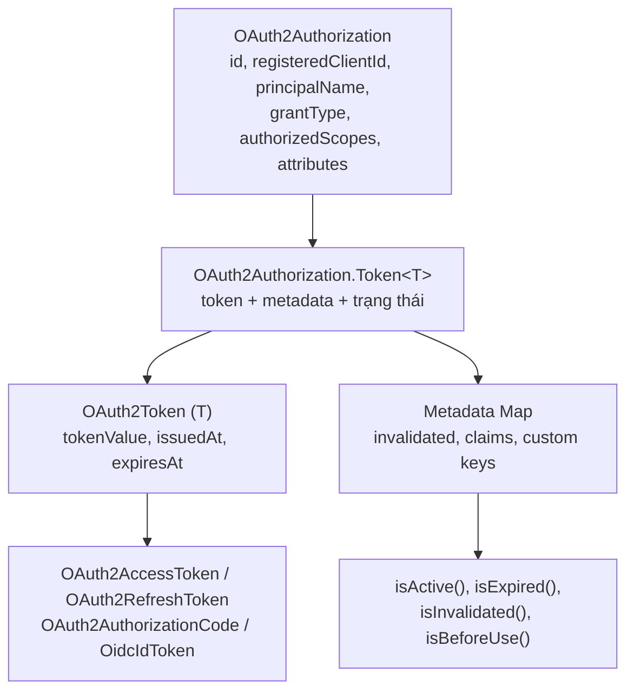
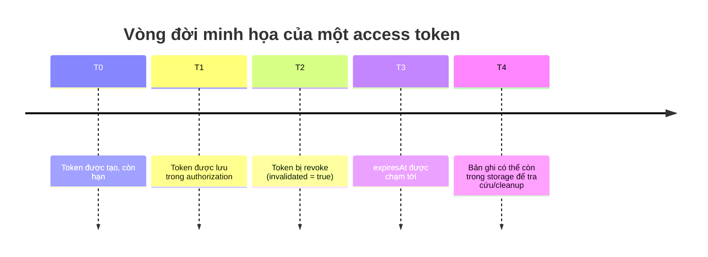
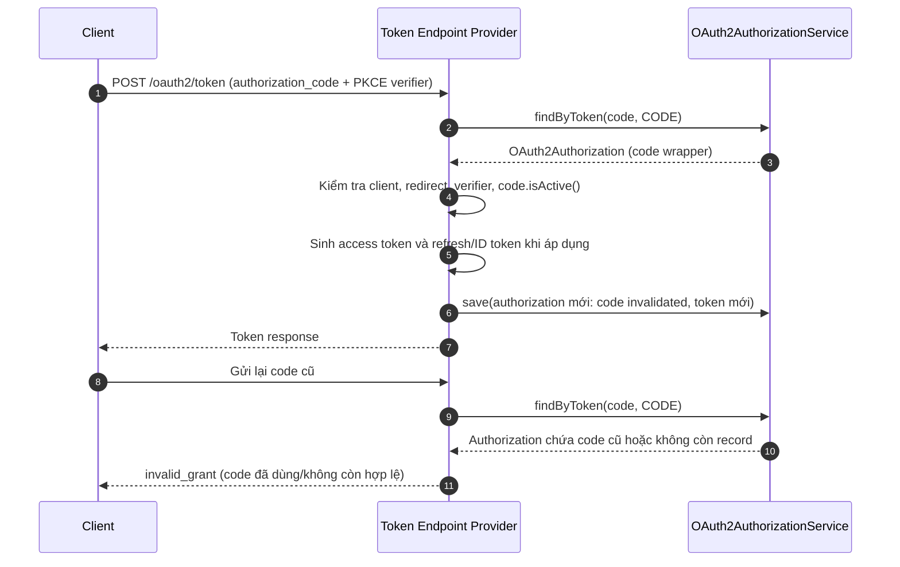
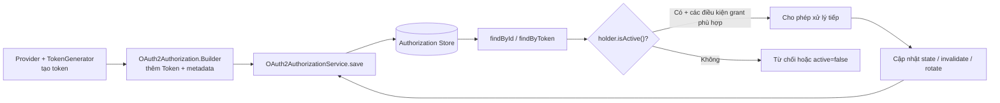
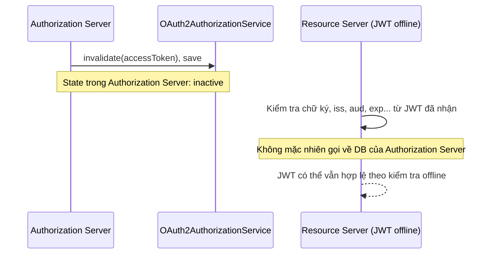

# OAuth2Authorization.Token, metadata và trạng thái hoạt động

## 1. Vì sao cần hiểu mô hình Token bên trong Authorization Server?

Trong **Spring Security OAuth2/OIDC Authorization Server**, việc cấp một access token không chỉ dừng ở việc trả chuỗi ký tự qua `/oauth2/token`. Spring Authorization Server còn cần biết token thuộc lần cấp quyền nào, chủ thể nào, client nào, có những claim gì, đã hết hạn hay đã bị vô hiệu hóa, có thể dùng lại để đổi token mới hay không. Các thông tin này là nền tảng cho Authorization Code, Refresh Token, Token Introspection, Token Revocation, quản trị phiên và kiểm thử bảo mật.

Bài học thuộc chương **Mô hình dữ liệu**, tập trung vào lớp lồng **`OAuth2Authorization.Token<T extends OAuth2Token>`** và ý nghĩa của **metadata** cùng **trạng thái hoạt động** trong ứng dụng **Spring Boot** dùng **Spring Security và Spring Authorization Server**. Đây là mô hình trạng thái *bên trong Authorization Server*; không phải DTO phản hồi từ Token Endpoint hoặc đối tượng mà Resource Server luôn nhận được.

Sau bài này, bạn sẽ hiểu và thực hiện được:

- Đọc đúng quan hệ giữa `OAuth2Authorization`, `OAuth2Authorization.Token` và các lớp token như `OAuth2AccessToken`, `OAuth2RefreshToken`, `OAuth2AuthorizationCode` và `OidcIdToken`.
- Phân biệt **token value**, **claims**, **metadata**, **attributes của authorization** và **trạng thái hiệu lực**.
- Dùng `getToken()`, `getClaims()`, `getMetadata()`, `isActive()`, `isExpired()`, `isInvalidated()`, `isBeforeUse()` đúng mục đích.
- Tạo và cập nhật `OAuth2Authorization` bằng builder, dùng `invalidate(token)` và lưu lại bằng `OAuth2AuthorizationService`.
- Giải thích vì sao token có thể còn nằm trong database nhưng không còn hoạt động, và vì sao revoke JWT phía Authorization Server không lập tức chặn API xác minh JWT hoàn toàn offline.

**Phiên bản API:** Các ví dụ minh họa theo nhóm API **Spring Authorization Server 1.5.x / Spring Security 6.x**. Dòng Spring Security 7.x tích hợp chức năng Authorization Server vào Spring Security và có thể khác về artifact/package hoặc chi tiết cấu hình. Khi triển khai thực tế, dùng tài liệu Javadoc đúng phiên bản mà Spring Boot quản lý.

## 2. Ba lớp cần phân biệt

Trong một authorization được cấp cho client, Spring lưu thông tin theo ba tầng:



### 2.1. `OAuth2Authorization` — trạng thái một lần cấp quyền

`OAuth2Authorization` là đối tượng bao trùm, có thể chứa:

| Thuộc tính | Ý nghĩa |
| --- | --- |
| `id` | ID riêng của authorization, **không phải** `client_id` hay chuỗi access token. |
| `registeredClientId` | ID **nội bộ** của `RegisteredClient` liên quan. |
| `principalName` | Danh tính người dùng; với `client_credentials` có thể đại diện client. |
| `authorizationGrantType` | Loại grant gắn với lần cấp phát, ví dụ `authorization_code` hoặc `client_credentials`. |
| `authorizedScopes` | Phạm vi quyền được cấp cho lần authorization này. |
| Các token | Một hoặc nhiều `OAuth2Authorization.Token<?>`, tùy flow và thời điểm xử lý. |
| `attributes` | Dữ liệu thêm ở **cấp authorization**, chẳng hạn authorization request hoặc thông tin authentication cần cho giao thức. |

Không nên suy ra một authorization luôn có đủ access token, refresh token và ID token. Ví dụ **Client Credentials** thường chỉ có access token; **Authorization Code** có giai đoạn chỉ mới giữ authorization code; **OIDC Authorization Code** có thể có ID token sau khi hoàn tất trao đổi code.

### 2.2. `OAuth2Token` — bản thân giá trị token

Lớp giao diện `OAuth2Token` thể hiện phần dữ liệu cơ bản, gồm:

- `getTokenValue()`: chuỗi mang token (nhạy cảm, không ghi log).
- `getIssuedAt()`: thời điểm phát hành, có thể được dùng trong các kiểm tra thời gian.
- `getExpiresAt()`: thời điểm hết hạn.

Các lớp chuyên biệt bổ sung thông tin tùy token. Ví dụ `OAuth2AccessToken` mang token type và scope; `OidcIdToken` có các claims OIDC. Không phải mọi token đều là JWT, và không phải mọi token value đều có thể giải mã lấy claims ở phía client.

### 2.3. `OAuth2Authorization.Token<T>` — lớp bọc giữ metadata và trạng thái

Đây là lớp lồng của `OAuth2Authorization`, với kiểu generic ràng buộc loại `OAuth2Token` đang lưu. Nó chứa **đối tượng token** cùng **metadata dạng map** và cung cấp các phép đánh giá hiệu lực.

Ví dụ khi có access token:

```java
OAuth2Authorization.Token<OAuth2AccessToken> holder =
        authorization.getAccessToken();

if (holder != null) {
    OAuth2AccessToken accessToken = holder.getToken();
    boolean active = holder.isActive();
    boolean expired = holder.isExpired();
    boolean revoked = holder.isInvalidated();
    Map<String, Object> claims = holder.getClaims();
}
```

*Đoạn mã giả định đã có biến `authorization` kiểu `OAuth2Authorization`, với các import Java/Spring tương ứng.* Ở đây `holder` là lớp bọc, còn `accessToken` là đối tượng token. Không có API `accessToken.isInvalidated()` tương đương: **trạng thái vô hiệu hóa nằm ở lớp bọc**.

## 3. Phân biệt metadata, claims và attributes

Ba loại thông tin thường cùng được gọi chung là “metadata”, nhưng chúng thuộc những phạm vi khác nhau.

| Nơi lưu | API | Ví dụ | Mục đích |
| --- | --- | --- | --- |
| **Authorization attributes** | `authorization.getAttributes()`, `getAttribute(name)` | Authentication, authorization request | Ngữ cảnh của toàn bộ lần cấp quyền |
| **Token metadata** | `holder.getMetadata()`, `getMetadata(name)` | Cờ invalidated, claims và khóa tùy biến | Trạng thái/thông tin **riêng cho một token** |
| **Token claims** | `holder.getClaims()` | `sub`, `iss`, `aud`, `scope`… khi có | Thông tin được generator gắn với token, hoặc giữ phía server |
| **Token value** | `holder.getToken().getTokenValue()` | Chuỗi JWT ba phần hoặc chuỗi opaque | Giá trị credential được client mang đi sử dụng |

### 3.1. Các khóa metadata do framework định nghĩa

`OAuth2Authorization.Token` công bố hai constant quan trọng:

- `OAuth2Authorization.Token.INVALIDATED_METADATA_NAME`: khóa cờ cho biết token bị vô hiệu hóa. Mặc định `isInvalidated()` trả về `false` nếu chưa bị đánh dấu invalidated.
- `OAuth2Authorization.Token.CLAIMS_METADATA_NAME`: khóa metadata dùng lưu các **claims** của token. `getClaims()` trả về map claims hoặc `null` nếu không có.

Ví dụ đọc metadata mà không in giá trị bí mật:

```java
OAuth2Authorization.Token<OAuth2AccessToken> holder =
        authorization.getAccessToken();

if (holder != null) {
    Map<String, Object> metadata = holder.getMetadata();
    Boolean invalidated = holder.getMetadata(
            OAuth2Authorization.Token.INVALIDATED_METADATA_NAME);
    Map<String, Object> claims = holder.getClaims();

    // Có thể đưa các giá trị boolean này tới logger của ứng dụng.
    // Không xuất tokenValue hoặc toàn bộ claims/metadata.
    boolean active = holder.isActive();
    boolean revoked = Boolean.TRUE.equals(invalidated);
}
```

Không hardcode giá trị literal của namespace/metadata keys hoặc suy đoán chuỗi bên trong constant. Dùng constant của framework để giảm lỗi tương thích.

### 3.2. Claims trong metadata có phải JWT payload?

**Không nhất thiết.** Khi token được tạo bởi generator hỗ trợ claims, Spring có thể lưu các claims vào metadata của `OAuth2Authorization.Token`. Với self-contained JWT, claims cũng được mang trong payload JWT đã ký. Với opaque token, **value là chuỗi tham chiếu**; các claims có thể chỉ có ý nghĩa ở phía Authorization Server và được cung cấp qua introspection theo chính sách.

Hai điều dễ nhầm:

1. `holder.getClaims()` có thể trả về `null`; không giả định mọi `OAuth2RefreshToken` hoặc authorization code đều có bộ JWT claims.
2. Tự ghi một khóa vào metadata **không sửa được JWT đã ký**. Muốn thay payload của JWT khi phát hành, dùng `OAuth2TokenCustomizer<JwtEncodingContext>` hoặc generator thích hợp *trước thời điểm ký*. Muốn lưu thêm thuộc tính riêng phục vụ vận hành, xác định rõ nó là authorization attribute hay token metadata.

**Nguyên tắc bảo mật:** Không đưa dữ liệu nội bộ nhạy cảm vào JWT claims chỉ vì chữ ký bảo đảm tính toàn vẹn; payload của JWT thông thường có thể đọc bởi bên sở hữu token. Metadata trong database cũng phải được bảo vệ vì có thể chứa dữ liệu cá nhân và thông tin bảo mật.

## 4. Trạng thái hiệu lực: active, expired, invalidated, before use

`OAuth2Authorization.Token` cung cấp bốn phép kiểm tra trạng thái:

| Phương thức | Ý nghĩa | Điều gì khiến kết quả có thể thay đổi? |
| --- | --- | --- |
| `isExpired()` | Token đã qua thời hạn sử dụng. | Đồng hồ tiến tới/sau `expiresAt`. |
| `isInvalidated()` | Token đã được **đánh dấu vô hiệu hóa**. | Metadata được thay đổi khi redeem code, revoke hoặc theo chính sách khác. |
| `isBeforeUse()` | Chưa tới thời điểm token có thể được sử dụng, nếu mốc thời gian tương ứng áp dụng. | Đồng hồ vẫn trước thời điểm hiệu lực. |
| `isActive()` | Token hiện có thể được xem là hoạt động theo các điều kiện trạng thái của lớp bọc. | Hết hạn, bị vô hiệu hóa hoặc đang ở trước thời điểm có thể dùng. |

Theo mô hình kiểm tra trạng thái, một token có thể được coi là **active** khi không bị invalidated, chưa expired và không ở trạng thái before-use. Đây là cách tư duy; khi lập trình **gọi trực tiếp `holder.isActive()`** thay vì tự tái triển khai các điều kiện theo đồng hồ riêng.

### 4.1. Bảng tình huống

| Tình huống | `isExpired()` | `isInvalidated()` | `isBeforeUse()` | `isActive()` |
| --- | --- | --- | --- | --- |
| Vừa cấp, nằm trong khoảng hiệu lực | `false` | `false` | `false` | `true` |
| Hết hạn, chưa bị revoke | `true` | `false` | Thường `false` | `false` |
| Bị đánh dấu revoke nhưng còn hạn | `false` | `true` | `false` | `false` |
| Chưa đến thời điểm được dùng | Có thể `false` | `false` | `true` | `false` |
| Vừa hết hạn **vừa** bị revoke | `true` | `true` | Thường `false` | `false` |

Các trạng thái không loại trừ nhau: một token đã bị revoke **vẫn tiếp tục trôi tới lúc hết hạn**. Lưu cờ invalidated không tự sửa `expiresAt`. Kết quả phụ thuộc thời điểm đánh giá và đặc tính token; với trường hợp `isBeforeUse()`, hãy kiểm tra quy tắc thời gian của phiên bản thư viện đang dùng.

### 4.2. Minh họa dòng thời gian



- Từ **T0 đến trước T2**, token có thể active nếu các điều kiện khác hợp lệ.
- Tại **T2**, token chuyển sang inactive do bị invalidated, mặc dù thời hạn chưa hết.
- Tại **T3**, token cũng đã expired; hai nguyên nhân inactive có thể cùng đúng.
- Tại **T4**, bản ghi có thể vẫn được lưu trong `OAuth2AuthorizationService`. **Tồn tại trong database không chứng minh token còn sử dụng được.**

### 4.3. Trạng thái của toàn bộ authorization

Một authorization chứa **nhiều token** có vòng đời khác nhau. Authorization code có thể đã được dùng và invalidated trong khi access token hoặc refresh token còn active. Mô hình Spring xem authorization **ngầm không còn hoạt động** khi mọi token liên quan đều inactive. Tuy nhiên, điều đó **không có nghĩa framework tự xóa record ngay** và không có phương thức chung `authorization.isActive()` tương đương cho tất cả các phiên bản.

Khi cần xác định trạng thái của **một token cụ thể**, tìm đúng wrapper và kiểm tra nó; không lấy trạng thái của access token để suy ra refresh token.

## 5. Các token được lưu tùy theo grant và thời điểm xử lý

| Luồng | Token có thể xuất hiện trong authorization | Điểm cần nhớ |
| --- | --- | --- |
| Authorization Code | Authorization code trước; sau khi đổi code có access token, có thể thêm refresh token | Code **chỉ dùng một lần**; được invalidated sau khi đổi thành công. |
| OIDC Authorization Code | Authorization code, access token, có thể có refresh token và OIDC ID token | ID token phục vụ client xác thực danh tính; không là token gọi API. |
| Client Credentials | Access token | Principal thường gắn với chính client; không có consent người dùng. |
| Refresh Token | Authorization được tra cứu qua refresh token và cập nhật token | Refresh token có thể được thay/rotate hoặc reuse theo `TokenSettings`; policy quyết định. |
| Device Authorization / extension flows | Các token/code theo profile được bật | Không giả định luôn có đủ loại token như authorization code. |

### 5.1. Authorization code đã được đổi thành công



Điểm cần nhìn là **authorization code được lưu như token trong authorization** và có thể tồn tại với metadata `invalidated=true` sau khi đã dùng. Không coi việc tra cứu được code là được phép đổi code lần nữa. Provider cần kiểm tra trạng thái và toàn bộ ràng buộc của grant.

### 5.2. Refresh token và rotation

Trong refresh flow, server dùng `OAuth2AuthorizationService.findByToken(..., OAuth2TokenType.REFRESH_TOKEN)` để tìm authorization, kiểm tra trạng thái, xác thực client và chính sách. Khi tạo token mới, trạng thái được lưu vào authorization. Tùy `TokenSettings.isReuseRefreshTokens()` và grant/client type, refresh token hiện tại có thể được giữ lại hoặc được thay bằng token mới.

Không mặc định “refresh token đã dùng thì bị revoke” trong **mọi** cấu hình. Cũng không mặc định mọi public client được cấp refresh token: hành vi phụ thuộc chính sách của Authorization Server và phiên bản triển khai.

## 6. API đọc token đúng kiểu

Giả sử `authorization` đã được tìm từ `OAuth2AuthorizationService`, hãy sử dụng những accessor chuyên biệt trước:

```java
OAuth2Authorization.Token<OAuth2AccessToken> access =
        authorization.getAccessToken();

OAuth2Authorization.Token<OAuth2RefreshToken> refresh =
        authorization.getRefreshToken(); // Có thể null

OAuth2Authorization.Token<OAuth2AuthorizationCode> code =
        authorization.getToken(OAuth2AuthorizationCode.class);

OAuth2Authorization.Token<OidcIdToken> idToken =
        authorization.getToken(OidcIdToken.class); // Có thể null
```

`OAuth2Authorization` cũng có `getToken(String tokenValue)` để tìm wrapper theo **giá trị token**, nhưng token value là credential nhạy cảm. Ở ranh giới HTTP, việc tra cứu authorization thường diễn ra qua **`OAuth2AuthorizationService.findByToken(value, type)`**, sau đó provider xét thêm trạng thái, client và các điều kiện giao thức.

Phân biệt hai thao tác:

```java
// Tra cứu cả authorization record từ storage bằng token được nhận.
OAuth2Authorization authorization =
        authorizationService.findByToken(
                presentedToken, OAuth2TokenType.ACCESS_TOKEN);

if (authorization != null) {
    // Đọc token được bọc trong record đã tìm được.
    OAuth2Authorization.Token<OAuth2AccessToken> holder =
            authorization.getAccessToken();
    boolean active = holder != null && holder.isActive();
}
```

**Không dùng đoạn này thay cơ chế xác thực HTTP của Spring Security.** Để xác thực một request đến API, Resource Server phải kiểm tra chữ ký/issuer/audience/scope hoặc introspection theo thiết kế. Lệnh `findByToken` chỉ thực hiện **lookup storage**; nó không tự chứng minh request hợp lệ hoặc token đang active.

## 7. Ví dụ Java: tạo authorization, gắn claims và đổi trạng thái

Ví dụ sau cố ý tạo một authorization tối giản trong bộ nhớ để quan sát `OAuth2Authorization.Token`. Đây là **mô hình dữ liệu phục vụ học/kiểm thử**, không phải cách tự phát hành access token ở production. Token giả được dùng trong ví dụ, không có chữ ký JWT hay trình sinh giá trị ngẫu nhiên bảo mật.

```java
import java.time.Instant;
import java.util.List;
import java.util.Map;
import java.util.Set;

import org.springframework.security.oauth2.core.AuthorizationGrantType;
import org.springframework.security.oauth2.core.ClientAuthenticationMethod;
import org.springframework.security.oauth2.core.OAuth2AccessToken;
import org.springframework.security.oauth2.server.authorization.InMemoryOAuth2AuthorizationService;
import org.springframework.security.oauth2.server.authorization.OAuth2Authorization;
import org.springframework.security.oauth2.server.authorization.OAuth2TokenType;
import org.springframework.security.oauth2.server.authorization.client.RegisteredClient;
import org.springframework.security.oauth2.server.authorization.settings.ClientSettings;

class AuthorizationTokenModelExample {

    void demo() {
        RegisteredClient client = RegisteredClient.withId("registered-client-row-1")
                .clientId("sample-public-client")
                .clientAuthenticationMethod(ClientAuthenticationMethod.NONE)
                .authorizationGrantType(AuthorizationGrantType.AUTHORIZATION_CODE)
                .redirectUri("https://client.example.com/callback")
                .scope("files.read")
                .clientSettings(ClientSettings.builder().requireProofKey(true).build())
                .build();

        Instant issuedAt = Instant.now();
        OAuth2AccessToken accessToken = new OAuth2AccessToken(
                OAuth2AccessToken.TokenType.BEARER,
                "fake-token-for-model-demonstration-only",
                issuedAt,
                issuedAt.plusSeconds(300),
                Set.of("files.read"));

        // Tạo record mô phỏng việc provider đã cấp một access token.
        OAuth2Authorization created = OAuth2Authorization.withRegisteredClient(client)
                .principalName("alice")
                .authorizationGrantType(AuthorizationGrantType.AUTHORIZATION_CODE)
                .authorizedScopes(Set.of("files.read"))
                .token(accessToken, metadata -> metadata.put(
                        OAuth2Authorization.Token.CLAIMS_METADATA_NAME,
                        Map.of("sub", "alice",
                               "scope", List.of("files.read"))))
                .build();

        InMemoryOAuth2AuthorizationService service =
                new InMemoryOAuth2AuthorizationService();
        service.save(created);

        OAuth2Authorization readBack = service.findById(created.getId());
        OAuth2Authorization.Token<OAuth2AccessToken> holder =
                readBack.getAccessToken();

        // Không in tokenValue; chỉ quan sát cấu trúc/trạng thái.
        boolean initiallyActive = holder.isActive();        // Thường true
        boolean initiallyRevoked = holder.isInvalidated();  // false
        Map<String, Object> claims = holder.getClaims();

        // Thao tác tương tự quyết định revoke: tạo bản sao trạng thái rồi lưu.
        OAuth2Authorization revoked = OAuth2Authorization.from(readBack)
                .invalidate(holder.getToken())
                .build();
        service.save(revoked);

        OAuth2Authorization afterRevocation = service.findById(created.getId());
        OAuth2Authorization.Token<OAuth2AccessToken> revokedHolder =
                afterRevocation.getAccessToken();

        boolean nowRevoked = revokedHolder.isInvalidated(); // true
        boolean nowActive = revokedHolder.isActive();       // false
    }
}
```

### Những điều đoạn mã cho thấy

1. `withRegisteredClient(client)` liên kết authorization với **client ID nội bộ**. `principalName("alice")` đặt chủ thể của grant.
2. `token(accessToken, metadataConsumer)` thêm token và metadata riêng cho token. Đoạn ví dụ tự thêm claims để minh họa API; nó **không tạo một JWT thật** và không thực hiện quy trình OAuth2 hợp lệ.
3. `service.save(created)` lưu authorization; `findById` trả record được lưu.
4. `OAuth2Authorization.from(readBack).invalidate(holder.getToken()).build()` tạo phiên bản authorization đã đánh dấu token invalidated, rồi `save` ghi thay đổi.
5. `isInvalidated()` chuyển thành `true` và `isActive()` thành `false` ngay cả khi `expiresAt` còn trong tương lai.

**Không sửa trực tiếp map từ `getMetadata()` rồi mặc nhiên xem như đã persistence.** API công khai dành cho cập nhật là `OAuth2Authorization.Builder` (ví dụ `invalidate(token)` hoặc `token(token, metadataConsumer)`), sau đó lưu record được build bằng `OAuth2AuthorizationService.save()`.

Đoạn ví dụ dùng `InMemoryOAuth2AuthorizationService` nên sẽ mất dữ liệu khi process restart. Trong triển khai nhiều instance/production, dùng persistence phù hợp như `JdbcOAuth2AuthorizationService` hoặc implementation tùy biến có bảo vệ đồng thời.

## 8. Metadata tùy biến: dùng khi nào và có giới hạn gì?

Bạn có thể gắn metadata riêng cho một token qua overload `token(token, metadataConsumer)`, ví dụ:

```java
OAuth2Authorization updated = OAuth2Authorization.from(authorization)
        .token(authorization.getAccessToken().getToken(), metadata -> {
            metadata.put("internal.audit.source", "scheduled-policy-check");
        })
        .build();

authorizationService.save(updated);
```

**Chỉ dùng cách này khi bạn có nhu cầu thật sự và kiểm soát serialization.** Metadata tùy biến phải an toàn với implementation persistence, versioning và khả năng đọc lại. Với JDBC, framework lưu metadata/attributes qua mapping và serialization; dữ liệu lạ, object Java không serialize được hoặc thay kiểu dữ liệu giữa phiên bản có thể gây lỗi khi đọc.

Những điều nên và không nên lưu:

| Dữ liệu | Khuyến nghị | Lý do |
| --- | --- | --- |
| Cờ nội bộ về xử lý lifecycle | Có thể, nếu có chính sách/schema rõ ràng | Giúp giám sát; không thay cờ invalidated chuẩn. |
| ID tương quan audit không chứa bí mật | Có thể cân nhắc | Nối sự kiện kỹ thuật giữa các bước. |
| Thông tin mật khẩu, client secret, private key | **Không** | Tăng nguy cơ rò rỉ, không phục vụ metadata token. |
| Authorization code, refresh token bản rõ đưa vào custom metadata | **Tránh** | Token value đã nhạy cảm; sao chép làm tăng bề mặt tấn công. |
| Claims lớn hoặc dữ liệu cá nhân không cần thiết | Hạn chế mạnh | Tăng kích thước storage, exposure và rủi ro tuân thủ. |

Không đặt custom metadata tự nghĩ ra rồi coi nó là một phần chuẩn của giao thức OAuth2/OIDC. Client và Resource Server thông thường **không nhận trực tiếp server-side metadata map** này.

## 9. Lưu và tra cứu trạng thái qua OAuth2AuthorizationService

### 9.1. Vòng đời trong storage



`OAuth2AuthorizationService` có các thao tác chính:

```java
void save(OAuth2Authorization authorization);
void remove(OAuth2Authorization authorization);
OAuth2Authorization findById(String id);
OAuth2Authorization findByToken(String token, OAuth2TokenType tokenType);
```

Các chữ ký trên trình bày interface để học. Giá trị trả về `findById`/`findByToken` có thể `null` nếu không thấy record. **Có record ≠ token active**; **token active ≠ request đã được phép hoàn tất**, vì còn phải xác thực client, grant, scope, audience, redirect URI, PKCE hoặc các điều kiện khác tùy endpoint.

### 9.2. InMemory và JDBC

| Implementation | Đặc tính | Hệ quả với token state |
| --- | --- | --- |
| `InMemoryOAuth2AuthorizationService` | Dữ liệu nằm trong process | Restart mất record; nhiều instance không chia sẻ state mặc định. |
| `JdbcOAuth2AuthorizationService` | Dữ liệu authorization/token được lưu trong database | Có thể chia sẻ giữa instance; cần schema, migration, backup, indexes và chiến lược bảo mật. |
| Custom implementation | Có thể dùng một hệ quản lý storage riêng | Phải giữ đúng contract tra cứu token, metadata, invalidation, consistency và concurrency. |

Một ứng dụng có `JdbcRegisteredClientRepository` **không tự bảo đảm** `OAuth2AuthorizationService` cũng dùng JDBC. Dữ liệu đăng ký client và trạng thái từng lần cấp token là hai mảng khác nhau.

Trong production, việc lưu metadata/token thường chứa nhiều giá trị nhạy cảm. Hãy xem cấu hình encryption-at-rest, giới hạn quyền đọc DB, bảo vệ backup, dọn dẹp token hết hạn và tránh trả raw state qua Actuator/log.

### 9.3. Dọn dẹp và hiệu lực

Việc `isExpired()` trả `true` **không đồng nghĩa bản ghi sẽ bị xóa tự động đúng thời điểm đó**. Thiết kế cleanup job hoặc retention policy cần xét khả năng refresh token còn active, những token khác trong cùng authorization, yêu cầu audit và quy tắc bảo vệ dữ liệu. Không xóa toàn bộ authorization chỉ vì **một access token** đã hết hạn nếu refresh token còn có thể dùng hợp lệ.

## 10. Revocation và introspection: metadata tham gia quyết định ra sao?

### 10.1. Token Revocation Endpoint

Với một yêu cầu revoke hợp lệ theo RFC 7009, Authorization Server xác định token cần thu hồi và áp dụng chính sách vô hiệu hóa. Lớp wrapper có thể phản ánh trạng thái `invalidated`. Các provider của Spring Authorization Server xử lý endpoint và lưu thay đổi qua authorization service.

**Lưu ý:** thao tác `builder.invalidate(token)` chỉ là thao tác trên **mô hình trạng thái**, không tự tương đương một request HTTP revoke hoàn chỉnh (phải xác thực client, kiểm tra quyền, xác định token và lưu trạng thái). Trong hệ thống thật, ưu tiên sử dụng protocol endpoint và cơ chế quản trị được thiết kế cho việc thu hồi.

### 10.2. Token Introspection Endpoint

Với opaque access token, Resource Server thường gọi introspection endpoint theo RFC 7662. Authorization Server tra cứu authorization chứa token và xác định token có hoạt động hay không dựa trên trạng thái và các điều kiện chính sách. Response có thể chứa:

```json
{
  "active": true,
  "scope": "files.read",
  "client_id": "sample-public-client",
  "token_type": "Bearer",
  "exp": 1760000000
}
```

Các số liệu chỉ là **ví dụ minh họa định dạng**; không phải response thực từ dự án. `active` trong response introspection là kết quả xử lý của endpoint, không phải đơn thuần việc tìm thấy token value trong database. Các trường chi tiết còn phụ thuộc token và server policy.

### 10.3. JWT access token tự xác minh tại Resource Server

Điểm vận hành dễ bị hiểu nhầm:



Một Resource Server chỉ kiểm tra chữ ký và claims của JWT offline **không tự biết** cờ `INVALIDATED_METADATA_NAME` vừa đổi trong database Authorization Server. Token có thể tiếp tục được chấp nhận tới khi hết hạn, trừ khi triển khai cơ chế kiểm tra trạng thái bổ sung.

Cách giảm rủi ro tùy kiến trúc gồm access token TTL ngắn, introspection hoặc xác minh revocation thông qua một kênh phù hợp, denylist có quản lý hiệu lực/cache, hoặc sử dụng opaque/reference token. Mọi lựa chọn đều cần cân nhắc độ trễ, khả năng sẵn có và mức độ thu hồi mong muốn.

## 11. Test đúng trạng thái: đừng chỉ kiểm tra value

### 11.1. Các tình huống tối thiểu

| Test case | Input/hành động | Kết quả cần kiểm chứng |
| --- | --- | --- |
| Token còn hạn, không revoke | Tạo token với `expiresAt` tương lai, không đánh dấu invalidated | `isActive() == true` khi thời điểm có thể dùng đã tới. |
| Token đã hết hạn | Tạo token có `expiresAt` trong quá khứ | `isExpired() == true`; `isActive() == false`. |
| Token bị revoke trước hạn | Dùng `OAuth2Authorization.from(...).invalidate(token)` rồi save | `isInvalidated() == true`; `isActive() == false`. |
| Token chưa tới mốc dùng được | Tạo token phù hợp để kiểm tra thời gian trước khi dùng | `isBeforeUse() == true` nếu điều kiện tương ứng của API được áp dụng. |
| Code dùng lại | Đổi authorization code hợp lệ hai lần | Lần đầu thành công; lần sau thất bại dù record code vẫn có thể tồn tại. |
| Access token hết hạn, refresh token còn hạn | Authorization chứa hai token với lifespan khác nhau | Không coi toàn bộ authorization mất hiệu lực chỉ vì access token expired. |
| Lưu/đọc bằng JDBC | Save rồi readback, bao gồm claims/invalidated metadata | Metadata chính xác, không mất trạng thái khi restart/qua instance. |
| JWT đã revoke được Resource Server chấp nhận offline | Revoke ở AS, RS chỉ xác minh chữ ký/exp | Ghi nhận giới hạn thiết kế; kiểm tra thêm giải pháp revocation nếu cần. |

### 11.2. Ví dụ kiểm tra trạng thái sau khi invalidate

```java
OAuth2Authorization.Token<OAuth2AccessToken> before =
        authorization.getAccessToken();

OAuth2Authorization after = OAuth2Authorization.from(authorization)
        .invalidate(before.getToken())
        .build();

OAuth2Authorization.Token<OAuth2AccessToken> now = after.getAccessToken();

assertThat(now.isInvalidated()).isTrue();
assertThat(now.isActive()).isFalse();
// Trạng thái hết hạn là kiểm tra độc lập:
assertThat(now.isExpired()).isEqualTo(before.isExpired());
```

Đây là đoạn minh họa cho test dùng **AssertJ** (cần `assertThat`/imports, fixture phù hợp). Khi cần kiểm tra persistence, thêm `authorizationService.save(after)` và `findById(...)` rồi assert trên record đọc lại. Kiểm thử authorization code replay hoặc Token Endpoint nên thực hiện bằng HTTP/integration test, không chỉ gọi builder trong unit test.

### 11.3. Kiểm thử thời gian tránh flaky

`isExpired()`/`isActive()` phụ thuộc thời điểm thực tế nên test có TTL cực ngắn dễ thất bại ngẫu nhiên ở CI. Với test mô hình đơn giản, chọn thời điểm cách xa hiện tại (ví dụ một giờ trước/sau) hoặc sử dụng clock/test facility phù hợp với logic đang kiểm thử. Đừng phụ thuộc vào `Thread.sleep()` dài để chờ token hết hạn trong bộ test thông thường.

## 12. Các lỗi và nhầm lẫn phổ biến

| Nhầm lẫn | Cách hiểu đúng |
| --- | --- |
| “`OAuth2Authorization.Token` chính là chuỗi JWT.” | Nó là **wrapper** chứa `OAuth2Token` và metadata; có thể chứa opaque token hoặc authorization code. |
| “`getTokenValue()` là đủ để biết token hợp lệ.” | Cần trạng thái, xác thực client và kiểm tra giao thức; Resource Server còn phải xác minh token đúng cách. |
| “Có trong database thì `active=true`.” | Record có thể đã expired, invalidated hoặc chưa tới thời điểm dùng. |
| “Hết hạn và bị revoke là một.” | Hết hạn do thời gian; revoke/invalidate do cập nhật metadata. Hai trạng thái có thể cùng đúng. |
| “`getClaims()` luôn có map.” | Method có thể trả `null` khi token không có claims được lưu. |
| “Ghi custom metadata sẽ cập nhật JWT đã ký.” | Metadata server-side không thay payload của JWT đã phát hành. |
| “Revoke token khiến JWT offline lập tức vô hiệu tại mọi API.” | API chỉ xác minh chữ ký/claims sẽ không tự nhìn thấy trạng thái trong AS database. |
| “Một authorization chỉ có một token.” | Có thể có code, access, refresh, ID token với trạng thái khác nhau. |
| “Sửa metadata map trực tiếp là đủ.” | Dùng builder, build authorization mới và lưu lại bằng service. |
| “Xóa consent đồng nghĩa mọi token đã cấp bị revoke.” | Consent và authorization/token state do các service khác nhau quản lý; cần chính sách kết hợp. |
| “Dùng in-memory repository cho client thì token state luôn in-memory.” | `RegisteredClientRepository` và `OAuth2AuthorizationService` là các thành phần độc lập. |

## 13. Tình huống vận hành: token còn lưu sau khi người dùng đăng xuất

Giả sử một ứng dụng web thực hiện OIDC Authorization Code với scope `openid profile files.read`:

1. Người dùng `alice` đăng nhập, client đổi code lấy access token và có thể nhận refresh token theo chính sách.
2. Authorization Server lưu `OAuth2Authorization`, trong đó code đã dùng có thể bị invalidated; access token và refresh token đang active.
3. Người dùng đóng trình duyệt hoặc đăng xuất khỏi phiên giao diện. **Việc kết thúc browser session không tự bảo đảm mọi access/refresh token đã phát hành bị vô hiệu hóa.**
4. Nếu cần thu hồi các token liên quan đến session/logout, ứng dụng phải có chiến lược OIDC logout, token revocation và lifecycle được thiết kế rõ. Các bước này liên quan tới cách session, client và token được lưu.
5. Nếu access token là JWT và Resource Server xác minh offline, chính sách access token TTL hoặc kênh thu hồi bổ sung là yếu tố quyết định hiệu lực tức thời.

Đây là ví dụ cho thấy **trạng thái hoạt động của `OAuth2Authorization.Token`** là một mảnh của bức tranh bảo mật. Để vận hành tốt cần thiết kế cả expiration, session, logout, consent, refresh rotation, audit và dữ liệu bền vững.

## 14. Tài liệu tham khảo

- [Spring Authorization Server — Core Model / Components](https://docs.spring.io/spring-authorization-server/reference/core-model-components.html): vòng đời `OAuth2Authorization`, token wrappers và các service liên quan.
- [Spring Authorization Server 1.5 API — OAuth2Authorization.Token](https://docs.spring.io/spring-authorization-server/reference/api/java/org/springframework/security/oauth2/server/authorization/OAuth2Authorization.Token.html): `getToken`, `getClaims`, `getMetadata`, `isExpired`, `isInvalidated`, `isBeforeUse`, `isActive`.
- [Spring Authorization Server 1.5 API — OAuth2Authorization.Builder](https://docs.spring.io/spring-authorization-server/reference/api/java/org/springframework/security/oauth2/server/authorization/OAuth2Authorization.Builder.html): `token(token, metadataConsumer)` và `invalidate(token)`.
- [Spring Authorization Server 1.5 API — OAuth2Authorization](https://docs.spring.io/spring-authorization-server/reference/api/java/org/springframework/security/oauth2/server/authorization/OAuth2Authorization.html): các accessor `getAccessToken`, `getRefreshToken` và `getToken`.
- [Spring Authorization Server — Configuration Model](https://docs.spring.io/spring-authorization-server/reference/configuration-model.html): token generator, services và endpoint behavior.
- [RFC 6749 — OAuth 2.0 Authorization Framework](https://www.rfc-editor.org/rfc/rfc6749): grant/token và cơ sở luồng OAuth2.
- [RFC 7009 — Token Revocation](https://www.rfc-editor.org/rfc/rfc7009): giao thức thu hồi token.
- [RFC 7662 — OAuth 2.0 Token Introspection](https://www.rfc-editor.org/rfc/rfc7662): ý nghĩa `active` và metadata được trả trong introspection.
- [RFC 9068 — JWT Profile for OAuth 2.0 Access Tokens](https://www.rfc-editor.org/rfc/rfc9068): các đặc trưng khi dùng JWT làm access token.

**Điểm cốt lõi:** `OAuth2Authorization.Token` **không chỉ chứa token value**; nó còn giữ metadata và các phép kiểm tra cho biết token hiện hoạt động hay không. Khi xây Spring Authorization Server, hãy đánh giá **đúng wrapper của đúng token**, dùng builder để cập nhật trạng thái, lưu bằng `OAuth2AuthorizationService` và nhớ rằng token đã bị vô hiệu hóa trong Authorization Server chưa chắc bị mọi Resource Server xác minh JWT offline từ chối ngay lập tức.
