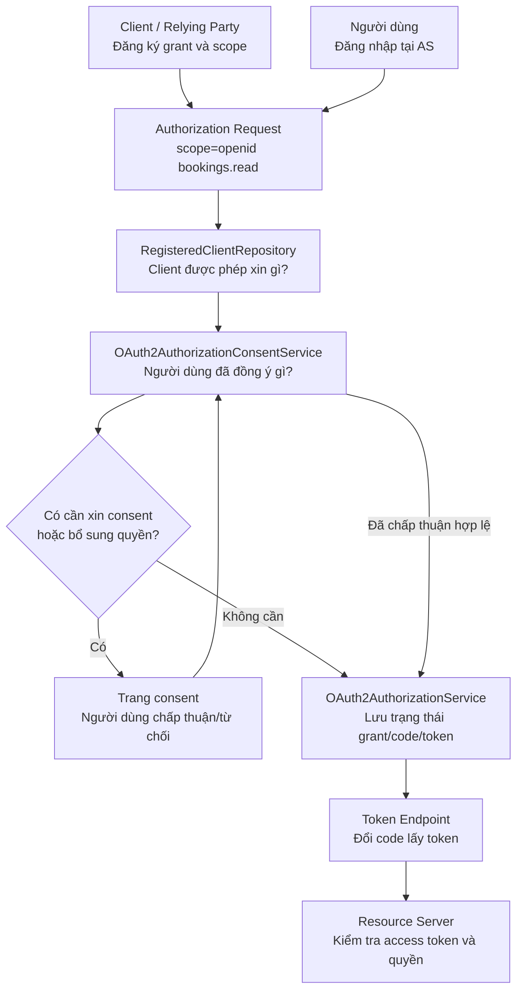
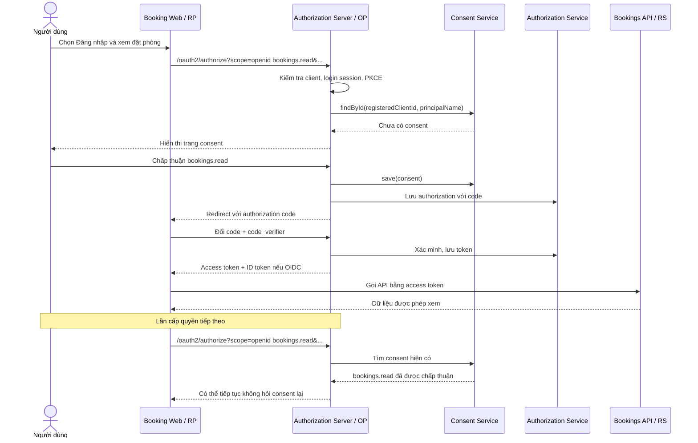

# OAuth2AuthorizationConsent và các quyền người dùng đã chấp thuận

## 1. Bối cảnh: vì sao Authorization Server cần lưu consent?

Trong một hệ thống **Spring Security OAuth 2.0/OpenID Connect Authorization Server** triển khai với **Spring Authorization Server** và Spring Boot, người dùng thường cấp quyền cho một ứng dụng truy cập một phần dữ liệu của mình. Ví dụ, ứng dụng quản lý đặt phòng `booking-web` muốn đọc lịch sử đặt phòng thông qua scope `bookings.read`.

Authorization Server có thể cần trả lời những câu hỏi như:

- Người dùng này **đã đồng ý** cho client này truy cập những scope nào?
- Lần sau client yêu cầu cùng các quyền đó, có cần hiển thị màn hình chấp thuận nữa không?
- Nếu client xin thêm `bookings.cancel`, quyền cũ có tự bao gồm quyền mới không?
- Khi người dùng vào phần **Ứng dụng đã kết nối** và thu hồi sự đồng ý, dữ liệu nào cần thay đổi?
- Sau khi xóa consent, các access token hoặc refresh token đã phát hành còn hiệu lực không?

Spring Authorization Server cung cấp mô hình **`OAuth2AuthorizationConsent`** và service **`OAuth2AuthorizationConsentService`** để lưu và truy xuất những quyền mà một principal đã chấp thuận cho một registered client.

Hãy xem consent như **bản ghi về sự chấp thuận**, chứ không phải mật khẩu, phiên đăng nhập hay access token. Phân biệt đúng các lớp này là cơ sở để thiết kế, cấu hình, bảo mật, kiểm thử và vận hành Authorization Server an toàn.

### Mục tiêu học tập

Sau bài học, bạn có thể:

1. Trình bày cấu trúc và ý nghĩa của `OAuth2AuthorizationConsent`.
2. Phân biệt `registeredClientId`, `principalName` và `authorities`.
3. Giải thích cách consent tham gia luồng **Authorization Code + PKCE**, bao gồm lần đầu, lần sau và lần xin thêm scope.
4. Dùng `OAuth2AuthorizationConsentService` để lưu, tìm và xóa consent.
5. So sánh consent với client registration, `OAuth2Authorization`, access token, session và chính sách Resource Server.
6. Thiết kế quản lý consent nhiều client/người dùng/tenant, xử lý thu hồi đúng kỳ vọng.
7. Lập các ca kiểm thử bảo mật và vận hành cho consent.

## 2. Consent nằm ở đâu trong kiến trúc OAuth 2.0/OIDC?

OAuth 2.0 mô tả việc một client được cấp quyền truy cập tài nguyên, thường thay mặt resource owner. Khi có người dùng tương tác, Authorization Server có thể yêu cầu người dùng chấp thuận một tập scope mà client đang xin.

**Consent** thường xuất hiện ở bước `/oauth2/authorize`, trước khi Authorization Server cấp authorization code. Trong khi đó:

- **Client registration** xác định client nào được phép hoạt động, những grant và scope nào có thể yêu cầu.
- **Authentication session** xác định người dùng đang đăng nhập tại Authorization Server hay chưa.
- **Consent** lưu các quyền mà người dùng đã chấp thuận cho client.
- **`OAuth2Authorization`** ghi trạng thái một lần cấp authorization: grant, các scope được cấp, code/token và metadata liên quan.
- **Access token** là credential được client sử dụng để gọi Resource Server/API.
- **Resource Server** kiểm tra token và chính sách truy cập tài nguyên theo yêu cầu thực tế.



Sơ đồ là diễn giải khái niệm; quy trình thực tế còn phụ thuộc grant type, phiên bản framework, client settings, consent page, OIDC parameters và chính sách của Authorization Server.

**Không phải grant nào cũng có consent của người dùng.** Với Client Credentials, client xin token cho chính mình và không có bước End-User chấp thuận quyền. Ngay cả Authorization Code Flow, cấu hình có thể cho phép bỏ qua trang consent. Vì thế, **một token được phát hành không chứng minh chắc chắn đã có bản ghi `OAuth2AuthorizationConsent`**.

## 3. Mô hình `OAuth2AuthorizationConsent`

`OAuth2AuthorizationConsent` là đối tượng thuộc mô hình cốt lõi của Spring Authorization Server. Nó đại diện các authority mà **một principal** đã chấp thuận cho **một registered client**.

Ba thông tin trung tâm:

| Thuộc tính | Kiểu dữ liệu về mặt mô hình | Ý nghĩa |
|---|---|---|
| `registeredClientId` | `String` | **ID nội bộ** của đối tượng `RegisteredClient` mà consent thuộc về |
| `principalName` | `String` | Tên định danh principal đã chấp thuận |
| `authorities` | `Set<GrantedAuthority>` | Tập các authority đã được chấp thuận; trong luồng OAuth thông dụng là scope dưới dạng authority |

Ở cấp API Java, có thể đọc các giá trị này qua:

```java
String registeredClientId = consent.getRegisteredClientId();
String principalName = consent.getPrincipalName();
Set<GrantedAuthority> authorities = consent.getAuthorities();
```

### 3.1. `registeredClientId` khác `clientId`

Đây là một nhầm lẫn rất dễ gây lỗi.

`RegisteredClient` có ít nhất hai định danh cần phân biệt:

- `registeredClient.getId()`: định danh nội bộ cho bản ghi client trong Authorization Server.
- `registeredClient.getClientId()`: định danh OAuth client gửi trên giao thức, ví dụ `booking-web`.

`OAuth2AuthorizationConsent` được gắn với **`registeredClient.getId()`**, không mặc nhiên là chuỗi `clientId` hiển thị ra ngoài. Ví dụ:

```text
RegisteredClient:
  id       = "rc-7f9a"
  clientId = "booking-web"

OAuth2AuthorizationConsent:
  registeredClientId = "rc-7f9a"
  principalName      = "user-42"
  authorities        = ["SCOPE_bookings.read"]
```

Nếu gọi `findById("booking-web", "user-42")` trong trường hợp này, service có thể không tìm thấy consent vì đã dùng sai định danh.

### 3.2. `principalName` xác định người đã chấp thuận

`principalName` xuất phát từ principal mà Authorization Server nhận diện khi xử lý authorization. Trong ví dụ, đây là `user-42`.

Thiết kế sản phẩm cần quyết định principal nào là ổn định và không va chạm:

- Không nên mặc nhiên lấy email làm định danh vĩnh viễn, vì email có thể thay đổi hoặc được cấp lại.
- Trong hệ thống đa tenant, phải tránh hai người dùng ở các tenant khác nhau cùng có `principalName` nhưng bị hiểu là một người.
- Khi đổi tên người dùng, hợp nhất tài khoản hoặc chuyển tenant, cần xác định có phải di chuyển/thu hồi các consent cũ không.
- Principal có trong consent **không thay thế** quyền kiểm tra sở hữu tài nguyên tại Resource Server.

Ví dụ, nếu hai tenant cùng có user `alice`, việc dùng trần chuỗi `alice` cho toàn bộ Authorization Server dùng chung có thể làm mờ ranh giới consent. Một chiến lược định danh ổn định có namespace tenant có thể thích hợp, nhưng phải tương thích với cách Spring Security xác định principal trong phiên đăng nhập và luồng authorization thực tế.

### 3.3. `authorities` là tập quyền đã đồng ý, không nhất thiết là role

Trong ví dụ OAuth thường gặp, mỗi scope đã được chấp thuận được biểu diễn thành `GrantedAuthority` với tiền tố `SCOPE_`:

```text
scope yêu cầu:       bookings.read
authority trong consent: SCOPE_bookings.read
```

Có thể tạo authority tương ứng bằng:

```java
new SimpleGrantedAuthority("SCOPE_bookings.read")
```

Tuy nhiên, `authorities` là tập `GrantedAuthority` chứ không phải danh sách role hệ thống. **Không được đồng nhất `SCOPE_bookings.read` với `ROLE_ADMIN`, quyền RBAC của người dùng hoặc quyền truy cập vào tất cả dữ liệu đặt phòng.**

Các authority được lưu vào consent cần đi qua chính sách của Authorization Server: client có được phép xin scope không, người dùng có được phép chấp thuận không và hệ thống có thực sự hỗ trợ scope đó không.

## 4. Consent khác gì với authorization, token và session?

| Khái niệm | Câu hỏi trả lời | Đơn vị lưu thông thường | Có thể tồn tại sau khi logout? |
|---|---|---|---|
| **Authentication session** | Người dùng có phiên đăng nhập hợp lệ tại AS/RP hay không? | Session/cookie, `SecurityContext` | Phiên đã logout thì chấm dứt theo cơ chế logout |
| **RegisteredClient** | Client có thể yêu cầu grant, redirect và scope nào? | `RegisteredClientRepository` | Có |
| **OAuth2AuthorizationConsent** | Principal đã chấp thuận quyền nào cho registered client? | `OAuth2AuthorizationConsentService` | Có |
| **OAuth2Authorization** | Grant và token của một authorization cụ thể đang ở trạng thái gì? | `OAuth2AuthorizationService` | Có thể |
| **Access token** | Client có credential hợp lệ để gọi API nào và với quyền gì? | Token phía client, trạng thái token ở AS/RS theo kiến trúc | Có thể |
| **Refresh token** | Client có thể xin token mới mà không lặp lại authorization tương tác không? | Client và trạng thái liên quan ở AS | Có thể |
| **ID token (OIDC)** | RP có bằng chứng xác thực người dùng do OP phát hành không? | RP xác minh ID token; AS lưu trạng thái theo triển khai | Có thể còn giá trị bằng chứng, không dùng làm API bearer token |

Ba phân biệt quan trọng:

1. **Consent không phải access token.** Nó không được gửi trong header `Authorization: Bearer ...` và API không dùng consent thay thế việc kiểm tra access token.
2. **Consent không phải authorization record.** Người dùng có thể giữ consent trong thời gian dài dù mọi token của authorization cũ đã hết hạn.
3. **Consent không phải login session.** Người dùng logout khỏi Authorization Server không mặc nhiên xóa consent đã lưu.

Một người dùng có thể có nhiều consent với nhiều client; một client có thể có consent từ nhiều người dùng; và một cặp principal + registered client có thể phát sinh **nhiều authorization khác nhau** theo các lần xin quyền.

## 5. Vòng đời consent trong Authorization Code + PKCE

Xét một tình huống cụ thể:

- Authorization Server: `https://auth.example.com`.
- Client: `booking-web`.
- User principal: `user-42`.
- API: `https://api.example.com/bookings`.
- Scope ban đầu: `openid bookings.read`.
- Scope cần xin thêm sau này: `bookings.cancel`.
- Client được cấu hình yêu cầu consent bằng `requireAuthorizationConsent(true)`.



Việc hiển thị lại trang consent phụ thuộc cấu hình, scope, chính sách và các tham số OIDC như `prompt=consent`. Có bản ghi consent không bảo đảm mọi yêu cầu tiếp theo sẽ bỏ qua màn hình.

### 5.1. Bước 1 — client được phép yêu cầu scope nào?

`RegisteredClient` xác định grant type, redirect URI, authentication method và scope client có thể yêu cầu. Đăng ký `bookings.read` nghĩa là **client được quyền xin** scope đó, chưa phải người dùng đã đồng ý.

Nếu client không được đăng ký `bookings.cancel`, một trường consent chứa authority tương ứng **không tự hợp thức hóa việc cấp scope này**. Validation tại Authorization Server vẫn cần áp dụng đầy đủ.

### 5.2. Bước 2 — xác thực người dùng

Spring Security xác định principal đang tương tác. Khi chưa có phiên đăng nhập hợp lệ, AS cần xử lý login; khi có phiên SSO hợp lệ, nó có thể tiếp tục. Consent luôn cần được gắn với **đúng principal hiện tại**.

Không nên xử lý consent bằng một request có thể tự khai `principalName` rồi tin giá trị đó. Principal phải được xác định từ ngữ cảnh xác thực tin cậy của Authorization Server.

### 5.3. Bước 3 — tìm consent cũ và so sánh scope

Service tìm consent theo registered client ID và principal name. Các trường hợp điển hình:

| Yêu cầu hiện tại | Consent đã lưu | Hướng xử lý |
|---|---|---|
| `bookings.read` | Không có | Yêu cầu consent nếu chính sách cần |
| `bookings.read` | `bookings.read` | Có thể sử dụng consent đã lưu |
| `bookings.read bookings.cancel` | `bookings.read` | Cần đánh giá quyền bổ sung `bookings.cancel` |
| `bookings.cancel` | `bookings.read` | Không được coi như đã chấp thuận `bookings.cancel` |
| `bookings.read` | Consent đã bị xóa | Đánh giá như chưa có consent theo chính sách |

**So sánh scope phải dùng danh tính và trạng thái được xác minh**, không căn cứ các checkbox do client tự dựng hoặc tham số URL được xem như đã cấp quyền.

### 5.4. Bước 4 — người dùng chấp thuận hoặc từ chối

Trang consent nên giúp người dùng hiểu:

- **Ứng dụng nào** đang yêu cầu, dựa trên metadata client đáng tin cậy.
- **Quyền nào** đang được yêu cầu, diễn đạt thành ngôn ngữ dễ hiểu.
- Quyền nào đã có, quyền nào mới bổ sung.
- Hành động chấp thuận/từ chối và cách rút lại quyền về sau.

Khi từ chối, hệ thống không được đánh dấu những scope bị từ chối là đã chấp thuận. Khi chọn một tập scope con, cần bảo đảm giao thức và UI hỗ trợ đúng hành vi cấp quyền từng phần; không mặc định mọi ứng dụng đều có lựa chọn từng scope.

**Consent phải chống CSRF và session confusion.** Tránh một controller nhận POST từ bất kỳ nguồn nào rồi tự ghi consent chỉ dựa trên `principalName`, `clientId`, `scope` người gửi tự khai. Dùng đường đi và kiểm tra mặc định của Authorization Server hoặc một extension được thiết kế chặt chẽ.

### 5.5. Bước 5 — lưu consent và phát hành authorization

Sau khi quyết định consent được xử lý hợp lệ, `OAuth2AuthorizationConsentService` lưu authority đã được chấp thuận. `OAuth2AuthorizationService` xử lý trạng thái authorization/code/token theo grant.

Cặp service này có nhiệm vụ khác nhau. Nếu chỉ lưu consent nhưng không tạo authorization hợp lệ, client không tự có access token. Ngược lại, một authorization có thể được tạo khi chính sách không yêu cầu lưu consent.

### 5.6. Bước 6 — các lần xin quyền sau và consent tăng dần

Giả sử lần đầu đã lưu:

```text
registeredClientId = rc-7f9a
principalName      = user-42
authorities        = [SCOPE_bookings.read]
```

Client sau đó yêu cầu thêm `bookings.cancel`. Nếu người dùng chấp thuận, bản ghi consent có thể được cập nhật thành:

```text
registeredClientId = rc-7f9a
principalName      = user-42
authorities        = [SCOPE_bookings.read, SCOPE_bookings.cancel]
```

Đây là cơ chế **incremental consent**: quyền mới được xem xét riêng, không được cấp nhờ consent cũ không liên quan. Các scope thực sự cấp trong **mỗi authorization** vẫn phải dựa trên yêu cầu, registration và policy của lần cấp đó.

## 6. Các API cốt lõi của `OAuth2AuthorizationConsentService`

Giao diện service công khai có ba thao tác nghiệp vụ chính:

```java
public interface OAuth2AuthorizationConsentService {

    void save(OAuth2AuthorizationConsent authorizationConsent);

    void remove(OAuth2AuthorizationConsent authorizationConsent);

    OAuth2AuthorizationConsent findById(
        String registeredClientId,
        String principalName
    );
}
```

Đoạn trên minh họa chữ ký mô hình. Các phiên bản thư viện có thể bổ sung annotation hợp đồng về giá trị `null` hoặc chi tiết khác.

| Thao tác | Công dụng | Lưu ý bảo mật |
|---|---|---|
| `findById(...)` | Tra cứu quyền người dùng đã chấp thuận cho một client | Dùng registered client **ID nội bộ** và principal tin cậy |
| `save(...)` | Lưu consent mới hoặc cập nhật theo key | Chỉ lưu quyền sau validation và chấp thuận hợp lệ |
| `remove(...)` | Xóa bản ghi consent | Không mặc nhiên thu hồi token đã cấp |

Không có API mặc định trong interface này để liệt kê tất cả consent theo principal, phân trang consent, lưu audit history hoặc thu hồi tất cả token. Nếu sản phẩm cần trang **Ứng dụng đã kết nối**, phải thiết kế lớp truy vấn/quản trị phù hợp với kho dữ liệu và chính sách bảo mật; tránh giả định interface này đã đủ cho mọi màn hình quản trị.

### 6.1. Tạo một bản ghi consent

Ví dụ có một `RegisteredClient` hợp lệ và principal `user-42` đã được xác thực, chấp thuận scope `bookings.read`:

```java
OAuth2AuthorizationConsent consent =
    OAuth2AuthorizationConsent
        .withId(registeredClient.getId(), "user-42")
        .authority(new SimpleGrantedAuthority("SCOPE_bookings.read"))
        .build();

authorizationConsentService.save(consent);
```

Ý nghĩa:

1. `registeredClient.getId()` cung cấp internal ID.
2. `"user-42"` phải trùng danh tính mà AS dùng cho principal trong thực tế.
3. `SCOPE_bookings.read` là authority biểu diễn scope đã chấp thuận.
4. `save` lưu đối tượng vào repository/service tương ứng.

**Đây là ví dụ mô hình dữ liệu**, không phải gợi ý để bất cứ controller nào tự ghi consent mà bỏ qua authorization request, CSRF, client validation và xác thực người dùng. Trong luồng chuẩn, các provider/handler của Spring Authorization Server nên điều phối quyết định consent.

### 6.2. Tra cứu consent hiện có

```java
OAuth2AuthorizationConsent existing =
    authorizationConsentService.findById(
        registeredClient.getId(),
        authenticatedPrincipal.getName()
    );

boolean approvedRead = existing != null &&
    existing.getAuthorities().stream()
        .map(GrantedAuthority::getAuthority)
        .anyMatch("SCOPE_bookings.read"::equals);
```

Đây là phép kiểm tra **consent đã lưu**, không phải kiểm tra xem người dùng có được phép đọc một đặt phòng nào đó. Permission check tại Resource Server vẫn là trách nhiệm riêng.

### 6.3. Cập nhật consent theo cách giữ lại quyền cũ

Khi người dùng chấp thuận thêm một scope hợp lệ, có thể tạo consent mới từ consent hiện có:

```java
String registeredClientId = registeredClient.getId();
String principalName = authenticatedPrincipal.getName();

OAuth2AuthorizationConsent current =
    authorizationConsentService.findById(
        registeredClientId, principalName);

OAuth2AuthorizationConsent.Builder builder = (current == null)
    ? OAuth2AuthorizationConsent.withId(
        registeredClientId, principalName)
    : OAuth2AuthorizationConsent.from(current);

OAuth2AuthorizationConsent updated = builder
    .authority(
        new SimpleGrantedAuthority("SCOPE_bookings.cancel"))
    .build();

authorizationConsentService.save(updated);
```

Ví dụ giả định **đã xác minh client được phép xin scope, principal có quyền chấp thuận và người dùng vừa đồng ý**. Nếu thiếu các bước đó, thao tác `save` có thể tạo consent quá rộng. Cần xử lý đồng thời (concurrency) khi nhiều authorization request cùng cập nhật consent để tránh làm mất những quyền được ghi ở request khác.

### 6.4. Xóa consent

```java
OAuth2AuthorizationConsent existing =
    authorizationConsentService.findById(
        registeredClient.getId(),
        authenticatedPrincipal.getName());

if (existing != null) {
    authorizationConsentService.remove(existing);
}
```

Thao tác này có nghĩa là **xóa sự chấp thuận đã lưu**. Nó không đóng HTTP session, không xóa `OAuth2Authorization`, không chủ động revoke refresh token, và không tự khiến JWT access token đã phát hành hết hiệu lực.

Nếu nghiệp vụ cần “ngắt kết nối ngay”, phải triển khai thêm các bước quản lý token và phiên theo yêu cầu cụ thể (xem phần 10).

## 7. Phân biệt ba tập scope rất dễ bị nhầm

Đối với một authorization request, thường có ba tập hợp cần phân biệt:

1. **Allowed/registered scopes**: những scope client có thể yêu cầu theo `RegisteredClient.getScopes()`.
2. **Consented scopes**: những scope đã được người dùng chấp thuận và được lưu như authority của `OAuth2AuthorizationConsent`.
3. **Authorized scopes**: những scope thực tế được cấp trong **một lần authorization**, thường gắn với `OAuth2Authorization.getAuthorizedScopes()` và token được phát hành.

Ví dụ:

| Phạm vi | Ví dụ |
|---|---|
| Client đã đăng ký | `bookings.read`, `bookings.cancel`, `profile`, `openid` |
| Người dùng đã chấp thuận | `bookings.read`, `profile` |
| Request lần này yêu cầu | `bookings.read` |
| Scopes thực tế được cấp | `bookings.read` |

Chỉ vì client **đã đăng ký** `bookings.cancel` không có nghĩa người dùng đã đồng ý. Chỉ vì người dùng **từng đồng ý** `profile` không có nghĩa authorization mới xin mỗi `bookings.read` phải luôn tự động cấp thêm `profile`. Và chỉ vì token có `bookings.read` không có nghĩa nó cho phép đọc mọi bản ghi ở API.

### 7.1. Consent không phải nguồn duy nhất cho policy

Một hệ thống có thể từ chối cấp scope đã chấp thuận vì:

- Client đã bị vô hiệu hóa hoặc thay đổi cấu hình.
- Người dùng bị khóa, đổi tenant hoặc không còn đủ quyền.
- Phạm vi yêu cầu không phù hợp với loại grant.
- Consent phải được xác nhận lại do chính sách hoặc yêu cầu OIDC.
- Hệ thống thay đổi policy truy cập dữ liệu.

Do đó, **consent là dữ liệu đầu vào cho quyết định cấp quyền**, không phải “vé trắng” để cấp token mới bất kỳ lúc nào.

### 7.2. Scope không thay thế phân quyền nghiệp vụ

Giả sử `bookings.read` được cấp. Khi client gọi:

```http
GET /bookings/booking-123
Authorization: Bearer ACCESS_TOKEN_VALUE
```

Resource Server phải kiểm tra token hợp lệ, phù hợp audience/scope và người dùng thực sự được phép xem `booking-123`. Sự chấp thuận scope ở Authorization Server không quyết định quyền sở hữu của từng đặt phòng.

## 8. Cấu hình client bắt buộc xin consent

Spring Authorization Server cho phép cấu hình client có yêu cầu hiển thị consent thông qua `ClientSettings`.

```java
RegisteredClient bookingWeb = RegisteredClient
    .withId(UUID.randomUUID().toString())
    .clientId("booking-web")
    .clientSecret(passwordEncoder.encode(secretFromSecureStore))
    .clientAuthenticationMethod(
        ClientAuthenticationMethod.CLIENT_SECRET_BASIC)
    .authorizationGrantType(
        AuthorizationGrantType.AUTHORIZATION_CODE)
    .authorizationGrantType(
        AuthorizationGrantType.REFRESH_TOKEN)
    .redirectUri(
        "https://app.example.com/login/oauth2/code/booking-web")
    .scope(OidcScopes.OPENID)
    .scope(OidcScopes.PROFILE)
    .scope("bookings.read")
    .scope("bookings.cancel")
    .clientSettings(ClientSettings.builder()
        .requireProofKey(true)
        .requireAuthorizationConsent(true)
        .build())
    .build();
```

Các điểm đáng chú ý:

- `requireAuthorizationConsent(true)` yêu cầu xử lý consent theo cơ chế và chính sách của framework.
- `requireProofKey(true)` yêu cầu PKCE cho Authorization Code Flow.
- `clientSecret` chỉ phù hợp với **confidential client** có thể giữ bí mật ở phía server; không đưa client secret vào SPA/browser.
- `scope(...)` định nghĩa phạm vi mà client có thể xin, không phải các scope đã được người dùng duyệt.
- `OidcScopes.OPENID` hỗ trợ yêu cầu xác thực OIDC khi OP được bật và cấu hình đầy đủ.

Đoạn mã minh họa đăng ký client; ứng dụng còn cần `RegisteredClientRepository`, `OAuth2AuthorizationService`, `OAuth2AuthorizationConsentService`, authentication/user login, signing keys và các filter chain đúng phiên bản. Không nên coi một `RegisteredClient` là toàn bộ Authorization Server.

### 8.1. Consent page có thể tùy chỉnh nhưng phải giữ giao thức

Spring Authorization Server có hook như `authorizationEndpoint(...).consentPage(...)` để điều hướng đến màn hình consent riêng. Trang consent nên hiển thị metadata client đáng tin, mô tả scope rõ và hạn chế checkbox cho những scope thực sự được yêu cầu.

Ví dụ một yêu cầu:

```text
Ứng dụng: Booking Web
Yêu cầu:
  [x] Xem danh sách đặt phòng (bookings.read)
  [ ] Hủy đặt phòng (bookings.cancel)

[Chấp thuận]  [Từ chối]
```

Đây là ví dụ UX, **không khẳng định mọi cấu hình mặc định của Spring đều hỗ trợ duyệt từng scope riêng**. Logic trên server phải tuân thủ yêu cầu, CSRF, authorized principal, consent và policy. Không nên đưa cơ chế “duyệt scope” vào controller tự phát authorization code.

### 8.2. Kết hợp consent với OIDC

OIDC sử dụng scope `openid` để yêu cầu tính năng xác thực người dùng. Các scope như `profile`, `email` đại diện nhóm claim được yêu cầu, tùy dữ liệu thực và consent/policy. Một RP có thể yêu cầu `prompt=consent` để OP hiển thị lại màn hình consent theo quy tắc OIDC; việc hỗ trợ và hành vi chính xác phụ thuộc OP và cấu hình.

Cần phân biệt:

- **ID token**: bằng chứng xác thực cho Relying Party, phải được xác minh theo OIDC.
- **Access token**: credential cho Resource Server hoặc UserInfo Endpoint đúng mục đích.
- **Consent**: dữ liệu quyết định người dùng đã cho phép chia sẻ những nhóm dữ liệu/quyền nào.

Đã chấp thuận `email` không bảo đảm dữ liệu email luôn được phát hành hay đã được xác minh. OIDC có những claim riêng như `email_verified`; tính chính xác của dữ liệu và phạm vi cung cấp thuộc chính sách OP.

## 9. Persistence: in-memory và JDBC

Tại tầng mô hình, `OAuth2AuthorizationConsentService` không áp đặt công nghệ lưu trữ. Spring Authorization Server cung cấp triển khai phục vụ các môi trường khác nhau.

| Triển khai | Tình huống sử dụng | Giới hạn |
|---|---|---|
| `InMemoryOAuth2AuthorizationConsentService` | Demo, thử nghiệm hoặc test cô lập | Consent có thể mất khi tiến trình khởi động lại; không tự chia sẻ giữa nhiều node |
| `JdbcOAuth2AuthorizationConsentService` | Hệ thống cần consent bền vững qua cơ sở dữ liệu quan hệ | Cần schema tương thích phiên bản, cấu hình `JdbcOperations` và repository client |
| Triển khai `OAuth2AuthorizationConsentService` riêng | MongoDB, cơ chế phân vùng, yêu cầu truy vấn/audit đặc thù | Phải giữ hợp đồng lưu, tìm, xóa và nhất quán dưới cạnh tranh ghi |

Ví dụ cấu hình JDBC:

```java
@Bean
OAuth2AuthorizationConsentService authorizationConsentService(
        JdbcOperations jdbcOperations,
        RegisteredClientRepository registeredClientRepository) {

    return new JdbcOAuth2AuthorizationConsentService(
        jdbcOperations,
        registeredClientRepository);
}
```

Ví dụ này giả định các bean `JdbcOperations` và `RegisteredClientRepository` đã được cấu hình. Cần tạo/migrate bảng theo schema tương thích với **phiên bản Spring Authorization Server đang dùng**. Không nên tự sao chép sơ đồ bảng ở một phiên bản khác rồi mặc nhiên coi là tương thích.

### 9.1. Hình dung khóa dữ liệu

Quan hệ logic của bản ghi consent là:

```text
CONSENT
  registered_client_id  ──┐
                         ├── Khóa định danh logic
  principal_name        ──┘
  authorities              Danh sách authority đã chấp thuận
```

Thường không có “một bản ghi consent cho mỗi access token”. Có thể có nhiều access token khác nhau phát sinh theo thời gian nhưng gắn với cùng một consent của cặp client + user.

Một truy vấn như “tất cả ứng dụng người dùng đã kết nối” cần khả năng tìm consent theo principal, nối với registered client và lọc theo quyền/tenant. `OAuth2AuthorizationConsentService` công khai có `findById` cho cặp client/user, **không mặc nhiên cung cấp API liệt kê**. Có thể xây repository quản trị bổ sung với kiểm tra quyền truy cập và phân trang.

### 9.2. Bền vững và nhất quán khi có nhiều instance

Giả sử Authorization Server có node A và B:

1. User cấp consent trên node A.
2. Lần xin quyền tiếp theo được load-balancer chuyển sang node B.
3. Nếu mỗi node chỉ dùng in-memory consent khác nhau, node B có thể hỏi lại consent hoặc có hành vi không nhất quán.
4. Nếu consent dùng kho chung và session/user identity cũng được xử lý nhất quán, cả hai node có thể dùng cùng quyết định đã lưu.

Lưu consent JDBC chỉ giải quyết **dữ liệu consent**; vẫn cần chiến lược riêng cho `OAuth2AuthorizationService`, HTTP session, client repository và khóa ký token. Đừng dùng một biến static hoặc cache cục bộ làm nguồn sự thật cho consent trên toàn cụm.

### 9.3. Bảo vệ dữ liệu consent

Consent cho thấy mối quan hệ giữa tài khoản người dùng, ứng dụng và loại dữ liệu mà người dùng cho phép truy cập. Đây là dữ liệu nhạy cảm về quyền truy cập, dù không phải access token.

Nên áp dụng:

- Phân quyền DB tối thiểu cho dịch vụ đọc/ghi consent.
- Kết nối DB bảo mật, backup và chính sách retention phù hợp.
- Bảo vệ trang danh sách ứng dụng đã kết nối bằng xác thực và kiểm tra sở hữu.
- Audit event khi cấp, bổ sung, rút hoặc thay đổi consent; log tránh chứa credential.
- Chính sách xóa/di chuyển consent khi tài khoản người dùng bị xóa, client bị xóa hoặc tenant thay đổi.
- Quản lý cập nhật đồng thời: tránh lost update khi các request cùng lúc xin scope khác nhau.

## 10. Thu hồi consent không tự động thu hồi token

Đây là giới hạn **quan trọng nhất** khi triển khai tính năng “Gỡ quyền truy cập”.

Giả sử người dùng đã chấp thuận `bookings.read` cho `booking-web`, ứng dụng đã nhận access token có thời hạn 10 phút và refresh token có thời hạn 7 ngày.

Người dùng chọn **Rút quyền**. Ứng dụng quản trị gọi:

```java
authorizationConsentService.remove(consent);
```

Kết quả trực tiếp là **bản ghi consent được xóa**. Nhưng:

- Access token đã phát hành **có thể vẫn được Resource Server chấp nhận** cho đến khi hết hạn.
- Refresh token đã phát hành **có thể vẫn được dùng để xin access token mới** nếu không bị vô hiệu hóa hoặc bị kiểm tra thêm bởi chính sách của AS.
- HTTP session tại AS và tại RP **không tự động biến mất**.
- Lần `/oauth2/authorize` mới sẽ phải đánh giá lại yêu cầu và consent theo chính sách.

### 10.1. Vì sao access token vẫn có thể hoạt động?

Với access token dạng **JWT tự xác minh**, Resource Server thường kiểm tra chữ ký, issuer, audience, expiration và scope mà không hỏi Consent Service. Xóa consent ở AS không sửa được JWT đã ký.

Với access token dạng **opaque** có introspection, AS có thể trả `active=false` khi trạng thái token đã bị vô hiệu hóa. Tuy nhiên, chỉ xóa consent không nhất thiết đánh dấu token là inactive; service phải phối hợp xử lý trạng thái authorization/token.

Cần phân biệt bốn hành động:

| Hành động | Tác động trực tiếp |
|---|---|
| Xóa `OAuth2AuthorizationConsent` | Bỏ dữ liệu chấp thuận đã lưu của user + client |
| Revoke refresh token | Ngăn token đó được dùng refresh tiếp, theo cơ chế revocation |
| Invalidate/revoke access token | Ngăn dùng access token theo khả năng kiểm tra của API |
| Logout AS/RP | Kết thúc phiên tại thành phần tương ứng |

Không được cam kết người dùng “đã ngắt kết nối hoàn toàn” nếu hệ thống mới thực hiện bước xóa consent.

### 10.2. Quy trình gỡ quyền truy cập theo nghiệp vụ

Một tính năng **Disconnect application** muốn chặn truy cập hiện tại có thể cần:

1. Xác thực người yêu cầu; chứng minh họ có quyền quản lý consent của principal đó.
2. Xác định đúng `registeredClientId` và principal; tránh dùng tên hiển thị hoặc client ID không được xác minh.
3. Xóa hoặc điều chỉnh consent qua service.
4. Truy vấn các authorization liên quan qua cơ chế quản lý dữ liệu được thiết kế; **không giả định chỉ có một authorization mỗi user/client**.
5. Vô hiệu hóa refresh token và authorization cần thiết, để client không thể làm mới token.
6. Quyết định cách xử lý access token đang sống: thời hạn ngắn, introspection, danh sách thu hồi hoặc cơ chế kiểm tra trạng thái phù hợp.
7. Xử lý RP/AS session nếu yêu cầu sản phẩm thực sự bao gồm đăng xuất.
8. Ghi audit event, kiểm thử API/token endpoint và xử lý retry nếu hệ thống phân tán.

**Lưu ý:** Giao diện `OAuth2AuthorizationConsentService` chỉ quản lý consent. Nó không cung cấp sẵn chức năng “tìm mọi authorization của một user trên mọi client”. Cần thiết kế truy vấn và logic vô hiệu hóa ở tầng nghiệp vụ thay vì tự dựng SQL xóa token thiếu kiểm soát.

### 10.3. Thu hồi một scope hay thu hồi toàn bộ consent?

Có hai thiết kế sản phẩm khác nhau:

- **Gỡ ứng dụng:** Xóa consent cho toàn bộ cặp principal + registered client, rồi thực hiện quy trình vô hiệu hóa token tương ứng nếu cần.
- **Gỡ một quyền:** Tạo bản ghi consent mới không chứa authority của scope bị rút. Nếu không còn authority nào, cân nhắc xóa bản ghi theo chính sách lưu trữ.

Một ví dụ **chỉ cập nhật mô hình consent**, giả định đã xác minh quyền quản trị và đã tính đúng các scope cần giữ:

```java
OAuth2AuthorizationConsent current =
    authorizationConsentService.findById(
        registeredClient.getId(),
        authenticatedPrincipal.getName());

if (current != null) {
    List<GrantedAuthority> retainedAuthorities =
        current.getAuthorities().stream()
        .filter(authority ->
            !authority.getAuthority().equals("SCOPE_bookings.cancel"))
        .toList();

    if (retainedAuthorities.isEmpty()) {
        authorizationConsentService.remove(current);
    } else {
        OAuth2AuthorizationConsent.Builder builder =
            OAuth2AuthorizationConsent.withId(
                current.getRegisteredClientId(),
                current.getPrincipalName());

        retainedAuthorities.forEach(builder::authority);
        OAuth2AuthorizationConsent updated = builder.build();
        authorizationConsentService.save(updated);
    }
}
```

Đoạn này không hoàn thành bước revoke token. Nếu sản phẩm yêu cầu cắt quyền `bookings.cancel` ngay, cần xử lý token và policy tại AS/Resource Server. Đồng thời cần kiểm soát concurrency để việc ghi bỏ scope không làm mất quyền vừa được chấp thuận hợp lệ từ một luồng khác.

## 11. Consent và OIDC: scope, claims, phiên đăng nhập

Consent thường được thảo luận cùng `openid`, `profile` và `email`, nhưng **OIDC login** và **OAuth authorization** có mục đích khác nhau.

Một OIDC client có thể xin:

```text
scope=openid profile email bookings.read
```

Trong đó:

- `openid`: yêu cầu dịch vụ xác thực OIDC.
- `profile` và `email`: yêu cầu nhóm claim tiêu chuẩn theo OIDC.
- `bookings.read`: quyền ứng dụng tự định nghĩa để truy cập API đặt phòng.

Authorization Server/OpenID Provider quyết định scope và claim nào thực sự được cấp, dựa trên client registration, xác thực người dùng, consent, các policy khác và dữ liệu sẵn có.

**Consent đã lưu không tự tạo ID token hoặc session mới.** Khi RP muốn đăng nhập OIDC, nó cần thực hiện luồng thích hợp và xác minh ID token theo các claim bắt buộc như `iss`, `aud`, `exp`, `iat` và `nonce` khi sử dụng. Consent là một thành phần của quyết định ủy quyền, không phải bằng chứng xác thực người dùng.

### 11.1. Consent có luôn được hỏi khi SSO còn hiệu lực không?

Không. Một người dùng có thể vẫn có session đăng nhập tại OP và đã cấp consent trước đó. Khi client thực hiện một authorization request mới với cùng scope, OP có thể cấp code mà không cần hiển thị lại consent. Nhưng điều này phụ thuộc chính sách provider, `prompt=consent`, yêu cầu xin thêm quyền và các ràng buộc về phiên/xác thực.

Ngược lại, đăng xuất khỏi OP thường không xóa consent. Người dùng login lại vẫn có thể thấy hệ thống ghi nhớ các quyền từng đồng ý, trừ khi consent đã được thu hồi hoặc hết hiệu lực theo policy.

## 12. Multi-tenant, thay đổi principal và nhiều client

Consent có ý nghĩa **theo cặp** registered client + principal. Khi hệ thống mở rộng quy mô, cần xét thêm các ranh giới dữ liệu.

### 12.1. Một người dùng, nhiều client

```text
user-42 + booking-web     → [SCOPE_bookings.read]
user-42 + partner-mobile  → [SCOPE_bookings.read]
user-42 + admin-portal    → [SCOPE_profile]
```

Nếu người dùng rút consent của `partner-mobile`, không nên xóa consent của `booking-web` trừ khi sản phẩm có chính sách thu hồi theo nhóm client được xác định rõ.

### 12.2. Một client, nhiều người dùng

```text
user-42 + booking-web  → [SCOPE_bookings.read]
user-77 + booking-web  → [SCOPE_bookings.read, SCOPE_bookings.cancel]
```

Không được chọn consent dựa trên `clientId` duy nhất rồi áp cho mọi user. Đây là lỗi có thể làm lộ quyền truy cập của người dùng này sang người dùng khác.

### 12.3. Một tenant, nhiều tài khoản

Với Authorization Server phục vụ nhiều tenant, cần chuẩn hóa user principal và đăng ký client sao cho các bản ghi consent không va chạm. Nếu hai tenant sử dụng cùng username `alice` và cùng registered client, khóa cặp thiếu namespace có thể tạo nhầm lẫn.

Các hướng giải quyết có thể gồm:

- Principal name chứa tenant ID hoặc dùng subject bất biến được namespace theo issuer.
- RegisteredClient được quản lý theo tenant nếu mô hình bảo mật yêu cầu.
- UI và truy vấn quản trị luôn kiểm tra tenant của principal và client từ dữ liệu tin cậy.
- Kế hoạch migration khi đổi định danh hoặc di chuyển tenant.

Không tự ghép `tenantId` từ header của client vào principal khi chưa xác minh ràng buộc tenant; đây là dữ liệu không đáng tin nếu người gửi có thể thay đổi.

## 13. Bảo mật consent page và API quản lý consent

Đối với một sản phẩm triển khai thực tế, các điểm bảo vệ tối thiểu gồm:

| Rủi ro | Hệ quả | Biện pháp |
|---|---|---|
| Consent CSRF | Người dùng bị ép chấp thuận scope mà không chủ ý | CSRF protection, ràng buộc đúng authorization request/session |
| Client identity spoofing | Trang hiển thị sai tên ứng dụng | Hiển thị metadata từ client registration đáng tin cậy |
| Scope escalation | Client tự đưa scope ngoài registration | Validation scope tại AS, không tin checkbox/URL đơn thuần |
| Principal substitution | User A sửa consent của User B | Lấy principal từ authentication đáng tin, kiểm tra ownership |
| Tenant collision | Quyền của tenant này áp sang tenant khác | Principal/registered client namespace, kiểm tra tenant |
| Consent stale | Policy đã đổi nhưng quyền cũ còn lưu | Đánh giá lại khi cần, version/policy migration hoặc buộc consent lại |
| Lost update | Hai request cùng cập nhật consent làm mất quyền mới | Transaction, locking/optimistic concurrency theo storage |
| Token còn sống sau revoke consent | API vẫn chấp nhận credential cũ | Phối hợp token revocation và chiến lược hiệu lực tại RS |
| Audit thiếu | Khó chứng minh ai đồng ý scope nào và khi nào | Audit event an toàn, không log token/cookie |
| Data leakage | Lộ danh sách ứng dụng mà user kết nối | Phân quyền truy vấn, giới hạn dữ liệu, che PII |

### 13.1. Dữ liệu cần audit

Khi cấp hoặc rút consent, sự kiện audit có thể lưu:

- Event type: consent granted, extended, reduced, revoked.
- Chủ thể: principal ID ổn định và tenant đáng tin cậy, nếu có.
- Registered client ID và phiên bản/nhãn client thích hợp.
- Scope/authority trước và sau khi xử lý.
- Thời gian, correlation ID, nguồn thao tác và kết quả.
- Identifier của chính sách/luồng xử lý, nếu hệ thống có versioning.

Tránh log access token, refresh token, authorization code, client secret, session cookie hoặc toàn bộ body/form. Audit event không thay thế database consent: nó phục vụ theo dõi biến cố, còn consent service phục vụ đọc trạng thái hiện tại.

### 13.2. Quyền quản trị consent

Trang “Ứng dụng đã kết nối” không nên cho client tự yêu cầu:

```text
GET /manage-consent?principalName=someone-else
```

rồi tin principalName đó. Principal phải gắn với người dùng đã xác thực hoặc quyền admin đã được xác minh. Với admin support, cần kiểm tra quyền ủy quyền cụ thể và ghi audit việc xem/xóa consent người khác.

## 14. Những ca kiểm thử cần có

### 14.1. Kiểm thử mô hình và service

| Test | Thiết lập | Kết quả mong đợi |
|---|---|---|
| Tạo consent | Client internal ID và principal hợp lệ | `getRegisteredClientId`, `getPrincipalName`, `getAuthorities` đúng |
| Tìm consent | `save` rồi `findById` đúng cặp | Trả về các authority đã lưu |
| Dùng nhầm client ID | Truy vấn bằng public `clientId` thay internal ID | Không lấy nhầm consent |
| Tách user | Hai principal khác nhau cùng client | Dữ liệu độc lập |
| Tách client | Một principal với hai registered client | Dữ liệu độc lập |
| Cập nhật scope | Consent `read`, sau đó thêm `cancel` | Quyền cũ được giữ, quyền mới được ghi đúng |
| Xóa consent | `remove` bản ghi đã tồn tại | `findById` không còn trả về consent |
| Tranh chấp ghi | Hai request cập nhật scope cùng lúc | Không làm mất dữ liệu trái policy |
| Restart/multi-instance | Dùng JDBC shared store | Consent còn và được đọc nhất quán |

### 14.2. Kiểm thử giao thức tích hợp

| Kịch bản | Kết quả mong đợi |
|---|---|
| Client xin scope hợp lệ lần đầu, yêu cầu consent | Authorization Server yêu cầu sự chấp thuận theo chính sách |
| Người dùng từ chối | Không phát hành authorization cho scope bị từ chối |
| Client xin cùng scope đã consent | Có thể đi tiếp không hỏi lại, trừ khi policy/`prompt=consent` yêu cầu |
| Client xin thêm scope mới | Không coi scope mới là đã được chấp thuận |
| Client xin scope không đăng ký | Bị từ chối dù có dữ liệu consent cũ hoặc form gửi scope đó |
| Consent form giả mạo/CSRF | Bị từ chối, không ghi consent |
| Code + PKCE sai | Token Endpoint từ chối, không phát hành token |
| Xóa consent rồi authorize lại | Consent được đánh giá lại theo policy |
| Xóa consent rồi gọi API bằng token cũ | Kết quả phản ánh chính sách token; không mặc nhiên kỳ vọng API từ chối |
| Revoke refresh token sau disconnect | Client không thể dùng refresh token đã thu hồi |
| JWT access token bị invalidate theo thiết kế | RS có cơ chế tương ứng để chặn đúng thời điểm |
| Principal khác/tenant khác | Không đọc hoặc xóa được consent ngoài phạm vi quyền |
| Đăng xuất AS/RP | Logout và consent có vòng đời độc lập theo chính sách |

Nên có kiểm thử **HTTP thực tế** tại Authorization Endpoint, Token Endpoint và Resource Server, thay vì chỉ gọi trực tiếp `OAuth2AuthorizationConsentService.save`. Test service chứng minh persistence; test end-to-end mới chứng minh consent tham gia cấp authorization đúng và không phá OAuth/OIDC.

### 14.3. Quan sát khi debug

Khi consent cứ xuất hiện lại dù người dùng đã đồng ý, kiểm tra lần lượt:

1. Client có thực sự yêu cầu đúng scope đã lưu và đang dùng đúng `registeredClientId` không?
2. `principalName` ở request hiện tại có khớp với bản ghi consent trước đó không?
3. AS có nhiều node dùng in-memory consent tách biệt không?
4. Consent service có được đăng ký trong đúng filter chain/configurer không?
5. Có `prompt=consent` hoặc chính sách force re-consent không?
6. UI có gửi lại consent request hợp lệ với CSRF/state/ngữ cảnh đúng không?
7. Có migration, restart, xóa consent hoặc đồng thời cập nhật làm mất bản ghi không?

Khi token vẫn hoạt động sau “gỡ ứng dụng”, kiểm tra **trạng thái token** ở `OAuth2AuthorizationService` và cơ chế xác minh của RS. Đừng mặc định đó là lỗi của consent service; xóa consent vốn không phải hành động revoke token.

## 15. Các nhầm lẫn phổ biến

**“`OAuth2AuthorizationConsent` lưu token.”** Không. Nó lưu các authority đã chấp thuận. Trạng thái authorization/token thuộc `OAuth2Authorization` và các thành phần phát hành, lưu và xác minh token.

**“Một người đã consent thì luôn được cấp scope đó.”** Không. AS vẫn phải kiểm tra registered client, scope được yêu cầu, policy, grant, tình trạng user và các điều kiện khác.

**“Có access token nghĩa là đã có consent record.”** Không. Consent có thể bị bỏ qua theo chính sách; Client Credentials không có End-User consent.

**“`registeredClientId` là client ID gửi từ trình duyệt.”** Không mặc nhiên. Consent dùng internal ID của `RegisteredClient`; public `clientId` là định danh giao thức khác.

**“Consent authority tương đương role.”** Không. `SCOPE_bookings.read` là sự chấp thuận scope, không tự tạo `ROLE_ADMIN` hoặc quyền đọc mọi bản ghi.

**“Đăng xuất là xóa consent.”** Không. Session và consent có vòng đời riêng.

**“Xóa consent lập tức vô hiệu hóa JWT access token.”** Không. JWT đã ký có thể còn hợp lệ đến khi hết hạn nếu RS không có cơ chế thu hồi bổ sung.

**“Chỉ cần xóa refresh token là xong.”** Không nhất thiết. Access token đang sống có thể còn truy cập API; yêu cầu sản phẩm quyết định thời điểm cắt quyền.

**“Chỉ cần đọc consent trong API để phân quyền.”** Consent không thay thế access token, audience, scope hay quyền sở hữu tài nguyên ở Resource Server.

**“Muốn màn hình danh sách consent thì gọi `findById` với principal.”** Interface không có phương thức liệt kê tất cả consent; cần thêm truy vấn quản trị có phân quyền.

## 16. Checklist thiết kế và vận hành

Trước khi đưa tính năng consent vào môi trường thật, hãy trả lời:

- **Client identity:** Đã phân biệt internal registered client ID và public client ID chưa?
- **Principal identity:** Tên người dùng có ổn định và không va chạm giữa tenant không?
- **Scope:** Client được đăng ký gì, user đã consent gì, authorization thực sự cấp gì?
- **UI:** Người dùng có thấy đúng ứng dụng và mô tả quyền, có thể từ chối và rút quyền không?
- **CSRF/session:** Consent form có gắn với user và authorization request hợp lệ không?
- **Persistence:** Consent có bền vững qua restart và thống nhất giữa các node không?
- **Concurrency:** Hai yêu cầu cấp scope cùng lúc có làm mất dữ liệu không?
- **Token:** Disconnect cần chặn token mới, token cũ hay cả hai? Đã có revocation strategy chưa?
- **Audit:** Có ghi sự kiện grant/revoke đủ để điều tra mà không lộ credential không?
- **Testing:** Đã thử consent lần đầu, lần sau, scope mới, từ chối, logout, revoke và multi-tenant chưa?

### Kiến thức cốt lõi

`OAuth2AuthorizationConsent` biểu diễn **tập authority mà một principal đã chấp thuận cho một registered client**. `OAuth2AuthorizationConsentService` cung cấp các thao tác `save`, `findById` và `remove` để quản lý trạng thái đó. Trong các luồng cấp quyền qua trình duyệt, consent giúp Authorization Server biết khi nào có thể ghi nhận chấp thuận cũ và khi nào cần đánh giá quyền mới.

**Consent là một phần của quyết định authorization**, nhưng không thay thế client registration, authentication session, authorization record, access token hay phân quyền tại Resource Server. Đặc biệt, **xóa consent không tự thu hồi token**. Hiểu ranh giới này giúp bạn thiết kế và vận hành hệ thống Spring Authorization Server vừa đúng giao thức vừa đúng lời hứa về quyền riêng tư và bảo mật của sản phẩm.

## Tài liệu tham khảo

- [Spring Authorization Server — Core Model / Components](https://docs.spring.io/spring-authorization-server/reference/core-model-components.html)
- [Spring Authorization Server — Protocol Endpoints](https://docs.spring.io/spring-authorization-server/reference/protocol-endpoints.html)
- [Spring Authorization Server — Reference](https://docs.spring.io/spring-authorization-server/reference/)
- [Spring Security — Servlet Architecture](https://docs.spring.io/spring-security/reference/servlet/architecture.html)
- [RFC 6749 — The OAuth 2.0 Authorization Framework](https://www.rfc-editor.org/rfc/rfc6749)
- [RFC 7009 — OAuth 2.0 Token Revocation](https://www.rfc-editor.org/rfc/rfc7009)
- [RFC 7636 — Proof Key for Code Exchange](https://www.rfc-editor.org/rfc/rfc7636)
- [RFC 7662 — OAuth 2.0 Token Introspection](https://www.rfc-editor.org/rfc/rfc7662)
- [RFC 9700 — Best Current Practice for OAuth 2.0 Security](https://www.rfc-editor.org/rfc/rfc9700)
- [OpenID Connect Core 1.0](https://openid.net/specs/openid-connect-core-1_0.html)
