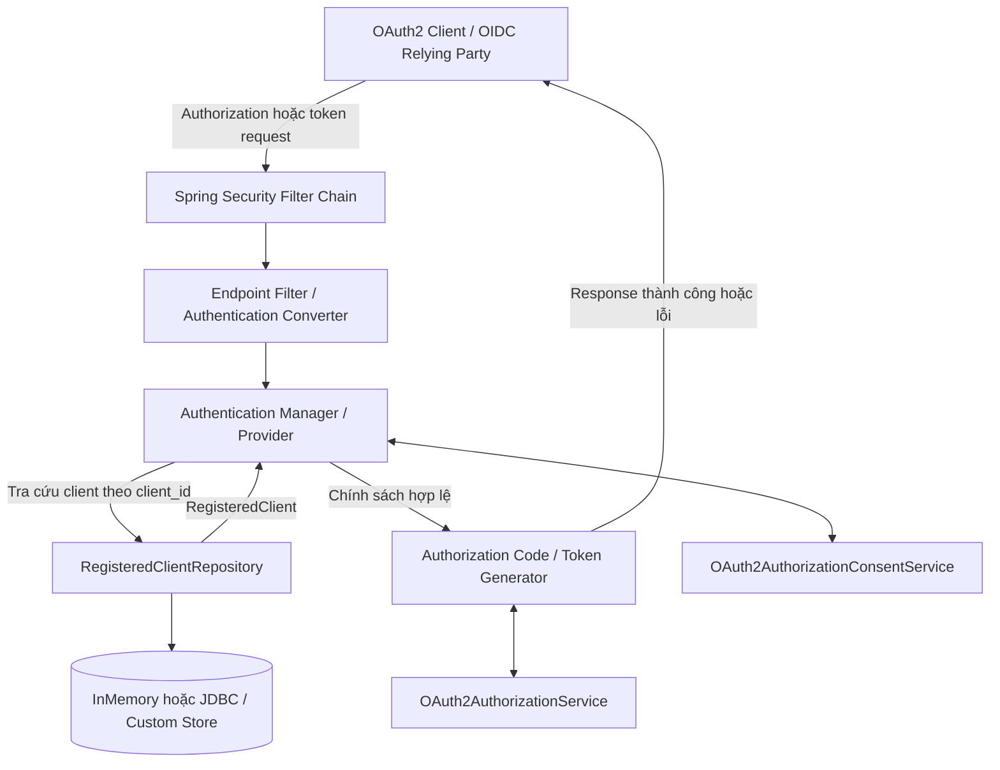
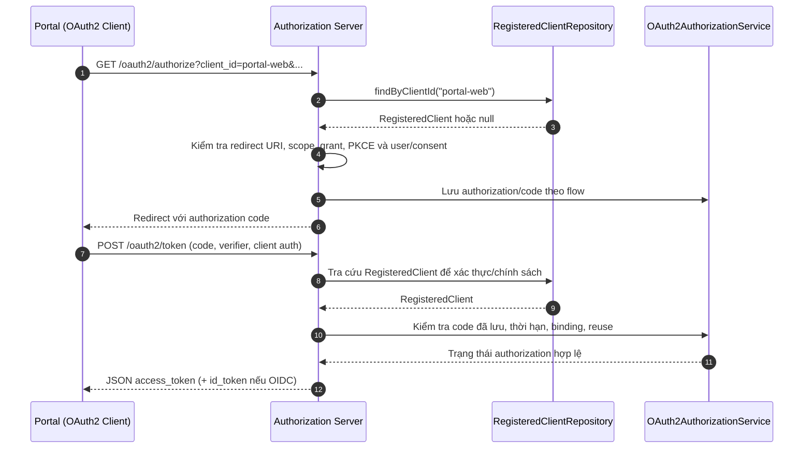

# RegisteredClientRepository và các thao tác tra cứu client

Trong hệ thống **OAuth 2.0/OpenID Connect (OIDC) Authorization Server**, một ứng dụng muốn xin authorization code, access token hoặc dùng cơ chế xác thực OIDC cần được Authorization Server nhận diện và kiểm tra chính sách. Với **Spring Authorization Server**, dữ liệu đăng ký ứng dụng được biểu diễn bởi **`RegisteredClient`**; thành phần chịu trách nhiệm **lưu và tra cứu** các bản ghi đó là **`RegisteredClientRepository`**.

Bài học thuộc chương **Mô hình dữ liệu** của module **SPRING_SECURITY_OAUTH2_OIDC_AUTHORIZATION_SERVER** tập trung vào hợp đồng của repository, ba thao tác `save`/`findById`/`findByClientId`, cách dùng triển khai InMemory hoặc JDBC, tích hợp vào Spring Boot, những giới hạn bảo mật và kiểm thử. Mục tiêu là có thể thiết kế, cấu hình, bảo mật, kiểm thử và vận hành Authorization Server dựa trên các mô hình rõ ràng, không nhầm dữ liệu đăng ký client với token hoặc tài khoản người dùng.

> **Phạm vi:** Ví dụ Java minh họa Spring Authorization Server trong ứng dụng Servlet với các API quen thuộc của Spring Security. Import, dependency, phiên bản thư viện, schema DB và bean hỗ trợ cần được bổ sung theo dự án. Một số API/DSL có thể khác giữa các phiên bản.

## 1. Registered client là ai, repository giải quyết vấn đề gì?

**Client** trong OAuth 2.0 là ứng dụng yêu cầu cấp quyền hoặc token từ Authorization Server (AS). Nó có thể là ứng dụng web phía máy chủ, ứng dụng di động, SPA hoặc dịch vụ chạy nền. Client không đồng nghĩa với **người dùng cuối**, cũng không đồng nghĩa với Resource Server cung cấp API.

**Registered client** là mô tả **client đã được AS chấp thuận/đăng ký**, bao gồm định danh, cách xác thực, grant type, redirect URI, scope và chính sách phát hành token.

**`RegisteredClientRepository`** trả lời các câu hỏi:

1. AS có nhận biết `client_id` này không?
2. Bản ghi client tương ứng đang có những phương thức xác thực và grant được phép?
3. Redirect URI, scope, yêu cầu PKCE, consent và token settings của client là gì?
4. Khi thay đổi cấu hình client, AS lưu và tra cứu bản ghi mới ở đâu?

Ví dụ, khi `portal-web` yêu cầu `/oauth2/authorize`, Authorization Server cần tìm dữ liệu đăng ký của `portal-web` trước khi kiểm tra `redirect_uri`, `response_type`, scope và các quy tắc liên quan. Khi client gọi `/oauth2/token`, AS cũng cần biết cơ chế xác thực, grant được phép và cấu hình của client.

**Repository là nguồn dữ liệu đăng ký client**, không phải nơi lưu authorization code hoặc refresh token đang hoạt động.

## 2. Đặt RegisteredClientRepository vào kiến trúc xử lý



Sơ đồ trên diễn giải **vai trò logic**, không cam kết thứ tự gọi của từng filter/provider trong mọi phiên bản. Client authentication có thể đi qua một filter riêng trước token grant; các request OIDC và consent có bước xử lý bổ sung.

| Thành phần | Nó lưu/biết gì? | Không thay thế được |
|---|---|---|
| **`RegisteredClient`** | Metadata và chính sách của một client | Token, phiên login, user account |
| **`RegisteredClientRepository`** | Lưu/đọc `RegisteredClient` | `OAuth2AuthorizationService` |
| **`OAuth2Authorization` / `OAuth2AuthorizationService`** | Một authorization đã cấp, code/token và trạng thái liên quan | Metadata đăng ký client |
| **`OAuth2AuthorizationConsent` / `OAuth2AuthorizationConsentService`** | Quyền consent của principal đối với một client | Client registration hoặc lưu token |
| **`AuthorizationServerSettings`** | Issuer và các đường dẫn endpoint của AS | Cấu hình riêng từng client |
| **UserDetailsService / hệ thống danh tính** | Tài khoản và thông tin xác thực người dùng | Kho đăng ký OAuth2 Client |

Sự khác biệt này đặc biệt quan trọng khi vận hành. Xóa hoặc đổi metadata của client **không tự bảo đảm mọi access token JWT đã phát hành bị vô hiệu tức thì**; trạng thái token, khả năng thu hồi và kiểm tra phía Resource Server phải được thiết kế riêng.

## 3. Mô hình RegisteredClient: nhóm thuộc tính chính

`org.springframework.security.oauth2.server.authorization.client.RegisteredClient` là đối tượng mô tả client tại AS. Phần lớn thao tác cập nhật diễn ra bằng **builder**, tạo đối tượng mới từ cấu hình đã có.

| Thuộc tính/nhóm | Vai trò | Ví dụ |
|---|---|---|
| `id` | Định danh **nội bộ** của bản ghi tại AS; dùng để liên kết lưu trữ | UUID |
| `clientId` | Định danh **giao thức** client gửi với yêu cầu OAuth2 | `portal-web` |
| `clientIdIssuedAt` | Thời điểm cấp client ID, nếu được thiết lập | `Instant` |
| `clientSecret` | Giá trị xác thực confidential client, thường được mã hóa một chiều | `{bcrypt}...` |
| `clientSecretExpiresAt` | Thời điểm hết hạn secret, nếu áp dụng | `Instant` |
| `clientName` | Tên hiển thị cho quản trị/consent tùy giao diện | `Portal Documents` |
| `clientAuthenticationMethods` | Các phương thức AS chấp nhận để xác thực client | `client_secret_basic`, `private_key_jwt`, `none` |
| `authorizationGrantTypes` | Các grant được phép dùng | `authorization_code`, `refresh_token`, `client_credentials` |
| `redirectUris` | URI AS được phép trả kết quả authorization | `https://portal.example.com/login/oauth2/code/company` |
| `postLogoutRedirectUris` | URI redirect sau OIDC logout khi có hỗ trợ | `https://portal.example.com/signed-out` |
| `scopes` | Các scope được phép yêu cầu | `openid`, `profile`, `documents.read` |
| `clientSettings` | Chính sách áp dụng cho client: PKCE, consent và một số cơ chế client auth | `requireProofKey(true)` |
| `tokenSettings` | Chính sách token: TTL, reuse refresh token, format và các lựa chọn khác | access token TTL 10 phút |

### 3.1. `id` khác `clientId` như thế nào?

Hai trường đều định danh client nhưng phục vụ **ngữ cảnh khác nhau**:

- **`id`**: khóa nội bộ trong AS, có thể dùng làm liên kết giữa registration với các bản ghi authorization/consent.
- **`clientId`**: giá trị client gửi trong thông điệp giao thức, chẳng hạn `client_id=portal-web`.

Trong ví dụ:

```text
id       = "d9b10ac8-57b7-4b84-a939-68bd4fbe1f3f"
clientId = "portal-web"
```

Không nên đặt `id` bằng `clientId` theo thói quen nếu mô hình persistence có liên kết nội bộ cần ổn định. **Không thay đổi `id` khi cập nhật một client đã có**; một `id` mới có thể khiến các authorization/consent trước đó trỏ tới bản ghi không còn tồn tại.

### 3.2. Secret không đồng nghĩa với client ID

`clientId` **không phải bí mật**; nó thường xuất hiện trong authorization URL. `clientSecret` là credential dành cho client có khả năng giữ bí mật, ví dụ backend. Với SPA/mobile/public client, **không giả vờ có secret** bằng cách nhúng chuỗi vào JavaScript hoặc ứng dụng di động.

Khi dùng `client_secret_basic` hoặc `client_secret_post`, secret phải được lưu dưới dạng phù hợp với `PasswordEncoder` mà client authentication provider sử dụng. Một thiết lập phổ biến là dùng **`DelegatingPasswordEncoder`**, lưu giá trị có tiền tố như `{bcrypt}...`. Không lưu secret thô vào repository, file cấu hình công khai hay source control.

## 4. Hợp đồng RegisteredClientRepository

Giao diện cơ bản của Spring Authorization Server có **ba thao tác**:

```java
public interface RegisteredClientRepository {
    void save(RegisteredClient registeredClient);

    RegisteredClient findById(String id);

    RegisteredClient findByClientId(String clientId);
}
```

Đây là **hợp đồng cốt lõi**, không phải REST controller hoặc CRUD API cho quản trị. Repository cung cấp các thao tác AS cần để lấy metadata; nó **không có sẵn** các phương thức như `findAll`, `deleteById`, `findByName`, `page` hay `rotateSecret`.

| Phương thức | Đầu vào | Kết quả | Trường hợp sử dụng |
|---|---|---|---|
| `save(RegisteredClient)` | Một bản ghi client hợp lệ | `void`; lưu theo ngữ nghĩa của implementation | Khởi tạo client, ghi thay đổi metadata |
| `findById(String id)` | `id` nội bộ | `RegisteredClient` hoặc `null` nếu không tìm thấy | Khôi phục metadata cho bản ghi đã liên kết bằng ID |
| `findByClientId(String clientId)` | `client_id` giao thức | `RegisteredClient` hoặc `null` nếu không tìm thấy | Xác định client khi nhận authorization/client-auth request |

Trong luồng OAuth, request thường mang `client_id` nên `findByClientId` là thao tác được gọi thường xuyên. `findById` hữu ích với những dữ liệu authorization/consent đã lưu tham chiếu tới ID nội bộ. Cần phân biệt ý nghĩa của hai khóa khi thiết kế database index và cache.

### 4.1. `findByClientId`: tra cứu tại giao thức

Ví dụ:

```java
RegisteredClient registeredClient =
    registeredClientRepository.findByClientId("portal-web");

if (registeredClient == null) {
    // Không tồn tại registration tương ứng trong repository.
    // Lớp xử lý OAuth quyết định mã lỗi phù hợp với endpoint/ngữ cảnh.
}
```

Repository trả `null` khi không tìm thấy client theo hợp đồng phổ biến của giao diện. **Không tự trả `invalid_client` tại repository** cho mọi cuộc gọi không thấy dữ liệu: authorization endpoint, client authentication và các endpoint khác có quy tắc error response riêng. Việc ánh xạ lỗi nên nằm ở lớp giao thức/provider xử lý request.

### 4.2. `findById`: tra cứu tham chiếu nội bộ

```java
String internalId = "d9b10ac8-57b7-4b84-a939-68bd4fbe1f3f";
RegisteredClient registeredClient =
    registeredClientRepository.findById(internalId);
```

Khi AS lưu dữ liệu cấp quyền liên quan tới `registeredClientId`, lookup bằng `id` giúp xác định registration tương ứng. Vì vậy nên giữ `id` **ổn định** trong suốt vòng đời bản ghi; nếu đổi ID hoặc xóa bản ghi mà không có chiến lược di trú, các mối liên kết lưu trữ có thể mất hiệu lực.

### 4.3. `save`: lưu bản ghi, không tự làm nhiệm vụ quản trị

```java
RegisteredClient existing =
    registeredClientRepository.findByClientId("portal-web");

if (existing != null) {
    RegisteredClient updated = RegisteredClient.from(existing)
        .clientName("Portal Documents")
        .build();

    registeredClientRepository.save(updated);
}
```

`RegisteredClient.from(existing)` giúp giữ nguyên các thuộc tính chưa thay đổi, đặc biệt là **`id`**, authentication methods, redirect URIs, scopes và token settings. Việc `save` là insert, update, upsert hay phát sinh lỗi khi trùng khóa phụ thuộc implementation; chẳng hạn JDBC sử dụng bảng và ràng buộc CSDL. **Không giả định API này thay bạn kiểm tra chính sách cấp quyền, quay vòng secret hay thực hiện audit.**

## 5. Ba thao tác phối hợp trong một request như thế nào?

Ví dụ client `portal-web` dùng Authorization Code + PKCE:



Điểm cần nhớ:

1. **Repository giúp nhận diện và kiểm tra chính sách của client**, không tự xác thực người dùng.
2. **`OAuth2AuthorizationService` quản lý trạng thái authorization/token**; `RegisteredClientRepository` không lưu authorization code hay refresh token.
3. AS phải kiểm tra grant, redirect URI, client authentication, consent, PKCE và token validation ở các thành phần xử lý thích hợp. **Việc tìm thấy client chỉ là điều kiện cần**, không có nghĩa client được cấp mọi token.

## 6. Triển khai InMemoryRegisteredClientRepository

Spring Authorization Server cung cấp `InMemoryRegisteredClientRepository` hữu ích cho ví dụ, kiểm thử hoặc môi trường phát triển. Dữ liệu registration được giữ trong bộ nhớ của **tiến trình đang chạy**; nếu ứng dụng khởi động lại mà không nạp dữ liệu từ nguồn bền vững, nội dung runtime sẽ không còn.

Ví dụ cấu hình đăng ký một **confidential web client** trong Spring Boot:

```java
@Bean
PasswordEncoder passwordEncoder() {
    return PasswordEncoderFactories.createDelegatingPasswordEncoder();
}

@Bean
RegisteredClientRepository registeredClientRepository(
        PasswordEncoder passwordEncoder) {

    String rawSecret = System.getenv("PORTAL_CLIENT_SECRET");
    if (rawSecret == null || rawSecret.isBlank()) {
        throw new IllegalStateException("Missing PORTAL_CLIENT_SECRET");
    }

    RegisteredClient portal = RegisteredClient.withId(
            UUID.randomUUID().toString())
        .clientId("portal-web")
        .clientName("Portal Documents")
        .clientSecret(passwordEncoder.encode(rawSecret))
        .clientAuthenticationMethod(
            ClientAuthenticationMethod.CLIENT_SECRET_BASIC)
        .authorizationGrantType(
            AuthorizationGrantType.AUTHORIZATION_CODE)
        .authorizationGrantType(
            AuthorizationGrantType.REFRESH_TOKEN)
        .redirectUri(
            "https://portal.example.com/login/oauth2/code/company")
        .scope(OidcScopes.OPENID)
        .scope(OidcScopes.PROFILE)
        .scope("documents.read")
        .clientSettings(ClientSettings.builder()
            .requireProofKey(true)
            .requireAuthorizationConsent(true)
            .build())
        .tokenSettings(TokenSettings.builder()
            .accessTokenTimeToLive(Duration.ofMinutes(10))
            .refreshTokenTimeToLive(Duration.ofDays(7))
            .reuseRefreshTokens(false)
            .build())
        .build();

    return new InMemoryRegisteredClientRepository(portal);
}
```

**Lưu ý cho ví dụ:**

- Code cần các import và dependencies của Spring Boot, Spring Security và Spring Authorization Server tương ứng. Cấu hình AS hoàn chỉnh còn cần `SecurityFilterChain`, issuer/endpoint settings, ký token/JWK source, đăng nhập người dùng và storage authorization/consent.
- `PORTAL_CLIENT_SECRET` là biến môi trường **được cấp bởi môi trường triển khai**, không phải giá trị cần đưa vào source code. Không in secret hoặc hash ra log.
- `PasswordEncoderFactories.createDelegatingPasswordEncoder()` tạo hash có tiền tố thuật toán (chẳng hạn `{bcrypt}...`), phù hợp với cơ chế DelegatingPasswordEncoder thường dùng để xác thực client secret. Kiểm tra encoder thực tế nếu tùy biến client authentication.
- `UUID.randomUUID()` thuận tiện cho ví dụ; với production/seed data cần **ID nội bộ ổn định qua các lần khởi động**, tránh tạo mỗi lần một ID mới cho cùng client nếu dữ liệu authorization/consent được lưu bền vững ở nơi khác.
- `requireProofKey(true)` yêu cầu PKCE; `requireAuthorizationConsent(true)` quy định chính sách consent ở client. Cần thiết kế phù hợp với luồng OIDC và đặc điểm ứng dụng.

### 6.1. Tra cứu trong InMemory

```java
RegisteredClientRepository repository =
    new InMemoryRegisteredClientRepository(portal);

RegisteredClient byClientId = repository.findByClientId("portal-web");
RegisteredClient byId = repository.findById(portal.getId());
RegisteredClient missing = repository.findByClientId("unknown-client");

// byClientId != null; byId != null; missing == null
```

Ở đây `portal` là biến được tạo ở ví dụ trước; đoạn code minh họa thao tác lookup. Khi cần bổ sung registration khác, có thể tạo và `save(...)` một bản ghi mới theo hợp đồng repository, nhưng tránh việc thay đổi ID/Client ID ngoài ý muốn.

### 6.2. Vì sao InMemory chưa đủ cho hệ thống nhiều node?

Nếu các instance AS có registration khác nhau, request authorization đi vào node A rồi token request tới node B có thể thất bại do **metadata client không thống nhất**. Mỗi lần restart cũng phải seed lại cấu hình. Với production có nhiều AS instance, một hệ thống lưu trữ dùng chung hoặc chiến lược đồng bộ cấu hình rõ ràng thường phù hợp hơn.

Nếu chỉ dùng InMemory cho thử nghiệm, cần ghi rõ **nó giải quyết lưu client registration**, không giải quyết authorization code/token/consent persistence.

## 7. Triển khai JdbcRegisteredClientRepository

Với hệ thống cần lưu bền vững, Spring Authorization Server cung cấp `JdbcRegisteredClientRepository` dựa trên `JdbcOperations`/`JdbcTemplate`. Repository sử dụng bảng đăng ký client, thường là **`oauth2_registered_client`** theo schema tham khảo của phiên bản Spring Authorization Server.

Ví dụ bean:

```java
@Bean
RegisteredClientRepository registeredClientRepository(
        JdbcTemplate jdbcTemplate) {
    return new JdbcRegisteredClientRepository(jdbcTemplate);
}
```

Đây chỉ là phần nối repository với datasource. **Không tự động tạo bảng**, không tự seed client, và không tự thay thế chính sách bảo mật AS. Cần tạo schema phù hợp với **phiên bản thư viện đang triển khai** bằng migration có quản lý (ví dụ Flyway/Liquibase) và nạp client ban đầu có kiểm soát.

### 7.1. Dữ liệu và ràng buộc ở database

Một mô hình persistence phù hợp cần bảo vệ:

| Yêu cầu | Vì sao |
|---|---|
| `id` có khóa chính/unique | Tìm bản ghi nội bộ và giữ liên kết tới authorization/consent |
| `client_id` có ràng buộc unique/index | Không cho hai client có cùng định danh giao thức, lookup nhanh và xác định |
| Cột secret được phân quyền chặt | Chứa **hash credential**, vẫn cần tránh sao chép/đọc trái phép |
| Redirect URI, grant, scope, client/token settings được lưu nguyên vẹn | AS phải kiểm tra đúng chính sách đã đăng ký |
| Schema được migration cùng version phần mềm | Tránh mapper/query lỗi do cấu trúc bảng không khớp |
| Audit thay đổi client | Truy vết thêm client, cấp scope mới, thay redirect URI, xoay vòng secret |

Các trường tập hợp thường được mapper của Spring chuyển đổi giữa cấu trúc Java và cột lưu trữ. **Không nên tự viết câu SQL INSERT với định dạng đoán từ Java object** khi chưa kiểm tra mapper/schema chính xác. Nếu cần mô hình riêng như thêm tenant hay cấu trúc tùy biến, cân nhắc custom `RegisteredClientRepository` hoặc chuyển đổi có kiểm soát.

### 7.2. Seed client lần đầu nhưng tránh ghi đè lúc restart

Một cách làm thực tiễn là chỉ tạo client khi chưa có bản ghi:

```java
// Ví dụ trong tác vụ provisioning/seed có kiểm soát.
RegisteredClient existing = repository.findByClientId("portal-web");

if (existing == null) {
    RegisteredClient initial = buildPortalRegistration();
    repository.save(initial);
}
```

`buildPortalRegistration()` là hàm minh họa tạo `RegisteredClient` đã được kiểm tra. **Đây không phải cơ chế atomic upsert**: trong hệ thống nhiều instance cùng chạy tác vụ seed, hai tiến trình có thể cùng đọc `null` rồi cùng insert. Cần thực thi provisioning một lần hoặc dùng transaction/unique constraint và xử lý trùng khóa phù hợp.

Không tự xoay vòng client secret mỗi lần khởi động. Điều đó có thể khiến client đang chạy mất khả năng xác thực sau restart hoặc giữa hai instance AS.

## 8. Cập nhật client và quản lý vòng đời credential

### 8.1. Cập nhật metadata bằng RegisteredClient.from(...)

Ví dụ đổi tên hiển thị, giữ nguyên ID và thuộc tính khác:

```java
RegisteredClient current =
    repository.findByClientId("portal-web");

if (current == null) {
    throw new IllegalStateException("Client registration not found");
}

RegisteredClient modified = RegisteredClient.from(current)
    .clientName("Portal Documents - Production")
    .build();

repository.save(modified);
```

Khi update redirect URI, scope, grant hoặc `clientAuthenticationMethods`, thay đổi đó **có tác động bảo mật** nên phải được kiểm tra quyền quản trị, xét duyệt và audit. Ví dụ thêm redirect URI trỏ tới domain không thuộc client có thể tạo kênh rò rỉ authorization code.

### 8.2. Xoay vòng secret có kiểm soát

Ví dụ tạo registration mới với secret được mã hóa trước khi lưu:

```java
RegisteredClient current =
    repository.findByClientId("portal-web");

if (current == null) {
    throw new IllegalStateException("Client registration not found");
}

String newRawSecret = obtainNewSecretFromSecureProvisioning();

RegisteredClient rotated = RegisteredClient.from(current)
    .clientSecret(passwordEncoder.encode(newRawSecret))
    .clientSecretExpiresAt(Instant.now().plus(Duration.ofDays(90)))
    .build();

repository.save(rotated);
```

`obtainNewSecretFromSecureProvisioning()` là hàm giả định của quy trình cấp secret; đoạn code chỉ minh họa cách dùng builder. **Không ghi raw secret ra log**, và chỉ phân phối nó tới client đích bằng kênh an toàn.

Repository mặc định lưu một giá trị `clientSecret` cho một registration. **Không giả định việc thay secret hỗ trợ song song hai secret cũ/mới**. Muốn rotation không gián đoạn, phải xây dựng quy trình chuyển đổi phù hợp (thời gian cập nhật client, chính sách xác thực riêng hoặc kiến trúc hỗ trợ giai đoạn chồng lấn) và kiểm thử trước khi thực hiện.

### 8.3. Hết hạn secret và trạng thái client

`clientSecretExpiresAt` cho phép lưu thời điểm hết hạn secret khi sử dụng cơ chế tương ứng. Nó **không phải một cờ `enabled` chung cho mọi loại client**, và `RegisteredClientRepository` không cung cấp sẵn `disableClient`.

Khi cần vô hiệu hóa client, phải xác định rõ:

1. Chặn **yêu cầu cấp authorization/token mới** như thế nào, ở policy/registration nào?
2. Client đã có **refresh token** còn sử dụng được không, cần thu hồi thế nào?
3. **Access token JWT** đã phát hành còn hiệu lực ở Resource Server tới khi hết hạn hay có cơ chế từ chối sớm?
4. Cần lưu audit, rollback và thông báo cho các hệ thống gọi API nào?

Đây là vấn đề vận hành/chính sách đa thành phần, không thể hoàn thành chỉ bằng một lệnh `save(...)` hoặc xóa một hàng DB.

## 9. Public client, confidential client và OIDC

### 9.1. Confidential web client

Một backend có khả năng giữ secret thường đăng ký:

```java
.clientAuthenticationMethod(ClientAuthenticationMethod.CLIENT_SECRET_BASIC)
.authorizationGrantType(AuthorizationGrantType.AUTHORIZATION_CODE)
.redirectUri("https://portal.example.com/login/oauth2/code/company")
.scope(OidcScopes.OPENID)
.clientSettings(ClientSettings.builder()
    .requireProofKey(true)
    .build())
```

Nếu client được dùng để đăng nhập OIDC, scope `openid` có vai trò kích hoạt yêu cầu OIDC phù hợp; OP cần hỗ trợ OIDC và client cần kiểm tra ID Token đúng issuer, audience, signature và thời hạn. Có đăng ký scope `openid` trong repository **không tự bật toàn bộ chức năng OIDC** trên Authorization Server.

### 9.2. Public client (SPA hoặc native app)

Public client **không có client secret đáng tin cậy** trong browser hoặc mã ứng dụng cài trên thiết bị. Ví dụ hình thái registration:

```java
RegisteredClient publicClient = RegisteredClient.withId(
        UUID.randomUUID().toString())
    .clientId("mobile-app")
    .clientAuthenticationMethod(ClientAuthenticationMethod.NONE)
    .authorizationGrantType(AuthorizationGrantType.AUTHORIZATION_CODE)
    .redirectUri("com.example.app:/oauth2redirect")
    .scope("documents.read")
    .clientSettings(ClientSettings.builder()
        .requireProofKey(true)
        .build())
    .build();
```

Redirect URI theo custom scheme ở đây chỉ là **ví dụ minh họa**; thực tế cần áp dụng quy tắc URI cho loại ứng dụng, nền tảng và chính sách AS, có thể ưu tiên app-claimed HTTPS URI ở nơi hỗ trợ. Public client cần Authorization Code + PKCE với S256, kiểm soát redirect URI và không lưu fake secret. Các chính sách phát hành refresh token cho public client phải được đánh giá riêng.

### 9.3. Client_credentials

Ứng dụng chạy nền có thể đăng ký `AuthorizationGrantType.CLIENT_CREDENTIALS` và cơ chế xác thực confidential client phù hợp. Grant này không đại diện cho **đăng nhập người dùng cuối**, nên không tự yêu cầu OIDC ID Token. Repository lưu **quyền sử dụng grant**, còn kết quả cấp token dựa trên request và chính sách của AS.

## 10. Phân biệt với ClientRegistrationRepository của OAuth2 Client

Spring Security có một interface tên rất gần: **`ClientRegistrationRepository`**, nhưng nó nằm ở **phía ứng dụng đóng vai trò OAuth2 Client**, không phải kho đăng ký client của Authorization Server.

| | `RegisteredClientRepository` | `ClientRegistrationRepository` |
|---|---|---|
| Thuộc thành phần | **Spring Authorization Server** | **Spring Security OAuth2 Client** |
| Lưu đối tượng | `RegisteredClient` | `ClientRegistration` |
| Mục đích | AS xác định client nào được cấp quyền/token, theo chính sách nào | Ứng dụng client biết AS/OP endpoint, credentials, scope, redirect URI để khởi tạo flow |
| Lookup tiêu biểu | `findByClientId("portal-web")`, `findById(internalId)` | `findByRegistrationId("company")` |
| Khóa cần hiểu | `id` nội bộ và `clientId` giao thức | `registrationId` của cấu hình local và `clientId` được AS cấp |

Ví dụ trong một ứng dụng web client có cấu hình:

```yaml
spring:
  security:
    oauth2:
      client:
        registration:
          company:
            provider: company-idp
            client-id: portal-web
            authorization-grant-type: authorization_code
            scope: openid, profile
        provider:
          company-idp:
            issuer-uri: https://identity.example.com
```

Đây là cấu hình thuộc **OAuth2 Client**, được Spring Boot dùng tạo `ClientRegistration`. Nó **không tự tạo** một `RegisteredClient` bên phía Authorization Server. Muốn flow hoạt động, `portal-web` vẫn phải được AS đăng ký tương thích; confidential client còn cần bí mật/phương thức xác thực phù hợp được cấu hình an toàn ở phía client.

## 11. Tự triển khai RegisteredClientRepository khi nào?

Bạn có thể cần custom repository nếu tổ chức có kho cấu hình client sẵn, đa tenant, schema riêng hoặc chính sách provisioning phức tạp. Khi đó vẫn phải giữ **đúng hợp đồng ba phương thức**. Một bản phác thảo:

```java
public final class CustomRegisteredClientRepository
        implements RegisteredClientRepository {

    private final ClientStore store;
    private final RegisteredClientMapper mapper;

    @Override
    public void save(RegisteredClient registeredClient) {
        // Validate permissions/uniqueness in provisioning layer,
        // then persist atomically with stable id and clientId.
        store.upsert(mapper.toRecord(registeredClient));
    }

    @Override
    public RegisteredClient findById(String id) {
        ClientRecord record = store.findById(id);
        return record == null ? null : mapper.toRegisteredClient(record);
    }

    @Override
    public RegisteredClient findByClientId(String clientId) {
        ClientRecord record = store.findByClientId(clientId);
        return record == null ? null : mapper.toRegisteredClient(record);
    }
}
```

`ClientStore`, `ClientRecord`, `RegisteredClientMapper` là **kiểu minh họa** cần tự thiết kế; đoạn code không nhằm biên dịch nguyên trạng. Trong custom implementation, cần chú ý:

- **Hai khóa và tính duy nhất:** không cho cùng `clientId` trỏ tới nhiều `id`; khi thay client ID, cập nhật index và liên kết một cách nhất quán.
- **Atomicity:** việc `save` phải ngăn cập nhật dở dang; nếu nhiều node đồng thời tạo/sửa client, nên dùng constraint/transaction/version thích hợp.
- **Mapping toàn vẹn:** không làm mất `clientAuthenticationMethods`, `authorizationGrantTypes`, redirect URIs, scope, `ClientSettings`, `TokenSettings`, secret expiration hoặc thuộc tính OIDC.
- **Không trả secret thô:** chỉ cung cấp giá trị hash đã lưu cho luồng client authentication đúng chính sách; hạn chế quyền đọc ở storage.
- **Lỗi và khả dụng:** phân biệt `null` vì không tìm thấy với outage database; đừng biến mọi lỗi DB thành “unknown client” không có cảnh báo vận hành.
- **Độ trễ:** lookup theo client ID là đường nóng; cần index hoặc cache phù hợp và phương án invalidation khi thay secret/chính sách.
- **Audit:** ghi actor, thời điểm và loại thay đổi ở hệ thống provisioning, tránh lưu plaintext secret trong audit.

### 11.1. Cache tra cứu client

Nếu cache `findByClientId` và `findById`, phải nghĩ tới **cả hai chỉ mục**. Ví dụ, sau khi xoay secret, cache node A vẫn có hash cũ có thể chấp nhận secret cũ; cache node B đọc hash mới và chấp nhận secret mới. Sau khi thu hồi client hoặc xóa redirect URI, cache cũ có thể cho phép cấu hình lỗi thời.

Do vậy:

1. Chọn TTL/invalidation dựa trên mức độ nghiêm trọng của thay đổi credential và policy.
2. Khi cập nhật client, vô hiệu hóa các entry liên quan tới cả `id` lẫn `clientId`.
3. Nếu môi trường nhiều node, phải có cơ chế thông báo thay đổi hoặc chọn consistency đáp ứng yêu cầu bảo mật.
4. Không dùng negative cache quá lâu cho client chưa tồn tại nếu hệ thống hỗ trợ provisioning động.

Không mặc định `RegisteredClientRepository` cung cấp sẵn các cơ chế consistency/cache này.

## 12. Đăng ký client tĩnh và Dynamic Client Registration

Việc viết bean với `InMemoryRegisteredClientRepository` hay seed database là **đăng ký tĩnh/quản trị**: người vận hành định nghĩa client rồi gọi `save`.

**Dynamic Client Registration** (ví dụ RFC 7591) là một giao thức/endpoint riêng để client đăng ký động theo chính sách, có thể yêu cầu quyền truy cập hoặc phê duyệt đặc biệt. **Có `RegisteredClientRepository` không đồng nghĩa AS tự mở public registration endpoint.**

Nếu bổ sung giao diện quản trị hoặc endpoint đăng ký động, cần kiểm tra:

- Ai được tạo và sửa client, có xác thực/quyền quản trị nào?
- Redirect URI được chấp nhận theo chính sách nào, có chặn redirect tới domain nguy hiểm?
- Grant, scope, client authentication methods, token TTL có được giới hạn?
- Secret được sinh/phân phối an toàn hay dùng cơ chế authentication mạnh hơn?
- Có audit, rate limit, quota, phê duyệt và cách hủy bỏ quyền không?

Repository chỉ là **cổng persistence** phía sau các quyết định đó.

## 13. Kiểm thử repository và luồng Authorization Server

### 13.1. Unit test hợp đồng với InMemory

Ví dụ kiểm tra lookup theo hai khóa và trường hợp không tồn tại (giả sử đã tạo `RegisteredClient portal` hợp lệ):

```java
@Test
void repositoryFindsClientByTwoKeys() {
    RegisteredClient portal = samplePortalClient();
    RegisteredClientRepository repository =
        new InMemoryRegisteredClientRepository(portal);

    assertThat(repository.findById(portal.getId()))
        .isEqualTo(portal);
    assertThat(repository.findByClientId(portal.getClientId()))
        .isEqualTo(portal);
    assertThat(repository.findByClientId("missing"))
        .isNull();
}
```

`samplePortalClient()` là hàm fixture cần viết, các imports JUnit/AssertJ được lược bỏ. Test xác minh repository, **chưa chứng minh** Authorization Server thực sự từ chối client sai grant hoặc sai secret.

### 13.2. Test JDBC cần dùng schema thực tế

Với `JdbcRegisteredClientRepository`, cần test có datasource thử nghiệm và schema đúng version:

| Kiểm thử | Điều cần xác minh |
|---|---|
| `save` rồi `findById` | Bản ghi được lưu bền vững, ID không đổi |
| `save` rồi `findByClientId` | Tra được đúng client bằng khóa giao thức |
| Đọc client không tồn tại | Trả `null`, không lẫn với lỗi kết nối DB |
| Update bằng `RegisteredClient.from(...)` | Giá trị mới được lưu, không mất scope/grant/settings chưa đổi |
| Trùng `clientId` | Ràng buộc unique hoạt động, xử lý race không tạo hai registration |
| Khởi động lại / 2 instance | Cùng nhìn thấy registration bền vững |
| Secret hash và thời hạn | Mapper round-trip đủ thông tin, không lộ raw secret |
| Lỗi DB | Báo sự cố vận hành rõ, không âm thầm coi là client unknown |

Không nhất thiết chạy toàn bộ AS cho mỗi unit test repository, nhưng phải có **integration test** đi qua filter chain ở các đường có liên quan đến đăng ký client.

### 13.3. Kiểm thử giao thức gắn với tra cứu client

| Kịch bản | Mong đợi |
|---|---|
| Client ID không tồn tại tại authorization request | Không cấp code, xử lý lỗi theo hợp đồng authorization endpoint và không redirect tới URI chưa tin cậy |
| Client ID hợp lệ nhưng redirect URI sai | Không redirect kết quả đến URI không đăng ký |
| Client không được phép Authorization Code grant | Không cấp code; lỗi tương ứng với endpoint |
| Client ID tồn tại, secret không hợp lệ ở token endpoint | `invalid_client` với status/header phù hợp client authentication |
| Client public không có secret, dùng PKCE đúng | Flow được chấp nhận theo chính sách và loại client |
| `code_verifier` không khớp | Không cấp token; thường `invalid_grant` |
| Client yêu cầu scope ngoài đăng ký | Không cấp quyền vượt quá chính sách; lỗi phù hợp |
| Đổi token với client không khớp chủ thể được cấp code | Không phát token; kiểm tra client binding |
| Thay secret/chính sách client | Các instance phản ánh cập nhật theo thiết kế cache/consistency |

Khi kiểm thử token endpoint, **tránh các request sai nhiều điều kiện cùng lúc** nếu muốn khẳng định một mã lỗi cụ thể: chẳng hạn client secret sai có thể bị chặn trước bước kiểm tra authorization code.

## 14. Lỗi thường gặp trong thiết kế và vận hành

| Sai lầm | Hậu quả | Cách xử lý |
|---|---|---|
| Dùng `findById(clientId)` | Không tìm thấy vì nhầm hai loại khóa | Dùng `findByClientId(clientId)` cho request mang `client_id` |
| Thay `id` khi cập nhật registration | Liên kết authorization/consent cũ bị lệch | Dùng `RegisteredClient.from(existing)` và giữ ID ổn định |
| Dùng raw client secret trong `clientSecret` | Rủi ro lộ credential, xác thực encoder không tương thích | Dùng PasswordEncoder đúng, bảo vệ provisioning |
| Nhúng secret vào SPA/mobile | Secret bị trích xuất, client giả danh | Public client + PKCE, không dùng embedded secret |
| Dùng InMemory trên các node không đồng bộ | Mỗi node có tập client/policy khác nhau | Shared storage hoặc đồng bộ cấu hình có kiểm soát |
| Mỗi lần startup lại sinh ID và secret mới | Client mất khả năng xác thực, mất liên kết dữ liệu | Provisioning một lần, ID bền vững, rotation theo quy trình |
| Tự mở endpoint cho phép `save` từ Internet | Kẻ lạ có thể thêm redirect URI/scope/client | Bảo vệ quản trị và kiểm tra policy trước persistence |
| Chỉ xóa registration và cho rằng JWT đã bị thu hồi | Access token đang lưu ở RS có thể còn hiệu lực | Thiết kế revocation, TTL, kiểm tra phía RS |
| Cache client lâu nhưng không invalidation | Dùng secret/redirect URI/scope đã lỗi thời | Invalidate theo ID và client ID, nhất quán nhiều node |
| Chỉ test `save` không test filter chain | Không phát hiện grant/client auth/PKCE xử lý sai | Integration test với request OAuth thật |

## 15. Checklist trước khi đưa vào production

1. **Đã chọn nguồn dữ liệu client bền vững chưa?** InMemory chỉ dùng khi yêu cầu vận hành cho phép; nhiều AS instance cần chính sách consistency.
2. **`id` và `clientId` có duy nhất và ổn định không?** Có index/unique constraint và xử lý race khi seed/update?
3. **Authentication method phù hợp loại client chưa?** Confidential client mới có secret được bảo vệ; public client dùng `none` và PKCE theo flow.
4. **Secret được lưu, phân phối và xoay vòng an toàn chưa?** Có encoder khớp với client authentication, không ghi secret vào log/CI output/source?
5. **Grant, scope, redirect URI, consent và TTL đã giới hạn chưa?** Có quy trình duyệt thay đổi quyền cao?
6. **Schema/migration phù hợp phiên bản thư viện chưa?** Có test `save`/lookup/update sau nâng cấp?
7. **Dữ liệu authorization, consent và client có được phân tách không?** Có kế hoạch revoke token khi vô hiệu hóa client?
8. **Cache có cơ chế invalidation không?** Có kiểm chứng sau rotation, đổi scope, thay redirect URI và khi multi-node?
9. **Có audit và giám sát không?** Theo dõi tỷ lệ `invalid_client`, lỗi repository/DB, thay đổi client bất thường mà không ghi credential.
10. **Có test thực qua AS không?** Bao gồm unknown client, secret sai, grant sai, scope sai, redirect URI sai và PKCE.

## 16. Tổng kết

- **`RegisteredClient`** là metadata/chính sách của client **được đăng ký tại Authorization Server**.
- **`RegisteredClientRepository`** có ba thao tác cốt lõi: `save`, `findById`, `findByClientId`. `id` nội bộ **khác** `clientId` mà OAuth2 Client gửi trong giao thức.
- **`InMemoryRegisteredClientRepository`** phù hợp học tập, thử nghiệm hoặc cấu hình đơn giản; **`JdbcRegisteredClientRepository`** cung cấp lưu trữ bền vững khi có schema và datasource thích hợp.
- Repository không thay thế **`OAuth2AuthorizationService`**, **`OAuth2AuthorizationConsentService`**, hệ thống người dùng, token validation hoặc kiểm soát quyền quản trị.
- Vận hành an toàn cần **secret hash**, registered redirect URI chặt chẽ, grants/scopes tối thiểu, provisioning/rotation có kiểm soát, ID ổn định, audit và kiểm thử filter chain.

Nắm chắc mô hình và các thao tác tra cứu này là nền tảng để triển khai Spring Security OAuth2/OIDC Authorization Server bằng Spring Boot đáng tin cậy, từ giai đoạn cấu hình client cho tới phát hành token và vận hành nhiều instance.

## 17. Tài liệu tham khảo

- [Spring Authorization Server Reference](https://docs.spring.io/spring-authorization-server/reference/): hướng dẫn mô hình `RegisteredClient`, cấu hình `RegisteredClientRepository` và các thành phần core.
- [Spring Security Reference](https://docs.spring.io/spring-security/reference/): OAuth2 Client, Resource Server và các nguyên tắc authentication.
- [RFC 6749 — The OAuth 2.0 Authorization Framework](https://www.rfc-editor.org/rfc/rfc6749): định nghĩa client, authorization grant và client authentication.
- [RFC 7636 — PKCE](https://www.rfc-editor.org/rfc/rfc7636): ràng buộc authorization code và `code_verifier`.
- [RFC 9700 — OAuth 2.0 Security Best Current Practice](https://www.rfc-editor.org/rfc/rfc9700): các khuyến nghị bảo mật OAuth hiện đại.
- [RFC 7591 — OAuth 2.0 Dynamic Client Registration Protocol](https://www.rfc-editor.org/rfc/rfc7591): giao thức đăng ký client động, khác với thao tác persistence của repository.
- [OpenID Connect Core 1.0](https://openid.net/specs/openid-connect-core-1_0.html): khái niệm client/Relying Party, ID Token và yêu cầu OIDC.
