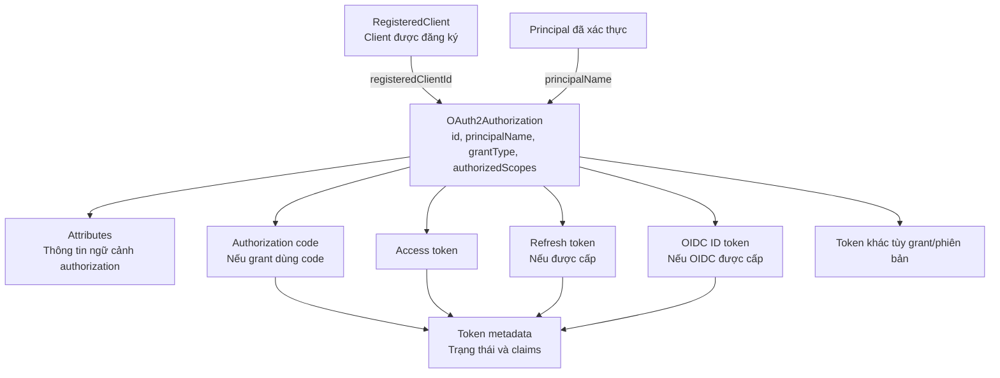
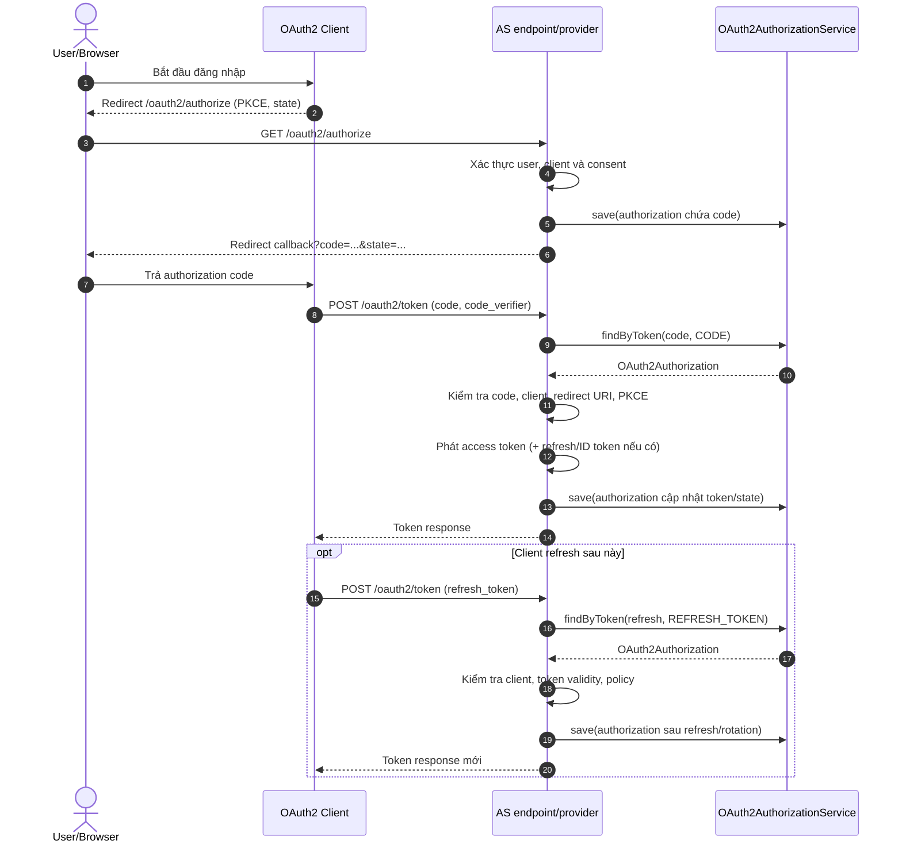
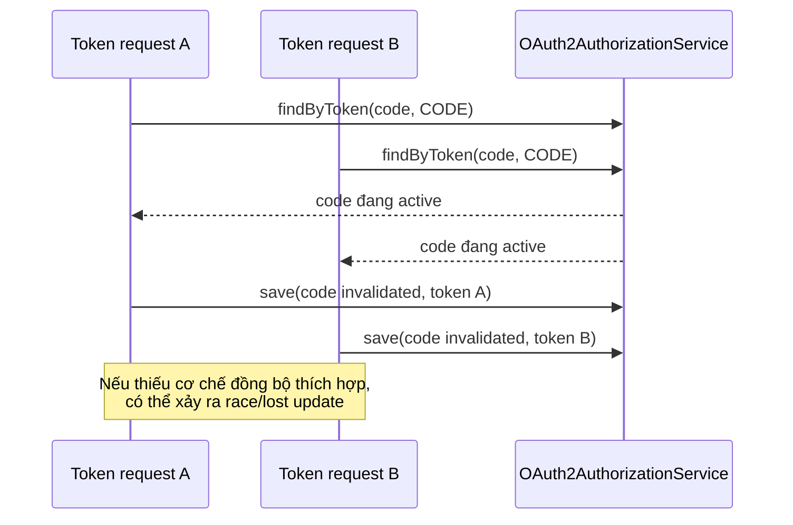
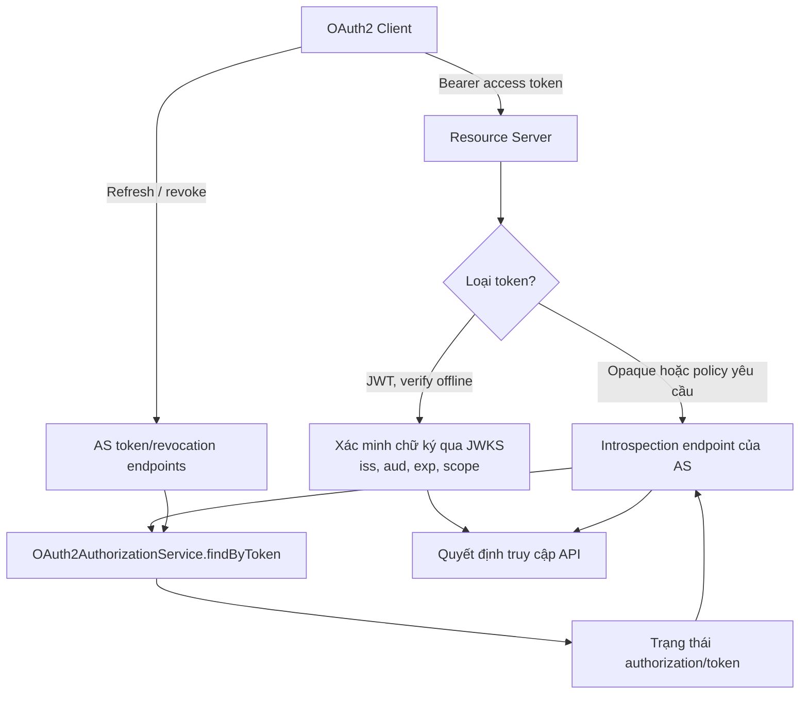
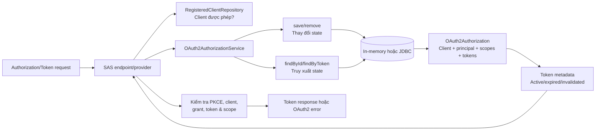

# OAuth2AuthorizationService và truy xuất authorization theo token

## 1. Mục tiêu và bối cảnh

Trong chương **Mô hình dữ liệu** của module **SPRING_SECURITY_OAUTH2_OIDC_AUTHORIZATION_SERVER**, `OAuth2AuthorizationService` là lớp trừu tượng quan trọng giúp Spring Authorization Server (SAS) duy trì và tra cứu **trạng thái cấp quyền OAuth 2.0/OpenID Connect (OIDC)**. Hiểu đúng service này là nền tảng để thiết kế, cấu hình, bảo mật, kiểm thử và vận hành Authorization Server bằng Spring Security trong ứng dụng Spring Boot.

Sau bài học, bạn có thể:

- Giải thích vì sao một `OAuth2Authorization` chứa **nhiều token và metadata**, thay vì chỉ là một access token.
- Sử dụng chính xác bốn phương thức `save`, `remove`, `findById` và `findByToken` của `OAuth2AuthorizationService`.
- Phân biệt truy xuất authorization theo authorization code, access token và refresh token; hiểu cách chỉ định `OAuth2TokenType`.
- Kiểm tra trạng thái token bằng `OAuth2Authorization.Token#isActive()` và phân biệt lookup với việc xác thực token.
- Lựa chọn `InMemoryOAuth2AuthorizationService` hoặc `JdbcOAuth2AuthorizationService` theo yêu cầu persistence, hiệu năng và nhiều instance.
- Thiết kế kiểm thử cho cấp phát token, đổi authorization code, refresh, revocation, expiration và bảo mật dữ liệu.

**Phạm vi:** Tập trung vào mô hình dữ liệu và truy vấn authorization. Các cấu hình endpoint, login và thuật toán ký JWT chỉ được nhắc đến khi cần để hiểu service. Ví dụ Java hướng tới API thường gặp của Spring Authorization Server 1.x trên Spring Security 6.x/Spring Boot 3.x; luôn đối chiếu phiên bản thực tế của ứng dụng.

## 2. `OAuth2Authorization` đại diện điều gì?

Một authorization là **bản ghi trạng thái cấp quyền**, liên kết **client đã đăng ký**, **principal** (người dùng hoặc client machine-to-machine), **grant type**, **scope được cấp**, các **token được sinh trong cùng vòng đời** và metadata liên quan.



Ví dụ: trong Authorization Code Flow, người dùng `alice` đồng ý cho ứng dụng `web-client` truy cập scope `profile.read`. Một authorization tương ứng có thể đi qua nhiều trạng thái: ban đầu chứa authorization code, sau khi đổi code thì chứa access token và có thể chứa refresh token và ID token. Khi refresh hoặc revoke, service cập nhật bản ghi authorization và metadata token tương ứng.

| Trường hoặc đối tượng | Diễn giải | Điểm dễ nhầm |
| --- | --- | --- |
| `id` | ID nội bộ của một `OAuth2Authorization` | Không phải `client_id`, `code` hoặc chuỗi access token. |
| `registeredClientId` | ID nội bộ tham chiếu `RegisteredClient` | Khác `clientId` dùng trong request OAuth2. |
| `principalName` | Tên principal liên quan authorization | Với Client Credentials có thể là client, không nhất thiết là tài khoản người dùng. |
| `authorizationGrantType` | Grant type tạo authorization | Ví dụ `authorization_code`, `client_credentials` hoặc một extension grant. |
| `authorizedScopes` | Scope thực tế đã được cho phép | Có thể khác tập scope client được phép đăng ký hoặc scope ban đầu yêu cầu. |
| `attributes` | Ngữ cảnh được lưu kèm authorization | Có thể chứa đối tượng bảo mật; cần cân nhắc serialization và dữ liệu nhạy cảm. |
| `tokens` | Các token thuộc authorization | Không giả định authorization nào cũng có đủ code, access, refresh và ID token. |
| `Token.metadata` | Metadata theo từng token | Chứa dấu hiệu invalidated, claims và thông tin phục vụ xử lý giao thức. |

**Ba mô hình cần tách biệt:** `RegisteredClient` mô tả *client được phép làm gì*; `OAuth2Authorization` mô tả *quyền/token đã được cấp trong một phiên cấp quyền*; `OAuth2AuthorizationConsent` mô tả *người dùng đã đồng ý scope nào cho client*. Service cho authorization không thay thế client repository hay consent service.

## 3. Hợp đồng `OAuth2AuthorizationService`

Interface cốt lõi có bốn phương thức:

```java
public interface OAuth2AuthorizationService {

    void save(OAuth2Authorization authorization);

    void remove(OAuth2Authorization authorization);

    OAuth2Authorization findById(String id);

    OAuth2Authorization findByToken(
            String token,
            OAuth2TokenType tokenType);
}
```

Chữ ký trên lược bỏ annotation nullability và metadata API của từng phiên bản để làm rõ ý nghĩa. Các phương thức tìm kiếm có thể trả **`null`** khi không tìm thấy bản ghi phù hợp.

| Phương thức | Input | Kết quả | Khi nào dùng |
| --- | --- | --- | --- |
| `save(authorization)` | Một `OAuth2Authorization` đầy đủ | Lưu mới hoặc cập nhật bản ghi hiện có | Phát authorization code, lưu token, thay trạng thái token sau refresh/revocation. |
| `remove(authorization)` | Bản ghi authorization | Xóa trạng thái authorization khỏi store | Dọn dữ liệu hoặc xử lý lifecycle khi framework/chính sách yêu cầu. |
| `findById(id)` | ID nội bộ authorization | `OAuth2Authorization` hoặc `null` | Truy vấn bằng ID nội bộ đã biết. |
| `findByToken(token, tokenType)` | Chuỗi giá trị token và loại token | `OAuth2Authorization` chứa token phù hợp hoặc `null` | Tra cứu khi nhận code, access token, refresh token hoặc token khác được hỗ trợ. |

### 3.1. Tại sao `findByToken` trả về authorization thay vì trả token?

Token là một **thành phần của authorization**, còn quyết định xử lý thường cần thông tin xung quanh token:

- Client đã đăng ký có quyền sử dụng grant nào?
- Token được cấp cho principal nào và scope nào?
- Token còn hạn, đã bị đánh dấu invalidated hay chưa?
- Authorization có refresh token và metadata liên quan không?
- Cần cập nhật bản ghi nào sau khi đổi code, refresh hoặc thu hồi?

Do đó:

```text
tokenValue + tokenType
    -> OAuth2AuthorizationService.findByToken(...)
    -> OAuth2Authorization
    -> lấy Token<?> phù hợp
    -> kiểm tra state + client + grant + các điều kiện giao thức
    -> thực thi, từ chối hoặc cập nhật authorization
```

**`findByToken` chỉ là thao tác tìm kiếm.** Tìm thấy bản ghi không đồng nghĩa token được phép sử dụng. Caller vẫn phải kiểm tra hiệu lực, client authentication, token type, grant, trạng thái revocation và các điều kiện bảo mật khác.

### 3.2. `save` là thao tác ghi lại trạng thái toàn bộ authorization

Khi tạo hoặc thay đổi token, các provider của SAS thường tạo một bản `OAuth2Authorization` mới dựa trên trạng thái hiện có rồi gọi `save`. Với `JdbcOAuth2AuthorizationService`, việc cập nhật có thể thay nhiều cột token/metadata trong **cùng bản ghi authorization**.

Không nên coi `save` là API “thêm một token độc lập”. Nếu nhiều request đồng thời lấy cùng authorization rồi ghi đè mà không phối hợp, có thể xảy ra **lost update** hoặc race condition. Cách triển khai persistence và tính nhất quán cần được xem xét theo luồng refresh/rotation và quy mô triển khai.

### 3.3. `remove` khác vô hiệu hóa token

`remove(authorization)` xóa bản ghi khỏi store. Điều đó khác với việc **giữ bản ghi nhưng đánh dấu token invalidated**, vốn có thể cần thiết để trả lời introspection, hỗ trợ audit hoặc xử lý quan hệ giữa access token và refresh token.

Nếu xóa toàn bộ authorization, có thể ảnh hưởng tới tất cả token trong đó và các thao tác refresh/revoke tiếp theo. Hãy sử dụng cơ chế revocation của SAS (ví dụ `/oauth2/revoke`) thay vì tự viết API xóa database theo một token bất kỳ.

## 4. Truy xuất theo token: kiểu token quyết định ngữ nghĩa

Phương thức có dạng:

```java
OAuth2Authorization authorization =
        authorizationService.findByToken(tokenValue, tokenType);
```

Trong đó `tokenValue` là **chuỗi token thực** mà AS đã lưu; `tokenType` định danh loại token theo quy ước của SAS.

### 4.1. Các loại tra cứu thường dùng

| Giá trị muốn tra | `tokenType` thường dùng | Trường trong authorization | Mục đích |
| --- | --- | --- | --- |
| Access token | `OAuth2TokenType.ACCESS_TOKEN` | `getAccessToken()` | Introspection, revoke hoặc kiểm tra nội bộ theo access token. |
| Refresh token | `OAuth2TokenType.REFRESH_TOKEN` | `getRefreshToken()` | Refresh Token Grant, xác minh/thu hồi refresh token. |
| Authorization code | `new OAuth2TokenType(OAuth2ParameterNames.CODE)` | `getToken(OAuth2AuthorizationCode.class)` | Tra code vừa được client gửi tới token endpoint. |
| OIDC ID token | `new OAuth2TokenType(OidcParameterNames.ID_TOKEN)` khi phiên bản hỗ trợ tra ID token | `getToken(OidcIdToken.class)` | Chức năng liên quan OIDC khi cần truy xuất theo ID token. |
| Device code hoặc user code | Token type dành riêng cho device grant | Token class tương ứng | Chỉ có khi bật Device Authorization và implementation hỗ trợ. |

**Cần kiểm tra version/implementation:** Những token type mở rộng và cách lập chỉ mục token đặc thù có thể thay đổi theo phiên bản SAS. Với code và ID token, dùng hằng số tương ứng từ OAuth2/OIDC thay vì tự gõ chuỗi khi API cung cấp. Đừng giả định mọi implementation tùy chỉnh đều hỗ trợ mọi loại token mở rộng.

Ví dụ gọi rõ ràng theo token type:

```java
OAuth2Authorization byAccess = authorizationService.findByToken(
        accessTokenValue, OAuth2TokenType.ACCESS_TOKEN);

OAuth2Authorization byRefresh = authorizationService.findByToken(
        refreshTokenValue, OAuth2TokenType.REFRESH_TOKEN);

OAuth2Authorization byCode = authorizationService.findByToken(
        authorizationCodeValue,
        new OAuth2TokenType(OAuth2ParameterNames.CODE));
```

Trong SAS, `OAuth2TokenType.ACCESS_TOKEN` là loại token của **giao thức**. Nó khác với `OAuth2AccessToken.TokenType.BEARER` là loại sử dụng access token trong HTTP Authorization header. Trộn hai kiểu enum/đối tượng này là lỗi thiết kế thường gặp.

### 4.2. Nếu truyền `tokenType = null` thì sao?

Hợp đồng tra cứu của SAS cho phép `tokenType` không được chỉ định; các implementation chuẩn thường tìm token value trong các trường được hỗ trợ. Tuy nhiên, thao tác có thể phải tra nhiều loại token và phụ thuộc cách lưu trữ của implementation.

```java
OAuth2Authorization authorization =
        authorizationService.findByToken(tokenValue, null);
```

Nên dùng cách trên **chỉ khi ngữ cảnh không biết trước loại token**, chẳng hạn một xử lý nội bộ cố ý hỗ trợ nhiều loại. Trong token endpoint, refresh handler hoặc introspection, caller thường biết token type được phép và nên truyền **loại cụ thể** để tránh tra cứu rộng và giảm mơ hồ. Không dùng `null` để né xác minh token type.

### 4.3. Tìm theo token value không giải mã token

Đối với JWT, chuỗi value có thể chứa ba phần `header.payload.signature`. `findByToken` tìm **bản ghi tương ứng trong authorization store** theo value và type. Nó không phải API chung để:

- xác minh chữ ký RS256/ES256;
- kiểm tra `iss`, `aud`, `exp`;
- áp chính sách scope/role tại Resource Server;
- lấy claims bằng decode JWT mà không cần authorization store.

Nếu Resource Server tự xác minh JWT bằng JWKS, nó không bắt buộc gọi `OAuth2AuthorizationService` cho mọi request. Ngược lại, introspection hoặc cơ chế revocation tức thời cần kiểm tra trạng thái ở server có thể dựa vào authorization store.

## 5. Metadata và trạng thái token bên trong authorization

SAS gói một token dưới dạng `OAuth2Authorization.Token<T>`. Từ bản ghi authorization có thể lấy từng token:

```java
OAuth2Authorization.Token<OAuth2AccessToken> access =
        authorization.getAccessToken();

OAuth2Authorization.Token<OAuth2RefreshToken> refresh =
        authorization.getRefreshToken();

OAuth2Authorization.Token<OAuth2AuthorizationCode> code =
        authorization.getToken(OAuth2AuthorizationCode.class);

OAuth2Authorization.Token<OidcIdToken> idToken =
        authorization.getToken(OidcIdToken.class);
```

Token không tồn tại trong authorization sẽ được trả về dưới dạng `null`. Ví dụ Client Credentials Flow thông thường không có authorization code hoặc ID token đại diện người dùng.

Một `OAuth2Authorization.Token<?>` có các thông tin phục vụ kiểm tra vòng đời:

- `getToken()`: đối tượng token gốc (có giá trị, thời điểm phát hành và thời điểm hết hạn tùy loại).
- `getMetadata()`: metadata do framework/ứng dụng quản lý, có thể gồm cờ invalidated.
- `getClaims()`: claims được lưu kèm nếu token generator có cung cấp, không được giả định luôn tồn tại cho mọi token.
- `isExpired()`: token đã qua thời điểm hết hạn.
- `isInvalidated()`: token bị đánh dấu vô hiệu.
- `isActive()`: token đang được coi là hoạt động theo các điều kiện trạng thái mà `Token` kiểm tra.

**Không dùng duy nhất `isActive()` để quyết định client/API được phép truy cập.** Caller còn phải kiểm tra client binding, grant type, scope, token purpose, chữ ký JWT và audience theo chức năng. Những điều kiện đó không thể suy ra chỉ từ trường active.

### 5.1. Ví dụ kiểm tra token sau lookup

Một service nội bộ trong AS có thể kiểm tra access token như sau:

```java
@Service
public class AuthorizationLookupService {

    private final OAuth2AuthorizationService authorizations;

    public AuthorizationLookupService(
            OAuth2AuthorizationService authorizations) {
        this.authorizations = authorizations;
    }

    public Optional<OAuth2Authorization> findByActiveAccessToken(
            String tokenValue) {

        OAuth2Authorization authorization =
                authorizations.findByToken(
                        tokenValue, OAuth2TokenType.ACCESS_TOKEN);

        if (authorization == null) {
            return Optional.empty();
        }

        OAuth2Authorization.Token<OAuth2AccessToken> accessToken =
                authorization.getAccessToken();

        if (accessToken == null || !accessToken.isActive()) {
            return Optional.empty();
        }

        return Optional.of(authorization);
    }
}
```

**Giới hạn ví dụ:** Đây là hàm **nội bộ** để minh họa lookup và kiểm tra trạng thái, không phải trình xác thực Bearer token hoàn chỉnh hay endpoint HTTP công khai. Không trả nguyên đối tượng `OAuth2Authorization` cho client vì có thể chứa token, metadata và attributes nhạy cảm. Các endpoint chuẩn của SAS đã có provider và policy kiểm soát client authentication.

### 5.2. Phân biệt “không tìm thấy” và “không còn hợp lệ”

| Trạng thái | Kết quả `findByToken` | Trạng thái token | Hành động thông thường |
| --- | --- | --- | --- |
| Chuỗi không tồn tại | `null` | Không có token | Từ chối yêu cầu; không suy đoán dữ liệu hay log raw token. |
| Trùng value nhưng gọi sai type | Có thể `null` | Token nằm ở loại khác | Caller phải dùng token type phù hợp, không tự hạ điều kiện. |
| Có bản ghi, token còn hạn | Có `OAuth2Authorization` | Có thể `isActive() = true` | Tiếp tục kiểm tra binding, quyền và điều kiện của grant. |
| Có bản ghi, đã hết hạn | Có thể vẫn tìm thấy | `isExpired() = true` | Từ chối sử dụng token; cleanup là bước riêng. |
| Có bản ghi, đã revoked/invalidated | Có thể vẫn tìm thấy | `isInvalidated() = true` | Từ chối; không coi lookup success là cấp quyền. |
| Đã xóa authorization | `null` | Không còn dữ liệu | Từ chối các thao tác cần trạng thái tương ứng. |

**Không giả định `findByToken` tự lọc token hết hạn.** Nó tìm bản ghi; kiểm tra validity là bước sau đó. Việc xóa bản ghi hết hạn có thể do maintenance job, database retention hoặc logic vòng đời của ứng dụng.

## 6. Vòng đời Authorization Code và các lần tra cứu



### 6.1. Khi cấp authorization code

AS tạo authorization, gắn client, principal, scopes và code vừa phát hành, sau đó gọi `save`. Code được dùng ở token endpoint và phải được bảo vệ chống replay. Phần kiểm tra code còn hạn, chưa dùng, client khớp và PKCE đúng thuộc trách nhiệm của provider/token endpoint, dựa vào trạng thái được service cung cấp.

### 6.2. Khi đổi code thành token

Token endpoint gọi `findByToken(code, codeType)`, thu được authorization chứa code. Sau khi xác minh các ràng buộc, provider phát token và cập nhật authorization. Authorization code đã sử dụng không thể được chấp nhận lại; framework đánh dấu trạng thái phù hợp khi xử lý thành công.

### 6.3. Khi refresh token

Refresh Token Grant lookup bằng `OAuth2TokenType.REFRESH_TOKEN`. Service trả authorization để provider xác minh token, client, quyền và chính sách refresh token. Nếu cấu hình rotation, refresh token mới được phát, token cũ có thể bị vô hiệu theo chính sách; việc cập nhật phải được lưu nhất quán.

### 6.4. Khi revoke hoặc introspect

- **Revocation (`/oauth2/revoke`):** endpoint thực hiện client authentication và các điều kiện của RFC 7009, rồi thao tác trên authorization/token state khi phù hợp. Không cho bên không có quyền tùy ý revoke token của client khác.
- **Introspection (`/oauth2/introspect`):** client được phép gọi endpoint nhận kết quả mô tả trạng thái token, trong đó `active` phụ thuộc nhiều điều kiện. Không mở API introspection không xác thực cho Internet.
- **JWT access token ở Resource Server:** nếu RS chỉ kiểm tra chữ ký offline, thay đổi trạng thái trong authorization store không tự làm JWT còn hạn bị từ chối ngay. Cần cân nhắc access token ngắn hạn, introspection hoặc cơ chế denylist khi yêu cầu thu hồi gần tức thời.

## 7. Đăng ký `OAuth2AuthorizationService` trong Spring Boot

### 7.1. Sử dụng in-memory khi học tập và kiểm thử

Để thấy rõ dependency injection:

```java
@Configuration(proxyBeanMethods = false)
public class AuthorizationPersistenceConfig {

    @Bean
    OAuth2AuthorizationService authorizationService() {
        return new InMemoryOAuth2AuthorizationService();
    }
}
```

SAS có thể tạo implementation in-memory mặc định trong cấu hình phù hợp khi chưa có bean service. Việc khai báo tường minh giúp dễ thay thế và dễ nhận biết trạng thái. Không nên tạo **hai bean `OAuth2AuthorizationService`** không có qualifier/primary rõ ràng nếu các component tự inject theo type.

Đặc tính in-memory:

- Nhanh và không yêu cầu database; phù hợp demo hoặc unit/integration test nhỏ.
- Restart JVM sẽ mất authorization codes, refresh token state và metadata liên quan.
- Không chia sẻ dữ liệu giữa nhiều pod/instance; request authorize tới instance A rồi đổi code ở instance B có thể thất bại.
- Không phải giải pháp retention/audit và không có transaction phân tán.

### 7.2. JDBC cho trạng thái bền vững

Với Spring JDBC đã cấu hình `DataSource` và `JdbcTemplate`, thay bean in-memory:

```java
@Configuration(proxyBeanMethods = false)
public class JdbcAuthorizationPersistenceConfig {

    @Bean
    OAuth2AuthorizationService authorizationService(
            JdbcTemplate jdbcTemplate,
            RegisteredClientRepository registeredClientRepository) {

        return new JdbcOAuth2AuthorizationService(
                jdbcTemplate, registeredClientRepository);
    }
}
```

**Đây là hai phương án thay thế**, không copy cả hai cấu hình vào cùng application context. `JdbcOAuth2AuthorizationService` cần repository client để tái dựng authorization từ dữ liệu lưu trữ. Đảm bảo repository và schema hỗ trợ đúng phiên bản Spring Authorization Server đang dùng.

Ở tầng database, dữ liệu điển hình của authorization bao gồm:

| Nhóm cột/giá trị | Mục đích |
| --- | --- |
| Authorization ID, registered client ID, principal name, grant type | Tái dựng quan hệ authorization. |
| Authorized scopes, attributes, state | Bối cảnh cấp quyền và trạng thái liên quan. |
| Authorization code + issued/expires + metadata | Tra code khi client đổi code. |
| Access token + issued/expires + metadata + type/scopes | Introspection, revoke và truy xuất theo access token. |
| Refresh token + issued/expires + metadata | Refresh Token Grant và rotation/revoke. |
| OIDC ID token và metadata | Hỗ trợ một số luồng OIDC khi phát hành. |
| Device/user codes nếu có | Hỗ trợ Device Authorization Grant. |

Tên cột/kiểu dữ liệu phụ thuộc **SQL schema của phiên bản SAS**. Không tự suy luận schema từ bảng này; dùng migration của dự án dựa trên schema mẫu phù hợp, rồi kiểm tra serialization tương thích với loại database đã chọn.

### 7.3. Hiệu năng truy vấn `findByToken`

Tra token là thao tác thường gặp tại token/introspection/revocation endpoints. Với JDBC, cần thiết kế dựa trên tần suất truy vấn và cơ chế tìm theo từng trường token:

1. Đọc chính xác câu truy vấn và schema của phiên bản JDBC service đang chạy.
2. Đánh giá tần suất tra authorization code, refresh token, access token và các token mở rộng.
3. Chỉ tạo index phù hợp với **trường, kiểu dữ liệu và query plan thực tế**. Token value dài trong cột LOB/CLOB có thể không phù hợp với một index B-tree thông thường.
4. Cân nhắc giải pháp lưu mã định danh/đại diện token có tính bảo mật phù hợp nếu tự xây dựng repository, nhưng phải giữ tương thích với hợp đồng service.
5. Xây dựng chính sách cleanup dữ liệu hết hạn, partition/archiving nếu lượng authorization lớn và theo dõi latency/query plan.

**Không hash token một cách tùy tiện trong bảng của `JdbcOAuth2AuthorizationService`** rồi kỳ vọng implementation mặc định vẫn `findByToken` hoạt động. Muốn lưu dạng băm/giảm lộ raw token, cần một implementation repository phù hợp hoặc custom mapper/logic có kiểm thử đầy đủ.

### 7.4. Bảo vệ persistence

Authorization store có thể chứa raw token value, metadata, attributes và claim nhạy cảm:

- Mã hóa kết nối và dữ liệu lưu trữ theo chính sách; cấp quyền database tối thiểu.
- Không ghi raw authorization code, access token, refresh token hay client secret vào log/tracing.
- Không trả toàn bộ authorization trong JSON response của API quản trị.
- Có retention, migration, backup và quy trình phản ứng khi lộ token/khóa.
- Với nhiều instance, thống nhất database, issuer, signing key và cơ chế session/consent nếu sử dụng.

## 8. Ví dụ thực hành truy xuất và kiểm tra authorization

### 8.1. Một API nội bộ trả thông tin tối thiểu

Có thể xây dựng phương thức nội bộ để phân tích authorization theo access token mà không vô tình đưa token ra ngoài. Ví dụ:

```java
public record AuthorizationSummary(
        String authorizationId,
        String registeredClientId,
        String principalName,
        boolean tokenActive,
        Set<String> authorizedScopes) {
}

@Service
public class AuthorizationInspector {

    private final OAuth2AuthorizationService authorizationService;

    public AuthorizationInspector(
            OAuth2AuthorizationService authorizationService) {
        this.authorizationService = authorizationService;
    }

    public Optional<AuthorizationSummary> inspectAccessToken(
            String rawAccessToken) {

        OAuth2Authorization authorization =
                authorizationService.findByToken(
                        rawAccessToken, OAuth2TokenType.ACCESS_TOKEN);

        if (authorization == null ||
                authorization.getAccessToken() == null) {
            return Optional.empty();
        }

        return Optional.of(new AuthorizationSummary(
                authorization.getId(),
                authorization.getRegisteredClientId(),
                authorization.getPrincipalName(),
                authorization.getAccessToken().isActive(),
                Set.copyOf(authorization.getAuthorizedScopes())));
    }
}
```

Mẫu này **không phải API public** và **không chứng minh caller có quyền đọc thông tin principal**. Trước khi sử dụng trong chức năng vận hành cần bổ sung authorization của operator, kiểm soát dữ liệu cá nhân và audit phù hợp. Với đầu vào raw token không đáng tin, tránh log giá trị đó; không trả lại access token trong result.

### 8.2. Truy xuất theo ID khác truy xuất theo token

Hai lệnh:

```java
OAuth2Authorization byId =
        authorizationService.findById(authorizationId);

OAuth2Authorization byAccessToken =
        authorizationService.findByToken(
                accessTokenValue, OAuth2TokenType.ACCESS_TOKEN);
```

không tương đương. `authorizationId` là ID nội bộ của authorization, còn `accessTokenValue` là credential được phát hành. Có thể có nhiều token thuộc **cùng** authorization ID; một token bị thay hoặc vô hiệu hóa không đồng nghĩa ID authorization thay đổi.

### 8.3. Mẫu kiểm tra code riêng với access token

```java
OAuth2Authorization authorization =
        authorizationService.findByToken(
                codeValue,
                new OAuth2TokenType(OAuth2ParameterNames.CODE));

if (authorization == null) {
    // Không tìm thấy code trong store
    return;
}

OAuth2Authorization.Token<OAuth2AuthorizationCode> code =
        authorization.getToken(OAuth2AuthorizationCode.class);

if (code == null || !code.isActive()) {
    // Code hết hạn hoặc đã invalidated
    return;
}

// Đây chỉ là bước đọc trạng thái.
// Token endpoint vẫn phải kiểm tra client, PKCE, redirect URI,
// grant type và đảm bảo code không được sử dụng lại.
```

Ví dụ chủ ý **dừng ở bước tra cứu**. Không đưa ra custom token endpoint đổi code vì rất dễ bỏ sót các kiểm tra bắt buộc. Với ứng dụng tiêu chuẩn nên giữ `OAuth2AuthorizationCodeAuthenticationProvider` và các provider do SAS cấu hình.

## 9. Vòng đời token, trạng thái invalidated và concurrency

### 9.1. Ba khái niệm tách biệt

1. **Hết hạn (`expired`):** thời gian hiện tại đã vượt `expiresAt` của token.
2. **Vô hiệu (`invalidated`):** trạng thái metadata cho biết token đã bị vô hiệu, ví dụ do đã sử dụng hoặc thu hồi theo chính sách.
3. **Không còn lưu trữ:** bản ghi/token đã bị xóa khỏi store hoặc cleanup, nên lookup trả `null`.

Không đánh đồng ba trạng thái này. Authorization code hết hạn vẫn có thể tồn tại trong database chờ cleanup, còn token bị revoked có thể được giữ lại để phục vụ xử lý giao thức hoặc audit.

### 9.2. Đổi code và refresh phải có ngữ nghĩa dùng một lần theo chính sách

Cần hiểu các cuộc đua khi có hai request gần đồng thời:



**Nguy cơ:** `findByToken` và `save` là hai thao tác riêng. Nếu tự thay provider hoặc service bằng implementation đơn giản, không có gì bảo đảm cặp thao tác này là một giao dịch nguyên tử ở mức business.

Giải pháp tùy database và yêu cầu gồm optimistic locking/version column, khóa hàng, transaction isolation phù hợp hoặc cơ chế consume token atomically trong repository tùy chỉnh. Không tự khẳng định `InMemoryOAuth2AuthorizationService` hay JDBC mặc định giải quyết hoàn toàn mọi cuộc đua phân tán. Kiểm thử thực tế các luồng dùng một lần khi yêu cầu bảo mật phụ thuộc vào tính nguyên tử.

### 9.3. Refresh token rotation

Khi chính sách `reuseRefreshTokens(false)` được áp dụng, việc đổi refresh token thường phải bảo đảm token cũ không còn được chấp nhận sau lần sử dụng hợp lệ. Thử nghiệm quan trọng:

- Refresh lần đầu thành công và client nhận token mới theo policy.
- Refresh lại bằng token cũ bị từ chối khi rotation đã có hiệu lực.
- Hai refresh request đồng thời không dẫn đến việc cấp trái phép nhiều bộ refresh token còn hoạt động.
- Khi lỗi ghi database giữa chừng, authorization không rơi vào trạng thái mâu thuẫn gây lộ quyền.

Không coi cấu hình `reuseRefreshTokens(false)` tự động mang lại mọi bảo đảm chống replay ở môi trường phân tán; cần kiểm tra hành vi thực tế và giao dịch persistence.

## 10. Ranh giới giữa lookup, introspection và Resource Server



**Với JWT access token:** Resource Server có thể tự xác minh bằng public key mà không lookup vào authorization store cho từng request. Điều này giảm phụ thuộc runtime nhưng revocation tại AS không tự động làm token còn hạn mất hiệu lực ở API.

**Với opaque token:** API thường phải sử dụng introspection hoặc một cơ chế kiểm tra trạng thái tương đương. SAS dùng authorization store để tra token và xác định trạng thái. Bản thân API không nên kết nối trực tiếp đến database authorization chỉ để tra token, vì sẽ xóa bỏ ranh giới bảo mật và làm API phụ thuộc schema nội bộ.

**Với client OIDC:** ID token dành cho xác thực danh tính ở client (Relying Party); access token dùng để gọi API. Đừng trao ID token cho Resource Server rồi sử dụng như access token. Một authorization có thể chứa cả hai loại nhưng mục đích và tiêu chí xác minh khác nhau.

## 11. Thiết kế kiểm thử theo hợp đồng service

### 11.1. Unit test cho service hoặc adapter tùy chỉnh

Với implementation tùy chỉnh của `OAuth2AuthorizationService`, tối thiểu cần xác minh các tình huống:

| Bước kiểm thử | Cách thực hiện | Kỳ vọng |
| --- | --- | --- |
| Save mới và findById | Lưu authorization có ID A; tra A | Trả bản ghi với đúng client, principal, grant và scope. |
| FindByToken đúng loại | Lưu token T; tra T với type tương ứng | Trả authorization A. |
| FindByToken sai loại | Tra T dưới type khác | Không trả token như thể thuộc type khác. |
| FindByToken không tồn tại | Tra chuỗi token lạ | Trả `null`. |
| Update token state | Lưu authorization cập nhật metadata | Lookup tiếp theo phản ánh trạng thái mới. |
| Remove authorization | Xóa A; tra lại ID/token | Không còn tìm thấy bản ghi. |
| Multiple token types | Một authorization có code/access/refresh | Tra từng value theo type đều tìm đúng authorization khi token đang được lưu. |
| Metadata round-trip | Lưu claims/invalidated metadata | Đọc lại giữ đủ metadata được hỗ trợ. |
| Persistence restart | Restart process dùng cùng database | Bản ghi cần bền vững còn được truy xuất. |
| Concurrency | Nhiều request đổi code/refresh cùng lúc | Không vi phạm chính sách dùng một lần/rotation đã đặt. |

Đối với Spring Boot ứng dụng sử dụng **JDBC**, ưu tiên integration test với database thật (có thể dùng Testcontainers) để kiểm tra data type, transaction, query plan, schema và serialization. Test in-memory không thay thế hoàn toàn bài kiểm thử persistence.

### 11.2. Integration test qua OAuth2 endpoints

| Luồng | Điều cần xác minh |
| --- | --- |
| Authorization Code + PKCE | Đăng nhập/consent, code được lưu, token endpoint chỉ đổi code hợp lệ. |
| Dùng lại code | Lần đầu thành công; lần tiếp theo trả lỗi phù hợp, không cấp token mới. |
| Code sai hoặc hết hạn | `findByToken` có thể không tìm thấy hoặc thấy inactive; endpoint từ chối an toàn. |
| Refresh Token | Lookup đúng refresh token; kiểm tra client, thời hạn và rotation policy. |
| Revoke access/refresh token | Authorization state được cập nhật theo chính sách và endpoint không tiết lộ token của client khác. |
| Introspection | Active token được phản ánh đúng, token invalid/expired không được xem là active. |
| JWT Resource Server | Chữ ký, issuer, audience, expiry và quyền được kiểm tra độc lập. |
| Multi-instance | Authorize ở instance A, đổi code ở B khi kiến trúc cho phép | Không thất bại do thiếu authorization state. |

**Test fail case:** sai `client_id`/client secret, sai redirect URI, sai `code_verifier`, scope vượt quyền, token không tồn tại, token đã revoked, database timeout, server restart giữa authorize và token exchange. Những lỗi này giúp phát hiện vấn đề không hiện ra trong happy path.

### 11.3. Không kiểm thử bằng cách ghi token thật vào log

Khi cần quan sát request/response, che hoặc loại bỏ `Authorization: Bearer ...`, `code`, `refresh_token`, `client_secret` và cookie session. Có thể log correlation ID, loại grant, client ID nội bộ đã qua chính sách dữ liệu và nhóm mã lỗi đã làm sạch. Với dữ liệu kiểm thử, chỉ dùng token giả hoặc credential có thể hủy bỏ.

## 12. Những lỗi thường gặp

| Hiện tượng | Nguyên nhân khả dĩ | Cách kiểm tra |
| --- | --- | --- |
| `findByToken` trả `null` sau khi restart | Authorization dùng in-memory | Kiểm tra implementation và kế hoạch persistence. |
| Authorize thành công nhưng token exchange trả `invalid_grant` | Code ở instance khác, hết hạn, đã dùng, PKCE/client/redirect không hợp lệ | So log an toàn, store chung, state và các ràng buộc của grant. |
| Tra access token không ra nhưng JWT vẫn xác minh được ở API | Store đã xóa/revoked hoặc RS kiểm tra JWT offline | Phân biệt dữ liệu AS với validation offline ở RS. |
| Tra refresh token vẫn ra nhưng refresh bị từ chối | Token expired/invalidated hoặc client/policy không phù hợp | Đọc trạng thái token, không chỉ kết quả lookup. |
| Tự làm introspection trả `active=true` cho token expired | Chỉ kiểm tra `authorization != null` | Dùng provider chuẩn hoặc kiểm tra hiệu lực đầy đủ. |
| `NoUniqueBeanDefinitionException` | Đăng ký cả in-memory và JDBC service | Chọn một bean rõ ràng, bỏ cấu hình thừa. |
| JDBC không đọc được authorization | Sai schema, JSON/serialization, thiếu client ID liên quan | Kiểm tra migration đúng phiên bản và registered client repository. |
| Tra token chậm bất thường | Query không có index phù hợp, dữ liệu quá lớn, LOB/scan | Đo query plan và latency; tối ưu theo implementation thực tế. |
| Dùng `getAccessToken()` nhận `null` | Authorization chưa có access token hoặc là grant/tình huống khác | Kiểm tra lifecycle và token type trước khi dùng. |
| Đổi code đồng thời sinh hai token hợp lệ | Thiếu kiểm soát concurrency/atomic consume trong custom store/provider | Bổ sung kiểm thử race và cơ chế transaction/locking phù hợp. |
| Token bị revoke nhưng API vẫn nhận JWT | API chỉ kiểm tra JWT offline | Thiết kế TTL ngắn, introspection hoặc cơ chế revocation propagation theo yêu cầu. |

Một lỗi kỹ thuật quan trọng khác là dùng `accessToken.getToken().getTokenValue()` làm **khóa primary cho toàn bộ authorization**. Một authorization có thể có nhiều token và token value thay đổi qua vòng đời; ID authorization mới là định danh nội bộ ổn định của bản ghi.

## 13. Checklist triển khai thực tế

- [ ] Phân biệt `RegisteredClientRepository`, `OAuth2AuthorizationService` và `OAuth2AuthorizationConsentService` theo trách nhiệm.
- [ ] Hiểu đủ `save`, `remove`, `findById` và `findByToken`; không nhầm lookup với token validation.
- [ ] Chỉ định `OAuth2TokenType` cụ thể trong những luồng đã biết loại token.
- [ ] Kiểm tra token `isActive()` và các điều kiện client/grant/scope trước khi xử lý.
- [ ] Không coi token được tìm thấy hoặc JWT có chữ ký đúng là bằng chứng đầy đủ để cấp quyền.
- [ ] Chỉ dùng `InMemoryOAuth2AuthorizationService` khi chấp nhận mất dữ liệu sau restart.
- [ ] Nếu dùng JDBC, bảo đảm schema đúng phiên bản SAS, registered clients còn tồn tại và metadata có thể đọc/ghi.
- [ ] Có chính sách cleanup, backup, bảo vệ token at rest và giới hạn quyền database.
- [ ] Kiểm thử code reuse, refresh rotation, revocation, expiration và concurrency ở mức phù hợp.
- [ ] Nếu có nhiều AS instance, authorization store được chia sẻ và consistency được đảm bảo.
- [ ] Resource Server kiểm tra issuer, audience, chữ ký/thời hạn và quyền theo loại token.
- [ ] Không công khai toàn bộ `OAuth2Authorization` hoặc raw token trong API quản trị, log và tracing.

## 14. Tổng kết kiến trúc



`OAuth2AuthorizationService` là **ranh giới giữa xử lý giao thức và trạng thái đã cấp quyền**. Nó cung cấp cách lưu và tìm `OAuth2Authorization` theo ID hoặc token value, giúp Spring Authorization Server xử lý authorization code, access token, refresh token, introspection và revocation một cách nhất quán. Giá trị thực của việc hiểu service nằm ở chỗ **không đồng nhất tìm thấy authorization với xác thực và cấp quyền**, đồng thời lựa chọn persistence, kiểm soát concurrency, bảo vệ token và kiểm thử vòng đời phù hợp khi đưa Spring Security OAuth2/OIDC Authorization Server từ môi trường học tập lên vận hành.
