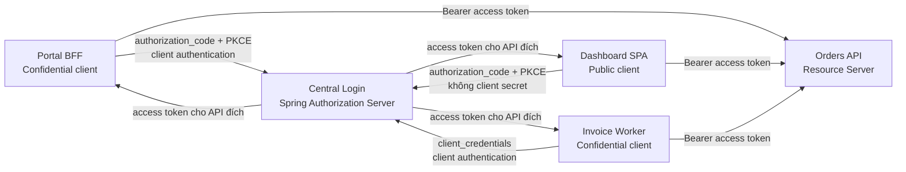
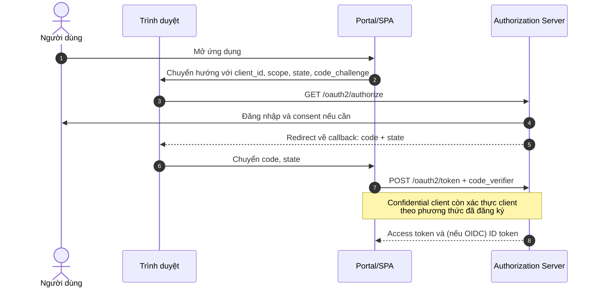
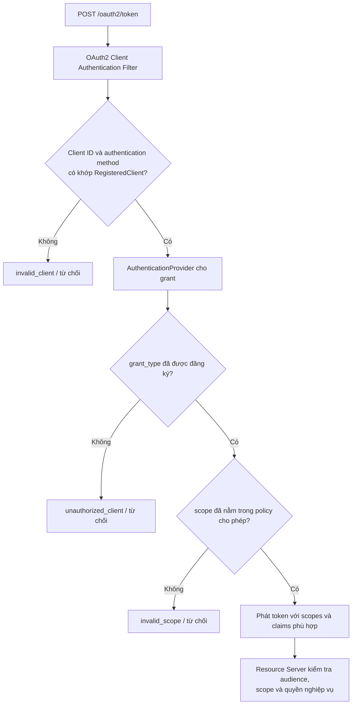

# Thiết lập grant type, authentication method và scope cho từng client

Trong **OAuth 2.0/OpenID Connect (OIDC)**, **client** không nhất thiết là một người dùng hoặc một ứng dụng giao diện. Client có thể là ứng dụng web có backend, Single Page Application (SPA), ứng dụng di động, công cụ dòng lệnh, thiết bị hạn chế đầu vào hoặc một dịch vụ chạy nền. Mỗi loại client có khả năng giữ bí mật và nhu cầu nhận token khác nhau.

Vì vậy, khi triển khai **Spring Authorization Server** với **Spring Security** trong **Spring Boot**, cấu hình client phải trả lời ít nhất ba câu hỏi:

1. **`authorizationGrantTypes`:** client được phép xin token qua quy trình nào?
2. **`clientAuthenticationMethods`:** client chứng minh danh tính với Authorization Server bằng cách nào, nếu là confidential client?
3. **`scopes`:** client được phép yêu cầu những quyền nào, và Resource Server sẽ kiểm tra những quyền đó ra sao?

Đây là bài trong chương **Quản lý client** thuộc mô-đun **SPRING_SECURITY_OAUTH2_OIDC_AUTHORIZATION_SERVER**, phục vụ mục tiêu học thiết kế, cấu hình, bảo mật, kiểm thử và vận hành Authorization Server bằng Spring Security và Spring Authorization Server. Nội dung được xây dựng từ bài toán thực tế đến cấu hình `RegisteredClient`, chính sách cấp token, ranh giới phân quyền và kiểm thử từ chối truy cập.

> **Nguyên tắc:** Chỉ đăng ký những grant type, authentication method và scope mà client thực sự cần. Việc một client được cấp access token không có nghĩa nó có toàn bộ quyền trên dữ liệu API.

## 1. Bài toán ví dụ: ba client trong một hệ thống

Giả sử hệ thống có:

- **Portal BFF** tại `portal.example.com`: người dùng đăng nhập qua trình duyệt; backend giữ client secret và token ở phía máy chủ.
- **Dashboard SPA** tại `dashboard.example.com`: JavaScript chạy trong trình duyệt; không thể giữ client secret an toàn.
- **Invoice Worker**: dịch vụ xuất hóa đơn định kỳ; không có người dùng tương tác, cần truy cập một phần Orders API.
- **Central Login** tại `login.example.com`: Authorization Server phát hành token, quản lý client registration và công bố OIDC/OAuth2 metadata.
- **Orders API**: Resource Server xác minh access token và kiểm tra quyền truy cập dữ liệu.

Một thiết kế ban đầu hợp lý:

| Client | Grant type được phép | Client authentication | Scope đăng ký |
|---|---|---|---|
| Portal BFF | `authorization_code`, `refresh_token` | `client_secret_basic` hoặc phương thức mạnh hơn | `openid`, `profile`, `orders.read` |
| Dashboard SPA | `authorization_code` | `none` + PKCE bắt buộc | `openid`, `orders.read` |
| Invoice Worker | `client_credentials` | `client_secret_basic`, `private_key_jwt` hoặc mTLS theo hạ tầng | `orders.export` |

Bảng minh họa cấu hình **theo từng client riêng**. Không nên chia sẻ một `client_id` và cùng secret cho cả Portal, SPA và Worker. Khi xảy ra sự cố, tách client giúp thu hồi, giới hạn scope và kiểm toán đúng tác nhân.



Sơ đồ chỉ thể hiện luồng logic. Với Authorization Code Flow, trình duyệt và các bước redirect đến `/oauth2/authorize` cũng tham gia; với BFF, access token có thể chỉ được backend lưu giữ và sử dụng.

## 2. RegisteredClient là nơi khai báo quyền của từng OAuth client

Spring Authorization Server dùng `org.springframework.security.oauth2.server.authorization.client.RegisteredClient` để biểu diễn cấu hình client đã đăng ký. Client phải được đăng ký trước khi khởi tạo một authorization grant được máy chủ cho phép.

| Trường của `RegisteredClient` | Ý nghĩa | Lưu ý |
|---|---|---|
| `id` | Khóa định danh nội bộ trong kho registered clients | Giữ ổn định khi dùng persistence |
| `clientId` | Định danh công khai mà client gửi trong giao thức | Không phải secret |
| `clientSecret` | Secret cho phương thức client authentication cần secret | Mã hóa bằng `PasswordEncoder`; chỉ cấp cho confidential client |
| `clientSecretExpiresAt` | Thời điểm secret hết hạn nếu cấu hình | Gắn quy trình rotation và thông báo trước |
| `clientAuthenticationMethods` | Danh sách phương thức xác thực client được chấp nhận | Cấu hình theo khả năng giữ bí mật |
| `authorizationGrantTypes` | Danh sách grant được phép dùng | Tối thiểu theo use case |
| `redirectUris` | Danh sách callback URI hợp lệ | Cần chính xác cho redirect-based grant |
| `postLogoutRedirectUris` | Callback sau OIDC logout, khi dùng | Không tự đồng nghĩa logout mọi client |
| `scopes` | Tập quyền client được phép yêu cầu | Không thay thế kiểm tra quyền nghiệp vụ |
| `clientSettings` | PKCE, consent, JWK URL, thuật toán assertion và cài đặt khác | Là chính sách theo client |
| `tokenSettings` | TTL, format access token, refresh token rotation... | Điều chỉnh theo rủi ro và loại client |

### 2.1. RegisteredClient và ClientRegistration không phải một

Hai đối tượng có tên gần giống nhưng ở **hai phía khác nhau**:

- **`RegisteredClient`** nằm ở **Authorization Server**: quyết định client nào được đăng ký và được phép sử dụng grant/method/scope nào.
- **`ClientRegistration`** nằm ở **OAuth2 Client** Spring Security: cấu hình ứng dụng client biết issuer, authorization/token endpoint, redirect URI, phương thức xác thực của chính nó và scope sẽ yêu cầu.

Nếu Portal khai báo `authorization-grant-type=authorization_code` ở phía client nhưng Central Login chỉ đăng ký `client_credentials` cho Portal, hai bên **không tự đồng bộ** và request sẽ bị từ chối. Cả hai phía phải cấu hình phù hợp, trong đó Authorization Server là nơi thực thi allowlist.

### 2.2. Repository dùng để tra cứu client

`RegisteredClientRepository` cung cấp thao tác tìm kiếm theo `clientId` hoặc ID nội bộ. Spring Authorization Server có các triển khai thường dùng:

- **`InMemoryRegisteredClientRepository`**: phù hợp để minh họa, phát triển và kiểm thử; mất dữ liệu khi tiến trình kết thúc nếu registration được tạo động.
- **`JdbcRegisteredClientRepository`**: lưu client registration bền vững qua JDBC; cần schema và quy trình cập nhật/rotation an toàn.
- **Repository tùy chỉnh**: cần khi có catalog client/tenant riêng hoặc cơ chế quản trị tổ chức; vẫn phải bảo toàn hành vi tra cứu/ghi và kiểm tra tính nhất quán.

Khi tạo client mới trong cơ sở dữ liệu, cấp `id` và `clientId` theo quy tắc riêng, có quản trị vòng đời. Không tạo `UUID.randomUUID()` cho cùng một client ở mỗi lần khởi động production, nếu làm vậy sẽ mất tính ổn định tham chiếu trong dữ liệu authorization/consent.

## 3. Grant type: chọn luồng cấp quyền theo tác nhân

**Authorization grant** diễn đạt cơ sở mà Authorization Server dùng để phát hành access token. Không phải client nào cũng nên dùng mọi grant.

### 3.1. Những grant type thường gặp

| Grant type | Khi nào dùng? | Có người dùng tương tác? | Điều kiện nổi bật |
|---|---|---|---|
| `authorization_code` | Portal, web app, SPA, native app cần người dùng cấp quyền | Có | Redirect URI được đăng ký; PKCE; xác thực client tùy loại |
| `refresh_token` | Làm mới access token mà không đăng nhập lại | Không ở lần refresh | Chỉ dùng khi được cấp refresh token hợp lệ; rotation và TTL |
| `client_credentials` | Service chạy nền gọi API bằng quyền riêng của workload | Không | Client phải chứng minh danh tính; không có identity người dùng cuối |
| Device Authorization Grant (`device_code`) | TV/thiết bị khó nhập liệu, người dùng xác thực trên thiết bị khác | Có, trên thiết bị khác | Device flow phải được AS và client hỗ trợ, có expiry/polling policy |
| Token Exchange (nếu bản triển khai hỗ trợ) | Đổi token theo chính sách để gọi API khác/on-behalf-of | Tùy bối cảnh | Cần kiểm tra token gốc, audience, actor, policy và hỗ trợ thực tế |

Các grant bổ sung hoặc mở rộng tùy thuộc phiên bản và phần cấu hình. **Đăng ký một tên grant không tự làm xuất hiện đầy đủ logic xử lý grant** nếu thư viện/ứng dụng chưa cài authentication provider và token policy tương ứng. Với hệ thống mới, không chọn Implicit Flow hoặc Resource Owner Password Credentials grant như mặc định.

### 3.2. Authorization Code + PKCE

Dùng cho client có người dùng đăng nhập và cần nhận quyền từ người dùng:



**PKCE** liên kết authorization request với token request bằng `code_challenge` và `code_verifier`, hạn chế nguy cơ code bị lấy cắp và dùng lại ở client khác. Với public client, PKCE là yêu cầu thiết yếu; có thể yêu cầu cả với confidential client. `requireProofKey(true)` trong `ClientSettings` thực thi chính sách đó theo client.

**`state`** giúp client ghép response với request trước đó và chống một số dạng CSRF/mix-up. **`nonce`** phục vụ bảo vệ liên kết ID token trong OIDC khi áp dụng. PKCE, state và nonce có nhiệm vụ khác nhau.

### 3.3. Refresh Token không phải cách xin quyền lần đầu

`refresh_token` được khai báo như grant type cho client được phép làm mới token. Điều đó **không bảo đảm** Authorization Server sẽ phát refresh token ở mọi flow; còn phụ thuộc grant ban đầu, client type, cấu hình server và token policy.

Với BFF confidential client, một chính sách có thể cho phép refresh token có TTL hữu hạn, rotation và lưu trữ server-side. Đối với public SPA, hướng dẫn Spring Authorization Server 1.5.x nêu **không phát refresh token cho public client**; cần kiểm tra chính sách của phiên bản dùng thực tế và cân nhắc BFF nếu cần quản lý phiên/token lâu dài.

Không dùng refresh token như access token khi gọi API. Resource Server chỉ nhận token dành cho tài nguyên của nó, theo chính sách được cấu hình.

### 3.4. Client Credentials dành cho máy với máy

`client_credentials` hoạt động khi **client tự xin access token bằng danh tính và quyền của chính client**, không cần redirect hoặc tài khoản nhân viên.

Ví dụ request khái niệm:

```http
POST /oauth2/token HTTP/1.1
Host: login.example.com
Authorization: Basic <base64(client_id:client_secret)>
Content-Type: application/x-www-form-urlencoded

grant_type=client_credentials&scope=orders.export
```

Ở đây, client đăng ký `client_credentials`, có xác thực client hợp lệ và được phép yêu cầu `orders.export`. Access token đại diện cho **Invoice Worker**. Không nên đưa `openid` vào scope của client credentials để giả vờ rằng có đăng nhập OIDC; `openid` là phạm vi OIDC cho tương tác định danh người dùng. Luồng client credentials thông thường chỉ cấp **access token**, không cần refresh token.

### 3.5. Khi nào cho phép nhiều grant trên một client?

Có lý do chính đáng để một **BFF** hỗ trợ `authorization_code` và `refresh_token`. Một worker thường chỉ cần `client_credentials`. Nếu cùng một định danh client vừa phục vụ trình duyệt vừa làm job nền, việc gộp grant có thể khiến token và quyền trở nên khó phân biệt, khó thu hồi và khó kiểm toán.

Vì vậy, nên tạo **hai client registration khác nhau cho hai workload hoặc vai trò tin cậy khác nhau**, ngay cả khi cùng thuộc một sản phẩm. Quy tắc này đặc biệt quan trọng nếu một phần sản phẩm chạy trên trình duyệt và một phần chạy trên backend.

## 4. Client authentication method: cách client chứng minh danh tính

Grant type nói **client muốn làm gì**, còn client authentication method nói **client chứng minh nó là ai** khi gọi endpoint yêu cầu xác thực client. Đăng ký grant đúng nhưng xác thực client sai vẫn bị từ chối.

### 4.1. Public và confidential client

- **Confidential client** có thể bảo vệ credential, thường là backend, service daemon hoặc workload quản lý bằng hạ tầng an toàn.
- **Public client** không thể giữ lâu dài một secret an toàn, ví dụ SPA JavaScript và ứng dụng cài trên thiết bị người dùng.

**Client ID không phải bí mật.** Một public client có `client_id` nhưng dùng `ClientAuthenticationMethod.NONE`, kết hợp PKCE và các kiểm tra giao thức. Đặt một chuỗi `client-secret` trong JavaScript/mobile app **không biến client đó thành confidential**.

| Phương thức | Cách hoạt động | Khi chọn |
|---|---|---|
| `client_secret_basic` | Gửi client ID/secret qua HTTP Basic đến token endpoint | Backend hoặc worker có quản lý secret; HTTPS bắt buộc |
| `client_secret_post` | Gửi ID/secret trong form body | Chỉ khi cần tương thích; tăng rủi ro nếu log body |
| `client_secret_jwt` | Dùng JWT assertion ký bằng secret chia sẻ | Có thỏa thuận chính sách thuật toán/chữ ký; cần quản trị secret |
| `private_key_jwt` | JWT client assertion ký bằng private key của client | Workload có quản lý private key, AS tin public JWK của client |
| `tls_client_auth` / `self_signed_tls_client_auth` | Client chứng minh danh tính bằng chứng chỉ TLS theo cơ chế mTLS | Khi triển khai đầy đủ TLS client authentication, trust và binding |
| `none` | Không dùng client secret để chứng minh danh tính client | Public client với Authorization Code + PKCE |

**Phụ thuộc phiên bản:** tập method mặc định và cách cấu hình mTLS/JWT assertion có thể thay đổi giữa các phiên bản Spring Authorization Server và Spring Security. Khi áp dụng, xác nhận method được hỗ trợ và kích hoạt đúng trong hệ thống. Không xem việc khai báo `PRIVATE_KEY_JWT`/mTLS trong `RegisteredClient` là đủ để hoàn tất hạ tầng chứng chỉ, key rotation hay network policy.

### 4.2. So sánh secret-based, JWT assertion và mTLS

| Tiêu chí | Client secret | Private Key JWT | mTLS |
|---|---|---|---|
| Credential cốt lõi | Shared secret | Private key của client | Chứng chỉ + private key |
| Kiểm chứng phía AS | Hash/secret authentication | Chữ ký assertion qua public JWK | Chuỗi xác thực TLS và đối sánh chứng chỉ |
| Triển khai | Dễ bắt đầu | Cần PKI/JWKS và chống replay assertion | Cần TLS termination/trust chain phù hợp |
| Rotation | Thay secret, phân phối cho client | Đổi key pair và công bố public key | Quản lý vòng đời certificate |
| Rủi ro nếu cấu hình sai | Lộ secret qua repo/log | Nhầm audience/issuer, tin JWK URL không kiểm soát | Proxy làm mất client certificate hoặc trust sai |

Với `private_key_jwt`, client gửi assertion có thời hạn ngắn với claims phù hợp (như `iss`/`sub` là client ID, `aud` là token endpoint, `exp`, `jti` theo chính sách) và chữ ký kiểm tra được bằng public key của client. **Không sử dụng khóa ký token của Authorization Server làm khóa riêng của client.**

### 4.3. Xác thực client không giống xác thực người dùng

Một OAuth client gửi `Authorization: Basic ...` tới `/oauth2/token` là xác thực **ứng dụng đã đăng ký**. Nhân viên đăng nhập tại `/login` lại được xác thực bởi form login, MFA hoặc IdP. Hai khái niệm chỉ trùng nhau nếu thiết kế sai ranh giới.

Ở `authorization_code`, confidential client vẫn có thể phải xác thực chính nó tại token endpoint **sau khi** người dùng đã đăng nhập. Ở `client_credentials` không có người dùng cuối, nên không thể suy ra quyền của nhân viên từ client authentication.

## 5. Scope: giới hạn quyền client được phép yêu cầu

**Scope** là chuỗi mô tả tập quyền mà Authorization Server cho phép client xin. Nó giúp client và API nói cùng một ngôn ngữ về **phạm vi truy cập**, nhưng không thay cho phân quyền nghiệp vụ đến từng bản ghi.

### 5.1. Phân biệt scope đã đăng ký, scope được yêu cầu và scope được cấp

Đặt:

- `S_registered`: scope allowlist trong `RegisteredClient`.
- `S_requested`: scope client gửi ở authorization/token request.
- `S_granted`: scope thực tế được Authorization Server cấp sau các bước hợp lệ và consent/policy.

Trong một mô hình allowlist thông thường:

```text
S_granted ⊆ S_requested ⊆ S_registered
```

Ví dụ Portal đăng ký `openid profile orders.read orders.write` nhưng lần này chỉ yêu cầu `openid orders.read`; người dùng hoặc chính sách có thể chấp nhận ít hơn yêu cầu. Token không mặc nhiên chứa tất cả scope đã đăng ký. Một số luồng có quy tắc mặc định khi không gửi `scope`; cần kiểm thử hành vi cụ thể, không đoán rằng token không có scope hoặc có toàn bộ scope.

**Điều kiện quan trọng:** Nếu client xin `orders.admin` nhưng không đăng ký quyền này, Authorization Server phải từ chối hoặc xử lý theo chính sách giao thức mà **không cấp vượt allowlist**. Việc thêm `scope` vào request không tự mở rộng quyền.

### 5.2. OIDC scopes và business scopes

| Scope | Nhóm | Ý nghĩa |
|---|---|---|
| `openid` | OIDC | Yêu cầu OpenID Connect; gắn với cơ chế ID token/định danh |
| `profile` | OIDC | Yêu cầu một tập standard profile claims nếu chính sách cho phép |
| `email` | OIDC | Yêu cầu email-related claims khi ứng dụng và chính sách hỗ trợ |
| `orders.read` | Nghiệp vụ/API | Đọc các đơn hàng mà chủ thể được phép xem |
| `orders.write` | Nghiệp vụ/API | Tạo/cập nhật đơn hàng theo chính sách |
| `orders.export` | Nghiệp vụ/API | Xuất dữ liệu đơn hàng trong giới hạn của workload |
| `billing.payments.read` | Nghiệp vụ/API | Truy vấn dữ liệu thanh toán được phép |

`openid` không đồng nghĩa client có quyền gọi mọi API. `orders.read` không chứng minh người dùng đã đăng nhập bằng OIDC. Scope liên quan tới **quyền của client/token**, còn ID token phục vụ **xác thực danh tính ở OIDC client**.

### 5.3. Scope, audience và role khác nhau

Để Orders API chấp nhận token, thường cần đồng thời:

1. **Chữ ký/trạng thái và thời gian hợp lệ**: token phát từ issuer tin cậy, chưa hết hạn.
2. **Audience hợp lệ**: token được phát cho Orders API (ví dụ `aud=orders-api`), không phải API khác.
3. **Scope phù hợp**: `orders.read` cho GET, `orders.write` cho POST.
4. **Chính sách tài nguyên**: người dùng/worker có quyền trên tenant, đơn hàng hoặc dữ liệu tương ứng.

Resource Server Spring Security có thể ánh xạ scope JWT thành authority kiểu `SCOPE_orders.read`. **Vai trò như `ROLE_ADMIN` không mặc định đồng nhất với scope OAuth2.** Nếu một người dùng có scope đọc, API vẫn phải kiểm tra tenant, sở hữu đơn hàng và quy tắc nghiệp vụ.

Audience cũng không tự xuất hiện như mong muốn chỉ bằng cách đăng ký scope. Authorization Server phải cấu hình phát access token với `aud` phù hợp, ví dụ bằng token customization/policy theo client và resource; Resource Server phải xác minh đúng audience.

### 5.4. Lưu ý khi tổ chức scope

- Ưu tiên tên có mục đích rõ ràng và mức đặc quyền hợp lý, như `orders.read`, `orders.write`, thay vì `all` hoặc `superuser`.
- Tránh scope quá vụn khiến consent khó đọc và khó quản lý; thiết kế theo nhóm thao tác thực sự có ý nghĩa.
- Phân biệt **scope cho người dùng tương tác** với **scope cho workload** khi chúng có chính sách dữ liệu khác nhau. Có thể dùng các tên khác nhau để giảm cấp nhầm.
- Lập danh mục scope có owner, mô tả, API tiêu thụ, level rủi ro và quy trình phê duyệt.
- Nếu multi-tenant, không dùng scope như bằng chứng rằng tenant trong request là hợp lệ; phải gắn token và dữ liệu với tenant bằng cơ chế rõ ràng.

## 6. Cấu hình ba RegisteredClient trong Spring Authorization Server

Ví dụ dưới đây dùng API thông dụng của **Spring Authorization Server 1.x và Spring Security 6.x**. Mục đích là minh họa ba kiểu client. Đoạn mã tập trung vào `RegisteredClient` và có import/bean để đọc rõ; nó chưa thay thế toàn bộ Authorization Server configuration (filter chains, signing keys, users, authorization service, consent service, issuer).

```java
package example.authorizationserver.config;

import java.time.Duration;
import java.util.UUID;

import org.springframework.context.annotation.Bean;
import org.springframework.context.annotation.Configuration;
import org.springframework.core.env.Environment;
import org.springframework.security.crypto.factory.PasswordEncoderFactories;
import org.springframework.security.crypto.password.PasswordEncoder;
import org.springframework.security.oauth2.core.AuthorizationGrantType;
import org.springframework.security.oauth2.core.ClientAuthenticationMethod;
import org.springframework.security.oauth2.core.oidc.OidcScopes;
import org.springframework.security.oauth2.server.authorization.client.RegisteredClient;
import org.springframework.security.oauth2.server.authorization.client.RegisteredClientRepository;
import org.springframework.security.oauth2.server.authorization.client.InMemoryRegisteredClientRepository;
import org.springframework.security.oauth2.server.authorization.settings.ClientSettings;
import org.springframework.security.oauth2.server.authorization.settings.TokenSettings;

@Configuration(proxyBeanMethods = false)
public class RegisteredClientConfiguration {

    @Bean
    PasswordEncoder passwordEncoder() {
        return PasswordEncoderFactories.createDelegatingPasswordEncoder();
    }

    @Bean
    RegisteredClientRepository registeredClientRepository(
            PasswordEncoder passwordEncoder,
            Environment env) {

        RegisteredClient portal = RegisteredClient.withId(UUID.randomUUID().toString())
            .clientId("portal-bff")
            .clientName("Employee Portal BFF")
            .clientSecret(passwordEncoder.encode(
                    env.getRequiredProperty("PORTAL_CLIENT_SECRET")))
            .clientAuthenticationMethod(
                    ClientAuthenticationMethod.CLIENT_SECRET_BASIC)
            .authorizationGrantType(AuthorizationGrantType.AUTHORIZATION_CODE)
            .authorizationGrantType(AuthorizationGrantType.REFRESH_TOKEN)
            .redirectUri("https://portal.example.com/login/oauth2/code/central")
            .scope(OidcScopes.OPENID)
            .scope(OidcScopes.PROFILE)
            .scope("orders.read")
            .clientSettings(ClientSettings.builder()
                    .requireProofKey(true)
                    .requireAuthorizationConsent(true)
                    .build())
            .tokenSettings(TokenSettings.builder()
                    .accessTokenTimeToLive(Duration.ofMinutes(10))
                    .refreshTokenTimeToLive(Duration.ofHours(8))
                    .reuseRefreshTokens(false)
                    .build())
            .build();

        RegisteredClient dashboard = RegisteredClient.withId(UUID.randomUUID().toString())
            .clientId("dashboard-spa")
            .clientName("Dashboard SPA")
            .clientAuthenticationMethod(ClientAuthenticationMethod.NONE)
            .authorizationGrantType(AuthorizationGrantType.AUTHORIZATION_CODE)
            .redirectUri("https://dashboard.example.com/oauth/callback")
            .scope(OidcScopes.OPENID)
            .scope("orders.read")
            .clientSettings(ClientSettings.builder()
                    .requireProofKey(true)
                    .requireAuthorizationConsent(true)
                    .build())
            .tokenSettings(TokenSettings.builder()
                    .accessTokenTimeToLive(Duration.ofMinutes(5))
                    .build())
            .build();

        RegisteredClient worker = RegisteredClient.withId(UUID.randomUUID().toString())
            .clientId("invoice-worker")
            .clientName("Invoice Export Worker")
            .clientSecret(passwordEncoder.encode(
                    env.getRequiredProperty("WORKER_CLIENT_SECRET")))
            .clientAuthenticationMethod(
                    ClientAuthenticationMethod.CLIENT_SECRET_BASIC)
            .authorizationGrantType(AuthorizationGrantType.CLIENT_CREDENTIALS)
            .scope("orders.export")
            .tokenSettings(TokenSettings.builder()
                    .accessTokenTimeToLive(Duration.ofMinutes(5))
                    .build())
            .build();

        return new InMemoryRegisteredClientRepository(
                portal, dashboard, worker);
    }
}
```

### 6.1. Đọc chính sách của từng client

**Portal BFF:** confidential client nên có secret và client authentication; dùng `authorization_code` để nhận ủy quyền người dùng và `refresh_token` nếu cần gia hạn phiên phía backend. `requireProofKey(true)` bổ sung ràng buộc PKCE; `requireAuthorizationConsent(true)` yêu cầu consent theo chính sách của server.

**Dashboard SPA:** public client không có `clientSecret`, chọn `ClientAuthenticationMethod.NONE` và **chỉ `authorization_code` với PKCE bắt buộc**. Không lưu client secret trong bundle JavaScript. Ở phiên bản Spring Authorization Server 1.5.x, public client không được phát refresh token theo hướng dẫn; nếu sản phẩm cần lưu token lâu dài, cân nhắc BFF và đánh giá tác động tới CORS, CSRF, cookies và XSS.

**Invoice Worker:** chỉ xin `client_credentials` và `orders.export`. Không khai báo `openid`, `authorization_code`, `refresh_token` hoặc redirect URI nếu không có nhu cầu. Worker phải giữ secret trong secret manager (hoặc chuyển sang cơ chế assertion/chứng chỉ theo chính sách), không ghi vào file được commit.

### 6.2. Giới hạn của ví dụ

- `InMemoryRegisteredClientRepository` chỉ dùng để học/thử nghiệm. Với production, sử dụng repository bền vững và ID ổn định; các authorization/consent đã lưu có tham chiếu tới registered client ID.
- Secrets được lấy từ environment và mã hóa lúc khởi động trong ví dụ. Hệ thống thật cần secret manager và kiểm soát phân quyền đọc; không ghi secret thô vào Git hoặc image container.
- `requireAuthorizationConsent(true)` chỉ có ý nghĩa với quy trình có **resource owner**. Không làm xuất hiện consent UI cho `client_credentials`.
- TTL trong ví dụ là **giá trị minh họa**, phải điều chỉnh theo rủi ro và khả năng gia hạn. Refresh token rotation còn cần cơ chế lưu token mới an toàn ở client và chính sách phát hiện replay phù hợp.
- Chỉ đăng ký `orders.export` chưa tạo claim audience cho Orders API. Phải định nghĩa token customization và validator Resource Server tương ứng.
- `RegisteredClient` khác với các phần filter chain, token generation, user authentication và issuer; cần ghép đúng thành Authorization Server hoàn chỉnh.

## 7. Nếu cần private_key_jwt thay cho client_secret_basic

Một dịch vụ có khả năng quản lý private key có thể chứng minh danh tính tại token endpoint bằng JWT client assertion. Với cấu hình/phiên bản hỗ trợ, ý tưởng đăng ký client như sau:

```java
RegisteredClient machineWithJwtAuth = RegisteredClient
    .withId("id-report-worker")
    .clientId("report-worker")
    .clientAuthenticationMethod(ClientAuthenticationMethod.PRIVATE_KEY_JWT)
    .authorizationGrantType(AuthorizationGrantType.CLIENT_CREDENTIALS)
    .scope("reports.generate")
    .clientSettings(ClientSettings.builder()
        .jwkSetUrl("https://report-worker.example.com/.well-known/jwks.json")
        .build())
    .build();
```

Đây là **một registration thay thế** cho worker dùng secret, không cần cùng client có hai phương thức mặc định. AS cần lấy/nhận diện đúng public JWK của client và xác minh JWT assertion theo phương thức được hỗ trợ; client phải bảo vệ private key, tạo assertion ngắn hạn và chống replay. Việc công bố `jwkSetUrl` không làm thay thiết kế trust: URL phải thuộc hệ thống quản trị, dùng HTTPS và có quy tắc phòng SSRF hoặc JWK substitution.

Nếu áp dụng mTLS, ngoài khai báo authentication method, còn phải bảo đảm kết nối TLS truyền đúng client certificate đến bộ xử lý client authentication, có chain tin cậy, mapping certificate-to-client và quy trình rotation. Khi TLS kết thúc ở proxy, phải xác định rõ proxy nào đáng tin và cách thông tin chứng chỉ được truyền; không tin header chứng chỉ tự khai báo từ Internet.

## 8. TokenSettings và ClientSettings bổ sung cho bộ ba chính

### 8.1. ClientSettings

| Setting | Ý nghĩa | Gợi ý theo loại client |
|---|---|---|
| `requireProofKey(true)` | Bắt buộc PKCE trong Authorization Code Flow | Public client phải bật; nên bật cả BFF hỗ trợ |
| `requireAuthorizationConsent(true)` | Yêu cầu consent khi người dùng cấp quyền | Tùy chính sách và mức tin cậy của Portal |
| `jwkSetUrl(...)` | Chỉ nguồn JWK của client trong các phương thức dùng public key | Cần quản trị trust và quyền kiểm soát URL |
| Cấu hình thuật toán assertion | Ràng buộc thuật toán ký JWT client assertion | Giới hạn thuật toán được phép, tránh hạ cấp |
| Cấu hình certificate subject (mTLS) | Ràng buộc danh tính client với certificate được tin cậy | Áp dụng khi dùng mTLS phù hợp |

**PKCE không phải client authentication bằng secret.** Một public client dùng `none` vẫn phải chứng minh sở hữu code verifier trong Authorization Code Flow. Mặt khác, confidential client dùng secret vẫn nên được bảo vệ trước việc authorization code bị đánh cắp.

### 8.2. TokenSettings

| Setting | Tác động | Quyết định vận hành |
|---|---|---|
| `accessTokenTimeToLive` | Token có thể sử dụng trong bao lâu | Ngắn hơn cho quyền nhạy cảm/workload có nguy cơ cao |
| `refreshTokenTimeToLive` | Thời hạn refresh token | Chỉ áp dụng khi grant/token policy phát refresh token |
| `reuseRefreshTokens` | Kiểm soát reuse/rotation khi refresh | Cần cập nhật và bảo vệ refresh token mới |
| `accessTokenFormat` | JWT tự chứa hoặc opaque theo cấu hình | Đánh đổi introspection, latency, revocation |
| `idTokenSignatureAlgorithm` | Thuật toán ký ID token OIDC | Phải tương thích với client và nguồn khóa |
| TTL authorization code | Thời gian code được phép đổi token | Rút ngắn và bắt buộc code một lần |

**Không nên để TTL dài vì client khó quản lý token.** Hãy sửa quy trình lưu/refresh/cấp lại token của client. Dùng refresh token sai cách hoặc access token quá dài làm tăng thiệt hại khi token bị lộ.

## 9. Thiết lập tương ứng ở phía ứng dụng client

Cấu hình ở Authorization Server chỉ là một nửa. Portal BFF phải gửi đúng grant, scope, redirect và client authentication:

```yaml
spring:
  security:
    oauth2:
      client:
        registration:
          central:
            provider: central
            client-id: portal-bff
            client-secret: "CONFIGURE_FROM_SECRET_MANAGER"
            client-authentication-method: client_secret_basic
            authorization-grant-type: authorization_code
            redirect-uri: "{baseUrl}/login/oauth2/code/{registrationId}"
            scope: openid, profile, orders.read
        provider:
          central:
            issuer-uri: https://login.example.com
```

Giá trị `client-secret` trên là **placeholder**, không lưu chuỗi này vào production. Thay bằng property lấy từ hệ thống bí mật đã quản lý; đảm bảo log và crash report không in giá trị. Ở phía client Spring Security, `ClientRegistration` mô tả cách ứng dụng xin token từ provider, khác bean `RegisteredClient` ở Authorization Server.

SPA phải dùng `authorization_code` + PKCE với `client-authentication-method: none`; không khai báo secret. Hệ thống backend lấy token cho worker có thể dùng `OAuth2AuthorizedClientManager` và provider `clientCredentials()` để tự quản lý xin/cấp lại token.

### 9.1. Ví dụ HTTP kiểm tra các giới hạn của client

**Worker xin đúng scope:**

```bash
curl --request POST "https://login.example.com/oauth2/token" \
  --user "$WORKER_CLIENT_ID:$WORKER_CLIENT_SECRET" \
  --data-urlencode "grant_type=client_credentials" \
  --data-urlencode "scope=orders.export"
```

**Worker thử xin scope không được đăng ký:**

```bash
curl --request POST "https://login.example.com/oauth2/token" \
  --user "$WORKER_CLIENT_ID:$WORKER_CLIENT_SECRET" \
  --data-urlencode "grant_type=client_credentials" \
  --data-urlencode "scope=orders.admin"
```

Yêu cầu thứ hai phải bị từ chối hoặc không được cấp vượt allowlist; không nên chấp nhận token với `orders.admin`. Trong cấu hình Spring Authorization Server thông thường, lỗi scope ngoài allowlist sẽ tương ứng `invalid_scope`. Lưu ý `curl --user` có thể làm lộ credential qua môi trường ghi nhận tham số tiến trình; trong hệ thống thật cần công cụ/vòng đời secret phù hợp.

**Không gửi client secret của SPA đến token endpoint.** Khi đổi code, SPA gửi `client_id` và `code_verifier` theo quy định, cùng `redirect_uri` nếu cần, thay vì tìm cách giả lập confidential client.

## 10. SecurityFilterChain, client authentication và policy không phải một lớp

Khi request đi vào Spring Authorization Server:



Sơ đồ đơn giản hóa: thứ tự xử lý thực tế còn phụ thuộc loại grant, endpoint filter/provider, PKCE, redirect URI, consent và các chính sách token. Không dùng sơ đồ này để dự đoán tất cả mã lỗi HTTP trong mọi flow.

Cần phân biệt:

- **Client registration policy**: AS cho client sử dụng grant/method/scope nào.
- **Token issuance policy**: sau khi request hợp lệ, token được phát với TTL, audience, claim và scope nào.
- **Resource Server policy**: khi có Bearer access token, API có chấp nhận token cho thao tác/tài nguyên cụ thể không.

Không thể chỉ đăng ký `orders.write` rồi kết luận client sẽ sửa được mọi đơn hàng. AS chỉ quản lý quyền ở ranh giới cấp token; API phải thực hiện object-level authorization.

## 11. Các lỗi cấu hình và cách chẩn đoán

| Triệu chứng | Nguyên nhân thường gặp | Cách kiểm tra |
|---|---|---|
| `invalid_client` ở token endpoint | Secret sai, method không đúng hoặc client không tồn tại | Đối chiếu `clientId`, secret hash và `clientAuthenticationMethods` |
| `unauthorized_client` | Client dùng grant không nằm trong allowlist | Kiểm tra `authorizationGrantTypes` |
| `invalid_scope` | Scope request ngoài `RegisteredClient.scopes` | Kiểm tra tên, cú pháp, consent/policy |
| Redirect URI bị từ chối | URI không khớp registration | So sánh scheme/host/path/port và proxy headers |
| Authorization code bị từ chối | Code hết hạn, đã dùng lại, PKCE/verifier sai | Kiểm tra code, `state`, `code_verifier` và client binding |
| SPA không lấy được refresh token | Public client bị giới hạn theo chính sách SAS | Xem hướng dẫn phiên bản; cân nhắc BFF |
| Portal gửi secret nhưng vẫn bị từ chối | Phương thức phía client khác phương thức AS cho phép | So sánh `client_secret_basic` và `client_secret_post` |
| Worker nhận ID token trong thiết kế | Nhầm `openid`/OIDC với client credentials | Tách flow user và workload |
| Token có scope hợp lệ nhưng API trả `403` | Audience sai hoặc thiếu quyền nghiệp vụ | Kiểm tra `aud`, scope, role và tenant |
| Token được cấp quá nhiều quyền | Client registration hoặc policy quá rộng | Rà soát allowlist, yêu cầu scope và cấp quyền |
| Rotation secret gây lỗi nhiều client | Secret đổi mà chưa phối hợp các bên | Có quy trình rollout, giám sát `invalid_client`, rollback an toàn |
| Hai workload dùng chung client ID | Không truy vết hoặc thu hồi độc lập | Tách registration và credential |

### 11.1. Sai lầm bảo mật cần tránh

**Không đặt secret trong SPA/mobile binary.** Người dùng có thể xem mã JavaScript, bundle hoặc trích xuất APK/IPA. Không dùng secret như bằng chứng bảo mật đối với client public.

**Không chọn quá nhiều grant type để “sẵn dùng”.** Cho worker quyền authorization code hoặc cho Portal quyền client credentials mà không có lý do khiến việc phân quyền mờ hơn.

**Không dựa vào consent để thay cho allowlist.** Consent chỉ thể hiện quyết định chấp thuận quyền trong quy trình có resource owner; không khiến scope ngoài chính sách trở nên hợp lệ.

**Không phát hành token đa mục tiêu không rõ audience.** API phải biết token có dành cho nó không; khi Service A gọi Service B thay người dùng, cần kiểm soát audience và chính sách token exchange/relay phù hợp.

**Không cho phép redirect wildcard trong production** hoặc chấp nhận URI từ request tùy ý. Redirect-based grant phải xác thực callback theo registration để hạn chế rò rỉ authorization code.

## 12. Kiểm thử từng thuộc tính của RegisteredClient

Bộ kiểm thử nên chứng minh **đúng client được quyền, sai client bị từ chối**, kể cả những yêu cầu sai có vẻ “gần đúng”.

| Test case | Client/request | Kết quả cần khẳng định |
|---|---|---|
| Happy path OAuth login | Portal BFF, `authorization_code` + PKCE | Nhận access token/ID token đúng scope đã cấp |
| Public PKCE | SPA có `code_challenge`/`code_verifier` đúng | Đổi code thành công không cần secret |
| PKCE missing | SPA không gửi challenge/verifier bắt buộc | Không cấp token |
| Wrong auth method | Portal đăng ký `client_secret_basic` nhưng gửi `client_secret_post` | Từ chối client authentication |
| Wrong secret | Worker gửi secret sai | `invalid_client`; không trả token |
| Disallowed grant | Worker gửi `grant_type=authorization_code` | Không chấp nhận grant |
| Disallowed scope | Worker xin `orders.admin` | Không có token với quyền đó |
| Scope subset | Portal yêu cầu `openid orders.read` | Token không tự mang scope chưa yêu cầu/cấp |
| Redirect mismatch | Portal sử dụng callback URI không đăng ký | Không redirect đến URI không được phép |
| No unintended ID token | Worker dùng `client_credentials` | Không nhận ID token như OIDC login người dùng |
| Refresh rotation | BFF sử dụng token mới theo policy, thử replay token cũ | Quan sát hành vi từ chối theo chính sách đã cấu hình |
| Cross-client mix-up | Code cấp cho Portal được SPA đem đổi | Từ chối do code/client binding và PKCE |
| Token audience | Access token dành cho API khác gửi Orders API | API từ chối |
| Tenant policy | Có `orders.read` nhưng truy vấn đơn tenant khác | API từ chối theo nghiệp vụ |
| Secret expiry | Credential hết hạn hoặc đã bị thu hồi | Không cấp token bằng credential cũ |
| Rotation/cluster | Secret/key mới triển khai qua nhiều node | Các node xác thực nhất quán theo rollout |

Có thể dùng `MockMvc`/`spring-security-test` để xác minh client authentication và grant validation trong Spring Security. Để kiểm thử chính xác PKCE, callback, consent, refresh token và JWT signatures, nên chạy integration test với Authorization Server thực và client đã đăng ký, không chỉ mock kết quả `Authentication`.

**Lưu ý:** Test bảo mật cần kiểm tra cả trường hợp token hợp lệ nhưng API từ chối do quyền nghiệp vụ; một test chỉ xác nhận token endpoint trả `200` không chứng minh ứng dụng an toàn.

## 13. Quản trị client trong production

### 13.1. Vòng đời đăng ký và thay đổi quyền

Một quy trình quản trị client nên gồm:

1. **Đề nghị đăng ký**: ghi owner, môi trường (dev/staging/prod), ứng dụng, API đích, nhu cầu grant/scope, phương thức xác thực.
2. **Đánh giá loại client**: public hay confidential, có giữ secret/private key được không, cần PKCE và redirect URI nào.
3. **Duyệt quyền**: scope/audience tối thiểu, có cần OIDC hay chỉ OAuth2, review quyền nhạy cảm và tenant policy.
4. **Cấp credential**: secret/key/cert được quản lý trong kho an toàn, phân phối cho đúng workload, không trả secret quá nhiều lần.
5. **Kiểm thử và triển khai**: happy path, invalid_client, unauthorized grant, invalid_scope, redirect mismatch, token audience và hồi quy.
6. **Theo dõi/rotation**: theo dõi lỗi theo client ID, TTL secret/key, login/consent changes và lượng token bất thường.
7. **Thu hồi/ngừng sử dụng**: xóa/disable registration có kế hoạch, thu hồi authorization/token theo yêu cầu, xử lý cache và tài liệu vận hành.

### 13.2. Phân tách môi trường và tenant

Đặt client ID khác nhau cho dev/staging/prod và hạn chế callback theo đúng hostname của từng môi trường. Không cho redirect production về localhost. Với multi-tenant, quyết định tenant nằm ở đâu (registration, issuer, token claim, routing) và bảo đảm client của tenant A không thể yêu cầu quyền hoặc redirect của tenant B.

Có thể dùng một client cho nhiều redirect URI hợp lệ khi cùng một ranh giới tin cậy, nhưng mỗi URI làm tăng bề mặt sai cấu hình. Nếu tenant có chủ sở hữu, pháp lý hoặc mức tin cậy khác nhau, cân nhắc tách client theo tenant và kiểm soát vận hành tương ứng.

### 13.3. Theo dõi an toàn

Theo dõi `invalid_client`, `unauthorized_client`, `invalid_scope`, `invalid_grant`, tỷ lệ thành công token endpoint, token issue rate, consent rejection và request scope khác thường. Ghi nhận `client_id`, environment, correlation ID, kết quả và thời gian xử lý, **không ghi nguyên secret, authorization code, refresh token, access token, cookie hay private key**.

Với hệ thống phân tán, bảo đảm kho client/authorization/consent bền vững, mọi node đọc registration nhất quán và có kế hoạch xoay key/secret không làm gián đoạn ngoài dự kiến.

## 14. Câu hỏi tự đánh giá

1. Vì sao Portal BFF và Dashboard SPA nên dùng hai `RegisteredClient` khác nhau dù cùng truy cập Orders API?
2. `authorizationGrantTypes` khác `clientAuthenticationMethods` thế nào? Tại sao cho phép `client_credentials` chưa đủ để bảo đảm client được cấp token?
3. Vì sao một public client có `client_id` nhưng phải dùng `none` và PKCE, không nhúng secret trong JavaScript?
4. Vì sao `refresh_token` không nên coi như grant xin token ban đầu, và vì sao client credentials không cần refresh token?
5. Nếu client được đăng ký `orders.read` và `orders.write` nhưng chỉ yêu cầu `orders.read`, kết quả mong muốn về scope cấp ra là gì?
6. Tại sao có `orders.read` vẫn không bảo đảm user đọc được đơn hàng ở mọi tenant?
7. Khi dùng `private_key_jwt`, những thuộc tính nào của JWT assertion và JWK trust phải kiểm soát?
8. Nếu `POST /oauth2/token` trả `invalid_client`, sẽ kiểm tra đăng ký client, phương thức auth và secret theo thứ tự nào?
9. Tại sao cần tách client ID/secret giữa môi trường test và production?
10. Làm thế nào để chứng minh API đã kiểm tra audience đúng, ngoài việc xác nhận JWT có chữ ký hợp lệ?

## 15. Tài liệu tham khảo chính thức

- [Spring Authorization Server — Core Model / Components](https://docs.spring.io/spring-authorization-server/reference/core-model-components.html): định nghĩa `RegisteredClient`, repository, authorization và token context.
- [Spring Authorization Server — Configuration Model](https://docs.spring.io/spring-authorization-server/reference/configuration-model.html): xử lý client authentication, grant và endpoint filters.
- [Spring Authorization Server — SPA with PKCE](https://docs.spring.io/spring-authorization-server/reference/guides/how-to-pkce.html): mẫu public client, PKCE và lưu ý với refresh token.
- [Spring Security — OAuth2 Client Authorization Grants](https://docs.spring.io/spring-security/reference/servlet/oauth2/client/authorization-grants.html): cấu hình phía OAuth2 Client và PKCE.

**Ghi nhớ:** Một `RegisteredClient` là hợp đồng quyền truy cập giữa client và Authorization Server: **grant type** giới hạn luồng, **authentication method** giới hạn cách chứng minh danh tính client, **scope** giới hạn quyền có thể xin. `ClientSettings`, `TokenSettings`, issuer/audience và chính sách Resource Server bổ sung các lớp bảo vệ cần thiết. Cấu hình riêng theo từng client và kiểm thử cả đường bị từ chối giúp hệ thống OAuth2/OIDC Spring Boot dễ quản trị, kiểm toán và vận hành an toàn.
