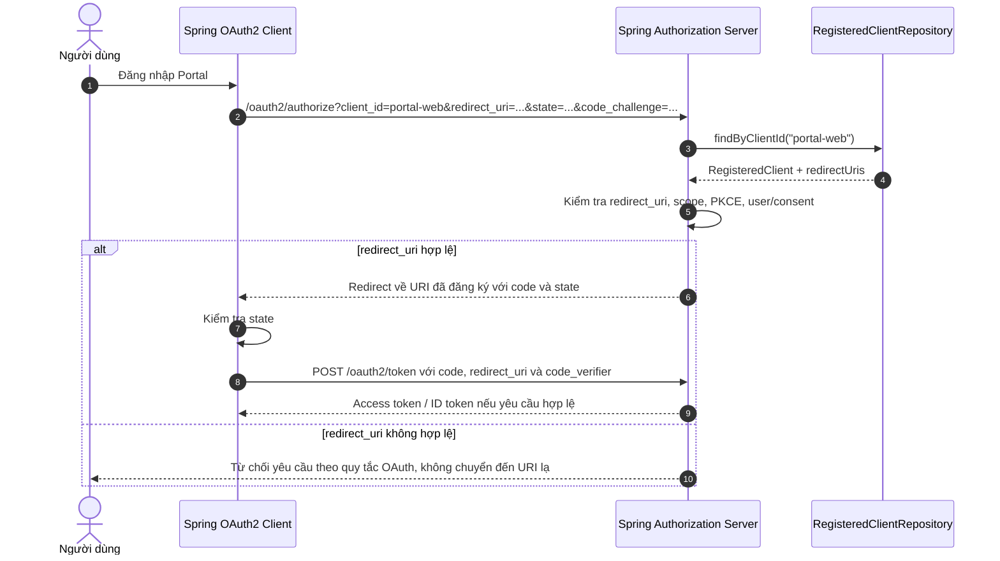
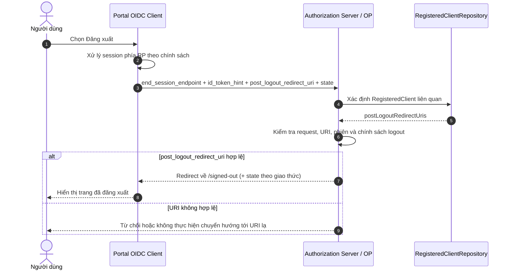

# Đăng ký redirect URI và post-logout redirect URI bằng danh sách cho phép

## 1. Mục tiêu và phạm vi

Trong ứng dụng Spring Boot dùng **Spring Security** và **Spring Authorization Server (SAS)** để cung cấp OAuth 2.0/OpenID Connect (OIDC) Authorization Server, một trong những quyết định bảo mật quan trọng nhất khi **quản lý client** là xác định trình duyệt **được phép quay về địa chỉ nào** sau khi cấp quyền hoặc đăng xuất.

Đối với mỗi `RegisteredClient`, SAS cung cấp hai tập URI độc lập:

- **`redirectUris`**: các địa chỉ client có thể nhận kết quả của luồng ủy quyền dựa trên chuyển hướng, điển hình là **Authorization Code Flow**.
- **`postLogoutRedirectUris`**: các địa chỉ client có thể yêu cầu quay về sau **OIDC RP-Initiated Logout** khi tính năng tương ứng đã được bật.

Đây là **danh sách cho phép (allowlist)**: client chỉ được đề xuất một đích đã đăng ký và được Authorization Server kiểm tra theo quy tắc giao thức. Không để client tùy ý chọn một URL mà server sẽ chuyển hướng trình duyệt tới.

Sau bài này, người học cần:

1. Phân biệt hai danh sách URI và các tham số `redirect_uri` / `post_logout_redirect_uri` trong HTTP.
2. Giải thích rủi ro rò rỉ authorization code, open redirect, phishing và đăng xuất có chuyển hướng đến website không tin cậy.
3. Đăng ký các URI chính xác cho một `RegisteredClient` bằng Spring Authorization Server.
4. Cấu hình khớp URL giữa Authorization Server và OAuth/OIDC client dùng Spring Security.
5. Thiết kế quy trình phê duyệt thay đổi URI, kiểm thử trường hợp từ chối và vận hành nhiều môi trường.

## 2. Hai danh sách URI giải quyết hai thời điểm khác nhau

| Đặc điểm | `redirectUris` | `postLogoutRedirectUris` |
| --- | --- | --- |
| Mục đích | Điểm quay về client **sau yêu cầu authorization** | Điểm quay về client **sau yêu cầu OIDC logout** |
| Tham số HTTP tương ứng | `redirect_uri` | `post_logout_redirect_uri` |
| Thường xuất hiện tại | Authorization endpoint, ví dụ `/oauth2/authorize`; có thể được đối chiếu lúc đổi code | OIDC end-session/logout endpoint, ví dụ `/connect/logout` trong cấu hình SAS thường gặp |
| Vai trò trong giao thức | Ràng buộc nơi authorization code được chuyển đến và nơi client dùng code | Ràng buộc nơi trình duyệt được quay lại sau khi OP xử lý yêu cầu logout |
| Cấu hình Java | `RegisteredClient.Builder.redirectUri(...)` | `RegisteredClient.Builder.postLogoutRedirectUri(...)` |
| Có thể để chung một tập? | **Không nên**: danh sách dành cho authorization | **Không nên**: danh sách dành cho logout |
| Có tự xử lý phía client không? | Không; client phải triển khai endpoint callback và kiểm tra state/PKCE | Không; client phải tự xử lý trang sau logout và phiên của nó |

**Ví dụ theo sản phẩm:**

```text
Ứng dụng:       https://portal.example.com
OAuth callback: https://portal.example.com/login/oauth2/code/portal
Trang sau logout: https://portal.example.com/signed-out
```

Khi người dùng đăng nhập, trình duyệt quay về `/login/oauth2/code/portal` để ứng dụng xử lý authorization code. Khi đăng xuất theo OIDC RP-Initiated Logout, trình duyệt có thể quay về `/signed-out` để hiện thông báo. Việc trang sau logout có tồn tại và cho phép người dùng chưa đăng nhập truy cập là **trách nhiệm của ứng dụng client**, không phải của SAS.

Một callback đăng nhập có thể gây lỗi nếu bị dùng làm đích post-logout: endpoint đó có thể đang đợi tham số `code` và `state`. Tương tự, trang `/signed-out` không có chức năng nhận code. Tách hai URI giúp hợp đồng rõ ràng và giảm nhầm lẫn.

## 3. Vì sao chỉ chấp nhận URI đã đăng ký?

### 3.1. Nguy cơ đánh cắp authorization code

Giả sử client hợp lệ được nhận diện bằng `client_id=portal-web`, nhưng kẻ tấn công thay tham số `redirect_uri` thành:

```http
GET /oauth2/authorize?response_type=code
  &client_id=portal-web
  &redirect_uri=https%3A%2F%2Fattacker.example%2Fcollect
  &scope=openid%20orders.read
  &state=RANDOM_STATE
```

Nếu server chấp nhận URI này chỉ vì `client_id` hợp lệ, trình duyệt có thể bị chuyển đến `attacker.example` kèm code. Authorization Code + PKCE, client authentication và kiểm tra code vẫn là những lớp bảo vệ quan trọng, nhưng **không được dùng chúng làm lý do để bỏ qua kiểm tra redirect URI**.

Trong triển khai đúng, server phải từ chối URI chưa đăng ký. **Không chuyển hướng phản hồi lỗi đến chính URI vừa bị từ chối**, vì như vậy vẫn cho kẻ tấn công kiểm soát đích chuyển hướng.

### 3.2. Open redirect và biến thể trông giống URL hợp lệ

Kiểm tra chuỗi bằng `startsWith("https://portal.example.com")` là sai vì `https://portal.example.com.attacker.example/cb` cũng có tiền tố ấy. Những cách kiểm tra “chỉ cần host chứa `example.com`”, wildcard `https://*.example.com/*` hay so khớp theo regex viết vội đều mở rộng bề mặt tấn công.

Ngay cả callback đã đăng ký cũng nguy hiểm nếu chính trang callback là **open redirector**: ví dụ `/callback?next=https://attacker.example` tự động chuyển hướng sang địa chỉ do request cung cấp. Authorization Server và ứng dụng client **đều phải tránh** endpoint chuyển hướng tự do dựa trên input không tin cậy.

### 3.3. Sau logout cũng có rủi ro chuyển hướng

Nếu OP cho phép `post_logout_redirect_uri=https://attacker.example` tùy ý, kẻ tấn công có thể khiến người dùng tin rằng họ vừa đăng xuất khỏi dịch vụ chính thức nhưng thực chất đã đến website giả mạo. OIDC RP-Initiated Logout yêu cầu post-logout URI phải **khớp chính xác một URI đã đăng ký** và chỉ chuyển hướng khi OP đã xác định hợp lệ đích đó theo quy tắc giao thức.

Danh sách cho phép không giải quyết mọi rủi ro CSRF logout, lộ ID token, session fixation hay phishing. Đây là một **kiểm soát cụ thể tại ranh giới chuyển hướng**, cần kết hợp xác thực phiên, kiểm soát client và thiết kế giao diện an toàn.

## 4. Quy tắc so khớp chính xác

### 4.1. OAuth 2.0 redirect URI: ưu tiên exact string matching

RFC 9700 (OAuth 2.0 Security Best Current Practice) yêu cầu Authorization Server so sánh **chính xác** URI được yêu cầu với URI đã đăng ký. Ngoại lệ chuẩn là **port có thể thay đổi ở loopback redirect URI cho native app**, theo các điều kiện của RFC 8252. Đây là một trường hợp đặc biệt phải thiết kế và kiểm thử đúng; không có nghĩa wildcard port áp dụng cho mọi web client.

Giả sử danh sách cho phép chỉ chứa:

```text
https://portal.example.com/login/oauth2/code/portal
```

| `redirect_uri` mà client gửi | Kết quả mong đợi | Giải thích |
| --- | --- | --- |
| `https://portal.example.com/login/oauth2/code/portal` | Chấp nhận nếu các điều kiện khác đúng | Trùng URI đã đăng ký |
| `http://portal.example.com/login/oauth2/code/portal` | Từ chối | Khác scheme; HTTP không được mặc nhiên tương đương HTTPS |
| `https://portal.example.com.attacker.example/login/oauth2/code/portal` | Từ chối | Khác host |
| `https://portal.example.com/login/oauth2/code/other` | Từ chối | Khác path |
| `https://portal.example.com/login/oauth2/code/portal/` | Từ chối | Dấu `/` cuối thay đổi chuỗi URI |
| `https://portal.example.com/login/oauth2/code/portal?next=/home` | Từ chối nếu không đăng ký nguyên chuỗi này | Query khác URI đã đăng ký |
| `https://portal.example.com@attacker.example/callback` | Từ chối | `portal.example.com` ở phần userinfo, host thực tế là `attacker.example` |
| `https://portal.example.com/login/oauth2/code/portal#frag` | Không đăng ký/không sử dụng làm redirect URI | OAuth redirect endpoint URI không được chứa fragment |

**Không tự “sửa hộ” request để khớp** bằng cách bỏ query, cắt path, chuyển HTTP thành HTTPS hay nối domain mặc định. URI nào client gửi phải được đối chiếu với danh sách cho phép theo hợp đồng đã đăng ký.

### 4.2. Các URI có query và cách mã hóa

URI đã đăng ký có thể có query hợp lệ theo chính sách client, ví dụ:

```text
https://portal.example.com/callback?source=corporate
```

Khi dùng trong `redirect_uri` của authorization request, URI này cần được **URL-encode như giá trị của tham số**. Query tĩnh trong URI đăng ký không đồng nghĩa được phép nối thêm `next`, `tenant` hoặc một URI bên ngoài tùy ý. Cũng không nên tự viết cơ chế chuẩn hóa, decode nhiều lần hoặc so sánh host bằng chuỗi tiền tố; những thao tác đó dễ tạo khác biệt giữa bước kiểm tra và trình duyệt.

**Nguyên tắc triển khai:** đăng ký URI nguyên vẹn, truyền đúng URI đã đăng ký và để bộ validator giao thức của SAS thực hiện kiểm tra. Nếu cần nhiều callback hợp lệ, đăng ký **từng URI cụ thể**, tránh wildcard.

### 4.3. Ngoại lệ native app dùng loopback

Theo RFC 8252, ứng dụng native có thể dùng URI loopback như `http://127.0.0.1:49152/callback` để nhận authorization code. Hệ điều hành có thể cấp cổng khác nhau khi khởi chạy, nên OAuth 2.0 BCP có ngoại lệ riêng cho **số port** của loopback redirect. Điều này không có nghĩa:

- Web app production được dùng wildcard host, path hoặc scheme.
- Mọi dạng `localhost` hoặc custom URI scheme đều tự động được mọi phiên bản SAS xử lý y hệt.
- Các URI post-logout cũng mặc nhiên nhận cùng ngoại lệ.

Khi triển khai native client với SAS, đối chiếu hỗ trợ thực tế của phiên bản, chính sách matcher và thư viện client; kiểm thử cổng động ở môi trường native thay vì vô hiệu hóa toàn bộ kiểm tra redirect URI. Với web production, dùng HTTPS và URI cố định.

## 5. Redirect URI trong Authorization Code Flow



Ví dụ request minh họa (các giá trị viết hoa là placeholder):

```http
GET https://auth.example.com/oauth2/authorize?response_type=code
  &client_id=portal-web
  &redirect_uri=https%3A%2F%2Fportal.example.com%2Flogin%2Foauth2%2Fcode%2Fportal
  &scope=openid%20profile
  &state=RANDOM_STATE
  &code_challenge=BASE64URL_SHA256_VERIFIER
  &code_challenge_method=S256
```

Ở token endpoint, Authorization Server cũng ràng buộc authorization code với client, các điều kiện grant và `redirect_uri` theo giao thức; client không thể dùng redirect URI khác để “nhận nốt” code đã cấp. Việc kiểm tra PKCE và `state` cung cấp các bảo vệ bổ sung, nhưng **không thay thế allowlist**.

## 6. Post-logout redirect URI trong OIDC RP-Initiated Logout

### 6.1. Ba bước khác nhau cần phân biệt

1. **RP (Relying Party/client)** quyết định người dùng muốn đăng xuất và điều hướng trình duyệt đến `end_session_endpoint` của OP (OpenID Provider / Authorization Server).
2. **OP** xác minh yêu cầu, xử lý phiên đăng nhập phía OP theo hỗ trợ/cấu hình đang có và quyết định có chuyển hướng về RP hay không.
3. Nếu có post-logout redirect hợp lệ, **trình duyệt** quay lại URI đã đăng ký. **RP vẫn chịu trách nhiệm xử lý phiên và giao diện phía RP**; chỉ quay lại `/signed-out` không chứng minh tất cả access token đã bị thu hồi.

OIDC RP-Initiated Logout định nghĩa các tham số chính:

| Tham số | Mục đích | Ghi chú |
| --- | --- | --- |
| `id_token_hint` | Gợi ý ID token đã cấp cho RP và phiên/user liên quan | Được khuyến nghị, nhất là khi yêu cầu post-logout redirect; không dùng access token thay ID token |
| `post_logout_redirect_uri` | Đích quay lại RP sau logout | Phải trùng chính xác với URI đã đăng ký, không phải URL tùy chọn |
| `state` | Giá trị opaque do RP dùng để liên kết request/callback logout | RP nên kiểm tra giá trị trả về để chống nhầm lẫn luồng |
| `client_id` | Hỗ trợ OP nhận diện client theo quy định giao thức | Tùy request và cách OP xác thực client, có thể quan trọng khi thiếu `id_token_hint` |

Chuẩn OIDC nhấn mạnh: nếu `post_logout_redirect_uri` **không trùng** URI đã đăng ký, OP **không được** thực hiện post-logout redirect đến URI đó. Nếu thiếu `id_token_hint`, OP chỉ có thể chuyển hướng khi có phương thức khác xác nhận tính hợp lệ của đích. Không nên tự gỡ bỏ điều kiện này để “logout chạy được”.

### 6.2. Luồng RP-Initiated Logout



Request minh họa:

```http
GET https://auth.example.com/connect/logout
    ?id_token_hint=ENCODED_ID_TOKEN
    &post_logout_redirect_uri=https%3A%2F%2Fportal.example.com%2Fsigned-out
    &state=RANDOM_LOGOUT_STATE
```

`ENCODED_ID_TOKEN` ở đây là placeholder. Trong vận hành, tránh đưa ID token, code, access/refresh token hoặc secret vào application log, reverse proxy log và công cụ phân tích URL. Tên endpoint `/connect/logout` là đường dẫn thường dùng của SAS; hãy đọc `end_session_endpoint` trong OIDC discovery của phiên bản/triển khai cụ thể.

### 6.3. Cấu hình allowlist không tự triển khai logout liên ứng dụng

`postLogoutRedirectUris` chỉ là metadata về **đích quay về**. Nó không tự:

- Xóa cookie hoặc local session của mọi RP/client khác.
- Thu hồi tức thì JWT access token đã được Resource Server chấp nhận.
- Đăng xuất toàn bộ thiết bị, đồng bộ browser tab hoặc kết thúc phiên trong hệ thống bên ngoài.
- Tạo controller `/signed-out` trong ứng dụng client.

Nếu yêu cầu single logout, front-channel/back-channel logout, thu hồi phiên hay token, phải thiết kế các luồng và điểm tích hợp riêng phù hợp với chuẩn và phiên bản. Với SAS, endpoint OIDC Logout cần được bật/cấu hình và có cơ chế quản lý session phù hợp; chỉ khai báo `postLogoutRedirectUri` trong `RegisteredClient` chưa bảo đảm luồng logout hoàn chỉnh.

## 7. Cấu hình RegisteredClient bằng Spring Authorization Server

Ví dụ dưới đây dựa trên mô hình `RegisteredClient` của **Spring Authorization Server 1.x**. Đây là public OIDC client chạy trên web theo Authorization Code + PKCE; các thành phần khác như user login, persistence authorization/consent, khóa ký, issuer và OIDC endpoint cần được cấu hình riêng.

```java
@Configuration
public class ClientRegistrationConfig {

    @Bean
    RegisteredClientRepository registeredClientRepository() {
        RegisteredClient portal = RegisteredClient.withId(
                    "64c2330e-f1a1-4c0d-84d2-aab73f692f58")
                .clientId("portal-web")
                .clientName("Portal Web")
                .clientAuthenticationMethod(ClientAuthenticationMethod.NONE)
                .authorizationGrantType(AuthorizationGrantType.AUTHORIZATION_CODE)
                .redirectUri(
                    "https://portal.example.com/login/oauth2/code/portal")
                .postLogoutRedirectUri(
                    "https://portal.example.com/signed-out")
                .scope(OidcScopes.OPENID)
                .scope(OidcScopes.PROFILE)
                .clientSettings(ClientSettings.builder()
                    .requireProofKey(true)
                    .requireAuthorizationConsent(true)
                    .build())
                .build();

        return new InMemoryRegisteredClientRepository(portal);
    }
}
```

Các chi tiết có chủ đích:

1. `redirectUri(...)` nhận **callback sau authorization**, còn `postLogoutRedirectUri(...)` nhận **trang sau logout**.
2. `ClientAuthenticationMethod.NONE` dành cho **public client**; `requireProofKey(true)` buộc sử dụng PKCE. `client_id` không phải bí mật; đăng ký URI chính xác vẫn bắt buộc.
3. `OidcScopes.OPENID` cho biết client có thể xin OIDC login; muốn dùng OIDC Logout, Authorization Server phải bật và cấu hình OIDC.
4. `InMemoryRegisteredClientRepository` phù hợp ví dụ; với production hãy dùng kho bền vững (như `JdbcRegisteredClientRepository` hoặc implementation khác) và quy trình quản trị URI có phê duyệt.
5. ID nội bộ được giữ ổn định trong ví dụ; khi tạo thực tế có thể sinh UUID **một lần** rồi lưu lại. Không sinh `id` mới trên mỗi startup cho cùng một client đang tồn tại.

Nếu dùng confidential client, thêm phương thức client authentication và secret/khóa được quản lý an toàn. Việc client là confidential **không** cho phép bỏ qua kiểm tra redirect URI.

### 7.1. Khai báo nhiều URI có chủ đích

Ví dụ cùng một client có hai callback cố định được phê duyệt:

```java
RegisteredClient portal = RegisteredClient.withId(stableInternalId)
        .clientId("portal-web")
        // ... client authentication, grant và scopes ...
        .redirectUri("https://portal.example.com/login/oauth2/code/portal")
        .redirectUri("https://portal.example.com/oauth/callback")
        .postLogoutRedirectUri("https://portal.example.com/signed-out")
        .postLogoutRedirectUri("https://portal.example.com/logout/complete")
        .build();
```

Ví dụ rút gọn để minh họa API builder, **không phải đoạn khai báo đủ cấu hình để chạy độc lập**. Mỗi URI nên có lý do rõ ràng, thuộc hệ thống đáng tin và có bài kiểm thử tương ứng. Tránh đăng ký nhiều callback cũ chỉ để tránh sửa client vì mỗi callback bổ sung thêm một điểm có thể bị khai thác.

### 7.2. Bật hỗ trợ OIDC ở Authorization Server

Ví dụ phác thảo trong phong cách cấu hình SAS 1.x:

```java
OAuth2AuthorizationServerConfigurer as =
        OAuth2AuthorizationServerConfigurer.authorizationServer();

http.securityMatcher(as.getEndpointsMatcher())
    .with(as, authorizationServer ->
        authorizationServer.oidc(Customizer.withDefaults()))
    .authorizeHttpRequests(authorize -> authorize.anyRequest().authenticated());
```

Đây chỉ là **phần cấu hình OIDC endpoint**, không chứa toàn bộ `SecurityFilterChain`, các bean và chính sách login/session cần thiết. Trong Spring Security 7.x, Authorization Server được tích hợp với API cấu hình mới; hãy theo đúng tài liệu phiên bản dự án thay vì trộn API của nhiều thế hệ.

## 8. Đồng bộ callback với ứng dụng OAuth2 Client

Allowlist trên Authorization Server phải khớp URL **thực sự** được OAuth2 Client sinh ra. Với ứng dụng Spring Security OAuth2 Client, cấu hình minh họa:

```yaml
spring:
  security:
    oauth2:
      client:
        registration:
          portal:
            provider: corporate-auth
            client-id: portal-web
            authorization-grant-type: authorization_code
            redirect-uri: "{baseUrl}/login/oauth2/code/{registrationId}"
            scope: openid, profile
        provider:
          corporate-auth:
            issuer-uri: https://auth.example.com
```

Giả sử ứng dụng chạy tại `https://portal.example.com`, `registrationId=portal`, `{baseUrl}` được dựng đúng từ request công khai, thì URI cuối cùng là:

```text
https://portal.example.com/login/oauth2/code/portal
```

Đây phải là một phần tử trong `RegisteredClient.redirectUris`. Nếu sau reverse proxy `{baseUrl}` bị tính thành `http://localhost:8080` hoặc tên host nội bộ, Authorization Server sẽ từ chối redirect URI. Cần cấu hình forwarded headers, TLS/proxy và public base URL theo mô hình triển khai, không làm yếu quy tắc allowlist.

### 8.1. OIDC client initiated logout với Spring Security

Khi ứng dụng client đã hỗ trợ OIDC login, có thể sử dụng `OidcClientInitiatedLogoutSuccessHandler` để điều hướng tới logout endpoint mà OP công bố, đồng thời cung cấp post-logout URI đúng hợp đồng:

```java
@Bean
SecurityFilterChain clientSecurityFilterChain(
        HttpSecurity http,
        ClientRegistrationRepository clientRegistrations) throws Exception {

    OidcClientInitiatedLogoutSuccessHandler logoutHandler =
            new OidcClientInitiatedLogoutSuccessHandler(clientRegistrations);
    logoutHandler.setPostLogoutRedirectUri("{baseUrl}/signed-out");

    http.authorizeHttpRequests(authorize -> authorize
            .requestMatchers("/signed-out").permitAll()
            .anyRequest().authenticated())
        .oauth2Login(Customizer.withDefaults())
        .logout(logout -> logout.logoutSuccessHandler(logoutHandler));

    return http.build();
}
```

Ví dụ minh họa phía **client**; không đặt bean này vào Authorization Server chỉ để đăng ký post-logout URI. URI được sinh ra phải **trùng với `postLogoutRedirectUris` của RegisteredClient** phía OP. Trang `/signed-out` cần thực sự tồn tại và có thể truy cập khi không còn phiên đăng nhập. Kiểm thử luồng logout trên các trình duyệt và cơ chế session mà dự án sử dụng.

## 9. Chính sách đăng ký URI an toàn

Không nên cung cấp một form cho bất kỳ người dùng nào có thể tự thêm URL mới vào allowlist của client quan trọng. Phần quản trị client phải có chính sách rõ ràng vì thay đổi redirect URI tương đương mở rộng các nơi được phép nhận kết quả ủy quyền.

### 9.1. Những điều nên kiểm tra khi đăng ký

| Điều kiện | Cách làm và lý do |
| --- | --- |
| Quyền sở hữu | Chỉ owner/admin được phép quản lý client; xác nhận miền và callback thực sự thuộc ứng dụng liên quan |
| Scheme | Ưu tiên/áp dụng HTTPS cho web production; xử lý loopback/native đặc biệt theo chuẩn |
| Host và path | Dùng tên miền chính xác và đường dẫn callback chuyên dụng; không chấp nhận wildcard tùy tiện |
| Fragment | Không dùng fragment trong OAuth redirect URI |
| Userinfo | Không nhận URI có `user:pass@` vì dễ gây nhầm host và rủi ro bảo mật |
| Query | Chỉ cho phép khi cần và đã đăng ký chính xác; tránh query dẫn tới open redirect |
| Tách mục đích | Có nhãn/nhóm riêng cho callback đăng nhập và đích sau logout |
| Môi trường | Dev, staging, production có danh sách riêng; không đưa callback localhost vào client production |
| Giới hạn thay đổi | Audit actor, thời điểm, lý do, cấu hình trước/sau; có phê duyệt và kiểm thử |
| Loại bỏ URI cũ | Xóa callback bỏ dùng và đánh giá ảnh hưởng đến các phiên/luồng đang chạy |

### 9.2. Danh sách cố định và rà soát đầu vào

Đối với URI do **quản trị viên** đề nghị thêm, ứng dụng quản trị có thể kiểm tra định dạng và quyền sở hữu **trước khi lưu**. Ví dụ về kiểm tra cơ bản:

```java
static void validateWebRedirectUri(String value) {
    URI uri = URI.create(value);

    if (!"https".equalsIgnoreCase(uri.getScheme())
            || uri.getHost() == null
            || uri.getRawUserInfo() != null
            || uri.getRawFragment() != null) {
        throw new IllegalArgumentException("Invalid web redirect URI");
    }

    // Tiếp tục kiểm tra tên miền thuộc quyền quản lý, endpoint hợp lệ,
    // quy tắc môi trường, quy trình phê duyệt và open redirect của client.
}
```

**Đây là kiểm tra đầu vào ở trang quản trị, không phải validator thay thế cho SAS**. Một URI có HTTPS và host hợp lệ vẫn có thể thuộc kẻ tấn công; không được coi đoạn mã trên là đủ để phê duyệt. Khi xử lý yêu cầu authorization/logout, hãy dùng cơ chế kiểm tra allowlist chuẩn của SAS thay vì tự so sánh host hoặc tự viết regex. Không nên bỏ qua validator mặc định khi thêm quy tắc nghiệp vụ.

## 10. Quản lý allowlist theo môi trường và nhiều tenant

Đăng ký gợi ý:

| Môi trường | Client ID | Redirect URI | Post-logout URI |
| --- | --- | --- | --- |
| Development | `portal-dev` | `http://127.0.0.1:8081/login/oauth2/code/portal` | `http://127.0.0.1:8081/signed-out` |
| Staging | `portal-staging` | `https://staging.portal.example.com/login/oauth2/code/portal` | `https://staging.portal.example.com/signed-out` |
| Production | `portal-web` | `https://portal.example.com/login/oauth2/code/portal` | `https://portal.example.com/signed-out` |

Đây là ví dụ về **mô hình phân tách môi trường**. Với client local/development, việc cho phép HTTP cần có chính sách riêng; localhost dành cho môi trường thử nghiệm, không trở thành ngoại lệ chung của production. Trên thực tế các môi trường nên có issuer, database, secret, khóa ký và chính sách triển khai tách biệt tùy mức độ cách ly.

Với hệ thống **multi-tenant**, đừng tạo allowlist từ chuỗi `https://{tenant}.example.com/callback` do người dùng nhập tùy ý nếu chưa kiểm soát quyền sở hữu từng tenant/domain. Khi tenant được thêm domain, cần xác nhận domain, tạo bản ghi đăng ký chính xác và kiểm thử client ứng với issuer. Quy tắc của một tenant không được vô tình mở redirect URI cho tenant khác.

## 11. Những trường hợp lỗi thường gặp và cách khắc phục

| Triệu chứng | Nguyên nhân thường gặp | Cách kiểm tra |
| --- | --- | --- |
| Login thất bại với `invalid_request` hoặc thông báo redirect URI sai | Client gửi URI không trùng danh sách | So sánh chính xác scheme, host, port, path, dấu `/`, query của URI cuối cùng |
| Redirect bị tính thành `http://localhost:8080` | Reverse proxy hoặc `{baseUrl}` sai | Kiểm tra forwarded headers và public URL |
| Client đổi authorization code lỗi `invalid_grant` | Code hết hạn/dùng lại, PKCE sai hoặc redirect URI không nhất quán | Đối chiếu code, `code_verifier`, redirect URI trong token request |
| Logout về trang sai hoặc không quay về RP | `post_logout_redirect_uri` chưa đăng ký, không khớp hoặc OP không thể xác nhận đích | Đối chiếu `RegisteredClient.postLogoutRedirectUris`, `id_token_hint` và cấu hình OIDC |
| `/signed-out` yêu cầu login lại | Trang logout completion bị bảo vệ bởi rule yêu cầu authenticated | Cho phép truy cập trang công khai sau logout; kiểm tra controller |
| Một instance nhận URI mới, instance khác vẫn từ chối | Cache client registration chưa được invalidation | Xác minh repository chung, cache TTL và lan truyền thay đổi |
| URI đã xóa vẫn được chấp nhận ở môi trường nào đó | Cấu hình seed cũ, cache hoặc database sai | Kiểm tra môi trường/issuer đang phục vụ request và bản ghi thực tế |
| Logout OP thành công nhưng RP khác vẫn đăng nhập | Chỉ RP-Initiated Logout đơn lẻ được triển khai | Xác định yêu cầu session/logout liên ứng dụng và cơ chế hỗ trợ |

Lỗi liên quan URI có thể có định dạng khác nhau theo endpoint và phiên bản. Với OAuth authorization request có `redirect_uri` không đáng tin, Authorization Server không được gửi trình duyệt về URI đó để hiển thị lỗi; lỗi có thể được xử lý tại OP. Với OIDC logout, OP phải từ chối **đích quay về không hợp lệ** mà không chuyển hướng đến nó.

## 12. Kế hoạch kiểm thử bảo mật và tương thích

### 12.1. Test với OAuth authorization redirect URI

| Trường hợp | Kết quả cần chứng minh |
| --- | --- |
| URI trùng allowlist | Request có thể tiếp tục nếu user/client/scope/PKCE hợp lệ |
| URI ngoài allowlist (domain khác) | Bị từ chối; không có HTTP `Location` đến domain lạ |
| Scheme khác (`http` thay `https`) | Bị từ chối đối với web production |
| Path khác hoặc thêm dấu slash cuối | Bị từ chối nếu không đăng ký riêng |
| Query mới, query bị đổi hoặc fragment | Không được tự động chấp nhận |
| Host giả `portal.example.com.attacker.example` | Bị từ chối |
| Userinfo `portal.example.com@attacker.example` | Bị từ chối |
| Client khác dùng cùng callback không được phép | Được đánh giá theo allowlist **của chính client ấy**, không chia sẻ tùy tiện |
| Authorization code từ client A được dùng ở client B | Bị từ chối; code gắn với client và điều kiện grant |
| PKCE verifier sai dù redirect URI đúng | Bị từ chối, chứng minh cả hai lớp kiểm tra hoạt động |
| Native app đổi cổng loopback | Hành vi tuân theo RFC 8252 và hỗ trợ phiên bản/cấu hình đã cam kết |

### 12.2. Test với OIDC post-logout redirect URI

| Trường hợp | Kết quả cần chứng minh |
| --- | --- |
| URI sau logout đúng allowlist | Có thể chuyển hướng sau xử lý logout hợp lệ |
| URI sau logout thuộc domain khác | Không chuyển trình duyệt đến domain đó |
| URI sau logout có path/query khác | Không chuyển đến URI ngoài danh sách đăng ký |
| Dùng authorization callback làm logout URI khi không đăng ký | Không chấp nhận chỉ vì URI có trong `redirectUris` |
| Dùng logout URI làm `redirect_uri` khi không đăng ký | Không chấp nhận chỉ vì URI có trong `postLogoutRedirectUris` |
| Thiếu hoặc sai `id_token_hint` | Hệ thống tuân thủ điều kiện nhận diện RP/phiên và xác nhận đích, không chuyển hướng thiếu căn cứ |
| `state` được trả về sau logout | RP kiểm tra khớp request, tránh nhầm luồng logout |
| OP logout xong nhưng client chưa xóa phiên | Tình huống được phát hiện, không coi post-logout redirect là đủ để xóa phiên RP |

### 12.3. Tích hợp và vận hành

Kiểm thử cùng browser với cookie thực, proxy/TLS thật, URL công khai của client, cấu hình `issuer-uri`, `{baseUrl}`, `state` và PKCE. Sau khi cập nhật client registration trong JDBC, xác minh mọi instance đều áp dụng đúng allowlist. Cần có test đầu cuối cho cả đăng nhập và đăng xuất, bao gồm trạng thái lỗi khi một URI bị loại bỏ.

Không log trực tiếp `code`, `code_verifier`, access/refresh token, ID token hay client secret. Để chẩn đoán, nên ghi correlation ID, `client_id`, mã lỗi, endpoint và mã định danh phiên/bản ghi không nhạy cảm. Nếu cần log URI lỗi, hãy cân nhắc che query hoặc những tham số có thể chứa dữ liệu nhạy cảm.

## 13. Bài tập tình huống

Hệ thống `portal-web` có:

```text
RegisteredClient.redirectUris:
  https://portal.example.com/login/oauth2/code/portal

RegisteredClient.postLogoutRedirectUris:
  https://portal.example.com/signed-out
```

Một ngày nhóm frontend thay đổi URL callback thành `https://portal.example.com/auth/callback` và trang logout thành `https://portal.example.com/goodbye`, nhưng chưa cập nhật đăng ký client. Một developer đề xuất sửa cấu hình server thành `https://portal.example.com/*` để không phải cập nhật mỗi lần.

Hãy phân tích:

1. Vì sao login và logout có thể lỗi ở hai điểm khác nhau? Nêu chính xác trường của `RegisteredClient` cần cập nhật cho từng URL.
2. Vì sao wildcard theo path không phù hợp với nguyên tắc exact matching và có thể tạo điều kiện cho open redirect?
3. Cần cập nhật/phê duyệt URI ở đâu, làm thế nào để không mất khả năng rollback?
4. Nếu `portal-web` đứng sau reverse proxy, làm thế nào xác nhận URI thực tế được sinh từ `{baseUrl}`?
5. Cần tối thiểu những ca kiểm thử âm nào để chứng minh URI của attacker không được chấp nhận?

**Gợi ý giải quyết:** đăng ký từng URI chính xác trong danh sách tương ứng, kiểm thử callback trước khi chuyển đổi và loại bỏ URI cũ sau khi các client đã nâng cấp. Có thể giữ tạm cả callback cũ và mới nếu được phê duyệt và kiểm thử, sau đó thu hẹp allowlist. Chỉ thay đổi `redirectUris` cho login và `postLogoutRedirectUris` cho logout; không lấy một danh sách thay thế danh sách kia.

## 14. Checklist triển khai production

1. **Chính xác:** `redirectUris` và `postLogoutRedirectUris` được khai báo theo URL đầy đủ, đúng scheme/host/port/path/query và tách theo mục đích.
2. **An toàn:** callback không phải open redirector; không dùng wildcard/so khớp tiền tố; không nhận URL do người dùng tự nhập ở thời điểm authorization.
3. **Phù hợp client:** Authorization Code + PKCE và kiểm tra `state`; public/confidential client theo chính sách xác thực đã đăng ký.
4. **OIDC đúng vai trò:** OP bật RP-Initiated Logout khi cần; có quản lý session thích hợp; RP xử lý local session và trang sau logout.
5. **Khớp môi trường:** issuer, public base URL, TLS và forwarded headers nhất quán; callback dev/staging/prod được tách.
6. **Quản trị thay đổi:** chỉ người có thẩm quyền được sửa danh sách; xác minh chủ sở hữu URL, audit thay đổi, triển khai có rollback và loại URI không còn dùng.
7. **Kiểm thử:** test cả đường đi thành công lẫn từ chối với host lạ, path lạ, slash/query khác, callback tráo giữa các client và post-logout URI lạ.
8. **Vận hành:** kho client bền vững, cache nhất quán, log an toàn và cảnh báo lỗi tăng đột biến tại authorization/logout endpoint.

## 15. Tài liệu chính thức để đối chiếu

- [Spring Authorization Server — Core Model Components / RegisteredClient](https://docs.spring.io/spring-authorization-server/reference/core-model-components.html#registered-client): `redirectUris` và `postLogoutRedirectUris` thuộc metadata của client.
- [Spring Authorization Server — Protocol Endpoints](https://docs.spring.io/spring-authorization-server/reference/protocol-endpoints.html): Authorization endpoint và OIDC Logout endpoint, validators và điểm mở rộng.
- [Spring Security — OAuth 2.0 Login](https://docs.spring.io/spring-security/reference/servlet/oauth2/login/core.html): cách client tính `redirect-uri`.
- [Spring Security — OIDC Logout](https://docs.spring.io/spring-security/reference/servlet/oauth2/login/logout.html): `OidcClientInitiatedLogoutSuccessHandler` và `postLogoutRedirectUri`.
- [RFC 6749 — OAuth 2.0](https://www.rfc-editor.org/rfc/rfc6749): quy tắc `redirect_uri` và Authorization Code.
- [RFC 9700 — OAuth 2.0 Security Best Current Practice](https://www.rfc-editor.org/rfc/rfc9700): exact redirect URI matching, chống open redirect và ngoại lệ native app.
- [RFC 8252 — OAuth 2.0 for Native Apps](https://www.rfc-editor.org/rfc/rfc8252): các lựa chọn redirect URI và loopback port của native app.
- [OpenID Connect RP-Initiated Logout 1.0](https://openid.net/specs/openid-connect-rpinitiated-1_0.html): `id_token_hint`, `post_logout_redirect_uri`, `state` và điều kiện chuyển hướng về RP.

Các API, endpoint và ngoại lệ cần đối chiếu với **phiên bản Spring Authorization Server/Spring Security thực tế**. Chuẩn giao thức mô tả hành vi cần có; framework và cấu hình cụ thể quyết định phần nào đang được triển khai.

**Ghi nhớ:** `redirectUris` cho biết nơi client được **nhận kết quả authorization**, còn `postLogoutRedirectUris` cho biết nơi trình duyệt được **quay về sau OIDC logout**. Cả hai phải là các allowlist riêng, được phê duyệt và đối chiếu chính xác. Giữ ranh giới này giúp Spring Boot Authorization Server tránh rò rỉ code, open redirect và các lỗi tích hợp đăng nhập/đăng xuất khi ứng dụng thay đổi URL.
