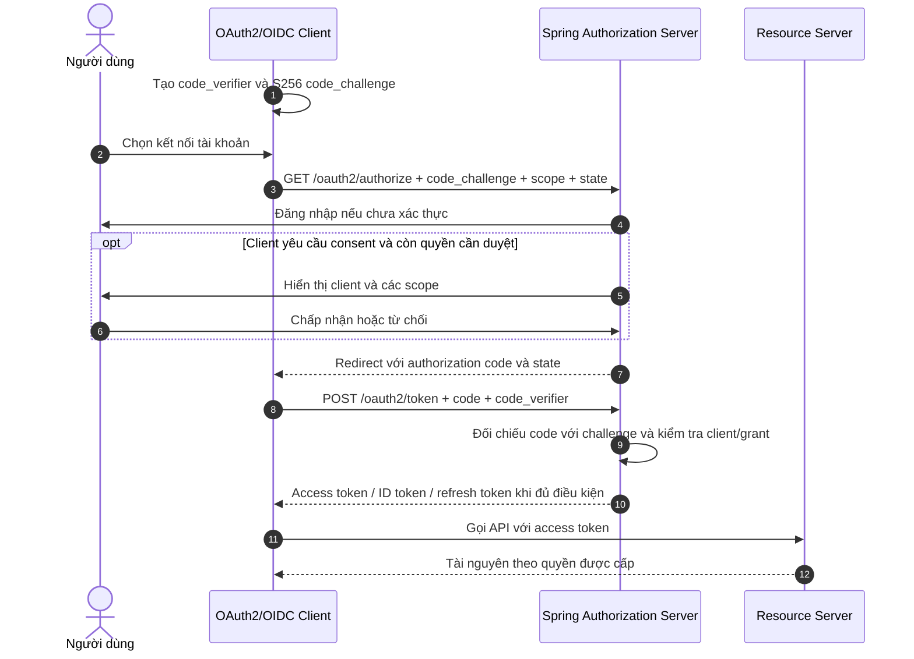

# Cấu hình yêu cầu PKCE và yêu cầu consent

## Mục tiêu bài học

Trong chương **Quản lý client** của module **SPRING_SECURITY_OAUTH2_OIDC_AUTHORIZATION_SERVER**, chúng ta tìm hiểu cách yêu cầu **Proof Key for Code Exchange (PKCE)** và **authorization consent** cho các OAuth 2.0/OpenID Connect (OIDC) client được đăng ký trong ứng dụng **Spring Boot** sử dụng **Spring Security** và **Spring Authorization Server**.

Hai cơ chế này thường xuất hiện cùng nhau trong luồng Authorization Code nhưng xử lý **hai vấn đề khác nhau**: PKCE giúp ràng buộc authorization code với client đã bắt đầu giao dịch; consent giúp người dùng xem xét phạm vi quyền mà một client yêu cầu trước khi máy chủ cấp quyền.

Sau bài này, bạn có thể:

- Giải thích mối đe dọa mà PKCE giải quyết, cơ chế `code_verifier`/`code_challenge` và lý do nên dùng `S256`.
- Cấu hình `ClientSettings.requireProofKey(true)` và `ClientSettings.requireAuthorizationConsent(true)` trên `RegisteredClient`.
- Chọn chính sách phù hợp cho SPA, native app, web backend và client machine-to-machine.
- Sử dụng `OAuth2AuthorizationConsentService` để lưu quyết định người dùng và thiết kế trang consent tùy chỉnh.
- Kiểm thử request thiếu PKCE, challenge/verifier không khớp, consent bị từ chối, thay đổi scope và xử lý thu hồi consent/token.
- Nhận diện trách nhiệm bảo mật và vận hành khi triển khai môi trường nhiều client, nhiều người dùng và nhiều replica.

> **Phạm vi kỹ thuật:** Ví dụ Java minh họa API của **Spring Authorization Server 1.x** và Spring Security 6.x; tên package và API có thể thay đổi theo phiên bản Spring Boot/Spring Security mà dự án sử dụng. Các đoạn mã được giải thích trong bối cảnh ứng dụng đã có Authorization Server filter chain, cơ chế xác thực người dùng, issuer, nguồn khóa ký và persistence thích hợp.

## 1. PKCE và consent nằm ở đâu trong Authorization Code flow?

OAuth 2.0 cho phép **client** xin cấp quyền thay mặt người dùng để truy cập **Resource Server**. Trong Authorization Code flow, client chuyển trình duyệt đến Authorization Server, người dùng đăng nhập và có thể đồng ý cấp quyền; sau đó client nhận một authorization code để đổi lấy token.



PKCE được kiểm tra ở các bước cấp code và đổi code: client gửi **challenge lúc yêu cầu cấp quyền**, rồi chứng minh quyền sở hữu **verifier lúc đổi code**. Consent được quyết định trong quá trình cấp quyền cho người dùng: Authorization Server cần biết **client nào**, **người dùng nào** và **phạm vi nào** được chấp thuận.

### 1.1. So sánh nhanh

| Tiêu chí | PKCE | Authorization consent |
|---|---|---|
| Mục tiêu | Giảm nguy cơ authorization code bị đánh cắp và bị client khác sử dụng. | Để người dùng biết và phê duyệt phạm vi client yêu cầu thay mặt mình. |
| Dữ liệu cốt lõi | `code_verifier`, `code_challenge`, `code_challenge_method`. | Người dùng, registered client, các scope/authority được đồng ý. |
| Thành phần thao tác | OAuth2 Client tạo verifier; Authorization Server kiểm chứng. | Authorization Server hiển thị/ghi nhận; người dùng phê duyệt. |
| Cấu hình trên client | `requireProofKey(true)`. | `requireAuthorizationConsent(true)`. |
| Có thay thế xác thực client không? | **Không**; confidential client vẫn cần xác thực client. | **Không**; consent không chứng minh danh tính của client. |
| Có thay thế kiểm tra quyền API không? | **Không**. | **Không**; Resource Server vẫn kiểm tra token và quyền thực tế. |

**PKCE không phải consent; consent không phải PKCE.** Một client có thể bắt buộc PKCE mà không cần hiển thị consent mỗi lần; một confidential web client cũng có thể bắt buộc cả PKCE và consent.

## 2. PKCE giải quyết rủi ro nào?

### 2.1. Tấn công đánh cắp authorization code

Giả sử ứng dụng native dùng redirect URI qua custom scheme hoặc môi trường trình duyệt có nguy cơ bị chiếm đường chuyển hướng. Kẻ tấn công lấy được **authorization code** trước khi client hợp lệ đổi code thành token. Nếu chỉ cần code và những tham số công khai, kẻ tấn công có thể thử đổi code trước client.

PKCE ràng buộc code với một bí mật ngắn hạn sinh riêng cho **từng authorization request**:

1. Client tạo `code_verifier` ngẫu nhiên, khó đoán, giữ kín.
2. Client tạo `code_challenge = BASE64URL-ENCODE(SHA256(ASCII(code_verifier)))` khi dùng `S256`.
3. Client gửi `code_challenge` cùng `code_challenge_method=S256` tới Authorization Endpoint.
4. Authorization Server liên kết challenge với authorization code được cấp.
5. Client gửi `code_verifier` tới Token Endpoint. Máy chủ tính lại challenge và so khớp trước khi cấp token.

```text
Authorization request:
  code_challenge = BASE64URL(SHA256(code_verifier))
  code_challenge_method = S256

Token request:
  code_verifier = chuỗi gốc chỉ client hợp lệ giữ

Authorization Server:
  BASE64URL(SHA256(code_verifier nhận được)) == code_challenge đã lưu ?
  Đúng  -> tiếp tục kiểm tra code, client, redirect URI, grant
  Sai   -> từ chối token request
```

Kẻ tấn công chỉ có code và challenge công khai thường không thể suy ra verifier đủ mạnh để sử dụng code. PKCE đặc biệt quan trọng với **public client** không thể giữ `client_secret` an toàn, như SPA hoặc ứng dụng mobile/native.

### 2.2. `S256`, `plain` và chất lượng verifier

Theo RFC 7636, `code_verifier` là chuỗi ngẫu nhiên dài **43–128 ký tự**, dùng bộ ký tự unreserved cho phép: chữ cái, chữ số, `-`, `.`, `_`, `~`. Cách sinh được khuyến nghị là tạo 32 byte ngẫu nhiên bằng bộ sinh số ngẫu nhiên mật mã, sau đó mã hóa Base64 URL-safe bỏ padding, được khoảng 43 ký tự.

**Ưu tiên `S256`**, không dùng `plain` làm phương án mặc định. `plain` gửi challenge bằng verifier ngay tại Authorization Endpoint và không chống được những rủi ro quan sát được request chứa challenge. RFC 9700 yêu cầu Authorization Server hỗ trợ PKCE, và public client phải sử dụng PKCE; confidential client cũng nên sử dụng PKCE để tăng bảo vệ luồng Authorization Code.

Ví dụ Java phía **client** để hiểu cách sinh cặp PKCE (các OAuth2/OIDC SDK chuẩn thường đã tự làm việc này):

```java
import java.nio.charset.StandardCharsets;
import java.security.MessageDigest;
import java.security.NoSuchAlgorithmException;
import java.security.SecureRandom;
import java.util.Base64;

public record PkcePair(String verifier, String challenge) {

    public static PkcePair generate() {
        byte[] entropy = new byte[32];
        new SecureRandom().nextBytes(entropy);

        String verifier = Base64.getUrlEncoder()
                .withoutPadding()
                .encodeToString(entropy);

        byte[] digest;
        try {
            digest = MessageDigest.getInstance("SHA-256")
                    .digest(verifier.getBytes(StandardCharsets.US_ASCII));
        } catch (NoSuchAlgorithmException ex) {
            throw new IllegalStateException("SHA-256 is required", ex);
        }

        String challenge = Base64.getUrlEncoder()
                .withoutPadding()
                .encodeToString(digest);

        return new PkcePair(verifier, challenge);
    }
}
```

Client phải lưu verifier trong **ngữ cảnh của đúng giao dịch đang chờ**, không ghi vào log hoặc đưa vào URL authorize. Không tái sử dụng cùng một verifier lâu dài cho nhiều giao dịch. Trong trình duyệt, bảo vệ trạng thái giao dịch trước XSS và injection; PKCE không giải quyết tất cả rủi ro của JavaScript độc hại.

### 2.3. PKCE không giải quyết những gì?

PKCE **không** thay thế:

- Kiểm tra `state` và ràng buộc response với giao dịch để chống CSRF/mix-up theo thiết kế client.
- Kiểm tra `nonce` trong luồng OIDC khi áp dụng.
- Đối chiếu `redirect_uri` theo registration, chặn open redirect hoặc xác minh `client_id`.
- Xác thực client bằng secret/private key với **confidential client**.
- TLS, bảo vệ session cookie, chống XSS, xác minh `issuer`/`audience` và phân quyền API.
- Cơ chế chống replay/reuse authorization code và chính sách vòng đời token.

PKCE bảo vệ **quá trình đổi authorization code**, không phải một cơ chế thay thế toàn bộ bảo mật OAuth2/OIDC.

## 3. Consent bảo vệ quyết định cấp quyền của người dùng

Khi một ứng dụng yêu cầu scope như `orders.read` hoặc `orders.write`, người dùng cần có khả năng hiểu client đang xin quyền gì. **Authorization consent** ghi lại quyết định cấp quyền theo người dùng, client và scope được duyệt.

Ví dụ một ứng dụng kế toán của bên thứ ba yêu cầu:

```text
scope=openid profile orders.read orders.write
```

Màn hình consent nên diễn giải những quyền này bằng ngôn ngữ người dùng dễ hiểu, chẳng hạn “Xem đơn hàng” và “Thay đổi đơn hàng”. Không nên chỉ hiện chuỗi kỹ thuật `orders.write` mà không giải thích hậu quả.

### 3.1. Consent trong lần đầu và lần sau

Với client được đặt `requireAuthorizationConsent(true)`:

1. Người dùng xác thực với Authorization Server.
2. Máy chủ xác định tập scope được client yêu cầu và điều kiện cần consent.
3. Nếu có scope chưa được người dùng phê duyệt theo chính sách, hiển thị giao diện đồng ý.
4. Người dùng chấp nhận tập quyền được cho phép hoặc từ chối.
5. Máy chủ lưu consent bằng `OAuth2AuthorizationConsentService` và tiếp tục hoặc từ chối authorization.

Khi consent đã được lưu cho cùng người dùng và client, người dùng **có thể không cần duyệt lại** các scope đã chấp thuận. Nếu client yêu cầu thêm quyền, hệ thống cần xác định và yêu cầu phê duyệt phần chưa có theo luồng phù hợp.

`requireAuthorizationConsent(true)` không có nghĩa màn hình sẽ xuất hiện **ở mọi lần đăng nhập**. Hành vi phụ thuộc consent đã lưu, requested scopes, giao thức/tính năng và phiên bản/cấu hình thực tế.

### 3.2. Consent khác scope, role và token

| Khái niệm | Ý nghĩa |
|---|---|
| **Scope được đăng ký** | Client có thể yêu cầu những quyền nào (`RegisteredClient.scope(...)`). |
| **Scope được yêu cầu** | Client đưa những scope nào trong request hiện tại. |
| **Scope được consent** | Người dùng đã phê duyệt quyền nào cho client theo mô hình lưu consent. |
| **Scope thực sự được cấp** | Quyền cuối cùng của authorization/token, sau các quy tắc của máy chủ. |
| **Role/permission nghiệp vụ** | Quyền người dùng có trên dữ liệu/đối tượng; do hệ thống cấp quyền nghiệp vụ quản lý. |

Consent cho `orders.write` **không tự tạo quyền quản trị đơn hàng** cho người dùng. Resource Server vẫn phải kiểm tra người dùng, token, đối tượng và quyền nghiệp vụ thực tế. Máy chủ cũng phải không để client tự thêm scope ngoài danh sách được đăng ký.

### 3.3. Consent không đồng nghĩa thu hồi token

Nếu người dùng rút lại consent, bản ghi consent tương ứng có thể bị xóa để yêu cầu hỏi lại khi cấp quyền sau này. Điều đó **không nhất thiết làm access token đã phát hành hết hiệu lực ngay**:

- Access token JWT được Resource Server xác minh ngoại tuyến có thể còn hợp lệ cho tới `exp` nếu không có chiến lược thu hồi bổ sung.
- Refresh token/authorization hiện có cần chính sách thu hồi riêng.
- Khi liên quan dữ liệu nhạy cảm, giao diện “Ngắt kết nối ứng dụng” thường phải vừa xóa consent **vừa** thực hiện quy trình thu hồi authorization/token tương ứng.

Cần viết rõ chính sách trong yêu cầu sản phẩm thay vì mặc định `removeAuthorizationConsent` đã ngắt toàn bộ phiên và API access.

## 4. Cấu hình PKCE và consent trên `RegisteredClient`

Trong Spring Authorization Server, cấu hình yêu cầu PKCE và consent gắn với **từng `RegisteredClient`** qua `ClientSettings`. Nhờ đó mỗi loại ứng dụng có chính sách phù hợp.

Hai phương thức quan trọng:

```java
ClientSettings.builder()
        .requireProofKey(true)
        .requireAuthorizationConsent(true)
        .build();
```

- `requireProofKey(true)`: yêu cầu PKCE cho Authorization Code flow của client đó.
- `requireAuthorizationConsent(true)`: yêu cầu consent theo hành vi xử lý authorization của máy chủ và dữ liệu consent đã lưu.

Không nên trông đợi một cờ YAML toàn cục tùy ý như `oauth.pkce.required=true` sẽ tự động điều khiển mọi `RegisteredClient`. Nếu ứng dụng đọc cấu hình YAML tự định nghĩa, cần lập trình logic mapping nó vào `ClientSettings`, lưu/persist và kiểm thử kết quả.

### 4.1. Ví dụ public client: SPA có PKCE

```java
import java.util.UUID;
import org.springframework.context.annotation.Bean;
import org.springframework.context.annotation.Configuration;
import org.springframework.security.oauth2.core.AuthorizationGrantType;
import org.springframework.security.oauth2.core.ClientAuthenticationMethod;
import org.springframework.security.oauth2.core.oidc.OidcScopes;
import org.springframework.security.oauth2.server.authorization.client.RegisteredClient;
import org.springframework.security.oauth2.server.authorization.client.RegisteredClientRepository;
import org.springframework.security.oauth2.server.authorization.client.InMemoryRegisteredClientRepository;
import org.springframework.security.oauth2.server.authorization.settings.ClientSettings;

@Configuration(proxyBeanMethods = false)
class DemoClientsConfiguration {

    @Bean
    RegisteredClientRepository demoRegisteredClientRepository() {
        RegisteredClient spaClient = RegisteredClient.withId(UUID.randomUUID().toString())
                .clientId("orders-spa")
                .clientName("Orders Portal")
                .clientAuthenticationMethod(ClientAuthenticationMethod.NONE)
                .authorizationGrantType(AuthorizationGrantType.AUTHORIZATION_CODE)
                .redirectUri("https://portal.example.com/oauth/callback")
                .scope(OidcScopes.OPENID)
                .scope(OidcScopes.PROFILE)
                .scope("orders.read")
                .clientSettings(ClientSettings.builder()
                        .requireProofKey(true)
                        .requireAuthorizationConsent(true)
                        .build())
                .build();

        return new InMemoryRegisteredClientRepository(spaClient);
    }
}
```

Giải thích:

- `ClientAuthenticationMethod.NONE` biểu thị **public client**, không có client secret đủ bảo mật để giữ kín như backend.
- `AuthorizationGrantType.AUTHORIZATION_CODE` cho phép authorization code; PKCE buộc kẻ đổi code phải chứng minh verifier.
- `redirectUri(...)` phải khớp callback đã đăng ký; không mở wildcard redirect vì tiện phát triển.
- `scope(OidcScopes.OPENID)` cho phép giao thức OIDC nếu Authorization Server bật OIDC. `orders.read` là scope nghiệp vụ minh họa.
- `requireAuthorizationConsent(true)` giúp người dùng xét quyền theo chính sách của AS.

`InMemoryRegisteredClientRepository` và `UUID.randomUUID()` ở đây **chỉ phù hợp demo**: mỗi restart sinh ID nội bộ mới và xóa cấu hình client. Môi trường production cần định danh RegisteredClient ổn định, repository bền vững và quy trình cấp/thu hồi client có kiểm soát.

**Lưu ý về refresh token:** Spring Authorization Server có các giới hạn/phương thức xử lý riêng cho refresh token của public client ở phiên bản tương ứng; không mặc định rằng thêm `AuthorizationGrantType.REFRESH_TOKEN` là client sẽ được cấp refresh token như confidential client. Nếu bài toán SPA yêu cầu duy trì phiên, đánh giá refresh token rotation/sender-constraining và hướng dẫn framework theo phiên bản; một kiến trúc Backend-for-Frontend cũng có thể phù hợp hơn.

### 4.2. Ví dụ confidential web client: PKCE vẫn hữu ích

Confidential client có thể xác thực với `client_secret_basic` hoặc cơ chế mạnh hơn. PKCE vẫn nên được bật vì hai biện pháp bảo vệ những yếu tố khác nhau: client authentication xác thực danh tính client, còn PKCE ràng buộc code với giao dịch tạo challenge.

```java
RegisteredClient backendClient = RegisteredClient.withId("orders-web-v1")
        .clientId("orders-web")
        .clientName("Orders Web")
        .clientSecret(passwordEncoder.encode(
                environment.getRequiredProperty("CLIENT_ORDERS_WEB_SECRET")))
        .clientAuthenticationMethod(ClientAuthenticationMethod.CLIENT_SECRET_BASIC)
        .authorizationGrantType(AuthorizationGrantType.AUTHORIZATION_CODE)
        .authorizationGrantType(AuthorizationGrantType.REFRESH_TOKEN)
        .redirectUri("https://orders.example.com/login/oauth2/code/orders-web")
        .scope(OidcScopes.OPENID)
        .scope("orders.read")
        .scope("orders.write")
        .clientSettings(ClientSettings.builder()
                .requireProofKey(true)
                .requireAuthorizationConsent(true)
                .build())
        .build();
```

Đoạn trên là **phần cấu tạo client** bên trong cấu hình có `PasswordEncoder` và `Environment` được inject, chưa bao gồm import/Bean hoàn chỉnh. Bí mật đầu vào phải được cấp qua secret manager hoặc nguồn cấu hình ngoài repository. Môi trường thật cần quy trình tạo secret, mã hóa khi lưu, rotation và thu hồi; không lưu plaintext client secret trong Git hoặc log.

Ở ví dụ này, authorization code cần verifier hợp lệ **và** confidential client phải xác thực theo `CLIENT_SECRET_BASIC` khi gọi Token Endpoint. **PKCE không thay thế client authentication**.

### 4.3. Cấu hình nào phù hợp với từng loại client?

| Loại client | PKCE khi dùng Authorization Code | Consent | Lưu ý |
|---|---|---|---|
| SPA public client | Bắt buộc theo thực hành bảo mật hiện đại. | Tùy mức độ tin cậy, quyền và UX; nên xem xét rõ. | Chặn XSS, kiểm tra callback, token storage, cân nhắc BFF. |
| Native/mobile public client | Bắt buộc. | Thường phù hợp khi xin quyền dữ liệu người dùng. | System browser, app link/loopback redirect theo chuẩn nền tảng. |
| Web backend confidential client | Nên yêu cầu. | Phù hợp khi có scope nhạy cảm/bên thứ ba; có thể không cần hỏi lại cho first-party được tin cậy theo chính sách. | Vẫn bắt buộc client authentication, cookie/session/CSRF an toàn. |
| Client Credentials service-to-service | Không áp dụng PKCE vì không dùng Authorization Code. | Không áp dụng user consent vì không có người dùng cuối trong grant. | Dùng xác thực client, scope/audience hạn chế, vòng đời credential. |
| Device Authorization | PKCE của Authorization Code không tự thay thế device-flow security. | Người dùng có thể cần xác nhận quyền trong giao diện device verification. | Bảo vệ user code, device code, polling và hạn mức. |

Một chính sách mặc định hợp lý là **bật PKCE cho tất cả Authorization Code clients hỗ trợ**, còn consent được quyết định theo mức độ tin cậy và phạm vi quyền. Không sử dụng `requireAuthorizationConsent(false)` như đường tắt để cấp quyền cho bất kỳ ứng dụng bên thứ ba nào mà không có đánh giá.

## 5. Authorization request và token request với PKCE

### 5.1. Yêu cầu authorization

Client tạo `state` và cặp verifier/challenge cho **mỗi giao dịch**, sau đó điều hướng người dùng tới Authorization Endpoint. Request minh họa (ngắt dòng để dễ đọc):

```http
GET /oauth2/authorize?response_type=code
    &client_id=orders-spa
    &redirect_uri=https%3A%2F%2Fportal.example.com%2Foauth%2Fcallback
    &scope=openid%20orders.read
    &state=STATE_RANDOM_FOR_THIS_REQUEST
    &code_challenge=BASE64URL_SHA256_CHALLENGE
    &code_challenge_method=S256 HTTP/1.1
Host: auth.example.com
```

Đây là sơ đồ request đã xuống dòng, **không phải raw HTTP request hợp lệ để copy nguyên**. Trong request thật, query phải được URL-encode theo chuẩn và gửi trên một dòng. Nếu dùng OIDC, client còn cần xử lý `nonce` theo profile/luồng xác thực phù hợp.

Authorization Server kiểm tra:

1. `client_id` là một RegisteredClient hợp lệ.
2. `redirect_uri` khớp giá trị được đăng ký (và các quy tắc liên quan).
3. `response_type=code` và các scope được phép.
4. Client đã gửi `code_challenge`/`code_challenge_method` đúng yêu cầu PKCE.
5. Trạng thái xác thực người dùng và consent trước khi cấp code.

Không nên coi việc nhận HTTP 302 là đủ để khẳng định PKCE đúng; cần kiểm tra liệu response là login redirect, consent redirect, authorization callback hay lỗi.

### 5.2. Request đổi code lấy token

Sau khi nhận code tại callback và xác minh `state`, client lấy lại verifier đã lưu trong chính giao dịch đó.

```http
POST /oauth2/token HTTP/1.1
Host: auth.example.com
Content-Type: application/x-www-form-urlencoded

grant_type=authorization_code&client_id=orders-spa&code=AUTHORIZATION_CODE&redirect_uri=https%3A%2F%2Fportal.example.com%2Foauth%2Fcallback&code_verifier=ORIGINAL_CODE_VERIFIER
```

Ở đây dùng **public client** nên không có client secret. Với confidential client, token request còn phải xác thực client đúng phương thức đã đăng ký, chẳng hạn HTTP Basic chứa client ID/secret hoặc phương thức khóa bất đối xứng. Authorization Server kiểm tra verifier tương ứng với challenge đã lưu, code chưa được sử dụng, còn hiệu lực và thuộc đúng client/redirect URI.

**Không đưa `code_verifier` vào Authorization Endpoint**, không ghi nó vào logs, không copy challenge thay cho verifier khi gọi token endpoint. Challenge `S256` được gửi ở authorize request, còn verifier gốc chỉ được gửi đến Token Endpoint.

### 5.3. Nếu thiếu hoặc sai PKCE thì sao?

Với RegisteredClient có `requireProofKey(true)`, các trường hợp thiếu challenge, dùng `code_challenge_method` không được hỗ trợ hoặc cung cấp verifier không khớp phải bị từ chối ở bước tương ứng. Lỗi OAuth2 có thể là `invalid_request` ở authorization request hoặc `invalid_grant` ở token request, tùy tình huống và implementation.

Trong kiểm thử, hãy quan sát **error code, HTTP status, response location và việc có hay không token**, thay vì cứng nhắc yêu cầu mọi trường hợp có chung một status HTTP. Đặc biệt, không được cấp token khi verifier sai.

## 6. Tổ chức consent và lưu trữ trong Spring Authorization Server

Framework cung cấp abstraction `OAuth2AuthorizationConsentService` để đọc và lưu quyết định consent. Điều này khác với `OAuth2AuthorizationService`, vốn lưu **authorization/token state**.

| Thành phần | Trách nhiệm |
|---|---|
| `RegisteredClientRepository` | Lưu client, grant type, redirect URI, scope và `ClientSettings`. |
| `OAuth2AuthorizationConsentService` | Lưu consent của người dùng cho registered client; phục vụ lần cấp quyền sau. |
| `OAuth2AuthorizationService` | Lưu authorization, authorization code, token và dữ liệu liên quan. |
| `AuthorizationServerSettings` | Cấu hình issuer và endpoint URL, không sở hữu chính sách PKCE/consent của client. |
| `OAuth2AuthorizationServerConfigurer` | Kết nối filter và xử lý các endpoint, có điểm tùy biến consent page. |

### 6.1. Dùng JDBC để consent tồn tại sau restart

Ở demo, có thể dùng `InMemoryOAuth2AuthorizationConsentService`. Trong production, thông thường phải dùng persistence chung giữa các replica, ví dụ JDBC:

```java
import org.springframework.context.annotation.Bean;
import org.springframework.context.annotation.Configuration;
import org.springframework.jdbc.core.JdbcTemplate;
import org.springframework.security.oauth2.server.authorization.client.RegisteredClientRepository;
import org.springframework.security.oauth2.server.authorization.consent.JdbcOAuth2AuthorizationConsentService;
import org.springframework.security.oauth2.server.authorization.consent.OAuth2AuthorizationConsentService;

@Configuration(proxyBeanMethods = false)
class ConsentPersistenceConfiguration {

    @Bean
    OAuth2AuthorizationConsentService authorizationConsentService(
            JdbcTemplate jdbcTemplate,
            RegisteredClientRepository clients) {

        return new JdbcOAuth2AuthorizationConsentService(jdbcTemplate, clients);
    }
}
```

Điều kiện để ví dụ chạy đúng:

- Cơ sở dữ liệu có schema `oauth2_authorization_consent` tương ứng với phiên bản framework/JDBC implementation.
- `RegisteredClientRepository` sử dụng định danh nội bộ `registeredClientId` **ổn định**, không sinh lại mỗi restart.
- Migration, transaction, index, backup, retention và quyền DB đã được kiểm soát.
- Mọi instance cùng issuer đọc được consent cần thiết từ một hệ thống lưu trữ nhất quán.

Bảng consent thường lưu khóa theo **registered client ID + principal name** và thông tin các authorities đã đồng ý. Không tự suy ra rằng quan hệ consent theo `client_id` bên ngoài luôn trùng với ID nội bộ trong database. Thiết kế ánh xạ principal/tenant phải tránh trùng người dùng có cùng tên ở nhiều nguồn danh tính.

### 6.2. Rút lại consent

Service cung cấp khả năng đọc và xóa bản ghi consent:

```java
OAuth2AuthorizationConsent consent =
        authorizationConsentService.findById(
                registeredClient.getId(),
                principalName
        );

if (consent != null) {
    authorizationConsentService.removeAuthorizationConsent(consent);
}
```

Đây là ví dụ logic phía server sau khi **đã xác thực và kiểm tra quyền** của người yêu cầu rút consent. Không tạo một public HTTP endpoint cho phép client tùy ý truyền `principalName`/`registeredClientId` rồi xóa bản ghi người khác.

Nếu chức năng “Ngắt kết nối” yêu cầu hiệu lực ngay, phải phối hợp thêm `OAuth2AuthorizationService` và chính sách revoke/invalidate refresh token, authorization và access token liên quan. Với JWT đã phát hành, Resource Server xác minh ngoại tuyến có thể tiếp tục chấp nhận token đến hết hạn nếu không có cơ chế thu hồi tập trung hoặc danh sách chặn.

### 6.3. Consent có cần hỏi lại mỗi lần không?

Tùy chính sách, nhưng thông thường nếu **toàn bộ quyền đang xin đã được duyệt và lưu**, không cần hỏi lại chỉ để đăng nhập. Khi một client tăng phạm vi từ `orders.read` lên `orders.read orders.write`, `orders.write` là quyền mới cần xử lý consent phù hợp.

Trên giao diện, nên phân biệt “đã cho phép trước đó” và “đang xin thêm quyền”; không dùng lựa chọn mặc định ép người dùng vô tình cấp quyền nhạy cảm. Phân loại scope theo mức độ ảnh hưởng và thiết lập thời điểm yêu cầu lại consent khi chính sách bảo mật hoặc quan hệ ủy quyền thay đổi.

## 7. Tùy chỉnh trang consent

Spring Authorization Server cho phép chuyển người dùng tới một **consent page** do ứng dụng quản lý. Điều này hữu ích khi cần giải thích phạm vi quyền theo ngôn ngữ sản phẩm, gắn logo/định danh client đã xác minh và có trải nghiệm chấp thuận/từ chối rõ ràng.

Ví dụ cấu hình tại Authorization Server filter chain:

```java
OAuth2AuthorizationServerConfigurer authorizationServer =
        OAuth2AuthorizationServerConfigurer.authorizationServer();

http.securityMatcher(authorizationServer.getEndpointsMatcher())
        .with(authorizationServer, configurer -> {
            configurer.oidc(Customizer.withDefaults());
            configurer.authorizationEndpoint(endpoint ->
                    endpoint.consentPage("/oauth2/consent"));
        });
```

Đây là **đoạn cấu hình rút gọn**, chưa gồm `@Bean SecurityFilterChain` hoàn chỉnh, authentication entry point, login chain và các Bean cần thiết. `/oauth2/consent` là địa chỉ **hiển thị trang**; việc chấp nhận consent được xử lý qua Authorization Endpoint theo hợp đồng framework.

### 7.1. Dữ liệu trang consent cần lấy từ đâu?

Controller/rendering layer cần xác định từ **trạng thái request mà Authorization Server đã xác thực**:

- Người dùng hiện tại (principal) và issuer/tenant.
- RegisteredClient đã được nhận diện; `clientName` hoặc tên được phê duyệt thay vì tin một tham số hiển thị do client gửi.
- Scope được đăng ký, scope đang yêu cầu, scope đã chấp thuận và scope mới cần duyệt.
- `state` của giao dịch và action xử lý consent theo endpoint đã cấu hình.
- Thông tin cảnh báo/chính sách nếu client là bên thứ ba hoặc scope đặc biệt nhạy cảm.

**Không tin dữ liệu lấy nguyên từ query string để quyết định cấp quyền.** Dữ liệu trong form có thể bị thay đổi bằng DevTools; máy chủ phải đối chiếu với authorization request gốc, RegisteredClient và quyền của người dùng.

### 7.2. Ví dụ cấu trúc form minh họa

Đoạn HTML sau chỉ diễn giải các trường cần có; dữ liệu trong ngoặc vuông là giá trị **được server render an toàn**, không copy trực tiếp thành form production:

```html
<form method="post" action="/oauth2/authorize">
  <!-- client_id, state lấy từ giao dịch cấp quyền hiện tại -->
  <input type="hidden" name="client_id" value="[CLIENT_ID]">
  <input type="hidden" name="state" value="[STATE]">

  <!-- Chỉ render những scope được phép chọn trong giao dịch -->
  <label>
    <input type="checkbox" name="scope" value="orders.read">
    Cho phép xem đơn hàng
  </label>
  <label>
    <input type="checkbox" name="scope" value="orders.write">
    Cho phép sửa đơn hàng
  </label>

  <!-- Thêm CSRF token theo cấu hình Spring Security khi áp dụng -->
  <input type="hidden" name="_csrf" value="[CSRF_TOKEN]">
  <button type="submit">Cho phép</button>
</form>
```

Trong ứng dụng thực, phải dùng template engine/framework có **escaping**, gửi đúng tên/giá trị field của phiên bản SAS, giữ nguyên `state`, bảo vệ CSRF theo filter chain thực tế, và xử lý cả hành động **Từ chối**. Nếu đã tùy chỉnh Authorization Endpoint thành đường dẫn khác, `action` của form cũng phải nhất quán.

Giao diện không nên tự nhận quyền đã đồng ý chỉ vì người dùng nhấn nút; kết quả cấp quyền cuối cùng phải do Authorization Server kiểm chứng và ghi lại. Không hiển thị client secret, token hoặc thông tin nhạy cảm trong trang consent.

### 7.3. Xử lý từ chối và cấp quyền một phần

Khi người dùng từ chối, Authorization Server cần hoàn tất luồng bằng phản hồi lỗi OAuth2/OIDC thích hợp, ví dụ `access_denied`, đồng thời ràng buộc `state` để client xác định đúng giao dịch. Với giao diện cho phép chọn subset scope, client phải kiểm tra **scope thực sự được cấp** và không giả định mọi scope đã yêu cầu đều được chấp thuận.

Không tạo cơ chế cho phép người dùng đánh dấu quyền mà client chưa đăng ký. Mọi dữ liệu scope/approval phải được kiểm tra lại ở server. Với scope liên quan dữ liệu nhạy cảm, cần thêm audit sự kiện đồng ý, từ chối, thêm/bớt quyền theo chính sách lưu trữ.

## 8. Các tình huống áp dụng chính sách

### Tình huống A — SPA nội bộ đọc thông tin cá nhân

SPA chạy trên HTTPS, có redirect URI cụ thể và truy cập API với scope `profile.read`.

- `ClientAuthenticationMethod.NONE`, Authorization Code + PKCE `S256`.
- `requireProofKey(true)`.
- Consent tùy mức độ tin cậy, chính sách tổ chức và trải nghiệm người dùng; không coi first-party đồng nghĩa được cấp tất cả scope.
- Kiểm soát XSS, xác minh `state`/issuer và quyền Resource Server; cân nhắc Backend-for-Frontend khi cần cách ly token khỏi JavaScript.

### Tình huống B — Ứng dụng đối tác truy cập đơn hàng

Confidential web client của đối tác xin `orders.read` và `orders.write`.

- Client authentication mạnh, Authorization Code + PKCE.
- `requireProofKey(true)` và `requireAuthorizationConsent(true)`.
- Giao diện consent giải thích rõ quyền đọc và ghi, tên đối tác, thời điểm có thể ngắt kết nối.
- Lưu consent bền vững; khi thêm `orders.write`, người dùng được yêu cầu phê duyệt quyền mở rộng.
- Audit cấp/thu hồi quyền, bảo vệ token và kiểm tra quyền nghiệp vụ trên từng đơn hàng.

### Tình huống C — Backend gọi API bằng Client Credentials

Một service thanh toán dùng `client_credentials` để đọc sự kiện kế toán.

- Không có Authorization Code, vì vậy PKCE **không áp dụng**.
- Không có người dùng cuối phê duyệt, nên user consent **không áp dụng**.
- Bảo vệ bằng client authentication, scope/audience hạn chế, credential rotation và authorization trên Resource Server.
- Không nên cố bật consent page cho Client Credentials rồi mong có giao diện người dùng.

### Tình huống D — Native mobile app kết nối tài khoản

Ứng dụng iOS/Android mở system browser, đi qua redirect phù hợp với nền tảng.

- PKCE bắt buộc, verifier sinh riêng cho mỗi attempt.
- Có thể yêu cầu consent khi truy cập dữ liệu/đăng ký kết nối lần đầu.
- Xác minh callback, `state` và token issuer; tránh embedded webview không phù hợp.
- Không đặt client secret bí mật trong package ứng dụng mobile vì có thể bị trích xuất.

## 9. Kiểm thử PKCE và consent

### 9.1. Kiểm tra cấu hình RegisteredClient

Ở tầng unit/configuration, có thể xác minh object đã được lưu:

```java
RegisteredClient registered = registeredClientRepository.findByClientId("orders-spa");

assertThat(registered).isNotNull();
assertThat(registered.getClientSettings().isRequireProofKey()).isTrue();
assertThat(registered.getClientSettings().isRequireAuthorizationConsent()).isTrue();
assertThat(registered.getClientAuthenticationMethods())
        .contains(ClientAuthenticationMethod.NONE);
```

Đây là ví dụ assertion rút gọn, cần JUnit/AssertJ và một `RegisteredClientRepository` được khởi tạo. Kiểm tra cấu hình **chưa đủ**; còn cần request thật để chứng minh enforcement.

### 9.2. Ma trận kiểm thử giao thức

| Bài thử | Kỳ vọng |
|---|---|
| Public client gửi Authorization Code request với challenge `S256` hợp lệ | Được xử lý tiếp đến login/consent; code được cấp nếu các điều kiện khác hợp lệ. |
| Bỏ `code_challenge` khi `requireProofKey(true)` | Authorization request bị từ chối; không cấp code có thể đổi token. |
| Challenge method sai hoặc unsupported | Bị từ chối theo cấu hình giao thức. |
| Đổi code với `code_verifier` sai | Token request bị từ chối; không phát hành access token. |
| Thử dùng lại authorization code | Không được cấp token lần hai. |
| Đổi code của client A bằng client B | Bị từ chối vì code ràng buộc với client/giao dịch. |
| Sai `redirect_uri` hoặc `state` | Bị từ chối hoặc client phát hiện sai giao dịch; không chấp nhận redirect mở. |
| Confidential client không xác thực khi đổi code | Bị từ chối dù PKCE verifier đúng. |
| Người dùng chưa từng consent, client xin scope hợp lệ | Có luồng duyệt khi chính sách yêu cầu. |
| Người dùng đã consent đủ scope | Consent có thể được tái sử dụng, không buộc hỏi lại không cần thiết. |
| Client xin thêm scope chưa được duyệt | Phần quyền mới được xử lý consent theo chính sách; không tự nâng quyền. |
| Client xin scope không đăng ký | Request bị từ chối/không cấp scope trái phép. |
| Người dùng từ chối consent | Không cấp quyền theo yêu cầu; client nhận kết quả từ chối thích hợp. |
| Xóa consent, gửi authorization request mới | Luồng cần xem xét consent lại theo cấu hình. |
| Xóa consent nhưng token cũ còn hạn | Kiểm tra chính sách thu hồi thực tế; không giả định JWT đã bị vô hiệu hóa tức thời. |
| Restart hoặc failover sang replica khác | Client settings, authorization và consent vẫn nhất quán nếu dùng shared persistence. |

Bài kiểm thử bảo mật nên kiểm tra **không có token nào được cấp khi điều kiện bị vi phạm**, kết hợp HTTP status, OAuth error code và dữ liệu lưu trữ. Đừng đồng nhất mọi request sai với cùng status 400/401/302: endpoint authorize có thể cần login redirect hoặc redirect lỗi về client đã được kiểm chứng.

### 9.3. Kiểm tra data persistence

Với `JdbcOAuth2AuthorizationConsentService`:

1. Tạo một RegisteredClient có ID bền vững và scope cụ thể.
2. Cho tài khoản thử nghiệm consent `orders.read`.
3. Restart ứng dụng và đọc `findById(registeredClientId, principalName)`.
4. Xác minh consent vẫn còn và request lặp lại dùng chính sách đã duyệt.
5. Mở rộng scope sang `orders.write`; xác minh quyền mới không tự được duyệt.
6. Xóa consent rồi kiểm tra có yêu cầu consent ở lần sau.
7. Thử một lần từ replica A và một lần từ replica B, khi cả hai cùng dùng database/shared session theo thiết kế.

Không để test truy cập database, client secrets hoặc người dùng production; use case nhiều tenant còn cần kiểm tra không có consent của tenant A được tái sử dụng cho cùng principal name ở tenant B.

## 10. Bảo mật và vận hành production

**Với PKCE:**

- Bắt buộc PKCE cho public Authorization Code client; dùng `S256`, verifier ngẫu nhiên đủ mạnh và sinh mới mỗi giao dịch.
- Confidential client vẫn cần xác thực với phương thức đã đăng ký dù có PKCE.
- Giữ đúng validation `redirect_uri`, `state`, `nonce` khi áp dụng, issuer và TLS; đừng tắt những kiểm soát này để flow chạy nhanh hơn.
- Giới hạn log nhạy cảm: không ghi `code_verifier`, authorization code, access/refresh token hoặc client secret.
- Dùng thư viện OAuth/OIDC client đã được bảo trì để xử lý PKCE, thay vì tự ghép request cho production.

**Với consent:**

- Đăng ký scope có tên và mô tả rõ, áp dụng quyền tối thiểu và tránh scope quá rộng.
- Hiển thị client name đã được kiểm soát; chặn giả mạo tên đối tác, XSS, clickjacking và CSRF theo ngữ cảnh.
- Có khả năng xem lại và rút consent; phân biệt rút consent với thu hồi authorization và token.
- Lưu consent trong storage bền vững khi production có nhiều replica; quản lý migration, backup, retention và yêu cầu xóa dữ liệu.
- Log audit sự kiện consent theo mức cần thiết; tránh ghi dữ liệu nhận dạng nhạy cảm hoặc token vào log.
- Khi người dùng đổi tài khoản, nguồn định danh hoặc tenant, tránh tái sử dụng consent không đúng principal. Xây identity key ổn định và quy định riêng cho nhiều issuer/tenant.

**Với quản lý client:**

- Không để client tự chọn tùy ý `requireProofKey(false)` hay `requireAuthorizationConsent(false)` qua API quản trị không có phê duyệt.
- Khi thay chính sách client đang hoạt động, kiểm thử tương thích với các phiên/giao dịch chưa hoàn tất; client cũ thiếu PKCE sẽ thất bại khi chính sách mới được bật.
- Theo dõi tỷ lệ lỗi `invalid_request`, `invalid_grant`, số consent thất bại, từ chối và request scope ngoài chính sách, nhưng không log payload nhạy cảm.
- Ghi nhận phiên bản client, owner, URL callback, loại grant và chính sách consent/PKCE làm bằng chứng kiểm toán.

## 11. Quy trình bật PKCE và consent cho client đã triển khai

Không nên sửa trực tiếp dữ liệu RegisteredClient của hàng trăm ứng dụng mà không có quá trình chuyển đổi:

1. **Kiểm kê** client đang dùng Authorization Code, xác định public/confidential, thư viện OAuth/OIDC và redirect URI.
2. **Kiểm chứng khả năng PKCE**: client đã gửi `S256` challenge và verifier đúng chưa? Đối với client cũ chưa hỗ trợ, lên kế hoạch nâng cấp.
3. **Lập chính sách consent**: nhóm first-party/third-party, scope nhạy cảm, nội dung UI, lưu consent và quy trình từ chối/rút quyền.
4. **Thử staging**: bật `requireProofKey(true)`/`requireAuthorizationConsent(true)` trên client thử nghiệm, chạy ma trận giao thức và kiểm tra consent persistence.
5. **Cập nhật RegisteredClient production** bằng quy trình kiểm soát thay đổi, bảo đảm DB và cache/replica đồng nhất.
6. **Quan sát sau rollout**: theo dõi các lỗi authorization/token, tỷ lệ bỏ consent, phản hồi hỗ trợ và phiên giao dịch cũ.
7. **Đánh giá và xử lý rollback**: nếu client không tương thích, nâng cấp client theo kế hoạch; không coi hạ yêu cầu PKCE là giải pháp mặc định lâu dài.

Với một hệ thống mới, bật PKCE và thiết kế consent ngay từ đầu thường đơn giản hơn so với siết chính sách sau khi đã có nhiều client không tương thích.

## 12. Bài tập thực hành

**Đề bài:** Trong Authorization Server của dự án học tập, đăng ký hai client:

- `orders-spa`: public client, Authorization Code, PKCE bắt buộc, cho phép scope `openid` và `orders.read`, yêu cầu consent.
- `orders-web`: confidential client, Authorization Code + Refresh Token, PKCE bắt buộc, cho phép `openid`, `orders.read`, `orders.write`, yêu cầu consent.

Thực hiện:

1. Tạo hai `RegisteredClient` với redirect URI cụ thể, grant và authentication method phù hợp.
2. Cấu hình `ClientSettings.builder().requireProofKey(true).requireAuthorizationConsent(true)` cho cả hai client.
3. Khởi chạy Spring Authorization Server có người dùng thử nghiệm, signing keys, issuer và persistence thích hợp.
4. Dùng OAuth2 Client hoặc công cụ kiểm thử để tạo verifier/challenge `S256`; hoàn thành Authorization Code flow.
5. Gửi request không có `code_challenge` và request token sai `code_verifier`; xác minh không có token được cấp.
6. Thử `orders-web` với verifier đúng nhưng thiếu client authentication; xác minh bị từ chối.
7. Cho người dùng consent `orders.read`, khởi động lại và xác nhận consent vẫn được lưu.
8. Yêu cầu thêm `orders.write` và kiểm tra việc xin quyền bổ sung; sau đó từ chối và rút consent.
9. Kiểm tra Resource Server vẫn áp dụng đúng scope, role/permission nghiệp vụ và tính hợp lệ của access token.

**Tiêu chí hoàn thành:** Hai client đều dùng PKCE đúng, confidential client vẫn phải xác thực, người dùng không bị cấp scope không chấp thuận, consent tồn tại sau restart và có quy trình rút quyền/token rõ ràng.

## 13. Checklist trước khi bàn giao

- [ ] Phân biệt PKCE (bảo vệ authorization code) và consent (quyết định phạm vi quyền của người dùng).
- [ ] Public Authorization Code clients bắt buộc PKCE `S256`.
- [ ] Confidential Authorization Code clients dùng PKCE cùng client authentication phù hợp.
- [ ] `ClientSettings` được lưu trên đúng RegisteredClient và đọc lại chính xác.
- [ ] Redirect URI, `state`, `nonce` (khi áp dụng) và issuer validation còn hoạt động.
- [ ] Các scope đăng ký, scope yêu cầu và scope đã đồng ý được kiểm tra ở server.
- [ ] Consent UI rõ tên client và ý nghĩa scope, có lựa chọn từ chối an toàn.
- [ ] `OAuth2AuthorizationConsentService` có persistence bền vững khi cần; RegisteredClient ID ổn định.
- [ ] Quy trình rút consent khác biệt rõ với thu hồi refresh/access token đã phát hành.
- [ ] Đã kiểm thử missing/mismatched PKCE, client authentication sai, consent từ chối, thêm scope và restart.
- [ ] Không log verifier, authorization code, client secret, token hoặc thông tin bí mật.
- [ ] Có kế hoạch chuyển đổi cho các client cũ và người chịu trách nhiệm thay đổi chính sách.

## Tổng kết

Đối với Spring Authorization Server, **`ClientSettings.requireProofKey(true)`** bật yêu cầu PKCE cho Authorization Code client, còn **`ClientSettings.requireAuthorizationConsent(true)`** yêu cầu xử lý consent của người dùng theo scope và dữ liệu đã lưu. Cả hai cùng củng cố luồng cấp quyền nhưng không thay thế xác thực client, xác minh token hay phân quyền ở Resource Server.

Một triển khai đầy đủ cần PKCE `S256` đúng chuẩn, consent UI có ý nghĩa, `OAuth2AuthorizationConsentService` bền vững, kiểm thử các request bị từ chối và quy trình quản lý consent/token trong suốt vòng đời client.

## Tài liệu tham khảo

1. [Spring Authorization Server — Core Model / Components](https://docs.spring.io/spring-authorization-server/reference/core-model-components.html): `RegisteredClient`, `ClientSettings`, `OAuth2AuthorizationConsent` và các repository/service.
2. [Spring Authorization Server — Configuration Model](https://docs.spring.io/spring-authorization-server/reference/configuration-model.html): `OAuth2AuthorizationServerConfigurer` và tùy biến authorization/consent endpoint.
3. [Spring Authorization Server — Protocol Endpoints](https://docs.spring.io/spring-authorization-server/reference/protocol-endpoints.html): Authorization Endpoint, Token Endpoint và các extension points.
4. [RFC 7636 — Proof Key for Code Exchange](https://www.rfc-editor.org/rfc/rfc7636): verifier, challenge, `S256` và luồng bảo vệ authorization code.
5. [RFC 9700 — OAuth 2.0 Security Best Current Practice](https://www.rfc-editor.org/rfc/rfc9700): yêu cầu bảo mật hiện đại cho PKCE, redirect URI và token.
6. [RFC 6749 — The OAuth 2.0 Authorization Framework](https://www.rfc-editor.org/rfc/rfc6749): Authorization Code, client authentication, scope và authorization grant.
7. [OpenID Connect Core 1.0](https://openid.net/specs/openid-connect-core-1_0.html): xác thực người dùng, OIDC scopes, consent và ID Token.

