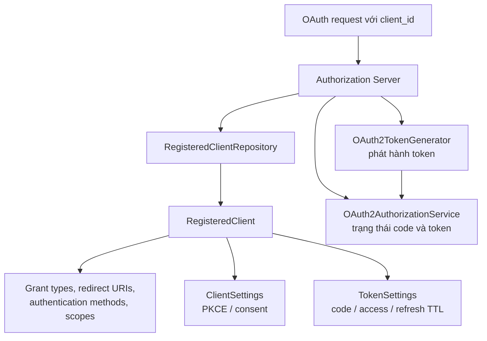
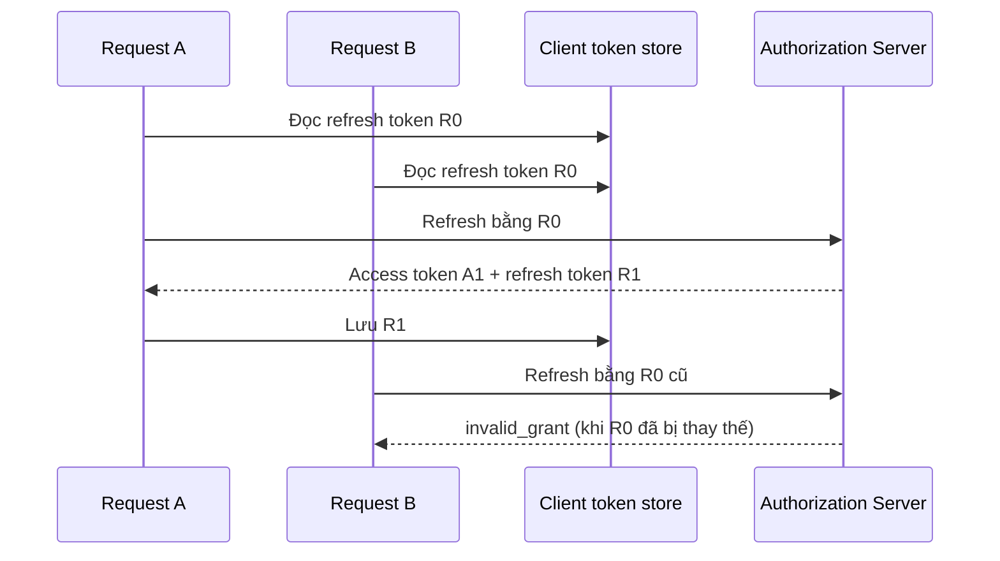

# Cấu hình thời hạn authorization code, access token và refresh token

Trong **Spring Security OAuth2/OIDC Authorization Server**, việc phát hành một token thành công chỉ là bước đầu. Hệ thống còn phải quyết định **token hoặc mã ủy quyền có hiệu lực bao lâu**, khi nào cần phát hành giá trị mới, khi nào từ chối giá trị cũ và làm thế nào để vận hành chính sách đó an toàn. Spring Authorization Server cung cấp **`TokenSettings`** để cấu hình thời hạn và một số hành vi token **theo từng `RegisteredClient`**.

Bài học thuộc chương **Quản lý client** của module **SPRING_SECURITY_OAUTH2_OIDC_AUTHORIZATION_SERVER**, hướng đến thiết kế, cấu hình, bảo mật, kiểm thử và vận hành OAuth 2.0/OpenID Connect Authorization Server bằng Spring Boot.

Sau bài này, bạn có thể:

- Phân biệt thời hạn và công dụng của **authorization code**, **access token** và **refresh token**.
- Cấu hình các thuộc tính `authorizationCodeTimeToLive`, `accessTokenTimeToLive`, `refreshTokenTimeToLive` và `reuseRefreshTokens` bằng `TokenSettings`.
- Thiết kế chính sách thời hạn theo mức tin cậy của client, loại grant, loại tài nguyên và yêu cầu vận hành.
- Giải thích refresh token rotation, giới hạn của thu hồi JWT và ảnh hưởng của kho dữ liệu, nhiều instance, đồng hồ hệ thống.
- Kiểm thử token hết hạn, code chỉ dùng một lần, refresh token bị thay thế và sự khác biệt giữa phiên đăng nhập với thời hạn token.

## 1. Ba loại giá trị, ba vòng đời khác nhau

Ví dụ: một backend web client `orders-portal` đã đăng ký với Spring Authorization Server, dùng **Authorization Code + PKCE**, có quyền gọi API đơn hàng.

```mermaid
sequenceDiagram
    autonumber
    actor U as Người dùng
    participant B as Trình duyệt
    participant C as orders-portal backend
    participant AS as Authorization Server
    participant API as Orders API

    U->>B: Mở trang đơn hàng
    B->>C: Yêu cầu đăng nhập
    C-->>B: Redirect tới /oauth2/authorize (state, PKCE)
    B->>AS: Authorization request
    AS-->>B: Đăng nhập / consent nếu cần
    B->>AS: Xác thực và đồng ý
    AS-->>B: Callback với authorization code
    B->>C: Chuyển authorization code
    C->>AS: /oauth2/token (code, verifier, client auth)
    AS-->>C: Access token + có thể refresh token
    C->>API: Authorization: Bearer access_token
    API-->>C: Dữ liệu được phép
    Note over C,API: Access token hết hạn
    C->>AS: /oauth2/token (grant_type=refresh_token)
    AS-->>C: Access token mới; refresh token tùy chính sách
    C->>API: Gọi API với access token mới
```

| Giá trị | Dùng ở đâu? | Thời hạn ngắn/dài có ý nghĩa gì? | Điều kiện kết thúc ngoài hết hạn |
| --- | --- | --- | --- |
| **Authorization code** | Client đổi tại token endpoint sau redirect từ Authorization Server. | Nên rất ngắn: mã chỉ cần sống đủ để client xử lý callback. | Chỉ được **dùng một lần**; sai client, redirect URI hoặc PKCE verifier phải bị từ chối. |
| **Access token** | Client trình cho Resource Server/API để truy cập tài nguyên. | Thường ngắn; rút ngắn thời gian hữu dụng nếu bị lộ, nhưng tăng tần suất cấp mới. | Có thể bị từ chối do chữ ký/issuer/audience/scope, trạng thái hoặc chính sách API; JWT tự chứa không mặc nhiên bị vô hiệu ngay sau revoke. |
| **Refresh token** | Client dùng tại token endpoint để xin access token mới mà không cần lặp lại toàn bộ luồng ủy quyền. | Thường dài hơn access token; lộ refresh token có thể tạo ra nhiều access token mới. | AS có thể từ chối token đã thu hồi, đã bị thay thế khi rotation, sai client, hoặc không còn thỏa chính sách. |

**Thời hạn (`time-to-live`, TTL)** là khoảng thời gian tính từ khi một giá trị được phát hành đến hạn hết hiệu lực của chính giá trị đó. Không nhầm TTL với thời gian phiên web/SSO còn hoạt động, thời gian consent được lưu hay thời gian user được phép làm việc ở API.

### 1.1. Ví dụ về mốc thời gian

Giả sử client được cấu hình minh họa:

- Authorization code TTL: **2 phút**.
- Access token TTL: **10 phút**.
- Refresh token TTL: **8 giờ**.
- Chính sách refresh token: phát hành token mới khi refresh (`reuseRefreshTokens(false)`).

Các mốc dưới đây chỉ là **ví dụ về thời điểm cấp**, không phải giá trị mặc định của Spring Authorization Server:

```text
14:00  Authorization Server phát hành authorization code
14:01  Client đổi code thành công tại token endpoint
       -> code đã được dùng, không thể đổi lại
       -> access token mới hết hạn vào khoảng 14:11
       -> refresh token mới hết hạn vào khoảng 22:01

14:11  Access token từ lần đổi code đã hết hạn
       -> Orders API phải từ chối token hết hạn
       -> client có thể xin access token khác nếu refresh token còn hợp lệ

15:00  Client gửi refresh token hợp lệ
       -> AS có thể trả access token mới
       -> nếu bật rotation, AS còn phát hành refresh token mới
       -> client phải lưu thay thế giá trị cũ một cách an toàn
```

Một authorization code được đổi thành công sau 1 phút **không kéo dài hiệu lực của code**; nó đã bị tiêu thụ. Khi AS cấp access token và refresh token tại 14:01, TTL của các token đó tính theo **thời điểm cấp từng token**, không theo mốc tạo authorization request.

## 2. TokenSettings gắn với RegisteredClient

Trong Spring Authorization Server, các thông tin đăng ký client được lưu dưới dạng `RegisteredClient` và tra cứu qua `RegisteredClientRepository`. Mỗi `RegisteredClient` có thể chứa `TokenSettings` riêng.



Những API liên quan nhất của `TokenSettings.builder()` trong Spring Authorization Server 1.x:

| Phương thức | Đối tượng tác động | Ý nghĩa |
| --- | --- | --- |
| `authorizationCodeTimeToLive(Duration)` | Authorization code | Thời gian code còn được chấp nhận để đổi tại token endpoint, với điều kiện chưa sử dụng. |
| `accessTokenTimeToLive(Duration)` | Access token | Thời gian hiệu lực mà AS dùng khi phát hành access token. |
| `refreshTokenTimeToLive(Duration)` | Refresh token | Thời gian hiệu lực của refresh token mới phát hành. |
| `reuseRefreshTokens(boolean)` | Refresh token được trả khi refresh | `true`: có thể tiếp tục dùng refresh token theo cơ chế của AS; `false`: phát hành token mới khi refresh thành công để thực hiện rotation. |
| `accessTokenFormat(OAuth2TokenFormat)` | Access token | Chọn định dạng như `SELF_CONTAINED` (thường là JWT) hoặc `REFERENCE` (opaque); điều này ảnh hưởng cách Resource Server xác minh và thu hồi. |

Các setting khác, như thời hạn device code hoặc thuật toán ký ID token, có thể có trong `TokenSettings` tùy phiên bản và giao thức bật. Bài này tập trung vào ba vòng đời được giao.

**Không giả định các con số mặc định luôn giống nhau giữa mọi bản Spring Authorization Server.** Đối chiếu tài liệu/bản thư viện đang dùng, sau đó khai báo rõ TTL mong muốn cho từng client quan trọng để thay đổi phiên bản không làm chính sách vận hành trở nên mơ hồ.

### 2.1. Phân biệt ba đối tượng có tên gần giống nhau

| Đối tượng | Phạm vi | Ví dụ |
| --- | --- | --- |
| `ClientSettings` | Điều kiện giao thức của một registered client | Yêu cầu PKCE, yêu cầu consent, JWK Set URL của client. |
| `TokenSettings` | Định dạng, thời hạn và hành vi token cho một registered client | Code 2 phút, access token 10 phút, refresh token 8 giờ, rotation. |
| `AuthorizationServerSettings` | Danh tính/endpoint của toàn Authorization Server | Issuer, authorization/token/JWKS endpoint. |

Muốn thay `issuer` thì không sửa `TokenSettings`. Muốn bắt buộc PKCE thì sửa `ClientSettings`. Muốn giảm thời gian access token còn được API chấp nhận thì bắt đầu từ `TokenSettings`, đồng thời xem xét validator/clock skew của Resource Server.

## 3. Cấu hình Java đầy đủ cho một confidential client

Ví dụ sau dùng **Spring Boot 3.x + Spring Authorization Server 1.x** tương thích, có `RegisteredClientRepository` và `PasswordEncoder`. Đoạn mã chỉ chịu trách nhiệm **đăng ký client và token policy**; để khởi chạy Authorization Server hoàn chỉnh vẫn cần `SecurityFilterChain`, người dùng, khóa ký/JWKS, `AuthorizationServerSettings` và các service liên quan. Không coi một lớp đăng ký client là toàn bộ ứng dụng.

Cấu hình trong `application.yml`:

```yaml
app:
  oauth:
    portal-client-secret: ${PORTAL_OAUTH_CLIENT_SECRET}
```

Dùng biến môi trường `PORTAL_OAUTH_CLIENT_SECRET` của môi trường chạy; tránh hardcode secret vào Git.

Tạo lớp ví dụ `PortalClientConfiguration.java`:

```java
package com.example.authserver.config;

import java.time.Duration;
import java.util.UUID;

import org.springframework.beans.factory.annotation.Value;
import org.springframework.context.annotation.Bean;
import org.springframework.context.annotation.Configuration;
import org.springframework.security.crypto.password.PasswordEncoder;
import org.springframework.security.oauth2.core.AuthorizationGrantType;
import org.springframework.security.oauth2.core.ClientAuthenticationMethod;
import org.springframework.security.oauth2.core.oidc.OidcScopes;
import org.springframework.security.oauth2.server.authorization.client.InMemoryRegisteredClientRepository;
import org.springframework.security.oauth2.server.authorization.client.RegisteredClient;
import org.springframework.security.oauth2.server.authorization.client.RegisteredClientRepository;
import org.springframework.security.oauth2.server.authorization.settings.ClientSettings;
import org.springframework.security.oauth2.server.authorization.settings.TokenSettings;

@Configuration(proxyBeanMethods = false)
public class PortalClientConfiguration {

    @Bean
    RegisteredClientRepository registeredClientRepository(
            PasswordEncoder passwordEncoder,
            @Value("${app.oauth.portal-client-secret}") String clientSecret) {

        TokenSettings tokenSettings = TokenSettings.builder()
            .authorizationCodeTimeToLive(Duration.ofMinutes(2))
            .accessTokenTimeToLive(Duration.ofMinutes(10))
            .refreshTokenTimeToLive(Duration.ofHours(8))
            .reuseRefreshTokens(false)
            .build();

        RegisteredClient portal = RegisteredClient.withId(
                    UUID.randomUUID().toString())
            .clientId("orders-portal")
            .clientSecret(passwordEncoder.encode(clientSecret))
            .clientAuthenticationMethod(
                ClientAuthenticationMethod.CLIENT_SECRET_BASIC)
            .authorizationGrantType(
                AuthorizationGrantType.AUTHORIZATION_CODE)
            .authorizationGrantType(
                AuthorizationGrantType.REFRESH_TOKEN)
            .redirectUri(
                "https://portal.example.com/login/oauth2/code/orders")
            .scope(OidcScopes.OPENID)
            .scope("orders.read")
            .clientSettings(ClientSettings.builder()
                .requireProofKey(true)
                .requireAuthorizationConsent(true)
                .build())
            .tokenSettings(tokenSettings)
            .build();

        return new InMemoryRegisteredClientRepository(portal);
    }
}
```

**Giải thích từng điểm quan trọng:**

1. `TokenSettings` được tạo trước, sau đó gắn vào đúng `RegisteredClient` bằng `.tokenSettings(tokenSettings)`. Hai client khác nhau có thể sử dụng hai policy khác nhau.
2. `authorizationCodeTimeToLive(Duration.ofMinutes(2))` làm code hết hạn sau hai phút kể từ khi AS phát code. Một code đã đổi thành công không dùng lại được dù TTL chưa hết.
3. `accessTokenTimeToLive(Duration.ofMinutes(10))` đặt hiệu lực access token mới được phát hành. Phía API phải xác minh hạn sử dụng thay vì chỉ giải mã nội dung token.
4. `refreshTokenTimeToLive(Duration.ofHours(8))` giới hạn thời hạn của refresh token mới. Nó **không bảo đảm** refresh token sẽ luôn được cấp: client cần có grant phù hợp, các điều kiện giao thức và chính sách AS phải cho phép.
5. `reuseRefreshTokens(false)` hướng đến cấp refresh token mới khi đổi refresh token thành công. Client phải cập nhật giá trị mới vào kho bí mật của mình, tránh tiếp tục gửi token cũ.
6. `ClientSettings.requireProofKey(true)` vẫn cần cho Authorization Code + PKCE. TTL ngắn không thay thế PKCE, client authentication, giới hạn redirect URI hoặc kiểm tra `state` tại phía client.
7. `UUID.randomUUID()` và `InMemoryRegisteredClientRepository` là lựa chọn minh họa. Với kho bền vững, cần ID ổn định và quá trình đăng ký client quản trị được.

**Lưu ý về thực thi:** đây là confidential backend client nên `client_secret_basic` có ý nghĩa vì secret được giữ trên server. Với SPA/native public client không được nhúng secret vào JavaScript hoặc binary rồi tự xem là confidential client. Những phiên bản và cấu hình SAS khác nhau có quy tắc riêng về cấp refresh token cho public client; cần xác minh hành vi trước khi thiết kế refresh cho SPA.

### 3.1. Có thể cấu hình nhiều client với thời hạn khác nhau

Ví dụ chính sách cho hai loại client:

```java
TokenSettings portalPolicy = TokenSettings.builder()
    .authorizationCodeTimeToLive(Duration.ofMinutes(2))
    .accessTokenTimeToLive(Duration.ofMinutes(10))
    .refreshTokenTimeToLive(Duration.ofHours(8))
    .reuseRefreshTokens(false)
    .build();

TokenSettings internalServicePolicy = TokenSettings.builder()
    .accessTokenTimeToLive(Duration.ofMinutes(5))
    .build();
```

`portalPolicy` phù hợp một confidential client dùng Authorization Code và Refresh Token. `internalServicePolicy` có thể gắn với client dùng `client_credentials`; **client credentials không có authorization code do người dùng cấp và thông thường không phát refresh token**. Hai phương thức `authorizationCodeTimeToLive`/`refreshTokenTimeToLive` vì vậy không có vai trò thực tế trong grant này.

Đừng áp một chính sách duy nhất theo cảm tính cho mọi client. Hãy cân nhắc mức tin cậy, kiểu truy cập, tần suất gọi API, khả năng bảo quản refresh token, điều kiện thu hồi và mức độ nhạy cảm của dữ liệu.

## 4. Authorization code: nên sống rất ngắn và chỉ dùng một lần

Authorization Code Flow có hai chặng riêng:

1. **Front-channel:** Authorization Server chuyển hướng trình duyệt về callback của client kèm `code`.
2. **Back-channel:** backend client (hoặc public client với PKCE) gửi code đến `/oauth2/token`; AS xác minh code và các ràng buộc trước khi cấp token.

Code xuất hiện ở URL callback nên có nguy cơ bị lộ qua log URL, lịch sử trình duyệt, referrer, lỗi redirect hoặc mã độc trên client. TTL ngắn làm giảm khoảng thời gian code hữu dụng nếu bị lộ, nhưng không thay thế cơ chế bảo vệ khác.

Khi cấu hình:

```java
TokenSettings.builder()
    .authorizationCodeTimeToLive(Duration.ofMinutes(2))
    .build();
```

bạn đang đặt **hạn sử dụng**, không cấp quyền cho bất kỳ client nào. Authorization Server còn phải kiểm tra:

- Code thuộc đúng client đã được cấp và vẫn còn hiệu lực.
- `redirect_uri` ràng buộc trong giao dịch phù hợp với yêu cầu đổi code.
- `code_verifier` tương ứng `code_challenge` khi dùng PKCE.
- Confidential client được xác thực theo phương thức đã đăng ký.
- Code chưa được tiêu thụ. Token endpoint phải từ chối một code được sử dụng lại.

**Trường hợp đổi code quá chậm:** người dùng đăng nhập và consent xong nhưng callback gặp chậm mạng hoặc client xử lý trễ hơn TTL, token endpoint phải từ chối bằng lỗi giao thức phù hợp (thường `invalid_grant`). Client nên khởi tạo **giao dịch authorization mới**, không cố kéo dài hoặc tái sử dụng code đã hết hạn.

Cách chọn TTL code cần cân bằng độ trễ redirect, tải hệ thống và nhu cầu tương tác trên thiết bị mạng yếu. Mức khoảng **1–5 phút** thường là điểm xuất phát để thảo luận, không phải quy tắc cố định cho mọi ứng dụng hay mặc định của thư viện.

## 5. Access token: thời hạn hiệu lực tại Resource Server

Access token đại diện cho quyền đã được Authorization Server cấp cho client và được trình tới Resource Server (API). Với JWT self-contained, token thường có claim `iat` và `exp`; API phải xác minh **chữ ký, issuer, thời hạn, audience, scope và quyền nghiệp vụ**. Với opaque/reference token, API thường xác minh qua introspection theo cơ chế được cấu hình.

### 5.1. Access token TTL xuất hiện ở đâu?

Giả sử AS phát JWT vào lúc `2026-11-16T08:00:00Z` với TTL 10 phút, payload có thể chứa:

```json
{
  "iss": "https://login.example.com",
  "sub": "alice",
  "aud": ["orders-api"],
  "scope": "orders.read",
  "iat": 1794816000,
  "exp": 1794816600
}
```

Đây là payload **minh họa**, không phải token đã ký thực. Giá trị `aud` chỉ là một ví dụ; để có audience này bạn phải cấu hình/tuỳ biến claim phát hành tương ứng, không mặc định `TokenSettings` tự sinh audience mong muốn. Các mốc `iat`/`exp` ở JWT thực được biểu diễn bằng NumericDate (giây Unix).

Khi token hết hạn, API phải từ chối dù client đã đăng nhập vào web portal và phiên AS còn tồn tại. Khi muốn tiếp tục truy cập, client phải có access token mới bằng refresh token hoặc một luồng cấp quyền thích hợp.

### 5.2. JWT tự chứa và opaque/reference token khác nhau ở việc thu hồi

| Vấn đề | JWT self-contained | Opaque/reference token |
| --- | --- | --- |
| API xác minh bằng cách nào? | Thường kiểm tra chữ ký và claims tại chỗ, dùng public key/JWKS đã tin cậy. | Thường gọi introspection hoặc tra trạng thái từ dịch vụ tin cậy. |
| TTL được thể hiện thế nào? | Thường có `exp` trong token; validator từ chối sau hạn theo chính sách clock skew. | AS lưu hạn trong trạng thái token; introspection trả trạng thái tương ứng. |
| Thu hồi trước hạn | AS có thể ghi nhận revoke, nhưng API chỉ xác minh JWT tại chỗ **không tự biết** lệnh revoke đó. | Có thể phản ánh trạng thái nhanh hơn qua introspection, phụ thuộc cache và hạ tầng. |
| Chi phí vận hành | Dễ mở rộng xác minh offline; cần quản lý khóa và vòng đời JWT. | Cần truy cập dịch vụ trạng thái và kiểm soát cache/độ sẵn sàng. |

Trong SAS, định dạng access token là một thuộc tính khác của `TokenSettings`:

```java
import org.springframework.security.oauth2.server.authorization.settings.OAuth2TokenFormat;
import org.springframework.security.oauth2.server.authorization.settings.TokenSettings;

TokenSettings jwtPolicy = TokenSettings.builder()
    .accessTokenFormat(OAuth2TokenFormat.SELF_CONTAINED)
    .accessTokenTimeToLive(Duration.ofMinutes(10))
    .build();

TokenSettings opaquePolicy = TokenSettings.builder()
    .accessTokenFormat(OAuth2TokenFormat.REFERENCE)
    .accessTokenTimeToLive(Duration.ofMinutes(10))
    .build();
```

Chọn định dạng dựa trên yêu cầu xác minh và thu hồi; **không giả định đổi sang opaque sẽ tự đảm bảo revoke tức thời** nếu Resource Server cache kết quả introspection quá lâu.

### 5.3. Tác động của TTL ngắn/dài

- **TTL rất ngắn** làm giảm thời gian token bị lộ còn dùng được, nhưng tăng số lần gọi refresh/token endpoint và nguy cơ lỗi khi mạng chập chờn.
- **TTL dài** giảm chi phí cấp mới nhưng kéo dài thời gian token bị đánh cắp có thể được lạm dụng, đặc biệt với JWT không có cơ chế từ chối trước hạn tại API.
- Một ứng dụng sử dụng refresh token an toàn có thể chọn access token ngắn hơn, nhưng phải bảo đảm token refresh không tạo nút thắt hoặc làm gián đoạn người dùng khi AS tạm thời không sẵn sàng.

Thời hạn access token phải gắn với độ nhạy của quyền, khả năng thu hồi và độ chịu tải. Không nên chỉ nâng access token TTL lên nhiều giờ để che lỗi thiết kế refresh.

## 6. Refresh token: cấp mới access token và quản lý rotation

Refresh token là **thông tin xác thực có giá trị cao** vì có thể đổi lấy access token mới. Nó thường chỉ được gửi tới **Authorization Server token endpoint**, không đưa cho Resource Server và không dùng như access token khi gọi API.

Với confidential web client, refresh token nên được lưu trong kho phía server có kiểm soát quyền truy cập và mã hóa phù hợp. Tránh gửi refresh token trong query string, ghi log hoặc trả về trình duyệt nếu backend có thể xử lý refresh thay người dùng.

### 6.1. Request refresh token

Một client đã được cấp refresh token có thể gửi request theo dạng:

```http
POST /oauth2/token HTTP/1.1
Host: login.example.com
Authorization: Basic <BASE64_OF_CLIENT_ID_COLON_SECRET>
Content-Type: application/x-www-form-urlencoded

grant_type=refresh_token&refresh_token=<REFRESH_TOKEN>
```

Đây là ví dụ mô tả **confidential client**; trên hệ thống thật phải dùng **HTTPS** và đúng phương thức client authentication được đăng ký. Không nhầm mật khẩu người dùng với client secret.

AS phải xác minh refresh token tồn tại, còn hạn, không bị thu hồi hoặc thay thế, thuộc đúng client, đồng thời áp dụng các ràng buộc scope/chính sách hiện hành theo giao thức. Nếu request hợp lệ, AS cấp access token mới.

Một phản hồi giản lược có thể như sau:

```json
{
  "access_token": "<NEW_ACCESS_TOKEN>",
  "token_type": "Bearer",
  "expires_in": 600,
  "refresh_token": "<NEW_REFRESH_TOKEN>",
  "scope": "orders.read"
}
```

`expires_in` là **số giây dự kiến access token còn hiệu lực kể từ khi response được tạo**, ở ví dụ là 600 giây. Đây không phải TTL của refresh token. Khi rotation được cấu hình và thực sự diễn ra, trường `refresh_token` chứa giá trị mới; client phải lưu giá trị mới này thay thế token trước đó. Khi token refresh được tái sử dụng theo chính sách khác, phản hồi và hành vi phải được kiểm tra theo triển khai.

### 6.2. reuseRefreshTokens(true) so với false

```java
TokenSettings.builder()
    .refreshTokenTimeToLive(Duration.ofHours(8))
    .reuseRefreshTokens(false)
    .build();
```

| Cấu hình | Hành vi mong muốn khi refresh thành công | Tác động đến client |
| --- | --- | --- |
| `reuseRefreshTokens(true)` | Tiếp tục sử dụng refresh token hiện có trong phạm vi vòng đời và quy tắc AS. | Ít cập nhật lưu trữ token hơn, nhưng refresh token bị lộ có thể bị lợi dụng trong thời gian còn hợp lệ. |
| `reuseRefreshTokens(false)` | Phát hành refresh token mới và thay thế token được sử dụng trong authorization state. | Client phải ghi và dùng token mới một cách nhất quán, đồng thời xử lý cạnh tranh giữa nhiều request refresh. |

**Không đánh đồng rotation với một hệ thống phát hiện tái sử dụng và vô hiệu hóa cả “token family”.** Chọn `reuseRefreshTokens(false)` mô tả việc cấp token mới khi refresh; cách phát hiện replay, phản ứng với refresh token cũ, thu hồi toàn chuỗi token và quản trị rủi ro phải được đánh giá theo bản Spring Authorization Server và chính sách triển khai. Không tuyên bố một cờ đơn lẻ bảo đảm đáp ứng mọi yêu cầu của OAuth Security Best Current Practice.

### 6.3. Race condition khi nhiều request cùng refresh

Giả sử hai request của cùng một phiên client đồng thời nhận thấy access token sắp hết hạn:



**Cách xử lý:** ở phía client, phối hợp refresh theo phiên/người dùng bằng khóa, cơ chế single-flight hoặc thao tác cập nhật token có điều kiện để tránh hai luồng gửi cùng refresh token cũ. Nếu lưu phân tán, phải tính đến cập nhật nguyên tử và concurrency giữa instance client. Không “chữa” lỗi bằng cách tắt rotation mà chưa đánh giá rủi ro.

### 6.4. Refresh token hết hạn có nghĩa gì với người dùng?

Khi refresh token hết hạn hoặc bị từ chối, client không thể tiếp tục cấp access token bằng refresh đó. Có thể khởi động lại Authorization Code Flow. Nếu phiên SSO tại Authorization Server vẫn hợp lệ, người dùng có thể được xác thực lại mà không phải nhập mật khẩu; nếu không, phải đăng nhập theo chính sách.

**Refresh token TTL không phải thời gian tối đa người dùng được đăng nhập** và **không tự quyết định thời điểm phiên web bị đăng xuất**. Muốn kiểm soát session lifetime hoặc maximum authentication age, cần cấu hình các cơ chế phiên, OIDC và chính sách xác thực liên quan.

## 7. Lựa chọn chính sách theo client và yêu cầu nghiệp vụ

Các giá trị dưới đây là **gợi ý ban đầu để đánh giá**, không phải tiêu chuẩn bắt buộc hoặc mặc định của Spring Authorization Server:

| Loại client | Authorization code | Access token | Refresh token và lý do |
| --- | --- | --- | --- |
| Backend portal phục vụ người dùng | Khoảng 1–5 phút | Khoảng 5–15 phút | Có thể dùng vài giờ và rotation nếu client lưu an toàn, cần phiên làm việc liên tục. |
| SPA/public client | Khoảng 1–5 phút, PKCE bắt buộc | Cân nhắc ngắn theo rủi ro XSS/API | Chỉ dùng nếu AS/tiêu chuẩn và kiến trúc hỗ trợ an toàn; rotation hoặc sender-constrained theo chính sách. |
| Native/mobile app | Khoảng 1–5 phút, PKCE bắt buộc | Ngắn theo yêu cầu API và khả năng offline | Thiết kế riêng cho lưu trữ trên thiết bị, rotation, thu hồi và rủi ro mất thiết bị. |
| Machine-to-machine client dùng `client_credentials` | **Không áp dụng** | Khoảng 5–15 phút hoặc theo SLA | **Thông thường không cấp refresh token**; service xin access token mới bằng client credentials. |
| Client chạy tác vụ nhạy cảm, khả năng thu hồi cao | Nếu dùng Authorization Code: ngắn | Có thể ngắn hơn portal thông thường | Cần cơ chế thu hồi rõ ràng, đánh giá lại việc cấp refresh token và audience/scope. |

Trong hệ thống thật, giá trị hợp lý phụ thuộc vào khả năng xử lý tải của token endpoint, nhu cầu làm việc liên tục, khả năng bảo quản khóa/secret, mức độ rủi ro khi token bị đánh cắp và cách API xác minh token.

### 7.1. Đừng dùng access token TTL để giải quyết mọi vấn đề bảo mật

Một số nhầm lẫn thường gặp:

- **“Đã giới hạn access token 10 phút thì không cần audience hoặc scope.”** Sai. Token vẫn có thể gọi nhầm API nếu không kiểm tra `aud`/quyền.
- **“Đổi chính sách TTL thành 2 phút làm token cũ hết hạn sau 2 phút.”** Sai. Token đã phát hành có expiration riêng; cần cơ chế thu hồi/đánh giá token cũ khi chính sách thay đổi.
- **“Người dùng logout thì mọi JWT access token bị vô hiệu tức thì.”** Không mặc nhiên. Nếu Resource Server chỉ xác minh JWT tại chỗ, nó vẫn có thể chấp nhận JWT chưa hết hạn trừ khi có kiểm tra trạng thái/denylist/bound token phù hợp.
- **“Refresh token rotation làm access token đang tồn tại hết hạn ngay.”** Không mặc nhiên. Rotation liên quan refresh credential; access token vẫn có thời hạn và cơ chế từ chối riêng.
- **“Client credentials cần refresh token để tránh đăng nhập lại.”** Không. Client credentials cho phép confidential client xin access token mới bằng thông tin xác thực máy với AS.

## 8. Lưu trữ và vận hành chính sách thời hạn

### 8.1. OAuth2AuthorizationService phải tồn tại bền vững khi cần

`TokenSettings` nằm trong `RegisteredClient` và thường được lưu qua `RegisteredClientRepository`. Tuy nhiên **authorization code, access token và refresh token đã cấp** còn gắn với trạng thái authorization do `OAuth2AuthorizationService` quản lý.

Trong môi trường phát triển, Spring Authorization Server có thể sử dụng các kho in-memory. Khi restart:

- Authorization code chưa đổi có thể mất khỏi kho và không đổi được nữa dù TTL chưa đến.
- Refresh token chưa hết hạn có thể không còn được AS tìm thấy.
- Nếu khóa ký JWT cũng sinh lại khi khởi động, các JWT cũ có thể không xác minh được bằng JWKS mới.

Để vận hành nhiều instance hoặc cần giữ phiên và refresh token sau restart, dùng kho dữ liệu bền vững/chia sẻ phù hợp (`JdbcOAuth2AuthorizationService` hoặc triển khai riêng), đồng bộ registration và quản trị khóa ký nhất quán. **Kéo dài TTL không giải quyết việc mất dữ liệu khi AS khởi động lại.**

### 8.2. Thời hạn, dọn dẹp dữ liệu và lưu trữ log

Khi token/code hết hạn, trạng thái tương ứng có thể còn tồn tại trong kho dữ liệu cho đến khi được dọn dẹp. Hệ thống cần một chiến lược xóa dữ liệu hết hạn theo định kỳ, index truy vấn phù hợp và retention theo chính sách kiểm toán. Không được hiểu “hết hạn” đồng nghĩa “database tự xóa ngay”.

Nên ghi metric tổng hợp về token endpoint (số lần cấp, refresh, lỗi `invalid_grant`, độ trễ, lưu lượng) nhưng **không ghi giá trị thô của authorization code, access token, refresh token hoặc client secret**. Log có thể chứa mã lỗi và định danh giao dịch đã làm sạch, tránh lưu PII không cần thiết.

### 8.3. Đồng hồ, clock skew và thời điểm hết hạn

Kiểm tra `exp`, `nbf` và các ràng buộc thời gian dựa trên đồng hồ của từng thành phần. Đồng bộ NTP cho AS và Resource Server. Một số JWT validator có **clock skew tolerance** để chịu lệch đồng hồ nhỏ; giá trị này phụ thuộc phiên bản và cấu hình của Resource Server.

Nếu validator được cho phép lệch 60 giây, JWT có thể vẫn được chấp nhận một khoảng rất nhỏ sau `exp` theo chính sách validator. Vì vậy:

- Đừng kiểm thử “token hết hạn đúng từng mili giây” khi chưa biết clock skew.
- Không tạo khoảng dung sai lớn để che cấu hình đồng hồ sai.
- Với kiểm thử, ưu tiên clock giả lập hoặc kiểm soát thời gian ở thành phần phát/kiểm tra token thay vì `Thread.sleep(...)` kéo dài.

### 8.4. Khi sửa TokenSettings đã đăng ký

Ví dụ hôm nay access token TTL là 15 phút, ngày mai đổi thành 5 phút:

- **Token mới** được phát hành sau khi policy mới có hiệu lực sẽ nhận TTL tương ứng.
- **Token đã cấp** thường giữ expiration được gắn tại thời điểm phát hành; không bị viết lại hàng loạt.
- Nếu nhiều AS instance sử dụng cache hoặc repository khác nhau, phải đảm bảo policy được cập nhật đồng nhất.
- Nếu cần thu hồi quyền khẩn cấp, phải có phương án revoke/denylist/introspection hoặc giới hạn quyền tại API, chứ không chỉ đổi TTL.

Điều này tương tự refresh token TTL: việc đổi thành 1 giờ không tự bảo đảm mọi refresh token cũ đã bị rút thời hạn. Khi migration, cần xác định cách xử lý token đã tồn tại và cam kết phiên của người dùng.

## 9. Kiểm thử cấu hình TTL và rotation

Kiểm thử nên có **đường thành công, đường hết hạn và đường tái sử dụng**. Một bài test chỉ xác minh bean chứa `Duration.ofMinutes(10)` không chứng minh toàn bộ giao thức thực thi đúng.

| Ca kiểm thử | Tình huống | Kết quả mong đợi |
| --- | --- | --- |
| Code còn hạn | Đổi code hợp lệ, đúng client, redirect và PKCE | Token endpoint chấp nhận theo grant được đăng ký. |
| Code quá hạn | Gửi code sau TTL | AS từ chối, không cấp token. |
| Code bị dùng lại | Đổi code đã tiêu thụ | AS từ chối, không cấp token lần hai. |
| PKCE sai | Code còn hạn nhưng `code_verifier` không khớp | AS từ chối. |
| Access token còn hạn | API nhận token đúng issuer, audience, scope | Được phép nếu quyền nghiệp vụ thỏa mãn. |
| Access token quá hạn | API nhận token `exp` đã qua ngoài dung sai hợp lệ | Resource Server từ chối. |
| Refresh token còn hạn | Gửi refresh token hợp lệ cho đúng client | AS cấp token mới theo chính sách. |
| Refresh token hết hạn | Gửi refresh token sau TTL | AS từ chối, thường `invalid_grant`. |
| Refresh token đã bị thay thế | Dùng lại refresh token cũ sau refresh có rotation | Phải bị từ chối theo trạng thái và chính sách AS. |
| Sai client authentication | Refresh bằng client ID/secret không phù hợp | AS từ chối. |
| Client không có refresh grant | Cố gửi `grant_type=refresh_token` | Không được cấp quyền theo grant chưa đăng ký. |
| Thay đổi TokenSettings | Token cũ còn hạn, token mới có TTL mới | Quan sát token cũ giữ expiration đã cấp, token mới dùng policy mới. |
| Refresh đồng thời | Hai request cùng dùng một refresh token | Client xử lý nhất quán, không mất refresh token mới hoặc liên tục lỗi do race. |
| JWT access token đã bị revoke | API chỉ kiểm tra chữ ký offline | Test làm rõ hạn chế thu hồi; nếu cần hiệu lực tức thì phải thêm cơ chế xác minh trạng thái. |

### 9.1. Đọc thời hạn ở token response và trong authorization state

Token response có trường `expires_in` thường biểu thị **số giây còn lại của access token**. Với JWT, có thể quan sát claim `exp` và `iat` trong môi trường test; tuy nhiên chỉ giải mã Base64 không phải xác minh chữ ký. Đối với refresh token, API OAuth không bắt buộc mọi token response đều cung cấp trường TTL refresh token; cần kiểm tra trạng thái authorization do AS lưu hoặc hành vi thực tế theo chính sách triển khai.

Nếu integration test truy cập được `OAuth2AuthorizationService`, có thể kiểm tra metadata/hạn của `OAuth2Authorization.Token` trong đối tượng authorization đã lưu. Không phụ thuộc vào việc nhìn được refresh token dưới dạng JWT; refresh token thường là giá trị opaque.

### 9.2. Kịch bản kiểm thử mốc hết hạn

Ví dụ token TTL là 10 phút:

```text
T0:        AS cấp access token
T0+9m:     Token còn hạn, API có thể chấp nhận nếu hợp lệ khác
T0+10m:    Đạt mốc exp (có thể chịu clock skew theo validator)
T0+11m:    API phải từ chối nếu đã vượt toàn bộ dung sai
```

Khi test JWT validator, đặt thời gian giả lập/tùy chỉnh validator nếu framework cho phép. Đối với Authorization Server integration test, kiểm soát clock của token generator hoặc sử dụng một policy TTL rất ngắn trong môi trường test, tránh làm các ca kiểm thử chậm và không ổn định.

### 9.3. Test thay đổi policy cần kiểm tra token thực tế

Giả sử có hai registered clients:

- `orders-portal`: access token TTL 10 phút.
- `reporting-service`: access token TTL 5 phút.

Sau khi cấp token cho từng client, kiểm tra thời hạn của token thực tế thay vì chỉ đọc config; kiểm tra client không thể yêu cầu TTL tùy ý qua tham số HTTP nếu không có cơ chế cấp phép tương ứng. Đừng nhận thời hạn do client gửi làm chính sách của AS.

## 10. Xử lý lỗi thường gặp

### `invalid_grant` dù authorization code vừa phát hành

Nguyên nhân có thể gồm code hết hạn, code đã được dùng một lần, sai `redirect_uri`, sai `code_verifier` hoặc authorization state không còn trong kho sau restart. Kiểm tra đúng giao dịch trước khi tăng TTL. **Không** tăng code TTL lên hàng giờ để giải quyết lỗi PKCE hoặc callback.

### Client gọi API thành công rồi bỗng nhận 401

Kiểm tra access token đã hết hạn hay chưa, đồng hồ/clock skew của Resource Server, issuer/JWKS và audience. Client cần phát hành lại token qua refresh hoặc grant phù hợp; `401` cũng có thể do sai chữ ký/issuer chứ không chỉ do hết hạn.

### Refresh token mới đã được cấp nhưng client vẫn gặp `invalid_grant`

Với rotation, client phải **lưu refresh token mới** sau mỗi lần refresh thành công. Nếu có nhiều luồng/instance cùng refresh, một nơi có thể tiếp tục gửi giá trị cũ. Kiểm tra concurrency, persistence và xử lý response thay thế token.

### Refresh token hết hạn sớm sau khi restart

Kho `OAuth2AuthorizationService` in-memory bị xóa khi process dừng, khác với token đơn thuần hết hạn. Cần lưu trữ bền vững và nhất quán giữa instance. Nếu JWT signing key cũng thay đổi, access token cũ có thể không xác minh được.

### Người dùng logout nhưng JWT vẫn gọi API được

Logout của phiên ứng dụng, logout OIDC, thu hồi refresh token và thu hồi hiệu lực access token là các cơ chế khác nhau. JWT có thể tiếp tục được API xác minh offline cho đến `exp`. Khi cần thu hồi ngay, thiết kế kiểm tra trạng thái hoặc các cơ chế ràng buộc token thay vì giả định logout tự thu hồi mọi JWT.

### Dùng `reuseRefreshTokens(false)` nhưng cho rằng đã chống mọi replay

Rotation chỉ là một thành phần. Cần làm rõ AS phát hiện reuse thế nào, có xóa/thu hồi cả authorization family hay không, phản ứng với refresh cũ sau lần xoay, và phối hợp với lưu trữ phân tán. Viết integration test cho kịch bản lấy lại token cũ để xác nhận hành vi mong đợi.

## 11. Bài tập thiết kế chính sách

Một công ty triển khai Spring Authorization Server cho ba ứng dụng:

| Client | Kiểu ứng dụng | Yêu cầu |
| --- | --- | --- |
| `employee-portal` | Confidential BFF | Người dùng làm việc liên tục trong ca 8 giờ; API nhân sự nhạy cảm. |
| `analytics-spa` | Public SPA | Dùng PKCE, có rủi ro XSS từ dependency; xem báo cáo nhưng ít thay đổi dữ liệu. |
| `batch-exporter` | Confidential machine client | Mỗi 15 phút chạy tác vụ, dùng `client_credentials`; không có người dùng tương tác. |

Hãy thiết kế `RegisteredClient` và `TokenSettings` tương ứng, rồi trả lời:

1. Client nào có authorization code và client nào không? Vì sao TTL của code không có ý nghĩa với `batch-exporter`?
2. Access token TTL của `employee-portal` nên cân nhắc thế nào nếu HR cần vô hiệu hóa quyền khẩn cấp? JWT offline validation có đáp ứng revoke ngay không?
3. Có nên cấp refresh token cho `batch-exporter` không, hay để client sử dụng `client_credentials` xin access token mới?
4. Nếu `employee-portal` dùng rotation, làm thế nào tránh hai request đồng thời cùng gửi refresh token cũ?
5. Khi `analytics-spa` cần refresh token, điều kiện bảo vệ trong browser là gì? Có nên cân nhắc kiến trúc BFF?
6. Thay `refreshTokenTimeToLive` có làm refresh token đã phát hành trước đó tự đổi `expiresAt` không?
7. Sau khi chạy nhiều AS replicas, cần dùng chung những dữ liệu và khóa nào để refresh và xác minh token không thất bại ngẫu nhiên?

**Gợi ý trả lời:** `batch-exporter` dùng client credentials và thông thường không cần refresh token hay authorization code. Các ứng dụng tương tác với người dùng có thể dùng Authorization Code + PKCE, nhưng phải chọn TTL theo rủi ro thực tế và khả năng xác minh/thu hồi. Đổi settings thường tác động token mới, không sửa hạn đã ghi của token cũ.

## 12. Checklist trước khi vận hành

- [ ] Thống nhất TTL riêng cho authorization code, access token, refresh token theo client và loại grant.
- [ ] Authorization code có TTL ngắn, chỉ dùng một lần và được kiểm tra PKCE, client, redirect URI.
- [ ] Access token TTL phù hợp mức rủi ro, có kiểm tra `iss`, `aud`, chữ ký/introspection, `exp`, scope và quyền dữ liệu.
- [ ] Refresh token chỉ cấp khi grant/chính sách phù hợp; được lưu như một bí mật và không gửi cho API.
- [ ] Đã quyết định `reuseRefreshTokens`, kiểm tra rotation, xử lý refresh đồng thời và thiết kế đáp ứng replay theo tiêu chuẩn bảo mật.
- [ ] Đã phân biệt TTL token với phiên web/SSO, consent và logout.
- [ ] `RegisteredClientRepository` và `OAuth2AuthorizationService` đủ bền vững cho restart/nhiều instance.
- [ ] Khóa ký JWT được quản lý ổn định, có quy trình rotation và JWKS hoạt động.
- [ ] AS/RS đồng bộ đồng hồ, clock skew được kiểm soát và kiểm thử.
- [ ] Đã có test hết hạn, code replay, refresh token cũ, sai client, sai PKCE, thay policy và JWT revoke.
- [ ] Đã có chính sách lưu trữ/xóa authorization state và giám sát không ghi lộ token.

**Ghi nhớ:** `TokenSettings` là **chính sách token gắn với từng `RegisteredClient`**. `authorizationCodeTimeToLive` điều chỉnh hạn của mã dùng một lần; `accessTokenTimeToLive` kiểm soát thời gian token truy cập còn hợp lệ; `refreshTokenTimeToLive` và `reuseRefreshTokens` liên quan thời gian cũng như cách cấp mới refresh credential. Một cấu hình TTL có hiệu quả chỉ khi Authorization Server, kho trạng thái, OAuth client và Resource Server cùng thực thi đúng ranh giới bảo mật.

**Tài liệu tham khảo:** Spring Authorization Server Reference — Core Model and Components (`RegisteredClient`, `TokenSettings`, `OAuth2AuthorizationService`); Spring Security Reference — OAuth2 Resource Server/JWT; RFC 6749 (OAuth 2.0), RFC 7636 (PKCE), RFC 7009 (Token Revocation), RFC 7662 (Token Introspection), RFC 9700 (OAuth 2.0 Security Best Current Practice), OpenID Connect Core 1.0.
