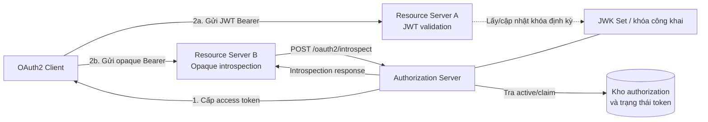
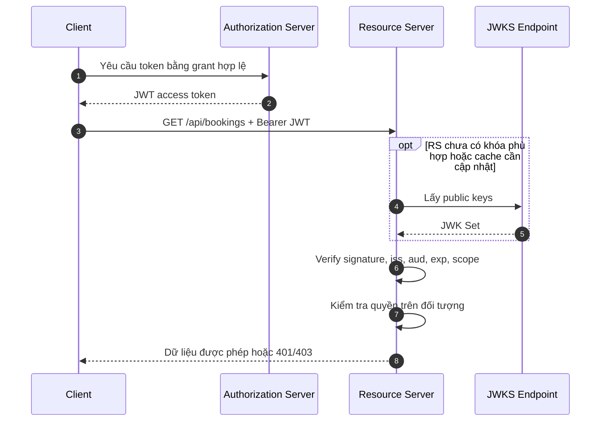
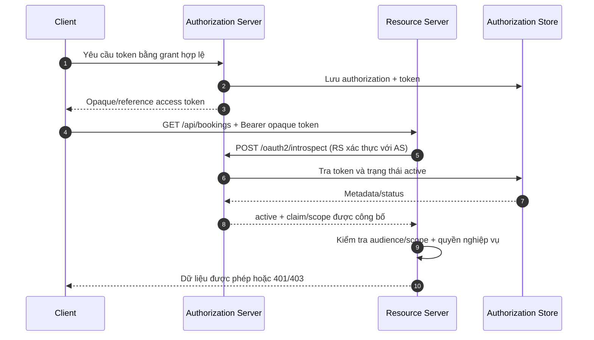
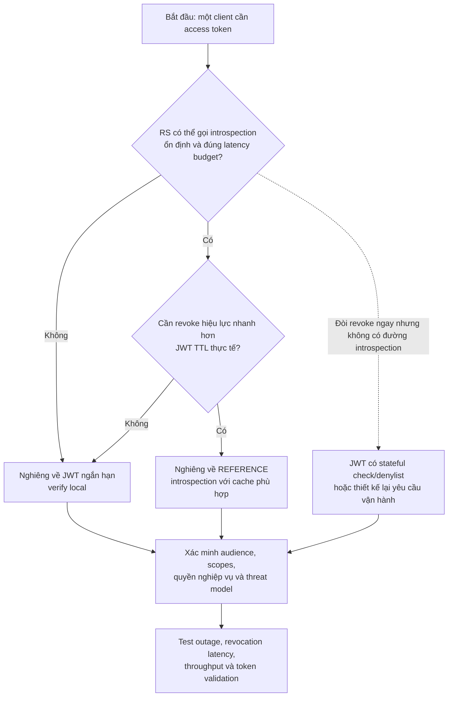

# Chọn access token dạng JWT hoặc reference theo nhu cầu

> **Chương:** Quản lý client  
> **Module:** `SPRING_SECURITY_OAUTH2_OIDC_AUTHORIZATION_SERVER`  
> **Bối cảnh:** Thiết kế, cấu hình, bảo mật, kiểm thử và vận hành OAuth 2.0/OpenID Connect Authorization Server bằng Spring Security và Spring Authorization Server trong ứng dụng Spring Boot.  
> **Phạm vi kỹ thuật:** Các ví dụ API Java hướng đến Spring Authorization Server 1.x và Spring Security 6.x; khi dùng nhánh Spring Security 7.x có Authorization Server tích hợp, cần đối chiếu package, dependency và API tương ứng với phiên bản đang chạy.

## 1. Mục tiêu học tập

Sau bài học, bạn có thể:

1. Phân biệt **self-contained JWT access token** và **reference (opaque) access token** theo cách xác minh, lưu trữ, thu hồi và phân phối thông tin.
2. Lựa chọn định dạng token dựa trên ràng buộc bảo mật, độ trễ, độ sẵn sàng, quy mô và mô hình vận hành thực tế.
3. Thiết lập `OAuth2TokenFormat.SELF_CONTAINED` hoặc `OAuth2TokenFormat.REFERENCE` qua `TokenSettings` trong `RegisteredClient` của Spring Authorization Server.
4. Cấu hình Resource Server để xác minh JWT bằng JWK Set hoặc kiểm tra opaque token qua token introspection.
5. Hiểu các giới hạn khi thu hồi token, xoay khóa, dùng bộ nhớ đệm, phân quyền theo scope và audience.
6. Thiết kế bài kiểm thử cho từng định dạng và nhận biết lỗi khi cùng một Authorization Server cấp token cho nhiều client khác nhau.

**Nguyên tắc đầu tiên:** OAuth 2.0 không quy định mọi access token phải là JWT. Theo góc nhìn của client, access token thường là một chuỗi để gửi tới Resource Server; **client không nên giải mã access token và dựa vào cấu trúc bên trong để điều khiển nghiệp vụ**. Định dạng và cách xác minh access token chủ yếu là thỏa thuận giữa Authorization Server (AS) và Resource Server (RS).

## 2. Hai định dạng đáp ứng cùng một mục đích

Sau khi hoàn tất một grant hợp lệ (Authorization Code + PKCE, Client Credentials hoặc grant được hỗ trợ khác), AS phát hành **access token** để client truy cập tài nguyên được bảo vệ.

### 2.1. JWT access token: token tự mang dữ liệu xác minh

JWT (JSON Web Token) thường có ba phần được mã hóa theo Base64URL, ngăn bởi dấu chấm:

```text
<base64url(header)>.<base64url(payload)>.<base64url(signature)>
```

Payload JWT có thể chứa các claim:

```json
{
  "iss": "https://auth.example.test",
  "sub": "user-123",
  "aud": ["booking-api"],
  "client_id": "booking-web",
  "scope": "booking.read",
  "iat": 1893455700,
  "exp": 1893456000,
  "jti": "example-token-id"
}
```

Đây là **payload minh họa**, không phải JWT có thể sử dụng. Hình dạng claim thực tế tùy AS, profile JWT, grant và cấu hình tùy biến. `sub` có thể biểu thị **người dùng** trong Authorization Code hoặc **client** trong Client Credentials; không được luôn coi `sub` là ID người dùng.

Resource Server có thể xác minh token **cục bộ**, nếu có khóa công khai hợp lệ và các quy tắc kiểm tra claim:

1. Kiểm tra chữ ký bằng khóa tin cậy từ AS (ví dụ JWKS).
2. Giới hạn thuật toán ký và nguồn khóa được cho phép.
3. Kiểm tra `iss`, thời hạn `exp`/`nbf` nếu có, và các ràng buộc thời gian thích hợp.
4. Kiểm tra `aud`: token thực sự dành cho API này.
5. Kiểm tra scope/authority và quy tắc nghiệp vụ, ví dụ quyền đọc **đúng booking** đang được yêu cầu.

**JWT được ký không đồng nghĩa với được mã hóa.** Header và payload của JWT thông thường có thể được đọc bởi ai có token. Chữ ký giúp phát hiện sửa đổi trái phép, nhưng không che giấu email, số điện thoại hoặc dữ liệu nhạy cảm. Vì thế phải **giảm dữ liệu claim** và dùng HTTPS; không nhét thông tin riêng tư vào JWT chỉ vì tiện lấy ra từ API.

### 2.2. Reference access token: chuỗi tham chiếu tới trạng thái ở AS

Với định dạng `REFERENCE` trong Spring Authorization Server, access token thường là **chuỗi opaque khó đoán**. Tự bản thân chuỗi không mang tập claim mà RS có thể đọc và tin cậy trực tiếp. AS giữ thông tin/token/authorization tương ứng trong kho lưu của nó; RS thường cần gọi **OAuth 2.0 Token Introspection (RFC 7662)** để AS xác nhận token có còn active và trả metadata được phép dùng.

Ví dụ giá trị token chỉ mang tính minh họa:

```text
r8fV9hN4fB7mC1xK6sQ0uA2eP5vR3yZ7
```

Giá trị opaque không nhất thiết có một độ dài cố định và không nên được client suy diễn thành dữ liệu danh tính. RS dựa vào **kết quả introspection được xác thực và nhận từ AS tin cậy**, không dựa vào cú pháp chuỗi.

Lợi ích chính là AS có thể quyết định token còn hiệu lực hay đã bị thu hồi trong thời điểm introspection. Đổi lại, RS phải có đường mạng ổn định tới AS và chịu thêm chi phí truy vấn, trừ khi có chính sách cache phù hợp.

### 2.3. Reference là một loại opaque; opaque không đồng nghĩa JWT bị giấu đi

Trong ngữ cảnh Spring Authorization Server:

- `OAuth2TokenFormat.SELF_CONTAINED`: access token tự chứa thông tin có thể xác minh, thường dùng JWT do `JwtGenerator` tạo.
- `OAuth2TokenFormat.REFERENCE`: access token là chuỗi tham chiếu, thường do `OAuth2AccessTokenGenerator` tạo; trạng thái token gắn với authorization được lưu ở AS.

Ở góc nhìn giao thức, các token opaque từ những nhà cung cấp khác có thể dùng cơ chế kiểm tra riêng. Bài này dùng từ **reference** theo tính năng của Spring Authorization Server, và **opaque** theo cách Resource Server tích hợp introspection.

**Cả JWT lẫn reference access token đều thường là Bearer token**: bên giữ token có thể sử dụng nó trong phạm vi token cho phép, trừ khi hệ thống thêm cơ chế ràng buộc bằng chứng sở hữu (sender-constrained token). Chuyển sang opaque không tự giải quyết rò rỉ Bearer token.

## 3. So sánh kiến trúc và luồng xác minh



Luồng cần được hiểu theo hai con đường độc lập:

**JWT, xác minh cục bộ:**



**Reference, introspection trực tuyến:**



RS có thể **cache** introspection response nếu chính sách cho phép. Khi đó không phải request nào cũng gọi AS; đổi lại kết quả cache có thể khiến việc thu hồi chưa có hiệu lực ngay tại RS.

## 4. Bảng quyết định JWT hay reference

| Tiêu chí | JWT self-contained | Reference/opaque + introspection | Câu hỏi cần hỏi |
| --- | --- | --- | --- |
| Xác minh tại RS | Thường xác minh chữ ký/claim cục bộ | Hỏi AS về trạng thái/metadata token | RS có luôn kết nối được AS không? |
| Độ trễ cho API | Thường thấp sau khi lấy khóa | Thêm round-trip introspection, có thể được cache | API có giới hạn latency nghiêm ngặt không? |
| Phụ thuộc AS trong mỗi request | Không cần nếu đã có khóa phù hợp và token hợp lệ | Thường cần AS nếu không có cache | AS mất kết nối thì API được hoạt động thế nào? |
| Thu hồi trước hạn | Không lập tức có hiệu lực khi RS chỉ tự xác minh | AS có thể trả `active: false` tại lần kiểm tra tiếp theo | Cần vô hiệu hóa quyền trong bao nhiêu giây? |
| Kích thước token | Thường lớn hơn do có header, claim, chữ ký | Thường là chuỗi ngắn hơn, tùy triển khai | Header/network có giới hạn kích thước không? |
| Dữ liệu claim lộ cho bên giữ token | Có thể đọc payload ký thông thường | Không suy ra claim chỉ từ chuỗi opaque | Có ràng buộc bảo mật dữ liệu trong token không? |
| Cập nhật quyền khi token còn hạn | Claim cũ có thể tồn tại đến hết hạn | Introspection có thể phản ánh thay đổi nếu AS chính sách/triển khai hỗ trợ | Cần đồng bộ quyền nhanh thế nào? |
| Tải lên AS | Chủ yếu khi phát token và lấy khóa/metadata | Phát token + lượng yêu cầu introspection | AS có đủ công suất và khả năng scale không? |
| Lưu trạng thái authorization | Vẫn có thể cần cho lifecycle/consent/revocation | Cần trạng thái token còn tra cứu được | Kho dữ liệu có HA và cleanup thích hợp không? |
| Xoay khóa ký | Phải quản lý JWK/`kid` và vòng đời khóa | RS không cần xác minh chữ ký của opaque token, nhưng vẫn cần TLS/client authentication với AS | Đội vận hành quản lý key rotation thế nào? |
| Tách mạng / offline RS | Phù hợp hơn nếu khóa công khai đã cache | Khó nếu RS không thể introspect | Có RS chạy ở edge hoặc mạng tách biệt không? |

**JWT không có nghĩa không thể thu hồi:** AS có thể ghi nhận revoke, RS có thể dùng denylist hoặc introspection bổ sung. Tuy nhiên **RS chỉ kiểm tra chữ ký/claim của JWT cục bộ sẽ không tự biết token vừa bị thu hồi**. Ngược lại, opaque không bảo đảm “revoke tức thời” nếu RS cache introspection hoặc AS chưa cập nhật trạng thái.

### 4.1. Khi nào nghiêng về JWT?

Ví dụ: Booking API có lưu lượng cao, nhiều instance, phân bố nhiều vùng mạng và yêu cầu độ trễ thấp. AS phát JWT access token ngắn hạn; các API nhận khóa công khai từ JWKS để xác minh.

Điều kiện bổ sung:

- API kiểm tra `iss`, `aud`, `exp` và scope/authority phù hợp.
- Chữ ký dùng thuật toán được chấp nhận và quy trình xoay khóa có kiểm soát.
- JWT chỉ chứa claim cần thiết, tránh PII.
- Chấp nhận cửa sổ token còn hiệu lực cho đến khi hết hạn hoặc thiết kế kiểm soát thu hồi riêng.
- Các thay đổi quyền đột xuất có cơ chế xử lý: TTL ngắn, kiểm tra nghiệp vụ trực tuyến, denylist hoặc cơ chế tương đương.

### 4.2. Khi nào nghiêng về reference?

Ví dụ: API quản trị có lưu lượng thấp hơn nhưng yêu cầu vô hiệu hóa token rất nhanh khi khách hàng khóa tài khoản hoặc ứng dụng bị thu hồi quyền. RS có kết nối nội bộ ổn định đến AS; nhóm vận hành chấp nhận tăng tải introspection.

Điều kiện bổ sung:

- Bật và bảo vệ endpoint introspection.
- RS có thông tin xác thực **riêng** để gọi introspection; không dùng thông tin đăng nhập của người dùng.
- Kho authorization/token có tính bền và HA phù hợp.
- Đặt timeout, retry có giới hạn, circuit breaker hoặc phương án giảm tải tương ứng.
- Quy định chính xác cache TTL và mức độ chậm trễ có thể chấp nhận của revocation.
- Thiết kế **fail closed** khi không xác minh được token, thay vì tự cho qua vì AS tạm thời không trả lời.

### 4.3. Khi nào nên cân nhắc cả hai?

Một AS có thể phục vụ nhiều `RegisteredClient` và chọn định dạng **theo từng client**. Ví dụ ứng dụng web có access token JWT cho API đọc thường xuyên; một client tích hợp nội bộ có reference token để AS kiểm tra trực tuyến.

Lưu ý: `TokenSettings.accessTokenFormat` đặt ở **RegisteredClient**. Không có nghĩa mỗi Resource Server tùy ý quyết định format cho cùng một access token. Khi một client gọi nhiều API, phải thống nhất thiết kế **audience**, quyền, định dạng và cơ chế xác minh tương ứng; nếu cần thay đổi theo từng API/token request, phải thiết kế giao thức và tùy biến AS có chủ đích.

## 5. Định dạng access token trong Spring Authorization Server

Trong Spring Authorization Server 1.x, định dạng được cấu hình qua:

- `RegisteredClient`: bản đăng ký của OAuth2 client.
- `TokenSettings`: chính sách lifetime, format và tùy chọn vòng đời token.
- `OAuth2TokenFormat.SELF_CONTAINED` hoặc `OAuth2TokenFormat.REFERENCE`.
- `RegisteredClientRepository`: lưu bản đăng ký client, ví dụ in-memory hoặc JDBC.
- `OAuth2AuthorizationService`: lưu authorization và trạng thái token; đặc biệt quan trọng khi RS introspection opaque token.
- `OAuth2TokenGenerator`: thành phần tạo access token, refresh token, ID token tùy grant và config. Thiết lập mặc định thường có JWT generator cho self-contained và access-token generator cho reference.

### 5.1. Cấu hình hai client có token format khác nhau

Đoạn Java sau minh họa thiết kế **client riêng biệt**, dùng `client_credentials` để tập trung vào khác biệt token format. Hàm nhận secret từ nguồn cấu hình an toàn; **không hardcode secret production vào source code**.

```java
import java.time.Duration;
import java.util.UUID;

import org.springframework.security.crypto.password.PasswordEncoder;
import org.springframework.security.oauth2.core.AuthorizationGrantType;
import org.springframework.security.oauth2.core.ClientAuthenticationMethod;
import org.springframework.security.oauth2.server.authorization.client.RegisteredClient;
import org.springframework.security.oauth2.server.authorization.settings.OAuth2TokenFormat;
import org.springframework.security.oauth2.server.authorization.settings.TokenSettings;

public final class ClientRegistrationFactory {

    private ClientRegistrationFactory() {}

    public static RegisteredClient createServiceClient(
            String clientId,
            String rawSecretFromSecureConfig,
            OAuth2TokenFormat format,
            PasswordEncoder passwordEncoder) {

        return RegisteredClient.withId(UUID.randomUUID().toString())
            .clientId(clientId)
            .clientSecret(passwordEncoder.encode(rawSecretFromSecureConfig))
            .clientAuthenticationMethod(
                ClientAuthenticationMethod.CLIENT_SECRET_BASIC)
            .authorizationGrantType(
                AuthorizationGrantType.CLIENT_CREDENTIALS)
            .scope("booking.read")
            .tokenSettings(TokenSettings.builder()
                .accessTokenFormat(format)
                .accessTokenTimeToLive(Duration.ofMinutes(5))
                .build())
            .build();
    }
}
```

Sử dụng:

```java
RegisteredClient fastApiClient =
    ClientRegistrationFactory.createServiceClient(
        "reporting-service",
        reportingSecretFromVault,
        OAuth2TokenFormat.SELF_CONTAINED,
        passwordEncoder
    );

RegisteredClient revocableClient =
    ClientRegistrationFactory.createServiceClient(
        "admin-integration",
        adminIntegrationSecretFromVault,
        OAuth2TokenFormat.REFERENCE,
        passwordEncoder
    );
```

Đây là mã **minh họa cách tạo hai cấu hình**. Hệ thống thực tế cần lưu cả hai qua `RegisteredClientRepository` phù hợp và duy trì ID ổn định giữa các lần triển khai; **không tái tạo ID client mới bằng `UUID.randomUUID()` mỗi lần khởi động nếu dữ liệu client đã tồn tại**. Trong môi trường production, khóa ký, lưu trữ authorization/consent, HTTPS, client secret, rotation và policy vận hành cũng cần được thiết lập.

Nếu dùng Authorization Code + PKCE, `RegisteredClient` phải đăng ký **grant type**, **redirect URI**, scope và các ràng buộc PKCE phù hợp. Việc đổi `SELF_CONTAINED` sang `REFERENCE` **không thay thế** quy tắc bảo mật ở authorization endpoint.

### 5.2. Giá trị mặc định và quyền kiểm soát version

Trong nhánh Spring Authorization Server 1.x, `TokenSettings` mặc định sử dụng định dạng **self-contained** cho access token. Vì tính năng có thể thay đổi giữa các thế hệ, một dự án yêu cầu hành vi ổn định nên ghi rõ format trong cấu hình client và có test xác nhận.

`JwtGenerator` thường phục vụ access token self-contained (JWT) và ID token OIDC. `OAuth2AccessTokenGenerator` có thể tạo access token reference. Khi tùy biến bean `OAuth2TokenGenerator`, hãy kiểm tra chain generator vẫn hỗ trợ **cả những loại token và format mà client cần**. Một customization sai có thể dẫn tới token endpoint không cấp được token hoặc ID token cần thiết.

### 5.3. Áp dụng cho client đăng ký bằng JDBC

`JdbcRegisteredClientRepository` lưu cấu hình `RegisteredClient`, gồm `TokenSettings`. Điều này có nghĩa:

1. Format là **chính sách của client registration**, không phải quyết định ngẫu nhiên ở mỗi HTTP request.
2. Khi sửa format từ JWT sang reference, cần lưu thay đổi vào repository bằng thao tác quản trị được kiểm soát.
3. **Token đã cấp trước đó không tự chuyển định dạng.** Một JWT cũ có thể còn hiệu lực đến khi hết hạn; RS cần kế hoạch xử lý khoảng giao thoa.
4. Nếu AS có nhiều instance, tất cả phải nhìn thấy cấu hình client nhất quán.
5. Format có thể được áp dụng vào lần cấp token mới; cần test xác minh chính sách khi refresh token phát hành access token mới, nếu hệ thống cho phép refresh.

Không sửa `tokenSettings` trong database bằng tay khi chưa nắm định dạng serialize và cơ chế migration của phiên bản đang dùng. Quản lý cấu hình qua ứng dụng/tooling có validation, audit và roll-back rõ ràng.

## 6. Resource Server xác minh JWT

Một Resource Server dùng Spring Security OAuth2 Resource Server có thể cấu hình JWT qua issuer:

```yaml
spring:
  security:
    oauth2:
      resourceserver:
        jwt:
          issuer-uri: https://auth.example.test
```

Từ issuer metadata, Spring Security có thể tìm JWK Set URI để tải khóa xác minh chữ ký; hành vi phát hiện khóa và khởi động phụ thuộc phiên bản/cấu hình. Nếu cấp `jwk-set-uri` tường minh, cần vẫn kiểm tra issuer và các claim bắt buộc.

Ví dụ giới hạn scope ở API:

```java
@Bean
SecurityFilterChain resourceServerSecurity(HttpSecurity http)
        throws Exception {

    return http
        .authorizeHttpRequests(authorize -> authorize
            .requestMatchers(HttpMethod.GET, "/api/bookings/**")
                .hasAuthority("SCOPE_booking.read")
            .anyRequest().authenticated())
        .oauth2ResourceServer(oauth2 ->
            oauth2.jwt(Customizer.withDefaults()))
        .build();
}
```

Khi dùng ánh xạ mặc định, claim scope hợp lệ của access token có thể tạo authority `SCOPE_booking.read`. Tuy nhiên đây mới là kiểm tra **được quyền gọi loại API nào**; Booking API còn phải kiểm tra dữ liệu có thuộc người dùng/tenant tương ứng hay không.

### 6.1. Kiểm tra audience là bắt buộc theo thiết kế

Không nhận một JWT chỉ vì nó được ký bởi **cùng một Authorization Server**. Giả sử AS cấp token cho `payment-api`; `booking-api` không được mặc nhiên chấp nhận token này.

Kiểm tra:

- `iss` là issuer dự kiến.
- Chữ ký và thuật toán được tin cậy.
- `aud` chứa audience của Resource Server hiện tại.
- Token chưa hết hạn, thỏa các ràng buộc thời gian.
- Scope/authority cho phép hành động cụ thể.
- Chủ thể, tenant và điều kiện nghiệp vụ phù hợp.

Trong Spring Security, cấu hình `issuer-uri` thường cung cấp kiểm tra issuer và claim thời gian mặc định, **không nên mặc định giả định audience luôn đã được kiểm tra**. Hãy cấu hình audience validator tường minh theo phiên bản Spring Security và định dạng token của hệ thống.

### 6.2. Xoay khóa JWT và TTL

RS có thể dùng JWK Set để xác minh token ký bằng khóa công khai. Khi xoay khóa theo chu kỳ:

1. AS xuất bản khóa công khai mới.
2. AS phát token mới với `kid` tương ứng.
3. RS lấy/cập nhật JWKS theo cơ chế cache.
4. Giữ khóa cũ đủ lâu để token hợp lệ đã ký bằng khóa cũ tiếp tục được xác minh, trừ khi cần thu hồi khẩn cấp.
5. Thu hồi khóa cũ đúng kế hoạch sau khi token liên quan hết hiệu lực.

Nếu khóa riêng bị lộ, phương án khẩn cấp có thể yêu cầu vô hiệu hóa khóa và chấp nhận việc token còn hạn bị từ chối. **Đổi khóa không phải cơ chế thu hồi chọn lọc một access token**; nó tác động lên toàn bộ token được ký bằng khóa đó.

TTL ngắn giúp giới hạn cửa sổ rủi ro của JWT tự xác minh, nhưng tăng số lần client yêu cầu token/refresh. Cần cân bằng với thời lượng request, retry, trải nghiệm người dùng và năng lực AS.

## 7. Resource Server xác minh reference token qua introspection

Với Spring Boot 3.x/Spring Security 6.x, Resource Server nhận opaque/reference token có thể dùng cấu hình:

```yaml
spring:
  security:
    oauth2:
      resourceserver:
        opaquetoken:
          introspection-uri: https://auth.example.test/oauth2/introspect
          client-id: booking-api-introspection
          client-secret: ${BOOKING_API_INTROSPECTION_SECRET}
```

`booking-api-introspection` ở đây là **client định danh Resource Server khi gọi introspection**, không nhất thiết là OAuth2 Client đã nhận access token ban đầu. Nó cần được AS đăng ký, xác thực và cấp quyền gọi introspection theo chính sách.

Đây là cấu hình riêng cho **Resource Server**, không phải cấu hình `TokenSettings` của client phát sinh token. Trên những phiên bản Spring Boot/Spring Security khác, hãy đối chiếu tên property và API.

### 7.1. Introspection diễn ra như thế nào?

Theo RFC 7662, RS gửi token đến AS qua HTTPS, kèm thông tin xác thực của RS theo cơ chế được AS hỗ trợ:

```http
POST /oauth2/introspect HTTP/1.1
Host: auth.example.test
Authorization: Basic <base64(introspection-client-id:client-secret)>
Content-Type: application/x-www-form-urlencoded

token=<opaque-access-token>&token_type_hint=access_token
```

Các giá trị trong ví dụ chỉ là placeholder. Không sao chép nguyên token, header Basic hoặc client secret thật vào log/console. `token_type_hint` hỗ trợ AS tìm nhanh loại token nhưng **không buộc AS phải tin hint** nếu dữ liệu thực tế khác.

Kết quả thành công có thể như sau:

```json
{
  "active": true,
  "scope": "booking.read",
  "client_id": "reporting-service",
  "token_type": "Bearer",
  "sub": "reporting-service",
  "aud": ["booking-api"],
  "exp": 1893456000,
  "iss": "https://auth.example.test"
}
```

Các claim này **không phải lúc nào cũng có đủ**; phải dựa vào AS đang triển khai và profile của token. RS cần xác định ràng buộc bắt buộc (audience, scope, tenant...) và **từ chối** nếu metadata không đủ cho quyết định bảo mật.

Với token không tồn tại, hết hạn, bị thu hồi hoặc không được AS công nhận, response hợp lệ về mặt introspection có thể là:

```json
{
  "active": false
}
```

Đừng phân biệt các lý do vô hiệu chi tiết bằng response gửi về bên không được phép biết. Đồng thời phải phân biệt:

- HTTP `200` với `active: false`: AS đã xử lý introspection và cho biết token không active.
- HTTP `401` khi introspection client credential sai: **RS không được xác thực với AS**; đây là lỗi cấu hình/vận hành.
- Timeout/`5xx` từ AS: **không có kết quả xác minh tin cậy**; không được coi token hợp lệ chỉ vì AS lỗi.

### 7.2. Cấu hình filter chain cho opaque token

```java
@Bean
SecurityFilterChain opaqueApiSecurity(HttpSecurity http) throws Exception {
    return http
        .authorizeHttpRequests(authorize -> authorize
            .requestMatchers(HttpMethod.GET, "/api/bookings/**")
                .hasAuthority("SCOPE_booking.read")
            .anyRequest().authenticated())
        .oauth2ResourceServer(oauth2 ->
            oauth2.opaqueToken(Customizer.withDefaults()))
        .build();
}
```

Ví dụ này **thay thế** phần `.jwt(...)` của chain JWT tương ứng; không áp dụng hai snippet làm hai bean chồng lấn cùng matcher một cách tùy tiện. Resource Server sẽ sử dụng bộ introspector đã cấu hình, tạo `Authentication` từ kết quả introspection và ánh xạ scope thành authority theo cơ chế Spring Security.

RS không cần hiểu cấu trúc reference token, cũng không cần trực tiếp truy vấn bảng authorization của AS. **Truy cập database AS trực tiếp từ RS không phải là cách thay thế an toàn cho introspection**, vì nó làm chặt phụ thuộc schema, bỏ qua logic xác minh và khó quản lý quyền.

### 7.3. AS phải lưu token đúng cách

Trên Spring Authorization Server 1.x, `OAuth2AuthorizationService` quản lý trạng thái authorization và token. Nếu chỉ dùng `InMemoryOAuth2AuthorizationService`, dữ liệu mất khi restart và không chia sẻ tự động giữa nhiều instance AS.

Đối với reference token trong production, hãy xem xét:

- Kho lưu bền vững hoặc phân tán phù hợp, ví dụ triển khai JDBC theo tài liệu Spring Authorization Server.
- Chỉ mục/khả năng tra cứu token an toàn và hiệu năng đủ cho tốc độ introspection.
- Dọn token hết hạn nhưng vẫn đảm bảo ngữ nghĩa token active/revoked.
- Xử lý đa instance và giao dịch cập nhật revoke/authorization.
- Bảo vệ database, backup, rotation credentials và phân quyền truy cập.
- Giám sát latency/lỗi của introspection, có autoscale/capacity planning.

Không dùng một bảng lưu opaque token như danh sách mật khẩu thô để thuận tiện quản trị; token là bearer credential và phải được bảo vệ khi lưu, truyền và vận hành.

## 8. Thu hồi token và thay đổi quyền

### 8.1. Thu hồi không đồng nghĩa với xóa một chuỗi khỏi client

OAuth 2.0 Token Revocation (RFC 7009) cho phép client yêu cầu AS thu hồi token theo chính sách. Trong Spring Authorization Server, trạng thái của token gắn với authorization có thể được điều chỉnh để không còn active tại AS.

Tuy nhiên, kết quả ở Resource Server phụ thuộc **phương thức xác minh**:

| Diễn biến | JWT RS chỉ verify local | Reference RS introspection mỗi request |
| --- | --- | --- |
| AS đã revoke access token | Có thể vẫn chấp nhận đến `exp` nếu chữ ký/claim vẫn hợp lệ | Lần introspection tiếp theo có thể trả `active: false` |
| User bị khóa tài khoản | JWT còn hạn có thể vẫn hợp lệ về mặt chữ ký/claim | Introspection có thể phản ánh thay đổi nếu AS chính sách/triển khai kiểm tra account status |
| Đổi scope của RegisteredClient | Token đã cấp vẫn giữ scope đã phát hành đến khi hết hiệu lực | AS có thể áp chính sách mới tại introspection nếu thiết kế hỗ trợ; không tự mặc định |
| RS cache kết quả introspection | Không áp dụng | Có cửa sổ stale theo TTL cache |
| AS tạm thời không truy cập được | RS có khóa và JWT hợp lệ vẫn có thể hoạt động | RS mất nguồn xác minh trực tuyến nếu không có cache còn hợp lệ |

**Chú ý quan trọng:** Reference token không bảo đảm mọi thay đổi quyền sẽ hiện ngay nếu introspection provider **chỉ trả metadata lưu lúc phát token** và không truy vấn chính sách người dùng hiện tại. Nếu nghiệp vụ cần khóa người dùng/tenant ngay, phải thiết kế thêm logic đồng bộ/kiểm tra trạng thái tại AS hoặc RS.

### 8.2. Kết hợp JWT TTL ngắn với chính sách nghiệp vụ

JWT có thể phù hợp cả trong hệ thống có yêu cầu bảo mật cao, nếu:

- Access token có TTL ngắn phù hợp.
- Những thao tác nhạy cảm yêu cầu kiểm tra quyền/đối tượng tại Resource Server.
- Thay đổi tài khoản/tenant nghiêm trọng kích hoạt denylist, token version hoặc cơ chế stateful phù hợp.
- Cơ chế refresh token có chính sách rotation/revocation và lưu giữ an toàn.
- Chính sách key rotation/incident response được kiểm thử.

Chi phí: tăng state hoặc thêm truy vấn khi dùng denylist/token version, làm giảm lợi ích “verify hoàn toàn local”. Không có một định dạng nào tối ưu tuyệt đối cho mọi mức độ bảo mật.

### 8.3. TTL và cache cho reference

Ví dụ chính sách mong muốn: “revoke token phải có tác dụng trong tối đa 30 giây”. Nếu RS cache introspection `active: true` trong 5 phút thì mục tiêu này **không đạt**, dù AS đánh dấu revoked ngay.

Cần xác định:

- Có cho cache `active: true` không? Nếu có, TTL tối đa bao nhiêu?
- TTL cache không được vượt thời gian hiệu lực còn lại của token.
- Có cache `active: false` không? Cần tính đến hành vi và rủi ro DoS.
- Khi AS timeout, hệ thống trả 401/503 theo contract vận hành nào? Dù chọn HTTP status nào, **không mở quyền truy cập**.
- Có dùng cơ chế invalidation đẩy sự kiện tới RS để giảm stale revocation không?
- AS có đủ tài nguyên để chịu tải introspection dưới tình huống peak và retry không?

Với endpoint yêu cầu thu hồi gần như tức thì, một số tác vụ có thể phải **bỏ cache**, chấp nhận RTT lớn hơn và thiết kế AS/DB HA kỹ lưỡng.

## 9. OIDC ID token và refresh token là hai vấn đề khác

Không lấy quyết định access token format để suy diễn định dạng token khác:

| Token | Mục đích | Đối tượng dùng | Quan hệ với JWT/reference |
| --- | --- | --- | --- |
| **Access token** | Client truy cập Resource Server | RS xác minh token | Có thể JWT self-contained hoặc reference/opaque |
| **ID token** | OIDC Client/Relying Party xác minh sự kiện đăng nhập và identity claims | OIDC Client | Theo OIDC, ID token là JWT; lựa chọn access token reference không biến ID token thành opaque |
| **Refresh token** | Client xin access token mới từ AS | Token endpoint của AS | Có vòng đời/format riêng; không phải Bearer token để gọi API |
| **Authorization code** | Đổi tại token endpoint sau authorization | OAuth2 Client + AS | Mã ngắn hạn, chỉ dùng một lần; không phải access token |

Khi nhận ID token qua OIDC và access token reference, ứng dụng **vẫn dùng ID token để xử lý login đúng vai trò RP** và gửi **access token** đến RS. Resource Server không được chấp nhận ID token làm API credential chỉ vì nó là JWT có chữ ký đúng của AS.

Client sử dụng Client Credentials thường **không có Resource Owner đang đăng nhập** trong request. Đừng suy từ `sub` hoặc `principalName` rằng token luôn đại diện user.

## 10. Case study: chọn format cho một hệ thống nhiều API

Giả sử nền tảng đặt phòng có ba nhóm client:

| Client | API sử dụng | Nhu cầu chính | Lựa chọn có thể phù hợp |
| --- | --- | --- | --- |
| `booking-web` (backend/BFF) | Booking API, Profile API | Lưu lượng cao, latency thấp, user login tương tác | JWT ngắn hạn; claim tối thiểu, audience kiểm soát |
| `internal-admin` | Admin API | Cần khóa phiên/truy cập nhanh khi nhân viên mất quyền | Reference + introspection ít cache, kết hợp kiểm tra quyền nghiệp vụ |
| `reporting-service` | Reporting API | Batch job, không có user tương tác, mạng nội bộ ổn định | JWT hoặc reference tùy yêu cầu revoke và tải AS |

**Không có quyết định cố định chỉ dựa trên tên client.** Ví dụ Admin API có thể dùng JWT + kiểm tra permission trong database ở mỗi hành động nhạy cảm; Reporting API có thể chọn reference nếu cần revoke tức thời. Phải xác định SLO về độ trễ, HA, latency thu hồi, mức độ nhạy cảm và chi phí vận hành.

### 10.1. Bảng yêu cầu trước khi chốt

| Câu hỏi | Ví dụ giá trị cần định nghĩa |
| --- | --- |
| Một token cần dùng trong bao lâu? | 5 phút, 15 phút; căn cứ mục tiêu và tải hệ thống |
| Thời gian tối đa để revoke có hiệu lực? | Vài giây, 30 giây, đến hết TTL |
| RS có thể gọi AS khi mỗi API request đến không? | Có trong cùng mạng; không ở edge/offline |
| Tải API dự kiến? | Request/giây, P95/P99 latency, tỷ lệ peak |
| AS/DB có SLA và capacity introspection? | Tính số request, cache TTL, lỗi và retry |
| Token được phép chứa dữ liệu gì? | ID kỹ thuật, scope, audience; hạn chế PII |
| Client gọi bao nhiêu API khác nhau? | Một hay nhiều audience |
| Ai có quyền quản lý revoke? | AS, admin security, event nghiệp vụ |
| Khi AS lỗi, RS sẽ phản hồi thế nào? | Fail closed; mã lỗi và retry policy xác định |
| Có yêu cầu audit và truy vết token? | Ghi token ID/metadata an toàn, không log raw token |

### 10.2. Cây quyết định tham khảo



Cây quyết định là **đề xuất đánh giá**, không thay thế risk assessment và yêu cầu tiêu chuẩn ngành nếu dự án phải tuân thủ.

## 11. Vận hành: di chuyển format mà không làm gãy client/RS

Giả sử một `RegisteredClient` đang nhận JWT; nhóm muốn đổi sang reference vì yêu cầu revoke:

1. **Kiểm kê Resource Server** nhận token của client. Chúng đang cấu hình JWT decoder hay opaque introspection?
2. **Đảm bảo RS hiểu format mới** trước khi AS phát token mới, hoặc triển khai giai đoạn tương thích có kiểm soát khi cần hỗ trợ cả hai.
3. **Đặt thời điểm đổi `TokenSettings.accessTokenFormat`** và cập nhật client registration nhất quán trên toàn bộ AS.
4. **Xử lý token đang tồn tại:** JWT đã phát hành có thể tiếp tục sống đến `exp` nếu RS còn chấp nhận; opaque mới cần introspection.
5. **Kiểm thử refresh/token exchange** nếu client có refresh token và cách thay đổi có thể ảnh hưởng token mới được cấp.
6. **Quan sát lỗi sau triển khai:** tỷ lệ 401/403, lỗi introspection, RTT, CPU/database AS và tỷ lệ refresh thất bại.
7. **Hoàn tất migration** khi token cũ hết hiệu lực và RS có thể bỏ cơ chế cũ theo kế hoạch.

Lựa chọn này không nhất thiết là một thay đổi “đổi một dòng YAML”: Spring Authorization Server chọn format từ **registered client**, còn Resource Server cần **phương thức xác minh tương thích**. Nếu đổi không đồng bộ, RS JWT có thể từ chối opaque token mới vì chúng không phải JWT; RS opaque có thể introspect JWT nếu AS hỗ trợ và được cấu hình, nhưng phải thử trên endpoint/provider thực tế.

Không phát cùng một access token cho nhiều audience không liên quan mà không thiết kế rõ ràng. Token bị đánh cắp từ API A có thể bị phát lại tới API B nếu B không kiểm tra audience chặt chẽ.

## 12. Kiểm thử theo format

### 12.1. Kiểm thử cấp token

| Tình huống | Kỳ vọng |
| --- | --- |
| Client `SELF_CONTAINED` xin token hợp lệ | Nhận access token JWT theo cấu hình, có chữ ký xác minh được |
| Client `REFERENCE` xin token hợp lệ | Nhận access token opaque, có bản ghi authorization để introspection |
| Client không đăng ký hoặc credential sai | AS từ chối theo lỗi OAuth2 thích hợp |
| Client chưa được phép dùng grant type/scope | AS từ chối hoặc chỉ cấp theo chính sách; không vượt đăng ký |
| Đổi token format trong `RegisteredClient` | Token **mới** dùng format mới, token **cũ** được xử lý theo chính sách migration |
| Token hết hạn hoặc grant/code không hợp lệ | Không cấp token mới trái phép |

Không coi “JWT có hai dấu chấm” là bằng chứng bảo mật duy nhất. Phải kiểm tra ký/xác minh bằng khóa tin cậy, issuer, audience, expiry và grant policy.

### 12.2. Kiểm thử Resource Server dùng JWT

- Chấp nhận JWT được AS ký, còn hạn, issuer đúng, audience đúng và scope phù hợp.
- Từ chối JWT sửa payload sau ký hoặc sai chữ ký.
- Từ chối issuer không được tin cậy.
- Từ chối token có audience của API khác.
- Từ chối token hết hạn (theo clock skew đã cấu hình).
- Từ chối token thiếu scope.
- Từ chối dữ liệu không thuộc user/tenant, kể cả khi token có scope.
- Kiểm tra key rotation với token ký bằng khóa cũ/mới theo kế hoạch.

Mock authentication bằng `spring-security-test` có thể kiểm tra luật `hasAuthority(...)`, nhưng **không chứng minh JWT thật đã vượt qua signature/issuer/audience validator**. Để kiểm tra toàn bộ đường đi phải dùng token thật hoặc test tích hợp có signer/decoder thực sự.

### 12.3. Kiểm thử Resource Server dùng reference

- AS trả `active: true`, scope/audience đúng → yêu cầu được xử lý theo quyền.
- AS trả `active: false` → RS từ chối.
- AS timeout/`5xx` → không mở quyền (fail closed); kiểm tra response và retry của hệ thống.
- Credential introspection của RS không hợp lệ → lỗi xác thực introspection, không coi token active.
- Token bị revoke → xác minh thời gian có hiệu lực tại RS theo mức cache đã quy định.
- AS restart/multi-instance → token còn hiệu lực vẫn tra được từ kho authorization bền vững.
- Nhiều RS có client-id/secret introspection riêng → quyền và audit được tách đúng.
- Token có `aud` của API khác → RS từ chối nếu hệ thống yêu cầu ràng buộc audience.
- Scope hợp lệ nhưng user/tenant không được xem đối tượng → RS từ chối ở tầng nghiệp vụ.

### 12.4. Test sai định dạng

Ví dụ ứng dụng `booking-api` dùng `oauth2ResourceServer().jwt(...)` nhưng AS đổi client sang `REFERENCE`. Kết quả thường là request tới API trả 401 vì token không parse/verify được theo JWT. Trong lúc migration, đây là tín hiệu sai **thỏa thuận token format giữa AS và RS**, không nhất thiết do scope.

Ngược lại, nếu RS đang dùng introspection nhưng AS không có endpoint/authorization store phù hợp, request có thể lỗi ngay cả với Bearer token hợp lệ về mặt cú pháp. Phải kiểm tra deployment và contract, không chỉ thay `AuthenticationEntryPoint` để “nuốt” lỗi.

## 13. Các lỗi thiết kế cần tránh

| Sai lầm | Hệ quả | Cách sửa |
| --- | --- | --- |
| Nghĩ JWT là bí mật vì đã được ký | Lộ claim cho bên giữ token | Hạn chế claim, tránh PII; nếu cần confidentiality, thiết kế phù hợp thay vì dựa vào chữ ký |
| JWT Resource Server không kiểm tra `aud` | Token dành cho API khác có thể bị chấp nhận | Validate audience theo đúng API |
| Nghĩ revoke JWT ở AS sẽ lập tức khóa tại mọi RS | RS verify local vẫn chấp nhận đến expiry | TTL ngắn, denylist/stateful check hoặc introspection nếu cần |
| Cache introspection `active: true` quá lâu | Revoke chậm có hiệu lực | Chọn cache TTL theo yêu cầu revoke/expiry |
| Khi introspection timeout thì cho request đi tiếp | Bỏ qua xác thực lúc AS lỗi | Fail closed, thiết kế HA/circuit breaker và thông báo lỗi thích hợp |
| Dùng thông tin đăng nhập của OAuth2 user để introspect | Trộn trách nhiệm và rủi ro credential | Cấp client credential riêng cho Resource Server |
| Lưu client secret/JWT/opaque token vào log | Có thể chiếm quyền Bearer | Mask/redact, chỉ log metadata tối thiểu |
| Tự parse opaque string để tìm user ID | Dữ liệu không có ý nghĩa đáng tin cậy | Gọi introspection qua AS đáng tin cậy |
| Dùng ID token làm access token | Sai đối tượng nhận/mục đích token | Client xác minh ID token; RS xác minh access token |
| Cấu hình JWT decoder cho RS nhận reference | 401 hàng loạt sau khi đổi format | Chuẩn bị và triển khai đường xác minh tương ứng |
| Tin scope nghĩa là được xem mọi bản ghi | BOLA/IDOR | Kiểm tra chủ sở hữu/tenant/quyền nghiệp vụ |
| Chọn `REFERENCE` nhưng AS lưu token chỉ trong memory một instance | Mất trạng thái khi restart, introspection không nhất quán | Dùng kho authorization có HA/persistence phù hợp |
| Đưa thông tin nhạy cảm từ database vào JWT để giảm API call | Khó thu hồi dữ liệu đã lộ, claim cũ tồn tại | Claim tối thiểu, truy vấn dữ liệu nghiệp vụ ở RS khi cần |

## 14. Câu hỏi tự kiểm tra

**Câu 1.** Một Resource Server cần hoạt động khi tạm mất kết nối tới Authorization Server. Nên cân nhắc JWT hay reference?

**Gợi ý trả lời:** JWT được xác minh cục bộ bằng khóa công khai đã cache phù hợp hơn. Nhưng vẫn cần kiểm tra issuer, audience, expiry, scope và cân nhắc hạn chế revocation.

**Câu 2.** Spring Authorization Server lưu lựa chọn `SELF_CONTAINED`/`REFERENCE` ở đâu?

**Đáp án:** Trong `TokenSettings` của từng `RegisteredClient`, qua `accessTokenFormat(...)`; registration được lưu bởi `RegisteredClientRepository`.

**Câu 3.** Nếu access token là opaque, Resource Server lấy scope từ đâu?

**Đáp án:** Từ kết quả token introspection (hoặc cơ chế xác minh đã thỏa thuận), không phải bằng cách tự giải mã chuỗi opaque.

**Câu 4.** Vì sao reference token không bảo đảm revoke “tức thời” ở Resource Server?

**Đáp án:** AS có thể xác nhận token không active khi introspect, nhưng RS có thể đang cache kết quả `active: true` và chỉ tra lại sau TTL.

**Câu 5.** JWT Access Token và OIDC ID Token có thể dùng thay nhau vì cùng định dạng JWT không?

**Đáp án:** Không. ID token dành cho OIDC Client/RP xác minh sự kiện đăng nhập; access token dành cho Resource Server quyết định quyền truy cập API.

**Câu 6.** Nếu một client được đổi format từ JWT sang reference, các JWT đã cấp tự biến thành opaque token không?

**Đáp án:** Không. Chính sách mới tác động đến token được phát hành sau đó; token cũ cần được xử lý theo thời hạn và kế hoạch chuyển đổi.

**Câu 7.** Opaque token an toàn hơn JWT ở mọi mặt?

**Đáp án:** Không. Opaque tránh bộc lộ trực tiếp claim và hỗ trợ kiểm tra trạng thái online, nhưng tăng phụ thuộc mạng/AS; cả hai đều cần bảo vệ Bearer token và phân quyền nghiệp vụ.

## 15. Checklist trước khi đưa vào vận hành

- [ ] Đã xác định use case, loại grant, client, audience và Resource Server nhận token.
- [ ] Đã định nghĩa SLA thu hồi và tối đa chấp nhận stale authorization.
- [ ] Đã đánh giá latency và throughput của JWT verify hoặc introspection.
- [ ] Đã chốt access token TTL, chính sách refresh token và yêu cầu key rotation.
- [ ] `TokenSettings.accessTokenFormat` được cấu hình rõ cho từng `RegisteredClient`.
- [ ] RS được cấu hình đúng JWT decoder hoặc opaque introspector, có audience/scope validation.
- [ ] Với opaque, AS có authorization store bền vững, HA và introspection client credentials được quản lý an toàn.
- [ ] Với JWT, AS/JWKS có quy trình publish/rotate key, RS có kiểm thử chữ ký/issuer/audience.
- [ ] Đã kiểm thử revoke, expiration, AS outage, cache và chuyển format.
- [ ] Không ghi raw access token, refresh token, secret hay dữ liệu riêng tư không cần thiết vào log.
- [ ] Có kế hoạch migration để token cũ và token mới được xử lý nhất quán.
- [ ] Theo dõi bản vá bảo mật, release notes và giới hạn của phiên bản Spring Security/Spring Authorization Server đang triển khai.

## 16. Tài liệu và tiêu chuẩn tham khảo

Tài liệu chính thức nên được mở ở **đúng version** của dự án:

- [Spring Authorization Server — Core Model / RegisteredClient / TokenSettings](https://docs.spring.io/spring-authorization-server/reference/core-model-components.html)
- [Spring Authorization Server — Configuration Model](https://docs.spring.io/spring-authorization-server/reference/configuration-model.html)
- [Spring Authorization Server — Protocol Endpoints](https://docs.spring.io/spring-authorization-server/reference/protocol-endpoints.html)
- [Spring Security — OAuth 2.0 Resource Server JWT](https://docs.spring.io/spring-security/reference/servlet/oauth2/resource-server/jwt.html)
- [Spring Security — OAuth 2.0 Resource Server Opaque Token](https://docs.spring.io/spring-security/reference/servlet/oauth2/resource-server/opaque-token.html)
- [RFC 7662 — OAuth 2.0 Token Introspection](https://www.rfc-editor.org/rfc/rfc7662)
- [RFC 7009 — OAuth 2.0 Token Revocation](https://www.rfc-editor.org/rfc/rfc7009)
- [RFC 6750 — Bearer Token Usage](https://www.rfc-editor.org/rfc/rfc6750)
- [RFC 9068 — JWT Profile for OAuth 2.0 Access Tokens](https://www.rfc-editor.org/rfc/rfc9068)

## 17. Kết luận

**JWT** phù hợp khi Resource Server cần xác minh cục bộ, có tải cao hoặc không bảo đảm truy cập liên tục tới AS, với điều kiện quản lý claim, khóa ký, audience, TTL và chính sách thu hồi rõ ràng. **Reference** phù hợp khi cần kiểm tra trạng thái token tập trung và dễ áp dụng revoke tại lần introspection tiếp theo, đổi lại độ trễ và phụ thuộc vào khả năng hoạt động của AS cùng kho lưu token.

Trong Spring Authorization Server, quyết định được thể hiện qua **`TokenSettings.accessTokenFormat` của `RegisteredClient`**. Dù chọn loại nào, thiết kế phải đồng thời xác định Resource Server xác minh ra sao, phản ứng khi AS lỗi, xử lý token đã cấp, bảo vệ Bearer token và kiểm tra quyền truy cập dữ liệu ở từng request. Đây mới là cơ sở đáng tin cậy để quản lý client và access token trong hệ thống OAuth 2.0/OIDC.

