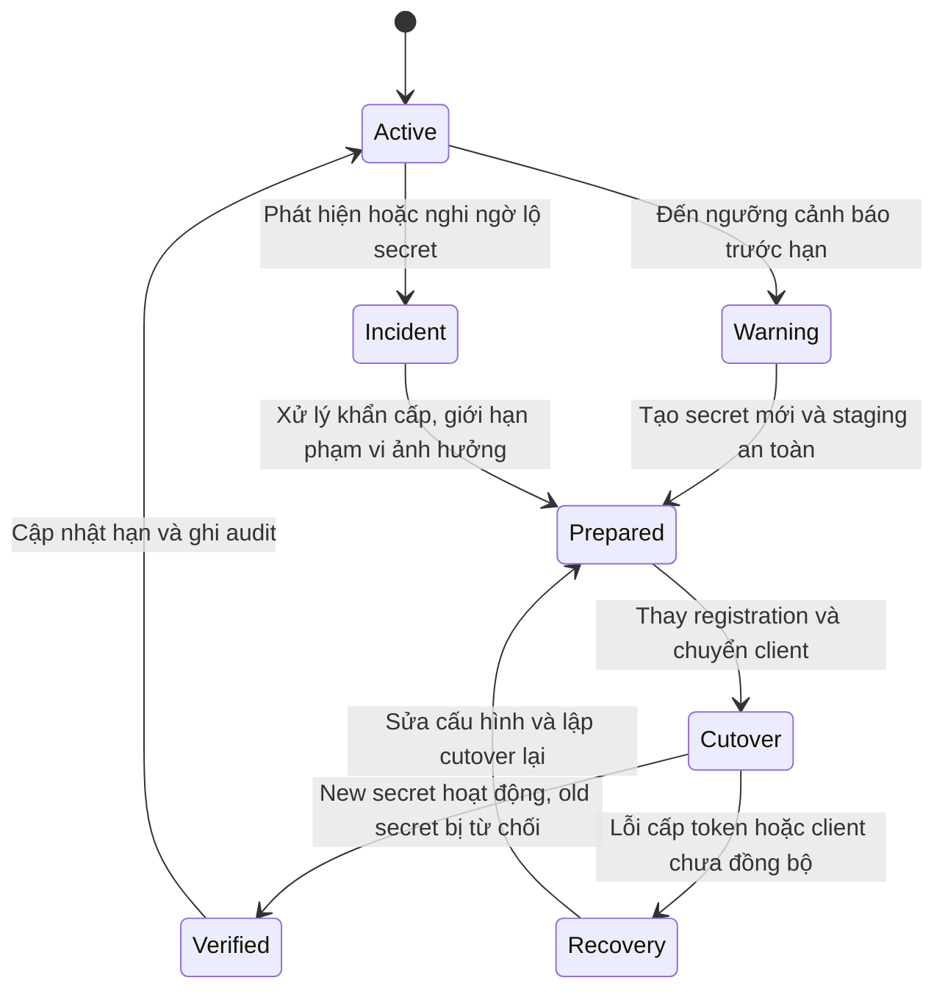

# Quản lý ngày hết hạn client secret và chính sách xoay secret

## 1. Vì sao client secret cần có vòng đời?

Trong chương **Quản lý client** của mô-đun **SPRING_SECURITY_OAUTH2_OIDC_AUTHORIZATION_SERVER**, một Authorization Server viết bằng **Spring Boot, Spring Security và Spring Authorization Server** không chỉ cần đăng ký client đúng lần đầu. Hệ thống còn phải quản lý cách cấp, lưu, hết hạn, thay thế và thu hồi **client secret** trong suốt thời gian ứng dụng hoạt động.

**Client secret** là thông tin xác thực được chia sẻ giữa Authorization Server và một **confidential client** có khả năng giữ bí mật ở phía server, chẳng hạn backend của ứng dụng web hoặc dịch vụ chạy nền. Nó giúp Authorization Server xác minh danh tính client khi nhận token request, revocation request hoặc introspection request theo cấu hình.

Giả sử dịch vụ `orders-batch` được đăng ký dùng grant `client_credentials` và có secret hợp lệ 90 ngày. Nếu quản trị viên chỉ đặt secret một lần rồi bỏ quên, có ít nhất hai vấn đề:

- **Rủi ro bí mật bị lộ tăng theo thời gian**: secret có thể bị sao chép vào log, cấu hình, backup, CI hoặc máy của thành viên cũ.
- **Nguy cơ gián đoạn hệ thống**: nếu secret có ngày hết hạn nhưng không có cảnh báo và kế hoạch thay thế, token request sẽ bắt đầu thất bại khi bí mật hết hạn.

Chính sách tốt phải giải quyết **cả bảo mật và khả năng vận hành**: xác định chủ sở hữu, thời hạn, cảnh báo, cách tạo secret mới, thời điểm chuyển đổi, xác minh, đường xử lý sự cố và dấu vết kiểm toán.

### Mục tiêu học tập

Sau bài này, bạn có thể:

1. Hiểu sự khác nhau giữa **hết hạn client secret**, **xoay secret**, **khóa client**, **thu hồi access/refresh token**.
2. Cấu hình `RegisteredClient.clientSecret` và `clientSecretExpiresAt` phù hợp với Spring Authorization Server.
3. Thiết kế chính sách hết hạn và lịch rotation theo mức độ rủi ro của client.
4. Thực hiện thay secret an toàn với repository bền vững và triển khai client đồng bộ.
5. Nhận diện giới hạn **một client secret được lưu trên mỗi `RegisteredClient`** trong mô hình mặc định, từ đó chọn chiến lược cutover phù hợp.
6. Kiểm thử các tình huống secret đúng, sai, hết hạn, đang xoay, và tác động lên token đã phát hành.

## 2. Phân biệt các thông tin xác thực và thời hạn

| Khái niệm | Dùng để làm gì? | Ai kiểm tra? | Liên quan đến rotation? |
| --- | --- | --- | --- |
| **Client secret** | Xác thực một confidential client | Authorization Server | Có, cần quy trình thay thế |
| **`clientSecretExpiresAt`** | Thời điểm secret đăng ký hết hiệu lực | Thành phần xác thực client của Authorization Server | Có, là thời hạn của secret, **không tự tạo secret mới** |
| **Authorization code** | Mã ngắn hạn để đổi token trong Authorization Code Flow | Token endpoint | Không phải client secret |
| **Access token** | Cho phép gọi Resource Server theo claim/scope | Resource Server | Có TTL độc lập; thay secret không tự làm JWT hết hạn |
| **Refresh token** | Đổi access token mới khi được phép | Token endpoint | Có vòng đời/thu hồi riêng; refresh request của confidential client vẫn cần client authentication |
| **Khóa ký JWT** | Ký JWT hoặc xác minh chữ ký qua public key | Authorization Server / Resource Server | Có quy trình **key rotation** riêng |
| **Mật khẩu người dùng** | Xác thực Resource Owner | Hệ thống đăng nhập | Không được nhầm với client secret |

**Ví dụ:** client secret hết hạn lúc 10:00 thì token request mới gửi secret đó có thể bị từ chối. Một access token JWT phát hành lúc 09:55 với `exp=10:10` **không tự mất chữ ký hợp lệ vào 10:00 chỉ vì secret của client hết hạn**. API kiểm tra JWT cục bộ vẫn có thể chấp nhận access token đến 10:10 nếu các điều kiện xác minh khác đều đúng và không có cơ chế thu hồi bổ sung.

Với **SPA và ứng dụng mobile**, mã được phân phối đến thiết bị người dùng không thể giữ client secret an toàn. Loại client này thường dùng `ClientAuthenticationMethod.NONE` và Authorization Code + PKCE. **Không triển khai chính sách client secret cho một public client bằng cách nhúng bí mật vào JavaScript hoặc APK.**

## 3. Mô hình `RegisteredClient` hỗ trợ những gì?

Spring Authorization Server dùng `RegisteredClient` để lưu cấu hình liên quan tới xác thực và cấp quyền của từng client. Các thuộc tính quan trọng cho bài học:

| Thuộc tính | Mục đích |
| --- | --- |
| `id` | ID nội bộ dùng bởi `RegisteredClientRepository` và các authorization liên quan |
| `clientId` | Định danh công khai client gửi tới Authorization Server |
| `clientSecret` | Secret **đã được mã hóa một chiều (hash/encoded)** để server so khớp khi xác thực |
| `clientSecretExpiresAt` | `Instant` mô tả thời điểm secret hết hạn; có thể không được đặt |
| `clientAuthenticationMethods` | Cách client chứng minh danh tính, ví dụ `client_secret_basic`, `client_secret_post` hoặc `private_key_jwt` |
| `authorizationGrantTypes` | Những grant client được phép sử dụng, ví dụ `authorization_code`, `refresh_token`, `client_credentials` |
| `scopes`, `clientSettings`, `tokenSettings` | Phạm vi cấp quyền và chính sách cấp token, độc lập với secret expiry |

API quan trọng là:

```java
Instant expiresAt = registeredClient.getClientSecretExpiresAt();
String storedHash = registeredClient.getClientSecret();
String clientId = registeredClient.getClientId();
```

**Lưu ý về giá trị rỗng:** `clientSecretExpiresAt == null` nghĩa là registration **không chỉ định ngày hết hạn cho client secret**. Không đồng nghĩa secret an toàn mãi mãi; một tổ chức vẫn có thể áp dụng deadline ở tầng chính sách vận hành. Nếu secret đã hết hạn, cơ chế client-secret authentication của Spring Authorization Server từ chối yêu cầu dùng secret ấy (thường trả lỗi giao thức `invalid_client`).

**Một giới hạn quan trọng:** `RegisteredClient` mặc định có **một trường `clientSecret` và một trường `clientSecretExpiresAt`**, không phải danh sách các phiên bản secret đang hoạt động. Gọi `RegisteredClient.from(existing).clientSecret(newHash)` sẽ thay thế secret lưu trên registration; secret cũ không tiếp tục được xác thực bởi cơ chế mặc định chỉ vì chưa đến thời hạn cũ. Việc chấp nhận **hai secret song song** cần thiết kế thêm, trình bày ở phần chiến lược rotation.

### 3.1. Ví dụ đăng ký confidential client có ngày hết hạn

Đoạn cấu hình Spring Boot bên dưới tạo một client minh họa `orders-batch`. Password encoder có định dạng `{id}...` để tương thích với cách xác thực client secret thường dùng trong Spring Security.

```java
import java.time.Duration;
import java.time.Instant;
import java.util.UUID;

import org.springframework.context.annotation.Bean;
import org.springframework.security.crypto.factory.PasswordEncoderFactories;
import org.springframework.security.crypto.password.PasswordEncoder;
import org.springframework.security.oauth2.core.AuthorizationGrantType;
import org.springframework.security.oauth2.core.ClientAuthenticationMethod;
import org.springframework.security.oauth2.server.authorization.client.RegisteredClient;
import org.springframework.security.oauth2.server.authorization.client.RegisteredClientRepository;
import org.springframework.security.oauth2.server.authorization.client.InMemoryRegisteredClientRepository;

@Bean
PasswordEncoder clientSecretPasswordEncoder() {
    return PasswordEncoderFactories.createDelegatingPasswordEncoder();
}

@Bean
RegisteredClientRepository registeredClientRepository(PasswordEncoder encoder) {
    // Chỉ dùng giá trị này trong phòng lab; production phải cấp từ secret manager.
    String demoSecret = "demo-only-change-me";

    RegisteredClient ordersBatch = RegisteredClient.withId(UUID.randomUUID().toString())
            .clientId("orders-batch")
            .clientSecret(encoder.encode(demoSecret))
            .clientSecretExpiresAt(Instant.now().plus(Duration.ofDays(90)))
            .clientAuthenticationMethod(ClientAuthenticationMethod.CLIENT_SECRET_BASIC)
            .authorizationGrantType(AuthorizationGrantType.CLIENT_CREDENTIALS)
            .scope("orders.read")
            .build();

    return new InMemoryRegisteredClientRepository(ordersBatch);
}
```

Trong môi trường thật, ưu tiên dùng `JdbcRegisteredClientRepository` (hoặc triển khai lưu trữ tương đương) để registration bền vững. **Không triển khai bean in-memory sinh lại ID, hash hoặc ngày hết hạn qua mỗi lần khởi động như nguồn dữ liệu production**. Đoạn code trên chỉ có nhiệm vụ cho thấy các field và cơ chế điền secret expiry.

### 3.2. Vì sao phải hash secret?

Authorization Server cần so khớp giá trị client gửi lên với giá trị được lưu. Không nên lưu secret rõ trong database, file cấu hình hay nhật ký. Dùng password encoder có chức năng hash và verify phù hợp:

```java
PasswordEncoder encoder = PasswordEncoderFactories.createDelegatingPasswordEncoder();

String stored = encoder.encode("temporary-secret-for-demo-only");
boolean accepted = encoder.matches("temporary-secret-for-demo-only", stored);
// accepted == true
```

Với DelegatingPasswordEncoder, dữ liệu lưu thường mang prefix như `{bcrypt}...` để verifier biết thuật toán. Tránh viết `.clientSecret("plaintext")` hoặc tự hash bằng SHA-256 không muối. **Hash trong database không thay nhu cầu bảo vệ secret gốc khi cấp phát và cấu hình phía client**: secret gốc vẫn phải được truyền qua kênh tin cậy, lưu trong secret manager và chỉ được các service được phép đọc.

## 4. Chính sách hết hạn và rotation: cần quyết định những gì?

Không có quy định chung trong OAuth 2.0 bắt mọi client secret phải hết hạn chính xác sau 30, 60 hoặc 90 ngày. Thời hạn cần dựa trên phân loại rủi ro, yêu cầu của tổ chức, khả năng tự động hóa và hậu quả nếu client tạm thời không lấy được token.

Một chính sách thực tế cần định nghĩa:

| Nội dung chính sách | Ví dụ quy tắc | Vì sao cần? |
| --- | --- | --- |
| **Chủ sở hữu client** | Nhóm vận hành và người dự phòng rõ ràng | Có người chịu trách nhiệm nhận cảnh báo/cutover |
| **Thời gian tồn tại tối đa** | 90 ngày cho client thông thường; ngắn hơn nếu rủi ro cao | Giới hạn tuổi secret, nhưng phải cân đối khả năng triển khai |
| **Cảnh báo trước hạn** | 30, 14, 7, 3, 1 ngày | Tránh đến hạn mới phát hiện |
| **Nguồn thời gian** | Lưu deadline ở UTC bằng `Instant` | Tránh nhầm múi giờ và đổi giờ hệ thống |
| **Sinh secret** | Bộ sinh ngẫu nhiên an toàn, độ mạnh tối thiểu 256 bit | Tránh secret dễ đoán hoặc tái sử dụng |
| **Phân phối** | Secret manager/CI có kiểm soát truy cập | Giảm rủi ro lộ secret qua chat, ticket hoặc source code |
| **Chuyển đổi** | Cutover có kế hoạch, xác minh token endpoint | Giảm gián đoạn dịch vụ |
| **Xử lý thất bại** | Phương án rollback/khôi phục được diễn tập | Tránh phải dùng lại secret đã lộ |
| **Audit** | Ai xoay, khi nào, client nào, kết quả, phiên bản key/secret | Điều tra và tuân thủ |
| **Rotation khẩn cấp** | Ngay khi nghi ngờ lộ, không đợi lịch | Giảm khoảng thời gian kẻ tấn công có thể dùng bí mật |

Ví dụ lịch **mang tính minh họa** cho deadline T:

```text
T - 30 ngày: gửi cảnh báo, xác minh owner và ứng dụng sử dụng client
T - 14 ngày: tạo change plan, xác định môi trường và các instance liên quan
T - 7  ngày: cấp secret mới trong kho bí mật, chuẩn bị cấu hình client
T - 1  ngày: kiểm tra khả năng đổi cấu hình và đường khôi phục
T          : thực hiện cutover có giám sát, xác minh bằng request thật
T + 1 giờ  : rà soát lỗi invalid_client, tỷ lệ cấp token, ghi nhận audit
```

Không nhất thiết chọn đúng ngày T để xoay. Thực hiện **trước hạn** thường tốt hơn, nhất là khi còn nhiều nhóm phải phối hợp. Sự cố bị lộ secret cần quy trình tức thời, không theo lịch này.

## 5. Chọn chiến lược xoay secret phù hợp

Vấn đề quan trọng nhất không chỉ là tạo secret mới. Bạn phải quyết định **cách Authorization Server và toàn bộ instance của client chuyển từ bí mật cũ sang bí mật mới**. Với một trường `clientSecret` mặc định, cập nhật registration là một thao tác thay thế giá trị đang được xác thực.

### 5.1. Ba phương án và đánh đổi

| Phương án | Client ID | Chấp nhận đồng thời secret cũ và mới? | Khi nào dùng? |
| --- | --- | --- | --- |
| **Thay trực tiếp trên `RegisteredClient`** | Giữ nguyên | **Không**, theo hành vi mặc định | Hệ thống ít instance, có cửa sổ cutover phối hợp được |
| **Đăng ký client thứ hai để chuyển dần** | Client ID mới | Có, nhưng thực chất là **hai client riêng** | Muốn triển khai song song và chấp nhận thay đổi định danh/phân quyền |
| **Tùy biến client authentication hỗ trợ nhiều phiên bản secret** | Có thể giữ nguyên | Có, **nếu tự xây và kiểm soát đúng** | Yêu cầu zero-downtime mà không thể đổi client ID; đổi lại có chi phí thiết kế/bảo mật cao |

**Không nên** tạo một chuỗi như `"hash_old,hash_new"` trong field `RegisteredClient.clientSecret` rồi mong framework tự thử hai hash. Nó sẽ không hoạt động như một danh sách secret được quản lý. Nếu cần nhiều secret cùng hiệu lực, thiết kế một kho phiên bản secret riêng, chính sách hạn/hủy từng phiên bản và một cơ chế client authentication phù hợp; phải kiểm thử chặt chẽ khả năng ngăn replay, secret bị lộ và truy cập trái phép.

**Không nên** đăng ký hai `RegisteredClient` có **cùng `clientId`** để giả lập dual-secret trong repository chuẩn. `clientId` là khóa tìm client; duplicate có thể gây xung đột hoặc hành vi không xác định. Với phương án client thứ hai, cần dùng một **client ID thực sự khác**, đánh giá lại scope, token policy, audience, tích hợp Resource Server và consent.

### 5.2. Quy trình cutover cho một secret trên mỗi RegisteredClient

Một phương án tối thiểu với repository mặc định:

1. **Lập danh sách bên sử dụng:** xác định client ID, môi trường, owner, tất cả instance/cron job/kết nối cần secret, grant type và endpoint đang dùng.
2. **Tạo secret ngẫu nhiên mới:** sinh bởi CSPRNG; cấp phát một lần qua kho bí mật, gắn mã phiên bản và quyền đọc tối thiểu. Không commit secret vào Git.
3. **Chuẩn bị client:** deploy khả năng đọc secret mới hoặc chọn phiên bản secret từ cấu hình mà không phải sửa mã nguồn; đảm bảo có thể chuyển cấu hình nhanh. Ở bước này AS vẫn đang xác thực secret cũ.
4. **Chốt cutover:** thay hash secret và ngày hết hạn trong `RegisteredClient` rồi kích hoạt cấu hình mới trên các client trong khoảng thời gian phối hợp. Với cơ chế mặc định, **không có thời gian giao nhau** mà cả hai secret đều hợp lệ. Các request dùng secret cũ trong khoảng chuyển đổi có thể thất bại với `invalid_client`.
5. **Xác minh ngay:** thực hiện token request hợp lệ bằng secret mới, xác nhận token được cấp; thực hiện một request âm tính với secret cũ sau cutover, xác nhận bị từ chối. Kiểm tra đồng thời tất cả instance và môi trường.
6. **Theo dõi và hoàn tất:** xem tỷ lệ lỗi, cảnh báo, việc cache secret cũ, cập nhật inventory, ghi audit và thu hồi quyền truy cập tới phiên bản secret cũ.

Khi hạ tầng hỗ trợ tự động hóa tốt, thao tác thay tại AS và bật cấu hình mới cho client nên được phối hợp trong một cửa sổ ngắn, có **kế hoạch khôi phục**. Tuy nhiên, không thể bảo đảm không có lỗi trong khoảng chuyển đổi nếu các request vẫn đến bằng secret cũ. Với yêu cầu availability nghiêm ngặt, cân nhắc phương án song song ở bảng trên.



**Ở trạng thái Prepared**, secret mới chỉ được staging trong vault/cấu hình client theo quyền truy cập đã chuẩn bị. **Nó chưa tự động có hiệu lực tại Authorization Server** cho đến khi được cập nhật vào registration theo phương án thay trực tiếp.

### 5.3. Khi cần khả năng chuyển đổi không gián đoạn

Có hai hướng thường dùng:

**Hướng A — Client ID song song.** Tạo `orders-batch-v2` với client ID mới, secret mới, grant và scope phù hợp; triển khai dần consumer sang v2; quan sát request và sau đó vô hiệu/xóa client cũ theo chính sách. Cần kiểm tra tác động của việc client ID mới tới token claim, Resource Server, audit, allowlist, billing/quota và các authorization cũ. Đây là **chuyển đổi giữa hai client**, không phải rotation trong một registration.

**Hướng B — Nhiều phiên bản secret trên cùng client ID.** Xây phần mở rộng xác thực client có kho `{clientId, secretVersion, secretHash, notBefore, expiresAt, revoked}` và cơ chế kiểm tra phù hợp, cho phép một cửa sổ overlap ngắn. Khi tất cả instance đã chuyển, vô hiệu phiên bản cũ. Phần mở rộng này cần đánh giá bảo mật, rate limiting, kiểm soát nhập sai, audit, thời gian hết hạn độc lập và test race condition. Không có sẵn chỉ bằng việc đặt `clientSecretExpiresAt`.

Nếu việc quản lý shared secret và cutover trở nên quá khó, có thể xem xét các phương thức client authentication mạnh hơn như `private_key_jwt` hoặc mTLS tùy yêu cầu và khả năng hỗ trợ. Chúng vẫn có **vòng đời khóa/chứng chỉ riêng**, không loại bỏ nhu cầu rotation.

## 6. Thực hành: sinh secret, lưu hash và thay registration

Các ví dụ sau minh họa **thao tác quản trị nội bộ** của Authorization Server. Chúng giả định bạn đã có một `RegisteredClientRepository` lưu bền vững, quyền quản trị phù hợp và một secret manager để cấp phát cho client. Không tạo endpoint rotation công khai từ các phương thức này khi chưa có authentication, authorization và audit chuyên biệt.

### 6.1. Sinh secret đủ ngẫu nhiên

Ví dụ Java sử dụng 32 byte ngẫu nhiên (256 bit), mã hóa bằng Base64URL không padding:

```java
import java.security.SecureRandom;
import java.util.Base64;

public final class ClientSecretGenerator {
    private static final SecureRandom RANDOM = new SecureRandom();

    private ClientSecretGenerator() {
    }

    public static String generate() {
        byte[] secretBytes = new byte[32];
        RANDOM.nextBytes(secretBytes);
        return Base64.getUrlEncoder()
                .withoutPadding()
                .encodeToString(secretBytes);
    }
}
```

Giá trị trả về dài khoảng 43 ký tự Base64URL. **Độ mạnh đến từ 32 byte ngẫu nhiên**, không phải chỉ từ độ dài ký tự. Đừng dùng `UUID.randomUUID()` hoặc chuỗi do người dùng tự đặt như một secret 256 bit; đừng ghi kết quả vào console hay log. Trong production, đặt secret vừa sinh vào secret manager theo một định danh phiên bản và chỉ cấp quyền truy cập cho service liên quan.

### 6.2. Cập nhật đúng registration đang tồn tại

Service sau chỉ mô tả phần **thay hash secret và hạn sử dụng**. Tại điểm gọi, hệ thống quản trị phải kiểm tra quyền, kiểm tra secret được sinh từ nguồn tin cậy, chuẩn bị phân phối an toàn và phối hợp cutover:

```java
import java.time.Instant;

import org.springframework.security.crypto.password.PasswordEncoder;
import org.springframework.security.oauth2.server.authorization.client.RegisteredClient;
import org.springframework.security.oauth2.server.authorization.client.RegisteredClientRepository;
import org.springframework.stereotype.Service;
import org.springframework.transaction.annotation.Transactional;

@Service
public class ClientSecretRotationService {
    private final RegisteredClientRepository clients;
    private final PasswordEncoder encoder;

    public ClientSecretRotationService(
            RegisteredClientRepository clients,
            PasswordEncoder encoder) {
        this.clients = clients;
        this.encoder = encoder;
    }

    @Transactional
    public void replaceSecret(
            String clientId,
            String newPlaintextSecret,
            Instant newExpiry) {
        if (newPlaintextSecret == null || newPlaintextSecret.isBlank()) {
            throw new IllegalArgumentException("Secret must not be empty");
        }
        if (newExpiry == null || !newExpiry.isAfter(Instant.now())) {
            throw new IllegalArgumentException("Expiry must be in the future");
        }

        RegisteredClient current = clients.findByClientId(clientId);
        if (current == null) {
            throw new IllegalArgumentException("Unknown client");
        }

        RegisteredClient updated = RegisteredClient.from(current)
                .clientSecret(encoder.encode(newPlaintextSecret))
                .clientSecretExpiresAt(newExpiry)
                .build();

        clients.save(updated);
    }
}
```

**Vì sao dùng `RegisteredClient.from(current)`?** Builder sao chép các field client hiện có như ID, grant type, redirect URI, scope và phương thức xác thực. Sau đó chỉ thay hai thuộc tính liên quan tới secret. Tạo `RegisteredClient.withId(UUID.randomUUID()...)` mỗi lần xoay sẽ làm thay đổi ID nội bộ, có thể gây mất liên hệ với authorization đã lưu.

**Các giới hạn của snippet:** `@Transactional` không tự đảm bảo xử lý an toàn mọi request xoay secret đồng thời hoặc mọi repository tự viết. Production cần chặn hai người xoay cùng client cùng lúc (khóa giao dịch hoặc optimistic locking phù hợp), ghi audit, xác minh giá trị secret mới từ secret manager và cập nhật trạng thái triển khai. Không truyền secret từ biểu mẫu không bảo vệ, không trả chuỗi secret trong error message và không log tham số `newPlaintextSecret`.

### 6.3. Xác minh sau cutover

Token endpoint thường xác thực client bằng HTTP Basic. Một yêu cầu `client_credentials` minh họa:

```http
POST /oauth2/token HTTP/1.1
Host: auth.example.com
Authorization: Basic BASE64(client_id:client_secret)
Content-Type: application/x-www-form-urlencoded

grant_type=client_credentials&scope=orders.read
```

Trong thực tế, giá trị `Authorization` phải được client tạo đúng theo quy tắc HTTP Basic của OAuth 2.0; chuỗi trên chỉ là ký hiệu giải thích. Dùng HTTPS và lấy client secret từ secret manager. Không lưu request chứa header xác thực vào ticket hoặc log. Các kiểm tra sau cutover:

| Thử nghiệm | Kỳ vọng |
| --- | --- |
| Client đúng + **secret mới** + grant được phép | Token endpoint cấp access token |
| Client đúng + **secret cũ** sau khi thay | Token endpoint từ chối xác thực client, thường `invalid_client` |
| Client đúng + secret mới nhưng **grant không được phép** | Bị từ chối theo chính sách client/grant |
| Client đúng + secret mới nhưng scope ngoài registration | Bị từ chối hoặc giới hạn theo chính sách server |
| Secret mới sau `clientSecretExpiresAt` | Token request bị từ chối khi xác thực client |
| Access token được cấp **trước** lúc xoay secret | Tiếp tục được Resource Server xử lý theo vòng đời token và chính sách thu hồi riêng |

Để test expiry, dùng đồng hồ có thể kiểm soát hoặc dữ liệu kiểm thử đặt hạn trong quá khứ trong môi trường cách ly. Không cố ý làm hết hạn client đang phục vụ traffic production chỉ để xác minh hành vi.

## 7. Theo dõi ngày hết hạn và cảnh báo chủ động

Không thể vận hành rotation ổn định nếu mỗi ngày phải mở database xem thủ công các client sắp hết hạn. Hãy xây **inventory và quy trình cảnh báo** dựa trên dữ liệu đã đăng ký.

### 7.1. Những thông tin cần quản lý

| Trường inventory | Nguồn | Ý nghĩa |
| --- | --- | --- |
| `clientId`, `id` | `RegisteredClient` | Xác định duy nhất client/registration |
| `clientSecretExpiresAt` | `RegisteredClient` | Deadline thực tế được AS kiểm tra |
| Authentication method | `RegisteredClient` | Xác định client có dùng shared secret không |
| Owner/team và người dự phòng | Hệ thống quản trị bên ngoài | Gửi cảnh báo và chỉ định người xử lý |
| Environment/service sử dụng | Inventory triển khai | Biết ứng dụng nào cần đổi cấu hình |
| `lastRotatedAt`, `secretVersion` | Bảng audit/secret manager | Theo dõi phiên bản và lần rotation gần nhất |
| `rotationStatus`, `changeId` | Quy trình vận hành | Biết yêu cầu thay secret đang ở bước nào |
| `lastVerifiedAt`, `lastVerifiedResult` | Hệ thống kiểm tra | Chứng minh secret mới đã được xác thực thành công |

**Đừng giả định** `RegisteredClient` có sẵn các trường như `lastRotatedAt` hoặc `ownerTeam`. Cần lưu chúng trong hệ thống quản trị hoặc bảng dữ liệu phụ, có khóa liên kết tới client ID/ID nội bộ. Cũng **đừng giả định** interface `RegisteredClientRepository` chuẩn có `findAll()`: nó tập trung vào `save`, `findById` và `findByClientId`. Để quét toàn bộ client sắp hết hạn, bạn phải có catalog/quản trị repository riêng hoặc truy vấn dữ liệu thích hợp.

Nếu sử dụng schema JDBC chính thức của Spring Authorization Server, cột lưu hạn secret thường là `client_secret_expires_at` trong bảng đăng ký client. Trước khi viết truy vấn SQL quản trị, đối chiếu schema thật của phiên bản framework và đặc điểm database đang vận hành.

### 7.2. Phân loại trạng thái dựa trên `Instant`

Ví dụ Java thuần cho tác vụ cảnh báo:

```java
import java.time.Clock;
import java.time.Duration;
import java.time.Instant;

public final class ClientSecretDeadlinePolicy {
    public enum Status {
        NO_DEADLINE, EXPIRED, CRITICAL, WARNING, HEALTHY
    }

    private ClientSecretDeadlinePolicy() {
    }

    public static Status classify(Instant expiresAt, Clock clock) {
        if (expiresAt == null) {
            return Status.NO_DEADLINE;
        }

        Instant now = clock.instant();
        if (!expiresAt.isAfter(now)) {
            return Status.EXPIRED;
        }
        if (!expiresAt.isAfter(now.plus(Duration.ofDays(7)))) {
            return Status.CRITICAL;
        }
        if (!expiresAt.isAfter(now.plus(Duration.ofDays(30)))) {
            return Status.WARNING;
        }
        return Status.HEALTHY;
    }
}
```

Tác vụ định kỳ lấy các client dùng shared secret từ inventory, kiểm tra deadline, liên kết owner và gửi cảnh báo theo quy trình nội bộ. Nếu deadline vắng mặt, `NO_DEADLINE` **không nên tự xem là HEALTHY**: hệ thống nên áp dụng chính sách phê duyệt ngoại lệ hoặc yêu cầu đặt hạn.

Thiết kế `Clock` có thể tiêm được giúp kiểm thử sát ranh giới thời gian, không phụ thuộc đồng hồ máy thật. Khi quan sát trạng thái, tính toán UTC và cân nhắc độ trễ clock giữa node. **Phân loại sức khỏe từ metadata không thay thế kết quả xác thực secret thực tế tại token endpoint**.

### 7.3. Chỉ số và cảnh báo vận hành

Tối thiểu nên quan sát:

- Số client dùng secret đã hết hạn, sắp hết hạn trong 7/30 ngày, chưa có deadline, và đang trong quy trình rotation.
- Tỷ lệ lỗi token endpoint thuộc nhóm `invalid_client`, thay đổi trước/sau cutover, có phân tách môi trường hoặc client nếu chính sách logging cho phép.
- Thời điểm lần cuối mỗi ứng dụng xác thực bằng secret mới thành công, để phát hiện cron job ít chạy vẫn còn dùng phiên bản cũ.
- Sự khác biệt trạng thái đăng ký client giữa các node/caches trong cluster.
- Lịch sử thao tác rotation: người thực hiện, kết quả, thời điểm, ID thay đổi và **tham chiếu phiên bản secret**, tuyệt đối không lưu secret rõ.

Ví dụ audit event có thể giữ:

```json
{
  "event": "client_secret_rotated",
  "client_id": "orders-batch",
  "actor": "authorized-admin-id",
  "occurred_at": "2026-11-16T08:00:00Z",
  "new_expires_at": "2027-02-14T08:00:00Z",
  "secret_version_reference": "vault-ref-version-42",
  "outcome": "verified"
}
```

Đây là **dữ liệu minh họa**, không phải format audit mặc định của Spring Authorization Server. Không thêm `secret_value`, Basic authorization header, token value hoặc hash secret vào log sự kiện. Cần bảo vệ cả audit metadata theo quy định quản trị.

## 8. Xử lý sự cố: secret hết hạn hoặc bị lộ

### 8.1. Secret hết hạn ngoài kế hoạch

Triệu chứng thường gặp là một client từng gọi `/oauth2/token` thành công bắt đầu nhận lỗi `invalid_client` hoặc HTTP 401 khi xác thực. Tuy nhiên, **`invalid_client` không chỉ có một nguyên nhân**: có thể do client ID sai, secret sai, phương thức client authentication không hợp lệ, registration không tồn tại hoặc secret đã hết hạn. Không kết luận ngay là expiry chỉ từ response bên ngoài.

Quy trình xử lý:

1. Kiểm tra `clientId`, authentication method, `clientSecretExpiresAt`, thời gian trên AS và trạng thái dữ liệu đã đồng bộ.
2. Xác nhận lỗi bắt đầu khi nào, ảnh hưởng bao nhiêu ứng dụng/instance, và còn cách cấp token hợp lệ nào khác.
3. Sinh một secret mới qua quy trình quản trị an toàn, đặt hạn mới, phối hợp cập nhật phía client và registration.
4. Thử token request thật từ môi trường đã chuyển, theo dõi `invalid_client` và các lỗi downstream.
5. Ghi sự cố và sửa chính sách cảnh báo để không lặp lại.

**Không mở rộng deadline vô thời hạn** như một thói quen để che sự cố vận hành. Nếu thật sự cần ngoại lệ, phải có owner, thời gian kết thúc và biện pháp bù đắp phù hợp.

### 8.2. Secret có dấu hiệu bị lộ

Trường hợp secret bị đưa vào source code công khai, log không an toàn, máy chủ bị xâm nhập hoặc nhóm không được phép có thể đọc được, quy trình **rotation khẩn cấp** phải ưu tiên ngăn kẻ tấn công tiếp tục xác thực:

1. Đánh giá phạm vi: client nào, môi trường nào, secret phiên bản nào, nguồn lộ và khoảng thời gian có thể bị khai thác.
2. Tạo và phân phối **secret hoàn toàn mới** qua đường an toàn; thay secret đang được AS chấp nhận càng sớm càng phù hợp với mức độ sự cố.
3. Giảm khả năng dùng secret đã lộ: từ chối secret cũ tại AS, xem xét khóa/giới hạn client nếu chưa thể cutover an toàn theo cơ chế bảo mật hiện có.
4. Rà soát các authorization/access token/refresh token đã phát hành cho client có khả năng bị ảnh hưởng; thực hiện revocation hoặc chính sách giảm thiểu nếu cần. Với JWT xác minh offline, việc vô hiệu ngay trên mọi Resource Server đòi hỏi chiến lược thu hồi riêng.
5. Thu dọn nguồn lộ: sửa pipeline, hạn chế quyền, xóa dữ liệu nhạy cảm tại các hệ thống phù hợp và thực hiện điều tra/audit.
6. Đưa client về trạng thái kiểm soát sau sự cố, đánh giá root cause và cải thiện kiểm thử/quy trình.

Trong sự cố nghi ngờ lộ, **không rollback bằng secret cũ đã bị nghi là compromised** để khôi phục dịch vụ. Phương án khôi phục nên dùng secret mới khác, hoặc biện pháp xác thực thay thế theo chính sách.

### 8.3. Thay secret không tương đương thu hồi token

Giả sử token endpoint đã cấp JWT access token hợp lệ trước thời điểm thay secret. Thay hash secret trong `RegisteredClient` làm thay đổi việc **client xác thực các request mới**; nó **không tự động**:

- thay claim `exp` của JWT đã phát hành;
- xóa mọi `OAuth2Authorization` còn lưu;
- hủy mọi refresh token đã tồn tại;
- khiến Resource Server đang chỉ xác minh JWT cục bộ biết rằng một token cần bị từ chối ngay.

Nếu security incident yêu cầu vô hiệu hóa token cũ, phải xử lý **vòng đời token** (revocation, introspection, thời hạn sống ngắn, danh sách từ chối hoặc cơ chế phù hợp), độc lập với việc xoay secret. Với refresh token của confidential client, việc đổi token mới còn phụ thuộc client authentication hiện hành và chính sách ràng buộc token–client.

## 9. Những lỗi thiết kế thường gặp

| Sai lầm | Hậu quả | Cách sửa |
| --- | --- | --- |
| Gắn client secret vào SPA/mobile | Secret có thể bị trích xuất | Dùng public client + Authorization Code/PKCE |
| Hard-code secret trong Git hoặc Docker image | Secret tồn tại lâu trong lịch sử và bản phân phối | Secret manager, inject runtime, quét nguồn và rotate khi lộ |
| Lưu `clientSecret` dạng plain text | Database leak làm lộ trực tiếp credential | Lưu hash bằng password encoder tương thích với provider |
| Không đặt `clientSecretExpiresAt` nhưng nghĩ framework tự xoay mỗi 90 ngày | Secret không có hạn kỹ thuật được cấu hình | Đặt deadline và scheduler quản trị |
| Chỉ sửa ngày hết hạn, không thay giá trị secret | Secret cũ vẫn là credential được chấp nhận | Sinh và thay secret thật theo rotation policy |
| Giả định `RegisteredClient` chứa hai secret | Cutover lỗi khi instance còn dùng secret cũ | Chọn kế hoạch chuyển đồng bộ, client ID song song hoặc custom verifier |
| Tạo client ID/registered ID mới khi chỉ muốn xoay secret | Đứt liên hệ với dữ liệu/cấu hình cũ | Dùng `RegisteredClient.from(current)` để giữ ID |
| Dùng `client_secret_post` rồi log request body | Secret bị ghi vào log | Ưu tiên `client_secret_basic` trên TLS, che header/body nhạy cảm |
| Chỉ kiểm thử request từ một instance | Các instance ít hoạt động vẫn dùng secret cũ | Xác minh theo fleet và chu kỳ công việc |
| Đồng nhất rotation với revoke token | JWT cũ vẫn có thể dùng | Thiết kế token revocation/expiry riêng |
| Không chia sẻ registration giữa các node | Lỗi `invalid_client` không đều giữa server | Dùng shared store, xử lý cache và quan sát đồng bộ |
| Ghi raw secret/Basic header vào metrics, log hoặc ticket | Rò rỉ credential qua hệ thống giám sát | Chỉ ghi ID client, kết quả, thời điểm và tham chiếu phiên bản an toàn |

Khi chẩn đoán `invalid_client`, Authorization Server cần trả lỗi giao thức phù hợp nhưng không tiết lộ quá nhiều thông tin cho bên chưa được xác thực. Hệ thống giám sát nội bộ có thể phân loại nguyên nhân sâu hơn **mà không lưu secret hoặc xác nhận bí mật hợp lệ cho người gọi không được phép**.

## 10. Kế hoạch kiểm thử chính sách hạn và xoay secret

Nên kiểm tra cả **trạng thái registration** lẫn **hành vi token endpoint**. Việc một helper tính ra `EXPIRED` không chứng minh cấu hình Authentication Provider thực tế từ chối client; và việc một token request thành công cũng chưa chứng minh tất cả instance đã đọc secret mới.

| Mã | Kịch bản | Kết quả cần xác minh |
| --- | --- | --- |
| TC-01 | Client đúng, secret đúng, deadline còn hiệu lực | Authentication thành công; grant/scope hợp lệ được xử lý |
| TC-02 | Client đúng, secret sai | Bị từ chối với lỗi client authentication thích hợp |
| TC-03 | Secret có deadline trong quá khứ | Token request dùng secret đó bị từ chối |
| TC-04 | Deadline đúng thời điểm hiện tại | Ranh giới thời gian nhất quán theo implementation/clock |
| TC-05 | Deadline bằng `null` | Hành vi đăng ký không có expiry được hiểu đúng; chính sách inventory vẫn cảnh báo/ngoại lệ |
| TC-06 | Thay secret xong, dùng secret mới | Được xác thực bằng registration đã cập nhật |
| TC-07 | Thay secret xong, dùng secret cũ | Không còn được xác thực với mô hình single-secret mặc định |
| TC-08 | Secret mới hợp lệ, grant không đăng ký | Từ chối grant; không nhầm với secret sai |
| TC-09 | Secret mới hợp lệ, scope không được phép | Không cấp quyền vượt registration |
| TC-10 | Access token phát hành trước rotation | Được kiểm tra độc lập theo signature, `iss`, `aud`, `exp` và chính sách thu hồi |
| TC-11 | Client Authorization Code + PKCE đổi code sau rotation | Token request phải dùng credential client hiện hành và `code_verifier` hợp lệ |
| TC-12 | Nhiều instance dùng secret ở các phiên bản khác nhau | Phát hiện được request còn dùng secret cũ; quy trình cutover xử lý được |
| TC-13 | Hai thao tác rotation đồng thời | Không âm thầm ghi đè/làm mất cập nhật; audit thể hiện kết quả thực |
| TC-14 | Restart và failover Authorization Server | Shared repository vẫn chứa đúng hash và deadline; cache không giữ trạng thái sai |
| TC-15 | Ngày đến hạn trong 30/7 ngày | Inventory cảnh báo đúng ngưỡng và đúng owner |
| TC-16 | Thu hồi token sau một incident | Resource Server phản ứng đúng với chiến lược kiểm tra/revocation đã chọn |

### 10.1. Kiểm thử logic cảnh báo tại ranh giới thời gian

Với lớp `ClientSecretDeadlinePolicy` ở phần 7, có thể test bằng `Clock.fixed` thay vì đợi thời gian thật:

```java
import static org.junit.jupiter.api.Assertions.assertEquals;

import java.time.Clock;
import java.time.Duration;
import java.time.Instant;
import java.time.ZoneOffset;
import org.junit.jupiter.api.Test;

class ClientSecretDeadlinePolicyTest {
    private static final Instant NOW =
            Instant.parse("2026-11-16T00:00:00Z");

    private final Clock clock = Clock.fixed(NOW, ZoneOffset.UTC);

    @Test
    void classifiesExpiredAndNearExpiry() {
        assertEquals(ClientSecretDeadlinePolicy.Status.NO_DEADLINE,
                ClientSecretDeadlinePolicy.classify(null, clock));
        assertEquals(ClientSecretDeadlinePolicy.Status.EXPIRED,
                ClientSecretDeadlinePolicy.classify(NOW, clock));
        assertEquals(ClientSecretDeadlinePolicy.Status.CRITICAL,
                ClientSecretDeadlinePolicy.classify(
                        NOW.plus(Duration.ofDays(7)), clock));
        assertEquals(ClientSecretDeadlinePolicy.Status.WARNING,
                ClientSecretDeadlinePolicy.classify(
                        NOW.plus(Duration.ofDays(8)), clock));
        assertEquals(ClientSecretDeadlinePolicy.Status.HEALTHY,
                ClientSecretDeadlinePolicy.classify(
                        NOW.plus(Duration.ofDays(31)), clock));
    }
}
```

Đây là unit test cho **phần chính sách cảnh báo**, không thay thế integration test với Spring Authorization Server. Trong integration test, nên dùng client được tạo riêng cho từng kịch bản, repository trong môi trường thử nghiệm và HTTP request đi qua đúng security filter chain/client authentication provider của ứng dụng.

### 10.2. Một phép thử có ý nghĩa sau rotation

Theo dõi theo thứ tự:

1. Ghi nhận client secret đang hoạt động tại T0; token request hợp lệ nhận access token A.
2. Sinh secret mới B và chuẩn bị một client có thể đọc B.
3. Thay hash trong `RegisteredClient` cùng hạn mới; lưu bằng repository bền vững.
4. Token request bằng B **thành công**; request bằng A (secret cũ) **thất bại**.
5. Với access token A đã phát trước cutover, gọi API đã bảo vệ và giải thích kết quả dựa trên TTL/validation, thay vì kỳ vọng secret rotation làm token lập tức mất hiệu lực.
6. Xác minh mọi ứng dụng tiêu thụ đã dùng B, đồng thời ghi nhận metric và audit.

Thực hiện chuỗi trên trong môi trường test riêng. Trong production, chỉ chạy các kiểm tra an toàn đã được phê duyệt trong quy trình vận hành, tránh phát sinh traffic hoặc token thử nghiệm vượt chính sách.

## 11. Tình huống thực tế và quyết định kiến trúc

### Tình huống A — Nhiều backend instance dùng chung một client ID

Một ứng dụng có 12 instance cùng `clientId=orders-batch`; các instance đọc secret từ một secret manager nhưng làm mới cache cấu hình 15 phút/lần. Nếu thay registration ngay và mong tất cả instance tự chuyển đồng thời, một số instance vẫn dùng giá trị cũ và nhận `invalid_client`.

**Cách tiếp cận:** giảm cửa sổ cache, hỗ trợ explicit refresh/reload, chuẩn bị chuyển đổi đồng bộ, theo dõi token request từng instance. Nếu không thể chịu gián đoạn khi một phần fleet còn dùng giá trị cũ, chọn mô hình đăng ký client song song hoặc cơ chế nhiều phiên bản secret đã được thiết kế và kiểm thử.

### Tình huống B — Client sử dụng Authorization Code + PKCE

Một ứng dụng web backend là **confidential client**, đã bật PKCE `S256`, nhưng secret vừa hết hạn. Người dùng vẫn có thể trải qua bước đăng nhập và nhận authorization code trong một số cấu hình; đến bước token exchange, client authentication bằng secret hết hạn bị từ chối.

**Điều cần nhớ:** PKCE ràng buộc code exchange với phía tạo request, nhưng **không thay client authentication** của confidential client đã đăng ký. Nếu muốn bỏ shared secret, phải chọn mô hình và phương thức client authentication phù hợp, không chỉ tắt kiểm tra secret.

### Tình huống C — Client secret hết hạn nhưng API vẫn trả HTTP 200

Hệ thống thấy secret hết hạn trong metadata trong khi một access token JWT cũ vẫn gọi được API. Đây không nhất thiết là lỗi: Resource Server có thể chỉ xác minh chữ ký và TTL của access token. Cần xác định yêu cầu nghiệp vụ:

- Nếu chỉ muốn **ngăn xin token mới bằng secret cũ**, việc hết hạn/thay secret có thể đã đáp ứng.
- Nếu muốn **vô hiệu toàn bộ truy cập đã cấp** do sự cố lộ credential, cần quy trình thu hồi token và chiến lược để Resource Server nhận biết việc thu hồi.

### Tình huống D — Luân chuyển khóa ký JWT và client secret cùng lúc

Một nhóm muốn "xoay tất cả secret" trong một thay đổi duy nhất, gồm client secret và khóa RSA ký JWT của AS. Hai thao tác có phạm vi ảnh hưởng khác nhau: thay client secret tác động client authentication; thay khóa ký tác động khả năng xác minh JWT, JWKS, caching `kid` và token đã phát.

**Quyết định:** lập kế hoạch và kiểm thử độc lập, có thể phối hợp theo lịch nhưng phải quản lý được nguyên nhân khi có lỗi. Khóa JWT cũ có thể vẫn cần công bố public key trong thời gian các token còn hạn; còn secret cũ có thể phải bị từ chối ngay khi cutover hoặc khi có incident.

### Tình huống E — Secret bị lộ nhưng rollback về bí mật cũ

Sau rotation khẩn cấp, một service chưa kịp nhận secret mới. Phương án nhanh nhất có vẻ là đặt lại secret cũ để ứng dụng chạy. Đây là một quyết định nguy hiểm vì credential đã bị nghi là compromised.

**Cách tiếp cận:** giữ secret cũ bị từ chối; khôi phục ứng dụng bằng credential mới khác được truyền an toàn hoặc phương thức xác thực được phê duyệt. Đo lường tác động và xử lý sự cố theo mức độ ưu tiên thay vì tái kích hoạt bí mật có thể đã rò rỉ.

## 12. Checklist vận hành và câu hỏi tự đánh giá

### Checklist trước khi đưa client vào production

- [ ] Phân loại đúng confidential/public client; không nhúng client secret trong SPA/mobile.
- [ ] Dùng phương thức xác thực phù hợp, ưu tiên `client_secret_basic` trên HTTPS khi dùng shared secret.
- [ ] Secret được tạo bằng nguồn ngẫu nhiên an toàn, có đủ entropy và không tái sử dụng giữa môi trường/client.
- [ ] RegisteredClient lưu **hash**, client chỉ nhận bí mật qua secret manager hoặc cơ chế cấp phát an toàn.
- [ ] Có `clientSecretExpiresAt` hoặc ngoại lệ chính sách được phê duyệt, theo dõi bằng UTC.
- [ ] Có owner, môi trường, danh sách instance, secret version reference và lịch rotation rõ ràng.
- [ ] Có cảnh báo trước hạn, đường xử lý `invalid_client` và chế độ giám sát sau cutover.
- [ ] Chọn đúng phương án chuyển đổi, hiểu rằng mặc định chỉ lưu một secret trên một registration.
- [ ] Có kế hoạch bảo vệ/cập nhật đồng bộ repository và cache trên nhiều node.
- [ ] Đã thử request bằng secret mới thành công và secret cũ thất bại sau cutover.
- [ ] Có quy trình rotation khẩn cấp và đánh giá token đã phát hành khi secret bị lộ.
- [ ] Không có secret hoặc Authorization header trong source, log, metrics, ticket hoặc audit.

### Câu hỏi và lời giải thích

**Câu 1.** Đặt `clientSecretExpiresAt=Instant.now().plus(90 ngày)` có khiến Authorization Server tự sinh secret mới sau 90 ngày không?  
**Trả lời:** Không. Thuộc tính này định nghĩa hạn; việc tạo, phân phối và thay secret phải do quy trình rotation thực hiện.

**Câu 2.** Có thể ghi đồng thời hai BCrypt hash vào `RegisteredClient.clientSecret` để chấp nhận cả secret cũ và mới không?  
**Trả lời:** Không trong mô hình mặc định. Cần phương án chuyển đồng bộ, hai RegisteredClient với **client ID khác nhau** hoặc phần mở rộng client authentication hỗ trợ phiên bản.

**Câu 3.** Sau khi xoay secret, access token JWT cũ có bị vô hiệu ngay không?  
**Trả lời:** Không tự động. Access token có vòng đời và quy tắc kiểm tra riêng ở Resource Server.

**Câu 4.** `invalid_client` có đồng nghĩa chắc chắn với secret hết hạn không?  
**Trả lời:** Không. Secret sai, client không tồn tại, authentication method không đúng hoặc hết hạn đều có thể gây lỗi xác thực client. Cần kiểm tra hệ thống nội bộ một cách an toàn.

**Câu 5.** Vì sao cần dùng `RegisteredClient.from(current)` khi rotate?  
**Trả lời:** Để giữ định danh và toàn bộ chính sách đăng ký hiện hành, chỉ thay những field cần cập nhật như hash secret và expiry.

**Câu 6.** Lịch rotation 90 ngày có phải yêu cầu bắt buộc của OAuth 2.0?  
**Trả lời:** Không. Đây chỉ là một ví dụ chính sách. Thời hạn nên được quyết định từ đánh giá rủi ro và năng lực vận hành.

### Sơ đồ tổng kết

```text
RegisteredClient (client ID, hash secret, expiry)
    |
    +-- client_secret_basic / client_secret_post
    |      -> Authorization Server xác thực client
    |      -> sai / hết hạn: từ chối request
    |
    +-- Inventory / deadline scanner
    |      -> cảnh báo 30 ngày / 7 ngày / hết hạn
    |      -> owner lập kế hoạch rotation
    |
    +-- Rotation workflow
           -> sinh secret ngẫu nhiên mới
           -> lưu và phân phối qua secret manager
           -> thay hash + expiry trong RegisteredClient
           -> chuyển các consumer sang secret mới
           -> kiểm tra secret mới và từ chối secret cũ
           -> audit và giám sát

Access token / refresh token / khóa ký JWT
    -> có vòng đời và chính sách thu hồi riêng
```

**Điểm cần ghi nhớ:** quản lý `clientSecretExpiresAt` là quản lý **khả năng dùng credential ở những lần xác thực client tiếp theo**. Chính sách xoay secret cần bao gồm cấp phát, lưu trữ, phân phối, cutover, kiểm thử, cảnh báo và xử lý sự cố. Hiểu rõ giới hạn của `RegisteredClient` và ranh giới giữa client authentication với token lifecycle là nền tảng để bảo mật và vận hành Spring Authorization Server một cách ổn định.

## Tài liệu tham khảo

- [Spring Authorization Server Reference](https://docs.spring.io/spring-authorization-server/reference/) — mô hình `RegisteredClient`, `RegisteredClientRepository` và client authentication.
- [Spring Security Password Storage](https://docs.spring.io/spring-security/reference/features/authentication/password-storage.html) — `PasswordEncoder`, DelegatingPasswordEncoder và lưu trữ credential dạng hash.
- [RFC 6749 — OAuth 2.0 Authorization Framework](https://www.rfc-editor.org/rfc/rfc6749) — xác thực client, token endpoint và phân biệt client credentials với access token.
- [RFC 7523 — JWT Profile for OAuth 2.0 Client Authentication and Authorization Grants](https://www.rfc-editor.org/rfc/rfc7523) — cơ chế xác thực client sử dụng JWT assertion.
- [RFC 8705 — OAuth 2.0 Mutual-TLS Client Authentication and Certificate-Bound Access Tokens](https://www.rfc-editor.org/rfc/rfc8705) — xác thực client bằng mTLS và các cân nhắc liên quan.
- [RFC 7009 — OAuth 2.0 Token Revocation](https://www.rfc-editor.org/rfc/rfc7009) — thu hồi token, khác với thay client secret.
