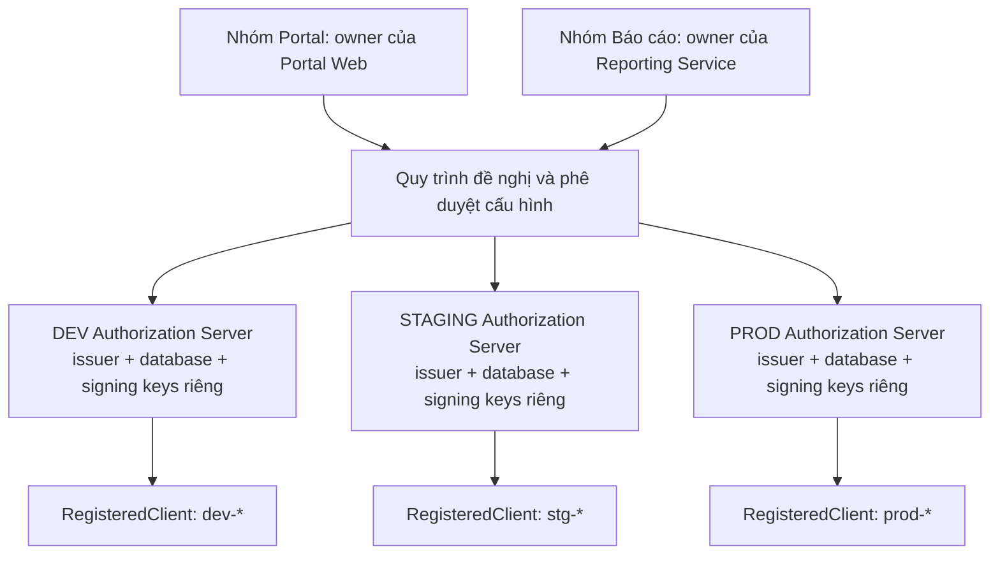
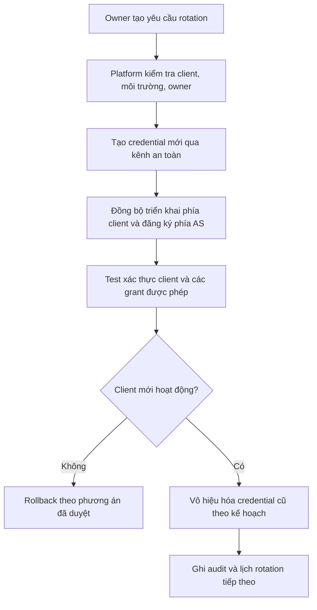

# Tách cấu hình client theo môi trường và chủ sở hữu ứng dụng

## 1. Bối cảnh và mục tiêu

Trong chương **Quản lý client** của module `SPRING_SECURITY_OAUTH2_OIDC_AUTHORIZATION_SERVER`, chúng ta học cách quản lý các ứng dụng được phép sử dụng **OAuth 2.0/OpenID Connect Authorization Server** trong hệ thống Spring Boot dùng **Spring Security** và **Spring Authorization Server**. Một quyết định quan trọng là **tách cấu hình client theo môi trường triển khai và theo người/nhóm chịu trách nhiệm với ứng dụng**.

Ví dụ, tổ chức có ba ứng dụng:

- **Portal Web**: ứng dụng web cho người dùng đăng nhập qua OIDC và gọi API.
- **Reporting Service**: dịch vụ backend lấy Access Token bằng `client_credentials` để đọc báo cáo.
- **Mobile App**: ứng dụng native dùng Authorization Code + PKCE.

Mỗi ứng dụng có thể chạy ở `dev`, `staging` và `prod`. Một cấu hình client dùng chung cho tất cả môi trường sẽ tạo ra rủi ro: secret thử nghiệm có thể đăng nhập vào production, redirect URI của máy phát triển lọt vào cấu hình thật, hoặc một nhóm chỉnh scope của ứng dụng khác mà không có phê duyệt.

**Mục tiêu bài học:** bạn có thể thiết kế danh mục client, xác định quyền sở hữu, phân tách môi trường, khai báo `RegisteredClient`, tổ chức lưu trữ và quy trình thay đổi, đồng thời kiểm thử để bảo đảm client chỉ có các grant, scope và endpoint đã được cấp phép. Kiến thức này phục vụ cả thiết kế, cấu hình, bảo mật, kiểm thử và vận hành Authorization Server.

## 2. Hai chiều phân tách khác nhau

### 2.1. Chiều môi trường: `dev`, `staging`, `prod`

| Môi trường | Mục đích | Đặc điểm cấu hình cần có |
| --- | --- | --- |
| **Development** | Thử nghiệm tính năng và debug trên máy cá nhân/hạ tầng dev | Client riêng; redirect URI local có kiểm soát; dữ liệu và khóa thử nghiệm |
| **Staging/UAT** | Kiểm thử tích hợp, quy trình phát hành và hành vi gần production | Client riêng, secret/khóa riêng, URL staging, chính sách gần production |
| **Production** | Phục vụ người dùng hoặc dữ liệu thật | Đăng ký được phê duyệt, domain chính thức, HTTPS, kiểm soát thay đổi và giám sát |

Một `client_id` chỉ có ý nghĩa trong phạm vi **Authorization Server/issuer** nơi nó được đăng ký. Nếu hai môi trường có hai issuer và hai kho dữ liệu tách biệt, về mặt giao thức chúng có thể dùng cùng một chuỗi `client_id`; tuy nhiên tên phân biệt môi trường giúp người vận hành dễ chẩn đoán. **Tiền tố `dev-` hay `prod-` là quy ước quản trị, không phải ranh giới bảo mật.**

Ranh giới an toàn phải đến từ triển khai và quyền truy cập: issuer riêng, kho `RegisteredClient` riêng, bí mật/khóa ký riêng, quyền truy cập theo môi trường, cấu hình DNS/TLS, và luồng phê duyệt thay đổi.

### 2.2. Chiều chủ sở hữu: ai chịu trách nhiệm cho client?

**Chủ sở hữu ứng dụng (application owner)** là nhóm/người được ủy quyền đăng ký và duy trì một ứng dụng client. Chủ sở hữu cần chịu trách nhiệm về:

1. Mục đích nghiệp vụ, dữ liệu và API mà ứng dụng cần truy cập.
2. Grant type, scope, redirect URI và client authentication method cần thiết.
3. Lưu giữ, luân chuyển và thu hồi secret/khóa xác thực client.
4. Kiểm thử tác động trước khi đổi cấu hình, xử lý sự cố và liên hệ khẩn cấp.
5. Định kỳ xác nhận client vẫn được sử dụng và các quyền đã cấp vẫn tối thiểu.

**Chủ sở hữu client không đồng nghĩa Resource Owner.** Trong OAuth 2.0, Resource Owner thường là người dùng hoặc chủ thể sở hữu tài nguyên; application owner là khái niệm quản trị nội bộ. Spring Authorization Server có `RegisteredClient` để thể hiện cấu hình giao thức, nhưng **không có một field chuẩn bắt buộc tên `ownerTeam`**. Thông tin chủ sở hữu thường được quản lý trong bảng danh mục, CMDB hoặc hệ thống quản lý yêu cầu thay đổi liên kết theo `client_id` và môi trường.

### 2.3. Ma trận môi trường × ứng dụng

| Ứng dụng | Dev | Staging | Production | Chủ sở hữu (ví dụ) |
| --- | --- | --- | --- | --- |
| Portal Web | `dev-portal-web` | `stg-portal-web` | `prod-portal-web` | Nhóm phát triển Portal |
| Reporting Service | `dev-reporting-svc` | `stg-reporting-svc` | `prod-reporting-svc` | Nhóm vận hành Báo cáo |
| Mobile App | `dev-mobile-app` | `stg-mobile-app` | `prod-mobile-app` | Nhóm ứng dụng Mobile |

Các định danh trên **chỉ là ví dụ**, không phải quy tắc bắt buộc của Spring Authorization Server. Mỗi ô tương ứng với một bản đăng ký client độc lập tại issuer của môi trường đó. Việc một client được duyệt ở dev **không tự động** cho phép nó hoạt động ở prod.



Sơ đồ thể hiện **quy trình quản trị**. Không nên cài một hệ thống cho phép nhóm ứng dụng có toàn quyền cập nhật trực tiếp cơ sở dữ liệu client production chỉ vì họ là application owner. Quyền thay đổi cần được kiểm soát bởi quy trình và quyền hạn của nền tảng Authorization Server.

## 3. Những thuộc tính phải quản lý cho mỗi client

Một bản ghi `RegisteredClient` chứa những thuộc tính giao thức và bảo mật thiết yếu:

| Thuộc tính | Ví dụ | Ý nghĩa/rủi ro khi cấu hình sai |
| --- | --- | --- |
| `id` | UUID nội bộ | Khóa định danh của bản ghi; nên ổn định khi sử dụng kho lưu trữ bền vững |
| `clientId` | `prod-portal-web` | Định danh client trong giao thức; không phải bí mật |
| `clientSecret` hoặc khóa công khai liên quan | Secret đã băm hoặc JWK/x.509 tùy phương thức | Dùng xác thực confidential client; phải bảo vệ và có kế hoạch luân chuyển |
| `clientAuthenticationMethods` | `client_secret_basic`, `private_key_jwt`, `none` | Phải khớp loại client và khả năng giữ bí mật |
| `authorizationGrantTypes` | `authorization_code`, `refresh_token`, `client_credentials` | Quy định những luồng client được phép sử dụng |
| `redirectUris` | `https://portal.example.com/login/oauth2/code/sso` | Giới hạn đích callback; sai URI có thể gây lỗi đăng nhập hoặc lộ code |
| `postLogoutRedirectUris` | URL quay về sau logout OIDC | Dùng khi hỗ trợ OIDC logout theo cấu hình |
| `scopes` | `openid`, `profile`, `orders.read` | Giới hạn các quyền client có thể yêu cầu |
| `ClientSettings` | `requireProofKey`, `requireAuthorizationConsent` | Kiểm soát PKCE, consent và các thiết lập client |
| `TokenSettings` | TTL Access Token/Refresh Token, rotation policy | Cân bằng rủi ro và trải nghiệm vận hành |

Những field này mô tả **điều kiện giao thức**, không thay cho kiểm tra quyền nghiệp vụ trong API. Ví dụ client được phép yêu cầu `orders.read` vẫn không có quyền đọc mọi đơn hàng nếu Resource Server còn yêu cầu kiểm tra chủ sở hữu tài nguyên.

Ngoài `RegisteredClient`, một **client inventory** của tổ chức nên lưu riêng:

| Nhóm metadata quản trị | Ví dụ |
| --- | --- |
| Nhận dạng | `environment`, `issuer`, `client_id`, tên ứng dụng, loại client |
| Trách nhiệm | Owner team, người liên hệ kỹ thuật, người phê duyệt bảo mật, on-call |
| Mục đích | Use case, API nhận token, danh mục dữ liệu/độ nhạy, cơ sở cấp scope |
| Vòng đời | `requested`, `approved`, `active`, `suspended`, `retired` |
| Kiểm soát thay đổi | Phiếu yêu cầu, người duyệt, thời điểm hiệu lực, lịch sử phiên bản |
| Giám sát | Ngày rà soát quyền gần nhất, ngày luân chuyển credential dự kiến, trạng thái sử dụng |

Liên kết inventory với `RegisteredClient` bằng khóa phù hợp, chẳng hạn cặp `(environment, client_id)` hoặc `(issuer, client_id)`. **Không chỉ dùng `client_id`** làm khóa trên toàn tổ chức nếu các issuer có thể tái sử dụng cùng chuỗi định danh.

## 4. Chọn loại client và phương thức xác thực trước khi chia môi trường

| Loại ứng dụng | Client authentication | Grant thường dùng | Cách lưu secret/khóa |
| --- | --- | --- | --- |
| Web app có backend/BFF | Confidential client: `client_secret_basic`, `private_key_jwt` hoặc phương thức phù hợp | Authorization Code + PKCE; Refresh Token nếu được phép | Secret/khóa nằm ở backend và secret manager |
| SPA thuần trình duyệt | Public client: `none` | Authorization Code + PKCE | **Không nhúng client secret vào JavaScript** |
| Ứng dụng native/mobile | Public client: `none` | Authorization Code + PKCE | Không dựa vào secret nhúng trong bản cài; dùng system browser và cơ chế lưu token phù hợp |
| Backend gọi backend | Confidential client | Client Credentials | Secret/khóa thuộc workload identity hoặc secret manager của service |

Trong `client_credentials` không có end-user OIDC login; không nên mặc định gắn `openid` hoặc yêu cầu ID Token cho luồng này. Với Authorization Code, đăng ký `redirect_uri` chính xác, PKCE (ưu tiên `S256`), scope phù hợp và chính sách consent rõ ràng.

**Không sao chép chính sách từ dev sang prod bằng thao tác thay chữ `dev` thành `prod`.** Ở mỗi môi trường phải đánh giá lại redirect URI, danh sách API, scope, phương thức xác thực và độ dài thời hạn token. Ví dụ localhost chỉ hợp lý trong ngữ cảnh phát triển hoặc trường hợp loopback native app được cho phép; một redirect URI tùy ý tới localhost trong production của web backend là dấu hiệu cần rà soát.

## 5. Thiết kế phân tách cấu hình trong Spring Boot

Nên phân biệt **cấu hình máy chủ** (issuer, host, kho dữ liệu, signing keys) với **cấu hình client** (grant, secret, scope, redirect URI) và **metadata quản trị** (owner, approver, ticket).

```text
Spring Boot deployment
├── application.yml                     # Giá trị chung, không chứa bí mật
├── application-dev.yml                 # Issuer dev, client demo dev
├── application-staging.yml             # Issuer staging, database/secret tham chiếu staging
└── application-prod.yml                # Issuer prod, database/secret tham chiếu prod

Client inventory / governance
└── owner, environment, approval, lifecycle, next review

External secret/config store
└── signing keys, client credential hashes, DB credentials
```

Sơ đồ trên là **cách tổ chức khái niệm**. Trong hệ thống production, nhiều cấu hình có thể nằm trong Kubernetes Secrets/ConfigMaps, Vault, hệ thống quản lý cấu hình hoặc database thay vì từng tệp YAML. **Không commit mật khẩu, client secret thô, private key hoặc connection string nhạy cảm vào Git.**

### 5.1. Ví dụ cấu hình phát triển

`application-dev.yml`:

```yaml
app:
  authorization-server:
    issuer: http://localhost:9000
  clients:
    portal:
      client-id: dev-portal-web
      client-secret-hash: ${DEV_PORTAL_SECRET_HASH}
      redirect-uri: http://127.0.0.1:8080/login/oauth2/code/portal
```

Đây là **namespace cấu hình tùy chỉnh `app.*`**, không phải thuộc tính mà Spring Boot tự động chuyển thành `RegisteredClient`. Mã Java ở phần tiếp theo sẽ đọc các property này. `DEV_PORTAL_SECRET_HASH` phải được cung cấp từ môi trường/kho secret; trong ví dụ với `client_secret_basic`, giá trị lưu nên có tiền tố định danh thuật toán như `{bcrypt}...` cho `DelegatingPasswordEncoder`. Client sẽ giữ **secret thô**, còn Authorization Server lưu **hash** để xác thực. Không đặt hash thật vào tài liệu hoặc source control.

`application-staging.yml` và `application-prod.yml` có thể chỉ giữ issuer và datasource theo môi trường, còn danh sách client được tải từ **database riêng của mỗi môi trường**:

```yaml
# application-staging.yml
app:
  authorization-server:
    issuer: https://auth-staging.example.com
```

```yaml
# application-prod.yml
app:
  authorization-server:
    issuer: https://auth.example.com
```

Hai file trên là ví dụ rút gọn: `DataSource`, secret manager, signing keys, TLS/proxy settings và các thiết lập vận hành vẫn phải được cung cấp từ cấu hình triển khai tương ứng.

### 5.2. Bind issuer thành `AuthorizationServerSettings`

```java
import org.springframework.beans.factory.annotation.Value;
import org.springframework.context.annotation.Bean;
import org.springframework.context.annotation.Configuration;
import org.springframework.security.oauth2.server.authorization.settings.AuthorizationServerSettings;

@Configuration(proxyBeanMethods = false)
class IssuerConfiguration {

    @Bean
    AuthorizationServerSettings authorizationServerSettings(
            @Value("${app.authorization-server.issuer}") String issuer) {
        return AuthorizationServerSettings.builder()
                .issuer(issuer)
                .build();
    }
}
```

`issuer` phải phản ánh đúng địa chỉ mà client sẽ dùng để xác minh metadata, ID Token và Access Token. Việc đổi `issuer` không chỉ là thay hostname: nó ảnh hưởng tới trust configuration của client, Resource Server và token đang tồn tại.

**Ranh giới môi trường không chỉ là Spring profile.** Nếu tất cả profile trỏ cùng một database hoặc dùng cùng signing key, chúng vẫn chia sẻ thành phần nhạy cảm. Cần đảm bảo cấu hình mạng, kho lưu trữ, quyền truy cập và secret thực sự tách biệt.

## 6. Ví dụ tạo RegisteredClient riêng cho development

Đoạn sau minh họa đăng ký một **confidential web client** dùng Authorization Code + PKCE trong môi trường `dev`.

```java
import java.time.Duration;
import java.util.UUID;

import org.springframework.beans.factory.annotation.Value;
import org.springframework.context.annotation.Bean;
import org.springframework.context.annotation.Configuration;
import org.springframework.context.annotation.Profile;
import org.springframework.security.oauth2.core.AuthorizationGrantType;
import org.springframework.security.oauth2.core.ClientAuthenticationMethod;
import org.springframework.security.oauth2.core.oidc.OidcScopes;
import org.springframework.security.oauth2.server.authorization.client.InMemoryRegisteredClientRepository;
import org.springframework.security.oauth2.server.authorization.client.RegisteredClient;
import org.springframework.security.oauth2.server.authorization.client.RegisteredClientRepository;
import org.springframework.security.oauth2.server.authorization.settings.ClientSettings;
import org.springframework.security.oauth2.server.authorization.settings.TokenSettings;

@Configuration(proxyBeanMethods = false)
class DevelopmentClientsConfiguration {

    @Bean
    @Profile("dev")
    RegisteredClientRepository developmentRegisteredClients(
            @Value("${app.clients.portal.client-id}") String clientId,
            @Value("${app.clients.portal.client-secret-hash}") String secretHash,
            @Value("${app.clients.portal.redirect-uri}") String redirectUri) {

        if (!secretHash.startsWith("{bcrypt}")) {
            throw new IllegalArgumentException(
                    "Development client secret must be stored as a bcrypt hash");
        }

        RegisteredClient portalClient = RegisteredClient
                .withId(UUID.randomUUID().toString())
                .clientId(clientId)
                .clientName("Portal Web (development)")
                .clientSecret(secretHash)
                .clientAuthenticationMethod(
                        ClientAuthenticationMethod.CLIENT_SECRET_BASIC)
                .authorizationGrantType(AuthorizationGrantType.AUTHORIZATION_CODE)
                .authorizationGrantType(AuthorizationGrantType.REFRESH_TOKEN)
                .redirectUri(redirectUri)
                .scope(OidcScopes.OPENID)
                .scope(OidcScopes.PROFILE)
                .scope("orders.read")
                .clientSettings(ClientSettings.builder()
                        .requireProofKey(true)
                        .requireAuthorizationConsent(true)
                        .build())
                .tokenSettings(TokenSettings.builder()
                        .accessTokenTimeToLive(Duration.ofMinutes(10))
                        .refreshTokenTimeToLive(Duration.ofHours(8))
                        .reuseRefreshTokens(false)
                        .build())
                .build();

        return new InMemoryRegisteredClientRepository(portalClient);
    }
}
```

**Ý nghĩa:**

- `@Profile("dev")` chỉ cho bean này xuất hiện khi profile `dev` hoạt động. Với profile khác, cần nguồn `RegisteredClientRepository` phù hợp.
- `clientId`, hash và redirect URI được đưa từ cấu hình của môi trường thay vì viết cố định trong mã.
- `requireProofKey(true)` yêu cầu PKCE cho client. `requireAuthorizationConsent(true)` giúp kiểm soát consent theo chính sách demo.
- `TokenSettings` thể hiện TTL và rotation policy **của riêng client**; không nên áp TTL giống nhau cho mọi loại client khi rủi ro khác nhau.
- `UUID.randomUUID()` và `InMemoryRegisteredClientRepository` phù hợp ví dụ dev khởi động lại từ đầu. Với kho dữ liệu bền vững, `RegisteredClient.id` phải được tạo **một lần khi đăng ký** và giữ ổn định, không sinh lại mỗi lần deploy.

Ví dụ giả định ứng dụng còn có cấu hình Authorization Server SecurityFilterChain, khóa ký và cơ chế đăng nhập người dùng để hoàn tất luồng OIDC. Bean repository **không tự bật OIDC**, không tự tạo Token Endpoint và không tạo `PasswordEncoder` cho toàn bộ ứng dụng.

### 6.1. Vì sao không đăng ký tất cả môi trường trong cùng một repository?

Giả sử code tạo `dev-portal-web`, `stg-portal-web` và `prod-portal-web` trong một `InMemoryRegisteredClientRepository`, rồi deploy chính file JAR này lên production. Mặc dù mỗi client có tiền tố khác nhau, tất cả chúng sẽ cùng được công nhận bởi một Authorization Server và cùng chịu rủi ro lộ bí mật. **Không có sự cô lập môi trường chỉ nhờ tên client.**

Cách đúng là triển khai đúng **một tập client đã được duyệt** cho mỗi issuer/không gian bảo mật và không chứa secret của môi trường khác trong artifact/config chạy tại môi trường đó.

## 7. Production và staging: repository bền vững, phân quyền provisioning

Khi chuyển khỏi demo, repository client thường cần trạng thái bền vững để phục vụ nhiều instance, khởi động lại và kiểm toán thay đổi. Spring Authorization Server cung cấp `JdbcRegisteredClientRepository` cho mô hình SQL:

```java
import org.springframework.context.annotation.Bean;
import org.springframework.context.annotation.Configuration;
import org.springframework.context.annotation.Profile;
import org.springframework.jdbc.core.JdbcOperations;
import org.springframework.security.oauth2.server.authorization.client.JdbcRegisteredClientRepository;
import org.springframework.security.oauth2.server.authorization.client.RegisteredClientRepository;

@Configuration(proxyBeanMethods = false)
class PersistentClientsConfiguration {

    @Bean
    @Profile({"staging", "prod"})
    RegisteredClientRepository persistentRegisteredClients(JdbcOperations jdbc) {
        return new JdbcRegisteredClientRepository(jdbc);
    }
}
```

Điều kiện vận hành cần nhớ:

1. Mỗi môi trường dùng **DataSource/database hoặc schema và credentials riêng**, có phân quyền chặt chẽ. Profile chỉ quyết định bean, không tự tạo sự cô lập dữ liệu.
2. Bảng `oauth2_registered_client` phải được tạo/migrate theo **schema của phiên bản Spring Authorization Server đang dùng**; repository JDBC không tự bảo đảm database đã có schema.
3. Client cần được **provisioning** thông qua quy trình quản trị/migration, với `id` ổn định, `client_id` đúng issuer, secret đã được băm và cấu hình grant/scope được duyệt.
4. `OAuth2AuthorizationService` và `OAuth2AuthorizationConsentService` cũng cần lựa chọn lưu trữ thích hợp nếu muốn giữ authorization/consent sau restart hoặc giữa nhiều instance; chỉ có JDBC client repository là chưa đủ.
5. Không chạy seed script mù quáng mỗi lần khởi động để ghi đè redirect URI, secret hoặc quyền của client production. Dùng migration có version, kiểm tra thay đổi và kế hoạch rollback.

**Ví dụ quy trình đăng ký một client mới:** owner gửi yêu cầu → nhóm vận hành/bảo mật duyệt grant, scope, redirect URI, auth method → hệ thống provisioning tạo `RegisteredClient` trong database môi trường đích → cấp secret qua kênh an toàn cho đúng chủ sở hữu → integration test → ghi audit và ngày rà soát tiếp theo.

### 7.1. Có nên dùng YAML để seed client production?

Có thể dùng cấu hình theo mã với hệ thống có ít client và quy trình triển khai chặt chẽ, nhưng nên cân nhắc tính phù hợp. Khi số lượng client lớn hoặc nhiều nhóm có vòng đời phát hành khác nhau, **repository bền vững và API/quy trình quản trị có phân quyền** thường dễ kiểm soát hơn. Điều cốt lõi là:

- **Source of truth** rõ ràng: YAML/GitOps hay registry/database, tránh hai hệ thống cùng ghi mà không xác định bên nào thắng.
- Thay đổi được kiểm tra, phê duyệt, ghi lịch sử và có cách khôi phục.
- Thông tin nhạy cảm không xuất hiện trong commit, pull request, audit log công khai hoặc response quản trị.
- Môi trường production có chính sách hạn chế quyền đọc/ghi và thao tác thay đổi tách với môi trường dev.

Spring Authorization Server có những endpoint OIDC/khả năng đăng ký client mở rộng tùy phiên bản và cấu hình. **Không bật Dynamic Client Registration công khai chỉ để đơn giản hóa onboarding**; nếu dùng phải thiết kế xác thực, ủy quyền, chính sách tạo client và quản trị vòng đời.

## 8. Quản lý quyền sở hữu ứng dụng trong quy trình

### 8.1. Mô hình trách nhiệm

| Vai trò | Quyền và trách nhiệm đề xuất |
| --- | --- |
| **Application owner** | Đề nghị client/scope/redirect URI, xác nhận nhu cầu, nhận và bảo vệ credential, kiểm thử tích hợp |
| **Authorization Server/platform owner** | Quản lý issuer, registry, khóa ký, baseline bảo mật, vận hành endpoint và thay đổi production |
| **API/Resource owner** | Định nghĩa scope/API audience, phê duyệt quyền truy cập vào dữ liệu và chính sách API |
| **Security reviewer** | Rà soát nguy cơ về redirect URI, loại client, grant, secret, TTL, quyền quá rộng |
| **Operations/on-call** | Theo dõi lỗi, xử lý sự cố, thu hồi client theo quy trình và thực hiện rollback |

Một người/nhóm có thể kiêm vai trò ở tổ chức nhỏ, nhưng **quyền thay đổi production nên được phân định** và có bằng chứng phê duyệt. Application owner có thể được cấp giao diện tự phục vụ để xem cấu hình của mình; quyền thay đổi nhạy cảm vẫn cần kiểm tra và phê duyệt theo chính sách.

### 8.2. Mẫu phiếu đăng ký và thay đổi client

Ví dụ minh họa (không chứa secret thật):

```yaml
request:
  environment: prod
  application: portal-web
  requestedClientId: prod-portal-web
  ownerTeam: team-portal
  technicalContact: team-portal-oncall
  businessPurpose: User login and read own orders
  clientType: confidential-web
  clientAuthenticationMethod: client_secret_basic
  grantTypes:
    - authorization_code
    - refresh_token
  redirectUris:
    - https://portal.example.com/login/oauth2/code/sso
  scopes:
    - openid
    - profile
    - orders.read
  pkceRequired: true
  apiAudience: orders-api
  reviewPeriodDays: 90
  approvalReference: CHANGE-EXAMPLE-001
```

Đây là **tài liệu yêu cầu quản trị**, không phải cấu hình `RegisteredClient` mà Spring Boot tự đọc. `apiAudience`, `ownerTeam`, `approvalReference` và `reviewPeriodDays` là metadata nghiệp vụ bổ sung, phải được xử lý bởi quy trình/cơ sở dữ liệu riêng nếu muốn hệ thống sử dụng chúng. Đối với audience, cần thiết kế cách phát hành và xác minh claim/token với API đích; đặt trường trong phiếu không tự giới hạn audience của token.

### 8.3. Phê duyệt quyền tối thiểu

Khi owner đề nghị `orders.read orders.write`, người quản lý API phải quyết định client có thực sự cần cả hai quyền không. Một confidential client không mặc nhiên đáng tin với mọi API chỉ vì nó giữ secret. Hãy xét:

- Grant có phù hợp với loại ứng dụng và flow đã thiết kế không?
- Scope có hẹp nhất để thực hiện nghiệp vụ không?
- Redirect URI có thuộc domain do owner kiểm soát và khớp chính xác với URL callback không?
- Tên miền staging và production đã được tách chưa?
- TTL/refresh policy có tương xứng mức độ rủi ro của dữ liệu không?
- Các API có thêm kiểm tra authorization theo resource owner/tenant và audience không?

Giới hạn scope tại Authorization Server và kiểm tra scope/audience tại Resource Server là **hai lớp bổ trợ**. Đừng dùng chuỗi `ownerTeam` từ request do client gửi làm bằng chứng phân quyền; metadata owner phải đến từ registry đáng tin cậy.

## 9. Bảo vệ client secret và luân chuyển credential

### 9.1. Phân biệt secret của client và khóa ký token

- **Client secret / private key dùng xác thực client:** giúp Authorization Server xác minh ứng dụng đang gọi Token Endpoint. Confidential client phải giữ bí mật tương ứng trong backend hoặc secret manager.
- **Authorization Server signing key:** dùng để ký token (đặc biệt JWT/ID Token); public key được công bố qua JWKS nếu cấu hình như vậy. Đó là tài sản của **issuer**, không phải secret của từng client.
- **Access Token/Refresh Token:** là kết quả của giao thức và cần được bảo vệ theo vòng đời riêng; không dùng chúng như secret đăng ký client.

Luân chuyển client secret **không có nghĩa** phải đổi khóa ký của Authorization Server. Ngược lại, rotation signing key cũng không thay đổi tự động mọi `client_secret`.

### 9.2. Quy trình rotation client secret



Một `RegisteredClient` tiêu chuẩn có field `clientSecret` đơn; **không giả định Spring Authorization Server mặc định chấp nhận đồng thời hai secret cho cùng client** trong thời gian chuyển tiếp. Nếu cần zero-downtime rotation, hãy thiết kế phương án có chủ đích: cập nhật client và AS theo nhịp triển khai, đăng ký client ID mới để chuyển dần, hoặc xây dựng cơ chế xác thực client phù hợp đã được thẩm định. Cần kiểm tra tác động tới authorization đang lưu, refresh token và các client instance chưa nâng cấp.

Đặc biệt:

- Gửi secret thô **một lần** qua kênh phân phối an toàn; lưu **hash** ở phía AS khi dùng cơ chế secret dựa trên password encoder. Hash không thay thế secret thô mà client dùng khi xác thực.
- Trong lỗi `invalid_client`, kiểm tra cấu hình mà không đưa secret vào ticket, log, screenshot hoặc tracing.
- Nếu secret bị nghi lộ, ưu tiên vô hiệu hóa/đổi credential và điều tra việc cấp token bất thường; có thể cần thu hồi authorization/refresh token tùy mức độ ảnh hưởng.
- Rotation phải có cả bước **xác minh việc credential cũ không còn sử dụng được**, không chỉ xác minh credential mới hoạt động.
- Với confidential client có khả năng sử dụng `private_key_jwt` hoặc mTLS, cân nhắc cơ chế quản lý khóa/chứng chỉ phù hợp để giảm phụ thuộc secret tĩnh; đánh giá độ phức tạp vận hành trước khi chuyển đổi.

## 10. Thay đổi redirect URI, scope và grant qua các môi trường

### 10.1. Redirect URI là ranh giới chống chuyển hướng sai đích

Mỗi môi trường có host và callback riêng:

```text
dev:     http://127.0.0.1:8080/login/oauth2/code/portal
staging: https://portal-staging.example.com/login/oauth2/code/sso
prod:    https://portal.example.com/login/oauth2/code/sso
```

Đây là ví dụ các địa chỉ khác nhau; dùng HTTPS cho các endpoint công khai. Tại Authorization Endpoint, AS cần đối chiếu `redirect_uri` với danh sách đã đăng ký theo quy tắc giao thức và cấu hình được hỗ trợ. Không dùng wildcard `https://*.example.com/*` hoặc URL có thể bị người gọi tùy ý thay đổi làm cách đăng ký chung cho mọi môi trường.

**Không thêm URI dev vào client production** chỉ để debug nhanh sự cố. Nếu cần mô phỏng bug production, dùng môi trường staging được bảo vệ, dữ liệu test và chính sách truy cập phù hợp.

### 10.2. Scope/grant phải được rà soát riêng

Một client `dev-reporting-svc` có thể cần scope `reports.read` để test, nhưng không nên mặc định được quyền `reports.delete` ở production. Khi yêu cầu bổ sung scope, phải xác định API owner, lý do sử dụng và ảnh hưởng đến Resource Server.

Đổi `authorizationGrantTypes` cũng là thay đổi nhạy cảm: thêm `client_credentials` cho client vốn chỉ chạy Authorization Code sẽ mở thêm luồng lấy token mà không cần người dùng; phải được thẩm định riêng.

### 10.3. TokenSettings và consent không nên sao chép vô điều kiện

Thời hạn token, `requireProofKey`, `requireAuthorizationConsent`, chính sách refresh và quyền OIDC là phần cấu hình của client. Môi trường dev có thể thuận tiện hơn để kiểm thử nhưng production cần baseline an toàn. `reuseRefreshTokens(false)` hỗ trợ phát hành refresh token mới khi refresh, **không tự bảo đảm cơ chế phát hiện tái sử dụng token bị đánh cắp** nếu chưa thiết kế lưu vết và thu hồi token family phù hợp.

## 11. Quy trình triển khai và kiểm soát sai lệch cấu hình

Một quy trình thay đổi cấu hình có thể đi theo các bước:

1. **Đăng ký:** application owner nộp phiếu với use case, môi trường, scope, grant, URI, loại client và người liên hệ.
2. **Thẩm định:** platform/security/API owner xác minh quyền, môi trường, domain, phương thức xác thực và chính sách token.
3. **Cấp phát:** provisioning tạo/sửa `RegisteredClient` tại đúng repository và issuer; phát hành credential qua kênh phù hợp.
4. **Kiểm thử:** thực hiện flow được phép, test request bị từ chối, metadata/issuer, redirect URI và kiểm tra API.
5. **Công bố:** cập nhật inventory/audit, thông báo owner về thay đổi và kỳ hạn rà soát.
6. **Giám sát:** theo dõi lỗi `invalid_client`, `invalid_grant`, token issuance, client không còn hoạt động và bất thường theo môi trường.
7. **Ngừng sử dụng:** khóa client, thu hồi credential/token theo phạm vi cần thiết, cập nhật ứng dụng phụ thuộc và lưu biên bản kết thúc.

### 11.1. Phát hiện cấu hình lệch giữa staging và production

Không nên yêu cầu hai môi trường có **giá trị tuyệt đối giống nhau**; issuer, redirect URI, credential và dữ liệu phải khác nhau. Thay vào đó, so sánh một tập tiêu chí:

| Tiêu chí so sánh | Mong đợi |
| --- | --- |
| Grant type | Có chủ đích, được duyệt riêng cho mỗi môi trường |
| Client authentication method | Phù hợp loại client, không nới lỏng tùy tiện ở prod |
| PKCE | Được yêu cầu cho Authorization Code theo chính sách |
| Scope | Prod chỉ có các scope nghiệp vụ được phê duyệt |
| Redirect URI | Đúng domain và callback của từng môi trường |
| Token TTL/refresh | Nằm trong baseline môi trường và use case |
| Issuer, signing key, repository | **Khác nhau theo môi trường**, không vô tình dùng chung |
| Owner và approval | Có trong inventory đáng tin cậy, còn hiệu lực |

Nên xây một job kiểm tra read-only, lấy cấu hình hiệu lực từ registry và so sánh với policy. Không đưa raw secret hoặc private key vào báo cáo diff. Khi có drift, cần phân biệt thay đổi có phê duyệt với sửa tay ngoài quy trình.

## 12. Kiểm thử phân tách môi trường và quyền sở hữu

### 12.1. Kiểm thử cấu hình và bean

Với ví dụ `@Profile("dev")` ở mục 6, một kiểm thử tích hợp minh họa:

```java
import static org.assertj.core.api.Assertions.assertThat;

import org.junit.jupiter.api.Test;
import org.springframework.beans.factory.annotation.Autowired;
import org.springframework.boot.test.context.SpringBootTest;
import org.springframework.security.oauth2.server.authorization.client.RegisteredClientRepository;
import org.springframework.test.context.ActiveProfiles;

@SpringBootTest(properties = {
        "app.clients.portal.client-id=dev-portal-web",
        "app.clients.portal.client-secret-hash={bcrypt}TEST_HASH_FROM_TEST_SECRET",
        "app.clients.portal.redirect-uri=http://127.0.0.1:8080/login/oauth2/code/portal"
})
@ActiveProfiles("dev")
class DevelopmentClientIsolationTest {

    @Autowired
    RegisteredClientRepository repository;

    @Test
    void developmentRepositoryHasOnlyDevelopmentPortalClient() {
        assertThat(repository.findByClientId("dev-portal-web")).isNotNull();
        assertThat(repository.findByClientId("prod-portal-web")).isNull();
    }
}
```

`TEST_HASH_FROM_TEST_SECRET` là **placeholder không dùng để xác thực được**. Trong test thực tế, sinh hash BCrypt hợp lệ cho một secret chỉ dùng trong test (không phải secret production), và cung cấp bean khác mà ApplicationContext yêu cầu. Test trên chứng minh **repository in-memory do ví dụ tạo ra** không chứa ID production; trong hệ thống thực, cần kiểm tra thêm database/issuer và quyền truy cập mạng để xác nhận sự cô lập.

### 12.2. Ma trận kiểm thử OAuth2/OIDC

| Ca kiểm thử | Kết quả mong đợi |
| --- | --- |
| Client dev gọi AS production bằng credential dev | Không được xác thực/cấp token |
| Client production gọi đúng AS nhưng redirect URI dev | Yêu cầu ủy quyền bị từ chối theo giao thức |
| Client public thử `client_secret_basic` dù đăng ký `none` | Không được chấp nhận như confidential client |
| Client `authorization_code` yêu cầu `client_credentials` chưa đăng ký | `unauthorized_client` hoặc từ chối giao thức phù hợp |
| Client yêu cầu scope chưa duyệt | Bị từ chối hoặc không được cấp scope vượt quyền |
| Client owner nhóm A yêu cầu sửa client của nhóm B qua admin API | Bị từ chối phân quyền/quy trình duyệt |
| Client đã retire tiếp tục xin token | Bị từ chối theo chính sách; kiểm tra thêm token đã cấp và cơ chế thu hồi |
| Staging và prod restart nhiều node | Client registry, signing key, authorization state của từng môi trường nhất quán nội bộ, không lẫn nhau |

Trong bài kiểm thử giao thức, nên dùng HTTP/MockMvc với grant hợp lệ; không chỉ assert bean tồn tại. Với bài kiểm thử quản trị, mock request **đã xác thực** và kiểm tra authorization dành cho owner/role, thay vì tin trường `ownerTeam` do người gọi tự khai.

### 12.3. Ví dụ yêu cầu Token Endpoint

Với confidential client `prod-reporting-svc` đã đăng ký `client_credentials`, người vận hành có thể thử trên môi trường kiểm thử tương ứng:

```bash
curl -i -X POST https://auth-staging.example.com/oauth2/token \
  -u 'stg-reporting-svc:<staging-client-secret>' \
  -H 'Content-Type: application/x-www-form-urlencoded' \
  --data-urlencode 'grant_type=client_credentials' \
  --data-urlencode 'scope=reports.read'
```

Không gửi secret thật qua chat, ticket, terminal dùng chung hoặc log CI. Request trên **chỉ thành công nếu** client đã đăng ký đúng ở staging, còn hoạt động và được phép dùng grant/scope này. Để kiểm tra phân tách, có thể dùng bộ test fixture riêng với credential dev thay vì thử secret thật trên production.

## 13. Tình huống thực tế và cách xử lý

### Tình huống A: Một client ID cho cả dev, staging và prod

**Hiện tượng:** thay đổi redirect URI trong dev làm login ở prod lỗi; mọi môi trường dùng chung một secret.

**Nguyên nhân:** hệ thống coi environment chỉ là nhãn, nhưng cùng repository/issuer/secret hoặc script seed ghi đè cấu hình.

**Cách xử lý:** tạo bản đăng ký và credential riêng theo issuer, chuyển từng ứng dụng sang client mới theo kế hoạch, kiểm tra issuer/redirect tại callback và ngăn thay đổi từ dev chạm kho production. Cần rà soát refresh token và phiên đang hoạt động trong giai đoạn chuyển đổi.

### Tình huống B: Owner yêu cầu thêm `https://localhost/*` vào redirect URI production

**Vấn đề:** tạo bề mặt chuyển hướng quá rộng và phá vỡ ranh giới môi trường.

**Cách xử lý:** yêu cầu callback chính xác cho ứng dụng production; tái hiện vấn đề trên dev/staging có domain và dữ liệu test phù hợp. Trường hợp native app dùng loopback URI cần tuân theo profile và quy tắc redirect URI dành cho native application, không được áp dụng ngoại lệ đó cho mọi web client.

### Tình huống C: Secret rotation làm hàng loạt request trả `invalid_client`

**Nguyên nhân có thể:** client đã đổi secret nhưng AS chưa cập nhật hash, hoặc một số replica client vẫn dùng credential cũ. `RegisteredClient` mặc định chỉ có một client secret, nên không có khoảng chồng lấp tự động.

**Cách xử lý:** kiểm tra audit thời điểm đổi, secret version của từng workload, kết quả xác thực tại Token Endpoint; thực hiện rollback hoặc cutover theo phương án đã duyệt, sau đó ngăn sử dụng credential cũ. Không log raw secret để đối chiếu.

### Tình huống D: Hai nhóm đều tự nhận là owner cùng một client

**Vấn đề:** không có nguồn sở hữu đáng tin cậy; quyền thay đổi grant/scope không rõ.

**Cách xử lý:** chọn một owner chính và nhóm phụ trách kỹ thuật được phê duyệt, cập nhật inventory và workflow; yêu cầu mọi đề nghị thay đổi tham chiếu `(issuer, client_id)`. Nếu thực tế hai ứng dụng độc lập đang chia sẻ client, ưu tiên tách chúng thành các registration riêng để giới hạn quyền và giám sát.

### Tình huống E: Client bị tắt nhưng JWT Access Token cũ vẫn gọi API được

**Giải thích:** việc vô hiệu hóa registration hoặc thu hồi Refresh Token **không mặc nhiên làm Access Token JWT đã phát hành mất hiệu lực tức thì** nếu Resource Server chỉ kiểm tra chữ ký và thời hạn. Cần chính sách TTL ngắn, kiểm tra trạng thái/denylist hoặc mô hình token opaque/introspection khi yêu cầu thu hồi gần thời gian thực.

**Cách xử lý:** đưa yêu cầu thu hồi vào thiết kế trước khi xảy ra sự cố; phân biệt `disable client`, `revoke refresh token` và `invalidate existing access tokens`.

## 14. Checklist và câu hỏi tự đánh giá

**Checklist trước khi kích hoạt một client production:**

1. Có owner chính, liên hệ kỹ thuật và yêu cầu đã được phê duyệt trong inventory.
2. Có `client_id` duy nhất trong issuer, với bản đăng ký production tách khỏi dev/staging.
3. Đúng loại client, client authentication method và tập grant thực sự cần.
4. Redirect/logout URI thuộc domain hợp lệ; không có wildcard hoặc callback dev không cần thiết.
5. Scope/audience được chủ API duyệt; Resource Server còn kiểm tra quyền trên tài nguyên thực tế.
6. PKCE/consent/token TTL/refresh policy được cấu hình theo loại client và mức độ rủi ro.
7. Credential và signing keys được bảo vệ, có phương án rotation và thu hồi; không nằm trong Git/log.
8. Provisioning/audit chạy đúng database môi trường, có kế hoạch khôi phục và rollback.
9. Kiểm thử cả đường thành công và đường từ chối, đặc biệt dùng nhầm client/credential giữa các môi trường.
10. Có ngày rà soát quyền tiếp theo, theo dõi client không sử dụng và quy trình offboarding.

**Câu hỏi ôn tập:**

1. Tại sao đặt tên `prod-*` chưa tạo được ranh giới bảo mật giữa môi trường?
2. `RegisteredClient.clientId` khác `RegisteredClient.id` ở điểm nào khi dùng JDBC?
3. Vì sao application owner và OAuth 2.0 Resource Owner là hai khái niệm khác nhau?
4. Nếu client đổi người quản lý, bạn cập nhật metadata nào và có nhất thiết phải đổi `client_id` không?
5. Khi thay secret của client, tại sao cần kiểm tra các instance chưa triển khai thay đổi?
6. Có thể dùng cùng khóa ký JWT giữa dev và prod không? Vì sao việc tách issuer/key lại quan trọng?
7. Một bản đăng ký client đã bị vô hiệu hóa có làm JWT Access Token trước đó vô hiệu ngay không?
8. Nếu dùng `JdbcRegisteredClientRepository`, bước nào bảo đảm bảng và dữ liệu client đã được tạo đúng?

## 15. Tài liệu tham khảo

- [Spring Authorization Server — Core Model / RegisteredClient](https://docs.spring.io/spring-authorization-server/reference/core-model-components.html)
- [Spring Authorization Server — Configuration Model](https://docs.spring.io/spring-authorization-server/reference/configuration-model.html)
- [Spring Authorization Server — Protocol Endpoints](https://docs.spring.io/spring-authorization-server/reference/protocol-endpoints.html)
- [Spring Security — OAuth 2.0 Client Registration](https://docs.spring.io/spring-security/reference/servlet/oauth2/client/core.html)
- [Spring Boot — Externalized Configuration](https://docs.spring.io/spring-boot/reference/features/external-config.html)
- [RFC 6749 — OAuth 2.0 Authorization Framework](https://www.rfc-editor.org/rfc/rfc6749)
- [RFC 8252 — OAuth 2.0 for Native Apps](https://www.rfc-editor.org/rfc/rfc8252)
- [RFC 7636 — Proof Key for Code Exchange (PKCE)](https://www.rfc-editor.org/rfc/rfc7636)
- [OAuth 2.0 Security Best Current Practice — RFC 9700](https://www.rfc-editor.org/rfc/rfc9700)

**Ghi nhớ:** mỗi client là một hợp đồng bảo mật giữa **một ứng dụng cụ thể** và **một Authorization Server/issuer cụ thể**. Phân tách dev, staging và production bằng hạ tầng/credential/kho dữ liệu thực, đồng thời ghi rõ owner, quyền hạn và vòng đời. Nhờ đó, đội phát triển có thể thay đổi, kiểm thử và vận hành OAuth2/OIDC client trong Spring Authorization Server mà không vô tình mở rộng quyền hoặc ảnh hưởng đến môi trường khác.
