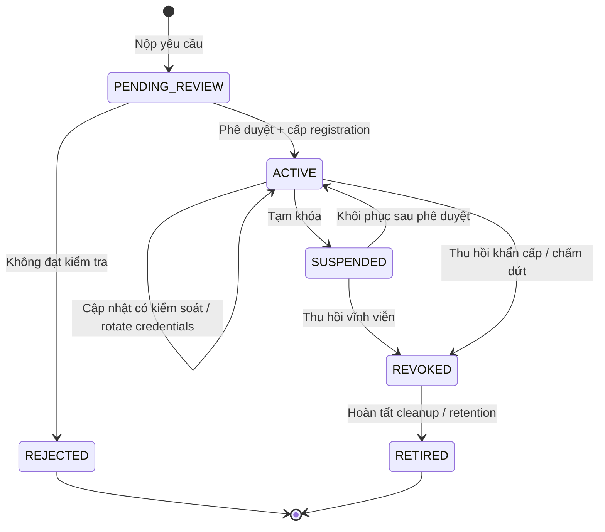
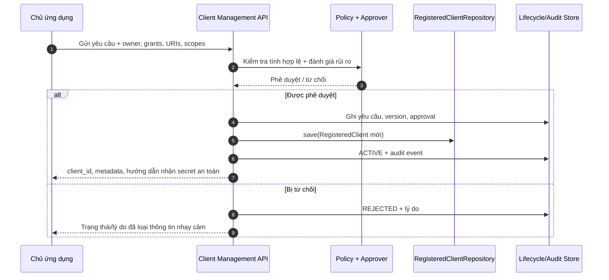
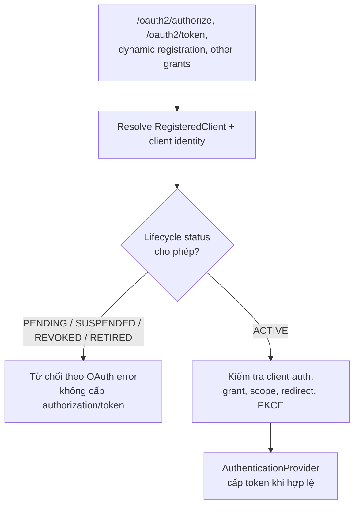
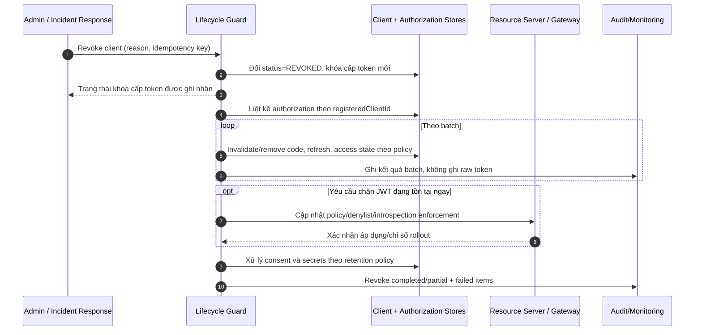

# Thiết kế quy trình cấp mới, cập nhật, vô hiệu hóa và thu hồi client

## 1. Bối cảnh và mục tiêu

Một **OAuth 2.0/OpenID Connect (OIDC) Authorization Server** không chỉ cần phát token đúng giao thức mà còn phải quản lý các ứng dụng được phép xin token trong suốt vòng đời: từ yêu cầu đăng ký, cấp `client_id`, cấu hình quyền và credential, thay đổi metadata, xoay vòng khóa/secret, tạm khóa, thu hồi phiên/token đến ngừng cung cấp dịch vụ. Đây là một phần quan trọng khi **thiết kế, cấu hình, bảo mật, kiểm thử và vận hành Spring Security OAuth2/OIDC Authorization Server bằng Spring Security, Spring Authorization Server trong Spring Boot**.

Trong chương **Quản lý client**, bài này đề xuất một quy trình có thể triển khai thực tế cho bốn nhóm thao tác:

1. **Cấp mới**: phê duyệt, tạo `RegisteredClient` và bàn giao thông tin kết nối an toàn.
2. **Cập nhật**: đổi redirect URI, scope, grant, client authentication, token policy hoặc đầu mối sở hữu theo quy trình có kiểm soát.
3. **Vô hiệu hóa**: ngăn client sử dụng Authorization Server, thường là biện pháp tạm thời khi có sự cố hoặc vi phạm chính sách.
4. **Thu hồi/khai tử**: thu hồi credential/quyền/token/consent phù hợp, chấm dứt client và xử lý dữ liệu còn lưu.

**Hai khái niệm phải tách rõ:** *vô hiệu hóa một client* là quyết định quản trị về quyền tham gia giao thức của **ứng dụng**; *revoke một token* là thao tác làm mất hiệu lực **một credential đã phát hành**. Một thao tác không tự động hoàn thành thao tác còn lại.

### Kết quả học tập

Sau bài này, bạn có thể:

- Xây dựng state machine quản lý client, phân công quyền phê duyệt, audit và idempotency.
- Phân biệt dữ liệu lõi `RegisteredClient` với **trạng thái vòng đời nghiệp vụ do hệ thống tự bổ sung**.
- Mô tả đúng hành vi khi cập nhật registration bằng `RegisteredClientRepository.save(...)` và những giới hạn của interface.
- Thiết kế quy trình xoay vòng client secret/key, chính sách cấp quyền tối thiểu và quy trình vô hiệu hóa an toàn.
- Kiểm thử các tình huống thay đổi scope, client bị disable nhưng vẫn còn JWT, refresh token vẫn còn hiệu lực và request đồng thời trên nhiều node.

**Phạm vi API:** ví dụ Java theo mô hình **Spring Authorization Server 1.5.x / Spring Boot 3.x / Spring Security 6.x**, trừ khi có ghi chú. Với Spring Security 7.x hoặc phiên bản framework khác, phải kiểm tra Javadoc và điều kiện cấu hình tương ứng trước khi sử dụng.

## 2. Vai trò và các loại dữ liệu trong quản lý client

### 2.1. OAuth client không đồng nghĩa với người dùng

Một client là phần mềm yêu cầu token từ Authorization Server; ví dụ SPA, backend web, mobile app hay batch job. **Client authentication** chứng minh danh tính *ứng dụng* theo cơ chế tương ứng; **user authentication** xác thực người dùng; **resource authorization** quyết định quyền vào dữ liệu ở API.

| Thành phần | Chứa gì? | Chịu trách nhiệm |
| --- | --- | --- |
| `RegisteredClient` | `id` nội bộ, `clientId`, secret/key metadata, grants, redirect URIs, scopes, `ClientSettings` và `TokenSettings` | Cấu hình/phạm vi khả năng của client |
| `RegisteredClientRepository` | `save`, `findById`, `findByClientId` | Lưu và tra cứu client registration |
| **Client lifecycle registry** (tự thiết kế) | Trạng thái PENDING/ACTIVE/SUSPENDED/REVOKED/RETIRED, owner, reason, version, approval, audit references | Quyết định quản trị, theo dõi thay đổi, chặn client bị khóa |
| `OAuth2AuthorizationService` | Authorization code, access/refresh token, trạng thái của grant | Tìm và cập nhật authorization/token đã cấp |
| `OAuth2AuthorizationConsentService` | Consent theo client ID nội bộ và principal | Quản lý sự đồng ý đã ghi nhận của người dùng |
| `OAuth2TokenGenerator<?>` | Token theo `OAuth2TokenContext` | Sinh token mới, không tự quyết định disable client |
| Resource Server | Kiểm tra access token, audience, scopes và chính sách truy cập | Bảo vệ API, thực thi hạn chế hiệu lực token |

**Giới hạn của Spring Authorization Server:** `RegisteredClient` không có sẵn field chuẩn `enabled` hoặc `status` để khóa tài khoản ứng dụng; `RegisteredClientRepository` chỉ khai báo ba phương thức `save`, `findById` và `findByClientId`. Nó **không có** API chuẩn `disableClient`, `deleteClient`, `listClients`, `revokeAllTokensForClient`. Vì vậy, mọi quy trình tự phục vụ quản trị, trạng thái và thu hồi hàng loạt phải được thiết kế thêm ở application/persistence layer.

### 2.2. Mô hình dữ liệu đề xuất

Đối với một hệ thống có nhiều đối tác hoặc nhiều đội ứng dụng, nên giữ lớp thông tin nghiệp vụ riêng với `RegisteredClient`:

```text
client_registration (Spring Authorization Server)
  id                 -- RegisteredClient.id, ổn định
  client_id          -- client_id OAuth2, duy nhất
  client_secret      -- hash/encoded secret, nếu áp dụng
  client_authentication_methods
  authorization_grant_types
  redirect_uris
  scopes
  client_settings
  token_settings

client_lifecycle (bảng do ứng dụng xây dựng, ví dụ)
  registered_client_id    -- khóa tham chiếu Registration.id
  owner_id / owner_team
  tenant_id
  status                  -- PENDING_REVIEW, ACTIVE, SUSPENDED, REVOKED, RETIRED
  status_reason
  status_changed_at
  approved_by / approved_at
  version                 -- optimistic locking
  created_by / created_at / updated_by / updated_at
  data_retention_until

client_change_request (ví dụ)
  request_id / idempotency_key
  registered_client_id
  change_type
  before_snapshot_hash / after_snapshot_hash
  requested_by / approved_by
  reason / ticket / status / timestamps

client_audit_event (append-only hoặc kho audit tương ứng)
  event_id, actor, action, target_client_id,
  correlation_id, timestamp, outcome, sanitized_diff
```

Đây là **lược đồ khái niệm**, không phải schema chuẩn được Spring Authorization Server tự tạo. Các trường như `status`, `owner_id` hay `version` phải được lưu và thực thi bởi code của ứng dụng; việc chỉ tạo thêm cột trong database không tự làm Spring Security kiểm tra chúng.

**Giữ `RegisteredClient.id` ổn định** khi chỉnh metadata. Consent và authorization lưu quan hệ theo ID nội bộ này; việc sinh ID mới mỗi lần triển khai/cập nhật có thể làm lệch mối liên hệ với các bản ghi đã tồn tại.

## 3. State machine cho toàn bộ vòng đời

### 3.1. Trạng thái nghiệp vụ

| Trạng thái | Ý nghĩa | Có được xin token mới? | Hướng chuyển tiếp |
| --- | --- | --- | --- |
| `PENDING_REVIEW` | Đã nhận hồ sơ nhưng chưa phê duyệt hoặc chưa cấp credential. | Không | `ACTIVE` nếu được duyệt; từ chối nếu không đạt |
| `ACTIVE` | Registration được phê duyệt, đáp ứng chính sách và được phép tham gia giao thức. | Có, **nếu** grant/client/user hợp lệ | `SUSPENDED`, `REVOKED` |
| `SUSPENDED` | Tạm dừng do sự cố, quá hạn rà soát hoặc yêu cầu vận hành. | Không; phải kiểm soát tại các đường xử lý liên quan | `ACTIVE` sau kiểm tra hoặc `REVOKED` |
| `REVOKED` | Chủ đích chấm dứt quyền sử dụng client hoặc credential; thực hiện xử lý token liên quan. | Không | `RETIRED` sau cleanup |
| `RETIRED` | Ngừng hoạt động và đã hoàn tất xử lý vòng đời/retention theo chính sách. | Không | Thường không kích hoạt lại; tạo client mới nếu cần |

Với yêu cầu từ chối hồ sơ, có thể dùng trạng thái riêng `REJECTED` trong workflow cấp mới. Trạng thái chuẩn OAuth/OIDC **không định nghĩa** bảng lifecycle trên; nó là **quy ước thiết kế nội bộ** cần được toàn bộ hệ thống hiểu và thực thi nhất quán.



### 3.2. Các bất biến cần giữ

- **Default deny:** client chưa được phê duyệt, bị suspended/revoked/retired phải không được thực hiện luồng phát token mới.
- **Phân tách người đề nghị và người duyệt:** các thay đổi có rủi ro cao như tăng scope, thêm redirect tới domain mới, chuyển sang `client_credentials`, cấp method xác thực mạnh/yếu hơn cần phê duyệt tương ứng.
- **Thao tác có thể kiểm toán:** actor, lý do, thời điểm, giá trị thay đổi (đã loại bỏ secret/token), mã yêu cầu và kết quả.
- **Không tái sử dụng `client_id` đã thu hồi** cho ứng dụng khác vì có thể gây nhầm chủ thể, log và quyền của token/consent cũ.
- **Cập nhật có kiểm tra đồng thời:** yêu cầu đến từ hai quản trị viên không được âm thầm ghi đè quyền của nhau.
- **Tách quyết định dừng cấp token khỏi cleanup dữ liệu:** việc ghi trạng thái `SUSPENDED` phải có hiệu lực chặn mới ngay; dọn dẹp authorization/token có thể là workflow độc lập có theo dõi kết quả.

## 4. Quy trình cấp client mới

### 4.1. Tiếp nhận và xác minh yêu cầu

Trước khi tạo `RegisteredClient`, lấy đủ dữ liệu thiết kế:

| Nhóm | Ví dụ thông tin cần khai báo | Cách kiểm tra |
| --- | --- | --- |
| Chủ sở hữu | Đội vận hành, đầu mối kỹ thuật, tenant, mục đích tích hợp | Owner có thẩm quyền, có người chịu trách nhiệm và quy trình hỗ trợ |
| Kiểu client | Public SPA/mobile hay confidential backend/BFF | Có thực sự giữ được credential không? |
| Loại grant | `authorization_code`, `client_credentials`, `refresh_token` nếu được cho phép | Chỉ cấp grant cần thiết; user-facing code flow nên có PKCE |
| Redirect URI | URI chính xác theo môi trường | Đúng ownership/domain, HTTPS; không wildcard/open redirect |
| Scope/audience | `orders.read`, `orders.write`, resource đích | Phạm vi tối thiểu, có phê duyệt resource owner/chủ API |
| Client authentication | `none`, `client_secret_basic`, `private_key_jwt`, mTLS | Phù hợp ranh giới lưu trữ secret/key và chính sách |
| Token policy | Access-token TTL, refresh-token policy, format JWT/opaque | Phù hợp mức độ nhạy cảm, revocation SLA và khả năng Resource Server |
| Vận hành | Môi trường, ngày hết hạn hợp đồng, yêu cầu rotation, contact | Cấu hình giám sát, thời hạn rà soát và hỗ trợ khi có sự cố |

**Tránh nhầm public client:** browser JavaScript, mobile app hoặc desktop app phân phối tới thiết bị người dùng không thể giữ một shared client secret cố định một cách đáng tin cậy. Dùng `ClientAuthenticationMethod.NONE` và Authorization Code + PKCE trong luồng thích hợp. Không “giấu” secret trong frontend build hay mobile binary.

### 4.2. Luồng phê duyệt và cấp phát



Các bước vận hành:

1. Ghi `request_id`/idempotency key để tránh tạo trùng khi client retry.
2. Kiểm tra quyền requester, quyền sở hữu redirect URI, scope, grant và các trường bắt buộc.
3. Tạo **`RegisteredClient.id`** nội bộ bất biến và **`clientId`** duy nhất; không dùng `client_id` làm secret.
4. Với confidential client, sinh secret bằng CSPRNG/secret manager hoặc đăng ký public key; lưu **encoded secret** khi dùng shared secret. Đảm bảo secret hiển thị cho bên nhận qua kênh bảo mật đúng một lần theo quy trình, không đưa vào audit/log.
5. Ghi registration và lifecycle một cách nhất quán; chỉ kích hoạt khi dữ liệu thiết yếu đã sẵn sàng. Nếu các kho khác nhau, dùng trạng thái trung gian và cơ chế hoàn tất/rollback có thể retry.
6. Kiểm tra smoke test, ghi audit, bàn giao issuer/discovery, endpoints, scopes, redirect URIs, token policy và đầu mối liên hệ.

### 4.3. Java: đăng ký client bằng `RegisteredClientRepository`

Ví dụ dưới đây chỉ minh họa **lớp lưu client đã được phê duyệt** trong Spring Authorization Server 1.5.x. Workflow phê duyệt, quyền admin, idempotency và lifecycle state phải nằm ở một service riêng:

```java
import java.time.Duration;
import java.time.Instant;
import java.util.UUID;

import org.springframework.security.crypto.password.PasswordEncoder;
import org.springframework.security.oauth2.core.AuthorizationGrantType;
import org.springframework.security.oauth2.core.ClientAuthenticationMethod;
import org.springframework.security.oauth2.core.oidc.OidcScopes;
import org.springframework.security.oauth2.server.authorization.client.RegisteredClient;
import org.springframework.security.oauth2.server.authorization.client.RegisteredClientRepository;
import org.springframework.security.oauth2.server.authorization.settings.ClientSettings;
import org.springframework.security.oauth2.server.authorization.settings.TokenSettings;

public class ClientRegistrationWriter {

    private final RegisteredClientRepository repository;
    private final PasswordEncoder passwordEncoder;

    public ClientRegistrationWriter(RegisteredClientRepository repository,
                                    PasswordEncoder passwordEncoder) {
        this.repository = repository;
        this.passwordEncoder = passwordEncoder;
    }

    // Chỉ gọi sau authorization/policy approval ở lớp quản trị.
    public RegisteredClient registerApprovedBff(
            String clientId, String plainSecret, String redirectUri) {

        if (repository.findByClientId(clientId) != null) {
            throw new IllegalArgumentException("client_id already exists");
        }

        RegisteredClient client = RegisteredClient.withId(UUID.randomUUID().toString())
                .clientId(clientId)
                .clientIdIssuedAt(Instant.now())
                .clientSecret(passwordEncoder.encode(plainSecret))
                .clientAuthenticationMethod(
                        ClientAuthenticationMethod.CLIENT_SECRET_BASIC)
                .authorizationGrantType(AuthorizationGrantType.AUTHORIZATION_CODE)
                .authorizationGrantType(AuthorizationGrantType.REFRESH_TOKEN)
                .redirectUri(redirectUri)
                .scope(OidcScopes.OPENID)
                .scope(OidcScopes.PROFILE)
                .scope("orders.read")
                .clientSettings(ClientSettings.builder()
                        .requireProofKey(true)
                        .requireAuthorizationConsent(true)
                        .build())
                .tokenSettings(TokenSettings.builder()
                        .accessTokenTimeToLive(Duration.ofMinutes(10))
                        .build())
                .build();

        repository.save(client);
        return client;
    }
}
```

**Giới hạn của ví dụ:** `plainSecret` đã được tạo bằng nguồn entropy mạnh và truyền qua kênh nội bộ có kiểm soát; method trên **không tự sinh** secret và không giải quyết race condition khi hai request cùng đăng ký một `clientId`. Hệ thống thật phải ràng buộc uniqueness tại database, thực hiện permission check, validate redirect/domain, rate limit và idempotent request trước khi lưu. `PasswordEncoder` phải hỗ trợ prefix/thuật toán khớp dữ liệu mà Spring Security dùng để xác thực.

Đối với public client, tạo registration bằng `ClientAuthenticationMethod.NONE`, không có `clientSecret`, thêm `requireProofKey(true)` và chỉ cấp grant phù hợp. Việc đăng ký một public client không biến tất cả bản cài đặt ứng dụng thành danh tính tin cậy duy nhất.

## 5. Quy trình cập nhật client

### 5.1. Chia thay đổi theo mức độ rủi ro

| Thay đổi | Nguy cơ chính | Quy trình khuyến nghị |
| --- | --- | --- |
| Đổi mô tả, contact, owner | Mất khả năng truy vết/người chịu trách nhiệm | Kiểm tra quyền sở hữu, audit trước/sau |
| Thêm redirect URI | Authorization code bị gửi sang endpoint không tin cậy | Xác minh quyền kiểm soát hostname/domain, phê duyệt, HTTPS và URI chính xác |
| Thu hẹp scope/grant | Tác động tương thích; token đã cấp có thể vẫn còn scope cũ | Lập lịch thay đổi, phối hợp token revocation và API policy |
| Mở rộng scope/grant | Tăng đặc quyền | Thẩm định theo least privilege; cần chủ sở hữu API/nhân sự có thẩm quyền duyệt |
| Đổi client type/auth method | Thay đổi trust boundary và cách giữ credential | Đánh giá kiến trúc, migration plan, kiểm thử âm tính |
| Đổi token TTL, format | Ảnh hưởng sessions, validation và thời điểm revoke | Phối hợp Resource Servers, khóa ký, introspection |
| Đổi client secret/key | Có thể mất kết nối hoặc lộ credential | Rotation có lịch hoặc khẩn cấp, đo đạc chuyển đổi, rollback |

**Thay đổi registration có hiệu lực cho những yêu cầu mới; không tự viết lại các JWT đã phát hành.** Ví dụ xóa `orders.write` khỏi `RegisteredClient.scopes` sẽ ngăn yêu cầu cấp quyền mới cho scope đó theo provider policy, nhưng JWT cũ có `scope=orders.write` có thể tiếp tục được API chấp nhận cho đến hết hạn nếu chỉ xác minh offline.

### 5.2. Dùng builder cập nhật mà giữ ID

API Java cho phép lấy registration cũ và tạo bản cập nhật, giữ ID/credential/grant không cần đổi:

```java
public RegisteredClient replaceRedirectUris(
        RegisteredClientRepository repository,
        String clientId,
        Set<String> approvedRedirectUris) {

    RegisteredClient current = repository.findByClientId(clientId);
    if (current == null) {
        throw new IllegalArgumentException("Unknown client");
    }
    if (approvedRedirectUris == null || approvedRedirectUris.isEmpty()) {
        throw new IllegalArgumentException("Missing approved redirect URIs");
    }

    // Lớp quản trị phải xác minh mọi URI đã được phê duyệt trước đoạn này.
    RegisteredClient updated = RegisteredClient.from(current)
            .redirectUris(uris -> {
                uris.clear();
                uris.addAll(approvedRedirectUris);
            })
            .build();

    repository.save(updated);
    return updated;
}
```

Đoạn ví dụ là **logic cập nhật dữ liệu đã phê duyệt**, cần imports `Set`, `RegisteredClient`, `RegisteredClientRepository` và wrapper service/controller khi chạy. `RegisteredClient.from(current)` giữ `id` nội bộ. Phương thức `redirectUris(Consumer<Set<String>>)` được dùng để **thay toàn bộ danh sách**. Chỉ gọi `redirectUri(newUri)` sẽ **thêm** URI mới vào tập cũ, có thể vô tình giữ lại endpoint không còn được phép.

Tương tự, muốn *thay toàn bộ* scope hoặc grant, dùng các builder consumer `scopes(scopes -> ...)`, `authorizationGrantTypes(grants -> ...)` thay vì chỉ bổ sung. Cần kiểm tra tập sau thay đổi không trái chính sách như:

- `authorization_code` phải có redirect URI phù hợp; public client dùng PKCE.
- `refresh_token` chỉ được cấp khi chính sách/flow cho phép; cân nhắc rotation và sender constraint theo RFC 9700.
- `client_credentials` thường dành cho confidential client, không cấp như cơ chế đăng nhập người dùng.
- Scope mới phải có approval đúng resource/audience.

**Thận trọng với đồng thời:** `RegisteredClientRepository.save(...)` là thao tác lưu, không tự định nghĩa ETag, version hoặc approval workflow. Hai tác nhân cùng đọc một registration rồi cùng `save` có thể gây *lost update*. Đặt version/optimistic locking ở lớp quản trị, khóa giao dịch hoặc cơ chế compare-and-swap tại storage.

### 5.3. Cập nhật có kế hoạch rollback

Đối với thay đổi có ảnh hưởng:

1. Lưu bản snapshot đã làm sạch secret cùng version và dấu vết người duyệt.
2. Thông báo lịch thay đổi và phạm vi ảnh hưởng cho chủ ứng dụng.
3. Áp dụng thay đổi bằng một giao dịch hoặc workflow có khả năng retry; không đổi ID nội bộ.
4. Smoke test cả luồng thành công và bị từ chối (redirect không hợp lệ, scope vượt quyền, secret cũ).
5. Theo dõi `invalid_client`, `invalid_scope`, lỗi callback, HTTP 4xx/5xx.
6. Nếu rollback, đánh giá **token/quyền đã phát hành trong khoảng thời gian thay đổi**; việc khôi phục registration chưa chắc xóa rủi ro vừa phát sinh.

## 6. Xoay vòng client secret và khóa xác thực

### 6.1. Phân biệt các cách xác thực

| Phương thức | Credential cần rotate | Lưu ý |
| --- | --- | --- |
| `client_secret_basic` / `client_secret_post` | Shared secret tại client và hash/encoded secret tại AS | Cần đồng bộ thay đổi; tránh lộ secret qua request log hoặc URL |
| `private_key_jwt` | Private key phía client và public key/JWKS mà AS tin cậy | Ưu tiên rotation qua `kid`, nhiều khóa trong giai đoạn chuyển tiếp nếu được hỗ trợ |
| mTLS | Client certificate và chuỗi tin cậy/định danh tương ứng | Phải kiểm tra TLS termination, trust store, certificate expiration |
| `none` (public client) | Không có client secret để rotate | Bảo vệ authorization code bằng PKCE; thiết bị không chứng minh được danh tính chỉ bằng `client_id` |

### 6.2. Rotation định kỳ cho shared secret

1. Sinh secret mạnh bằng CSPRNG hoặc secret manager, áp dụng kiểm soát truy cập.
2. Bàn giao secret mới qua một kênh an toàn; xác nhận client đã cập nhật môi trường test/staging.
3. Chọn thời điểm cutover, cập nhật encoded secret trong `RegisteredClient` và cấu hình client thực tế.
4. Xác nhận credential mới hoạt động; xác minh secret cũ bị từ chối.
5. Xóa secret cũ khỏi secret manager/deployment, kiểm tra log và audit.

**Giới hạn quan trọng:** mô hình `RegisteredClient` chuẩn có **một** `clientSecret`. Spring Authorization Server không mặc nhiên hỗ trợ **hai shared secrets đồng thời** cho một registration chỉ vì muốn rotation không gián đoạn. Nếu cần overlap thời gian, phải thiết kế/kiểm thử phương thức client authentication tùy biến hoặc chọn cách migration phù hợp (chẳng hạn client registration khác với tác động quyền/token đã được đánh giá). Không quảng bá “rotation không downtime” nếu chưa có cơ chế overlap được kiểm chứng.

Ví dụ cập nhật secret *đã qua phê duyệt*:

```java
RegisteredClient old = repository.findByClientId("orders-bff");
if (old == null) {
    throw new IllegalArgumentException("Unknown client");
}

RegisteredClient changed = RegisteredClient.from(old)
        .clientSecret(passwordEncoder.encode(newSecretFromSecureChannel))
        .clientSecretExpiresAt(Instant.now().plus(Duration.ofDays(90)))
        .build();
repository.save(changed);
```

Ví dụ cần các biến/import tương ứng, đặc biệt secret phải được cấp bởi nguồn tin cậy. Không trả secret dạng plaintext qua API đọc registration, không log secret, không đưa secret vào database audit event.

### 6.3. Rotation khi nghi lộ credential

Khi credential có dấu hiệu bị đánh cắp, ưu tiên **ngắt khả năng phát token mới**, đánh giá token đã phát hành và thu hồi theo phạm vi. Một secret mới **không làm access token/refresh token cũ tự mất hiệu lực**. Đồng thời cần xác định nguồn lộ (CI/CD, image, source control, logs, vendor) và loại bỏ bí mật cũ ở tất cả vị trí.

## 7. Vô hiệu hóa client: thiết kế fail-closed

### 7.1. Chính xác “disable” có nghĩa là gì?

Với client đang `ACTIVE`, lệnh `SUSPEND` có thể được đưa ra vì chủ ứng dụng yêu cầu tạm dừng, hợp đồng hết hạn, nghi ngờ tấn công hoặc để sửa cấu hình. Sau khi chuyển sang `SUSPENDED`, **yêu cầu phát token/authorization mới phải bị chặn trước khi tiếp tục xử lý grant**.

Spring Authorization Server không có sẵn flag `RegisteredClient.enabled`. Vì vậy cần triển khai **lifecycle guard** và bảo đảm guard được gọi ở những đường phù hợp:



**Điểm tích hợp triển khai cần cân nhắc:**

- Chính sách lifecycle đặt ở server-side storage có thể chia sẻ giữa các instance; cache phải có TTL/invalidation đáp ứng mục tiêu khóa khẩn cấp.
- Áp dụng guard tại **client authentication và grant/authorization processing**, không chỉ tại giao diện admin. Một public client không có shared secret nhưng vẫn phải được chặn trước khi phát code/token.
- Đường cấp mới như token exchange/device authorization và registration management phải được rà soát cùng với các flow mặc định.
- Introspection/revocation, đọc lại authorization cũ và tác vụ audit cần xem xét độc lập; không làm cho kho dữ liệu mất khả năng cleanup chỉ vì chặn client.

### 7.2. Vì sao không chỉ xóa bản ghi client?

Xóa `RegisteredClient` khỏi database không phải quy trình disable hoàn chỉnh:

- Nó có thể khiến tìm client mới thất bại, nhưng **không thu hồi JWT access token đã phát hành** tại Resource Server xác minh offline.
- `OAuth2Authorization` và `OAuth2AuthorizationConsent` cũ còn tham chiếu `registeredClientId`. Một số thao tác tra cứu/deserialize phụ thuộc repository; xóa sớm có thể làm hỏng quy trình điều tra hoặc thu hồi.
- `RegisteredClientRepository` không định nghĩa phương thức `delete`; tự xóa SQL mà bỏ qua nghiệp vụ/audit có thể gây dữ liệu mồ côi.
- Không có tombstone/status thì khó phân biệt client chưa từng tồn tại với client đã bị khóa và cần giữ lịch sử.

Thiết kế an toàn hơn là **lưu trạng thái SUSPENDED ở lớp lifecycle**, thực thi guard chặn sử dụng, sau đó xử lý token/consent theo yêu cầu. Chỉ xóa dữ liệu đăng ký khi đã đạt điều kiện retention và đã xác nhận không còn tham chiếu cần thiết.

### 7.3. Phân biệt suspension và revocation

| Tác động | Suspend client | Revoke/terminate client |
| --- | --- | --- |
| Cho phép yêu cầu token mới | Không | Không |
| Có thể khôi phục | Có, qua phê duyệt | Thường không, nên tạo client mới |
| Credential | Có thể giữ ở trạng thái cách ly hoặc rotate khi khôi phục | Hủy/thu hồi theo chính sách |
| Token hiện có | Cần quyết định rõ: giữ tới TTL hay thu hồi khẩn | Thường thu hồi mọi authorization/token liên quan |
| Consent | Có thể giữ để phục vụ khôi phục | Xem xét xóa/rút theo chính sách |
| Lưu registration/audit | Giữ | Giữ tới hết retention, cleanup có kiểm soát |

Trong sự cố lộ bí mật hoặc gian lận, **đừng coi “tạm khóa” là đủ nếu access token vẫn đang hoạt động**; yêu cầu dừng truy cập hiện hữu có thể buộc phải thu hồi token hoặc cập nhật chính sách Resource Server.

## 8. Thu hồi client và thu hồi token là hai lớp công việc

### 8.1. Giao thức Token Revocation xử lý điều gì?

OAuth 2.0 Token Revocation Endpoint theo **RFC 7009** cho phép client gửi **một token** để yêu cầu thu hồi (tùy loại token/policy). Ví dụ minh họa HTTP:

```http
POST /oauth2/revoke HTTP/1.1
Host: auth.example.com
Authorization: Basic <client-credentials>
Content-Type: application/x-www-form-urlencoded

token=<refresh-token>&token_type_hint=refresh_token
```

Đây là thao tác theo **token value**, không phải “xóa mọi thứ thuộc client_id”. Không gửi token value/secret vào URL query hoặc log; chỉ thực hiện qua TLS. Response của RFC 7009 có thể không phân biệt token hợp lệ và token không tìm thấy để tránh lộ thông tin.

### 8.2. Tại sao thu hồi toàn bộ client cần custom workflow?

`OAuth2AuthorizationService` công bố:

```java
void save(OAuth2Authorization authorization);
void remove(OAuth2Authorization authorization);
OAuth2Authorization findById(String id);
OAuth2Authorization findByToken(String token, OAuth2TokenType tokenType);
```

Interface này **không có** `findAllByRegisteredClientId(...)` hoặc `revokeAllByClientId(...)`. Muốn thu hồi toàn bộ token của một client, hệ thống phải có **truy vấn liệt kê authorization theo `registeredClientId`** trong lớp persistence riêng (và xử lý theo trang/batch nếu lớn), sau đó cập nhật trạng thái token hoặc xóa authorization theo chính sách.

**Không giả định** `OAuth2AuthorizationService.remove(authorization)` là đủ cho mọi tình huống:

- Xóa record có thể ngăn refresh token hoặc opaque token introspection tìm thấy state, nhưng tác động đến audit/forensics/retention.
- Đối với JWT access token được Resource Server tự xác minh offline, xóa record **không bảo đảm chặn JWT ngay lập tức**.
- Authorization code đã cấp cần được xử lý để không đổi thành token mới; refresh token nên bị thu hồi và có thể cần xử lý token family tùy policy.
- Nhiều grant/authorization có thể cùng thuộc một client; chỉ xử lý một token không đủ cho “terminate client”.

### 8.3. Trình tự thu hồi client được đề xuất



Thứ tự này ưu tiên **chặn cấp phát mới trước**, vì hệ thống có thể tiếp tục tạo token khi batch thu hồi đang chạy nếu không có guard. Việc cập nhật state và dọn token trên nhiều storage có thể là **workflow nhiều bước**, cần idempotency, retry, theo dõi tiến độ và báo lỗi một phần. Không đánh dấu “đã thu hồi hoàn tất” nếu các bước bắt buộc còn thất bại.

### 8.4. JWT offline, opaque token và thời gian phản ứng

| Loại token | Hành vi khi sửa state tại Authorization Server | Muốn chặn tức thời tại API phải làm gì? |
| --- | --- | --- |
| **Opaque/reference** + introspection trực tiếp | Introspection có thể trả `active=false` sau cập nhật state | Giảm cache TTL và kiểm tra chính sách của Resource Server |
| **JWT access token** được xác thực offline | JWT vẫn có chữ ký/`exp`/`aud` hợp lệ dù DB đã cập nhật | Denylist, introspection/state check, policy push, sender constraint hoặc TTL ngắn theo thiết kế |
| **Refresh token** | Token Endpoint có thể từ chối refresh tiếp khi state invalidated | Bảo đảm không còn đường cấp token mới và xử lý refresh rotation/replay |
| **Authorization code** | Có thể chặn đổi code nếu state đã invalidated hoặc client bị chặn | Guard tại Token Endpoint và kiểm tra code dùng một lần |

**SLA thu hồi** phải được định nghĩa cụ thể: ví dụ “ngừng cấp token mới trong vài giây” là một mục tiêu khác “mọi API từ chối access token cũ trong vài giây”. Nếu Resource Server cache introspection hoặc chỉ xác minh JWT offline, cần ràng buộc kỹ thuật đo được để đạt mục tiêu thứ hai.

### 8.5. Consent và tài khoản người dùng liên quan

`OAuth2AuthorizationConsentService` có các thao tác theo cặp `registeredClientId + principalName`, nhưng **không có API chuẩn liệt kê tất cả consent của một client**. Muốn xóa tất cả consent khi terminate cần truy vấn bổ sung trong storage, làm batch và tôn trọng retention. Xóa consent không tự thu hồi token đã phát hành; ngược lại, revoke token không tự xóa consent đã ghi.

## 9. Thiết kế Client Management API

Một Authorization Server production thường có **admin API** riêng hoặc tích hợp hệ quản trị nội bộ. Các URI dưới đây **chỉ là thiết kế minh họa ứng dụng**, không phải các endpoint Spring Authorization Server tự sinh:

| Phương thức / URI minh họa | Mục đích | Quy tắc |
| --- | --- | --- |
| `POST /admin/oauth-clients/requests` | Yêu cầu cấp mới | Kiểm tra user/owner, định dạng, idempotency key |
| `POST /admin/oauth-clients/requests/{id}/approve` | Phê duyệt | Người duyệt có quyền độc lập, kiểm soát 2 người nếu cần |
| `GET /admin/oauth-clients/{id}` | Xem metadata đã che credential | Owner/admin phù hợp, không trả secret hash hoặc raw token |
| `PATCH /admin/oauth-clients/{id}` | Thay đổi URI/scope/grant/policy | Version/ETag, preconditions, approval, kiểm tra rủi ro |
| `POST /admin/oauth-clients/{id}/rotate-credential` | Quản lý rotation | Secret/key bàn giao qua kênh an toàn, audit |
| `POST /admin/oauth-clients/{id}/suspend` | Tạm khóa | Có lý do, thực thi guard và chính sách token hiện có |
| `POST /admin/oauth-clients/{id}/resume` | Kích hoạt lại | Chỉ sau xác minh và phê duyệt; có thể buộc rotate |
| `POST /admin/oauth-clients/{id}/revoke` | Thu hồi quyền client | Chặn issuance, revoke token/consent, trả operation ID |
| `GET /admin/oauth-client-operations/{operationId}` | Theo dõi tiến độ | Trả số batch hoàn thành/lỗi mà không lộ token |

### 9.1. Ví dụ dữ liệu yêu cầu cấp mới

```json
{
  "name": "Orders BFF",
  "ownerTeam": "orders-platform",
  "clientType": "confidential",
  "grantTypes": ["authorization_code", "refresh_token"],
  "clientAuthenticationMethod": "client_secret_basic",
  "redirectUris": ["https://orders.example.com/login/oauth2/code/orders-bff"],
  "scopes": ["openid", "profile", "orders.read"],
  "requirePkce": true,
  "reason": "Ứng dụng Orders Web cần đăng nhập người dùng"
}
```

Backend phải **tự kiểm chứng** tất cả thuộc tính, không tin dữ liệu nhập từ phía client là “đã phê duyệt”. Xác thực API quản trị bằng Spring Security, phân quyền theo vai trò/tenant và resource ownership, áp dụng CSRF protection nếu dùng cookie session, rate limit và logging an toàn. Không cấp role quản trị cho OAuth client chỉ vì nó đang có access token hợp lệ.

### 9.2. Idempotency, đồng thời và phân quyền

- Một yêu cầu cấp mới có `Idempotency-Key` duy nhất cho actor/ngữ cảnh; retry cùng payload trả cùng kết quả, không sinh thêm client.
- Với cập nhật, dùng `If-Match`/version hoặc transaction có kiểm tra phiên bản; trả 409 Conflict khi dữ liệu đã đổi, tránh lost update.
- Duyệt thay đổi scope/redirect nhạy cảm cần chính sách rõ, có thể tách người tạo và người duyệt.
- Hoạt động suspend/revoke nên **idempotent**: gọi lại không tạo side effect vô hạn, chỉ tiếp tục các bước chưa hoàn thành.
- Dữ liệu audit nên ghi actor, target, event type, timestamp, correlation ID, ticket, kết quả và diff đã loại thông tin nhạy cảm.
- Những trường có thể được public client đọc không được tự ý phơi credential của confidential client, JWKS private key hoặc token.

## 10. Dynamic Client Registration không thay thế toàn bộ lifecycle workflow

Spring Authorization Server cung cấp khả năng **OIDC Dynamic Client Registration** khi được cấu hình bật; endpoint **mặc định bị tắt** vì nhiều hệ thống không cần cho ứng dụng tự đăng ký. Theo hướng dẫn của Spring Authorization Server 1.5.x, client được phép đăng ký có thể dùng `client.create`, client đọc registration có thể dùng `client.read`; giao diện đăng ký yêu cầu access token theo chính sách của endpoint.

Các chuẩn liên quan:

- **RFC 7591**: OAuth 2.0 Dynamic Client Registration, định nghĩa cách client gửi metadata để đăng ký.
- **RFC 7592**: OAuth 2.0 Dynamic Client Registration Management, mô tả cách đọc/cập nhật/xóa registration trong một profile tương ứng.
- **OpenID Connect Dynamic Client Registration 1.0**: mở rộng metadata/protocol cho hệ sinh thái OIDC.

**Không suy ra rằng bật OIDC Dynamic Client Registration mặc định sẽ có đủ admin API cập nhật, disable, revoke-all, approval hoặc tenant isolation.** Tài liệu Spring Authorization Server mô tả chức năng đăng ký và truy xuất client; các thao tác quản trị vòng đời/thu hồi toàn bộ client thuộc phạm vi ứng dụng và các extension bạn chủ động triển khai.

Chỉ bật đăng ký động khi có nhu cầu rõ ràng, bảo vệ bằng token/role phù hợp, validation redirect URI nghiêm ngặt, rate limit, quota, audit, chống tự nâng quyền và quy trình cấp credential. Với đối tác production, luồng approval ngoài băng có thể phù hợp hơn việc cho bất kỳ actor có quyền đăng ký tạo client tự do.

## 11. Nơi đặt lifecycle guard trong Spring Authorization Server

### 11.1. Không đồng nhất registration lookup với toàn bộ authorization policy

Một cách đơn giản là tạo một wrapper `RegisteredClientRepository` và trả `null` khi client không ACTIVE. **Tuy nhiên, cách này phải được cân nhắc kỹ:**

- `OAuth2AuthorizationService` và consent service có thể cần `findById` để đọc lại bản ghi liên quan, phục vụ introspection, revocation hoặc cleanup.
- Nếu che/không trả bản ghi ở mọi `findById`, quá trình deserialize/tra cứu authorization cũ có thể gặp lỗi.
- Một số endpoint có hành vi riêng trong xác thực client, request validation và protocol error mapping.

Vì vậy, nên xây **một dịch vụ policy lifecycle độc lập** và tích hợp vào các vị trí xác thực client/authorization grant với kiểm thử HTTP thật. Registration repository vẫn là nguồn dữ liệu cần cho quản lý state cũ. Tất cả các node Authorization Server phải cùng thấy quyết định disable.

```java
// Pseudocode của ứng dụng, KHÔNG phải interface Spring Authorization Server.
interface ClientLifecyclePolicy {
    // registeredClientId là id nội bộ của RegisteredClient.
    boolean canIssueNewGrant(String registeredClientId);

    // Có thể áp dụng quy tắc riêng cho introspection/revocation/management.
    boolean canAccessProtocolOperation(
            String registeredClientId, String operation);
}
```

Trong một implementation dùng Spring Security, có thể đưa guard vào đoạn kiểm tra của custom authentication provider, validation step hoặc extension point thích hợp trên Authorization Server. **Không khẳng định một hook duy nhất mặc định chặn hết mọi grant và endpoint.** Cần kiểm thử những đường thực sự được bật: `authorization_code`, `client_credentials`, `refresh_token`, device flow, token exchange, dynamic registration, introspection và revocation theo chính sách.

### 11.2. Chính sách với introspection/revocation client đã bị khóa

Khóa một client thường nghĩa là nó không được *xin token mới*, nhưng quy trình quản lý token cần phân biệt:

- **Token Endpoint/Authorization Endpoint**: fail closed với client không ACTIVE.
- **Introspection Endpoint**: tùy chính sách, Resource Server hoặc một client được cấp quyền cần tiếp tục tra cứu token cũ để nhận `active=false` khi token bị thu hồi; kiểm soát ai được gọi endpoint.
- **Revocation Endpoint**: nếu client tự revoke token khi đã bị khóa, có thể phải dùng kênh quản trị độc lập để cleanup; không tạo thế bế tắc khiến token cũ không thể thu hồi.
- **Management API**: admin có thể đọc metadata/audit và thực hiện cleanup kể cả client đã bị khóa.

Đừng biến trạng thái `SUSPENDED` thành lỗi 500 do không tìm thấy client trong mọi loại service. Trả OAuth error đúng ngữ cảnh, theo dõi hành vi và giữ bằng chứng sự cố.

## 12. Tình huống thực tế: vô hiệu hóa đối tác khi phát hiện lộ secret

Giả sử đối tác `payments-integration` là confidential client dùng `client_credentials` để gọi API thanh toán. Trong quá trình kiểm tra, phát hiện một bản ghi client secret đã xuất hiện trong log CI.

### 12.1. Diễn tiến xử lý

| Thời điểm | Hành động | Kết quả mong đợi |
| --- | --- | --- |
| T0 — Phát hiện | Tạo incident ID và xác nhận client ID/owner, môi trường ảnh hưởng | Xác định phạm vi, không phát tán secret thêm |
| T1 — Khóa phát token | Đổi lifecycle sang `SUSPENDED` trên storage dùng chung; bảo đảm guard thực thi | Token request mới bị từ chối |
| T2 — Phân tích | Tìm các authorization/token thuộc `RegisteredClient.id` qua kho dữ liệu | Có danh sách cần vô hiệu hóa; không nhầm với `clientId` |
| T3 — Thu hồi | Vô hiệu hóa refresh/opaque access state nếu có; thiết lập chặn JWT chưa hết hạn theo SLA | Giảm khả năng dùng token đã phát hành |
| T4 — Rotate | Tạo credential mới và cập nhật client qua kênh bảo mật sau khi khắc phục nguồn lộ | Credential cũ không còn dùng được |
| T5 — Kiểm thử | Thử secret cũ, secret mới, token cũ, cả đường API và Token Endpoint | Xác nhận mục tiêu an toàn, phát hiện cache/JWT offline |
| T6 — Resume/Terminate | Phê duyệt kích hoạt lại nếu đã khắc phục, hoặc chuyển `REVOKED` và cleanup | Quyết định được audit, có owner và timeline |

Một trường hợp thường bị bỏ sót: nếu Resource Server chỉ xác minh JWT offline, việc disable client ở AS có thể **ngăn cấp token mới** nhưng JWT chưa hết hạn vẫn được chấp nhận tại API. Đội vận hành phải có cơ chế kiểm soát tại API hoặc chấp nhận mức rủi ro dựa trên TTL; tuyệt đối không báo “đã chặn mọi truy cập” nếu chỉ mới thực hiện bước T1.

### 12.2. Tránh khôi phục không có kiểm soát

Với client bị nghi ngờ lộ secret, không đơn thuần chuyển `SUSPENDED → ACTIVE` rồi tiếp tục dùng credential cũ. Trước khi resume, cần đổi credential, xử lý token bị ảnh hưởng, xác minh nguyên nhân gốc, kiểm tra access log/anomalies và phê duyệt lại quyền cần thiết.

## 13. Kiểm thử bắt buộc cho từng thao tác vòng đời

Các test nên kết hợp unit test policy, integration test persistence và HTTP-level protocol tests. Đặc biệt, chỉ test CRUD `RegisteredClientRepository` **không chứng minh** client bị suspended không thể nhận token.

| Nhóm | Test case | Kết quả mong đợi |
| --- | --- | --- |
| Cấp mới | Yêu cầu hợp lệ đã duyệt | Tạo đúng một client, status ACTIVE, tìm bằng `findByClientId` được |
| Cấp mới | Retry cùng idempotency key | Không tạo client/secret mới ngoài dự kiến |
| Cấp mới | Redirect không sở hữu, wildcard, scope vượt quyền | Không được phê duyệt/không lưu registration |
| Cập nhật | Thay toàn bộ redirect URI | URI cũ bị loại, URI mới được phép theo policy |
| Cập nhật | Hai admin cập nhật cùng version | Một giao dịch bị conflict, không lost update |
| Cập nhật | Giảm scope/grant | Yêu cầu cấp token mới vượt scope/grant bị từ chối |
| Rotate | Secret/key cũ sau cutover | Bị từ chối; secret/key mới hoạt động theo thiết kế |
| Suspend | Token request mới ở mỗi instance | Bị chặn, kể cả public client + PKCE hoặc refresh token |
| Suspend | Client có JWT chưa hết hạn | Đo hành vi Resource Server và SLA thu hồi thực tế |
| Revoke | Nhiều authorization dưới cùng client ID nội bộ | Batch xử lý hết, retry idempotent, audit phần lỗi |
| Revoke | Token revocation theo RFC 7009 | Token đã thu hồi không còn active khi được introspect theo chính sách |
| Revoke | Consent liên quan | Xử lý theo retention policy; không coi consent deletion là revoke token |
| Security | Admin API từ user không có quyền / tenant khác | 403/deny; không lộ metadata/credential |
| Operations | Restart nhiều node và mất cache | Client bị khóa vẫn bị khóa; không có khoảng thời gian cấp token trái phép |

### 13.1. Đo những chỉ số cần thiết

Theo dõi theo từng tenant/client với mức dữ liệu an toàn:

- Số đăng ký mới và thời gian phê duyệt.
- Số lần thay đổi scope/redirect URI/credential và tỷ lệ thất bại.
- Số sự kiện `invalid_client`, `unauthorized_client`, `invalid_grant` tăng bất thường sau cập nhật.
- Độ trễ từ khi `SUSPEND/REVOKE` được ghi đến khi **mọi Token Endpoint instance** từ chối client.
- Độ trễ từ khi bắt đầu revoke đến khi **Resource Servers** không chấp nhận token cũ theo SLA.
- Tỷ lệ batch cleanup hoàn thành/lỗi, backlog authorization hết hạn, consent retention.

Tránh gắn nguyên client secret, raw access token, refresh token, authorization code hoặc private key vào metric labels/traces/log. Nếu cần tương quan, dùng ID sự kiện hoặc hash không thể dùng để tái tạo credential, có chính sách retention phù hợp.

## 14. Các lỗi thiết kế thường gặp

| Nhầm lẫn | Hướng xử lý đúng |
| --- | --- |
| “`RegisteredClient` đã có `enabled=false`.” | Spring Authorization Server không có lifecycle field này trong model chuẩn; tự xây registry và enforcement. |
| “Xóa client record là đã revoke mọi token.” | Record/token/consent là các kho khác nhau; JWT offline có thể tiếp tục hợp lệ. |
| “`OAuth2AuthorizationService` có sẵn list/revoke-all theo client.” | Interface chuẩn chỉ có save/remove/findById/findByToken; phải mở rộng persistence cho batch. |
| “Đổi secret làm refresh/access token cũ mất hiệu lực.” | Cần kiểm tra và thu hồi token state độc lập. |
| “Giảm scopes của client là giảm claims trong JWT cũ.” | JWT đã ký không tự đổi; cần token lifetime/revocation strategy. |
| “`RegisteredClient.from(...).redirectUri(uri)` thay URI cũ.” | Nó **thêm** URI; muốn thay danh sách phải dùng `redirectUris(Consumer<Set<String>>)`. |
| “Dùng `@Bean` repository JDBC thì có luôn admin API.” | Repository chỉ cung cấp lưu/tra cứu registration, không có workflow/API quản trị. |
| “Client đã SUSPENDED thì mọi read theo ID trả null sẽ an toàn.” | Có thể phá đường revoke/introspection/cleanup; cần policy gate đúng endpoint. |
| “Cho SPA client secret vẫn là confidential.” | Code trên thiết bị/bundle không bảo vệ được shared secret. |
| “Bật OIDC Dynamic Client Registration là có đủ cấp/sửa/xóa/duyệt/thu hồi.” | Chức năng mặc định không thay thế lifecycle management; phải xác định chính xác endpoint hỗ trợ. |
| “Rotation shared secret luôn hỗ trợ hai secret song song.” | `RegisteredClient` chuẩn có một `clientSecret`; overlap cần thiết kế riêng. |
| “Thao tác revoke xong trong DB nghĩa API đã từ chối JWT.” | Resource Server offline không tự nhìn thấy cờ revoke ở AS. |
| “Đã có audit log nên có thể lưu secret để điều tra.” | Audit chỉ lưu dữ liệu đã làm sạch và định danh sự kiện; không log credential/token. |

## 15. Checklist đưa hệ thống vào production

**Đăng ký và cập nhật**

- [ ] Có owner, tenant, môi trường, scope/audience/grant, redirect ownership, thời hạn rà soát và kênh hỗ trợ.
- [ ] Có validator URL/grant/scope, approval và idempotent create; database ràng buộc uniqueness `clientId`.
- [ ] `RegisteredClient.id` ổn định; metadata secret/key được bảo vệ; không sao chép secret vào log hoặc admin read API.
- [ ] Cập nhật có version/transaction, sanitized audit, review thay đổi nâng quyền, rollback plan.

**Vô hiệu hóa và thu hồi**

- [ ] Lifecycle status được lưu bền vững và enforcement trên mọi Authorization Server instance.
- [ ] Token/Authorization Endpoint chặn grant mới khi client không ACTIVE; những endpoint khác được kiểm tra theo chính sách.
- [ ] Có đường liệt kê authorization theo `registeredClientId` và revoke/cleanup theo batch với retry/idempotency.
- [ ] Phân biệt các loại token và kiểm chứng hiệu lực revoke ở cả Authorization Server lẫn Resource Server.
- [ ] Xử lý consent, credential, retention và audit mà không xóa dữ liệu sớm.
- [ ] Có quy trình incident response cho lộ secret, policy về token TTL và kiểm soát JWT offline.

**Vận hành và kiểm thử**

- [ ] Thử những tình huống sai redirect, scope, grant, client credentials, token replay và trạng thái suspend/revoked.
- [ ] Đo độ trễ khóa client qua nhiều node, cache, DB/reverse proxy và API Gateway.
- [ ] Giám sát các lỗi OAuth2/OIDC, rotation, batch cleanup và lệnh admin không được cấp quyền.
- [ ] Tài liệu hóa rõ mục tiêu “ngừng cấp token mới” và “mọi API chặn token cũ”, cùng cơ chế chứng minh từng mục tiêu.

## 16. Tài liệu tham khảo

- [Spring Authorization Server — Core Model / Components](https://docs.spring.io/spring-authorization-server/reference/core-model-components.html): `RegisteredClient`, `RegisteredClientRepository`, `OAuth2AuthorizationService` và consent service.
- [Spring Authorization Server 1.5 — RegisteredClient.Builder API](https://docs.spring.io/spring-authorization-server/reference/api/java/org/springframework/security/oauth2/server/authorization/client/RegisteredClient.Builder.html): `from(...)`, `redirectUris(...)`, `scopes(...)` và `clientSecret(...)`.
- [Spring Authorization Server 1.5 — RegisteredClientRepository API](https://docs.spring.io/spring-authorization-server/reference/api/java/org/springframework/security/oauth2/server/authorization/client/RegisteredClientRepository.html): chỉ `save`, `findById`, `findByClientId`; secret phải được mã hóa/băm bên ngoài repository.
- [Spring Authorization Server — Register a client dynamically](https://docs.spring.io/spring-authorization-server/reference/guides/how-to-dynamic-client-registration.html): bật OIDC registration theo nhu cầu, `client.create`/`client.read`.
- [Spring Authorization Server — Protocol Endpoints](https://docs.spring.io/spring-authorization-server/reference/protocol-endpoints.html): các endpoint, customization hooks và giới hạn đăng ký động mặc định.
- [RFC 7591 — OAuth 2.0 Dynamic Client Registration](https://www.rfc-editor.org/rfc/rfc7591): cách đăng ký client bằng metadata.
- [RFC 7592 — OAuth 2.0 Dynamic Client Registration Management](https://www.rfc-editor.org/rfc/rfc7592): profile quản lý registration đã được cấp.
- [RFC 7009 — Token Revocation](https://www.rfc-editor.org/rfc/rfc7009): thu hồi token qua protocol endpoint.
- [RFC 7662 — Token Introspection](https://www.rfc-editor.org/rfc/rfc7662): kiểm tra trạng thái token.
- [RFC 9700 — OAuth 2.0 Security Best Current Practice](https://www.rfc-editor.org/rfc/rfc9700): PKCE, bảo vệ refresh token, client authentication và giảm quyền token.

**Kết luận:** muốn quản lý client an toàn với Spring Authorization Server, cần thiết kế **một vòng đời có chủ sở hữu, phê duyệt, trạng thái, audit và enforcement** bao quanh `RegisteredClientRepository`. Cấp mới và cập nhật xử lý **registration**; vô hiệu hóa chặn **sử dụng client**; thu hồi xử lý **token, credential, consent và hiệu lực tại Resource Server**. Chỉ khi cả các lớp này hoạt động nhất quán thì thao tác “khóa hoặc thu hồi client” mới có ý nghĩa thực tế.
