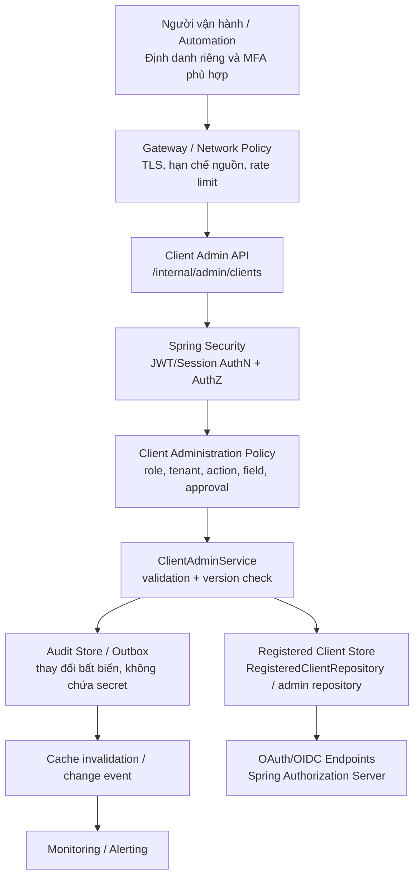
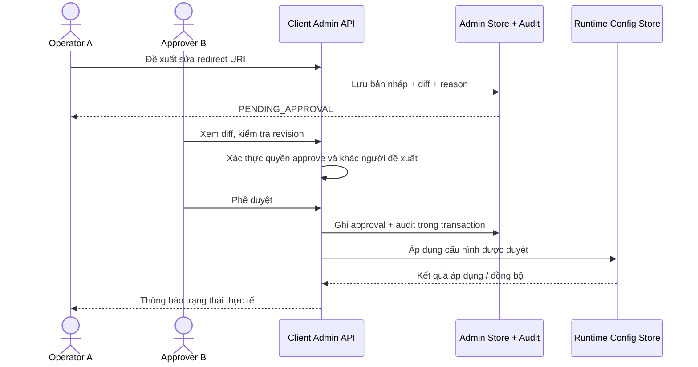

# Bảo vệ API quản trị client và ghi nhận thay đổi cấu hình

## 1. Vì sao quản trị client là bề mặt tấn công đặc biệt nhạy cảm?

Trong hệ thống **OAuth 2.0/OpenID Connect Authorization Server** xây dựng bằng **Spring Security** và **Spring Authorization Server** trên Spring Boot, thông tin đăng ký client quyết định một ứng dụng có thể tham gia luồng ủy quyền như thế nào. Một thao tác quản trị tưởng như đơn giản, chẳng hạn sửa `redirectUri` hoặc thêm một grant type, có thể thay đổi ranh giới tin cậy của toàn bộ nền tảng.

Ví dụ, hệ thống đặt phòng có client `booking-bff` đang dùng Authorization Code + PKCE và một redirect URI chính thức. Nếu kẻ tấn công chiếm được API quản trị rồi thêm redirect URI do mình kiểm soát, họ có thể tạo điều kiện cho việc chuyển hướng authorization response tới đích nguy hiểm. Nếu có thể thay client authentication method hoặc scope, họ còn có thể mở rộng khả năng sử dụng client ngoài chính sách đã phê duyệt.

Vì vậy, **API quản trị client là control plane bảo mật**. Cần bảo vệ nó với mức nghiêm ngặt tương xứng với khả năng chỉnh sửa chính sách của Authorization Server.

Bài học thuộc chương **Quản lý client** và tập trung vào cách **thiết kế, cấu hình, bảo mật, kiểm thử và vận hành** các thao tác quản trị trong Spring Boot. Sau bài học, bạn có thể:

1. Xác định ranh giới giữa endpoint OAuth/OIDC chuẩn và API quản trị client do hệ thống xây dựng.
2. Thiết kế xác thực, phân quyền, kiểm soát tenant và quyền thao tác cho người vận hành.
3. Bảo vệ các thuộc tính nhạy cảm: redirect URI, grant type, scope, authentication method, secret, JWK và token policy.
4. Ghi audit đầy đủ nhưng không làm lộ credential, token hoặc dữ liệu cá nhân không cần thiết.
5. Tổ chức cập nhật cấu hình có kiểm soát phiên bản, phê duyệt, khả năng rollback và hiệu lực nhất quán trên nhiều instance.
6. Xây dựng ma trận kiểm thử cho bảo mật và tính đúng đắn của API quản trị.

## 2. Phân biệt quản trị client với các giao thức OAuth/OIDC

**OAuth Client Registration** có thể được thực hiện theo nhiều cách: file cấu hình, cơ sở dữ liệu, công cụ nội bộ, API quản trị riêng hoặc triển khai chuẩn **Dynamic Client Registration** theo RFC 7591 và **Dynamic Client Registration Management** theo RFC 7592.

Spring Authorization Server cung cấp mô hình `RegisteredClient` và `RegisteredClientRepository`. Tuy nhiên, **đăng ký client trong repository không có nghĩa hệ thống mặc nhiên cung cấp một API quản trị CRUD đầy đủ, an toàn, có phân quyền, phê duyệt, lịch sử thay đổi và rollback**. Các tính năng này là trách nhiệm kiến trúc và nghiệp vụ của ứng dụng khi cần.

| Nhóm endpoint | Ai sử dụng? | Mục đích | Rủi ro nếu nhầm lẫn |
|---|---|---|---|
| `/oauth2/authorize`, `/oauth2/token` | OAuth clients và trình duyệt người dùng theo từng luồng | Thực hiện yêu cầu ủy quyền, phát hành token | Lấy API quản trị thay cho xác minh grant/client |
| `/.well-known/openid-configuration`, JWKS | Client/Relying Party/Resource Server | Công bố metadata và khóa công khai | Công khai thông tin quản trị nhạy cảm qua metadata |
| Endpoint đăng ký client động nếu triển khai | Client/actor theo cơ chế authorization của RFC tương ứng | Đăng ký/quản lý client qua giao thức chuẩn | Cho đăng ký hoặc đổi metadata không đúng credential/chính sách |
| **API quản trị client nội bộ** | Operator, automation hoặc quản trị viên được cấp quyền | Tạo, xem, sửa, ngừng hoạt động, xoay secret, phê duyệt cấu hình | Bị lạm dụng để chiếm client hoặc mở rộng quyền |
| UI quản trị client | Người vận hành được xác thực | Giao diện cho API quản trị và quy trình phê duyệt | CSRF, XSS, lộ secret hoặc kiểm tra quyền chỉ ở frontend |

Một thiết kế tham khảo dùng prefix riêng `/internal/admin/clients` và tách biệt policy với endpoint OAuth. Prefix chỉ là quy ước tổ chức, **không phải biện pháp bảo mật**. Mọi request vẫn phải trải qua xác thực, phân quyền và các ràng buộc dữ liệu ở backend.

> Nếu hệ thống không có nhu cầu tự đăng ký client qua API, không nên bật hoặc xây Dynamic Client Registration chỉ vì OAuth/OIDC có tiêu chuẩn tương ứng. Mỗi endpoint quản trị tăng thêm bề mặt tấn công.

## 3. Mô hình đe dọa: kẻ tấn công muốn thay đổi điều gì?

Xác định những cấu hình có thể tạo ra thay đổi bảo mật nghiêm trọng:

| Thuộc tính client | Ví dụ thay đổi nguy hiểm | Hậu quả tiềm tàng |
|---|---|---|
| `redirectUris` | Thêm URL do kẻ tấn công kiểm soát | Authorization response/code bị chuyển đến đích không mong muốn |
| `clientAuthenticationMethods` | Chuyển confidential client sang `none` | Giảm yêu cầu xác thực client tại Token Endpoint |
| `authorizationGrantTypes` | Bật grant không phù hợp | Mở rộng các con đường xin token |
| `scopes` | Thêm scope quản trị hoặc dữ liệu nhạy cảm | Client có thể yêu cầu quyền rộng hơn |
| `clientSecret` | Đọc hoặc thay bằng secret biết trước | Giả mạo confidential client |
| `jwkSetUrl` / khóa client | Chuyển tới nguồn khóa độc hại | Có thể làm sai niềm tin vào khóa xác thực client |
| `ClientSettings` | Tắt `requireProofKey` hoặc yêu cầu consent | Giảm bảo vệ Authorization Code và sự chấp thuận |
| `TokenSettings` | Kéo dài refresh token hoặc cho reuse không phù hợp | Tăng thời gian khai thác token bị đánh cắp |
| OIDC logout/redirect metadata | Ghi URI không đáng tin | Chuyển hướng nguy hiểm hoặc luồng logout không đúng |
| Client status/ownership | Kích hoạt client bị vô hiệu hóa hoặc chuyển tenant | Khôi phục hoặc cấp quyền vượt phạm vi quản lý |

Các hình thức tấn công thường gặp gồm:

- **Broken object-level authorization (BOLA/IDOR):** Operator có quyền với client A thay ID trong URL để sửa client B.
- **Broken function-level authorization:** Người chỉ được đọc metadata vẫn gọi được endpoint rotate secret hoặc mở rộng scopes.
- **Mass assignment/overposting:** API nhận toàn bộ JSON và tự ánh xạ vào `RegisteredClient`, làm cho trường ngoài ý định bị cập nhật.
- **Cross-tenant access:** Quản trị viên tenant X sửa client thuộc tenant Y.
- **Replay hoặc lost update:** Request cũ ghi đè thay đổi đã được phê duyệt sau đó.
- **Credential leakage:** Trả secret trong JSON, log request body hoặc lưu giá trị cũ trong audit diff.
- **Policy bypass:** Kiểm tra quyền ở UI/gateway nhưng service backend không kiểm tra lại.
- **Configuration drift:** Nhiều node đọc cấu hình client khác nhau hoặc cache chưa được cập nhật.

## 4. Kiến trúc bảo vệ đề xuất

Một ứng dụng vận hành thực tế có thể tách **lớp quản trị**, **lớp cấu hình client** và **lớp giao thức**:



Luồng lý tưởng khi cập nhật:

1. Xác thực người/automation thực hiện yêu cầu ở **ranh giới quản trị**.
2. Kiểm tra quyền đối với **hành động và đúng client/tenant**.
3. Kiểm tra dữ liệu đầu vào, kiểm tra chính sách và phiên bản đối tượng.
4. Nếu thay đổi rủi ro cao, thực hiện quy trình phê duyệt.
5. Lưu cấu hình và audit/outbox nhất quán.
6. Phát tín hiệu vô hiệu cache/cập nhật cấu hình cho các node.
7. Ghi nhận kết quả, metric và cảnh báo khi thay đổi nhạy cảm.

**Không để controller trực tiếp ghi database hoặc gọi `RegisteredClientRepository.save(...)` mà không có lớp validation, authorization và audit.**

## 5. Thiết kế quyền truy cập API quản trị

### 5.1. Tách người quản trị khỏi OAuth client thông thường

Một access token được cấp cho client với scope `bookings.read` **không cho phép** gọi API quản trị chỉ vì token hợp lệ. API quản trị cần chính sách về:

- **Issuer tin cậy:** Token từ hệ thống định danh được chỉ định để xác thực operator hoặc automation.
- **Audience cụ thể:** Token phải dành cho Admin API, không thể dùng access token của Bookings API thay thế.
- **Authority/role/action:** Ví dụ `clients.read`, `clients.write`, `clients.rotate-secret`, `clients.approve`.
- **Phạm vi sở hữu:** Tenant/project/environment nào người gọi được quản lý.
- **Bảo đảm xác thực:** Với thao tác nhạy cảm, có thể yêu cầu MFA, phiên xác thực gần đây hoặc cơ chế step-up.
- **Phân tách nhiệm vụ:** Người đề xuất một thay đổi có rủi ro cao không nhất thiết là người phê duyệt.

Đối với automation, dùng danh tính workload riêng và credential phù hợp với hạ tầng (ví dụ xác thực client bằng private key JWT hoặc mTLS khi hỗ trợ). Không dùng một shared admin secret cho tất cả công cụ.

### 5.2. Mô hình quyền chi tiết

Một mô hình tối thiểu có thể định nghĩa:

| Hành động | Quyền ví dụ | Ràng buộc bổ sung |
|---|---|---|
| Liệt kê client thuộc tenant | `clients.read` | Chỉ tenant được giao |
| Xem cấu hình đã che nhạy cảm | `clients.read` | Không trả secret hoặc private key |
| Tạo client | `clients.create` | Allowed templates, quota, tenant owner |
| Sửa metadata ít rủi ro | `clients.write` | Scope hành động + field allowlist |
| Sửa redirect URI/grant/scope | `clients.security-write` | Phê duyệt hoặc step-up tùy chính sách |
| Xoay secret | `clients.rotate-secret` | Credential mới chỉ được trả theo kênh an toàn |
| Disable client | `clients.disable` | Quy trình ứng cứu và kiểm tra token còn sống |
| Phê duyệt thay đổi | `clients.approve` | Không tự phê duyệt đề xuất của chính mình |
| Đọc audit | `clients.audit-read` | Phân quyền theo tenant, hạn chế PII |

Đây là **ví dụ thiết kế policy**, không phải scope Spring tự tạo. Kiểm tra quyền ở HTTP chain giúp loại request không có quyền chức năng, còn **service domain vẫn phải kiểm tra resource-level authorization** dựa vào client ID, owner, tenant và trường bị thay đổi.

### 5.3. Default-deny và quyền tối thiểu

Một operator chỉ quản lý tenant A không được ghi client tenant B. Hệ thống không nên mặc nhiên cho sửa toàn bộ trường khi người gọi chỉ được phép cập nhật tên hiển thị.

Không lấy tenant mục tiêu từ header/query do caller gửi làm bằng chứng quyền. Tenant trong request có thể được dùng để chọn đối tượng, nhưng quyết định cuối cùng phải đối chiếu **tenant đáng tin từ identity và dữ liệu sở hữu của client**.

## 6. Spring Security: tách riêng SecurityFilterChain cho Admin API

Một API quản trị nhận **Bearer access token**, không sử dụng cookie phiên và xử lý HTTP stateless, có thể có chain riêng. Ví dụ cấu trúc:

```java
@Configuration
@EnableWebSecurity
@EnableMethodSecurity
class ClientAdminSecurityConfig {

    @Bean
    @Order(1)
    SecurityFilterChain clientAdminApiChain(HttpSecurity http)
            throws Exception {

        http
            .securityMatcher("/internal/admin/**")
            .authorizeHttpRequests(authorize -> authorize
                .requestMatchers(
                    HttpMethod.GET, "/internal/admin/clients/**"
                ).hasAuthority("SCOPE_clients.read")
                .anyRequest().hasAuthority("SCOPE_clients.write"))
            .oauth2ResourceServer(oauth2 ->
                oauth2.jwt(Customizer.withDefaults()))
            .sessionManagement(session -> session
                .sessionCreationPolicy(SessionCreationPolicy.STATELESS))
            .csrf(csrf -> csrf.disable());

        return http.build();
    }
}
```

**Phạm vi đoạn mã:** Đây là minh họa **riêng chain quản trị Bearer-only**, không phải cấu hình đầy đủ cho Authorization Server. Vì `/internal/admin/**` không dùng cookie đăng nhập, việc tắt CSRF có thể chấp nhận trong chain đó. **Nếu API dùng browser cookie/session thì không được áp dụng nguyên mẫu này**; phải duy trì bảo vệ CSRF phù hợp.

Cần bổ sung và kiểm tra trong ứng dụng thật:

1. `JwtDecoder` tin cậy issuer/keys đúng cho Admin API.
2. **Audience validation** riêng, vì xác minh chữ ký và issuer không đủ để bảo đảm token dành cho Admin API.
3. Kiểm tra scope/role theo hành động thực tế; ví dụ trên chỉ đơn giản hóa GET so với request ghi.
4. Kiểm tra tenant và field-level policy ở service/method security.
5. CORS chỉ cho origin cần thiết nếu có frontend khác origin; không dùng `*` tùy tiện cùng credential.
6. Rate limit, timeout, audit và kiểm soát mạng phù hợp.
7. Filter chain riêng cho các endpoint OAuth/OIDC và login theo tài liệu Spring Authorization Server.

Cần lưu ý `@Order` và `securityMatcher`: Spring Security thường dùng chain đầu tiên khớp request. Chain bắt mọi request đặt trước chain Authorization Server hoặc Admin API có thể khiến endpoint đi sai cơ chế bảo vệ. Cấu hình phải có test routing chính xác cho `/internal/admin/**`, `/oauth2/**`, `/.well-known/**` và UI login.

### 6.1. Scope ở URL chưa đủ

Ví dụ người dùng có `SCOPE_clients.write` nhưng chỉ quản lý tenant `acme`. Endpoint sau vẫn cần từ chối nếu `targetClient` thuộc tenant khác:

```http
PATCH /internal/admin/clients/registered-client-123
Authorization: Bearer ADMIN_ACCESS_TOKEN
If-Match: "rev-18"
Content-Type: application/json

{
  "displayName": "Booking Portal"
}
```

Một kiểm tra trong service có thể diễn đạt như sau:

```java
// Hàm service/policy minh họa, không phải API dựng sẵn của Spring.
void authorizeUpdate(
        Authentication actor,
        ManagedClient current,
        ClientChangeRequest request) {

    clientAdminPolicy.assertCanManageTenant(
        actor, current.tenantId());

    clientAdminPolicy.assertCanChangeFields(
        actor, current, request.changedFields());
}
```

`clientAdminPolicy` và `ManagedClient` là các abstraction nghiệp vụ do ứng dụng định nghĩa. Việc kiểm tra dựa trên đối tượng **đã đọc từ storage tin cậy** tránh lỗi sửa tenant ID trong JSON để vượt quyền.

## 7. Thiết kế API quản trị: CRUD có ranh giới rõ

Không nhất thiết cần một REST CRUD cho phép PUT mọi field tùy ý. Nên mô hình hóa thao tác và rủi ro của chúng.

| Endpoint minh họa | Ngữ nghĩa | Bảo vệ đặc thù |
|---|---|---|
| `GET /internal/admin/clients` | Liệt kê client theo quyền | Pagination, filter tenant theo policy, không liệt kê client ngoài quyền |
| `GET /internal/admin/clients/{id}` | Xem cấu hình đã che bí mật | Authorization theo client và tenant |
| `POST /internal/admin/clients` | Tạo client có chủ đích | Kiểm tra template, redirect, grant, scope, ownership |
| `PATCH /internal/admin/clients/{id}` | Sửa một tập field được phép | Whitelist, version precondition, kiểm tra rủi ro |
| `POST /internal/admin/clients/{id}/rotate-secret` | Xoay secret | Step-up/approval, trả credential mới tối thiểu một lần |
| `POST /internal/admin/clients/{id}/disable` | Ngừng sử dụng client | Phân biệt hiệu lực với token đã phát hành |
| `POST /internal/admin/client-changes/{changeId}/approve` | Phê duyệt đề xuất | Separation of duties, revision check |
| `GET /internal/admin/clients/{id}/changes` | Truy xuất lịch sử | Audit permission, che dữ liệu nhạy cảm |

**Đây là API nội bộ do ứng dụng định nghĩa**, không phải endpoint được Spring Authorization Server mặc định xuất bản. RFC 7591/7592 mô tả hệ thống registration/management riêng; nếu triển khai các RFC đó, phải tôn trọng credential, luồng quyền và contract của RFC thay vì thay đổi ngữ nghĩa tùy ý.

### 7.1. Dùng ID ổn định

`RegisteredClient` có `id` nội bộ và `clientId` dùng trong giao thức. API quản trị có thể dùng **internal ID** làm khóa tài nguyên, không phụ thuộc vào tên hiển thị hay client ID có thể thay đổi theo chính sách.

Cần tránh cho người gọi thay `id` của đối tượng để chiếm bản ghi khác. Khi xử lý PATCH:

1. Đọc client bằng ID từ path.
2. Kiểm tra quyền với bản ghi được đọc.
3. Áp dụng patch chỉ trên những field thuộc allowlist.
4. Kiểm tra hợp lệ toàn bộ cấu hình mới.
5. So sánh revision và ghi atomic cùng audit.

Không map trực tiếp JSON client gửi vào cả entity nếu entity còn chứa secret hash, tenant ownership, trạng thái phê duyệt hoặc field bảo mật khác.

### 7.2. Các trạng thái nghiệp vụ hữu ích

Một hệ thống cần phê duyệt có thể sử dụng:

```text
DRAFT -> PENDING_APPROVAL -> APPROVED -> ACTIVE
                  |               |
                  v               v
               REJECTED         CANCELLED

ACTIVE -> DISABLED -> ARCHIVED
```

Đây là mô hình đề xuất của **client management layer**, không phải trạng thái mặc định của `RegisteredClient`. Không nên đồng nhất “client được lưu trong repository” với “client đã được duyệt để dùng trên production”.

Có thể giữ bản nháp/phê duyệt ở kho quản trị riêng và chỉ đồng bộ cấu hình **ACTIVE** được cho phép vào repository mà Authorization Server dùng. Nếu repository luôn chứa cả bản nháp, cần bảo đảm các bản nháp không thể được dùng để thực hiện grant.

## 8. Kiểm tra dữ liệu cấu hình trước khi ghi

### 8.1. Redirect URI

Với Authorization Code/OIDC, redirect URI là tài sản bảo mật cốt lõi. Validation cần dựa trên chuẩn và mô hình client:

- Scheme, host, port, path và những thành phần URI cho phép phải được kiểm tra.
- Trong môi trường web production, ưu tiên **HTTPS** và host được phê duyệt.
- Không dùng wildcard `https://*.example.com/callback` nếu không có contract giao thức rõ; thực hành chuẩn ưu tiên matching chặt, tránh open redirect.
- Không chấp nhận URI có `fragment` trong redirect URI đăng ký cho authorization redirect.
- Native/loopback clients có ngoại lệ và quy tắc riêng theo loại ứng dụng, cần áp dụng đúng chuẩn liên quan (ví dụ RFC 8252).
- Phân biệt redirect URI của authorization với post-logout redirect URI của OIDC nếu được hỗ trợ.
- Khi chuyển môi trường dev/staging/prod, không tự mang redirect URI nội bộ vào client production.

**Không tạo quy tắc “host chứa tên công ty” bằng `String.contains(...)`.** Hãy chuẩn hóa URI, kiểm tra đầy đủ origin/host/path theo policy đáng tin và chống các trường hợp hostname giả mạo, dấu chấm hậu tố hoặc redirect nhiều bước.

### 8.2. Grant type và authentication method

Những bất biến nên kiểm tra:

| Tổ hợp | Quy tắc thiết kế |
|---|---|
| Public client + Authorization Code | Phải dùng PKCE; không được coi client có shared secret an toàn |
| Confidential client | Yêu cầu phương thức xác thực client phù hợp tại Token Endpoint |
| Client Credentials | Chỉ cấp token đại diện cho client, không sinh user ID token |
| Refresh Token | Chỉ bật khi phù hợp grant/client và khả năng bảo vệ refresh token |
| `client_secret_basic` | Secret phải được tạo đủ entropy, bảo vệ và mã hóa băm phù hợp |
| `private_key_jwt` / mTLS | Cần quản lý khóa/chứng chỉ, binding và xoay vòng theo cấu hình hỗ trợ |

Không cho operator vô tình đổi confidential client thành public client hoặc bật grant cũ không phù hợp chỉ vì DTO có field `authorizationGrantTypes`.

### 8.3. Scope và token policy

Không cho phép cập nhật scope vượt danh sách quyền đã được tổ chức phê duyệt; ví dụ tenant chỉ được tạo clients có `bookings.read` và `bookings.write`, không thể thêm `admin.superuser`.

Kiểm tra giới hạn TTL hợp lý:

- Access token tối đa theo rủi ro và khả năng thu hồi.
- Refresh token timeout/rotation theo loại client.
- Authorization code TTL ngắn và yêu cầu PKCE.
- Client policy không được tắt consent hoặc PKCE trái quy tắc bảo mật bắt buộc.

Việc giảm TTL trong cấu hình mới thường chỉ ảnh hưởng **token phát hành sau thay đổi**, không tự viết lại thời hạn token đang sống. Cần quyết định riêng cách xử lý token hiện tại.

## 9. Quản lý client secret, khóa và credential

### 9.1. Không trả lại secret đã lưu

Một nguyên tắc API quan trọng: **các endpoint GET/LIST không được trả `clientSecret`**, kể cả trường được lưu dưới dạng hash. Hash vẫn là dữ liệu không cần thiết cho operator và có thể tăng rủi ro nếu bị lộ.

Ví dụ response an toàn:

```json
{
  "id": "registered-client-123",
  "clientId": "booking-bff",
  "status": "ACTIVE",
  "authenticationMethods": ["client_secret_basic"],
  "redirectUris": [
    "https://booking.example.com/login/oauth2/code/booking-bff"
  ],
  "scopes": ["openid", "bookings.read"],
  "hasClientSecret": true,
  "secretLastRotatedAt": "2026-11-01T02:00:00Z",
  "revision": 18
}
```

Đây là cấu trúc DTO do API quản trị thiết kế, không phải response mặc định của Spring Authorization Server.

### 9.2. Tạo và lưu secret

Khi tạo confidential client:

1. Sinh secret ngẫu nhiên bằng CSPRNG với entropy phù hợp.
2. Truyền credential mới qua kết nối bảo mật tới đúng người/automation có quyền nhận.
3. Chỉ hiển thị một lần theo thiết kế; không đưa lại trong GET hoặc audit.
4. Lưu dạng được bảo vệ theo `PasswordEncoder` hoặc cơ chế lưu credential tương thích với phương thức client authentication.
5. Đảm bảo hệ thống token endpoint dùng encoder/matcher tương thích.
6. Xóa/che secret ở log, trace, exception và hệ thống quan sát.

Với `client_secret_basic`, Spring Authorization Server thường kiểm tra secret bằng `PasswordEncoder` khi cấu hình client authentication. Khi dùng secret hash có prefix/encoder dạng khác nhau, phải kiểm tra cơ chế `PasswordEncoder` cụ thể của phiên bản đang chạy.

### 9.3. Xoay secret và giai đoạn chuyển tiếp

Đổi `RegisteredClient.clientSecret` có thể khiến client đang dùng secret cũ không xác thực được ngay. **`RegisteredClient` thường có một trường `clientSecret` hiện hành; không nên giả định Spring tự hỗ trợ hai secret cùng hiệu lực với giai đoạn chồng lấn.**

Quy trình xoay secret cần xác định:

- Ai được phát động/duyệt rotation.
- Credential mới được chuyển tới client bằng kênh nào.
- Khi nào secret mới bắt đầu được chấp nhận.
- Client có thể triển khai đồng bộ không, hay phải thiết kế cơ chế chuyển tiếp riêng đã được kiểm thử.
- Khi nào secret cũ bị vô hiệu hóa và người vận hành kiểm tra client đã chuyển đổi thành công.
- Cách rollback nếu xảy ra sự cố, không khôi phục secret đã bị lộ.

Với client hỗ trợ `private_key_jwt` hoặc mTLS, việc thay khóa/chứng chỉ có quy trình khác và cần cân nhắc tin cậy vào JWKS/certificate, thời gian cache và key rotation.

**Không đưa client secret vào audit diff**. Thay vì lưu giá trị, ghi sự kiện `CLIENT_SECRET_ROTATED`, định danh client, actor, thời điểm và các metadata không nhạy cảm.

## 10. Ghi nhận thay đổi cấu hình: audit phải trả lời được điều gì?

Một bản ghi audit tốt nên giúp trả lời:

- **Ai** thực hiện? Người quản trị hay workload nào, thông qua danh tính đã xác minh?
- **Đã làm gì?** Tạo, sửa, phê duyệt, từ chối, rotate secret, disable?
- **Tác động tới client nào?** Internal client ID, tenant, môi trường?
- **Khi nào?** Dấu thời gian nhất quán theo UTC và correlation/request ID.
- **Từ cấu hình nào sang cấu hình nào?** Revision trước/sau và các field đã thay đổi.
- **Vì sao?** Lý do thay đổi, ticket, approval reference nếu chính sách yêu cầu.
- **Kết quả?** Thành công, từ chối do policy, tranh chấp revision, lỗi hệ thống?
- **Đã có hiệu lực chưa?** Cấu hình lưu xong, được duyệt và node nào đã nhận bản mới?

### 10.1. Schema audit minh họa

```json
{
  "eventId": "evt-93a1",
  "eventType": "CLIENT_CONFIGURATION_UPDATED",
  "occurredAt": "2026-11-16T03:12:00Z",
  "actor": {
    "subject": "operator-417",
    "kind": "HUMAN",
    "authMethod": "MFA"
  },
  "target": {
    "registeredClientId": "registered-client-123",
    "clientId": "booking-bff",
    "tenantId": "tenant-a",
    "environment": "production"
  },
  "change": {
    "fromRevision": 18,
    "toRevision": 19,
    "fields": {
      "redirectUris": {
        "before": [
          "https://booking.example.com/login/oauth2/code/booking-bff"
        ],
        "after": [
          "https://booking.example.com/oauth2/callback"
        ]
      }
    }
  },
  "decision": {
    "outcome": "APPROVED_AND_APPLIED",
    "approvalId": "approval-442",
    "reasonCode": "APP_CALLBACK_MIGRATION"
  },
  "correlationId": "req-80e2"
}
```

Giá trị và định danh trên chỉ để minh họa. Trước khi lưu audit thực tế, cần xác định phân loại dữ liệu: đôi khi hostnames, tenant IDs hoặc thông tin operator cũng cần giới hạn truy cập và retention.

### 10.2. Không ghi những gì?

**Không ghi vào audit/log**:

- Raw `clientSecret`, hash secret, private key, token quản trị, refresh token, authorization code.
- Header `Authorization`, `Cookie`, giá trị `Set-Cookie`.
- Toàn bộ request/response body trước khi redaction.
- Dữ liệu cá nhân không cần thiết để chứng minh thay đổi.
- Secret cũ hoặc secret mới trong phần `before`/`after` của diff.

Khi đổi secret, audit nên có:

```json
{
  "eventType": "CLIENT_SECRET_ROTATED",
  "targetId": "registered-client-123",
  "field": "clientSecret",
  "newSecretValueRecorded": false
}
```

### 10.3. Audit attempt và audit state change

Hai loại sự kiện bổ sung cho nhau:

| Loại | Khi phát sinh | Mục đích |
|---|---|---|
| **Security/access audit** | Yêu cầu quản trị bị từ chối, đăng nhập thất bại, denied tenant access | Phát hiện tấn công và lạm dụng quyền |
| **Configuration change audit** | Cấu hình được đề xuất, phê duyệt, commit hoặc rollback | Tái dựng lịch sử và trách nhiệm thay đổi |

Một yêu cầu bị từ chối vì không có quyền có thể cần audit ngay cả khi không có thay đổi DB. Nhưng **không lưu bản ghi “áp dụng thành công” trước khi transaction thực sự commit**.

## 11. Cập nhật nguyên tử và kiểm soát tranh chấp

### 11.1. Vì sao last-write-wins nguy hiểm?

Giả sử hai operator cùng mở revision 7:

1. A dự định sửa redirect URI thành URL đã được kiểm tra.
2. B dự định tắt grant không còn dùng.
3. A lưu revision 8.
4. B dùng object cũ từ revision 7 và ghi đè toàn bộ client, vô tình khôi phục redirect URI cũ hoặc xóa thay đổi của A.

Đây là **lost update**, đặc biệt nguy hiểm ở client registration vì cấu hình bảo mật có thể bị khôi phục trái ý muốn.

Nên dùng **optimistic concurrency control**:

- GET trả `revision` hoặc HTTP `ETag`.
- PATCH/PUT yêu cầu `If-Match` hoặc revision hiện tại.
- Service chỉ commit nếu revision khớp.
- Nếu không khớp, trả **HTTP 412 Precondition Failed** (với `If-Match`) hoặc lỗi conflict phù hợp và yêu cầu người dùng tải lại.
- Kiểm tra revision trong cùng transaction/CAS, không chỉ so sánh trước khi ghi.

```http
PATCH /internal/admin/clients/registered-client-123
Authorization: Bearer ADMIN_ACCESS_TOKEN
If-Match: "rev-18"
Content-Type: application/json

{
  "redirectUris": [
    "https://booking.example.com/oauth2/callback"
  ],
  "reason": "Callback migration"
}
```

Nếu revision đã thành 19, request này phải bị từ chối thay vì ghi đè.

### 11.2. Cấu trúc service có audit

Ví dụ giả mã Java theo hướng hexagonal/service, thể hiện thứ tự nghiệp vụ:

```java
@Transactional
public ClientView updateClient(
        AuthenticatedAdmin actor,
        String registeredClientId,
        ClientUpdateCommand command,
        long expectedRevision) {

    ManagedClient current =
        clientAdminStore.findForUpdate(registeredClientId)
            .orElseThrow(ClientNotFoundException::new);

    clientAdminPolicy.checkCanUpdate(
        actor, current, command.changedFields());

    revisionPolicy.requireMatch(
        current.revision(), expectedRevision);

    ManagedClient proposed =
        clientConfigurationValidator.applyAndValidate(
            current, command);

    approvalPolicy.requireApprovalIfNeeded(
        actor, current, proposed);

    ManagedClient saved =
        clientAdminStore.saveNextRevision(proposed);

    auditStore.append(
        ClientChangeAudit.maskedDiff(
            actor, current, saved, command.reason()));

    outboxStore.enqueue(
        ClientConfigurationChanged.of(
            saved.id(), saved.revision()));

    return ClientView.redacted(saved);
}
```

Các class `AuthenticatedAdmin`, `ManagedClient`, `ClientAdminStore`, `ClientConfigurationValidator`, `AuditStore` và `OutboxStore` là **abstraction minh họa do ứng dụng phải triển khai**. Đoạn mã không phải API có sẵn trong Spring Authorization Server.

Một triển khai thật cần bảo đảm database transaction bao trùm cấu hình, revision và audit/outbox **khi chúng cùng nằm trong kho có thể transaction**. Nếu nhiều kho khác nhau, cần saga/retry hoặc một cơ chế nhất quán tương ứng; không giả định một `@Transactional` có thể đảm bảo atomic trên mọi external service.

### 11.3. Outbox cho đồng bộ nhiều instance

Nếu cập nhật client thành công nhưng phát sự kiện đến message broker thất bại, các instance cache client có thể dùng trạng thái cũ. Mô hình **transactional outbox** giúp:

1. Trong một transaction, commit bản cấu hình và bản ghi outbox.
2. Worker phát sự kiện từ outbox tới các consumer.
3. Consumer xử lý idempotent theo `clientId/internalId` + revision.
4. Theo dõi lần phát thất bại, retry và dead-letter.
5. Với thay đổi rủi ro cao, kiểm tra thời điểm các node thực sự nhìn thấy revision mới.

Eventual consistency vẫn tồn tại nếu có cache và hệ thống phân tán. API quản trị nên phân biệt trạng thái **đã commit** và **đã đồng bộ/đã có hiệu lực trên tất cả node** nếu sản phẩm cần hiển thị hai trạng thái đó.

## 12. Hiệu lực của thay đổi: client registration khác token đã phát hành

Một cấu hình client mới tác động vào **các yêu cầu tiếp theo**, nhưng token, session và consent có thể tồn tại độc lập.

| Thay đổi | Điều thường bị ảnh hưởng ngay ở Authorization Server | Điều không tự thay đổi |
|---|---|---|
| Xóa một redirect URI | Authorization Request mới dùng URI cũ bị từ chối | Authorization code/token đã phát hành trước đó không tự biến mất |
| Gỡ grant type | Yêu cầu grant tương lai bị kiểm tra theo cấu hình mới | Access token đã cấp không tự mất hiệu lực |
| Gỡ scope | Yêu cầu mới không được cấp scope đã gỡ | JWT còn hạn có thể vẫn chứa scope cũ |
| Giảm access token TTL | Token mới phát hành theo policy mới | `exp` của JWT cũ thường không đổi |
| Xoay client secret | Client authentication về sau sử dụng secret mới | Token đã phát hành có thể vẫn hợp lệ |
| Disable client | Có thể chặn một số luồng mới nếu triển khai status check | Token cũ có thể còn dùng được; cần cơ chế thu hồi riêng |
| Xóa client khỏi registration | Có thể khiến một số endpoint không tìm thấy client | Resource Server tự xác minh JWT có thể vẫn nhận token đã ký |
| Thay đổi owner/tenant | Quản trị về sau dùng ownership mới | Consent và authorization cũ cần được xem xét/migrate/revoke theo policy |

Đặc biệt, `RegisteredClient` **không có một trạng thái disable chuẩn có hiệu lực tức thì trên toàn bộ token trong mọi phiên bản và mọi Resource Server**. Nếu ứng dụng thêm `status=DISABLED` ở lớp quản trị, phải xác định nơi nào thực thi trạng thái đó và cách đồng bộ.

### 12.1. Disable khẩn cấp

Nếu mục tiêu là chặn một client đã bị xâm phạm:

1. Chặn cấp authorization/token mới cho client theo policy và dữ liệu cập nhật nhất quán.
2. Thu hồi/đánh dấu không còn hợp lệ các refresh token liên quan nếu cần.
3. Xác định access token còn sống sẽ bị xử lý ra sao tại Resource Server.
4. Với JWT self-contained, cân nhắc TTL ngắn, denylist/token version hoặc kiểm tra revocation bổ sung; logout hay sửa registration không đủ.
5. Theo dõi hoạt động của client và cảnh báo các lần tiếp tục sử dụng credential cũ.
6. Cập nhật audit/ticket điều tra và quyết định điều kiện khôi phục.

**Không ghi trong UI “client đã bị vô hiệu hóa ngay lập tức” khi thực tế chỉ chặn việc đăng ký hoặc cấp token mới**.

### 12.2. Consent sau khi đổi scope hoặc owner

Consent đã lưu theo `registeredClientId` và `principalName` có thể tồn tại sau khi registration thay đổi. Khi client được cấp thêm scope nhạy cảm, consent cũ **không tự đồng ý scope mới**. Khi gỡ client hoặc chuyển owner, cần chính sách xử lý consent cũ và audit quyết định đó.

## 13. Phê duyệt, rollback và thay đổi bảo mật

Không phải mọi cập nhật đều cần phê duyệt nhiều người, nhưng những trường có khả năng nâng quyền hoặc làm lộ credential nên được đánh dấu rủi ro.

| Loại thay đổi | Ví dụ | Chính sách gợi ý |
|---|---|---|
| Thấp | Đổi mô tả hiển thị | Owner được sửa, audit sau commit |
| Trung bình | Đổi contact hoặc metadata không ảnh hưởng giao thức | Owner + kiểm tra trường, revision |
| Cao | Thêm redirect URI production, grant, scope nhạy cảm | Approval tách người, policy review, kiểm thử trước |
| Cao | Tắt PKCE hoặc consent | Mặc định từ chối nếu trái baseline bảo mật |
| Cao | Đổi client auth method/JWK | Review, key verification, rollout |
| Khẩn cấp | Disable client nghi bị xâm phạm | Đường thao tác có quyền riêng, audit, cảnh báo, diễn tập |

### 13.1. Quy trình hai bước



Không được giả định phê duyệt một bản nháp cũ luôn an toàn. Khi revision client đã thay đổi trong thời gian chờ duyệt, cần yêu cầu **rebase/re-review** thay vì áp thay đổi với dữ liệu đã lạc hậu.

### 13.2. Rollback không phải khôi phục mọi thứ

Rollback một bản cấu hình có thể giúp phục hồi redirect URI hoặc grant type trước đó, nhưng:

- Secret đã bị lộ **không nên được khôi phục**.
- Token đã phát hành dưới policy cũ **không tự bị thu hồi**.
- Client đã chuyển callback URI có thể không tương thích với rollback.
- Consent mới hoặc dữ liệu phê duyệt phát sinh sau cấu hình cũ vẫn cần xử lý.

Vì vậy, rollback phải tạo **revision mới** và audit một thay đổi mới, thay vì xóa lịch sử hoặc ghi lại revision cũ như chưa từng có thay đổi.

## 14. Xử lý lỗi và phản hồi an toàn

API quản trị phải dùng HTTP status rõ ràng và tránh làm lộ sự tồn tại của client ngoài phạm vi quyền.

| Tình huống | Phản hồi phù hợp | Ghi chú |
|---|---|---|
| Chưa xác thực | `401 Unauthorized` | Không tiết lộ client |
| Đã xác thực nhưng thiếu quyền | `403 Forbidden` | Một số thiết kế dùng `404` để không lộ object existence |
| Client không tồn tại hoặc bị ẩn theo policy | `404 Not Found` | Tránh enumeration |
| Input cấu hình sai | `400 Bad Request` hoặc `422 Unprocessable Content` | Trả mã lỗi field, không lộ dữ liệu nhạy cảm |
| Revision không khớp `If-Match` | `412 Precondition Failed` | Không ghi đè |
| Thiếu precondition bắt buộc | `428 Precondition Required` | Hữu ích với API yêu cầu ETag |
| Cấu hình xung đột chính sách | `409 Conflict` hoặc lỗi validation phù hợp | Ví dụ scope/grant không tương thích |
| Rate limit | `429 Too Many Requests` | Không lộ chi tiết kỹ thuật nội bộ |
| Sự cố phía server | `5xx` | Error ID để tra log đã che thông tin |

Ví dụ response:

```json
{
  "type": "https://api.example.com/problems/client-policy-violation",
  "title": "Client configuration rejected",
  "status": 422,
  "code": "CLIENT_REDIRECT_URI_NOT_ALLOWED",
  "correlationId": "req-80e2"
}
```

Error details nên đủ để operator xử lý nhưng không trả về client secret, access token, stacktrace, SQL query hay cấu hình thuộc tenant khác. Với các thao tác tạo client/rotate secret, cần kế hoạch **idempotency** để retry không tạo nhiều client hoặc nhiều secret ngoài ý muốn.

## 15. Kiểm thử bảo mật API quản trị client

### 15.1. Kiểm thử xác thực và phân quyền

| Ca kiểm thử | Thiết lập | Kết quả mong đợi |
|---|---|---|
| Không Bearer token | Gọi `GET/PATCH` | `401` |
| Token hết hạn hoặc signature sai | Gọi API | `401` |
| Token đúng issuer nhưng sai audience | Token dành cho Bookings API | Bị từ chối |
| Có quyền read nhưng gọi PATCH | `SCOPE_clients.read` | `403` |
| Có quyền write nhưng sai tenant | Sửa client của tenant khác | Bị từ chối, không thay đổi dữ liệu |
| Không có quyền rotate | Gọi `rotate-secret` | Bị từ chối, không sinh credential |
| Operator tự approve đề xuất | Same actor ID | Bị từ chối theo SoD policy |
| Automation thiếu step-up bắt buộc | Thay đổi nhạy cảm | Bị chặn theo policy |
| Thử ID không tồn tại | GET/PATCH | Không lộ client khác hoặc dữ liệu hệ thống |
| Request có field ngoài allowlist | JSON `{"clientSecretHash":"..."}` | Bị từ chối hoặc bỏ qua an toàn, không ghi |

### 15.2. Kiểm thử validation giao thức

| Thao tác | Kết quả cần chứng minh |
|---|---|
| Thêm redirect URI không được cho phép | Không được lưu |
| Thêm wildcard/URI có fragment | Bị từ chối khi không đúng chuẩn/policy |
| Public client tắt PKCE | Bị từ chối theo baseline |
| Bật grant không thuộc danh sách cho phép | Bị từ chối |
| Thêm scope vượt tenant | Bị từ chối |
| Set token TTL vượt giới hạn | Bị từ chối |
| Đổi authentication method trái client type | Bị từ chối |
| Xoay secret | Secret cũ/mới xử lý đúng chính sách, không lộ trong GET/audit |
| Disable client | Các request cấp token mới bị chặn theo thiết kế, token cũ được xử lý theo policy |

### 15.3. Kiểm thử nhất quán và audit

1. **Ghi thành công:** Cấu hình revision tăng, audit và outbox được commit, không có secret.
2. **Transaction thất bại:** Cấu hình không đổi, không có audit “đã áp dụng” sai sự thật.
3. **Concurrent PATCH:** Chỉ một request thắng revision/CAS, request còn lại bị từ chối có kiểm soát.
4. **Approval stale:** Đề xuất dựa trên revision cũ không tự áp dụng.
5. **Đồng bộ nhiều instance:** Một node cập nhật, node khác quan sát được revision mới theo SLA.
6. **Outbox retry:** Sự kiện phát lại không tạo cấu hình/audit trùng gây sai lịch sử.
7. **Secret redaction:** Response, logs, traces, audit, analytics không chứa raw secret/hash.
8. **Query audit:** Người có quyền phù hợp chỉ thấy lịch sử trong tenant/phạm vi được phép.
9. **Rollback:** Sinh revision và audit mới; không xóa lịch sử.
10. **Regression OAuth/OIDC:** Sau thay đổi, các luồng Authorization Code + PKCE, Client Credentials, Refresh Token và OIDC vẫn đúng theo grant được phép.

### 15.4. Kiểm thử HTTP với Spring Security

Các integration test nên chạy qua `MockMvc` hoặc HTTP integration test của ứng dụng, không chỉ gọi trực tiếp service method. Trường hợp kiểm thử 401/403/tenant cần xác nhận **SecurityFilterChain được chọn đúng** và service còn thực thi policy khi method được gọi ngoài controller.

Khi test JWT, cần kiểm tra rõ issuer/audience, scope/authority mapping và các thời điểm token hết hạn. Các unit test policy có thể dùng principal giả lập, nhưng kết quả unit test không thay thế kiểm thử với filter chain thật.

Không cần bắt đầu bằng test tất cả trường hợp ngẫu nhiên; ưu tiên **các đường có thể nâng quyền hoặc làm lộ credential**, sau đó bổ sung regression theo incident và thay đổi chính sách.

## 16. Vận hành, giám sát và phản ứng sự cố

### 16.1. Metric và cảnh báo nên có

- Số thao tác tạo/sửa/disable/rotate client theo môi trường và loại hành động.
- Số lần `401`, `403`, `412` và validation error ở Admin API.
- Số lần sửa redirect URI, grant, scope hoặc authentication method nhạy cảm.
- Đề xuất chờ duyệt quá lâu hoặc bị từ chối liên tục.
- Số phiên bản cấu hình chưa đồng bộ giữa các node/instance.
- Tần suất client authentication thất bại sau secret rotation.
- Tình trạng outbox backlog, thất bại đồng bộ, audit write failure.
- Những thay đổi ngoài giờ làm việc hoặc ngoài quy trình bình thường, nếu phù hợp policy.

Alert nên hướng đến điều kiện có ý nghĩa, ví dụ **thêm redirect URI production cho client nhạy cảm** hoặc **liên tục thất bại khi rotate secret**, không ghi credential vào nội dung cảnh báo.

### 16.2. Quy trình xử lý sự cố

Khi nghi ngờ tài khoản quản trị bị chiếm:

1. Ngăn identity thực hiện thêm thao tác quản trị; thu hồi phiên/token quản trị.
2. Đọc audit để xác định client, field, revision, thời điểm và nguồn thay đổi.
3. Đánh giá từng thay đổi về khả năng gây lộ code/token, nâng scope hoặc thay authentication method.
4. Đưa cấu hình về trạng thái an toàn bằng một revision mới có audit.
5. Xoay credential/khóa nếu cần; vô hiệu hóa authorization/token theo phạm vi sự cố.
6. Kiểm tra thực tế Resource Server có còn chấp nhận token đáng ngờ hay không.
7. Phục hồi hoạt động, giám sát và cập nhật policy/test để ngăn tái diễn.

Chỉ rollback cấu hình không đủ khi authorization code, access token hoặc refresh token đã phát hành trong thời gian client bị thay đổi.

### 16.3. Bảo quản bằng chứng

Audit nên được lưu trong kho có phân quyền truy cập rõ, retention phù hợp, chiến lược chống sửa/xóa trái phép và khả năng export phục vụ kiểm toán. Khi yêu cầu bằng chứng mạnh, cân nhắc append-only storage, hash chaining, chữ ký hoặc storage có tính chống chỉnh sửa; đừng coi một bảng SQL có quyền UPDATE/DELETE rộng là log bất biến.

## 17. Những nhầm lẫn phổ biến

**“API quản trị nằm sau VPN nên không cần kiểm tra quyền.”** Sai. Kiểm soát mạng hữu ích nhưng không thay thế xác thực và phân quyền theo hành động, client, tenant.

**“Có `SCOPE_clients.write` là sửa được mọi client.”** Sai. Phải kiểm tra đối tượng, môi trường, tenant, ownership và field.

**“`RegisteredClientRepository` có `save` nên đã có CRUD quản trị hoàn chỉnh.”** Sai. API repository phục vụ lưu/truy xuất mô hình client; nghiệp vụ quản trị cần validation, approval, audit, revision và quản lý trạng thái bổ sung.

**“Chỉ cần kiểm tra ở frontend.”** Sai. Attacker có thể gọi API trực tiếp, bỏ qua UI.

**“Có audit log từ HTTP gateway là đủ.”** Không chắc. Gateway có thể không biết diff cấu hình đã commit; trong khi log raw request lại có nguy cơ chứa secret. Cần audit nghiệp vụ với giá trị đã che.

**“Cập nhật client làm token cũ tự hết hiệu lực.”** Sai. JWT, authorization, session và consent có vòng đời độc lập.

**“Sau khi rotate secret có thể xem lại secret cũ từ database.”** Không nên. Secret phải được lưu bảo vệ và chỉ hiển thị khi phát hành theo thiết kế.

**“Rollback là xóa bản ghi audit vừa ghi.”** Sai. Rollback tạo sự kiện và revision mới, giữ lịch sử để truy vết.

**“Rate limit và CORS đủ để bảo vệ API.”** Sai. CORS không phải cơ chế authorization; rate limiting chỉ giảm lạm dụng, không chặn người dùng đã xác thực nhưng thiếu quyền.

## 18. Checklist review trước khi đưa API quản trị lên production

- **Biên giới:** Endpoint quản trị có được tách khỏi giao thức OAuth/OIDC và không mở công khai ngoài nhu cầu?
- **Danh tính:** Issuer, audience, signature và thời hạn của token quản trị đã được kiểm tra?
- **Quyền:** Kiểm tra role/scope, tenant, owner, action và field ở backend?
- **Step-up:** Thao tác nhạy cảm cần MFA, approval hoặc nguyên tắc hai người chưa?
- **Input:** Redirect URI, grant, scope, auth method, PKCE, TTL và metadata được xác minh theo policy?
- **Credential:** Secret sinh an toàn, hash/bảo vệ khi lưu, không xuất hiện trong GET/audit/log?
- **Concurrency:** Mỗi thay đổi có revision, precondition và kiểm tra CAS/transaction?
- **Lịch sử:** Audit ghi actor, target, diff đã che, lý do, kết quả và revision?
- **Đồng bộ:** Cache các node được cập nhật có kiểm soát và có trạng thái áp dụng?
- **Hiệu lực:** Disable/sửa client ảnh hưởng gì đến access/refresh token đã phát hành?
- **Kiểm thử:** Đã thử 401, 403, cross-tenant, overposting, concurrent update, rollback, secret rotation?
- **Ứng cứu:** Có quy trình khóa người quản trị, disable client, revoke token và điều tra audit?

### Kiến thức cốt lõi

API quản trị client là nơi kiểm soát **ai có thể thay đổi các điều kiện tin cậy của Authorization Server**. Bảo vệ API này cần hơn một filter xác thực: phải kết hợp identity đáng tin, authorization chi tiết, xác minh cấu hình, quản lý credential, kiểm soát revision, phê duyệt thay đổi nhạy cảm, audit có redaction và cơ chế đồng bộ runtime.

Với Spring Security và Spring Authorization Server, hãy dùng `RegisteredClient`/`RegisteredClientRepository` làm nền tảng lưu client, xây **dịch vụ quản trị** có policy riêng và giữ endpoint OAuth/OIDC hoạt động theo chuẩn. **Ghi thay đổi cấu hình, kiểm soát hiệu lực và thu hồi token là các trách nhiệm liên quan nhưng không thể thay thế cho nhau.**

## Tài liệu tham khảo

- [Spring Authorization Server — Core Model / Components](https://docs.spring.io/spring-authorization-server/reference/core-model-components.html)
- [Spring Authorization Server — Reference](https://docs.spring.io/spring-authorization-server/reference/)
- [Spring Security — Authorization Architecture](https://docs.spring.io/spring-security/reference/servlet/authorization/architecture.html)
- [Spring Security — Multiple HttpSecurity Instances](https://docs.spring.io/spring-security/reference/servlet/configuration/java.html#_multiple_httpsecurity_instances)
- [Spring Security — OAuth 2.0 Resource Server JWT](https://docs.spring.io/spring-security/reference/servlet/oauth2/resource-server/jwt.html)
- [RFC 6749 — The OAuth 2.0 Authorization Framework](https://www.rfc-editor.org/rfc/rfc6749)
- [RFC 7591 — OAuth 2.0 Dynamic Client Registration Protocol](https://www.rfc-editor.org/rfc/rfc7591)
- [RFC 7592 — OAuth 2.0 Dynamic Client Registration Management Protocol](https://www.rfc-editor.org/rfc/rfc7592)
- [RFC 7009 — OAuth 2.0 Token Revocation](https://www.rfc-editor.org/rfc/rfc7009)
- [RFC 7636 — Proof Key for Code Exchange](https://www.rfc-editor.org/rfc/rfc7636)
- [RFC 8252 — OAuth 2.0 for Native Apps](https://www.rfc-editor.org/rfc/rfc8252)
- [RFC 9700 — Best Current Practice for OAuth 2.0 Security](https://www.rfc-editor.org/rfc/rfc9700)
- [OWASP API Security Top 10 (2023)](https://owasp.org/API-Security/editions/2023/en/0x11-t10/)
