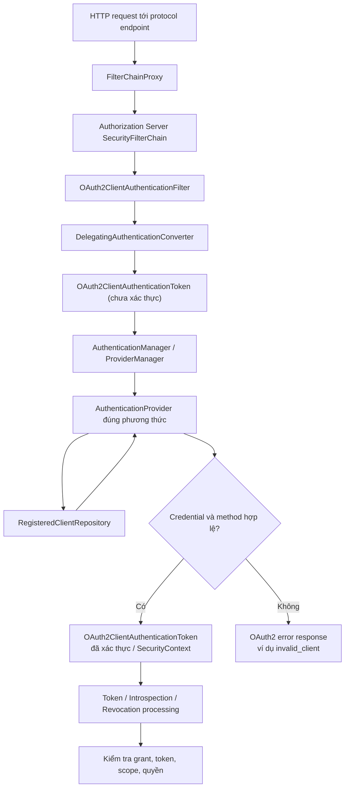
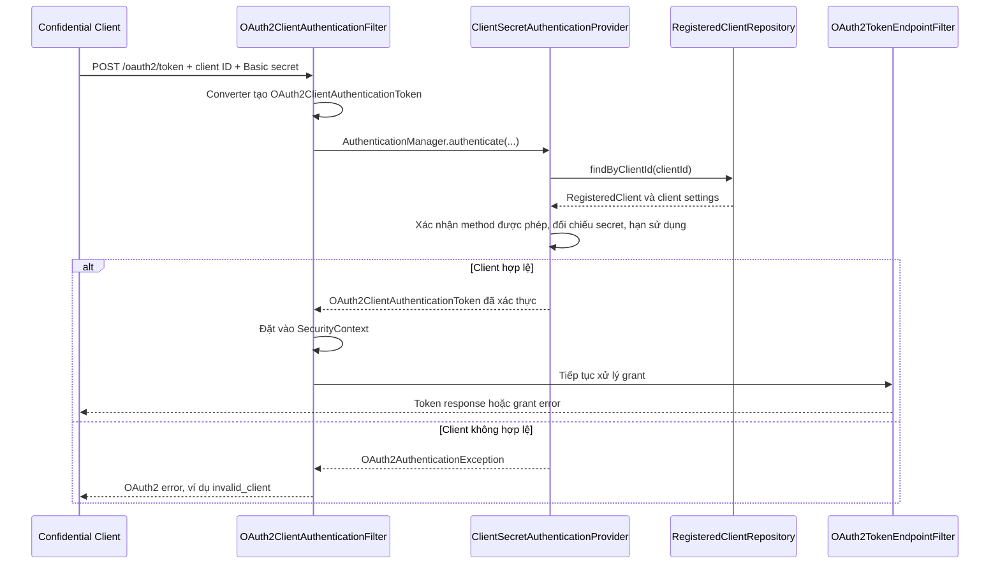

# Client Authentication Endpoint Filter và quá trình nhận diện client

## 1. Vì sao Authorization Server phải nhận diện client?

Giả sử một nền tảng có hai ứng dụng gọi API: **Orders Web** cho người dùng đăng nhập và **Reports Service** chạy báo cáo tự động. Cả hai đều yêu cầu token từ cùng một OAuth 2.0 Authorization Server, nhưng có mức độ tin cậy khác nhau:

- **Orders Web** có thể là một ứng dụng chạy trong trình duyệt, không giữ được bí mật dài hạn. Nó sử dụng Authorization Code + PKCE để liên kết lần đổi code với yêu cầu ban đầu.
- **Reports Service** chạy trên máy chủ được kiểm soát và có thể giữ client secret, khóa riêng hoặc chứng chỉ. Nó dùng Client Credentials để lấy access token cho chính dịch vụ.

Authorization Server phải tìm ra **client nào đang yêu cầu**, client đăng ký **phương thức xác thực nào**, bằng chứng được gửi có hợp lệ không, và client có được phép dùng **grant type, scope, redirect URI** liên quan hay không.

Trong Spring Security và Spring Authorization Server, bước xác thực client được tổ chức quanh **`OAuth2ClientAuthenticationFilter`** do **`OAuth2ClientAuthenticationConfigurer`** cấu hình. Bài thuộc chương **Xác thực client** trong module `SPRING_SECURITY_OAUTH2_OIDC_AUTHORIZATION_SERVER`; mục tiêu là học cách thiết kế, cấu hình, bảo mật, kiểm thử và vận hành việc xác thực client trong Spring Boot.

**Điểm then chốt:** `client_id` là **định danh** để tra cứu cấu hình, **không phải bí mật**. Biết client ID chưa chứng minh bên gửi request thực sự sở hữu credential của client. Bước chứng minh phụ thuộc loại client và phương thức xác thực được đăng ký.

### Sau bài này, bạn cần nắm được

1. Phân biệt **client identification**, **client authentication**, **user authentication**, **authorization grant validation** và **token validation**.
2. Giải thích đường đi từ HTTP request qua `OAuth2ClientAuthenticationFilter`, `AuthenticationConverter`, `AuthenticationProvider` tới `SecurityContext`.
3. Nhận biết các phương thức `client_secret_basic`, `client_secret_post`, `private_key_jwt`, `client_secret_jwt`, mTLS và `none`.
4. Cấu hình `RegisteredClient` và điểm mở rộng `clientAuthentication(...)` trong Spring Authorization Server.
5. Kiểm thử được các trường hợp sai client secret, chữ ký JWT assertion, certificate, PKCE và cấu hình phương thức xác thực.

## 2. Năm khái niệm dễ bị nhầm lẫn

| Khái niệm | Câu hỏi nó trả lời | Ví dụ |
| --- | --- | --- |
| **Nhận diện client (identification)** | Client khai báo mình là ai? | `client_id=reports-service` |
| **Xác thực client (authentication)** | Client chứng minh danh tính đã khai báo bằng gì? | HTTP Basic với secret, JWT assertion có chữ ký, chứng chỉ TLS |
| **Xác thực người dùng (end-user authentication)** | Người dùng đang đăng nhập là ai? | Form login, MFA, xác thực qua IdP |
| **Kiểm tra authorization grant** | Yêu cầu cấp token này có đúng grant, code, PKCE và quyền đã cấp không? | `grant_type=authorization_code`, code còn hiệu lực, `code_verifier` khớp |
| **Xác minh access token tại Resource Server** | API có nên chấp nhận token này và cho phép thao tác không? | Kiểm tra chữ ký, issuer, audience, scope, quyền theo dữ liệu |

Việc **xác thực client thành công không đồng nghĩa được cấp token**: token endpoint còn phải kiểm tra grant type được đăng ký, request hợp lệ, scope, authorization code hoặc refresh token và các chính sách khác.

Ngược lại, người dùng đăng nhập thành công tại `/oauth2/authorize` cũng **không thay thế client authentication** khi confidential client đổi code ở `/oauth2/token`.

### Confidential client và public client

Theo mô hình OAuth 2.0:

- **Confidential client** có khả năng giữ credential khỏi người dùng và bên không đáng tin, ví dụ backend web hoặc dịch vụ máy chủ. Nó thường phải xác thực tại token endpoint.
- **Public client** không thể giữ bí mật dài hạn, ví dụ ứng dụng SPA thuần trong trình duyệt hoặc ứng dụng mobile phát hành cho người dùng. Nó thường đăng ký `ClientAuthenticationMethod.NONE` và dùng **Authorization Code + PKCE**.

Một client đăng ký `none` **không có nghĩa ứng dụng đã chứng minh được danh tính bằng mật khẩu hoặc khóa**. PKCE chứng minh bên đổi code giữ `code_verifier` của giao dịch, giúp ngăn đánh cắp code; nó không biến ứng dụng chạy trong thiết bị người dùng thành confidential client.

## 3. OAuth2ClientAuthenticationFilter nằm ở đâu?

Trong ứng dụng Authorization Server, Spring Security chọn `SecurityFilterChain` phù hợp với request. Bộ lọc xác thực client nằm trong chain giao thức do `OAuth2AuthorizationServerConfigurer` lắp đặt.



Các bước chính:

1. **Filter** xác định request có thuộc loại cần xác thực client không.
2. **Converter** trích client ID, secret, JWT assertion, chứng chỉ hoặc tham số public client từ HTTP request rồi tạo đối tượng `OAuth2ClientAuthenticationToken`.
3. **AuthenticationManager** chọn `AuthenticationProvider` phù hợp với phương thức client đang dùng.
4. **Provider** truy xuất `RegisteredClient` và kiểm tra phương thức đã đăng ký, credential và điều kiện cần thiết.
5. **Success handler** đặt kết quả xác thực client vào `SecurityContext` để các bước xử lý protocol endpoint phía sau sử dụng.
6. **Failure handler** trả lỗi OAuth 2.0 phù hợp, không cho request đi tiếp như thể client đã được tin cậy.

Thành công ở bước 5 **chưa phải token response thành công**. Ví dụ token endpoint vẫn có thể trả `invalid_grant` nếu authorization code hết hạn.

### 3.1. Filter hoạt động trên endpoint nào?

Trong cấu hình mặc định được mô tả trong Spring Authorization Server, client authentication được áp dụng cho các request thích hợp tới:

- **`/oauth2/token`** — cấp token theo grant type được hỗ trợ.
- **`/oauth2/introspect`** — truy vấn trạng thái token, yêu cầu xác thực bên gọi theo chính sách.
- **`/oauth2/revoke`** — yêu cầu thu hồi token theo quy tắc giao thức.

Các tính năng khác như **Device Authorization** hoặc **Pushed Authorization Requests** có thể liên quan xác thực client tùy phiên bản, endpoint, loại client và cách bật tính năng. Luôn kiểm tra **matcher thực tế** và reference guide của phiên bản sử dụng.

Tại **`/oauth2/authorize`**, trình duyệt mang `client_id` để máy chủ nhận diện cấu hình client và kiểm tra `redirect_uri`, scope, PKCE. Không gửi **client secret** qua trình duyệt để cố “xác thực client” ở authorization endpoint.

Ở **`/userinfo`**, ứng dụng thông thường dùng **access token** theo OIDC để lấy claim người dùng. Đó là cơ chế bảo vệ tài nguyên của endpoint, không đồng nhất với client secret authentication tại token endpoint.

## 4. Các converter và provider mặc định

Trong những dòng Spring Authorization Server/Spring Security hiện đại, `OAuth2ClientAuthenticationConfigurer` thường thiết lập một **`DelegatingAuthenticationConverter`** và nhiều **`AuthenticationProvider`**:

| Converter | Đầu vào nhận diện | Provider tương ứng |
| --- | --- | --- |
| `ClientSecretBasicAuthenticationConverter` | `Authorization: Basic ...` | `ClientSecretAuthenticationProvider` |
| `ClientSecretPostAuthenticationConverter` | `client_id` và `client_secret` trong form body | `ClientSecretAuthenticationProvider` |
| `JwtClientAssertionAuthenticationConverter` | `client_assertion_type` + `client_assertion` | `JwtClientAssertionAuthenticationProvider` |
| `X509ClientCertificateAuthenticationConverter` | Chứng chỉ client đã được TLS stack xác thực và chuyển an toàn đến ứng dụng | `X509ClientCertificateAuthenticationProvider` |
| `PublicClientAuthenticationConverter` | Thông tin của public client và bằng chứng liên quan giao dịch code/PKCE | `PublicClientAuthenticationProvider` |

Các converter **chỉ biến đầu vào HTTP thành đối tượng yêu cầu xác thực**; chúng không phải nơi kết luận credential đúng. Provider thực hiện việc kiểm tra. Thành phần X.509 và các phương thức mTLS phụ thuộc phiên bản/configuration; bảng mô tả API ở các dòng hiện đại, không khẳng định mọi bản cũ đều có X.509 mặc định.

Theo giao diện tổng quát:

```java
// Pseudocode để hiểu luồng, không thay thế implementation của Spring.
Authentication candidate = authenticationConverter.convert(request);
Authentication result = authenticationManager.authenticate(candidate);
SecurityContextHolder.getContext().setAuthentication(result);
// Request tiếp tục qua filter chain đến endpoint.
```

Điểm đáng chú ý là `OAuth2ClientAuthenticationToken` có thể mô tả **client ban đầu chưa xác thực** rồi **client đã được provider chấp nhận**. Token này thuộc bước xác thực **OAuth client**, không phải access token JWT được gửi cho Resource Server.

## 5. Tra cứu RegisteredClient và quyết định xác thực

`RegisteredClientRepository` là nguồn thông tin mà Authorization Server sử dụng để tìm client đã đăng ký:



Một `RegisteredClient` thường có:

| Trường/thiết lập | Vai trò |
| --- | --- |
| `id` | Khóa nội bộ của bản ghi client, không nhất thiết là `client_id` |
| `clientId` | Định danh công khai dùng khi client gửi request |
| `clientSecret` và `clientSecretExpiresAt` | Dữ liệu bí mật đã được mã hóa lưu trữ và thời hạn nếu có |
| `clientAuthenticationMethods` | Những phương thức được phép, ví dụ `client_secret_basic` hoặc `private_key_jwt` |
| `authorizationGrantTypes` | Grant mà client được phép dùng |
| `redirectUris` | Các callback được đăng ký cho redirect flow |
| `scopes` | Những quyền client có thể yêu cầu |
| `clientSettings` | PKCE, consent, JWKS URL, JWT assertion signing algorithm, chứng chỉ... |
| `tokenSettings` | Thời hạn và định dạng token, chính sách refresh token... |

Một request có `client_id` tồn tại trong database vẫn có thể bị từ chối nếu **phương thức xác thực không nằm trong tập đã đăng ký**, secret hết hạn, chữ ký không hợp lệ hoặc client không đáp ứng chính sách.

### 5.1. Nhận diện client và phát hành token là hai quyết định

Ví dụ `reports-service` xác thực Basic thành công nhưng cố dùng `grant_type=password`, dù client chỉ đăng ký `client_credentials`. AuthenticationProvider của client có thể chấp nhận danh tính client; **token endpoint phải từ chối grant không được phép**.

Tương tự, một client được phép `orders.read` nhưng yêu cầu scope `orders.admin` phải bị từ chối hoặc được xử lý đúng theo quy tắc scope của giao thức và chính sách đã đăng ký. Không tự gán thêm scope chỉ vì client đã xác thực thành công.

## 6. Các phương thức Client Authentication

### 6.1. `client_secret_basic` — HTTP Basic

Confidential client gửi thông tin xác thực trong header:

```http
POST /oauth2/token HTTP/1.1
Host: auth.example.com
Authorization: Basic <base64-of-client-credentials>
Content-Type: application/x-www-form-urlencoded

grant_type=client_credentials&scope=reports.read
```

Trong OAuth 2.0, Basic dùng `client_id` và `client_secret` theo quy tắc mã hóa của RFC 6749; Base64 **chỉ là mã hóa biểu diễn, không phải mã hóa bảo mật**. Bắt buộc dùng HTTPS. Server lấy client ID từ Basic, tra cứu `RegisteredClient`, xác minh phương thức `client_secret_basic` được cho phép, rồi so sánh secret bằng `PasswordEncoder` phù hợp.

Đây là phương thức thường dễ tích hợp cho backend-to-backend khi hai bên bảo vệ được secret. Không đặt Basic header vào log hoặc gửi secret trong URL/query string.

### 6.2. `client_secret_post` — secret trong form body

```http
POST /oauth2/token HTTP/1.1
Host: auth.example.com
Content-Type: application/x-www-form-urlencoded

grant_type=client_credentials&
client_id=reports-service&
client_secret=<secret-value>&
scope=reports.read
```

Phương thức này được dùng khi client không hỗ trợ Basic hoặc có yêu cầu tương thích. Nhược điểm là secret có thể bị ghi lại bởi HTTP/body logging, APM hoặc proxy. Chỉ cho phép khi đã đăng ký `ClientAuthenticationMethod.CLIENT_SECRET_POST`, có TLS và chính sách che dữ liệu nhạy cảm. Theo OAuth 2.0, xác thực bằng cách gửi secret trong request body **không nên là lựa chọn ưu tiên**.

**Không gửi đồng thời nhiều cách xác thực client** trong cùng request, ví dụ Basic header kèm `client_secret` body, để tránh mâu thuẫn hoặc xử lý khác nhau giữa các thành phần.

### 6.3. `private_key_jwt` — chứng minh quyền sở hữu khóa riêng

Client tạo một **JWT client assertion** được ký bằng khóa riêng của nó. Authorization Server kiểm tra chữ ký qua khóa công khai/JWKS đã được liên kết với client. Request điển hình:

```http
POST /oauth2/token HTTP/1.1
Host: auth.example.com
Content-Type: application/x-www-form-urlencoded

grant_type=client_credentials&
scope=reports.read&
client_assertion_type=urn%3Aietf%3Aparams%3Aoauth%3Aclient-assertion-type%3Ajwt-bearer&
client_assertion=<signed-client-assertion-JWT>
```

Claim minh họa của assertion:

```json
{
  "iss": "reports-service",
  "sub": "reports-service",
  "aud": "https://auth.example.com/oauth2/token",
  "iat": 1780000000,
  "exp": 1780000060,
  "jti": "unique-assertion-id-42"
}
```

Đây là giá trị minh họa, không phải assertion hợp lệ vì chưa kèm chữ ký. `iss` và `sub` thường cùng xác định client, `aud` phải phù hợp với giá trị Authorization Server chấp nhận, `exp` giới hạn hiệu lực. Provider xác minh thuật toán và chữ ký theo **cấu hình của RegisteredClient**, không tin khóa được client tự giới thiệu trong request nếu khóa đó chưa được đăng ký/tin cậy.

**`jti` và chống phát lại:** Không nên mặc nhiên giả định mọi bản triển khai sẽ lưu `jti` đã dùng để từ chối phát lại. Nếu threat model yêu cầu single-use assertion, phải kiểm tra khả năng của phiên bản hiện tại, bổ sung replay store hoặc validator/chính sách thích hợp.

`private_key_jwt` phù hợp khi cần tránh secret dùng chung và muốn kiểm soát vòng đời khóa. Đổi lại, client phải bảo vệ khóa riêng, công bố/đăng ký public key đáng tin và xử lý rotation cùng thời gian lệch đồng hồ.

### 6.4. `client_secret_jwt` — JWT assertion ký bằng secret dùng chung

Client cũng gửi JWT assertion nhưng ký bằng khóa đối xứng bắt nguồn từ client secret. Authorization Server xác minh bằng bí mật đã đăng ký và thuật toán phù hợp.

Đây vẫn là **shared-secret authentication**: ai có secret có khả năng tạo assertion mới. Nó có ưu điểm JWT assertion ngắn hạn, nhưng không tạo bảo mật bất đối xứng như `private_key_jwt`. Hãy quản lý chiều dài/entropy secret, thuật toán được phép, clock skew và replay theo chính sách.

### 6.5. `tls_client_auth` và `self_signed_tls_client_auth` — mTLS

Với **mutual TLS**, client trình diện chứng chỉ trong quá trình TLS handshake; máy chủ xác minh chuỗi tin cậy/chứng chỉ và liên kết nó với `RegisteredClient`. Hai hình thức trong RFC 8705:

- **`tls_client_auth`:** xác thực bằng chứng chỉ được cấp theo hạ tầng PKI; cấu hình client có thể ràng buộc subject DN hoặc thuộc tính chứng chỉ phù hợp.
- **`self_signed_tls_client_auth`:** sử dụng chứng chỉ tự ký đã được đăng ký; có thể liên kết qua JWKS chứa chứng chỉ công khai.

Các dòng Spring Authorization Server hiện đại có `X509ClientCertificateAuthenticationConverter` và `X509ClientCertificateAuthenticationProvider`; cần kiểm tra hỗ trợ của **đúng phiên bản** và cấu hình TLS/certificate verifier trước khi sử dụng. Nếu TLS kết thúc tại gateway, Authorization Server không được tin một header chứa chứng chỉ do client Internet tự đặt; thông tin chứng chỉ phải được chuyển qua **kênh được bảo vệ và chỉ từ proxy tin cậy**.

Chứng chỉ client có thể được dùng cùng cơ chế **certificate-bound access token** nếu các bên hỗ trợ và cấu hình đúng; Resource Server phải kiểm tra ràng buộc chứng chỉ khi nhận token. Không giả định bật mTLS client authentication tự động khiến mọi access token thành sender-constrained token.

### 6.6. `none` — public client cùng PKCE

Một SPA/mobile app không có secret đáng tin. Client đăng ký `ClientAuthenticationMethod.NONE` và, khi dùng Authorization Code Flow, phải thiết kế PKCE thích hợp:

```text
1. Client tạo code_verifier và code_challenge = S256(code_verifier).
2. /oauth2/authorize nhận client_id, code_challenge, redirect_uri...
3. Authorization Server gắn challenge vào authorization code.
4. Callback trả code cho client.
5. /oauth2/token nhận client_id, code và code_verifier.
6. Authorization Server kiểm tra code/PKCE, redirect URI và policy.
```

Việc public client **không có client secret** là tình huống dự kiến của giao thức, không phải lỗi cần “sửa” bằng cách nhúng secret vào JavaScript hoặc ứng dụng mobile. Một secret nhúng vào gói client có thể bị trích xuất và không chứng minh ứng dụng đáng tin.

## 7. Bảng chọn phương thức theo loại client

| Loại client | Phương thức thường cân nhắc | Ghi chú bảo mật |
| --- | --- | --- |
| Backend web (BFF/server-side session) | `client_secret_basic`, `private_key_jwt` hoặc phương pháp mạnh hơn phù hợp | Secret/khóa riêng phải ở phía server; nên dùng PKCE cùng Authorization Code |
| Dịch vụ nội bộ gọi API máy với máy | `client_secret_basic`, `private_key_jwt`, mTLS | Hạn chế scope/grant và bảo vệ credential bằng secret manager/KMS khi thích hợp |
| SPA chạy thuần trong trình duyệt | `none` + Authorization Code + PKCE | Không nhúng secret; phòng chống XSS và bảo vệ lưu token |
| Ứng dụng mobile phân phối cho người dùng | `none` + Authorization Code + PKCE | Sử dụng system browser/deep link hoặc app link được cấu hình an toàn |
| Thiết bị hạn chế input | Chính sách của Device Authorization Grant và loại client phù hợp | Xem rõ yêu cầu client authentication của endpoint/version, polling, user-code abuse |
| Đối tác ngoài tổ chức với yêu cầu chứng thực mạnh | `private_key_jwt` hoặc mTLS khi hai bên hỗ trợ | Ràng buộc khóa/chứng chỉ, tin cậy JWKS, rotation và quy trình thu hồi |

Không chọn phương thức chỉ vì nó “có sẵn”. Hãy xét khả năng giữ bí mật của client, mô hình triển khai, rủi ro bị đánh cắp credential, thời hạn sử dụng và năng lực vận hành khóa/chứng chỉ.

## 8. Cấu hình RegisteredClient trong Spring Authorization Server

Ví dụ sau sử dụng **Spring Authorization Server 1.x** để minh họa chính sách của hai client. Những import được lược bỏ cho dễ tập trung vào nội dung; biến `encodedSecret` là secret **đã được PasswordEncoder mã hóa**, không phải mật khẩu viết cứng.

```java
// Confidential backend: Reports Service
RegisteredClient reports = RegisteredClient.withId(
                UUID.randomUUID().toString())
        .clientId("reports-service")
        .clientSecret(encodedSecret)
        .clientAuthenticationMethod(
                ClientAuthenticationMethod.CLIENT_SECRET_BASIC)
        .authorizationGrantType(AuthorizationGrantType.CLIENT_CREDENTIALS)
        .scope("reports.read")
        .build();

// Public app: Orders Mobile / SPA
RegisteredClient ordersPublic = RegisteredClient.withId(
                UUID.randomUUID().toString())
        .clientId("orders-public")
        .clientAuthenticationMethod(ClientAuthenticationMethod.NONE)
        .authorizationGrantType(AuthorizationGrantType.AUTHORIZATION_CODE)
        .redirectUri("https://app.example.com/oauth2/callback")
        .scope("orders.read")
        .clientSettings(ClientSettings.builder()
                .requireProofKey(true)
                .build())
        .build();

RegisteredClientRepository repository =
        new InMemoryRegisteredClientRepository(reports, ordersPublic);
```

Đoạn code tạo repository **in-memory cho demo**. Trong production, dùng `JdbcRegisteredClientRepository` hoặc kho phù hợp với môi trường; bảo đảm client ID ổn định, chính sách cấp quyền được quản trị và secret không bị ghi log.

Với secret-based method, Authorization Server lưu giá trị được **PasswordEncoder** xử lý, và provider so sánh giá trị client gửi với bản lưu. Một hướng tạo `encodedSecret` minh họa:

```java
PasswordEncoder encoder =
        PasswordEncoderFactories.createDelegatingPasswordEncoder();

// rawSecret được lấy từ secret manager hoặc cấu hình bảo mật,
// không ghi trực tiếp vào source code.
String encodedSecret = encoder.encode(rawSecret);
```

Không tự hash bằng SHA-256 đơn thuần để thay `PasswordEncoder` khi cần xác minh client secret. Khi credential thay đổi, quản lý việc cập nhật kho client và việc chuyển đổi của các client đang sử dụng secret cũ.

### 8.1. Đăng ký `private_key_jwt`

Ví dụ phần đăng ký client dùng JWT bất đối xứng:

```java
RegisteredClient partner = RegisteredClient.withId(
                UUID.randomUUID().toString())
        .clientId("partner-service")
        .clientAuthenticationMethod(
                ClientAuthenticationMethod.PRIVATE_KEY_JWT)
        .authorizationGrantType(AuthorizationGrantType.CLIENT_CREDENTIALS)
        .scope("reports.read")
        .clientSettings(ClientSettings.builder()
                .jwkSetUrl("https://partner.example.com/.well-known/jwks.json")
                .tokenEndpointAuthenticationSigningAlgorithm(
                        SignatureAlgorithm.RS256)
                .build())
        .build();
```

`jwkSetUrl` cần thuộc domain/tài nguyên đã được **đăng ký và kiểm soát**. Không lấy một URL JWKS tùy ý từ client assertion rồi tải khóa để tin chữ ký; thiết kế như vậy có thể biến hệ thống thành nơi chấp nhận khóa của kẻ tấn công hoặc phát sinh SSRF. Cân nhắc caching, timeout, khả năng JWKS không sẵn sàng và rotation `kid`.

## 9. Cấu hình Client Authentication Endpoint Filter

### 9.1. Vị trí trong `OAuth2AuthorizationServerConfigurer`

Ở Spring Authorization Server 1.x, `OAuth2ClientAuthenticationConfigurer` được cấu hình qua `clientAuthentication(...)`:

```java
@Bean
@Order(1)
SecurityFilterChain authorizationServerSecurityFilterChain(
        HttpSecurity http) throws Exception {

    OAuth2AuthorizationServerConfigurer authorizationServer =
            OAuth2AuthorizationServerConfigurer.authorizationServer();

    http
        .securityMatcher(authorizationServer.getEndpointsMatcher())
        .with(authorizationServer, server ->
            server.clientAuthentication(clientAuthentication ->
                clientAuthentication
                    // Thêm converter/provider riêng nếu thật sự cần.
                    // .authenticationConverter(customConverter)
                    // .authenticationProvider(customProvider)
                    // .errorResponseHandler(customErrorHandler)
            )
        )
        .authorizeHttpRequests(authorize ->
            authorize.anyRequest().authenticated()
        );

    return http.build();
}
```

Đây là **khung cấu hình tập trung vào client authentication**; để chạy Authorization Server thật còn cần các bean như `RegisteredClientRepository`, `OAuth2AuthorizationService`, `AuthorizationServerSettings`, khóa ký khi dùng JWT/OIDC, và một chain đăng nhập cho người dùng nếu hỗ trợ Authorization Code. Hãy dùng API/import đúng dòng Spring Boot và Spring Authorization Server được cài.

Ở **Spring Security 7.x**, cách vào DSL khác:

```java
http.oauth2AuthorizationServer(server ->
    server.clientAuthentication(clientAuthentication -> {
        // Tùy chỉnh các authenticationConverter/provider/handler nếu cần.
    })
);
```

Không ghép mẫu DSL 7.x và import của phiên bản 1.x theo cách tùy tiện; nên sử dụng reference guide đúng phiên bản dự án.

### 9.2. Các điểm mở rộng chính xác

| DSL | Giai đoạn | Dùng khi nào? |
| --- | --- | --- |
| `authenticationConverter(...)` | Trước xác thực | Thêm converter chuyển credential từ request thành `OAuth2ClientAuthenticationToken` |
| `authenticationConverters(...)` | Trước xác thực | Kiểm tra, thêm hoặc thay thứ tự danh sách converter mặc định |
| `authenticationProvider(...)` | Xác thực | Thêm provider xử lý method/credential mới |
| `authenticationProviders(...)` | Xác thực | Tùy chỉnh danh sách provider và validator chuyên biệt |
| `authenticationSuccessHandler(...)` | Sau xác thực thành công | Thực hiện xử lý kết quả, bảo đảm SecurityContext chứa client đã được chấp nhận |
| `errorResponseHandler(...)` | Sau xác thực thất bại | Trả OAuth 2.0 error theo chuẩn và che chi tiết nhạy cảm |

Những method này được `OAuth2ClientAuthenticationConfigurer` chuyển thành cấu hình của `OAuth2ClientAuthenticationFilter`. Không cần viết một servlet filter mới chỉ để xác minh Basic secret khi framework đã có `ClientSecretAuthenticationProvider`.

### 9.3. Tùy chỉnh validator của JWT assertion

Với `private_key_jwt`, Spring có `JwtClientAssertionDecoderFactory` và validator mặc định cho những claim quan trọng như `iss`, `sub`, `aud`, `exp` và `nbf` (nếu có). Khi cần policy riêng, ví dụ hạn chế tuổi assertion hoặc kiểm tra một claim hợp đồng, cấu hình **validator factory** cho `JwtClientAssertionAuthenticationProvider`.

Đây là điểm mở rộng phù hợp hơn việc tạo token endpoint riêng. Khi custom validator, **phải giữ các kiểm tra chuẩn**, không vô tình thay thế toàn bộ validator mặc định bằng một hàm chỉ đọc claim bổ sung.

### 9.4. Tùy chỉnh xác thực mTLS

Khi dùng `tls_client_auth`, Spring cung cấp điểm mở rộng verifier trong `X509ClientCertificateAuthenticationProvider`. Có thể cần so khớp Subject Distinguished Name hoặc Subject Alternative Name với cấu hình `RegisteredClient`. Chứng chỉ phải được chuyển tới provider từ TLS stack đáng tin, không từ một header client tự khai báo.

## 10. Xử lý lỗi: `invalid_client` khác `invalid_grant`

Khi client authentication thất bại, handler của filter trả phản hồi OAuth 2.0 tương ứng, thường là **`invalid_client`**. Theo RFC 6749, token endpoint có thể trả **HTTP 401** khi xác thực client thất bại; nếu client đã thử xác thực qua HTTP `Authorization` header, máy chủ phải đáp ứng phù hợp với cơ chế đó (ví dụ header `WWW-Authenticate`).

Một phản hồi minh họa:

```http
HTTP/1.1 401 Unauthorized
Content-Type: application/json
Cache-Control: no-store
Pragma: no-cache

{
  "error": "invalid_client"
}
```

Không tiết lộ cho client bên ngoài những thông tin như `client_id` có tồn tại hay không, secret sai hay hết hạn, khóa nào được tìm thấy hoặc chi tiết stack trace. Các thông tin phục vụ vận hành nên nằm trong log nội bộ có kiểm soát, không chứa credential.

| Tình huống | Lớp xử lý chính | Lỗi thường gặp / hướng điều tra |
| --- | --- | --- |
| Không có credential khi confidential client bắt buộc xác thực | Client auth filter/provider | `invalid_client` |
| Client secret sai hoặc đã hết hạn | Client auth provider | `invalid_client` |
| Client khai `client_secret_post` nhưng chỉ đăng ký `client_secret_basic` | Client auth provider | `invalid_client` |
| Chữ ký JWT assertion sai hoặc `aud` không được chấp nhận | JWT client assertion provider | `invalid_client` |
| Client xác thực thành công nhưng `authorization_code` hết hạn | Grant provider tại token endpoint | `invalid_grant` |
| Client xác thực thành công nhưng dùng grant chưa được cho phép | Token endpoint/provider | `unauthorized_client` hoặc lỗi phù hợp ngữ cảnh |
| Scope yêu cầu vượt phạm vi cho phép | Token endpoint/provider | `invalid_scope` hoặc phản hồi theo quy tắc scope áp dụng |
| PKCE verifier sai khi đổi code | Authorization code / public client validation | `invalid_grant` hoặc lỗi giao thức phù hợp theo vị trí kiểm tra |
| JWT access token không đủ quyền gọi API | Resource Server | HTTP 403 hoặc lỗi bearer-token phù hợp, **không phải client-auth error** |

Mã lỗi thực tế còn phụ thuộc grant, phiên bản framework và giai đoạn xảy ra lỗi. Vì vậy, khi chẩn đoán cần xem **endpoint, HTTP status, OAuth error code và log correlation** thay vì đoán từ một thông điệp chung.

## 11. Các rủi ro bảo mật cần thiết kế phòng vệ

### 11.1. Credential bị lộ

Đối với secret-based authentication, rủi ro lớn nhất là credential bị lộ từ source code, file cấu hình, CI/CD log, request body log, APM, crash dump hoặc máy chủ bị chiếm quyền. **TLS là bắt buộc khi truyền credential**, nhưng không bảo vệ credential đã nằm trong log. Nên dùng secret manager, phân quyền truy cập, rotation và tắt logging của các header/body nhạy cảm.

### 11.2. Confusion giữa các phương thức

Không chấp nhận secret trong form body chỉ vì một converter có thể đọc được trường đó; provider phải kiểm tra phương thức đã đăng ký. Nếu cho phép nhiều phương thức trên cùng client để di trú, cần đặt thời hạn và chính sách rõ ràng. Đừng để một cấu hình yếu hơn trở thành lối đi vòng cho client vốn phải dùng xác thực mạnh.

### 11.3. Replay JWT assertion

JWT assertion ký đúng nhưng bị đánh cắp trong thời gian hiệu lực vẫn có thể bị phát lại nếu không có chính sách replay. Đặt `exp` ngắn, kiểm tra `iss`/`sub`/`aud`, hạn chế clock skew và đánh giá khả năng lưu `jti` đã sử dụng. Cũng nên giới hạn thuật toán ký theo registration, không tin `alg` tự khai báo nếu thuật toán đó chưa được cho phép.

### 11.4. Key và certificate rotation

Với `private_key_jwt`, quản lý phiên bản khóa (`kid`), JWKS cache, khả năng tạm thời chấp nhận khóa cũ và điều kiện thu hồi. Với mTLS, giám sát thời hạn certificate, CRL/OCSP hoặc chính sách PKI theo hệ thống; nếu TLS termination tại proxy, bảo vệ chặng truyền chứng chỉ đã xác minh đến backend.

### 11.5. Client authentication không bảo vệ access token sau phát hành

Sau khi đã có access token, Resource Server vẫn phải xác minh issuer, audience, thời hạn, scope và quyền nghiệp vụ. PKCE và client secret không làm access token tự động chống bị đánh cắp. Nếu yêu cầu proof-of-possession, cân nhắc sender-constrained access token như mTLS-bound token hoặc DPoP khi hệ thống/phiên bản hỗ trợ và được cấu hình đúng.

## 12. Ma trận kiểm thử các phương thức Client Authentication

| Ca kiểm thử | Đối tượng | Kết quả mong đợi |
| --- | --- | --- |
| Confidential client dùng Basic đúng, grant/scope hợp lệ | `client_secret_basic` | Client được xác thực; token endpoint tiếp tục xử lý và trả token theo policy |
| Basic secret sai, thiếu hoặc hết hạn | Client auth | Từ chối `invalid_client`, không cấp token |
| Basic và body secret cùng xuất hiện | Client auth | Từ chối request không phù hợp hoặc tuân theo cơ chế xử lý an toàn; không coi đây là hai credential độc lập |
| Đăng ký chỉ Basic nhưng gửi body secret | `RegisteredClient` method validation | Không chấp nhận phương thức chưa đăng ký |
| Client ID lạ | Repository/provider | Không cấp token; thông báo bên ngoài không làm lộ tồn tại của client |
| Secret đúng nhưng `grant_type` không được phép | Token endpoint | Từ chối grant dù client auth thành công |
| Assertion `private_key_jwt` hợp lệ | JWT provider | Xác thực nếu issuer, audience, chữ ký, thuật toán và thời hạn hợp lệ |
| Assertion sai `aud`, `exp` hoặc chữ ký | JWT provider | Từ chối client, không cấp token |
| Assertion dùng `jti` lặp lại | JWT provider / replay policy | Hành vi theo chính sách chống replay đã cấu hình; test phải chứng minh có hoặc không có kiểm tra |
| Chứng chỉ mTLS không khớp registration | X.509 provider | Từ chối client |
| Public client dùng Authorization Code + PKCE đúng | `none` + PKCE | Có thể đổi code hợp lệ; không cần client secret |
| Public client thiếu/wrong verifier | PKCE validation | Không đổi được code |
| Authorization code đã dùng lại | Grant validation | Từ chối, không cấp token lần hai |
| Introspection/revocation không có auth phù hợp | Client auth cho protocol endpoint | Từ chối theo chính sách, không tiết lộ token state |
| Secret xuất hiện trong log khi bật debug | Logging/observability | Test phát hiện và khắc phục việc log dữ liệu nhạy cảm |

Các kịch bản này nên kết hợp **integration test qua HTTP thật** với bài kiểm tra converter/provider. Với mTLS và JWT assertion, nên có môi trường test chứng chỉ/khóa được kiểm soát để phân biệt lỗi **TLS handshake**, lỗi **client authentication** và lỗi **grant validation**.

### 12.1. Đo đúng lớp đang kiểm thử

- Muốn kiểm thử **Basic authentication**, dùng registered client có secret và grant hợp lệ, chỉ sửa header Basic.
- Muốn kiểm thử **PKCE**, dùng public client và một authorization code hợp lệ, thay `code_verifier` trong yêu cầu token.
- Muốn kiểm thử **JWT assertion claim**, ký assertion với **khóa test được tin** nhưng thay claim mong muốn; nếu chỉ sửa payload trên JWT cũ, chữ ký sẽ sai trước khi validator chuyên biệt chạy.
- Muốn kiểm thử **grant authorization**, giữ credential client đúng rồi yêu cầu grant/scope chưa đăng ký.

Việc tách lớp giúp xác định nguyên nhân thực tế và tránh một test `invalid_client` bị hiểu nhầm là kiểm tra PKCE hay scope.

## 13. Quan sát và vận hành an toàn

Nên giám sát tỷ lệ thất bại của `/oauth2/token`, `/oauth2/introspect` và `/oauth2/revoke` theo **mã lỗi, phương thức xác thực, nhóm client đã ẩn danh và thời gian**, không thu thập credential. Cần đánh dấu những tăng đột biến của `invalid_client`, thất bại JWT assertion do clock drift, chứng chỉ gần hết hạn, lỗi lấy JWKS hoặc hàng loạt lần thử client ID.

Một số tình huống thực tế:

| Triệu chứng | Nơi kiểm tra đầu tiên |
| --- | --- |
| Tất cả client Basic đột nhiên thất bại | Secret rotation, client repository, `PasswordEncoder`, cấu hình proxy/TLS |
| Chỉ một client `private_key_jwt` thất bại | JWKS URL, `kid`, chữ ký, thuật toán, issuer/audience và đồng hồ |
| Chỉ client mTLS thất bại sau đổi ingress | Chứng chỉ từ TLS stack/proxy, chuỗi tin cậy, mapping certificate→client |
| Client `none` không đổi được code | PKCE, redirect URI, code còn hiệu lực và trạng thái authorization |
| Endpoint trả HTML login thay cho JSON OAuth error | Filter chain matcher, `@Order`, client-auth handler và configurer |
| Introspection phản hồi khác nhau giữa các node | Repository/authorization storage chia sẻ và tính nhất quán |

Đảm bảo tất cả instance dùng **cùng registered client policy**, secret đã mã hóa và quy tắc xác minh khóa/chứng chỉ. Nếu mỗi node có repository in-memory khác nhau, request gửi tới node khác có thể thất bại bất thường. Khi rotate client secret/khóa ký của client, có quy trình chuyển đổi với thời hạn giới hạn và khả năng rollback phù hợp.

Log chỉ nên chứa correlation ID, endpoint, phương thức, mã lỗi và metadata vận hành tối thiểu. **Không ghi** `Authorization` header, client secret, client assertion JWT nguyên văn, authorization code, `code_verifier`, refresh token hoặc access token.

## 14. Một tình huống tổng hợp

Hệ thống có:

- **Orders Web** là backend web giữ được secret, dùng OIDC Authorization Code + PKCE.
- **Orders Mobile** là public client, dùng Authorization Code + PKCE và không có client secret.
- **Reports Service** là confidential client, dùng Client Credentials với `private_key_jwt`.
- **Orders API** là Resource Server kiểm tra access token.

Thiết kế dòng xử lý:

1. Đăng ký **ba `RegisteredClient` riêng biệt**, mỗi client có method, grant type, scope và redirect URI phù hợp.
2. Authorization Server sử dụng `OAuth2ClientAuthenticationFilter` để xác minh client khi xử lý các yêu cầu thuộc phạm vi của filter.
3. Với Orders Web, client xác thực secret/khóa tại token endpoint; máy chủ còn kiểm tra code, PKCE, redirect URI và consent.
4. Với Orders Mobile, dùng `none` và PKCE. Không nhúng secret vào ứng dụng phân phối cho người dùng.
5. Với Reports Service, provider xác minh JWT assertion qua public key/JWKS của client rồi token endpoint kiểm tra `client_credentials` và scope `reports.read`.
6. Orders API **không** tái sử dụng client secret authentication để quyết định truy cập. Nó xác minh access token, audience, scope và quy tắc nghiệp vụ riêng.

Tình huống này cho thấy **nhận diện client**, **xác thực client**, **cấp token** và **bảo vệ API** là các bước liên kết nhưng có trách nhiệm độc lập.

## 15. Tổng kết

`OAuth2ClientAuthenticationFilter` là điểm xử lý xác thực OAuth client trong SecurityFilterChain của Authorization Server. Nó phối hợp:

1. **`AuthenticationConverter`** để đọc credential từ HTTP.
2. **`AuthenticationProvider`** để tra cứu `RegisteredClientRepository` và xác thực theo method đã đăng ký.
3. **`SecurityContext`** để chuyển kết quả xác thực cho endpoint xử lý grant hoặc tác vụ giao thức phía sau.
4. **Error handler** để trả lỗi chuẩn khi client không hợp lệ.

Hãy nhớ: **`client_id` chỉ để nhận diện; credential chứng minh quyền sử dụng client; grant và scope quyết định token nào có thể được cấp; Resource Server kiểm tra token trước khi cho truy cập dữ liệu.**

### Tài liệu tham khảo

- [Spring Authorization Server — Configuration Model / Configuring Client Authentication](https://docs.spring.io/spring-authorization-server/reference/configuration-model.html)
- [Spring Authorization Server — Core Model Components](https://docs.spring.io/spring-authorization-server/reference/core-model-components.html)
- [Spring Security — Authorization Server Configuration Model](https://docs.spring.io/spring-security/reference/servlet/oauth2/authorization-server/configuration-model.html)
- [RFC 6749 — OAuth 2.0 Authorization Framework, Client Authentication](https://www.rfc-editor.org/rfc/rfc6749)
- [RFC 7523 — JWT Profile for OAuth 2.0 Client Authentication and Authorization Grants](https://www.rfc-editor.org/rfc/rfc7523)
- [RFC 8705 — OAuth 2.0 Mutual-TLS Client Authentication and Certificate-Bound Access Tokens](https://www.rfc-editor.org/rfc/rfc8705)
- [RFC 7636 — Proof Key for Code Exchange (PKCE)](https://www.rfc-editor.org/rfc/rfc7636)
- [RFC 9700 — Best Current Practice for OAuth 2.0 Security](https://www.rfc-editor.org/rfc/rfc9700)
