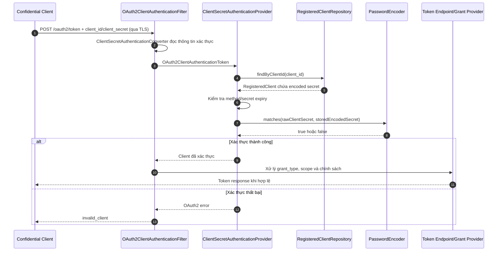
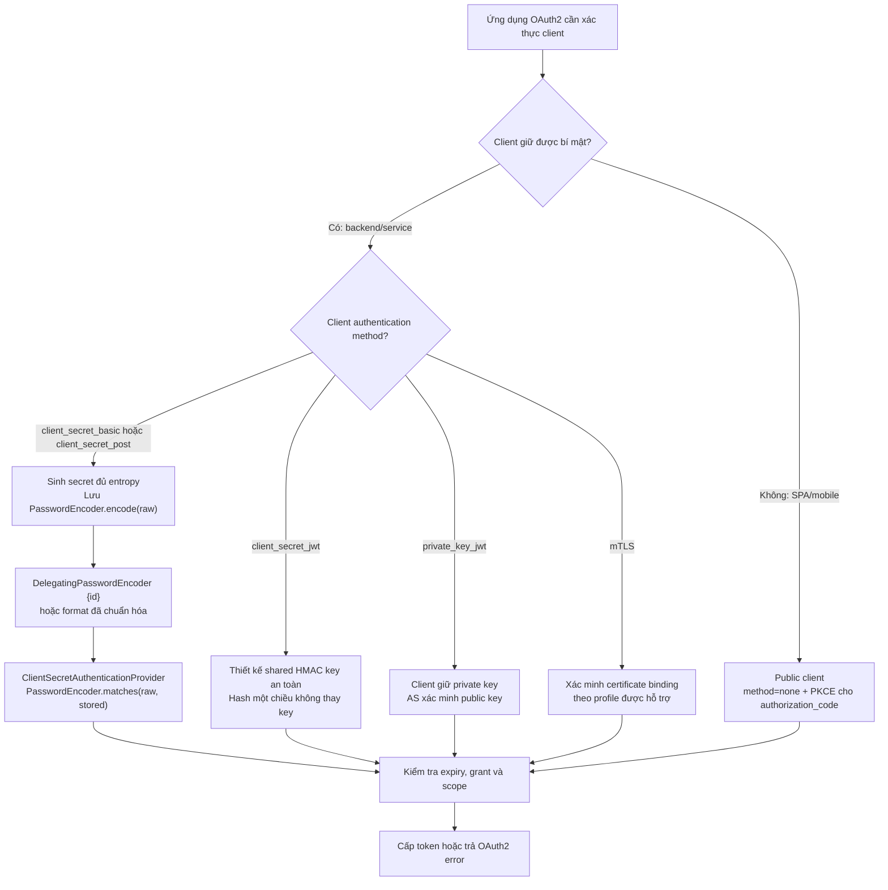

# Mã hóa client secret bằng PasswordEncoder và lựa chọn thuật toán phù hợp

## 1. Mục tiêu và phạm vi

Trong chương **Xác thực client** của module **SPRING_SECURITY_OAUTH2_OIDC_AUTHORIZATION_SERVER**, việc bảo vệ **client secret** là một phần quan trọng khi thiết kế, cấu hình, bảo mật, kiểm thử và vận hành OAuth 2.0/OpenID Connect (OIDC) Authorization Server bằng **Spring Security và Spring Authorization Server (SAS)** trên **Spring Boot**.

Bài học này giải thích cách lưu client secret bằng `PasswordEncoder`, lựa chọn thuật toán, cấu hình cơ chế xác thực client và vận hành secret một cách an toàn. Sau khi học, bạn có thể:

- Phân biệt **secret dạng thô (raw)**, **giá trị băm một chiều (encoded hash)** và **mã hóa có thể giải mã (reversible encryption)**.
- Biết khi nào dùng `ClientAuthenticationMethod.CLIENT_SECRET_BASIC`, `CLIENT_SECRET_POST` hoặc những phương thức **không thể dùng cùng cách băm secret**.
- Đăng ký `PasswordEncoder`, tạo `RegisteredClient` có secret đã băm và hiểu cách `ClientSecretAuthenticationProvider` xác minh.
- So sánh `BCrypt`, `PBKDF2`, `SCrypt`, `Argon2` để chọn tham số phù hợp với lưu lượng và chính sách bảo mật.
- Thiết kế thời hạn, xoay vòng, nâng cấp thuật toán, kiểm soát lỗi và bộ kiểm thử cho client credentials.

**Giả định kỹ thuật:** Những ví dụ Java sử dụng API thường gặp của Spring Security 6.x / Spring Authorization Server 1.x kết hợp Spring Boot 3.x. Trong các thế hệ mới hơn, tên lớp, phương thức, default và cơ chế auto-configuration cần đối chiếu với phiên bản dependency của dự án. Đặc biệt, cấu hình `PasswordEncoder` cho người dùng đăng nhập và cấu hình encoder cho SAS client authentication là **hai điểm tích hợp cần kiểm chứng riêng**.

> **Thuật ngữ:** Dù đề bài dùng từ “mã hóa”, `PasswordEncoder` thực hiện **biến đổi một chiều để xác minh secret** bằng `matches`, không phải mã hóa có thể giải mã. Không có API `decode` để lấy lại client secret ban đầu từ hash.

## 2. Client secret dùng để chứng minh điều gì?

Trong OAuth 2.0, client là ứng dụng được đăng ký với Authorization Server. **Confidential client** có khả năng giữ bí mật, ví dụ ứng dụng backend hoặc dịch vụ máy với máy. Client secret là một **shared credential** để client chứng minh danh tính với AS tại những endpoint yêu cầu xác thực client, thường là token endpoint.

Một ví dụ:

- `client_id`: `orders-backend` — định danh client, **không phải bí mật**.
- `client_secret`: chuỗi ngẫu nhiên đủ mạnh mà chỉ client và bên quản lý secret biết.
- `clientAuthenticationMethod`: `client_secret_basic`.
- `authorizationGrantType`: `client_credentials`.
- `scope`: `orders.read`.

Khi backend gọi `POST /oauth2/token` với `grant_type=client_credentials`, SAS xác thực client trước khi quyết định cấp access token. Việc client được xác thực **không tự động cho phép mọi scope hoặc grant**: server còn phải kiểm tra `RegisteredClient` và chính sách liên quan.

**Phân biệt các đối tượng bảo mật:**

| Đối tượng | Dùng để làm gì? | Có nên lưu bằng `PasswordEncoder`? |
| --- | --- | --- |
| `client_id` | Định danh client khi tra repository | Không; đây là định danh, cần được tra cứu trực tiếp. |
| `client_secret` của `client_secret_basic/post` | Xác thực confidential client bằng secret đối chiếu | **Có**, lưu hash một chiều khi server chỉ cần so khớp secret. |
| Mật khẩu của người dùng | Xác thực resource owner qua login | Có, với encoder/policy mật khẩu phù hợp; đây là miền dữ liệu khác client secret. |
| Authorization code | Chứng minh flow cấp quyền ngắn hạn, gắn PKCE và client | Thuộc authorization state; **không lưu hoặc so sánh bằng cách tự áp `PasswordEncoder` cho từng field của SAS**. |
| Access token / refresh token | Bearer credential hoặc token theo profile | Lưu và tra cứu theo `OAuth2AuthorizationService`; không tự hash field trong JDBC service mặc định. |
| Private key của `private_key_jwt` | Khóa ký assertion nằm phía client | Client phải bảo vệ private key; AS xác minh bằng public key, không lưu hash private key. |
| Shared key của `client_secret_jwt` | Khóa HMAC để ký/kiểm tra client assertion | Cần vật liệu khóa gốc hoặc cơ chế mật mã tương đương để xác minh chữ ký; **hash một chiều thông thường không thể thay thế khóa HMAC**. |

## 3. Bản đồ xác thực client secret trong SAS



Sơ đồ thể hiện **trách nhiệm** của các thành phần, không yêu cầu mọi phiên bản framework có thứ tự kiểm tra nội bộ giống hệt nhau. Các mốc quan trọng:

1. `OAuth2ClientAuthenticationFilter` nhận yêu cầu và dùng converter tương ứng với phương thức client authentication.
2. `ClientSecretAuthenticationProvider` lấy `RegisteredClient` theo `client_id` và xác minh rằng client được phép dùng phương thức được yêu cầu.
3. Provider đối chiếu **raw secret gửi từ client** với **encoded secret trong repository** bằng `PasswordEncoder.matches(raw, encoded)`; có thể kiểm tra thêm `clientSecretExpiresAt`.
4. Chỉ sau khi client authentication thành công, grant provider mới xét `grant_type`, scope, token state và các điều kiện khác.
5. Nếu credentials không hợp lệ, endpoint trả lỗi OAuth2 như `invalid_client` mà không cấp token.

**HTTP Basic không phải mã hóa:** Base64 trong `Authorization: Basic ...` là biểu diễn dữ liệu, không bảo vệ tính bí mật trên mạng. Bắt buộc dùng **TLS/HTTPS** khi truyền client secret qua mạng. HTTP trên loopback chỉ nên dùng trong bài thực hành local được cô lập.

## 4. `PasswordEncoder` lưu gì và kiểm tra ra sao?

### 4.1. `encode` và `matches`

Hợp đồng cốt lõi của Spring Security:

```java
public interface PasswordEncoder {
    String encode(CharSequence rawPassword);
    boolean matches(CharSequence rawPassword, String encodedPassword);
    default boolean upgradeEncoding(String encodedPassword) {
        return false;
    }
}
```

`encode(raw)` tạo chuỗi biểu diễn phù hợp thuật toán. `matches(raw, stored)` trả `true` khi raw input phù hợp hash đã lưu. `upgradeEncoding(stored)` cho biết **có nên cân nhắc nâng cấp cách lưu** theo cấu hình encoder hiện tại; bản thân lời gọi không cập nhật database.

Ví dụ (không có secret thật trong source):

```java
PasswordEncoder encoder =
        PasswordEncoderFactories.createDelegatingPasswordEncoder();

String rawSecret = System.getenv("LOCAL_OAUTH_CLIENT_SECRET");
String storedSecret = encoder.encode(rawSecret);

boolean accepted = encoder.matches(rawSecret, storedSecret);
boolean rejected = encoder.matches("wrong-secret", storedSecret);
```

Với encoder do factory cung cấp ở các phiên bản Spring Security 6.x thường gặp, hash mới được tạo bằng BCrypt và gắn tiền tố `{bcrypt}`. Giá trị mỗi lần `encode` có thể khác vì muối ngẫu nhiên, nhưng `matches` vẫn trả đúng với raw secret tương ứng.

### 4.2. Salt, work factor và lý do không dùng SHA-256 trần

Một thuật toán password hashing phù hợp thường có:

- **Salt riêng, ngẫu nhiên** cho mỗi giá trị để giảm hiệu quả của việc đối chiếu cùng hash hoặc bảng tra cứu dựng sẵn.
- **Work factor/cost** có thể điều chỉnh để tăng chi phí thử đoán hàng loạt.
- Định dạng lưu cho phép biết thông số cần để xác minh; không cần ứng dụng quản lý salt thủ công nếu encoder đã hỗ trợ.

Không dùng `SHA-256(rawSecret)` hoặc `MD5(rawSecret)` như phương án lưu credential bằng `PasswordEncoder`. Các hàm băm tổng quát tính quá nhanh, không cung cấp cùng mức chống thử đoán offline như thuật toán chuyên dụng. Kể cả khi client secret được sinh ngẫu nhiên, việc lựa chọn cơ chế đúng và nhất quán vẫn cần thiết để tránh lỗi quản lý credential và thay đổi thuật toán sau này.

**Băm một chiều khác mã hóa:** `PasswordEncoder` không cung cấp decryption key. Khi client quên secret, hệ thống cần **cấp secret mới/rotate**, không có chức năng “xem lại secret cũ” từ hash.

### 4.3. `DelegatingPasswordEncoder` và tiền tố `{id}`

`DelegatingPasswordEncoder` dùng cú pháp:

```text
{id}encodedPassword
```

Ví dụ minh họa, phần hash đã được rút gọn:

```text
{bcrypt}$2a$12$.....................................................
{pbkdf2@SpringSecurity_v5_8}....
{scrypt@SpringSecurity_v5_8}....
{argon2@SpringSecurity_v5_8}....
```

Phần trong dấu ngoặc nhọn cho biết encoder dùng để **xác minh** giá trị; đây là ví dụ các ID mà map hỗ trợ ở những cấu hình/version nhất định, không phải cam kết mọi ứng dụng đều hỗ trợ tất cả. Factory `createDelegatingPasswordEncoder()` có tập ID theo version Spring Security đang chạy.

Khi gọi:

```java
PasswordEncoder encoder =
        PasswordEncoderFactories.createDelegatingPasswordEncoder();

String encoded = encoder.encode("example-only-not-a-real-secret");

boolean valid = encoder.matches(
        "example-only-not-a-real-secret", encoded);
```

Encoder thường phân tích tiền tố `{bcrypt}` rồi chuyển phần sau cho `BCryptPasswordEncoder`. Nhờ đó, có thể duy trì khả năng xác minh hash cũ trong khi chuyển sang định dạng mới, miễn đã cấu hình decoder cho ID tương ứng.

**Không xóa tiền tố `{bcrypt}` một cách tùy tiện.** Nếu dùng `DelegatingPasswordEncoder` mặc định để kiểm tra một chuỗi `$2a$...` không có `{id}`, việc tra encoder theo ID có thể thất bại. Nếu dùng `new BCryptPasswordEncoder()` trực tiếp, ngược lại, nó mong nhận định dạng bcrypt thuần, không phải chuỗi có tiền tố `{bcrypt}`. Cần bảo đảm encoder ở **lúc tạo hash** và **lúc matches** có hợp đồng lưu trữ tương thích.

## 5. Lựa chọn thuật toán theo loại client và yêu cầu vận hành

| Thuật toán | Đặc tính | Phù hợp khi | Điểm cần đánh giá |
| --- | --- | --- | --- |
| **BCrypt** | Hàm dẫn xuất chậm, tự quản lý salt, cost có thể điều chỉnh; hệ sinh thái Java rộng | Mặc định thực dụng cho `client_secret_basic/post` với secret đủ ngẫu nhiên | Giới hạn xử lý **72 byte đầu vào** của bcrypt; chọn secret ngắn hơn giới hạn; benchmark cost khi lượng request token lớn. |
| **PBKDF2** | Dựa trên nhiều vòng lặp của hàm mật mã; CPU-bound | Hệ thống có yêu cầu tuân thủ hoặc stack mật mã ưu tiên PBKDF2 | Chọn PRF, số vòng, độ dài hash và phiên bản cấu hình phù hợp; tiêu thụ CPU, ít memory hardness hơn scrypt/Argon2. |
| **scrypt** | Thiết kế tiêu tốn cả CPU và bộ nhớ | Muốn làm tăng chi phí brute force dùng phần cứng song song | Memory cost có thể ảnh hưởng mạnh đến AS khi nhiều client xác thực đồng thời. |
| **Argon2 / Argon2id** | Hàm memory-hard hiện đại, hỗ trợ tham số memory/time/parallelism | Có khả năng triển khai, giám sát và benchmark tốt; phù hợp chính sách ưu tiên memory-hard hashing | Yêu cầu thư viện/phiên bản hỗ trợ, tài nguyên RAM và tinh chỉnh trong môi trường chạy thật. |
| **NoOp / plaintext** | Không băm, không bảo vệ bí mật khi lộ database | Chỉ dùng để nhận diện dữ liệu legacy/test bị cấu hình sai | **Không lựa chọn** để lưu client secret ở hệ thống thật. |
| **SHA-256 thuần** | Hash tổng quát rất nhanh | Chữ ký/kiểm tra dữ liệu ở mục đích khác | Không dùng làm password hashing thay các thuật toán ở trên. |

**Lựa chọn ban đầu hợp lý:** `PasswordEncoderFactories.createDelegatingPasswordEncoder()` để có tiền tố thuật toán và cơ chế băm mặc định tương thích với Spring Security, thường là BCrypt. Sau đó benchmark chi phí xác thực client, cân nhắc quy định bảo mật và nâng thuật toán/cost khi cần.

### 5.1. Vì client secret thường có entropy cao, cần cân nhắc điều gì?

Client secret của backend nên là chuỗi **do hệ thống sinh bằng CSPRNG**, có entropy đủ cao (ví dụ 32 byte ngẫu nhiên = 256 bit trước khi biểu diễn Base64URL). Secret khác mật khẩu do con người chọn: nguy cơ đoán từ từ điển thấp hơn nhiều nếu secret được sinh và quản lý đúng.

Dù vậy, hashing vẫn giúp hạn chế lộ raw secret khi database bị đọc trộm. Các ưu tiên cùng quan trọng:

1. Sinh secret đủ mạnh; không dùng mẫu `company123`, tên ứng dụng hoặc UUID đoán được.
2. Chỉ trao secret cho confidential client qua kênh được bảo vệ.
3. Không lưu raw secret trong log, configuration được commit hay analytics.
4. Hạn chế số lượng nơi có thể truy cập hash và thông tin client.
5. Đặt TTL, rotation, rate limiting và giám sát thất bại xác thực.
6. Chọn hash cost không biến token endpoint thành điểm nghẽn hoặc công cụ DoS.

### 5.2. Trường hợp giới hạn 72 byte của BCrypt

BCrypt truyền thống chỉ sử dụng khoảng **72 byte** đầu vào. Hai secret chỉ khác nhau sau giới hạn này có thể không được phân biệt theo cách người dùng mong đợi. Không tự băm SHA-256 trước BCrypt vì sẽ thay đổi format và khả năng tương thích. Thay vào đó, khi sử dụng BCrypt cho client secret, sinh secret ngẫu nhiên với độ dài **dưới 72 byte sau khi mã hóa**. Ví dụ 32 byte ngẫu nhiên biểu diễn Base64URL thành khoảng 43 ký tự ASCII, nằm trong ngưỡng an toàn để xử lý.

### 5.3. Hiệu năng và sức chịu tải

Việc `matches` có chi phí CPU/bộ nhớ là chủ đích của password hashing, nhưng token endpoint có thể xử lý lưu lượng lớn từ hệ thống máy với máy. Khi tăng BCrypt strength hoặc memory cost của Argon2:

- Đo P50/P95/P99 của `/oauth2/token` và chi phí CPU/RAM cho mỗi lần xác thực.
- Kiểm thử load và số lượng request đồng thời, cả với secret sai lẫn đúng.
- Áp dụng rate limiting/bảo vệ abuse ở gateway hoặc AS theo chính sách, không dùng log raw secret để phát hiện tấn công.
- Thực hiện thay đổi tham số theo kế hoạch nâng cấp, không đổi tùy hứng gây sụt công suất.

Không có một giá trị cost cố định phù hợp mọi máy và mọi phiên bản thư viện. Benchmark trên hạ tầng dự kiến là cơ sở để chọn tham số.

## 6. Sinh client secret an toàn

Không tạo secret bằng chuỗi ngắn do con người đặt hoặc bằng `Math.random()`. Một ứng dụng quản trị có thể sử dụng Java `SecureRandom`:

```java
import java.security.SecureRandom;
import java.util.Base64;

public final class ClientSecretGenerator {
    private static final SecureRandom RANDOM = new SecureRandom();

    private ClientSecretGenerator() {
    }

    public static String generate() {
        byte[] bytes = new byte[32]; // 256 bit trước khi biểu diễn
        RANDOM.nextBytes(bytes);
        return Base64.getUrlEncoder()
                .withoutPadding()
                .encodeToString(bytes);
    }
}
```

Kết quả là chuỗi Base64URL khoảng 43 ký tự, phù hợp với BCrypt về độ dài đầu vào. Trong hệ thống thật, **không in kết quả ra log để “debug”**. Chức năng quản trị tạo client nên:

- Sinh secret ở backend qua CSPRNG.
- Lưu **encoded hash** trong `RegisteredClientRepository`.
- Trả secret gốc **một lần** qua kênh quản trị bảo mật cho người có quyền.
- Buộc người quản trị lưu secret vào secret manager hoặc hệ thống cấu hình an toàn của client.
- Khi mất secret, phát secret mới theo quy trình rotation thay vì cố phục hồi từ hash.

Nếu nhận secret do bên tích hợp tự tạo, vẫn phải xác thực độ dài/chất lượng và lưu theo cùng định dạng encoder, có thể đặt chính sách không chấp nhận secret yếu hoặc quá dài vượt đặc tính thuật toán.

## 7. Đăng ký `PasswordEncoder` và `RegisteredClient`

### 7.1. Cấu hình Spring Boot tối thiểu

Với Spring Boot và bộ thư viện SAS tương thích, có thể sử dụng dependency:

```xml
<dependency>
    <groupId>org.springframework.boot</groupId>
    <artifactId>spring-boot-starter-oauth2-authorization-server</artifactId>
</dependency>
```

Ví dụ dưới đây khai báo **confidential machine-to-machine client** `orders-backend` dùng `client_secret_basic`. Mật khẩu client được lấy qua biến môi trường ở lúc chạy, không gắn literal secret vào code.

```java
@Configuration(proxyBeanMethods = false)
public class ClientRegistrationConfig {

    @Bean
    PasswordEncoder passwordEncoder() {
        return PasswordEncoderFactories
                .createDelegatingPasswordEncoder();
    }

    @Bean
    RegisteredClientRepository registeredClientRepository(
            PasswordEncoder passwordEncoder,
            @Value("${LOCAL_OAUTH_CLIENT_SECRET}") String rawSecret) {

        if (rawSecret == null || rawSecret.isBlank()) {
            throw new IllegalStateException(
                    "LOCAL_OAUTH_CLIENT_SECRET must be configured");
        }

        RegisteredClient client = RegisteredClient
                .withId("orders-backend-local-001")
                .clientId("orders-backend")
                .clientSecret(passwordEncoder.encode(rawSecret))
                .clientAuthenticationMethod(
                        ClientAuthenticationMethod.CLIENT_SECRET_BASIC)
                .authorizationGrantType(
                        AuthorizationGrantType.CLIENT_CREDENTIALS)
                .scope("orders.read")
                .clientSecretExpiresAt(
                        Instant.now().plus(Duration.ofDays(90)))
                .build();

        return new InMemoryRegisteredClientRepository(client);
    }
}
```

Những import cần thiết gồm `org.springframework.security.crypto.password.PasswordEncoder`, `org.springframework.security.crypto.factory.PasswordEncoderFactories`, các class `RegisteredClient`/`RegisteredClientRepository`/`InMemoryRegisteredClientRepository`, `ClientAuthenticationMethod`, `AuthorizationGrantType`, `java.time.Instant` và `java.time.Duration`. Trong ứng dụng lớn nên tách đăng ký client khỏi startup bằng service quản trị có quyền, lưu vào repository bền vững.

**Đọc dòng quan trọng:**

```java
.clientSecret(passwordEncoder.encode(rawSecret))
```

`RegisteredClient` lưu **hash**, còn client thực dùng **raw secret** để xác thực. Nếu client gửi chuỗi `{bcrypt}...` lấy từ database thay cho raw secret, `matches` thông thường sẽ không xem đó là bí mật gốc.

**Chú ý ví dụ:** `Instant.now().plus(Duration.ofDays(90))` chỉ minh họa cách đặt ngày hết hạn, không có nghĩa mọi client phải có TTL 90 ngày. Sau khi restart, ví dụ sẽ tạo hash có salt mới và đặt lại ngày hết hạn; trong production, các thay đổi này cần được quản lý bằng quy trình đăng ký/rotation bền vững, không tái tạo client tùy tiện khi khởi động ứng dụng.

### 7.2. Đặt biến môi trường mà không đưa secret vào source

Ví dụ PowerShell local:

```powershell
$secret = Read-Host "Local OAuth2 client secret" -AsSecureString
$pointer = [Runtime.InteropServices.Marshal]::SecureStringToBSTR($secret)
try {
    $env:LOCAL_OAUTH_CLIENT_SECRET =
        [Runtime.InteropServices.Marshal]::PtrToStringBSTR($pointer)
} finally {
    [Runtime.InteropServices.Marshal]::ZeroFreeBSTR($pointer)
}
```

Cách này tránh ghi secret trực tiếp vào lịch sử PowerShell, nhưng **biến môi trường trong process vẫn chứa plaintext**. Với hệ thống vận hành, dùng secrets manager hoặc giải pháp cấp credential được kiểm soát. Không commit `.env` có secret hoặc đưa raw value vào CI output.

### 7.3. `@Bean PasswordEncoder` có tự tác động tới SAS không?

**Không nên suy luận chỉ từ việc có một bean `PasswordEncoder` rằng mọi provider trong Authorization Server sẽ tự dùng bean đó.** Trong SAS 1.x, `ClientSecretAuthenticationProvider` có cơ chế encoder của riêng nó (cấu hình mặc định thường là delegating encoder). Nếu ứng dụng chọn encoder và định dạng tùy chỉnh, cần **bảo đảm encoder bên tạo hash và bên kiểm tra tương thích**.

Có thể cấu hình tường minh provider trong DSL của SAS để gắn encoder dùng tại registration:

```java
@Bean
@Order(1)
SecurityFilterChain authorizationServerChain(
        HttpSecurity http,
        PasswordEncoder passwordEncoder) throws Exception {

    OAuth2AuthorizationServerConfigurer as =
            OAuth2AuthorizationServerConfigurer.authorizationServer();

    http
        .securityMatcher(as.getEndpointsMatcher())
        .with(as, authorizationServer ->
                authorizationServer.clientAuthentication(
                        clientAuthentication ->
                                clientAuthentication
                                    .authenticationProviders(providers -> {
                                        for (AuthenticationProvider provider
                                                : providers) {
                                            if (provider instanceof
                                                    ClientSecretAuthenticationProvider secretProvider) {
                                                secretProvider.setPasswordEncoder(
                                                        passwordEncoder);
                                            }
                                        }
                                    })))
        .authorizeHttpRequests(auth ->
                auth.anyRequest().authenticated());

    return http.build();
}
```

Ví dụ chỉ minh họa **điểm tích hợp client authentication**, chưa phải cấu hình đầy đủ cho Authorization Code, trang login, OIDC hay token generator. Những phần đó cần được kết hợp với cấu hình AS khác theo mục tiêu ứng dụng và đúng phiên bản SAS.

Nếu sử dụng `PasswordEncoderFactories.createDelegatingPasswordEncoder()` nhất quán ở hai phía, hash dạng `{bcrypt}...` có thể được xác minh mà không cần viết converter/provider tùy chỉnh. Khi dùng encoder chỉ nhận BCrypt thuần, phải bảo đảm provider và định dạng lưu trữ đều dùng đúng encoder đó.

## 8. Basic, POST và các phương thức không dùng shared-secret hashing

### 8.1. `client_secret_basic`

Client gửi client credentials qua HTTP Basic tại token endpoint. Ví dụ request về mặt giao thức:

```http
POST /oauth2/token HTTP/1.1
Host: auth.example.com
Authorization: Basic <BASE64_OF_CLIENT_ID_AND_SECRET>
Content-Type: application/x-www-form-urlencoded

grant_type=client_credentials&scope=orders.read
```

Trong HTTP Basic của OAuth 2.0, client ID và secret được xử lý theo quy tắc form-url-encoding trước khi ghép vào credentials và Base64; thư viện OAuth2 client phù hợp thường thực hiện hộ. Chuỗi Base64 là **credential nhạy cảm**, không ghi log hoặc gửi tới bên thứ ba. Request phải chạy qua TLS.

`client_secret_basic` thường được ưu tiên so với `client_secret_post` vì credential nằm ở header có thể được xử lý/redact riêng, và tránh truyền secret trong form body khi tích hợp hệ thống ghi log request payload.

### 8.2. `client_secret_post`

Client gửi `client_id`/`client_secret` dưới dạng form fields của request đến token endpoint:

```http
POST /oauth2/token HTTP/1.1
Host: auth.example.com
Content-Type: application/x-www-form-urlencoded

grant_type=client_credentials&client_id=orders-backend&client_secret=<RAW_SECRET>
```

Nếu AS cho phép `client_secret_post`, `RegisteredClient` phải đăng ký tương ứng:

```java
.clientAuthenticationMethod(
        ClientAuthenticationMethod.CLIENT_SECRET_POST)
```

Chỉ mở thêm phương thức thực sự cần; không mặc nhiên chấp nhận mọi cách client authentication cho cùng client. `client_secret_post` dễ bị lộ khi reverse proxy, APM hoặc middleware ghi body; cần redaction và chính sách bảo vệ tương đương header Basic.

### 8.3. Public client không có client secret đáng tin

Browser SPA và ứng dụng mobile không có khả năng bảo vệ một shared secret nhúng trong source/package. Với public client, dùng:

```java
.clientAuthenticationMethod(
        ClientAuthenticationMethod.NONE)
.authorizationGrantType(
        AuthorizationGrantType.AUTHORIZATION_CODE)
.clientSettings(ClientSettings.builder()
        .requireProofKey(true)
        .build())
```

Client còn phải khai báo redirect URI và scope phù hợp, ví dụ sử dụng Authorization Code + PKCE S256. Không phát secret rồi coi nó là an toàn chỉ vì đã băm secret trên AS: bản sao raw secret vẫn nằm trong ứng dụng phân phối cho người dùng và có thể bị trích xuất.

**PKCE và client authentication khác nhau:** PKCE ràng buộc authorization code với một verifier do client giữ; `client_secret_basic` xác thực confidential client. Với confidential client sử dụng Authorization Code, có thể dùng cả hai.

### 8.4. `client_secret_jwt` cần thận trọng về vật liệu khóa

`client_secret_jwt` dùng **khóa đối xứng chung** để ký và xác minh client assertion kiểu JWT. Để kiểm tra chữ ký HMAC, server cần truy cập được key material thích hợp; hash một chiều của raw secret bằng `BCryptPasswordEncoder` **không thể thay thế trực tiếp khóa HMAC ban đầu**.

Do vậy:

- Cấu hình lưu hash một chiều ở bài này nhắm tới `client_secret_basic` và `client_secret_post`.
- Không chuyển một client sang `client_secret_jwt` mà giữ nguyên `{bcrypt}...` rồi cho rằng xác minh chữ ký sẽ hoạt động.
- Nếu thực sự cần `client_secret_jwt`, phải thiết kế cơ chế lưu/truy xuất shared key có bảo vệ và hỗ trợ đúng provider/thuật toán; thường nên đánh giá `private_key_jwt` để AS chỉ cần public key.
- Với `private_key_jwt`, client giữ private key, AS xác minh assertion bằng public key/JWKS của client; không dựa vào `PasswordEncoder.matches` cho client secret.
- Mutual TLS (nếu hạ tầng hỗ trợ) cũng là phương thức xác thực client khác có thể phù hợp theo yêu cầu bảo mật.

## 9. Đăng ký client mới và thay đổi secret an toàn

### 9.1. Đăng ký client bằng JDBC

Khi cần persistence, sử dụng `JdbcRegisteredClientRepository` hoặc repository tùy chỉnh. Ví dụ:

```java
@Bean
RegisteredClientRepository registeredClientRepository(
        JdbcTemplate jdbcTemplate) {
    return new JdbcRegisteredClientRepository(jdbcTemplate);
}
```

Phần code này là **phương án thay thế** bean in-memory ở trên. Trước khi sử dụng, phải áp dụng schema đúng phiên bản SAS. Một quy trình quản trị có quyền có thể tạo bản ghi:

```java
public void registerMachineClient(
        RegisteredClientRepository repository,
        PasswordEncoder encoder,
        String rawSecret) {

    RegisteredClient client = RegisteredClient
            .withId(UUID.randomUUID().toString())
            .clientId("orders-backend")
            .clientSecret(encoder.encode(rawSecret))
            .clientAuthenticationMethod(
                    ClientAuthenticationMethod.CLIENT_SECRET_BASIC)
            .authorizationGrantType(
                    AuthorizationGrantType.CLIENT_CREDENTIALS)
            .scope("orders.read")
            .build();

    repository.save(client);
}
```

Trong ứng dụng thực, cần thêm kiểm tra quyền tạo client, chống trùng `clientId`, lifecycle/expiry, audit và xử lý giao secret an toàn. Không phơi phương thức quản trị này thành endpoint công khai.

### 9.2. Đặt thời hạn secret

`RegisteredClient.Builder#clientSecretExpiresAt(Instant)` cho phép cấu hình thời điểm hết hạn:

```java
RegisteredClient updated = RegisteredClient.from(existing)
        .clientSecretExpiresAt(
                Instant.now().plus(Duration.ofDays(90)))
        .build();

registeredClientRepository.save(updated);
```

Chỉ thay hạn dùng nếu đã được phê duyệt theo chính sách; không kéo dài thời hạn một cách tự động để bỏ qua lỗi. Khi client secret hết hạn, client authentication bị từ chối theo quy tắc provider. Cần giám sát và thông báo trước hạn để tránh gián đoạn.

### 9.3. Quy trình rotation

Một quy trình đổi client secret có kiểm soát:

1. **Chuẩn bị:** xác nhận client owner, hệ thống phụ thuộc, thời hạn, đường phân phối secret mới và phương án rollback.
2. **Sinh secret mới:** dùng CSPRNG, đủ entropy, không tái sử dụng secret cũ.
3. **Băm và cập nhật:** dùng đúng `PasswordEncoder`; chỉ lưu encoded hash vào repository theo cơ chế đã chọn.
4. **Phân phối:** giao raw secret mới tới client qua secret manager/kênh quản trị an toàn; cập nhật các instance/đối tác liên quan.
5. **Chuyển đổi:** đảm bảo client đã dùng secret mới, theo dõi authentication error và giới hạn thời gian secret cũ tồn tại.
6. **Thu hồi và hậu kiểm:** vô hiệu secret cũ theo chính sách, ghi audit metadata an toàn và xác nhận các hệ thống vẫn hoạt động.

**Hạn chế của model mặc định:** `RegisteredClient` thường có **một** trường `clientSecret` hiệu lực tại một thời điểm. Việc cập nhật hash có thể khiến client chưa chuyển đổi thất bại ngay lập tức. Nếu cần giai đoạn overlap hai secret, phải thiết kế cơ chế được hỗ trợ: repository/provider tùy chỉnh có nhiều credential, hoặc chiến lược client registration tách biệt có kiểm soát. Không giả định SAS tự cho phép đồng thời secret cũ và secret mới.

Thay client secret **không tự thu hồi** mọi access token JWT đã phát hành: API có thể vẫn chấp nhận token còn hạn nếu chỉ xác minh offline bằng JWKS. Khi nghi ngờ lộ secret, cần đánh giá revocation, TTL và kiểm soát phạm vi ảnh hưởng của token đã phát.

## 10. Nâng cấp thuật toán và cost khi đã có client trong database

### 10.1. Định dạng có phiên bản giúp chuyển đổi từng bước

Ví dụ repository đang lưu các hash:

```text
{bcrypt}...
{pbkdf2@SpringSecurity_v5_8}...
```

Nếu `DelegatingPasswordEncoder` đã cấu hình nhận diện cả hai ID, có thể `matches` hash cũ trong khi hệ thống bắt đầu `encode` secret mới theo thuật toán mới. Cần đảm bảo mọi AS instance đã hỗ trợ ID mới **trước** khi tạo hash theo định dạng mới.

### 10.2. Rehash không tự xảy ra lúc matches

Lời gọi:

```java
boolean verified = encoder.matches(rawSecret, storedSecret);
boolean upgradeSuggested = encoder.upgradeEncoding(storedSecret);
```

không tự ghi lại `RegisteredClient`. Để nâng hash, cần có **raw secret tại một thời điểm được ủy quyền** và quy trình cập nhật repository phù hợp, hoặc yêu cầu client rotate secret. Với credential cấp cho bên thứ ba, raw secret có thể không được lưu ở server ngoài thời điểm request; không tìm cách giải mã hash để rehash.

Nếu chọn tự rehash sau khi xác thực, phải xử lý concurrency và audit vì cùng một client có thể gửi nhiều request song song; không làm yếu kiểm tra secret hoặc ghi nhầm trạng thái đăng ký client. Thực tế, rotation có quản trị thường dễ kiểm soát hơn thay đổi ngầm trong luồng token endpoint.

### 10.3. Tương thích giữa các instance

Đối với Authorization Server nhiều instance:

- Mỗi instance phải dùng encoder có khả năng `matches` tất cả format hash hiện đang lưu.
- Các phiên bản schema/repository phải nhất quán.
- Thay đổi thuật toán cần triển khai theo thứ tự hỗ trợ đọc trước rồi mới hỗ trợ ghi.
- Có kế hoạch rollback không khiến instance cũ không thể đọc hash mới.
- Theo dõi tỷ lệ `invalid_client` sau rollout mà không log raw secret.

Không “sửa nhanh” bằng cách chấp nhận plaintext fallback cho mọi credential, vì có thể biến lỗi migration thành lỗ hổng bảo mật.

## 11. Kiểm thử bảo mật và tích hợp

### 11.1. Unit test cho `PasswordEncoder`

Một phép thử không chứa secret thật:

```java
@Test
void encodesAndMatchesClientSecret() {
    PasswordEncoder encoder =
            PasswordEncoderFactories.createDelegatingPasswordEncoder();

    String raw = "local-test-only-randomized-secret-value";
    String stored = encoder.encode(raw);

    assertNotEquals(raw, stored);
    assertTrue(stored.startsWith("{bcrypt}"));
    assertTrue(encoder.matches(raw, stored));
    assertFalse(encoder.matches("incorrect-secret", stored));
}
```

Nếu đổi encoder hoặc thuật toán mặc định ở dự án, hãy thay assertion tiền tố bằng yêu cầu format đã được quyết định; không phụ thuộc mặc định mãi mãi khi dự án có chính sách riêng.

Thử thêm:

| Tình huống | Kỳ vọng |
| --- | --- |
| Cùng raw secret được `encode` hai lần | Hash thường khác do salt ngẫu nhiên, cả hai đều `matches` raw secret. |
| Raw secret sai | `matches` trả `false`. |
| Hash có `{id}` không được hỗ trợ | Bị từ chối/throw exception phù hợp; tuyệt đối không fallback sang plaintext tự động. |
| Hash BCrypt thiếu tiền tố nhưng dùng delegating encoder | Nhận diện là format không tương thích; sửa migration/encoder thay vì bỏ qua xác thực. |
| Client secret rỗng/nguồn input thiếu | Quy trình đăng ký và startup từ chối an toàn. |
| Thay đổi cost/thuật toán | Hash cũ được xác minh theo ID và chính sách compatibility đã cấu hình. |
| Giá trị raw vượt hạn chế BCrypt | Chính sách tạo/nhận secret xử lý rõ, không chấp nhận bí mật mơ hồ sau byte 72. |

### 11.2. Integration test qua token endpoint

Với client `orders-backend` và grant `client_credentials`, có thể dùng `curl.exe` trên Windows. Khi bỏ mật khẩu khỏi giá trị `--user`, curl sẽ hỏi người dùng thay vì gắn secret lên command line:

```powershell
curl.exe --user orders-backend --data-urlencode "grant_type=client_credentials" --data-urlencode "scope=orders.read" http://localhost:9000/oauth2/token
```

Điều kiện: AS đã được cấu hình đầy đủ và client đã đăng ký, token generation hoạt động. HTTP trên `localhost` chỉ dùng để học trong môi trường loopback cô lập; khi truy cập qua mạng phải chuyển sang HTTPS.

Kỳ vọng thành công là token response đúng chuẩn của grant đã cấp phép. Bộ kiểm thử phải bao gồm thêm các nhánh lỗi:

| Kịch bản | Kết quả mong đợi |
| --- | --- |
| Đúng client ID, secret, authentication method và grant | Client xác thực; xử lý token theo grant/scope. |
| Sai secret | Lỗi `invalid_client` hoặc response bảo mật tương ứng; không phát token. |
| Không có secret đối với confidential client | Từ chối xác thực client. |
| Secret hết hạn | Từ chối xác thực; không cấp token mới. |
| Client dùng `client_secret_post` nhưng chỉ đăng ký `client_secret_basic` | Từ chối phương thức không được phép. |
| Client bị vô hiệu theo chính sách quản trị | Không cấp token; tùy implementation có kiểm tra bổ sung. |
| Đúng secret nhưng yêu cầu grant không được đăng ký | Từ chối grant, không cấp token. |
| Đúng secret nhưng scope vượt quyền | Không cấp token với scope vượt quyền. |
| Hash lưu bị hỏng/thiếu ID encoder | Lỗi xác thực an toàn; không cho qua bằng fallback plaintext. |
| Đổi thuật toán và rolling deployment | Mọi instance đang hoạt động đều xác minh được format đang sử dụng. |
| Rotation secret | Secret mới thành công; secret cũ bị từ chối sau khi hết overlap/chính sách chuyển đổi. |

### 11.3. Những chỉ số nên theo dõi

Các tín hiệu vận hành hữu ích gồm số request tới `/oauth2/token`, tỉ lệ `invalid_client`, độ trễ xác thực, CPU/memory khi password hashing, trạng thái backend repository, số client gần hết hạn và số lần rotation. Gắn correlation ID và client ID theo chính sách dữ liệu phù hợp; không log raw secret, authorization header, access/refresh token hay password hash.

Không phân biệt quá chi tiết trong response công khai giữa “client không tồn tại”, “secret sai” và “secret vừa hết hạn” nếu có nguy cơ bị lợi dụng để dò thông tin client. Nhật ký nội bộ đã được bảo vệ có thể dùng mã sự kiện rõ hơn phục vụ điều tra.

## 12. Những sai lầm thường gặp

| Sai lầm | Hậu quả | Cách khắc phục |
| --- | --- | --- |
| Lưu raw `clientSecret` trong repository | Rò rỉ database dẫn tới lộ credential có thể dùng ngay | Lưu `passwordEncoder.encode(rawSecret)` đối với basic/post. |
| Dùng `new BCryptPasswordEncoder()` để kiểm tra chuỗi `{bcrypt}...` | Không khớp do định dạng prefix | Dùng delegating encoder tương ứng hoặc migrate format có kiểm soát. |
| Dùng delegating encoder nhưng hash trong DB không có `{id}` | Không xác định được encoder; xác thực thất bại | Chuẩn hóa format/migration; tránh fallback `NoOp`. |
| Dùng raw secret cực dài với BCrypt | Có thể không phân biệt phần sau byte 72 | Sinh ngẫu nhiên 32 byte và biểu diễn Base64URL, hoặc chọn thuật toán phù hợp khác. |
| Đăng ký confidential client secret trong JavaScript/mobile | Người dùng có thể trích xuất raw secret | Dùng public client + Authorization Code + PKCE. |
| Dùng `client_secret_post` và log request body | Lộ credential qua proxy/APM/log | Tắt hoặc redaction body logs, ưu tiên Basic khi có thể, dùng HTTPS. |
| Chỉ đăng ký bean `PasswordEncoder` và giả định SAS tự dùng cấu hình tùy chỉnh | Hash khi lưu và khi xác thực khác format | Kiểm tra `ClientSecretAuthenticationProvider` và gắn encoder khi cần. |
| Dùng hashed secret cho `client_secret_jwt` như HMAC key | Không xác minh được JWT assertion | Thiết kế lưu key phù hợp hoặc chuyển sang `private_key_jwt`. |
| Đặt BCrypt cost cao không benchmark | Token endpoint nghẽn hoặc dễ bị DoS tài nguyên | Đo hiệu năng và triển khai rate limit/capacity phù hợp. |
| Rotate secret trực tiếp khi nhiều instance chưa cập nhật | Lỗi `invalid_client` hàng loạt | Quy trình chuyển đổi/overlap có kiểm soát, kiểm thử trước rollout. |
| Gọi `matches` rồi xem như đã có quyền cấp token | Bỏ qua grant/scope/client policy | Để SAS xử lý đầy đủ token endpoint và grant provider. |
| Đưa client secret vào query string | Lộ qua log, browser history, analytics | Dùng phương thức xác thực client đúng chuẩn qua HTTPS. |

## 13. Checklist thiết kế trước khi đưa vào vận hành

- [ ] Xác định client là **confidential** hay **public**, phương thức client authentication phù hợp.
- [ ] Với `client_secret_basic/post`, sinh raw secret bằng CSPRNG đủ entropy và độ dài tương thích thuật toán.
- [ ] Chỉ lưu encoded hash qua `PasswordEncoder`; không lưu plaintext trong database.
- [ ] Kiểm tra encoder ở lúc ghi và provider ở lúc `matches` hỗ trợ cùng định dạng.
- [ ] Dùng `DelegatingPasswordEncoder` với tiền tố `{id}` hoặc một chiến lược hash format nhất quán có quản trị.
- [ ] Chọn BCrypt/PBKDF2/scrypt/Argon2 theo yêu cầu tuân thủ và benchmark hiệu năng thực tế.
- [ ] Với BCrypt, bảo đảm cách tạo/nhận secret không vượt hạn chế 72 byte.
- [ ] Dùng HTTPS cho client authentication qua mạng; bảo vệ token endpoint và hạn chế logs nhạy cảm.
- [ ] Khai báo grant types, scopes, client secret expiry và redirect URI đúng loại client.
- [ ] Có cơ chế tạo secret, phân phối một lần, rotation, thu hồi và cảnh báo hết hạn.
- [ ] Không dùng password hash của basic/post làm HMAC key cho `client_secret_jwt`.
- [ ] Kiểm thử sai secret, expired secret, method không khớp, grant/scope vượt quyền và migration hash.
- [ ] Khi dùng nhiều AS instance, đảm bảo encoder/provider và repository tương thích.
- [ ] Không tiết lộ raw secret, token, hash hoặc dữ liệu xác thực trong log, trace và response công khai.

## 14. Sơ đồ quyết định lựa chọn chiến lược



Khi xác thực confidential client bằng secret, điều quan trọng không chỉ là gọi `PasswordEncoder.encode` mà là giữ một **hợp đồng nhất quán từ lúc tạo, lưu, phân phối đến lúc xác minh và xoay vòng secret**. Băm client secret bằng thuật toán thích hợp giúp giảm rủi ro khi lộ repository, còn TLS, giới hạn quyền client, PKCE (khi liên quan), giới hạn lưu lượng và chính sách vận hành mới hoàn thiện phòng vệ cho Authorization Server được triển khai bằng Spring Security và Spring Authorization Server.
