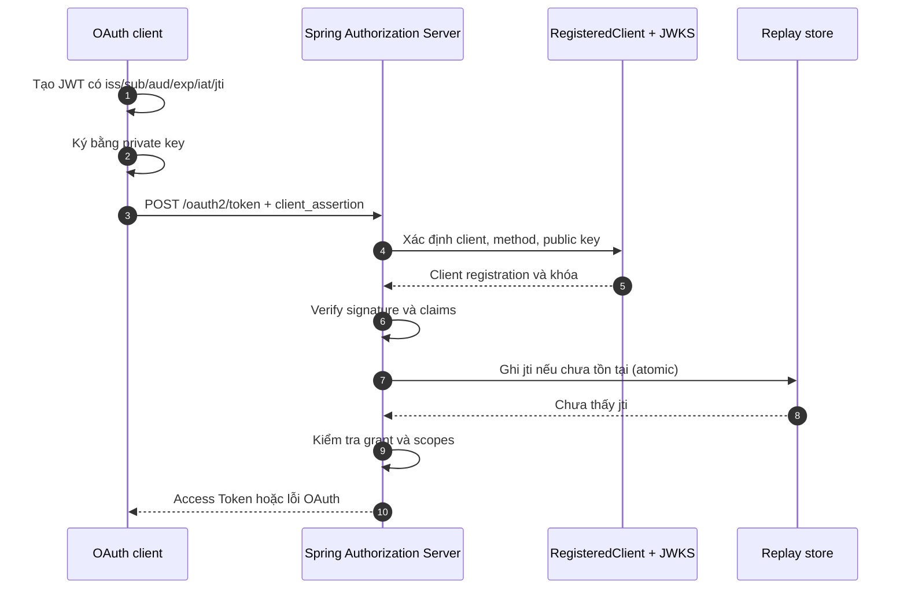
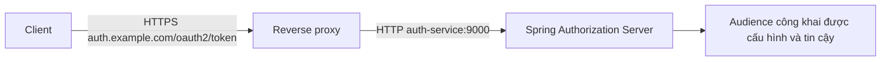

# Xác minh issuer, subject, audience, thời hạn và chống phát lại assertion

## 1. Mục tiêu và bối cảnh

Trong chương **Xác thực client** của module **SPRING_SECURITY_OAUTH2_OIDC_AUTHORIZATION_SERVER**, chúng ta học cách thiết kế, cấu hình, bảo mật, kiểm thử và vận hành OAuth 2.0/OpenID Connect Authorization Server bằng Spring Security và Spring Authorization Server trong ứng dụng Spring Boot. Bài này đi sâu vào việc **xác minh JWT client assertion**: bằng chứng được OAuth client ký và gửi đến Authorization Server để chứng minh danh tính của chính client.

Ví dụ, dịch vụ `invoice-service` sử dụng phương thức `private_key_jwt`. Nó tạo một JWT ngắn hạn, ký bằng private key của mình, rồi gửi assertion tới `/oauth2/token`. Authorization Server tìm client đã đăng ký, xác minh chữ ký bằng public key đáng tin cậy và kiểm tra các claims trước khi cấp token.

Một assertion chỉ nên được chấp nhận khi **tất cả điều kiện** liên quan đều đúng:

- **Chữ ký và khóa**: JWT được ký bằng khóa phù hợp với client đã đăng ký, thuật toán được phép.
- **Issuer (`iss`)**: bên tạo client assertion chính là OAuth client cần xác thực.
- **Subject (`sub`)**: chủ thể của assertion khớp `client_id` của client.
- **Audience (`aud`)**: assertion hướng tới đúng Authorization Server/endpoint được chấp nhận.
- **Thời hạn (`exp`, `nbf`, `iat`)**: assertion còn hiệu lực và không có vòng đời quá dài.
- **Chống phát lại (`jti`)**: nếu yêu cầu bảo vệ replay, định danh assertion chưa từng được chấp nhận và được ghi dấu nguyên tử.

**Chữ ký đúng chưa đủ**. Một JWT có chữ ký hợp lệ nhưng dành cho server khác, đã hết hạn hoặc bị gửi lại vẫn có thể là yêu cầu không được phép.

Sau bài này, người học có thể giải thích các quy tắc xác minh trên, cấu hình client `private_key_jwt` mẫu, kiểm tra lỗi bằng request thực hành, xây kho chống replay nhiều instance và thiết kế bộ kiểm thử tiêu cực.

## 2. JWT client assertion hoạt động ở đâu?

### 2.1. Client assertion không phải Access Token

| Dữ liệu | Bên tạo | Bên nhận/kiểm tra | Mục đích |
| --- | --- | --- | --- |
| **JWT client assertion** | OAuth client, bằng khóa của client. | Authorization Server. | Xác thực danh tính ứng dụng client. |
| Authorization code | Authorization Server. | Client đổi tại token endpoint; server kiểm tra. | Chứng cứ một lần của giao dịch ủy quyền. |
| Access Token | Authorization Server. | Resource Server/API. | Quyền truy cập tài nguyên. |
| ID Token | OpenID Provider/Authorization Server. | OIDC client. | Kết quả xác thực người dùng. |
| Refresh Token | Authorization Server. | Client dùng tại token endpoint. | Xin token mới khi còn đủ điều kiện. |

JWT cũng có thể được dùng làm **authorization grant assertion** theo RFC 7523 với `grant_type=urn:ietf:params:oauth:grant-type:jwt-bearer` và tham số `assertion`. Đó là một chức năng **khác** với JWT dùng để xác thực client. Bài này bàn về tham số `client_assertion` cùng `client_assertion_type`.

Hai phương thức xác thực client bằng JWT:

| Phương thức | Vật liệu ký | Cách Authorization Server kiểm tra |
| --- | --- | --- |
| `private_key_jwt` | Client giữ private key và ký JWT bất đối xứng. | Dùng public key/JWKS gắn với `RegisteredClient`. |
| `client_secret_jwt` | Client ký/MAC JWT bằng client secret dùng chung. | Dùng khóa bí mật phù hợp được quản lý phía server. |

Với `private_key_jwt`, private key **không được gửi tới Authorization Server**. Đối với `client_secret_jwt`, việc kiểm tra HMAC cần vật liệu khóa phù hợp; không được mặc định coi một chuỗi password hash một chiều là khóa HMAC gốc. Cả hai phương thức vẫn yêu cầu TLS, kiểm soát secrets và chống giả mạo.

### 2.2. Token request mang assertion

Ví dụ client `invoice-service` có grant `client_credentials`:

```http
POST /oauth2/token HTTP/1.1
Host: auth.example.com
Content-Type: application/x-www-form-urlencoded

grant_type=client_credentials&
client_id=invoice-service&
scope=invoices.read&
client_assertion_type=urn%3Aietf%3Aparams%3Aoauth%3Aclient-assertion-type%3Ajwt-bearer&
client_assertion=<signed-jwt>
```

Sau URL decoding, `client_assertion_type` phải bằng:

```text
urn:ietf:params:oauth:client-assertion-type:jwt-bearer
```

Đây là phần **xác thực client** của request; `grant_type`, `scope` và các chính sách cấp token phải được kiểm tra **riêng**. Ví dụ HTTP xuống dòng để dễ đọc; request thực tế cần form encoding đúng.



Kho replay trong sơ đồ là **chính sách tăng cường**. Không mặc định giả định Spring Authorization Server tự ghi dấu `jti` giữa các request và giữa nhiều instance.

## 3. Cấu trúc và ý nghĩa của JWT client assertion

JWT được ký ở dạng JWS compact thông thường:

```text
BASE64URL(header).BASE64URL(payload).BASE64URL(signature)
```

Protected header minh họa:

```json
{
  "alg": "RS256",
  "typ": "JWT",
  "kid": "invoice-key-2026-11"
}
```

Payload minh họa (mốc thời gian là dữ liệu ví dụ, **không** phải một assertion đang còn hiệu lực):

```json
{
  "iss": "invoice-service",
  "sub": "invoice-service",
  "aud": "https://auth.example.com/oauth2/token",
  "iat": 1790000000,
  "nbf": 1790000000,
  "exp": 1790000060,
  "jti": "64f79c9c-4a2a-4fe5-8b19-0110d2b62047"
}
```

| Trường | Ý nghĩa và yêu cầu kiểm tra |
| --- | --- |
| `alg` | Chỉ chấp nhận thuật toán trong allowlist gắn với phương thức/khóa của client; từ chối `none` và thuật toán ngoài chính sách. |
| `kid` | Chỉ là gợi ý chọn khóa trong tập khóa tin cậy đã đăng ký cho client. |
| **`iss`** | Bên phát hành assertion. Với JWT client authentication theo RFC 7523 phải nhận diện client, thường bằng `client_id`. |
| **`sub`** | Chủ thể assertion, phải bằng `client_id` của client đang xác thực. |
| **`aud`** | Bên nhận assertion dự kiến, phải chứa định danh Authorization Server/endpoint được chấp nhận. |
| **`exp`** | Thời điểm hết hạn, NumericDate tính bằng giây Unix. Bắt buộc. |
| `nbf` | Thời điểm sớm nhất assertion có hiệu lực; nếu xuất hiện phải kiểm tra. |
| `iat` | Thời điểm tạo; kiểm tra hợp lý khi xuất hiện và nên yêu cầu trong profile nghiêm ngặt. |
| `jti` | Mã định danh assertion; chống phát lại khi có chính sách bắt buộc và kho lưu dấu đã sử dụng. |

**Phạm vi chuẩn:** RFC 7523 quy định các trường trọng yếu như `iss`, `sub`, `aud`, `exp` cho JWT client authentication. `iat`, `nbf`, `jti` có mức độ bắt buộc tùy đặc tả/profile áp dụng. Trong bài này ta thiết kế một **profile bảo mật nghiêm ngặt** yêu cầu thêm `iat`, `jti`, TTL ngắn và phát hiện replay. Không nên tuyên bố rằng mọi provider mặc định đều thực hiện đầy đủ các điều kiện tăng cường đó.

## 4. Kiểm tra issuer và subject: đúng danh tính client

### 4.1. Issuer của assertion khác issuer của token do server phát hành

Một trong những lỗi dễ mắc là đặt `iss` của client assertion bằng issuer URL của Authorization Server. Hãy phân biệt:

```text
Authorization Server issuer = https://auth.example.com
OAuth client_id            = invoice-service

Trong JWT client assertion:
    iss = invoice-service
    sub = invoice-service

Trong JWT Access Token / OIDC ID Token do AS phát hành:
    iss = https://auth.example.com
```

Trong client authentication, các đối chiếu logic cần đúng:

```text
request.client_id == registeredClient.clientId
assertion.iss     == registeredClient.clientId
assertion.sub     == registeredClient.clientId
```

Trường hợp request không gửi `client_id` riêng và phiên bản giao thức/implementation có khả năng suy ra client từ assertion, Authorization Server vẫn phải xác định đúng `RegisteredClient` và ràng buộc cả issuer, subject, phương thức authentication và khóa ký với chính client đó. Payload chưa verify **không phải** bằng chứng để tin cậy client.

| Request khai báo client | `iss` | `sub` | Kết quả kiểm tra danh tính |
| --- | --- | --- | --- |
| `invoice-service` | `invoice-service` | `invoice-service` | Đạt bước kiểm tra danh tính, còn phải verify chữ ký và các claims khác. |
| `invoice-service` | `other-client` | `invoice-service` | Từ chối. |
| `invoice-service` | `invoice-service` | `other-client` | Từ chối. |
| `invoice-service` | `https://auth.example.com` | `invoice-service` | Từ chối vì nhầm issuer của Authorization Server. |
| `invoice-service` | Thiếu | `invoice-service` | Từ chối. |
| `invoice-service` | `invoice-service` | Thiếu | Từ chối. |

Chữ ký của client A không thể dùng xác thực client B chỉ vì cả hai cùng gọi một token endpoint. Public key dùng verify phải thuộc **đúng client đã đăng ký**.

## 5. Kiểm tra audience: đúng Authorization Server và endpoint

### 5.1. Chấp nhận audience đã được cấu hình

`aud` của assertion phải nhận diện Authorization Server dự kiến. Theo RFC 7523, token endpoint URL có thể là một audience hợp lệ; các profile OIDC và chính sách hệ thống cũng có thể hỗ trợ issuer URL của OP trong phạm vi cụ thể.

Ví dụ server và client thống nhất sử dụng token endpoint URL:

```text
Accepted audience: https://auth.example.com/oauth2/token
Assertion audience: https://auth.example.com/oauth2/token
Result: accepted for the audience check
```

`aud` cũng có thể là mảng:

```json
{
  "aud": [
    "https://auth.example.com/oauth2/token"
  ]
}
```

Xác minh đúng là **kiểm tra một giá trị đã được tin cậy xuất hiện trong audience**, không chỉ kiểm tra trường `aud` có tồn tại hoặc chuỗi chứa `auth.example.com`. Không tự bỏ port/path, thay đổi scheme hoặc chấp nhận tùy ý mọi endpoint của cùng hostname.

Đối với Spring Authorization Server, cần đối chiếu **quy tắc audience thực sự được provider/validator của phiên bản sử dụng chấp nhận**, vì cách chấp nhận issuer URL hay token endpoint có thể phụ thuộc cấu hình và profile. Không giả định một chuỗi duy nhất đúng cho mọi phiên bản.

### 5.2. Đừng trộn các audience

| JWT | `iss` | `aud` |
| --- | --- | --- |
| **Client assertion** | Định danh OAuth client (`client_id`). | Authorization Server hoặc token endpoint phù hợp profile. |
| OIDC ID Token | Issuer của OpenID Provider. | OIDC client ID. |
| JWT Access Token | Issuer của Authorization Server. | Resource Server/API dự kiến. |

Đừng tái sử dụng bộ validate audience của Access Token như bộ validate client assertion. Chúng có **bên nhận và mục đích** khác nhau.

### 5.3. Audience khi có reverse proxy hoặc nhiều tenant



Backend có thể nhìn thấy `http://auth-service:9000` do proxy terminate TLS. Không lấy hostname nội bộ đó làm audience mặc định nếu client dùng URL công khai khác. Với nhiều issuer/tenant, routing và audience phải được xác định từ cấu hình tenant đáng tin, tránh assertion dành cho tenant A bị dùng tại tenant B.

Không để `Host`, `Forwarded` hoặc `X-Forwarded-Host` do người gọi tùy ý cung cấp làm thay đổi audience được phép. Proxy phải xóa/ghi đè forwarded headers không đáng tin và ứng dụng cần sử dụng issuer/public origin được quản lý.

## 6. Kiểm tra thời gian: exp, nbf, iat và clock skew

### 6.1. Expiration bắt buộc

`exp` là thời điểm hết hạn dưới dạng NumericDate. Server chỉ chấp nhận khi assertion chưa hết hạn theo chính sách lệch giờ cho phép. Ví dụ:

```text
iat = 10:00:00
exp = 10:01:00
now = 10:00:30   => có thể tiếp tục các bước kiểm tra khác
now = 10:04:00   => phải từ chối vì hết hạn
```

Một assertion hết hạn không được chấp nhận chỉ vì chữ ký vẫn đúng. Ngược lại, assertion **chưa hết hạn** vẫn có thể bị phát lại nhiều lần nếu server không theo dõi `jti`.

### 6.2. Not-before và issued-at

- `nbf` chặn sử dụng assertion quá sớm. Nếu `nbf` ở tương lai vượt quá clock skew, phải từ chối.
- `iat` giúp phát hiện JWT được đánh dấu tạo trong tương lai xa hoặc có thời gian sống bất thường.
- `exp - iat` cho biết lifetime của một assertion. Có thể đặt ngưỡng max TTL để tránh client tạo assertion có thời hạn quá dài.
- Các instance trong cụm và OAuth client phải có đồng hồ được đồng bộ tương đối chính xác; không dùng clock skew rất lớn để che lỗi vận hành.

Một profile bảo mật **minh họa** có thể yêu cầu:

```text
exp hiện diện
iat hiện diện
jti hiện diện, không rỗng
0 < exp - iat <= 120 giây
iat <= now + 30 giây
nbf <= now + 30 giây (nếu có nbf)
exp > now - 30 giây
```

Giá trị `120 giây` và `30 giây` không phải mặc định hoặc hằng số bắt buộc của RFC 7523; hệ thống cần lựa chọn theo chính sách, rủi ro và môi trường triển khai.

### 6.3. Ví dụ Java validate claims đã được verify chữ ký

Đoạn mã sau chỉ là **bước kiểm tra claims bổ sung**. Đầu vào `Jwt` phải đã được xác minh chữ ký bằng khóa đã đăng ký cho đúng client. Đoạn này **không xác minh chữ ký và không lưu `jti` vào replay cache**:

```java
import java.time.Clock;
import java.time.Duration;
import java.time.Instant;
import java.util.List;

import org.springframework.security.oauth2.jwt.Jwt;

public final class ClientAssertionClaimsPolicy {

    private ClientAssertionClaimsPolicy() {}

    public static void validate(
            Jwt verifiedJwt,
            String registeredClientId,
            String acceptedAudience,
            Clock clock) {

        if (!registeredClientId.equals(verifiedJwt.getClaimAsString("iss"))
                || !registeredClientId.equals(verifiedJwt.getClaimAsString("sub"))) {
            throw new IllegalArgumentException("Invalid client assertion identity");
        }

        List<String> audiences = verifiedJwt.getAudience();
        if (audiences == null || !audiences.contains(acceptedAudience)) {
            throw new IllegalArgumentException("Invalid client assertion audience");
        }

        Instant now = clock.instant();
        Duration skew = Duration.ofSeconds(30);
        Duration maxLifetime = Duration.ofMinutes(2);
        Instant iat = verifiedJwt.getIssuedAt();
        Instant nbf = verifiedJwt.getNotBefore();
        Instant exp = verifiedJwt.getExpiresAt();

        if (iat == null || exp == null
                || !exp.isAfter(iat)
                || !exp.isAfter(now.minus(skew))
                || iat.isAfter(now.plus(skew))
                || Duration.between(iat, exp).compareTo(maxLifetime) > 0) {
            throw new IllegalArgumentException("Invalid client assertion timestamps");
        }

        if (nbf != null && nbf.isAfter(now.plus(skew))) {
            throw new IllegalArgumentException("Client assertion not active yet");
        }

        String jti = verifiedJwt.getId();
        if (jti == null || jti.isBlank()) {
            throw new IllegalArgumentException("Missing client assertion jti");
        }
    }
}
```

Trong ứng dụng thật, `registeredClientId` và `acceptedAudience` phải đến từ thông tin **đã được tin cậy**, không lấy trực tiếp từ các claims chưa xác minh. Hãy dùng extension point của JWT client authentication provider tương thích với phiên bản Spring Authorization Server đang chạy, giữ lại các kiểm tra mặc định và bổ sung kiểm tra replay sau khi chữ ký/claims hợp lệ.

## 7. Xác minh chữ ký và nguồn khóa đáng tin

### 7.1. Cấu hình RegisteredClient dùng private_key_jwt

Ví dụ Spring Authorization Server 1.x có API phù hợp:

```java
import java.util.UUID;

import org.springframework.security.oauth2.core.AuthorizationGrantType;
import org.springframework.security.oauth2.core.ClientAuthenticationMethod;
import org.springframework.security.oauth2.server.authorization.client.RegisteredClient;
import org.springframework.security.oauth2.server.authorization.settings.ClientSettings;

RegisteredClient invoiceClient = RegisteredClient.withId(UUID.randomUUID().toString())
        .clientId("invoice-service")
        .clientAuthenticationMethod(ClientAuthenticationMethod.PRIVATE_KEY_JWT)
        .authorizationGrantType(AuthorizationGrantType.CLIENT_CREDENTIALS)
        .scope("invoices.read")
        .clientSettings(ClientSettings.builder()
                .jwkSetUrl("https://client.example.com/.well-known/jwks.json")
                .build())
        .build();
```

Đoạn code chỉ minh họa **đăng ký client**, chưa phải cấu hình Authorization Server đầy đủ: còn cần `RegisteredClientRepository`, `SecurityFilterChain`, issuer, token generator, authorization services và các thành phần khác.

`jwkSetUrl` là JWKS của **OAuth client** để server kiểm tra JWT client assertion. Nó **khác** JWKS endpoint của chính Authorization Server (thường dùng cho Resource Server/OIDC client xác minh token do Authorization Server phát hành).

### 7.2. Algorithm, kid và JOSE headers

Server phải chọn thuật toán xác minh theo phương thức client authentication và chính sách khóa tin cậy. Không chấp nhận `alg=none`, thuật toán yếu, hay key confusion giữa HMAC và RSA/ECDSA. Header `kid` chỉ là gợi ý chọn trong **bộ khóa của client đã đăng ký**.

Ví dụ JWKS public của client:

```json
{
  "keys": [
    {
      "kty": "RSA",
      "use": "sig",
      "kid": "invoice-key-2026-11",
      "alg": "RS256",
      "n": "<base64url-rsa-modulus>",
      "e": "AQAB"
    }
  ]
}
```

`n` ở đây là placeholder; JSON này **chưa** chứa một public key sử dụng được. Private key phải nằm ở hệ thống ký phía client. Không cho header `jku`, `x5u` hoặc `jwk` do request tự gửi thay đổi nguồn khóa đã được cấp quyền.

Khi tải JWKS từ `jwkSetUrl`, cần:

- Dùng HTTPS, xác minh chứng chỉ/hostname, kiểm soát redirect.
- Quản lý danh sách URL nguồn, chặn các đích mạng nội bộ không mong muốn và rủi ro SSRF.
- Có timeout, giới hạn kích thước JWKS, chính sách cache và giám sát lỗi.
- Lập kế hoạch rotation cùng `kid` và giai đoạn công bố public key phù hợp.
- Từ chối khi không thể xác minh chữ ký; không được tự fallback sang bỏ xác thực.

## 8. Chống phát lại bằng jti và kho dùng chung

### 8.1. Vì sao jti cần trạng thái?

Giả sử client gửi assertion lúc 10:00:05; JWT có `exp` 10:01:00. Request đầu thành công. Nếu attacker có được nguyên JWT và gửi lại lúc 10:00:10, chữ ký, `iss`, `sub`, `aud` và `exp` vẫn đều hợp lệ. Không có dấu vết sử dụng trước đó, server có thể xem đây là một lần xác thực client mới.

`jti` chỉ là một định danh. **Có `jti` trong JWT chưa đồng nghĩa với chống replay**. Server phải có chính sách từ chối nếu cùng `jti` đã được chấp nhận.

Một khóa lưu dấu có thể được thiết kế từ:

```text
authoritative_issuer + registered_client_id + assertion_jti
```

Issuer và registered client ID phải được xác định từ context và đăng ký client đáng tin cậy; có thể hash `jti` để kiểm soát độ dài và ký tự khi lưu trong key của cache. Hãy quyết định phạm vi duy nhất theo toàn bộ Authorization Server/tenant, không tự chia key quá hẹp theo endpoint khiến replay qua endpoint khác lọt kiểm tra.

### 8.2. Thứ tự xử lý an toàn

1. Giới hạn kích thước JWT/request trước khi parse.
2. Xác định client đã đăng ký và phương thức client authentication được phép.
3. Xác minh chữ ký bằng khóa của client, thuật toán được phép.
4. Kiểm tra `iss`, `sub`, `aud`, `exp`, `nbf`, `iat`, giới hạn TTL và `jti`.
5. Ghi dấu `jti` **nguyên tử nếu chưa có** trong một kho replay dùng chung; nếu đã có thì từ chối.
6. Chỉ khi các bước trên thành công mới chấp nhận xác thực client và tiếp tục kiểm tra grant.

Không đánh dấu `jti` của JWT **chưa xác minh** vì request giả có thể chiếm trước định danh của assertion thật. Cũng không dùng cặp thao tác `exists(jti)` rồi `save(jti)` tách biệt: hai request đồng thời đều có thể đọc `exists=false` trước khi ghi.

### 8.3. Redis SET NX với TTL

Với Redis, thao tác khái niệm là:

```text
SET client-assertion:<issuer-id>:<client-id>:<jti-hash> 1 NX PX <ttl-ms>
```

`NX` chỉ tạo key nếu chưa tồn tại, `PX` đặt thời hạn mili giây. TTL của dấu lưu phải kéo dài **tối thiểu đến hết khoảng assertion có thể được chấp nhận**, thường là `exp + allowedClockSkew`. Xóa key quá sớm trong khi server vẫn có thể chấp nhận JWT vì clock skew sẽ mở lại cửa sổ replay.

Mã giả:

```java
// PSEUDOCODE: gọi sau khi chữ ký và claims đã được xác minh.
String key = replayKey(serverIssuer, registeredClientId, jwt.getId());
Duration ttl = Duration.between(
        clock.instant(),
        jwt.getExpiresAt().plus(allowedClockSkew));

if (ttl.isZero() || ttl.isNegative()) {
    throw invalidClient();
}

boolean firstUse = replayStore.putIfAbsent(key, "1", ttl);
if (!firstUse) {
    throw invalidClient();
}
// Chỉ request ghi dấu thành công mới được đi tiếp.
```

Pseudocode không phải API có sẵn của Spring Authorization Server. Cách thay thế là SQL table với **unique constraint** trên `(issuer, client_id, jti)` và insert nguyên tử, có quy trình dọn dữ liệu hết hạn. `ConcurrentHashMap` cục bộ không đủ bảo vệ khi triển khai nhiều node hoặc restart.

### 8.4. Những trường hợp khó cần thiết kế

| Tình huống | Hành vi mong đợi |
| --- | --- |
| Client gửi lại đúng JWT sau timeout. | Nếu lần đầu đã ghi dấu, từ chối; client phải tạo assertion **mới với `jti` mới** để retry. |
| Hai request cùng `jti` đến hai node đồng thời. | Chỉ một thao tác ghi dấu nguyên tử thành công. |
| Replay store gặp sự cố. | Nếu policy yêu cầu chống replay thì không được âm thầm bỏ kiểm tra; có chiến lược từ chối/tạm lỗi có kiểm soát. |
| JWT hết hạn nhưng key replay đã bị dọn quá sớm. | Không được chấp nhận lại trong thời gian skew; thiết kế TTL đúng. |
| Kẻ tấn công gửi nhiều JWT ký sai nhưng `jti` đoán được. | Không ghi dấu trước khi kiểm tra chữ ký/claims; rate limit và giới hạn kích thước. |
| Có nhiều issuer/tenant. | Dấu lưu gồm issuer/tenant đáng tin, không trộn state hoặc mở cửa replay chéo tenant. |

Để bảo vệ hệ thống, chỉ log client ID, issuer, loại lỗi đã được chuẩn hóa và thông tin truy vết cần thiết; không log raw assertion, private key, client secret hay Access Token.

## 9. Tích hợp Spring Authorization Server và tạo assertion từ client

### 9.1. Pipeline xác thực client

Spring Authorization Server cung cấp các thành phần chuyển đổi request, xác định `RegisteredClient` và xử lý các phương thức client authentication. Với những phiên bản hỗ trợ JWT assertion, provider thường mang tên `JwtClientAssertionAuthenticationProvider`. API mở rộng validation và cách kết hợp validator mặc định thay đổi theo phiên bản.

Khi tích hợp chính sách của bài này:

1. Đăng ký đúng `ClientAuthenticationMethod.PRIVATE_KEY_JWT` hoặc `CLIENT_SECRET_JWT`.
2. Kiểm tra provider đang xác minh JWS signature từ đúng nguồn khóa của client và claims bắt buộc.
3. Thêm policy `iat`, thời gian sống tối đa và `jti` nếu triển khai yêu cầu nghiêm ngặt.
4. Gắn replay store **sau khi xác minh chữ ký và claims**, trước khi xác thực client hoàn tất.
5. Không thay validator mặc định bằng code tự viết thiếu kiểm tra quan trọng; đối chiếu extension point đúng phiên bản.

Không tạo controller `/oauth2/token` riêng để parse JWT tùy ý khi framework đã có pipeline client authentication tương ứng.

### 9.2. Client dùng JwtEncoder tạo assertion mới

Đoạn Java này chạy **ở phía OAuth client**, nơi có private key và `JwtEncoder` được cấu hình tương ứng với public JWKS đã đăng ký. Mỗi lần gọi phải tạo `jti` mới:

```java
import java.time.Clock;
import java.time.Instant;
import java.util.List;
import java.util.UUID;

import org.springframework.security.oauth2.jose.jws.SignatureAlgorithm;
import org.springframework.security.oauth2.jwt.JwtClaimsSet;
import org.springframework.security.oauth2.jwt.JwtEncoder;
import org.springframework.security.oauth2.jwt.JwtEncoderParameters;
import org.springframework.security.oauth2.jwt.JwsHeader;

public final class ClientAssertionFactory {

    private final JwtEncoder jwtEncoder;
    private final Clock clock;

    public ClientAssertionFactory(JwtEncoder jwtEncoder, Clock clock) {
        this.jwtEncoder = jwtEncoder;
        this.clock = clock;
    }

    public String create(String clientId, String audience, String keyId) {
        Instant now = clock.instant();

        JwtClaimsSet claims = JwtClaimsSet.builder()
                .claim("iss", clientId)
                .subject(clientId)
                .audience(List.of(audience))
                .issuedAt(now)
                .notBefore(now)
                .expiresAt(now.plusSeconds(60))
                .id(UUID.randomUUID().toString())
                .build();

        JwsHeader header = JwsHeader.with(SignatureAlgorithm.RS256)
                .keyId(keyId)
                .build();

        return jwtEncoder.encode(JwtEncoderParameters.from(header, claims))
                .getTokenValue();
    }
}
```

Với ví dụ audience token endpoint, ứng dụng gọi `create("invoice-service", "https://auth.example.com/oauth2/token", "invoice-key-2026-11")`. Private key dùng ở client **khác** private key mà Authorization Server sử dụng để ký token của mình.

Thử request trong PowerShell, sau khi client tạo được JWT có chữ ký hợp lệ:

```powershell
$assertion = '<jwt-signed-by-invoice-service>'

curl.exe -i -X POST 'https://auth.example.com/oauth2/token' --data-urlencode 'grant_type=client_credentials' --data-urlencode 'scope=invoices.read' --data-urlencode 'client_id=invoice-service' --data-urlencode 'client_assertion_type=urn:ietf:params:oauth:client-assertion-type:jwt-bearer' --data-urlencode "client_assertion=$assertion"
```

Nếu mọi điều kiện xác thực client và cấp token đều được thỏa mãn, server có thể trả:

```json
{
  "access_token": "<issued-access-token>",
  "token_type": "Bearer",
  "expires_in": 900,
  "scope": "invoices.read"
}
```

Assertion được dùng để xác thực client **không trở thành Access Token** trong response. Không gửi client assertion tới Resource Server như một Bearer Token.

Nếu xác thực client thất bại, token endpoint thường trả lỗi OAuth như `invalid_client`. Trạng thái HTTP và chi tiết phụ thuộc endpoint/phiên bản, nhưng server không nên để lộ thông tin phân loại khóa, raw assertion hoặc dữ liệu nhạy cảm trong phản hồi.

## 10. Ma trận kiểm thử đầy đủ

| Nhóm | Trường hợp | Kỳ vọng |
| --- | --- | --- |
| Happy path | JWT ký đúng, `iss=sub=client_id`, `aud` hợp lệ, còn hạn, `jti` mới. | Client được xác thực; sau đó tiếp tục kiểm tra grant và scopes. |
| Issuer | `iss` là issuer URL của Authorization Server thay vì client ID. | Từ chối. |
| Issuer | JWT có `iss` của client A nhưng request `client_id` là B. | Từ chối, không dùng khóa A để xác thực B. |
| Subject | `sub` sai client ID hoặc thiếu. | Từ chối. |
| Audience | `aud` là URL Resource Server, không phải audience chấp nhận cho AS. | Từ chối. |
| Audience | `aud` là endpoint của tenant khác. | Từ chối. |
| Audience | Array `aud` không chứa audience được phép. | Từ chối. |
| Expiration | Thiếu `exp` hoặc `exp` đã hết hạn. | Từ chối. |
| Not-before | `nbf` quá xa trong tương lai. | Từ chối. |
| Issued-at | `iat` quá xa trong tương lai hoặc thiếu khi profile yêu cầu. | Từ chối theo policy. |
| Lifetime | `exp - iat` vượt 2 phút khi đó là max lifetime. | Từ chối theo policy. |
| JWT ID | Thiếu `jti` trong profile yêu cầu. | Từ chối. |
| Replay | Gửi lại **cùng JWT** sau khi lần đầu thành công. | Lần tiếp theo bị từ chối. |
| Replay biến thể | Ký JWT mới bằng cùng client nhưng tái sử dụng `jti` cũ. | Từ chối nếu `jti` đã ghi dấu. |
| Concurrency | Hai node nhận cùng `jti` đồng thời. | Tối đa một request ghi dấu thành công. |
| Signature | Sửa payload sau khi ký hoặc dùng khóa sai. | Từ chối. |
| JOSE | `alg=none`, thuật toán trái policy hoặc `kid` không thuộc bộ khóa client. | Từ chối, không fallback bỏ verify. |
| Method | Client chỉ đăng ký `private_key_jwt` nhưng dùng `client_secret_basic`. | Từ chối. |
| Grant | Client đã xác thực nhưng chưa được phép grant yêu cầu. | Không cấp token theo grant không hợp lệ. |
| JWKS | Không tải được nguồn khóa đáng tin. | Không chấp nhận JWT chưa thể xác minh; xử lý lỗi có kiểm soát. |
| Replay store | Cache chống replay không khả dụng. | Không bỏ qua kiểm tra khi policy bắt buộc. |
| Reverse proxy | Backend nhìn HTTP nội bộ thay vì HTTPS công khai. | Audience theo cấu hình đáng tin, không bị đổi ngoài ý muốn. |

**Kiểm thử tự động:** tách unit test claims (có `Clock` điều khiển), integration test chữ ký/khóa client, và test cạnh tranh với replay store thật. Với integration test cần xác minh rằng xác thực client thành công **chưa đồng nghĩa** được phép mọi grant hoặc scope.

## 11. Những lỗi thiết kế và vận hành thường gặp

### 11.1. Dùng một issuer validator chung cho mọi JWT

`iss` của client assertion thường là **client ID**; `iss` của Access Token/ID Token do Authorization Server phát hành là **Authorization Server issuer**. Dùng sai validator có thể từ chối request hợp lệ hoặc khiến người phát triển nới lỏng xác minh để né lỗi.

### 11.2. Chỉ kiểm tra chữ ký

Chữ ký không tự chứng minh assertion dùng đúng audience, chưa hết hạn hay chưa từng được sử dụng. Kiểm tra chữ ký và claims là các điều kiện bổ sung cho nhau.

### 11.3. Tin kid/jku tùy ý

Không cho JWT header tự quyết định URL JWKS hoặc khóa xác minh ngoài nguồn đã đăng ký cho client. Đây là rủi ro key substitution và SSRF.

### 11.4. Đặt exp quá xa và không có replay store

TTL dài tăng thời gian attacker có thể sử dụng assertion bị lộ; thiếu replay cache thì gửi lại `jti` cũ vẫn có thể được chấp nhận. Dùng TTL ngắn và replay store nếu yêu cầu chống phát lại.

### 11.5. Thao tác check-then-save không nguyên tử

Đọc `exists=false` rồi ghi ở bước khác không an toàn khi có request đồng thời. Dùng unique insert hoặc SET NX và trạng thái dùng chung qua các node.

### 11.6. Cho rằng thư viện tự chống replay hoàn toàn

Một JWT validator có thể kiểm tra chữ ký, audience, timestamps mà không lưu `jti` đã sử dụng. Kiểm tra chính sách/thực tế phiên bản chạy và bổ sung store khi cần. Sự tồn tại claim `jti` trong JWT **không tự chặn replay**.

### 11.7. Ghi log assertion hoặc khóa bí mật

JWT client assertion còn hiệu lực là bằng chứng xác thực có thể bị lợi dụng nếu bị lộ. Không ghi raw assertion, private key, shared secret hay token vào log, trace, analytics hoặc URL. Theo dõi lỗi qua client ID, correlation ID và mã lỗi đã chuẩn hóa.

## 12. Bài tập thực hành

**Bài 1 — Phân biệt issuer.** Với issuer server `https://auth.example.com` và client ID `invoice-service`, hãy ghi giá trị `iss`, `sub`, `aud` hợp lệ cho một client assertion dùng token endpoint URL. Sau đó giải thích vì sao `iss` của một ID Token do server phát hành lại khác.

**Bài 2 — Sai audience.** Ký một assertion hợp lệ về chữ ký/thời gian nhưng đặt `aud=https://other-as.example.com/oauth2/token`. Gửi tới server hiện tại và kiểm tra lỗi; không sửa server để chấp nhận mọi audience.

**Bài 3 — Thời hạn.** Tạo assertion với `exp` quá khứ, `nbf` ở tương lai, `iat` ở tương lai xa và `exp - iat` vượt max TTL. Chỉ ra quy tắc từ chối tương ứng.

**Bài 4 — Replay phân tán.** Gửi cùng JWT hai lần. Sau đó gửi hai request cùng `jti` tới hai instance cùng dùng Redis/SQL replay store. Chứng minh tối đa một request vượt qua thao tác lưu dấu nguyên tử.

**Bài 5 — Key rotation.** Đăng ký public keys cũ/mới trong giai đoạn chuyển đổi. Ký assertions với hai `kid`, kiểm tra chính sách chọn khóa và xử lý khi khóa cũ được ngừng sử dụng.

**Bài 6 — Phân tích request.** Một request có `iss=https://auth.example.com`, `sub=invoice-service`, `aud=invoice-service`. Xác định ít nhất hai lỗi và cách khắc phục ở client mà không tắt validation của server.

### Checklist đạt yêu cầu

- [ ] Phân biệt JWT client assertion với JWT Access Token, ID Token và JWT bearer grant.
- [ ] Biết `private_key_jwt` sử dụng private key của client và public JWKS đã đăng ký.
- [ ] Kiểm tra `iss`/`sub` ràng buộc đúng `client_id`.
- [ ] Kiểm tra `aud` theo định danh Authorization Server/endpoint được phép.
- [ ] Kiểm tra `exp`, `nbf`, `iat` và lifetime tối đa theo policy.
- [ ] Hiểu `jti` chỉ chống replay khi có kho lưu dấu nguyên tử đúng TTL.
- [ ] Không tin `kid`/`jku` hoặc thuật toán tùy ý trong JWT header.
- [ ] Có thể thiết kế thử nghiệm replay giữa nhiều instance và request đồng thời.
- [ ] Biết cách cấu hình `RegisteredClient`, tạo assertion mới và gửi token request.
- [ ] Biết giữ nguyên các kiểm tra mặc định của Spring Authorization Server khi thêm validator mở rộng.

## 13. Tài liệu tham khảo

- [RFC 7523 — JSON Web Token (JWT) Profile for OAuth 2.0 Client Authentication and Authorization Grants](https://www.rfc-editor.org/rfc/rfc7523) — quy tắc JWT assertion và yêu cầu `iss`/`sub`/`aud`/`exp`.
- [RFC 7521 — Assertion Framework for OAuth 2.0 Client Authentication and Authorization Grants](https://www.rfc-editor.org/rfc/rfc7521) — framework assertion trong OAuth 2.0.
- [RFC 7519 — JSON Web Token](https://www.rfc-editor.org/rfc/rfc7519) — định nghĩa các registered claims.
- [RFC 7515 — JSON Web Signature](https://www.rfc-editor.org/rfc/rfc7515) — protected header, chữ ký và JWS.
- [RFC 7517 — JSON Web Key](https://www.rfc-editor.org/rfc/rfc7517) — JWK/JWKS và cách biểu diễn khóa.
- [RFC 9700 — OAuth 2.0 Security Best Current Practice](https://www.rfc-editor.org/rfc/rfc9700) — bảo mật OAuth 2.0 hiện đại.
- [OpenID Connect Core 1.0 — Client Authentication](https://openid.net/specs/openid-connect-core-1_0.html#ClientAuthentication) — `private_key_jwt` và `client_secret_jwt`.
- [Spring Authorization Server Reference](https://docs.spring.io/spring-authorization-server/reference/) — RegisteredClient, client authentication và các điểm cấu hình mở rộng.
- [Spring Security Reference](https://docs.spring.io/spring-security/reference/) — xác minh JWT, signature và cấu hình bảo mật servlet.

**Kết quả cốt lõi:** để xác thực client bằng JWT assertion một cách an toàn, Authorization Server phải xác minh chữ ký/khóa tin cậy, ràng buộc `iss` và `sub` đúng client, kiểm tra `aud` và thời hạn, đồng thời lưu dấu `jti` khi cần chống replay. Mỗi điều kiện giải quyết một nguy cơ riêng; bỏ qua một điều kiện quan trọng có thể khiến server cấp token cho request không được phép.
