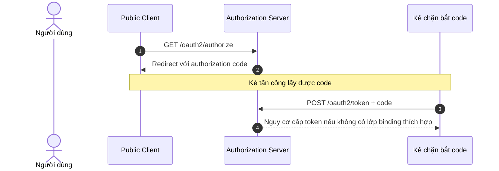
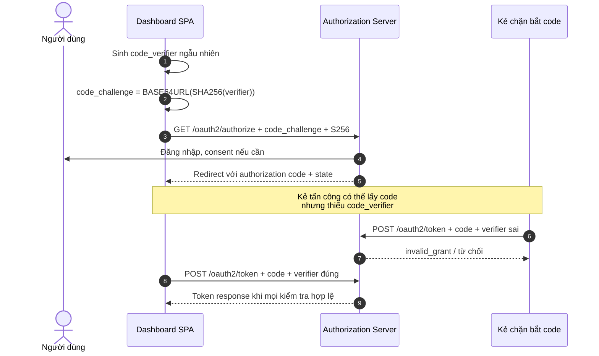
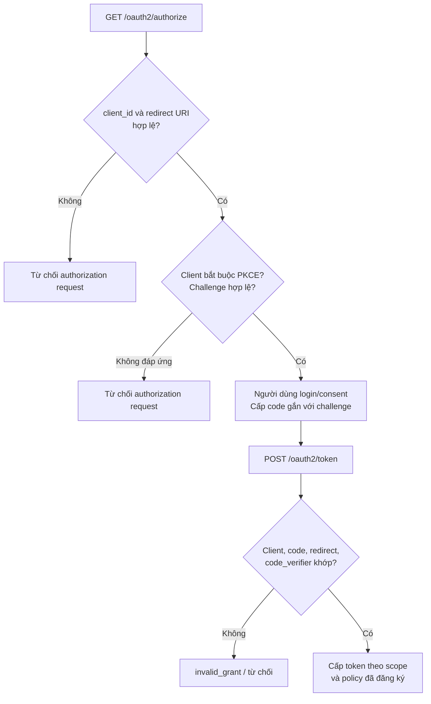

# Client public với authentication method none và yêu cầu PKCE

Khi triển khai OAuth 2.0/OpenID Connect (OIDC), một **public client** là ứng dụng **không thể bảo vệ một thông tin xác thực bí mật dùng chung một cách đáng tin cậy**. Ví dụ điển hình là ứng dụng JavaScript chạy trong trình duyệt (Single Page Application — SPA), ứng dụng di động cài trên thiết bị người dùng và ứng dụng desktop phân phối đến máy người dùng. Mã nguồn hoặc gói cài đặt của các ứng dụng này có thể bị kiểm tra, sao chép hoặc sửa đổi; vì thế **nhúng `client_secret` vào ứng dụng không biến nó thành confidential client**.

Trong Spring Authorization Server, public client dùng **`ClientAuthenticationMethod.NONE`** để thông báo rằng nó không có phương thức xác thực client bằng bí mật tại token endpoint. Với luồng **Authorization Code**, cấu hình phải kết hợp **Proof Key for Code Exchange (PKCE)**, lý tưởng là phương thức **`S256`**. PKCE giúp ràng buộc authorization code nhận ở bước chuyển hướng với đúng yêu cầu đã khởi tạo, làm giảm khả năng kẻ khác đổi được code bị chặn bắt.

Bài thuộc chương **Xác thực client** của mô-đun **SPRING_SECURITY_OAUTH2_OIDC_AUTHORIZATION_SERVER**, trong lộ trình thiết kế, cấu hình, bảo mật, kiểm thử và vận hành OAuth 2.0/OIDC Authorization Server bằng Spring Security và Spring Authorization Server trong Spring Boot. Trọng tâm là cách cấu hình `none` và PKCE chính xác, hiểu ranh giới bảo vệ, triển khai ví dụ và kiểm thử cả luồng thành công lẫn thất bại.

## 1. Public client là gì và vì sao cần cơ chế riêng?

Một OAuth client gồm định danh `client_id`, thông tin đăng ký với Authorization Server và cách khởi tạo yêu cầu cấp token. Phân loại public/confidential dựa trên **khả năng bảo vệ credential** và kiến trúc vận hành, không chỉ dựa vào giao diện ứng dụng.

| Tiêu chí | Public client | Confidential client |
|---|---|---|
| Ví dụ | SPA, native/mobile, ứng dụng desktop phân phối cho người dùng | Backend Web, BFF, worker chạy trong hạ tầng kiểm soát |
| Giữ `client_secret` an toàn? | Không thể giả định | Có thể, nếu secret/key được quản lý và không lộ cho trình duyệt |
| `client_id` | Định danh công khai | Định danh công khai |
| Phương thức xác thực | `none` cho public client | `client_secret_basic`, `private_key_jwt` hoặc cơ chế được hỗ trợ |
| Luồng đăng nhập tương tác | Authorization Code + PKCE | Authorization Code + PKCE cũng được khuyến nghị |
| Đánh đổi cần quản lý | Token và trạng thái giao thức ở thiết bị/trình duyệt khó bảo vệ | Secret server-side, phiên, kho token và vận hành backend |

**`ClientAuthenticationMethod.NONE` không có nghĩa “bỏ qua an ninh”.** Nó có nghĩa Authorization Server không dùng một client secret riêng để chứng thực client ở token endpoint. Các bước xác thực **người dùng**, đối chiếu **client registration**, kiểm tra **redirect URI**, **grant**, **scope**, **authorization code** và **PKCE** vẫn phải vận hành đầy đủ.

### 1.1. Ba danh tính không nên nhầm

- **`client_id`:** định danh đăng ký OAuth client, có thể bị người khác biết hoặc sao chép.
- **Người dùng cuối:** được xác thực tại Authorization Server, chẳng hạn qua login + MFA.
- **Người gọi API:** Resource Server xác minh **access token**, audience, scope và chính sách tài nguyên.

PKCE **không chứng minh danh tính độc quyền của ứng dụng public**; mọi bản sao phần mềm có thể biết `client_id`. PKCE chủ yếu chứng minh thực thể đổi authorization code có giữ `code_verifier` tương ứng với challenge của yêu cầu ban đầu. Không sử dụng PKCE như một giải pháp chống mã độc/XSS hoặc thay thế xác minh token tại API.

## 2. Mối đe dọa mà PKCE giải quyết

Giả sử người dùng đăng nhập qua Dashboard SPA tại `dashboard.example.com`. Ứng dụng chuyển trình duyệt đến `login.example.com/oauth2/authorize`. Sau khi xác thực và cấp quyền, Authorization Server chuyển trình duyệt về callback đã đăng ký cùng **authorization code**.

Nếu kẻ tấn công lấy được code từ một nơi không mong muốn (chẳng hạn cơ chế chuyển hướng trên thiết bị hoặc lỗi lộ URL), chúng có thể thử gửi code đến token endpoint để nhận token.

### 2.1. Nếu chỉ có authorization code



Sơ đồ chỉ minh họa nguy cơ **authorization code interception**. Trong triển khai thực, còn có ràng buộc redirect URI, client ID và các biện pháp khác; PKCE bổ sung lớp bảo vệ quan trọng đối với public client.

### 2.2. Thêm proof key để ràng buộc hai bước

Client tạo một **`code_verifier` ngẫu nhiên, đủ entropy**, rồi tính `code_challenge` và gửi challenge ở authorization request. Khi đổi code, client gửi **verifier gốc**. Authorization Server kiểm tra verifier có khớp challenge đã gắn với authorization code hay không.



**Ý nghĩa bảo mật:** challenge là giá trị công khai có thể đưa lên URL authorization request; verifier là giá trị phải được giữ trong phiên giao dịch của client và chỉ gửi tới **token endpoint**. Kẻ chỉ lấy được code và challenge nhưng không có verifier không thể đổi code thành token hợp lệ.

PKCE **không ngăn** script độc hại cùng origin đọc verifier hoặc token, cũng không ngăn kẻ chiếm toàn bộ thiết bị hay phiên trình duyệt. Vì thế SPA vẫn cần chống XSS, kiểm soát dependencies, URL callback, CSP phù hợp và quản lý thời gian sống token.

## 3. PKCE hoạt động cụ thể như thế nào?

PKCE được chuẩn hóa trong **RFC 7636**. Hai tham số trung tâm là:

| Tham số | Nơi xuất hiện | Giá trị |
|---|---|---|
| `code_verifier` | Client tạo trước khi chuyển hướng; gửi ở token request | Chuỗi ngẫu nhiên, chỉ client giữ qua giao dịch |
| `code_challenge` | Authorization request | Bản biến đổi của verifier, dùng để liên kết code |
| `code_challenge_method` | Authorization request | Nên là `S256` |
| `client_id` | Cả hai bước theo yêu cầu giao thức | Định danh client đã đăng ký; không phải secret |
| `code` | Callback từ Authorization Server | Authorization code thời hạn ngắn, một lần |
| `redirect_uri` | Authorization request và token request khi áp dụng | Phải khớp URI đã được chấp nhận khi cấp code |

### 3.1. Tạo verifier có entropy cao

Theo RFC 7636, `code_verifier` có độ dài từ **43 đến 128 ký tự**, chỉ gồm các ký tự không cần escape: `A-Z`, `a-z`, `0-9`, `-`, `.`, `_`, `~`. Cách dễ thực hiện là lấy **32 byte** từ bộ sinh số ngẫu nhiên an toàn mật mã, sau đó Base64URL không padding, cho chuỗi dài **43 ký tự**.

Không tạo verifier bằng:

- `Math.random()`, timestamp hoặc chuỗi dự đoán được;
- client ID, username, một password cố định hoặc secret được hard-code;
- một verifier toàn cục dùng lại cho mọi phiên đăng nhập.

Mỗi lần khởi tạo authorization request mới phải tạo verifier mới và liên kết nó đúng với request đó. Khi callback hoàn thành hoặc bị hủy, dọn trạng thái giao dịch theo chính sách ứng dụng.

### 3.2. Biến đổi S256

Với `S256`, công thức là:

```text
code_challenge = BASE64URL-ENCODE(SHA256(ASCII(code_verifier)))

BASE64URL-ENCODE = Base64URL không có ký tự padding "="
```

Do verifier chỉ dùng bảng ký tự ASCII ở trên, việc băm chuỗi ASCII là xác định và dễ tái lập. Authorization Server kiểm tra:

```text
BASE64URL-ENCODE(SHA256(ASCII(received_code_verifier)))
    == stored_code_challenge
```

Phương thức `plain` có trong RFC để tương thích đặc thù, nhưng `S256` là lựa chọn được khuyến nghị. **`requireProofKey(true)` yêu cầu có PKCE; đừng suy ra chỉ thiết lập này đã chứng minh mọi client/request đều bị giới hạn duy nhất ở S256.** Chính sách không chấp nhận `plain` cần được xác minh theo phiên bản hoặc tùy biến máy chủ và kiểm thử riêng.

### 3.3. JavaScript tạo verifier và challenge trong SPA

Ví dụ dùng Web Crypto API trong trình duyệt có secure context:

```javascript
function base64url(bytes) {
  const binary = String.fromCharCode(...bytes);
  return btoa(binary)
    .replace(/\+/g, "-")
    .replace(/\//g, "_")
    .replace(/=+$/g, "");
}

function createCodeVerifier() {
  const randomBytes = new Uint8Array(32);
  crypto.getRandomValues(randomBytes);
  return base64url(randomBytes); // 43 ký tự, entropy 256 bit
}

async function createCodeChallenge(verifier) {
  const bytes = new TextEncoder().encode(verifier);
  const digest = await crypto.subtle.digest("SHA-256", bytes);
  return base64url(new Uint8Array(digest));
}

// Gọi khi bắt đầu MỖI authorization request.
const verifier = createCodeVerifier();
const challenge = await createCodeChallenge(verifier);
```

Trong ứng dụng thực, logic trên cần nằm trong một hàm `async` hoặc module phù hợp; ví dụ cuối sử dụng top-level await của ES module. Chỉ lưu verifier trong trạng thái giao dịch cần thiết và bảo vệ khỏi XSS. `sessionStorage` có thể hữu ích để duy trì trạng thái qua full-page redirect nhưng **không miễn nhiễm với JavaScript độc hại cùng origin**. Khi cần bảo vệ token/verifier ở backend, cân nhắc mô hình BFF.

### 3.4. PKCE, state và nonce không thay thế nhau

| Giá trị | Vấn đề chính được giải quyết | Ai kiểm tra? |
|---|---|---|
| `code_verifier` / `code_challenge` | Ràng buộc authorization code với thực thể khởi tạo yêu cầu | Authorization Server khi đổi code |
| `state` | Gắn callback với yêu cầu OAuth ban đầu, hỗ trợ chống CSRF/đánh tráo response | OAuth client |
| `nonce` trong OIDC | Liên kết ID token với yêu cầu xác thực ban đầu, chống replay ID token | OIDC client khi validate ID token |
| Session cookie của Authorization Server | Duy trì người dùng đã xác thực qua các request | Authorization Server |
| Redirect URI registration | Giới hạn nơi Authorization Server gửi code | Authorization Server |

Với OIDC, client còn phải kiểm tra ID token theo quy tắc về chữ ký, issuer, audience, thời hạn và nonce khi áp dụng. **ID token không được dùng thay access token** để gọi Resource Server.

## 4. Luồng Authorization Code + PKCE với public client

Kịch bản: Dashboard SPA đã đăng ký `client_id=dashboard-spa`, callback chính xác `https://dashboard.example.com/auth/callback`, các scope `openid` và `orders.read`. Authorization Server có issuer `https://login.example.com`.

### 4.1. Bước A — yêu cầu authorization code

SPA tạo verifier, challenge, `state` và (nếu OIDC cần) `nonce`, rồi đưa trình duyệt tới URL tương tự:

```http
GET /oauth2/authorize?response_type=code
  &client_id=dashboard-spa
  &redirect_uri=https%3A%2F%2Fdashboard.example.com%2Fauth%2Fcallback
  &scope=openid%20orders.read
  &state=<fresh-random-state>
  &nonce=<fresh-random-nonce>
  &code_challenge=<S256-code-challenge>
  &code_challenge_method=S256 HTTP/1.1
Host: login.example.com
```

Các dấu `<...>` biểu thị giá trị giả định; query phải được URL-encode đúng khi tạo thực tế. Khi người dùng đã xác thực và quyền được phê duyệt nếu cần, Authorization Server chuyển hướng về **đúng callback đã đăng ký**:

```text
https://dashboard.example.com/auth/callback
  ?code=<single-use-authorization-code>
  &state=<original-state>
```

SPA so khớp `state` với giá trị đã lưu cho giao dịch trước khi đổi code; nếu không khớp phải dừng luồng. SPA không chấp nhận callback bất ngờ hoặc sử dụng code khi không tìm thấy verifier tương ứng.

### 4.2. Bước B — đổi code tại token endpoint

Public client gửi `code`, `code_verifier`, `client_id` và redirect URI tương ứng (khi yêu cầu):

```http
POST /oauth2/token HTTP/1.1
Host: login.example.com
Content-Type: application/x-www-form-urlencoded

grant_type=authorization_code
&client_id=dashboard-spa
&code=<authorization-code-from-callback>
&redirect_uri=https%3A%2F%2Fdashboard.example.com%2Fauth%2Fcallback
&code_verifier=<original-random-verifier>
```

Đây là minh họa đã chia dòng để đọc, **không phải HTTP body nguyên văn có thể dán chạy**; khi gửi thực tế phải encode `application/x-www-form-urlencoded` chính xác. Public client **không gửi `client_secret`** và **không gửi HTTP Basic client credentials**. Đối với client đã đăng ký `none`, token endpoint nhận diện client theo quy tắc dành cho public client; ràng buộc code, redirect URI và PKCE mới là những kiểm tra cốt lõi của flow.

Nếu mọi điều kiện hợp lệ, Authorization Server trả response token. Khi request có `openid` và OIDC được bật, response thường có `id_token` bên cạnh `access_token`:

```json
{
  "access_token": "<opaque-or-jwt-access-token>",
  "token_type": "Bearer",
  "expires_in": 300,
  "scope": "openid orders.read",
  "id_token": "<signed-oidc-id-token>"
}
```

Giá trị trên chỉ minh họa, không phải token thật. **Không mặc định có refresh token**: chính sách Spring Authorization Server 1.x thường không phát refresh token cho public client theo mẫu SPA + PKCE; hành vi cụ thể phải kiểm tra phiên bản và cấu hình. Không vì thiếu refresh token mà cố gắng nhúng secret vào SPA.

### 4.3. Bước C — gọi Resource Server

SPA gọi Orders API bằng access token:

```http
GET /api/orders HTTP/1.1
Host: api.example.com
Authorization: Bearer <access-token>
```

Orders API phải kiểm tra issuer/chữ ký hoặc trạng thái token, expiration, **audience dành cho API**, `orders.read` và quyền nghiệp vụ theo user/tenant. Authorization Server đăng ký scope `orders.read` không có nghĩa user được phép đọc mọi đơn hàng.

### 4.4. HTTP 401/403 và lỗi giao thức

- Thiếu hoặc sai authorization code, verifier không khớp, code hết hạn/đã sử dụng: token endpoint từ chối, thường là lỗi `invalid_grant`.
- Authorization request sai tham số PKCE, redirect URI, grant hoặc scope: phản hồi lỗi tùy bước và loại lỗi; không cố chuyển tới redirect URI chưa được xác minh.
- API thiếu/không hợp lệ Bearer token: thường `401`; token hợp lệ nhưng thiếu quyền: thường `403`.

Không quy mọi lỗi PKCE về `invalid_client`. Public client không có secret để xác thực theo cách confidential client; code/verifier và chính sách grant phải được kiểm tra đúng lớp.

## 5. Cấu hình RegisteredClient dùng NONE và yêu cầu PKCE

Trong Spring Authorization Server, `RegisteredClient` mô tả các điều kiện Authorization Server cho phép đối với **một client**. Ví dụ Spring Boot dùng các API phổ biến của Spring Authorization Server 1.x / Spring Security 6.x:

```java
package example.authserver.config;

import java.time.Duration;

import org.springframework.context.annotation.Bean;
import org.springframework.context.annotation.Configuration;
import org.springframework.security.oauth2.core.AuthorizationGrantType;
import org.springframework.security.oauth2.core.ClientAuthenticationMethod;
import org.springframework.security.oauth2.core.oidc.OidcScopes;
import org.springframework.security.oauth2.server.authorization.client.RegisteredClient;
import org.springframework.security.oauth2.server.authorization.client.RegisteredClientRepository;
import org.springframework.security.oauth2.server.authorization.client.InMemoryRegisteredClientRepository;
import org.springframework.security.oauth2.server.authorization.settings.ClientSettings;
import org.springframework.security.oauth2.server.authorization.settings.TokenSettings;

@Configuration(proxyBeanMethods = false)
public class PublicClientRegistrationConfig {

    @Bean
    RegisteredClientRepository registeredClientRepository() {
        RegisteredClient dashboard = RegisteredClient
            .withId("dashboard-spa-registration")
            .clientId("dashboard-spa")
            // Public client không có client secret.
            .clientAuthenticationMethod(ClientAuthenticationMethod.NONE)
            .authorizationGrantType(AuthorizationGrantType.AUTHORIZATION_CODE)
            .redirectUri("https://dashboard.example.com/auth/callback")
            .scope(OidcScopes.OPENID)
            .scope("orders.read")
            .clientSettings(ClientSettings.builder()
                .requireProofKey(true)
                .requireAuthorizationConsent(true)
                .build())
            .tokenSettings(TokenSettings.builder()
                .accessTokenTimeToLive(Duration.ofMinutes(5))
                .build())
            .build();

        return new InMemoryRegisteredClientRepository(dashboard);
    }
}
```

**Các thuộc tính cần hiểu đúng:**

1. **`ClientAuthenticationMethod.NONE`:** khai báo client không giữ credential bí mật; tuyệt đối không thêm `.clientSecret("...")` vào bản build SPA chỉ để đổi code.
2. **`AuthorizationGrantType.AUTHORIZATION_CODE`:** cho phép quy trình redirect và đổi authorization code. Không bật `CLIENT_CREDENTIALS` cho public SPA.
3. **`.requireProofKey(true)`:** yêu cầu PKCE cho authorization code. Phải kiểm thử phía server từ chối request thiếu/verifier sai; bảo đảm client sử dụng `S256`.
4. **`.redirectUri(...)`:** đăng ký cụ thể callback chính xác. Không dùng wildcard hoặc callback mở để nhận code.
5. **`.scope(...)`:** giới hạn những scope client được phép xin; `openid` làm luồng trở thành OIDC khi server đã bật OIDC.
6. **`.requireAuthorizationConsent(true)`:** chính sách hiển thị consent khi cần; không thay thế xác thực người dùng hoặc các kiểm tra PKCE.
7. **`TokenSettings`:** giới hạn TTL access token. TTL `5` phút chỉ là ví dụ, cần điều chỉnh theo yêu cầu bảo mật/vận hành.

Với môi trường production, cần kho `RegisteredClientRepository` bền vững, quản trị client ID/redirect/scopes theo môi trường. `InMemoryRegisteredClientRepository` ở đây dùng để học và test. Không cần tạo lại ID nội bộ mỗi lần chạy nếu ứng dụng có authorization/consent persistence.

### 5.1. Bộ ba grant, method và PKCE có vai trò khác nhau

| Thuộc tính | Câu hỏi nó trả lời | Giá trị cho Dashboard SPA |
|---|---|---|
| `authorizationGrantType` | Có được đi theo quy trình này không? | `authorization_code` |
| `clientAuthenticationMethod` | Client có xác thực bằng credential ở token endpoint không? | `none` |
| `requireProofKey` | Code có phải ràng buộc với verifier không? | `true` |
| `redirectUri` | Gửi code về đâu? | Callback HTTPS đã đăng ký |
| `scope` | Client được phép yêu cầu quyền nào? | `openid`, `orders.read` |
| Token policy | Token sống bao lâu, format gì? | TTL ngắn phù hợp rủi ro |

Chọn đúng một trường nhưng bỏ các trường còn lại vẫn có thể không an toàn. Ví dụ client dùng `none` nhưng thiếu PKCE làm tăng rủi ro bị đổi authorization code; client có PKCE nhưng redirect URI quá rộng vẫn gây nguy cơ lộ code và các cuộc tấn công khác.

## 6. Cấu hình Authorization Server xung quanh RegisteredClient

`RegisteredClient` **không tự tạo Authorization Server hoàn chỉnh**. Ứng dụng còn cần security filter chains, xác thực người dùng, issuer settings, JWKSource/khóa ký khi phát ID token/JWT, authorization/consent storage, token generation và các endpoint OAuth2/OIDC.

Ví dụ cấu hình hai chain theo cách thường dùng:

```java
@Bean
@Order(1)
SecurityFilterChain authorizationServerSecurityFilterChain(
        HttpSecurity http) throws Exception {
    OAuth2AuthorizationServerConfigurer authorizationServer =
            OAuth2AuthorizationServerConfigurer.authorizationServer();

    http
        .securityMatcher(authorizationServer.getEndpointsMatcher())
        .with(authorizationServer, configurer ->
            configurer.oidc(Customizer.withDefaults()))
        .authorizeHttpRequests(authorize -> authorize
            .anyRequest().authenticated())
        .exceptionHandling(exceptions -> exceptions
            .defaultAuthenticationEntryPointFor(
                new LoginUrlAuthenticationEntryPoint("/login"),
                new MediaTypeRequestMatcher(MediaType.TEXT_HTML)))
        .oauth2ResourceServer(oauth2 -> oauth2
            .jwt(Customizer.withDefaults()));

    return http.build();
}

@Bean
@Order(2)
SecurityFilterChain applicationSecurityFilterChain(HttpSecurity http)
        throws Exception {
    http
        .authorizeHttpRequests(authorize -> authorize
            .anyRequest().authenticated())
        .formLogin(Customizer.withDefaults());
    return http.build();
}
```

Đoạn này minh họa wiring và đã lược bỏ imports. Protocol chain xử lý `/oauth2/authorize` và `/oauth2/token`; application chain phục vụ trang login. Nếu client chưa có phiên, yêu cầu authorize có thể chuyển hướng login, rồi quay lại hoàn tất cấp code.

Khi bật OIDC, những bean như `JwtDecoder` và `JWKSource` có thể cần thiết cho các endpoint OIDC tương ứng. Kiểm tra API/cấu hình theo đúng phiên bản Spring Security và Spring Authorization Server của dự án. Việc thêm `.oidc(...)` hoặc `.requireProofKey(true)` mà thiếu các bean/nền tảng tương ứng sẽ không tạo ra ứng dụng hoàn chỉnh.

### 6.1. PKCE được kiểm tra ở đâu?

Luồng khái niệm:



Các endpoint filter, client authentication provider và authorization-code authentication provider của Spring Authorization Server thực hiện các kiểm tra phù hợp theo giao thức. Sơ đồ chỉ là **mô hình chức năng**, không cam kết chính xác thứ tự mọi lớp filter/provider hoặc mã lỗi ở tất cả phiên bản.

### 6.2. Server phải ràng buộc authorization code với client

PKCE là một phần của phòng tuyến; máy chủ còn phải kiểm tra:

- Authorization code tồn tại, còn hạn và **chỉ được dùng một lần**.
- Code được cấp cho đúng **`client_id`**, đúng authorization request và redirect URI đã ghi nhận.
- `code_verifier` thỏa cú pháp và khớp challenge gắn với **chính code đó**.
- Scope được cấp không vượt allowlist và chính sách consent.
- Token có issuer/audience/TTL đúng và Resource Server kiểm tra quyền cuối cùng.

Không được chỉ so khớp một `code_verifier` chung toàn ứng dụng hoặc một giá trị PKCE lưu theo client ID. Từng **authorization request** phải có verifier/challenge độc lập.

## 7. Sử dụng public client từ SPA và ứng dụng native

### 7.1. SPA trong trình duyệt

SPA chạy JavaScript ở client nên có thể trực tiếp trao đổi với token endpoint nếu Authorization Server có chính sách **CORS** phù hợp. CORS phải cho phép **origin xác định** và các method/header cần thiết, tránh mở `*` bừa bãi cùng credential nhạy cảm.

Tuy nhiên, CORS không phải cơ chế bảo vệ token khỏi XSS. Nếu script độc hại chạy trong origin SPA, nó có thể tác động đến trạng thái ứng dụng và token. Những lưu ý thực tế:

- Ưu tiên lưu token trong bộ nhớ nếu phù hợp; tránh đưa access token hoặc verifier lên URL, console, log hoặc analytics.
- Tránh lưu token dài hạn trong `localStorage`; đánh giá rủi ro XSS và cơ chế khôi phục phiên. `sessionStorage` cũng không an toàn trước script độc hại cùng origin.
- Sử dụng CSP, kiểm soát third-party scripts, kiểm tra dependency, encode đầu ra HTML và chặn open redirect.
- Dùng redirect URI chính xác, HTTPS và phân biệt origin giữa các môi trường.
- Đảm bảo `state`, `nonce` và transaction state được tạo ngẫu nhiên, so khớp, dọn dẹp.
- API vẫn phải xác minh access token; không tin chỉ vì request xuất phát từ origin được phép CORS.

### 7.2. Ứng dụng native/mobile

Ứng dụng native cũng thường là public client. Sử dụng **system browser hoặc trình duyệt được ủy quyền của hệ điều hành**, tránh thu thập mật khẩu bằng WebView nhúng. Authorization Code + PKCE phù hợp hơn việc đưa mật khẩu cho ứng dụng hoặc nhúng secret trong APK/IPA.

Native app có thể dùng app-claimed HTTPS redirect, private-use URI scheme hoặc loopback redirect theo profile bảo mật và khả năng của nền tảng. Đăng ký redirect URI và xử lý callback phải khớp chính sách Authorization Server. **Không suy đoán** mọi phiên bản Spring Authorization Server cho phép tự động mọi kiểu loopback URI/dynamic port nếu chưa xác minh cấu hình hỗ trợ.

Ở cả SPA và native app, một ứng dụng đã cài đặt có thể bị sửa hoặc giả mạo. PKCE là bảo vệ chống code interception, **không cung cấp attestation của ứng dụng**. Nếu bài toán cần bảo đảm workload/thiết bị tin cậy mạnh hơn, phải bổ sung mô hình xác thực hoặc cấp quyền riêng phù hợp.

### 7.3. Khi nào cân nhắc BFF?

Một **Backend for Frontend (BFF)** giữ OAuth client credentials và access/refresh tokens ở phía server, còn trình duyệt tương tác với BFF bằng phiên bảo vệ qua cookie. BFF có thể giúp giảm việc access token nằm trong JavaScript, hỗ trợ kiểm soát token rotation và logout.

Nhưng BFF cũng tạo trách nhiệm: quản lý CSRF cho cookie, SameSite, session fixation, XSS, credential lưu server-side, horizontal scaling và phân quyền giữa phiên browser với token. **Không cần ép mọi SPA phải là BFF**; lựa chọn dựa trên rủi ro, hạ tầng và yêu cầu phiên.

| Tình huống | Thiết kế cân nhắc |
|---|---|
| SPA nhỏ, phiên ngắn, rủi ro chấp nhận được | Public client + `none` + Authorization Code + PKCE |
| SPA xử lý dữ liệu nhạy cảm, cần kiểm soát token chặt | BFF confidential client, session cookie được bảo vệ |
| Native/mobile | Public client + PKCE, system browser và redirect platform-specific |
| Job nền không có người dùng | Confidential client + `client_credentials`, không dùng `none` giả lập đăng nhập |

## 8. Các hạn chế mà PKCE không giải quyết

PKCE chỉ chống một lớp tấn công cụ thể trong luồng đổi authorization code. Thiết kế vẫn cần các bảo vệ độc lập:

| Nguy cơ | Vì sao PKCE chưa đủ? | Biện pháp bổ sung |
|---|---|---|
| **XSS trong SPA** | Script cùng origin có thể đọc verifier/token | CSP, encode output, kiểm soát dependency, BFF khi cần |
| **Redirect URI không kiểm soát** | Code vẫn có thể bị đưa tới endpoint của kẻ khác | Đăng ký callback chính xác, loại open redirect |
| **Login CSRF/response mix-up** | PKCE không thay toàn bộ kiểm tra callback | `state` ngẫu nhiên, issuer checking, transaction binding |
| **OIDC ID token replay** | Verifier không thay nonce/ID token validation | Kiểm tra `nonce` khi áp dụng, `iss`, `aud`, `exp`, chữ ký |
| **Access token bị đánh cắp** | PKCE kết thúc nhiệm vụ sau đổi code | TTL ngắn, secure storage, policy API, giải pháp token binding khi hỗ trợ |
| **Quyền API quá rộng** | PKCE không cấp quyền nghiệp vụ | Scope ít quyền, audience, tenant/object authorization |
| **Mã client bị giả mạo** | Public client không có secret để chứng minh bản cài đặt độc nhất | Chính sách đăng ký/consent, kiểm soát redirect, cơ chế attestation nếu cần |
| **Refresh token bị lạm dụng** | PKCE không bảo vệ token dài hạn sau phát hành | Chính sách refresh token, rotation/revocation khi áp dụng, cân nhắc BFF |

### 8.1. State và nonce phải gắn đúng giao dịch

Tình huống SPA mở hai cửa sổ đăng nhập song song có thể có hai bộ `state`/`nonce`/`code_verifier`. Nếu ứng dụng chỉ lưu **một biến toàn cục** và cửa sổ sau ghi đè cửa sổ trước, callback đầu tiên có thể thất bại hoặc bị ghép sai transaction.

Quản lý các bộ tham số theo authorization transaction và dọn state sau khi đổi code hoặc timeout. Không xử lý callback tùy ý chỉ vì trong query có `code`.

### 8.2. Phân biệt scope và audience

Token có scope `orders.read` **không tự động hợp lệ cho mọi API**. API phải kiểm tra audience (thí dụ `aud=orders-api`) và issuer tin cậy. Khi public client gọi nhiều API, cần chính sách token hướng đến đúng Resource Server; không chuyển tiếp token của API A sang API B nếu audience không cho phép.

OIDC `id_token` được phát cho **OAuth client** để kiểm tra đăng nhập; không sử dụng nó như Bearer access token ở Orders API.

## 9. Kiểm thử với Spring Authorization Server

Một bộ kiểm thử tốt không chỉ chứng minh flow thành công. Nó phải chứng minh Authorization Server **từ chối** các trường hợp không có PKCE hoặc không đúng ràng buộc.

| Test case | Input / thiết lập | Kết quả kỳ vọng |
|---|---|---|
| Authorization Code + S256 hợp lệ | Client `none`, challenge S256, verifier đúng | Token được cấp khi user, code, scope đều hợp lệ |
| Thiếu `code_challenge` | Client `requireProofKey(true)` | Authorization request bị từ chối |
| Thiếu `code_verifier` | Code được cấp với PKCE nhưng token request không có verifier | Không cấp token |
| Verifier sai | Hash không khớp challenge | Thường `invalid_grant`; không cấp token |
| Verifier dự đoán được | Verifier có entropy thấp hoặc sai định dạng | Client test phải phát hiện; server cần validate cú pháp và policy |
| Code dùng hai lần | Token request lần thứ hai với cùng code | Từ chối lần sau |
| Sai client ID | Code cấp cho client A, client B gửi token request | Từ chối |
| Redirect URI khác | Token request không khớp URI được gắn với code | Từ chối |
| Phương thức `plain` | Client cố dùng `plain` thay `S256` | Xác minh policy mong muốn; chỉ từ chối nếu cấu hình server hỗ trợ/áp yêu cầu đó |
| Thêm secret cho client `none` | Gửi Basic/client secret không có trong registration | Không được tự động nâng client thành confidential |
| Scope ngoài allowlist | SPA xin `orders.admin` chưa đăng ký | Không cấp scope vượt quyền |
| `state` callback sai | Giá trị trả về không khớp yêu cầu | OAuth client từ chối callback |
| `nonce` OIDC sai | ID token nonce không khớp | OIDC client từ chối đăng nhập |
| ID token sai issuer/audience | ID token giả hoặc của client khác | OIDC client từ chối |
| Access token gửi sai API | Audience không dành cho Resource Server | API từ chối |
| Callback bị chỉnh sửa | URI ngoài allowlist hoặc open redirect | Authorization Server không gửi code đến URI sai |
| XSS / token exposure | Kiểm tra frontend và log trong môi trường test | Không vô tình xuất token/verifier vào URL, log, analytics |

**Không đánh dấu thành công chỉ vì `/oauth2/token` trả HTTP 200.** Cần kiểm tra token claims, scope, lifetime, audience và việc không cấp token cho yêu cầu sai. Các test chỉ mock authentication có thể bỏ qua bước kiểm tra chữ ký, PKCE và luồng redirect thực.

### 9.1. Test mức cấu hình và mức giao thức

**Ở Authorization Server**, dùng test context và `MockMvc`/`spring-security-test` để kiểm tra registered client, redirect URI, filter chain, CSRF login, grant và xử lý lỗi. Có thể kết hợp HTTP integration tests với server thật để kiểm tra authorization code được tạo, lưu và đổi đúng một lần.

**Ở SPA/OIDC client**, kiểm tra:

1. Có tạo verifier bằng nguồn ngẫu nhiên mật mã và challenge S256 cho mỗi phiên không?
2. Có lưu đúng từng `state`/verifier/nonce tương ứng khi redirect song song không?
3. Callback sai state hoặc thiếu dữ liệu giao dịch có dừng ngay không?
4. Có gửi verifier ở token request mà không lộ qua URL/analytics không?
5. Có kiểm tra ID token đúng issuer, audience, expiry, nonce không?
6. Khi token hết hạn, ứng dụng xử lý đăng nhập lại hoặc cơ chế phiên đúng chính sách không?

### 9.2. Yêu cầu curl minh họa để kiểm tra lỗi

Vì có đăng nhập trình duyệt, authorization code cần được tạo qua authorization endpoint với phiên người dùng hợp lệ. Sau khi **test** có code và verifier, có thể mô phỏng token exchange:

```bash
curl --request POST "https://login.example.com/oauth2/token" \
  --header "Content-Type: application/x-www-form-urlencoded" \
  --data-urlencode "grant_type=authorization_code" \
  --data-urlencode "client_id=dashboard-spa" \
  --data-urlencode "code=$AUTHORIZATION_CODE" \
  --data-urlencode "redirect_uri=https://dashboard.example.com/auth/callback" \
  --data-urlencode "code_verifier=$CODE_VERIFIER"
```

Lưu ý **không có `--user CLIENT_ID:CLIENT_SECRET`**: client public dùng `none`. Để test sai verifier, thay `CODE_VERIFIER` bằng chuỗi sai và xác minh không có token; tạo authorization code **mới** cho trường hợp test độc lập vì code là một lần. Chỉ chạy với tài khoản và môi trường test, không đưa code/token thật vào log hoặc ticket công khai.

## 10. Lỗi triển khai và cách chẩn đoán

| Triệu chứng | Nguyên nhân có thể | Hướng kiểm tra |
|---|---|---|
| SPA token request trả `invalid_client` | Server đăng ký `client_secret_basic` thay vì `none`, thiếu/không khớp client ID | Xem `RegisteredClient.clientAuthenticationMethods` |
| `/oauth2/authorize` lỗi khi thiếu PKCE | Client bị yêu cầu `requireProofKey(true)` | Sinh challenge S256 và method đúng |
| `/oauth2/token` trả `invalid_grant` | Verifier sai, code hết hạn/đã dùng, redirect sai | Theo dõi transaction ID, so khớp challenge, code binding |
| Token request từ browser bị chặn CORS | CORS/origin chưa được cấu hình chính xác | Kiểm tra origin, preflight, allowed methods/headers |
| Dashboard không có refresh token | Chính sách public client của phiên bản SAS không phát refresh token | Thiết kế lại phiên hoặc cân nhắc BFF |
| Có ID token nhưng API vẫn `401` | Dùng ID token như access token hoặc access token sai audience | Gửi access token đúng API và kiểm tra claims |
| `/login` lặp redirect | Chain login không đúng matcher, login route bị khóa | Kiểm tra `SecurityFilterChain` order và entry point |
| Callback không tìm thấy verifier | Mất `sessionStorage`, nhiều tab ghi đè hoặc giao dịch timeout | Lưu từng transaction có kiểm soát |
| Verifier trong URL callback | Triển khai PKCE sai: đưa verifier vào authorization request | Chỉ gửi challenge ở bước authorize; verifier ở token request |
| Gỡ PKCE để “sửa” lỗi | Client sai generator hoặc server/client lệch quy tắc | Sửa transaction và policy, không nới bảo mật |
| Token bị lộ trong console/storage | Logging frontend, dependency hoặc XSS | Kiểm tra dữ liệu nhạy cảm và CSP |
| Sai issuer/redirect khi qua proxy | Public URL, forwarded headers hoặc callback không khớp | Cấu hình issuer và proxy tin cậy thống nhất |

### 10.1. Vận hành an toàn cho public clients

- Quản lý `client_id`, redirect URI, scope theo **môi trường** (dev/staging/prod), giữ các host/callback chính xác.
- Giới hạn TTL authorization code và access token; không cấp quyền lâu hơn nhu cầu nghiệp vụ.
- Theo dõi tỷ lệ lỗi `invalid_grant`, từ chối redirect, `invalid_scope` và các truy cập bất thường theo client, nhưng **không log code, verifier, access/refresh token hoặc cookie**.
- Kiểm tra chính sách CORS/HTTPS, CSP, XSS, tài nguyên bên thứ ba và chặn open redirect khi triển khai SPA.
- Luôn có kiểm thử hồi quy PKCE khi cập nhật Spring Authorization Server, Spring Security hoặc thư viện OAuth client.
- Phân biệt đăng xuất khỏi SPA, kết thúc phiên OIDC tại Authorization Server và thời hạn hiệu lực của access token; không giả định logout xóa ngay mọi token.

## 11. Lựa chọn kiến trúc theo tình huống

Giả sử một tổ chức xây ba ứng dụng:

**Ứng dụng A — Dashboard SPA:** chạy hoàn toàn trong browser, đăng nhập OIDC, gọi Orders API. Chọn `authorization_code` + `ClientAuthenticationMethod.NONE` + `requireProofKey(true)`, bắt buộc `S256` theo thiết kế client và policy đã kiểm thử. Scope `openid orders.read`; callback HTTPS cụ thể; không nhúng secret. Đánh giá XSS/CORS/token storage và có thể chuyển sang BFF khi yêu cầu tăng.

**Ứng dụng B — Employee Portal BFF:** web frontend có backend kiểm soát token và phiên. BFF là confidential client, có thể dùng `client_secret_basic` hoặc phương thức mạnh hơn, vẫn dùng Authorization Code + PKCE. Token được bảo vệ ở backend; browser nhận cookie phiên có CSRF/SameSite phù hợp.

**Ứng dụng C — Invoice Worker:** chạy định kỳ không có tương tác người dùng. Dùng confidential client + `client_credentials` với credential bảo vệ bằng secret manager, key hoặc mTLS khi tích hợp đúng; không dùng `none` để giả lập public client có user.

| Câu hỏi quyết định | Nếu có | Hướng đi |
|---|---|---|
| Mã ứng dụng phát tới thiết bị/trình duyệt không kiểm soát? | Có | Xem như public client |
| Người dùng cần đăng nhập OIDC? | Có | Authorization Code + PKCE và scope `openid` |
| Ứng dụng có backend kiểm soát credential? | Có | Có thể chọn BFF confidential client |
| Không có người dùng, chỉ là job nền? | Có | Client Credentials với client authentication |
| Cần token dài hạn ở JavaScript? | Có | Cân nhắc lại kiến trúc, ưu tiên BFF/policy phiên phù hợp |

## 12. Câu hỏi tự đánh giá

1. Vì sao `client_id` được xem là công khai? Vì sao không được nhúng `client_secret` trong SPA?
2. `ClientAuthenticationMethod.NONE` thực sự bỏ qua việc kiểm tra nào và **không** bỏ qua việc kiểm tra nào?
3. PKCE ràng buộc `code_verifier` và `code_challenge` thế nào? Tại sao chọn `S256`?
4. Vì sao nên tạo verifier mới cho mỗi authorization request? Những rủi ro nào xuất hiện khi dùng một verifier cố định?
5. Khi callback có code nhưng `state` không khớp, SPA phải làm gì trước khi gửi token request?
6. Spring Authorization Server cần cấu hình gì trong `RegisteredClient` để yêu cầu PKCE đối với public client?
7. Vì sao `requireProofKey(true)` chưa đồng nghĩa đã có kiểm chứng chính sách **chỉ S256**?
8. Public client cần gửi những trường nào đến token endpoint khi đổi code và trường nào tuyệt đối không cần?
9. Vì sao PKCE không bảo vệ được verifier/token khi ứng dụng bị XSS?
10. API phải kiểm tra gì ngoài việc token được cấp cho public client đã đăng ký?
11. Nếu hệ thống cần refresh token/phiên kéo dài cho web app nhạy cảm, BFF giải quyết vấn đề gì và đặt ra trách nhiệm bảo mật nào?
12. Trong hệ thống có ứng dụng native, SPA và worker, bạn sẽ tách client registration theo những tiêu chí nào?

## 13. Tài liệu nền tảng

- [RFC 7636 — Proof Key for Code Exchange](https://www.rfc-editor.org/rfc/rfc7636): định nghĩa verifier/challenge, S256 và cơ chế ràng buộc authorization code.
- [RFC 8252 — OAuth 2.0 for Native Apps](https://www.rfc-editor.org/rfc/rfc8252): sử dụng system browser, public clients, PKCE và redirect trong native apps.
- [RFC 9700 — OAuth 2.0 Security Best Current Practice](https://www.rfc-editor.org/rfc/rfc9700): các khuyến nghị bảo mật hiện đại cho authorization flow, redirect URI và PKCE.
- [Spring Authorization Server — SPA using PKCE](https://docs.spring.io/spring-authorization-server/reference/guides/how-to-pkce.html): hướng dẫn đăng ký public client trong Spring Authorization Server.
- [Spring Authorization Server — Core Model](https://docs.spring.io/spring-authorization-server/reference/core-model-components.html): `RegisteredClient`, `ClientSettings` và chính sách token.

**Ghi nhớ:** Public client dùng **`ClientAuthenticationMethod.NONE`** vì không thể bảo vệ credential bí mật một cách đáng tin cậy. Với Authorization Code, **PKCE S256** ràng buộc code với đúng yêu cầu bằng một verifier ngẫu nhiên và chỉ được gửi ở token endpoint. Spring Authorization Server thể hiện chính sách này bằng `RegisteredClient` với `AUTHORIZATION_CODE`, `NONE` và `requireProofKey(true)`. Cấu hình đó phải được kết hợp với redirect URI chính xác, `state`, OIDC validation, scope/audience, bảo vệ token và kiểm thử từ chối truy cập để kiến trúc public client vừa dùng được vừa an toàn.
