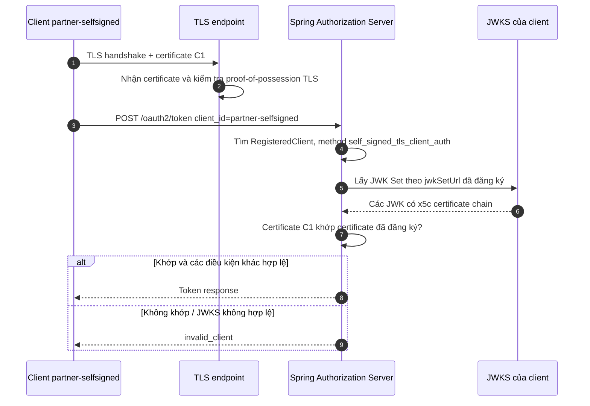
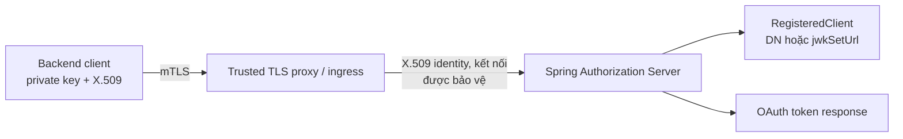
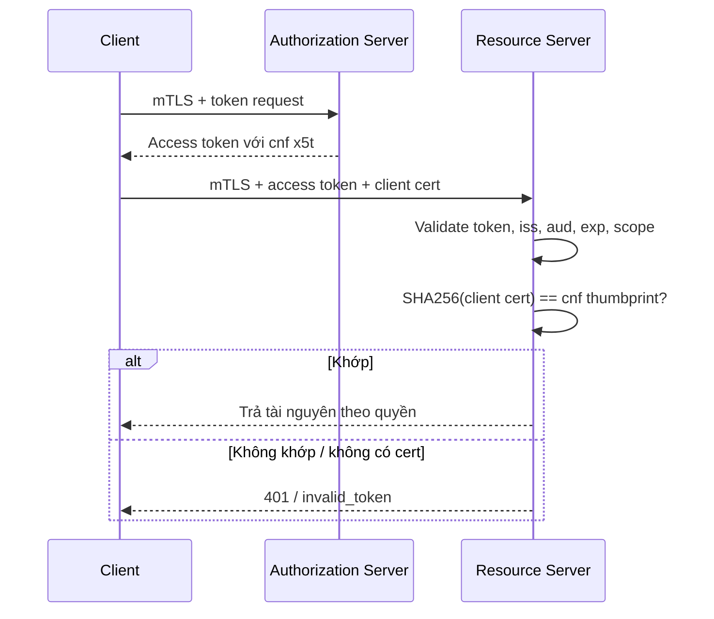

# tls_client_auth và self_signed_tls_client_auth

Trong OAuth 2.0/OpenID Connect, **client authentication** là việc Authorization Server (AS) xác minh ứng dụng đang gọi endpoint giao thức thực sự là client đã đăng ký. Bên cạnh `client_secret_basic` hoặc `private_key_jwt`, Spring Authorization Server hỗ trợ hai phương thức xác thực client bằng chứng chỉ X.509 qua **mutual TLS (mTLS)**:

- **`tls_client_auth`**: dựa vào hạ tầng khóa công khai (PKI), chuỗi chứng chỉ được xác thực bằng CA tin cậy và một danh tính chứng chỉ đã đăng ký.
- **`self_signed_tls_client_auth`**: client sử dụng chứng chỉ đã đăng ký trong một JWK Set; AS đối chiếu chính xác chứng chỉ được trình trong kết nối TLS với chứng chỉ có trong JWK Set của client.

Đây là bài học thuộc chương **Xác thực client** của module **SPRING_SECURITY_OAUTH2_OIDC_AUTHORIZATION_SERVER**, dành cho việc thiết kế, cấu hình, bảo mật, kiểm thử và vận hành OAuth 2.0/OIDC Authorization Server bằng Spring Security và Spring Authorization Server trong Spring Boot.

Sau bài này, bạn có thể:

1. Giải thích vì sao mTLS xác thực client khác với HTTPS thông thường, OAuth bearer token, PKCE và xác thực người dùng.
2. Phân biệt ranh giới tin cậy giữa **TLS handshake**, **đăng ký client** và **OAuth token endpoint** trong hai phương thức của RFC 8705.
3. Cấu hình `RegisteredClient`, `ClientSettings` và `TokenSettings` cho hai phương thức trong Spring Authorization Server.
4. Tổ chức certificate validation khi ứng dụng chạy trực tiếp hoặc sau reverse proxy, và hiểu vì sao `client_id` hoặc header HTTP chứa DN không phải bằng chứng.
5. Thiết kế kiểm thử certificate mismatch, mất chứng chỉ, xoay chứng chỉ và **certificate-bound access token**.

> **Phạm vi:** Ví dụ Java dùng API của Spring Authorization Server **1.x** với Spring Security/Spring Boot tương thích. Hướng dẫn sử dụng hostname, chứng chỉ và cấu hình minh họa; không giả định ví dụ đăng ký client tự thiết lập được TLS, PKI hay Resource Server.

## 1. Vị trí của mTLS trong mô hình OAuth 2.0

Với **TLS một chiều**, trình duyệt hoặc HTTP client kiểm tra chứng chỉ TLS của máy chủ nhằm xác nhận đang kết nối đến đúng server qua kênh được mã hóa. Với **mutual TLS**, server còn yêu cầu client cung cấp chứng chỉ và chứng minh sở hữu **private key** tương ứng trong quá trình bắt tay TLS.

Trong OAuth, chứng chỉ đó chỉ trở thành **OAuth client authentication** khi Authorization Server xác minh chứng chỉ phù hợp với **`RegisteredClient` đã được xác định bằng `client_id`**.

```mermaid
sequenceDiagram
    autonumber
    participant C as OAuth client backend
    participant TLS as TLS endpoint của AS
    participant AS as Spring Authorization Server
    participant R as RegisteredClientRepository

    C->>TLS: Mở HTTPS, bắt đầu TLS handshake
    TLS-->>C: Chứng chỉ server; yêu cầu client certificate
    C->>TLS: Xuất trình X.509 và chứng minh giữ private key
    TLS->>TLS: Hoàn tất kiểm tra TLS theo phương thức
    C->>AS: POST /oauth2/token + client_id + grant
    AS->>R: Tìm client theo client_id
    R-->>AS: RegisteredClient + ClientSettings
    AS->>AS: Kiểm tra authentication method và certificate binding
    alt Hợp lệ
        AS-->>C: Access token theo grant và chính sách
    else Không hợp lệ
        AS-->>C: invalid_client (hoặc từ chối trước OAuth nếu TLS lỗi)
    end
```

**Hai lớp kiểm tra cần tách bạch:**

- **TLS layer:** kết nối bảo mật, client chứng minh giữ private key; với phương thức PKI, chuỗi CA và tính hợp lệ của chứng chỉ còn phải được TLS layer kiểm tra. Nếu TLS handshake thất bại, HTTP request thường **chưa tới** Spring Authorization Server.
- **OAuth layer:** request mang `client_id`; AS tìm registration, kiểm tra phương thức xác thực đã đăng ký và đối chiếu chứng chỉ TLS với danh tính/khóa tin cậy của **đúng client đó**. Nếu không khớp, OAuth client authentication thất bại.

Không được chỉ nhìn thấy một certificate rồi cho rằng người gửi đã được phép dùng `client_id` bất kỳ. Việc ghép chứng chỉ với đăng ký client là phần quan trọng của RFC 8705.

### 1.1. Client authentication khác xác thực người dùng và PKCE

| Khái niệm | Kiểm tra điều gì? | Có thay thế mTLS client authentication không? |
| --- | --- | --- |
| **Đăng nhập người dùng** | Người sử dụng hệ thống là ai; có thể qua form login, MFA, IdP. | Không; một backend client có thể gọi `client_credentials` mà không có người dùng. |
| **`client_id`** | Chỉ định bản ghi client cần tra cứu. | Không; ID công khai, có thể bị khai giả. |
| **PKCE** | Bên đổi authorization code giữ `code_verifier` tương ứng challenge đã gửi. | Không; PKCE không chứng minh danh tính confidential client. |
| **`client_secret_basic`** | Client biết secret đã đăng ký. | Là phương thức khác; không sử dụng chứng chỉ mTLS. |
| **`private_key_jwt`** | Client ký JWT assertion theo khóa đã đăng ký. | Là phương thức khác; chữ ký JWT assertion không phải chứng cứ TLS handshake. |
| **`tls_client_auth` / `self_signed_tls_client_auth`** | Client có private key của chứng chỉ và chứng chỉ khớp registration. | Chính là hai phương thức mTLS của bài này. |
| **Certificate-bound access token** | Khi gọi API, client chứng minh sở hữu khóa chứng chỉ mà token đã ràng buộc. | Đây là bảo vệ **truy cập tài nguyên sau khi cấp token**, có thể dùng cùng client authentication nhưng là quyết định riêng. |

mTLS client authentication thường phù hợp với **confidential client** chạy trên server, đối tác B2B hoặc dịch vụ nội bộ có khả năng quản lý khóa. Nó không phải giải pháp mặc định cho mọi SPA chạy trong trình duyệt.

## 2. So sánh tls_client_auth và self_signed_tls_client_auth

RFC 8705 định nghĩa cả hai phương thức:

| Tiêu chí | `tls_client_auth` — PKI mTLS | `self_signed_tls_client_auth` — self-signed mTLS |
| --- | --- | --- |
| Chuỗi chứng chỉ | Server xác minh certificate chain với CA tin cậy theo PKI. | Không dựa vào CA chain trust để quyết định client; AS xác minh certificate được đăng ký trong JWKS của client. |
| Ràng buộc client | Subject DN hoặc một thuộc tính SAN đã đăng ký (tùy cấu hình/implementation). | Chứng chỉ thực tế phải khớp một chứng chỉ trong `jwks`/`jwks_uri` đã đăng ký. |
| Metadata OAuth | `tls_client_auth_subject_dn` hoặc một giá trị SAN tương ứng theo RFC. | `jwks` hoặc `jwks_uri` mang JWK có `x5c`. |
| Spring default verifier ở SAS 1.x | So khớp `ClientSettings.x509CertificateSubjectDN(...)`. | Dùng `ClientSettings.jwkSetUrl(...)` để lấy JWKS và đối chiếu certificate. |
| Hạ tầng cần có | CA/truststore, chính sách cấp phát, thu hồi và xoay certificate. | Client quản lý chứng chỉ và nguồn JWKS tin cậy, cơ chế TLS chấp nhận/thu được certificate để OAuth kiểm tra. |
| Xoay certificate | Có thể đổi certificate do CA tin cậy cấp với cùng subject đăng ký; phải xử lý trust/revocation. | Cập nhật JWKS với cert mới và cho phép khoảng chồng lấn nếu cần; AS phải thấy cert mới trước cutover. |
| Sai sót nguy hiểm | Tin CA quá rộng, không kiểm tra DN/SAN, bỏ qua thu hồi certificate hoặc tin header từ Internet. | Chấp nhận bất kỳ self-signed certificate, để request tự chỉ định JWKS URL, hoặc làm yếu TLS validation trên toàn hệ thống. |

Điểm khó hiểu nhất là chữ “self-signed”. **`self_signed_tls_client_auth` không có nghĩa AS chấp nhận mọi certificate tự ký.** Nó vẫn yêu cầu certificate xuất trình được **đăng ký trước** cho đúng OAuth client trong JWKS, và client phải chứng minh giữ private key tương ứng.

Ngược lại, **`tls_client_auth` không chỉ kiểm tra “CA đã ký”.** Nếu nhiều client dùng chung một CA đáng tin, AS còn phải kiểm tra **danh tính certificate gắn với client đang yêu cầu**; nếu không, certificate của client A có thể bị dùng để giả mạo `client_id` của client B.

## 3. Luồng tls_client_auth: PKI và subject DN

Ví dụ tổ chức đăng ký backend `billing-partner` cho grant `client_credentials`. Đối tác được cấp chứng chỉ từ một CA mà phía AS tin cậy. Trong registration, AS lưu **subject DN mong đợi**:

```text
client_id: billing-partner
client_authentication_method: tls_client_auth
registered certificate subject DN:
  CN=billing-partner,OU=Integrations,O=Example Corp,C=VN
```

Khi gọi token endpoint:

1. Backend đối tác kết nối đến `https://login.example.com/oauth2/token` bằng HTTPS và gửi client certificate.
2. TLS endpoint xác minh certificate chain theo CA/truststore được phép, chữ ký, thời hạn và các ràng buộc chứng chỉ. Chính sách kiểm tra thu hồi (CRL/OCSP) cần được thiết kế phù hợp.
3. Backend gửi `client_id=billing-partner` trong body token request cùng grant và scope.
4. Spring Authorization Server tìm `RegisteredClient` đó.
5. `X509ClientCertificateAuthenticationProvider` kiểm tra certificate từ TLS và đối chiếu subject DN với `ClientSettings.x509CertificateSubjectDN(...)` theo verifier mặc định.
6. Nếu hợp lệ, AS tiếp tục xử lý grant, scope và chính sách token; còn nếu không, trả lỗi xác thực client.

### 3.1. Cấu hình RegisteredClient cho PKI mTLS

```java
import java.time.Duration;
import java.util.UUID;

import org.springframework.security.oauth2.core.AuthorizationGrantType;
import org.springframework.security.oauth2.core.ClientAuthenticationMethod;
import org.springframework.security.oauth2.server.authorization.client.RegisteredClient;
import org.springframework.security.oauth2.server.authorization.settings.ClientSettings;
import org.springframework.security.oauth2.server.authorization.settings.TokenSettings;

RegisteredClient billingPartner = RegisteredClient.withId(
        UUID.randomUUID().toString())
    .clientId("billing-partner")
    .clientAuthenticationMethod(ClientAuthenticationMethod.TLS_CLIENT_AUTH)
    .authorizationGrantType(AuthorizationGrantType.CLIENT_CREDENTIALS)
    .scope("invoices.read")
    .clientSettings(ClientSettings.builder()
        .x509CertificateSubjectDN(
            "CN=billing-partner,OU=Integrations,O=Example Corp,C=VN")
        .build())
    .tokenSettings(TokenSettings.builder()
        .accessTokenTimeToLive(Duration.ofMinutes(10))
        .build())
    .build();
```

**Giải thích:**

- `ClientAuthenticationMethod.TLS_CLIENT_AUTH` chọn phương thức PKI mTLS. Không thêm `CLIENT_SECRET_BASIC` nếu chỉ muốn xác thực client bằng certificate.
- `x509CertificateSubjectDN(...)` là DN đã đăng ký của **client**, không phải DN của AS hay CN của certificate server. DN là thông tin định danh, **không phải bí mật**.
- `CLIENT_CREDENTIALS` được dùng cho dịch vụ backend-to-backend, không yêu cầu người dùng đăng nhập, `redirect_uri` hay authorization code.
- `TokenSettings` chỉ giới hạn thời hạn token, không cấu hình TLS hoặc CA.
- `RegisteredClient` phải được lưu trong `RegisteredClientRepository` phù hợp; với sản phẩm thật nên dùng lưu trữ bền vững và ID registration ổn định.

Một `client_id` có thể đại diện cho một dịch vụ, nhưng subject DN cần được quản trị để tránh hai client khác nhau dùng cùng một danh tính được chấp nhận trong cùng miền tin cậy.

### 3.2. DN hay SAN?

RFC 8705 cho phép phương thức PKI nhận diện client bằng **một** trong các giá trị đã đăng ký: subject DN hoặc SAN dạng DNS, URI, IP, email. Hệ thống phải chọn chính xác loại identifier được tin cậy cho client.

Trong **Spring Authorization Server 1.x**, default certificate verifier của `X509ClientCertificateAuthenticationProvider` dùng `x509CertificateSubjectDN`. Nếu tổ chức chọn SAN làm danh tính (ví dụ URI dành cho workload), phải **tùy biến certificate verifier** theo tài liệu Spring; không giả định SAS tự kiểm tra SAN chỉ vì chứng chỉ có chứa SAN.

Khi kiểm tra subject DN cần tính đến quy tắc biểu diễn/canonicalization của X.500 DN. Tránh so sánh chuỗi tùy tiện trong một custom verifier vì thứ tự thuộc tính, escape và encoding có thể khác nhau; ưu tiên kiểm tra theo X.500 principal hoặc thư viện X.509 tương ứng.

### 3.3. Certificate chain hợp lệ vẫn chưa đủ

Giả sử hai dịch vụ được CA nội bộ ký:

```text
Service A: CN=billing-partner,OU=Integrations,O=Example Corp,C=VN
Service B: CN=analytics-worker,OU=Integrations,O=Example Corp,C=VN
```

Cả hai certificate có thể đi qua TLS handshake vì chung CA tin cậy. Nhưng khi Service B gửi `client_id=billing-partner`, AS vẫn phải **từ chối**: DN của certificate B không khớp DN đã đăng ký cho client A. Chỉ xác minh CA sẽ khiến mọi certificate CA cấp có thể giả mạo lẫn nhau.

## 4. Luồng self_signed_tls_client_auth: certificate trong JWKS

Phương thức `self_signed_tls_client_auth` sử dụng mTLS nhưng không dựa vào CA tin cậy để nhận diện OAuth client. Thay vào đó, client đã đăng ký một **JWK Set** chứa certificate được phép dùng; AS xác minh certificate được trình qua TLS khớp một chứng chỉ trong đó.

Luồng logic:



Trong SAS 1.x, verifier mặc định tìm JWKS qua **`RegisteredClient.getClientSettings().getJwkSetUrl()`**. JWKS này là nguồn **public certificate của OAuth client**, hoàn toàn khác với `/oauth2/jwks` do Authorization Server công bố public key để Resource Server xác minh access token/ID token.

### 4.1. Cấu hình RegisteredClient cho self-signed mTLS

```java
import java.util.UUID;

import org.springframework.security.oauth2.core.AuthorizationGrantType;
import org.springframework.security.oauth2.core.ClientAuthenticationMethod;
import org.springframework.security.oauth2.server.authorization.client.RegisteredClient;
import org.springframework.security.oauth2.server.authorization.settings.ClientSettings;

RegisteredClient partnerSelfSigned = RegisteredClient.withId(
        UUID.randomUUID().toString())
    .clientId("partner-selfsigned")
    .clientAuthenticationMethod(
        ClientAuthenticationMethod.SELF_SIGNED_TLS_CLIENT_AUTH)
    .authorizationGrantType(AuthorizationGrantType.CLIENT_CREDENTIALS)
    .scope("reports.export")
    .clientSettings(ClientSettings.builder()
        .jwkSetUrl("https://partner.example.com/oauth-client-jwks.json")
        .build())
    .build();
```

AS phải được cấu hình để **thực sự nhận certificate từ TLS handshake**. Chỉ đăng ký `jwkSetUrl` mà không có chứng chỉ từ kết nối TLS thì không xác thực được client.

**Cẩn trọng:** URL `jwkSetUrl` là thông số **được quản trị khi đăng ký client**. Không dùng URL tùy ý do request token gửi vào để tải khóa, không tải metadata từ các địa chỉ private/loopback hoặc redirect không được cho phép. Nếu AS fetch một URL đối tác ngoài mạng, hãy bảo vệ chống SSRF, giới hạn domain và đường đi, thời gian chờ, kích thước phản hồi, cache, TLS server validation và quy trình thay đổi URL.

### 4.2. Cấu trúc JWKS có x5c

Chứng chỉ X.509 trong JWK Set được biểu diễn qua trường `x5c` (mảng chứa certificate DER được mã hóa Base64, không phải base64url). Với RSA, JWK còn phải có tham số public key `n` và `e`; khóa trong certificate đầu tiên của `x5c` phải khớp public key JWK.

Một JWKS minh họa **chứa placeholder**, không phải dữ liệu dùng được:

```json
{
  "keys": [
    {
      "kty": "RSA",
      "kid": "cert-2026-01",
      "n": "<RSA_MODULUS_BASE64URL>",
      "e": "AQAB",
      "x5c": [
        "<BASE64_OF_DER_CLIENT_CERTIFICATE>"
      ]
    }
  ]
}
```

Những yêu cầu quan trọng:

- `x5c[0]` phải biểu diễn certificate client được trình ở TLS handshake và public key phải thống nhất với `n`/`e` của JWK.
- Không bao giờ công bố **private key**, `d`, RSA CRT parameters hoặc password của keystore trong JWKS.
- Nguồn JWKS phải có sẵn và có TLS server certificate hợp lệ; AS không bỏ qua validation HTTPS chỉ vì **client certificate** thuộc mô hình self-signed.
- Nếu certificate bị thay đổi nhưng JWKS chưa được cập nhật hoặc cache chưa làm mới, AS phải từ chối certificate không được đăng ký.
- Không đồng nhất việc một server **truy cập được** `jwks_uri` với việc URL đó **đáng tin**; quy trình onboarding/approval mới xác lập nguồn đáng tin.

### 4.3. Vì sao self-signed mTLS cần cấu hình TLS cẩn thận?

Đây là điểm dễ triển khai sai. Trong `tls_client_auth`, TLS endpoint thường xác minh chuỗi certificate dựa trên CA truststore. Với `self_signed_tls_client_auth`, tiêu chuẩn không dựa vào CA trust cho **OAuth client authentication**; thay vào đó dùng certificate đã đăng ký trong JWKS.

Vì vậy một TLS endpoint cấu hình **chỉ chấp nhận certificate có chuỗi ký bởi CA trong truststore** có thể **từ chối self-signed certificate ngay tại handshake**, trước khi Spring nhận request để so khớp JWKS. Cấu hình `server.ssl.client-auth=need` cộng một truststore PKI thông thường **không tự triển khai** `self_signed_tls_client_auth`.

Để dùng self-signed, nền tảng TLS/ingress phải cho phép AS lấy được chứng chỉ client và bằng chứng proof-of-possession, đồng thời phải đảm bảo **chỉ chứng chỉ đúng registration mới được OAuth layer chấp nhận**. Cách hiện thực phụ thuộc Servlet container, TLS termination hoặc proxy. Không bật “trust all certificates” chung cho dịch vụ công khai hoặc bỏ qua xác minh certificate của **máy chủ** từ phía client. Nếu hạ tầng không cung cấp đường xử lý self-signed an toàn, chọn PKI mTLS thay thế.

## 5. Spring Authorization Server xác thực X.509 như thế nào?

Tại token endpoint, Spring Authorization Server sử dụng các thành phần liên quan:

| Thành phần | Trách nhiệm |
| --- | --- |
| `X509ClientCertificateAuthenticationConverter` | Trích xuất thông tin xác thực client và chuỗi X.509 từ request đã đi qua TLS (khi được cấu hình/tích hợp đúng). |
| `X509ClientCertificateAuthenticationProvider` | Xác thực client có method `TLS_CLIENT_AUTH` hoặc `SELF_SIGNED_TLS_CLIENT_AUTH` dựa trên registration và certificate verifier. |
| `RegisteredClientRepository` | Lấy method và các setting tin cậy đã đăng ký theo `client_id`. |
| `ClientSettings.x509CertificateSubjectDN(...)` | DN mong đợi của client với PKI method mặc định. |
| `ClientSettings.jwkSetUrl(...)` | Nguồn JWKS chứa certificate client với self-signed method mặc định. |
| `TokenSettings.x509CertificateBoundAccessTokens(...)` | Chính sách **tùy chọn** để ràng buộc access token được cấp với certificate của client. |

Verifier mặc định của PKI method kiểm tra **subject DN**; self-signed method kiểm tra certificate tương ứng từ **JWK Set**. Nếu muốn so khớp SAN hoặc áp dụng một chính sách certificate nâng cao khác, có thể tùy biến verifier trong `OAuth2AuthorizationServerConfigurer.clientAuthentication(...)`. Bất kỳ tùy biến nào cũng phải **giữ lại cơ chế kiểm tra bắt buộc**, không vô tình thay toàn bộ verifier bằng logic cho phép mọi certificate.

### 5.1. Ví dụ cấu hình hai client trong một repository

Một cấu hình Java hoàn chỉnh **ở phạm vi registration** (giả định bạn đã có các bean hạ tầng AS và TLS):

```java
package com.example.authserver.config;

import java.time.Duration;
import java.util.UUID;

import org.springframework.context.annotation.Bean;
import org.springframework.context.annotation.Configuration;
import org.springframework.security.oauth2.core.AuthorizationGrantType;
import org.springframework.security.oauth2.core.ClientAuthenticationMethod;
import org.springframework.security.oauth2.server.authorization.client.InMemoryRegisteredClientRepository;
import org.springframework.security.oauth2.server.authorization.client.RegisteredClient;
import org.springframework.security.oauth2.server.authorization.client.RegisteredClientRepository;
import org.springframework.security.oauth2.server.authorization.settings.ClientSettings;
import org.springframework.security.oauth2.server.authorization.settings.TokenSettings;

@Configuration(proxyBeanMethods = false)
public class MtlsClientRegistrationConfig {

    @Bean
    RegisteredClientRepository registeredClientRepository() {
        RegisteredClient pkiClient = RegisteredClient
            .withId(UUID.randomUUID().toString())
            .clientId("billing-partner")
            .clientAuthenticationMethod(
                ClientAuthenticationMethod.TLS_CLIENT_AUTH)
            .authorizationGrantType(
                AuthorizationGrantType.CLIENT_CREDENTIALS)
            .scope("invoices.read")
            .clientSettings(ClientSettings.builder()
                .x509CertificateSubjectDN(
                    "CN=billing-partner,OU=Integrations,O=Example Corp,C=VN")
                .build())
            .tokenSettings(TokenSettings.builder()
                .accessTokenTimeToLive(Duration.ofMinutes(10))
                .build())
            .build();

        RegisteredClient selfSignedClient = RegisteredClient
            .withId(UUID.randomUUID().toString())
            .clientId("partner-selfsigned")
            .clientAuthenticationMethod(
                ClientAuthenticationMethod.SELF_SIGNED_TLS_CLIENT_AUTH)
            .authorizationGrantType(
                AuthorizationGrantType.CLIENT_CREDENTIALS)
            .scope("reports.export")
            .clientSettings(ClientSettings.builder()
                .jwkSetUrl(
                    "https://partner.example.com/oauth-client-jwks.json")
                .build())
            .tokenSettings(TokenSettings.builder()
                .accessTokenTimeToLive(Duration.ofMinutes(5))
                .build())
            .build();

        return new InMemoryRegisteredClientRepository(
            pkiClient, selfSignedClient);
    }
}
```

Cách dùng:

1. **Chỉ tạo một `RegisteredClientRepository`** nếu đây là cấu hình AS đang sử dụng; nếu ứng dụng đã có repository CSDL, hãy đăng ký hai client trong repository đó, không định nghĩa bean in-memory trùng chức năng.
2. Mỗi client khai báo **một** phương thức xác thực TLS tương ứng. Đây là danh sách phương thức server cho phép, không phải tự động cấp client secret.
3. `client_credentials` cần client authentication và phù hợp cho backend-to-backend. Nếu client dùng Authorization Code Flow, còn phải cấu hình redirect URI, state/PKCE, user authentication và policy khác.
4. Ví dụ in-memory chỉ dùng local/test. Môi trường sản xuất cần lưu registration bền vững, quản trị DN/JWKS URL, cấp phát và thu hồi certificate.
5. Một `RegisteredClient` có thể gắn `TokenSettings` riêng; thời hạn token không quyết định certificate nào được chấp nhận.

### 5.2. Nếu cần xác minh SAN thì làm gì?

Spring Authorization Server công bố extension point của `X509ClientCertificateAuthenticationProvider` để tùy biến certificate verifier; có thể lấy certificate trong `OAuth2ClientAuthenticationContext` và kiểm tra SAN theo loại đã đăng ký.

Ví dụ **mã minh họa cơ chế gắn verifier**, không chứa logic SAN hoàn chỉnh:

```java
import java.security.cert.X509Certificate;
import java.util.List;
import java.util.function.Consumer;

import org.springframework.security.authentication.AuthenticationProvider;
import org.springframework.security.oauth2.server.authorization.authentication.OAuth2ClientAuthenticationContext;
import org.springframework.security.oauth2.server.authorization.authentication.OAuth2ClientAuthenticationToken;
import org.springframework.security.oauth2.server.authorization.authentication.X509ClientCertificateAuthenticationProvider;

// Sử dụng bên trong cấu hình clientAuthentication(...):
Consumer<List<AuthenticationProvider>> configureX509Verifier() {
    return providers -> providers.forEach(provider -> {
        if (provider instanceof X509ClientCertificateAuthenticationProvider x509) {
            Consumer<OAuth2ClientAuthenticationContext> verifier = context -> {
                OAuth2ClientAuthenticationToken auth = context.getAuthentication();
                X509Certificate[] chain = (X509Certificate[]) auth.getCredentials();
                X509Certificate leaf = chain[0];

                // BẮT BUỘC: so khớp SAN đã đăng ký của client tương ứng;
                // sai / thiếu SAN => throw OAuth2AuthenticationException(invalid_client).
                // Đồng thời cần giữ mọi điều kiện ràng buộc khác có liên quan.
                throw new UnsupportedOperationException(
                    "Implement strict client-specific SAN validation");
            };
            x509.setCertificateVerifier(verifier);
        }
    });
}
```

Nếu chưa triển khai kiểm tra SAN, **không đưa đoạn này vào một ứng dụng chạy thật**. Khi `setCertificateVerifier(...)` được gọi, verifier bạn cung cấp có thể thay thế logic mặc định; nếu quên các bước kiểm tra cần thiết, bạn có thể vô tình cho phép certificate sai. Trong nhiều hệ thống, dùng subject DN mặc định của SAS đơn giản và dễ kiểm soát hơn.

## 6. Cấu hình TLS và ranh giới reverse proxy

Một `RegisteredClient` đúng **chưa đủ** để TLS handshake tạo ra chuỗi certificate có thể truy xuất ở Spring. Cần cấu hình server, client, CA/truststore (khi dùng PKI) và/hoặc proxy.

### 6.1. Ví dụ Boot TLS trực tiếp cho PKI mTLS

Ở môi trường có chứng chỉ máy chủ trong keystore và CA của client trong truststore, một cấu hình **minh họa** cho Spring Boot có thể là:

```yaml
server:
  port: 9443
  ssl:
    enabled: true
    key-store: classpath:server.p12
    key-store-type: PKCS12
    key-store-password: ${SERVER_KEYSTORE_PASSWORD}
    trust-store: classpath:trusted-client-ca.p12
    trust-store-type: PKCS12
    trust-store-password: ${CLIENT_TRUSTSTORE_PASSWORD}
    client-auth: need
```

- `server.p12` chứa **server certificate và private key của AS**, phục vụ HTTPS để client xác minh server.
- `trusted-client-ca.p12` chứa các CA certificate phù hợp để server xác minh certificate của OAuth client.
- `client-auth: need` yêu cầu client certificate trên mọi request đi qua listener này, kể cả trang đăng nhập nếu cùng port.
- Đây là cấu hình **PKI TLS**; không phải hướng dẫn “bật self-signed” ở tầng TLS.
- Password keystore/truststore phải truyền qua cấu hình bí mật của môi trường, không hardcode vào repo. Đối với hạ tầng thực tế, còn phải quản trị certificate expiration, root CA rotation và thuật toán/chính sách TLS.

Vì một Authorization Server thường phục vụ **trình duyệt tại `/oauth2/authorize`** và **backend client tại `/oauth2/token`**, đặt `client-auth: need` trên một listener duy nhất có thể khiến trình duyệt người dùng cũng bị hỏi client certificate. Hãy thiết kế listener/hostname mTLS riêng, dùng cơ chế endpoint alias của RFC 8705 hoặc cấu hình proxy bảo vệ đường giao thức phù hợp. **Không dùng một listener bắt buộc mTLS cho mọi luồng user-agent** nếu không chủ ý.

### 6.2. Khi TLS kết thúc ở reverse proxy



Nếu proxy kết thúc mTLS và chuyển HTTP request về Spring:

1. **Proxy phải tự xác minh** chứng chỉ và private-key possession trong kết nối mTLS, theo phương thức lựa chọn.
2. **Chỉ proxy tin cậy** mới được phép gửi thông tin certificate tới backend; backend phải được cô lập mạng hoặc dùng TLS/mTLS nội bộ với proxy.
3. Không tin các HTTP header kiểu `X-Client-Cert`, `X-SSL-CERT` hoặc `X-Forwarded-Client-Cert` do Internet tùy ý gửi. Proxy cần xóa/ghi đè header client tự khai, không được ghép nhiều phiên bản.
4. Spring Authorization Server phải được tích hợp sao cho `X509ClientCertificateAuthenticationConverter` nhận certificate có nguồn gốc **được chứng thực từ kết nối TLS**, không phải từ một giá trị chuỗi không kiểm chứng.
5. Kiểm thử thực tế xem converter/provider của phiên bản Spring đang sử dụng có nhận được certificate chain tại request hay không. Forwarded headers cho scheme/host **không tự chuyển** certificate X.509 một cách an toàn.

Nhiều Servlet container công bố chuỗi chứng chỉ client được TLS container xác thực dưới request attribute như `jakarta.servlet.request.X509Certificate`. Nếu TLS được terminate ở proxy, attribute đó **không tự có**. Cần tích hợp đáng tin cậy, hoặc để Spring nhận TLS trực tiếp. **Không tự thêm một filter chấp nhận certificate header tùy ý và coi như mTLS đã hoàn thành.**

### 6.3. Một lưu ý riêng cho self-signed

Self-signed mTLS có yêu cầu khó hơn PKI TLS tiêu chuẩn: TLS layer phải thu nhận được certificate mà OAuth layer sẽ so khớp theo JWKS, không được từ chối ngay chỉ vì nó không có trusted CA chain. Cách thực hiện phụ thuộc công nghệ proxy/termination và cần được thiết kế rõ ràng với security team. Nếu chỉ bật cơ chế bỏ qua xác minh chain rộng trên cùng endpoint phục vụ nhiều ứng dụng, bạn có thể làm yếu ranh giới TLS và vô tình ảnh hưởng các luồng khác.

Hãy cân nhắc một **mTLS token endpoint** riêng, hạn chế truy cập và thiết kế đường chuyển danh tính/certificate được kiểm chứng. Không suy luận rằng một cờ trong `application.yml` đủ giải quyết toàn bộ luồng.

## 7. Token request thực tế với client certificate

Giả sử Spring Authorization Server triển khai token endpoint tại `https://login.example.com/oauth2/token` và client PKI `billing-partner` đã có certificate.

Một request sử dụng `curl`:

```bash
curl --fail-with-body --verbose \
  --cert ./billing-partner.crt \
  --key ./billing-partner.key \
  --cacert ./trusted-auth-server-ca.pem \
  --request POST 'https://login.example.com/oauth2/token' \
  --header 'Content-Type: application/x-www-form-urlencoded' \
  --data-urlencode 'grant_type=client_credentials' \
  --data-urlencode 'client_id=billing-partner' \
  --data-urlencode 'scope=invoices.read'
```

**Đây là lệnh minh họa**; file certificate và khóa cần được cấp bởi hạ tầng tin cậy, hostname và trust CA phải đúng. Không sử dụng `-k`/`--insecure` để bỏ qua xác minh chứng chỉ **máy chủ** trong test có ý nghĩa bảo mật.

Phần authentication không chứa `Authorization: Basic ...` và không cần `client_secret`: certificate xuất trình trong TLS handshake là yếu tố chứng minh sở hữu private key, sau đó AS liên kết với `client_id`.

Với `self_signed_tls_client_auth`, hình thức token request tương tự, nhưng certificate của client phải khớp certificate trong JWKS đã đăng ký; cấu hình TLS termination phải cho phép certificate đến được AS để đối chiếu. Dùng `--cert` và `--key` không chứng minh được AS đã thực hiện xác thực đúng nếu proxy hoặc Spring không áp dụng verifier; cần kiểm tra test từ chối certificate lạ.

### 7.1. Mã lỗi phát sinh ở lớp nào?

| Tình huống | Nơi phát hiện đầu tiên | Kết quả điển hình |
| --- | --- | --- |
| Client không tin server certificate | HTTPS client | Không hoàn thành TLS, không có OAuth response. |
| PKI client certificate hết hạn/không được CA tin cậy | TLS endpoint của AS/proxy | Handshake bị từ chối hoặc kết nối bị đóng trước HTTP. |
| Self-signed client certificate bị proxy từ chối trước OAuth | TLS endpoint | Handshake không hoàn tất, dù registration JWKS có thể đúng. |
| Client certificate hợp lệ theo TLS nhưng DN không khớp `client_id` | Spring X.509 client authentication | OAuth error `invalid_client`. |
| Self-signed certificate không thuộc JWKS của client | Spring X.509 client authentication | OAuth error `invalid_client`. |
| Client auth thành công nhưng scope không được đăng ký | Spring token endpoint | OAuth error theo grant/scope, chẳng hạn `invalid_scope`. |
| Client auth thành công nhưng grant chưa đăng ký | Spring token endpoint | OAuth error như `unauthorized_client`. |

Không nên ép mọi trường hợp trả HTTP 401: lỗi TLS xảy ra **trước** khi endpoint có thể tạo phản hồi HTTP theo OAuth; còn lỗi giao thức có mã OAuth cụ thể.

## 8. Certificate-bound access token: tách khỏi client authentication

RFC 8705 còn định nghĩa **certificate-bound access tokens**. Đây là cơ chế ràng buộc access token với một chứng chỉ, nhằm giảm khả năng kẻ tấn công dùng lại token bị đánh cắp mà **không có private key**.

Hai khái niệm có thể cùng dùng mTLS nhưng khác mục tiêu:

- **mTLS client authentication tại AS:** xác minh client đang xin token.
- **Certificate-bound access token tại Resource Server:** khi gọi API, kiểm tra client có sở hữu private key của chứng chỉ gắn với token hay không.

Một token JWT được ràng buộc chứng chỉ thường chứa confirmation claim:

```json
{
  "iss": "https://login.example.com",
  "sub": "billing-partner",
  "aud": ["billing-api"],
  "cnf": {
    "x5t#S256": "<BASE64URL_SHA256_CERTIFICATE_THUMBPRINT>"
  },
  "exp": 1980003600
}
```

Đây là payload minh họa, không phải JWT đã ký. `x5t#S256` là thumbprint SHA-256 của certificate theo RFC 8705, khác với việc chép raw certificate hay private key vào token.

### 8.1. Bật certificate binding trong TokenSettings

Spring Authorization Server có thể cấu hình theo client:

```java
RegisteredClient certificateBoundClient = RegisteredClient
    .withId(UUID.randomUUID().toString())
    .clientId("billing-partner")
    .clientAuthenticationMethod(
        ClientAuthenticationMethod.TLS_CLIENT_AUTH)
    .authorizationGrantType(AuthorizationGrantType.CLIENT_CREDENTIALS)
    .scope("invoices.read")
    .clientSettings(ClientSettings.builder()
        .x509CertificateSubjectDN(
            "CN=billing-partner,OU=Integrations,O=Example Corp,C=VN")
        .build())
    .tokenSettings(TokenSettings.builder()
        .x509CertificateBoundAccessTokens(true)
        .build())
    .build();
```

**Chú ý:** `TokenSettings.x509CertificateBoundAccessTokens(true)` là cờ **riêng**, không mặc định mọi mTLS client authentication tự sinh proof-of-possession token. Cần kiểm tra định dạng token và claim/cấu trúc introspection mà phiên bản đang sử dụng phát hành.

### 8.2. Resource Server phải xác minh thêm điều gì?

Resource Server nhận request cùng **mTLS client certificate** (hoặc danh tính chứng chỉ được chuyển an toàn qua proxy tin cậy). Bên cạnh kiểm tra issuer, chữ ký hoặc introspection, thời hạn, audience, scope và quyền tài nguyên, RS phải:

1. Lấy certificate của **kết nối TLS gọi API**.
2. Tính SHA-256 thumbprint của certificate theo chuẩn.
3. So sánh với `cnf["x5t#S256"]` trong JWT hoặc confirmation data từ introspection.
4. Từ chối request khi không có certificate hoặc thumbprint không khớp.



Một API chỉ bật Spring Security JWT validation **không mặc nhiên** triển khai đầy đủ kiểm tra thumbprint của mTLS certificate. Nếu API không kiểm tra `cnf`, token bị đánh cắp vẫn có thể bị sử dụng như bearer token ngay cả khi AS đã đưa claim binding vào token.

Điều này cũng không thay thế logic authorization trên bản ghi/tenant của API. Certificate binding chứng minh bên sử dụng token giữ khóa, không chứng minh họ được truy cập mọi dữ liệu.

## 9. An toàn chứng chỉ, khóa và vòng đời vận hành

### 9.1. Quản lý private key

Private key của client phải được bảo vệ như một bí mật xác thực mạnh. Tốt nhất lưu trong HSM/KMS hoặc kho khóa có phân quyền hạn chế; việc xuất private key ra file làm tăng nguy cơ rò rỉ. Đối với quy trình phát triển, file khóa phải có quyền truy cập tối thiểu, không commit Git và không lưu trong image Docker.

Certificate X.509 chứa public key nên không phải bí mật, nhưng việc công bố thông tin subject/SAN có thể ảnh hưởng quyền riêng tư hoặc tiết lộ cấu trúc tổ chức. Không ghi private key, raw token hoặc chuỗi xác thực mTLS vào log.

### 9.2. Rotation với PKI

Khi dùng `tls_client_auth`:

1. Client yêu cầu cấp certificate mới từ CA đang được AS tin cậy, giữ **subject DN/SAN được đăng ký** nếu chính sách cho phép.
2. AS/proxy phải tin CA mới nếu thay CA; có kế hoạch chồng lấn trust roots.
3. Đối chiếu certificate mới với quy tắc certificate verifier và kiểm tra thời hạn/thu hồi.
4. Sau cutover, thu hồi certificate cũ theo chính sách và kiểm tra các kết nối TLS mới.

Nếu chính sách chỉ dựa vào DN và CA cho phép nhiều certificate cùng DN, hai certificate có thể cùng hợp lệ trong giai đoạn rotation. Cần giới hạn CA và quy trình cấp phát nhằm tránh kẻ khác xin chứng chỉ có cùng DN.

### 9.3. Rotation với self-signed

Khi dùng `self_signed_tls_client_auth`:

1. Client sinh keypair/certificate mới và tạo JWK có `x5c` phù hợp.
2. Cập nhật JWKS đã đăng ký để chứa **certificate cũ và mới** trong giai đoạn chuyển tiếp (nếu cần), với cache/TTL hợp lý.
3. Đảm bảo AS đã nạp/nhìn thấy certificate mới qua `jwkSetUrl` rồi mới đổi client sang certificate mới.
4. Xác minh request bằng certificate mới được chấp nhận và certificate không đăng ký bị từ chối.
5. Gỡ certificate cũ khỏi JWKS, làm mới cache AS và theo dõi client còn dùng certificate cũ.

Nếu JWKS URL bị thay đổi, cần phê duyệt thay đổi trong registration và kiểm soát SSRF; không cho client gửi URL mới trong request token rồi tự được tin.

### 9.4. Multi-instance Authorization Server

Khi chạy nhiều instance AS, từng instance phải:

- Có cùng danh sách `RegisteredClient`, phương thức mTLS và DN/JWKS URL được đăng ký.
- Dùng cùng quy tắc tin cậy CA, TLS validation và certificate verifier.
- Có chính sách cache JWKS nhất quán, độ trễ refresh chấp nhận được và không cấp token khi certificate chưa hợp lệ.
- Đồng bộ quản lý issuer, signing keys, authorization state và policy token. Riêng mTLS không giải quyết các vấn đề HA này.
- Giám sát lỗi TLS handshake, `invalid_client`, hết hạn certificate, JWKS fetch failure và bất thường trong certificate rotation; không lưu chi tiết bí mật.

**Lưu ý về revocation:** chỉ việc certificate hết hạn hoặc bị thu hồi ở PKI không tự thu hồi ngay các JWT access token đã phát hành trước đó, đặc biệt nếu RS xác minh token offline. Với certificate-bound access token, việc dùng token còn phụ thuộc vào certificate và private key ở API; vẫn cần chính sách thu hồi token/session/khóa và cách RS cập nhật trust/revocation nếu yêu cầu hiệu lực tức thời.

## 10. Ma trận kiểm thử bắt buộc

Để chứng minh cấu hình đúng, không đủ chạy duy nhất request hợp lệ. Phải kiểm tra các nhánh từ chối **ở cả TLS layer, OAuth layer và Resource Server**.

| Tình huống | Kỳ vọng | Ranh giới |
| --- | --- | --- |
| PKI client đúng CA, đúng DN, đúng `client_id`, đúng grant/scope | AS có thể cấp token. | TLS + OAuth. |
| PKI certificate đúng CA nhưng DN thuộc client khác | OAuth `invalid_client`. | OAuth registration. |
| PKI certificate ký bởi CA lạ/hết hạn | Handshake thất bại theo policy TLS. | TLS. |
| Không gửi client certificate | Bị từ chối ở TLS hoặc OAuth; không cấp token. | TLS/OAuth. |
| Client gửi `client_id` hợp lệ nhưng không giữ private key | Không chứng minh được TLS possession; không cấp token. | TLS. |
| Self-signed cert có trong JWKS của client | Được xác thực khi TLS integration và điều kiện OAuth khác đúng. | TLS + JWKS. |
| Self-signed cert không có trong JWKS | `invalid_client`; không cấp token. | OAuth registration. |
| Self-signed JWKS có `x5c` nhưng public key JWK không khớp | Không được chấp nhận theo RFC/JWK validation. | JWKS verification. |
| JWKS URL không truy cập được, trả lỗi hoặc bị redirect trái chính sách | Không fail-open; không cấp token khi không xác minh được. | External metadata. |
| Certificate được ghi vào HTTP header do attacker tự gửi | Không được nhận là proof-of-possession. | Proxy trust boundary. |
| Client dùng method `client_secret_basic` với registration chỉ cho mTLS | Bị từ chối xác thực client. | OAuth. |
| Client auth thành công nhưng scope không đăng ký | Không cấp scope ngoài policy. | Token endpoint. |
| Xoay self-signed cert với JWKS chứa hai certificate | Cert cũ/mới được xử lý đúng giai đoạn chuyển; cert ngoài JWKS bị từ chối. | JWKS cache/rotation. |
| Access token có `cnf` nhưng request API không dùng mTLS | RS từ chối nếu triển khai certificate-bound token đúng. | Resource Server. |
| Token có `cnf` của cert A nhưng API thấy cert B | RS từ chối vì thumbprint không khớp. | Resource Server. |
| Hai instance AS có khác CA/JWKS cache | Test phát hiện request hợp lệ/không hợp lệ không nhất quán. | HA/operations. |

### 10.1. Kịch bản kiểm thử cụ thể

**Kịch bản PKI:** đăng ký `billing-partner` với DN cố định. Tạo hoặc nhận hai certificate từ cùng CA, một certificate có DN đúng, một certificate có DN khác. Cả hai có thể đi qua TLS nếu chain hợp lệ, nhưng chỉ certificate đúng DN được xác thực cho `client_id=billing-partner`.

**Kịch bản self-signed:** đăng ký `partner-selfsigned` với `jwkSetUrl` của client. Cho JWKS công bố certificate C1. Gửi token request bằng certificate C1, rồi dùng C2 (không có trong JWKS). Chỉ C1 được xác thực. Sau đó thêm C2 vào JWKS, làm mới cache và kiểm tra C2 bắt đầu được chấp nhận.

**Kịch bản proof-of-possession token:** bật `x509CertificateBoundAccessTokens(true)`, nhận access token có `cnf.x5t#S256`. Gọi API bằng cùng certificate và một certificate khác. API phải phân biệt hai trường hợp trên **ngoài** kiểm tra chữ ký JWT.

### 10.2. Kiểm tra lỗi theo từng tầng

Khi thấy một request mTLS thất bại, kiểm tra lần lượt:

1. **Handshake:** client có gửi certificate? truststore/CA và điều kiện TLS có đúng? Có lỗi chain/expiration trước HTTP?
2. **Transport đến Spring:** certificate có tới được ứng dụng sau proxy không? Có dấu hiệu attacker có thể tự tạo certificate header?
3. **Client registration:** `client_id` có tồn tại, được đăng ký đúng TLS method, DN hoặc `jwkSetUrl` đã khai báo?
4. **Verifier:** DN/SAN có đúng? JWKS có certificate `x5c` khớp, endpoint truy cập được và cache còn mới?
5. **Grant/token:** grant và scope hợp lệ? Token generator/signing key/authorization service có sẵn?
6. **Resource Server:** nếu dùng certificate-bound token, API có TLS client certificate và kiểm tra thumbprint `cnf`?

Không xử lý lỗi mTLS bằng cách bỏ xác thực client, bỏ kiểm tra DN hoặc thêm một phương thức client secret yếu vào registration để “tạm chạy được”.

## 11. Bài tập thiết kế cho hệ thống Spring Boot

Giả sử một tổ chức có ba OAuth clients:

| Client | Tính chất | Yêu cầu |
| --- | --- | --- |
| `finance-api-worker` | Backend nội bộ, được cấp certificate từ CA công ty. | `client_credentials` với `tls_client_auth`, chỉ scope `finance.read`. |
| `vendor-exporter` | Backend đối tác, không dùng CA chung, quản lý self-signed certificate riêng. | `client_credentials` với `self_signed_tls_client_auth`, chỉ scope `exports.write`. |
| `portal-web` | Ứng dụng web đăng nhập người dùng. | Authorization Code + PKCE và form login/OIDC; không bắt buộc mTLS. |

Hãy phác thảo cách triển khai, rồi trả lời:

1. Với `finance-api-worker`, AS lưu thông tin certificate nào trong `ClientSettings`? CA trust ở TLS layer hay trong `RegisteredClient`?
2. Với `vendor-exporter`, JWKS cần chứa trường gì và làm cách nào để client xoay certificate trong khi request vẫn được xác thực?
3. Tại sao AS không được tin `X-Client-Cert` từ Internet nếu TLS kết thúc ở proxy?
4. Khi toàn bộ OAuth token endpoint bật `client-auth=need`, điều gì có thể xảy ra với luồng đăng nhập web người dùng trên cùng listener?
5. Nếu AS bật `x509CertificateBoundAccessTokens(true)` nhưng API chỉ kiểm tra JWT signature, issuer và scope, API còn thiếu kiểm tra gì?
6. Một certificate đã được CA tin cậy ký có tự cho phép truy cập scope `finance.write` dù client chỉ đăng ký `finance.read` không?
7. Làm cách nào kiểm thử sự khác nhau giữa TLS handshake failure và OAuth `invalid_client`?

**Hướng trả lời:** PKI cần kiểm tra chain CA ở tầng TLS **và** client identity ở OAuth; self-signed cần so khớp cert thực tế trong JWKS đã đăng ký. Resource Server phải kiểm tra `cnf` với certificate trong mTLS khi dùng sender-constrained access token; grant/scope vẫn được kiểm soát độc lập. Mọi certificate được lấy từ request phải có nguồn tin cậy ở tầng TLS/proxy.

## 12. Checklist khi đưa mTLS client authentication vào vận hành

- [ ] Xác định mỗi client dùng PKI mTLS hay self-signed mTLS; không coi hai phương thức là tương đương.
- [ ] Đã định nghĩa rõ nơi kết thúc TLS, cách client chứng minh sở hữu private key và cách Spring nhận certificate an toàn.
- [ ] Với `tls_client_auth`, chain CA/truststore hợp lệ và DN/SAN đúng registration; kiểm tra hạn và revocation theo chính sách.
- [ ] Với `self_signed_tls_client_auth`, JWKS URL đã được phê duyệt, có `x5c` đúng certificate và private key ở phía client được bảo vệ.
- [ ] Chỉ cho phép các grant, scopes, auth methods cần thiết trong `RegisteredClient`.
- [ ] Proxy xóa/ghi đè certificate header do client gửi; backend chỉ nhận lưu lượng từ proxy tin cậy.
- [ ] Có kiểm thử thiếu certificate, certificate sai registration, JWKS lỗi, TLS handshake failure và code path fail-closed.
- [ ] Có quy trình rotation, cache invalidation, audit thay đổi DN/JWKS URL và thu hồi certificate.
- [ ] Nếu dùng certificate-bound token, token chứa `cnf.x5t#S256` và **Resource Server thực sự so thumbprint với certificate kết nối API**.
- [ ] Các instance AS chia sẻ registration/chính sách tin cậy, certificate rotation và dữ liệu cần thiết để vận hành ổn định.
- [ ] Không ghi private key, token hoặc thông tin xác thực nhạy cảm vào source code hay log.

**Điểm ghi nhớ:** `tls_client_auth` dựa trên **certificate chain được CA tin cậy** cùng **DN/SAN đăng ký**; `self_signed_tls_client_auth` dựa trên **certificate khớp JWKS đã đăng ký**, vẫn cần TLS chứng minh client giữ private key. Spring Authorization Server thực hiện phần xác thực OAuth bằng `X509ClientCertificateAuthenticationProvider`, nhưng TLS, proxy, đăng ký client và Resource Server đều phải được cấu hình đúng để giữ nguyên ranh giới tin cậy.

**Tài liệu tham khảo:**

- [RFC 8705 — OAuth 2.0 Mutual-TLS Client Authentication and Certificate-Bound Access Tokens](https://www.rfc-editor.org/rfc/rfc8705.html): mục 2.1/2.2 về hai phương thức client authentication, mục 3 về certificate-bound access token.
- [Spring Authorization Server Reference — Configuration Model](https://docs.spring.io/spring-authorization-server/reference/configuration-model.html): `X509ClientCertificateAuthenticationProvider`, `ClientSettings`, `TokenSettings.x509CertificateBoundAccessTokens`.
- [Spring Authorization Server Reference — Core Model and Components](https://docs.spring.io/spring-authorization-server/reference/core-model-components.html): `RegisteredClient` và các thiết lập per-client.
- [RFC 7517 — JSON Web Key (JWK)](https://www.rfc-editor.org/rfc/rfc7517): `x5c` và biểu diễn khóa công khai.
- [RFC 6749 — OAuth 2.0 Authorization Framework](https://www.rfc-editor.org/rfc/rfc6749.html): mô hình client authentication và token endpoint.

