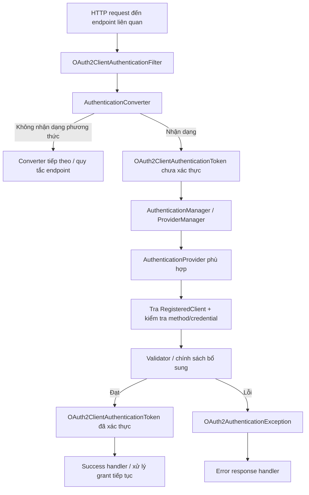
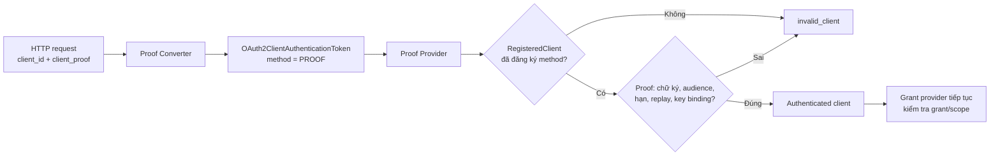

# Tùy chỉnh converter, provider và validator cho xác thực client

## 1. Bài toán và kết quả học tập

Trong hệ thống **Spring Security OAuth 2.0/OIDC Authorization Server** xây bằng Spring Boot và **Spring Authorization Server (SAS)**, xác thực client trả lời câu hỏi: *ứng dụng đang yêu cầu token hoặc gọi endpoint bảo vệ có thực sự là client được đăng ký và có được phép dùng phương thức xác thực ấy không?* Đây là việc khác với đăng nhập người dùng cuối và cũng khác với quyết định cấp một scope cụ thể.

Các hệ thống thực tế thường cần nhiều hơn mặc định:

- Client chỉ được xác thực sau khi hoàn thành phê duyệt nội bộ, chưa bị tạm khóa và còn thuộc tổ chức được phép hoạt động.
- Một hệ thống đối tác dùng client assertion hoặc chứng chỉ theo hồ sơ đã thỏa thuận.
- Các phương thức mặc định cần kiểm tra đầu vào chặt chẽ hơn, nhưng vẫn phải giữ cơ chế xác minh client secret/chữ ký của framework.
- Một phương thức xác thực đặc thù bắt buộc phải có converter, provider và những kiểm tra chống giả mạo, hết hạn, phát lại.

Trong chương **Xác thực client**, bài này tập trung cách lựa chọn và triển khai đúng **ba điểm mở rộng**: `AuthenticationConverter`, `AuthenticationProvider` và validator/chính sách xác thực. Người học cần giải thích được đường đi từ HTTP request đến `OAuth2ClientAuthenticationToken`, chọn điểm mở rộng phù hợp, tránh làm mất bảo vệ mặc định, và viết được các ca kiểm thử âm cho phương thức tùy chỉnh.

> **Lưu ý phiên bản:** Tên lớp và API cấu hình trong ví dụ tham chiếu cách tổ chức của **Spring Authorization Server 1.x / Spring Security 6.x**. Các phiên bản Spring Security tích hợp chức năng Authorization Server mới hơn có thể đổi API cấu hình hoặc mức hỗ trợ. Cần đối chiếu tài liệu và Javadoc đúng phiên bản trước khi sao chép mã. Ví dụ bỏ import/bean cơ sở hạ tầng để tập trung vào kiến trúc.

## 2. Xác thực client nằm ở đâu?

Trong các endpoint cần client authentication (như token endpoint đối với confidential client, introspection hoặc revocation theo điều kiện giao thức), SAS dùng `OAuth2ClientAuthenticationFilter` cùng `AuthenticationManager` và những provider liên quan. Bộ lọc xác định yêu cầu có chứa một cơ chế xác thực client được hỗ trợ, chuyển nó thành đối tượng `Authentication`, gọi manager và áp dụng success/failure handler.



Sơ đồ là mô hình logic. Tùy phương thức và phiên bản, một số kiểm tra diễn ra bên trong provider, một số nằm ở converter hoặc lớp xác minh JWT/chứng chỉ. `AuthenticationManager` còn có thể chứa nhiều provider; một provider có thể trả `null` nếu không nhận phương thức đang xét.

### 2.1. Phân biệt ba giai đoạn

| Thành phần | Câu hỏi xử lý | Có nên thực hiện ở đây? | Ví dụ |
| --- | --- | --- | --- |
| **Converter** | *Request đang đề xuất cách xác thực nào? Có đủ tham số để biểu diễn yêu cầu không?* | Đọc và kiểm tra hình dạng HTTP request; tạo `Authentication` chưa xác thực | Phân tích Basic header, body form, JWT assertion |
| **Provider** | *Client có hợp lệ và thực sự sở hữu bằng chứng được trình bày không?* | Tra cứu `RegisteredClient`, kiểm tra phương thức đã đăng ký, credential/chữ ký và điều kiện an ninh | Xác minh secret bằng `PasswordEncoder`; xác minh client assertion |
| **Validator / policy** | *Có thêm điều kiện nào cần áp dụng khi xác thực không?* | Kiểm tra thuộc tính claim, issuer/audience, trạng thái phê duyệt, tenant, chính sách ngày hết hạn | Từ chối client đã bị đình chỉ; yêu cầu claim đúng đối tượng |

**Không được coi converter là nơi xác thực credential.** Một `OAuth2ClientAuthenticationToken` tạo từ HTTP request có thể chứa `client_id` giả và credential sai. Chỉ provider sau xác minh mới được tạo kết quả `authenticated` đáng tin.

### 2.2. Các phương thức xác thực thông dụng

| Phương thức | Dữ liệu chứng minh | Điểm đáng chú ý |
| --- | --- | --- |
| `client_secret_basic` | HTTP Basic với client ID/secret | Phổ biến cho confidential backend client, yêu cầu TLS |
| `client_secret_post` | `client_id` và `client_secret` trong form body | Cần kiểm soát log/body; không đưa secret vào URL |
| `client_secret_jwt` | JWT client assertion ký bằng bí mật đối xứng | Kiểm tra thuật toán, `aud`, thời hạn, chủ thể và chính sách khóa |
| `private_key_jwt` | JWT client assertion ký bằng private key của client | Server phải có khóa công khai tin cậy; xác thực JWT theo profile |
| `none` | Không có client secret | Dành cho public client; không làm biến mất PKCE hay các kiểm tra grant |
| Phương thức dựa trên TLS hoặc extension | Chứng chỉ/credential theo profile | Khả năng hỗ trợ phụ thuộc phiên bản và triển khai; không tin header chứng chỉ do Internet gửi trực tiếp |

Danh sách trên mô tả các **cơ chế theo tiêu chuẩn và hệ sinh thái OAuth**. Không suy rằng mọi phương thức đều có provider bật sẵn trong mọi phiên bản. Đặc biệt, `none` không phải cách “bỏ qua bảo mật”: client không thể giữ bí mật vẫn phải chịu kiểm tra `redirect_uri`, `state` phía client, PKCE và quyền theo grant.

## 3. Các thành phần SAS cần nắm

### 3.1. `OAuth2ClientAuthenticationToken`

Đây là đối tượng Java triển khai `Authentication` dùng trong **xác thực OAuth client**. Nó khác `OAuth2AccessToken` được phát hành để gọi API.

Ở giai đoạn request, object thường chứa:

- `clientId` / principal nhận diện client;
- `ClientAuthenticationMethod` mà client đề xuất;
- credentials như secret hoặc signed assertion;
- các tham số bổ sung cần cho converter/provider.

Sau khi được provider xác minh, kết quả có thể chứa `RegisteredClient` và trạng thái `isAuthenticated() == true`. Provider phải đảm bảo `RegisteredClient` tra được tương ứng với `client_id` và **đã cho phép phương thức xác thực đang dùng**.

### 3.2. `RegisteredClientRepository` và `RegisteredClient`

Repository cung cấp `findByClientId(String clientId)`. `RegisteredClient` quy định `clientAuthenticationMethods`, `authorizationGrantTypes`, `clientSecret`, `clientSecretExpiresAt`, các URI và `ClientSettings`.

Một request đưa ra `client_id=reporting-service` không đồng nghĩa có thể dùng mọi phương thức. Nếu client chỉ đăng ký `private_key_jwt`, request gửi `client_secret_basic` không được chấp nhận ngay cả khi có một chuỗi giống secret.

### 3.3. `OAuth2ClientAuthenticationConfigurer`

Với mẫu API của SAS 1.x, điểm cấu hình thường có dạng:

```java
OAuth2AuthorizationServerConfigurer authorizationServer =
        OAuth2AuthorizationServerConfigurer.authorizationServer();

http.securityMatcher(authorizationServer.getEndpointsMatcher())
    .with(authorizationServer, server -> server
        .clientAuthentication(clientAuth -> clientAuth
            .authenticationConverters(converters -> {
                // Tùy biến danh sách converter dùng cho client authentication.
            })
            .authenticationProviders(providers -> {
                // Tùy biến danh sách provider dùng cho client authentication.
            })
        ))
    .authorizeHttpRequests(auth -> auth.anyRequest().authenticated());
```

Đây là **đoạn trích cấu hình**, chưa phải một `SecurityFilterChain` chạy độc lập. Ví dụ chưa tạo kho client, authorization/consent, token generator, khóa ký, đăng nhập người dùng hoặc endpoint OIDC.

Các API cấu hình thường gặp:

| API | Mục đích |
| --- | --- |
| `authenticationConverter(converter)` | Bổ sung một converter cho phương thức xác thực client |
| `authenticationConverters(Consumer<List<AuthenticationConverter>>)` | Điều chỉnh danh sách converter, bao gồm converter mặc định đã được cấu hình |
| `authenticationProvider(provider)` | Bổ sung provider xử lý loại `Authentication` |
| `authenticationProviders(Consumer<List<AuthenticationProvider>>)` | Điều chỉnh danh sách provider; hữu ích khi bọc provider để thêm policy |
| `authenticationSuccessHandler(...)` | Xử lý sau khi client authentication thành công |
| `errorResponseHandler(...)` | Tạo phản hồi lỗi client authentication theo giao thức |

Thứ tự converter và provider có thể tác động đến kết quả. Đừng xóa các thành phần mặc định nếu không hiểu tính năng nào đang sử dụng chúng; sau khi thay đổi cần kiểm thử cả những phương thức **không** nhắm tới.

## 4. Tùy chỉnh AuthenticationConverter

### 4.1. Converter nên xử lý gì?

`AuthenticationConverter` có hợp đồng:

```java
public interface AuthenticationConverter {
    Authentication convert(HttpServletRequest request);
}
```

Trả `null` khi converter **không nhận diện** cơ chế mà nó phụ trách, để converter phù hợp khác có thể xử lý. Với request rõ ràng dùng cơ chế này nhưng bị sai dạng (thiếu tham số bắt buộc, có tham số trùng lặp gây mơ hồ, encoding không hợp lệ), nên từ chối bằng lỗi giao thức thích hợp thay vì trả `null` và cho phương thức khác bỏ qua lỗi.

Converter **không được**:

- Tự gán `authenticated=true` cho kết quả chưa kiểm tra.
- Tự tin một `client_id` chỉ vì request chứa nó.
- Ghi client secret, assertion hoặc bearer token vào log.
- Bỏ qua ràng buộc “một request không dùng đồng thời nhiều phương thức client authentication”.
- Tự suy đoán phương thức từ những header không có bảo đảm nguồn gốc.

### 4.2. Ví dụ: kiểm tra chặt body của `client_secret_post`

Giả sử cần phát hiện một body có hai giá trị `client_secret`, trường `client_id` bị lặp hoặc Content-Type không đúng trước khi converter mặc định xử lý. Cách an toàn là **bọc converter gốc**, chuyển tiếp request hợp lệ sang nó và **thay thế đúng vị trí** của converter gốc trong danh sách. Việc chỉ thêm một converter phía trước nhưng vẫn giữ converter cũ ở đường khác có thể khiến request bị bỏ qua điều kiện mới.

```java
final class StrictClientSecretPostConverter implements AuthenticationConverter {
    private final AuthenticationConverter delegate =
            new ClientSecretPostAuthenticationConverter();

    @Override
    public Authentication convert(HttpServletRequest request) {
        // Không phải dạng client_secret_post thì để converter khác xử lý.
        String[] secrets = request.getParameterValues("client_secret");
        if (secrets == null) {
            return null;
        }

        // Đã nhận diện dạng client_secret_post: lỗi phải bị từ chối.
        String[] clientIds = request.getParameterValues("client_id");
        if (!"POST".equalsIgnoreCase(request.getMethod())
                || clientIds == null || clientIds.length != 1
                || secrets.length != 1
                || clientIds[0].isBlank()
                || secrets[0].isBlank()) {
            throw invalidRequest();
        }

        String contentType = request.getContentType();
        boolean formEncoded;
        try {
            formEncoded = contentType != null
                    && MediaType.APPLICATION_FORM_URLENCODED.isCompatibleWith(
                            MediaType.parseMediaType(contentType));
        } catch (InvalidMediaTypeException ex) {
            throw invalidRequest();
        }
        if (!formEncoded) {
            throw invalidRequest();
        }

        // Delegate tiếp tục tạo AuthenticationToken đúng hợp đồng SAS.
        return delegate.convert(request);
    }

    private static OAuth2AuthenticationException invalidRequest() {
        return new OAuth2AuthenticationException(
                new OAuth2Error(OAuth2ErrorCodes.INVALID_REQUEST));
    }
}
```

**Phạm vi của ví dụ:** kiểm tra cú pháp của `client_secret_post`, chưa có chính sách xác minh secret, tránh credential trong URL/query, hoặc phát hiện mọi cách phối hợp Basic header và form body. Các yêu cầu đó phải được bổ sung/kiểm thử nhất quán ở **toàn bộ đầu vào**; converter trên **không phải bộ lọc an ninh hoàn chỉnh** để dùng nguyên trạng ở production.

Thay thế converter mặc định với API configurer:

```java
.clientAuthentication(clientAuth ->
    clientAuth.authenticationConverters(converters -> {
        for (int index = 0; index < converters.size(); index++) {
            if (converters.get(index)
                    instanceof ClientSecretPostAuthenticationConverter) {
                converters.set(index, new StrictClientSecretPostConverter());
                return;
            }
        }
        throw new IllegalStateException(
                "Expected ClientSecretPostAuthenticationConverter");
    }))
```

Ví dụ trên được gắn **bên trong** cấu hình Authorization Server, không phải một chuỗi Java đứng độc lập. Chủ ý throw khi không tìm thấy converter giúp phát hiện việc thay đổi API/mặc định của phiên bản thay vì khởi động thành công nhưng mất kiểm tra. Sau khi thay converter, phải kiểm thử cả `client_secret_basic` và `private_key_jwt` để xác định không bị ảnh hưởng.

## 5. Tùy chỉnh AuthenticationProvider và chính sách sau xác thực

### 5.1. Khi nào nên giữ provider chuẩn?

Nếu muốn “khóa client đã bị đình chỉ”, “chỉ client của tenant đang hoạt động được gọi token endpoint”, hoặc “đối tác phải ở danh sách được phê duyệt”, thông thường **không cần viết lại xác minh client secret/JWT**. Giữ provider chuẩn rồi áp dụng policy bổ sung **sau khi provider đã xác thực thành công** sẽ ít rủi ro hơn tự triển khai phép so sánh bí mật hoặc chữ ký.

Lý do: provider chuẩn đã xử lý nhiều chi tiết như phương thức được đăng ký, secret encoding, hết hạn secret, issuer/audience/algorithm của client assertion và lỗi OAuth phù hợp trong phạm vi phiên bản. Bỏ qua một trong những bước ấy có thể khiến client mạo danh được chấp nhận.

### 5.2. Ví dụ: bọc provider để chặn client bị đình chỉ

Giả sử có một `ClientAdmissionPolicy` do ứng dụng triển khai bằng kho trạng thái đã phê duyệt:

```java
interface ClientAdmissionPolicy {
    boolean isAllowed(String clientId);
}

final class ClientAdmissionProvider implements AuthenticationProvider {
    private final AuthenticationProvider delegate;
    private final ClientAdmissionPolicy admission;

    ClientAdmissionProvider(
            AuthenticationProvider delegate,
            ClientAdmissionPolicy admission) {
        this.delegate = delegate;
        this.admission = admission;
    }

    @Override
    public boolean supports(Class<?> authentication) {
        return delegate.supports(authentication);
    }

    @Override
    public Authentication authenticate(Authentication authentication)
            throws AuthenticationException {
        Authentication result = delegate.authenticate(authentication);

        // null nghĩa là provider này không xử lý; giữ nguyên hợp đồng.
        if (result == null) {
            return null;
        }

        if (result instanceof OAuth2ClientAuthenticationToken client
                && client.isAuthenticated()) {
            RegisteredClient registration = client.getRegisteredClient();
            if (registration == null
                    || !admission.isAllowed(registration.getClientId())) {
                throw new OAuth2AuthenticationException(
                        new OAuth2Error(OAuth2ErrorCodes.INVALID_CLIENT));
            }
        }
        return result;
    }
}
```

Đăng ký wrapper trên các provider của **client authentication**:

```java
.clientAuthentication(clientAuth ->
    clientAuth.authenticationProviders(providers ->
        providers.replaceAll(provider ->
            new ClientAdmissionProvider(provider, clientAdmissionPolicy))))
```

`clientAdmissionPolicy` là bean do ứng dụng cấp và phải quyết định đúng trường hợp *deny-by-default* khi không thể đọc trạng thái hoặc client không có trong danh sách. Ví dụ trên thực hiện policy **sau** khi một provider trả kết quả; nó không kiểm tra lại secret. Mỗi provider vẫn chịu trách nhiệm xác thực bằng chứng phù hợp.

Khi sử dụng ở hệ thống thực:

- Xác định provider nào được bọc, tránh bọc sai endpoint và bảo đảm policy áp dụng cho **mọi phương thức client authentication** cần kiểm soát.
- Cân nhắc tính nhất quán của cache sau khi tạm khóa client; một instance giữ trạng thái cũ có thể tiếp tục chấp nhận client.
- Không để lỗi timeout của kho phê duyệt biến thành “cho phép tạm thời”.
- Tránh ghi các bí mật được mang trong `Authentication` ra log; chỉ ghi client ID và mã lỗi có kiểm soát.
- Kiểm tra thứ tự provider để đảm bảo không có một đường xử lý khác trả kết quả hợp lệ mà bỏ qua policy.

### 5.3. Không dùng provider để quyết định mọi quyền OAuth

`OAuth2ClientAuthenticationToken` đã xác thực trả lời “client có danh tính hợp lệ”. Token endpoint **vẫn phải** kiểm tra `authorization_grant_type`, scope, authorization code, PKCE, refresh token, consent và các điều kiện riêng của grant. Resource Server **vẫn phải** kiểm tra audience, quyền API và ownership dữ liệu. Đừng nhét tất cả những kiểm tra ấy vào provider xác thực client.

## 6. Validator: vị trí và tiêu chuẩn phải giữ

Từ “validator” có thể chỉ một lớp `OAuth2TokenValidator<Jwt>`, hàm validation được provider/configurer cho phép truyền vào hoặc logic chính sách riêng. **Không có một interface `ClientAuthenticationValidator` duy nhất bắt buộc mọi phương thức SAS đều phải triển khai**. Hãy chọn extension point mà phiên bản cung cấp.

| Nhóm kiểm tra | Vị trí phù hợp | Điều không được bỏ qua |
| --- | --- | --- |
| Tham số HTTP hợp lệ, không trùng/mơ hồ | Converter hoặc request validator trước xác thực | Đúng method, Content-Type, encoding và số lượng tham số |
| Client đã được đăng ký | Provider + `RegisteredClientRepository` | Không tin client ID tự khai |
| Client authentication method cho phép | Provider | Không tự động chấp nhận phương thức chỉ vì có credential |
| Secret hoặc chữ ký hợp lệ | Provider, `PasswordEncoder`, JWT decoder/verifier | Kiểm tra cryptographic đúng; không so sánh secret hời hợt |
| JWT assertion claims | JWT validator thuộc cơ chế JWT client authentication | `iss`, `sub`, `aud`, `exp`, thuật toán, khóa tin cậy, chống phát lại theo chính sách |
| Client còn được phép hoạt động | Provider wrapper hoặc policy sau xác thực | Phê duyệt, tạm khóa, tenant, trạng thái credential |
| Grant type, scope, authorization code, PKCE | **Grant provider / token endpoint** | Đúng client, grant, quyền và bằng chứng |
| Quyền truy cập từng tài nguyên API | **Resource Server** | Audience, scopes, roles, tenant và ownership |

### 6.1. Ví dụ về chính sách JWT client assertion

Với `private_key_jwt` hoặc `client_secret_jwt`, không chỉ xác minh “JWT có chữ ký đúng”. Tùy profile, server còn phải ràng buộc assertion với đúng client và token endpoint, kiểm tra:

1. `iss` và `sub` nhận diện đúng client theo profile được chấp nhận.
2. `aud` tương ứng Authorization Server/token endpoint theo hợp đồng client assertion; không tự chấp nhận audience của môi trường khác.
3. `exp` chưa quá hạn; `iat`/`nbf` và clock skew được xử lý theo chính sách.
4. Thuật toán ký được cho phép và khóa xác minh thuộc client đã đăng ký; không chấp nhận `alg=none` hoặc key bất kỳ lấy từ request.
5. `jti` hoặc cơ chế chống replay được kiểm tra theo chính sách/profile; nếu cần, có kho lưu định danh assertion đã sử dụng với TTL.
6. Không log toàn bộ assertion hay tiết lộ chi tiết xác minh cho caller.

Nếu phiên bản cung cấp hook thay JWT validator/decoder, **chỉ thêm ràng buộc nghiệp vụ sau khi giữ đầy đủ kiểm tra tiêu chuẩn**. Khi thay toàn bộ validator mặc định bằng validator chỉ kiểm tra `tenant_id`, bạn có thể vô tình bỏ các phép kiểm tra `aud` hoặc `exp`.

### 6.2. Chính sách phải có ngữ nghĩa nhất quán

Ví dụ, client `partner-billing` bị khóa lúc 10:00. Nếu chỉ thêm check ở trang quản trị client mà token endpoint vẫn chấp nhận credential đến 10:30 do cache, chính sách không có tác dụng đúng lúc. Cần quyết định:

- Việc khóa có ngăn cấp token **mới** hay còn phải thu hồi token **đã cấp**?
- Nếu API xác minh JWT offline, làm sao đạt yêu cầu thu hồi tức thì nếu có?
- Các endpoint introspection/revocation có áp cùng policy không? Có thể cần cho phép một số thao tác cleanup khi client bị khóa, nhưng phải thiết kế riêng.
- Khi policy service không sẵn sàng, client bị từ chối hay có cơ chế xử lý sự cố nào được phê duyệt?

Chính sách xác thực client và chính sách vòng đời token liên quan nhau nhưng không hoàn toàn giống nhau.

## 7. Khi bắt buộc phải hỗ trợ phương thức xác thực tùy biến

**Ưu tiên cơ chế chuẩn** như `private_key_jwt`, `client_secret_basic` hoặc cơ chế ràng buộc chứng chỉ được framework hỗ trợ. Phương thức riêng chỉ nên dùng khi có hợp đồng tích hợp và lý do không thể biểu diễn yêu cầu bằng chuẩn hiện có.

Để hiểu mối quan hệ, xem một phương thức **giả định** mang tên `urn:example:oauth:client-auth:proof`, trong đó client gửi `client_id` và một bằng chứng đã ký trong form body. Đoạn mã dưới đây chỉ phác thảo cách nối converter/provider; **việc thẩm định chữ ký, replay, key trust và profile phải được cài đặt bởi một `ClientProofVerifier` đã được kiểm toán**.

### 7.1. Custom converter tạo request chưa xác thực

```java
static final ClientAuthenticationMethod PROOF_METHOD =
        new ClientAuthenticationMethod("urn:example:oauth:client-auth:proof");

final class ProofClientAuthenticationConverter implements AuthenticationConverter {
    @Override
    public Authentication convert(HttpServletRequest request) {
        String[] proofValues = request.getParameterValues("client_proof");
        if (proofValues == null) {
            return null; // Không phải phương thức này.
        }

        String[] clientIds = request.getParameterValues("client_id");
        if (!"POST".equalsIgnoreCase(request.getMethod())
                || clientIds == null || clientIds.length != 1
                || proofValues.length != 1
                || clientIds[0].isBlank()
                || proofValues[0].isBlank()) {
            throw new OAuth2AuthenticationException(
                    new OAuth2Error(OAuth2ErrorCodes.INVALID_REQUEST));
        }

        return new OAuth2ClientAuthenticationToken(
                clientIds[0], PROOF_METHOD, proofValues[0], Collections.emptyMap());
    }
}
```

**Lưu ý:** form proof chỉ là ví dụ mô hình; trong một triển khai thật phải xác định Content-Type, quy tắc tránh cùng lúc nhiều authentication method, kích thước tối đa, nguồn credential và chuẩn canonicalization. Converter **không** gọi `setAuthenticated(true)`.

### 7.2. Custom provider kiểm tra bằng chứng

```java
interface ClientProofVerifier {
    // Phải ném lỗi nếu chữ ký, key binding, audience, thời gian,
    // jti/nonce hoặc cơ chế chống replay không hợp lệ.
    void verify(RegisteredClient client, String proof);
}

final class ProofClientAuthenticationProvider implements AuthenticationProvider {
    private final RegisteredClientRepository clients;
    private final ClientProofVerifier verifier;

    ProofClientAuthenticationProvider(
            RegisteredClientRepository clients, ClientProofVerifier verifier) {
        this.clients = clients;
        this.verifier = verifier;
    }

    @Override
    public boolean supports(Class<?> authentication) {
        return OAuth2ClientAuthenticationToken.class.isAssignableFrom(authentication);
    }

    @Override
    public Authentication authenticate(Authentication authentication)
            throws AuthenticationException {
        OAuth2ClientAuthenticationToken request =
                (OAuth2ClientAuthenticationToken) authentication;
        if (!PROOF_METHOD.equals(request.getClientAuthenticationMethod())) {
            return null; // Nhường provider khác khi không đúng method.
        }

        Object principal = request.getPrincipal();
        if (!(principal instanceof String clientId)) {
            throw invalidClient();
        }

        RegisteredClient client = clients.findByClientId(clientId);
        if (client == null
                || !client.getClientAuthenticationMethods().contains(PROOF_METHOD)) {
            throw invalidClient();
        }

        try {
            verifier.verify(client, (String) request.getCredentials());
        } catch (RuntimeException ex) {
            // Không để lọt thông tin xác minh chi tiết ra OAuth response.
            throw invalidClient();
        }
        return new OAuth2ClientAuthenticationToken(client, PROOF_METHOD, null);
    }

    private static OAuth2AuthenticationException invalidClient() {
        return new OAuth2AuthenticationException(
                new OAuth2Error(OAuth2ErrorCodes.INVALID_CLIENT));
    }
}
```

**Ranh giới an toàn của mẫu:** `ClientProofVerifier` cố ý là một hợp đồng **chưa có implementation**. Không triển khai nó bằng `proof != null`, so sánh chuỗi tĩnh hoặc giải mã JWT mà không xác minh chữ ký; những cách đó không tạo authentication an toàn. Nếu chính sách cần phân biệt lỗi hệ thống với credential sai, phải xác định cơ chế xử lý và alert riêng, vẫn không trả chi tiết nhạy cảm cho client.

### 7.3. Đăng ký đúng converter và provider

```java
.clientAuthentication(clientAuth -> clientAuth
    .authenticationConverter(new ProofClientAuthenticationConverter())
    .authenticationProvider(new ProofClientAuthenticationProvider(
            registeredClientRepository, clientProofVerifier)))
```

Trong `RegisteredClient` tương ứng, phương thức mới phải được đăng ký có chủ đích:

```java
RegisteredClient partner = RegisteredClient.withId(stableInternalId)
        .clientId("partner-billing")
        .clientAuthenticationMethod(PROOF_METHOD)
        .authorizationGrantType(AuthorizationGrantType.CLIENT_CREDENTIALS)
        .scope("invoices.read")
        .build();
```

Đoạn trên cũng chỉ là phần builder cần quan tâm. Một dự án thật cần định nghĩa `stableInternalId`, repository, khóa/chứng chỉ, trình xác minh proof và chính sách phê duyệt client. Không triển khai provider này để thay thế `private_key_jwt` nếu đã có cơ chế chuẩn đủ phù hợp.

### 7.4. Custom method có hai phần bắt buộc độc lập



Converter quyết định **nhận diện input**. Provider quyết định **tin tưởng input** sau khi xác minh. Một extension chỉ có converter hoặc chỉ có provider sẽ không tạo ra một phương thức client authentication hoàn chỉnh.

## 8. Các phương thức tích hợp nên chọn theo yêu cầu

| Nhu cầu thực tế | Hướng ưu tiên | Lý do |
| --- | --- | --- |
| Backend có thể giữ secret | `client_secret_basic` với secret management và TLS | Đã có cơ chế chuẩn, dễ vận hành khi secret được bảo vệ |
| Đối tác ký assertion bằng private key | `private_key_jwt` | Có profile rõ ràng; giảm nhu cầu tự phát minh protocol |
| Cần bắt buộc JWT assertion mang claim theo hợp đồng | Validator JWT phù hợp phiên bản | Giữ chữ ký/thời gian/audience mặc định, thêm policy |
| Cần vô hiệu hóa client đã bị đình chỉ | Policy ở repository/provider và quản trị vòng đời | Không cần thay thuật toán xác thực credential |
| Cần chặn body `client_secret_post` sai định dạng | Converter wrapper thay đúng converter gốc | Phát hiện input lỗi trước provider |
| Public SPA/mobile | `none` + Authorization Code + PKCE, redirect URI đã đăng ký | Secret nhúng frontend không bảo mật được |
| mTLS/client certificate | Cơ chế chuẩn tương ứng nếu phiên bản triển khai hỗ trợ | Chứng chỉ phải được TLS stack xác minh và ràng buộc với client |
| Bắt buộc một proof đặc thù | Converter + provider + verifier + kiểm thử chuyên biệt | Chỉ hợp lý khi không dùng được chuẩn và có thiết kế an ninh được duyệt |

Đối với **mTLS phía sau proxy**, một header như `X-Client-Cert` chỉ đáng tin khi proxy đã xác minh TLS, chặn header giả từ Internet, và kết nối proxy → ứng dụng được bảo vệ. Không lấy một chuỗi chứng chỉ do client tự gửi qua HTTP làm bằng chứng xác thực.

## 9. Phân biệt lỗi converter, provider và grant provider

| Vị trí | Tình huống | Lỗi OAuth/diễn giải thường gặp |
| --- | --- | --- |
| Converter | Tham số lặp, sai encoding, body thiếu trường khi đã nhận dạng method | `invalid_request` |
| Provider | Không tồn tại `client_id`, secret sai, assertion sai, method chưa đăng ký | `invalid_client` |
| Provider/policy | Client tạm khóa hoặc không được chấp nhận theo chính sách | Thường từ chối xác thực client mà không tiết lộ trạng thái nội bộ |
| Token endpoint / grant provider | Client hợp lệ nhưng chưa đăng ký grant `client_credentials` | `unauthorized_client` |
| Token endpoint / grant provider | Client hợp lệ nhưng xin scope ngoài phạm vi cho phép | `invalid_scope` |
| Authorization Code provider | Code hết hạn, bị dùng lại, sai PKCE | `invalid_grant` |
| Resource Server | Access token không hợp lệ hoặc không đủ quyền | 401 hoặc 403 ở API theo nguyên nhân |

Mã lỗi thực tế phụ thuộc endpoint và ngữ cảnh chuẩn. `invalid_client` thường dẫn đến phản hồi HTTP 401 với yêu cầu xác thực phù hợp, còn `invalid_request` hoặc `invalid_scope` có thể trả 400. Không dùng status HTTP 200 với payload token giả để “giữ tương thích”.

**Thực hành debug:** ghi correlation ID, endpoint, client ID nếu an toàn, method đã nhận diện, provider đã xử lý, và mã lỗi. Tuyệt đối tránh log `Authorization: Basic ...`, client secret, client assertion, khóa riêng, authorization code hoặc access/refresh token.

## 10. Kiểm thử bắt buộc khi tùy chỉnh

Một thay đổi ở tầng xác thực client có thể phá vỡ mọi grant chạy phía sau. Vì vậy nên kiểm thử **theo HTTP endpoint**, không chỉ unit test trực tiếp một converter/provider.

### 10.1. Ma trận trường hợp thành công và thất bại

| Ca kiểm thử | Đầu vào | Kỳ vọng |
| --- | --- | --- |
| Basic hợp lệ | Confidential client đã đăng ký `client_secret_basic` và secret đúng | Client được xác thực, grant phù hợp được xử lý tiếp |
| Basic sai secret | Đúng client ID, secret sai | `invalid_client`; không có token |
| Post hợp lệ | Body form đúng, một `client_id` và một `client_secret` | Converter wrapper không làm hỏng phương thức hợp lệ |
| Post sai Content-Type | Có `client_secret` nhưng body không phải form hợp lệ | Bị từ chối |
| Post trùng tham số | Hai `client_secret` hoặc hai `client_id` | Bị từ chối, không lấy tùy tiện phần tử đầu |
| Hai phương thức trong một request | Vừa Basic header vừa body secret/assertion | Không được diễn giải mơ hồ hoặc chấp nhận đường bypass |
| Method không đăng ký | Client chỉ đăng ký Basic nhưng gửi POST/JWT assertion | `invalid_client` |
| Client bị đình chỉ | Credential đúng nhưng policy không cho phép | Bị từ chối; kiểm tra mọi authentication method |
| Policy service không khả dụng | Không xác định được trạng thái phê duyệt | Từ chối theo fail-closed và có giám sát |
| JWT assertion hợp lệ | Signature/claims/key binding đúng | Được xác thực theo profile đã thống nhất |
| JWT sai audience | Assertion nhắm đến AS khác | Bị từ chối |
| JWT hết hạn hoặc future-dated ngoài ngưỡng | `exp`/`nbf`/`iat` không hợp lệ | Bị từ chối |
| JWT lặp lại | Gửi lại assertion có `jti` đã dùng nếu policy yêu cầu replay cache | Bị từ chối |
| Assertion ký bằng khóa lạ | Chữ ký hợp lệ với khóa không thuộc client | Bị từ chối |
| Custom proof thiếu verifier | Không có bean/verifier hoạt động | Cấu hình không được đưa vào phục vụ traffic |
| Custom proof không đăng ký method | Proof đúng chữ ký nhưng method chưa khai báo trong `RegisteredClient` | `invalid_client` |
| Client auth hợp lệ nhưng grant sai | Confidential client đã xác thực, xin grant không đăng ký | Bị token endpoint từ chối |
| Public client với `none` | Authorization Code + PKCE hợp lệ | Luồng hợp lệ vẫn hoạt động; không yêu cầu secret giả |
| Các endpoint khác | Introspection/revocation sau thay đổi provider | Không mở đường bypass hoặc làm hỏng chính sách endpoint |

### 10.2. Kiểm thử đặc biệt cho converter wrapper

Sau khi thay `ClientSecretPostAuthenticationConverter`, nên có regression tests chứng minh: request hợp lệ vẫn được delegate, request sai cú pháp bị chặn, các converter Basic/JWT vẫn xử lý đúng, và request nhiều dạng credential không thể chọn một phương thức “dễ” để vượt qua kiểm tra. Kiểm tra cả các request gửi thông tin nhạy cảm ở query string vì `getParameterValues` có thể nhìn thấy cả query và body trên Servlet API.

### 10.3. Kiểm thử provider wrapper

Trong môi trường test, tạo cùng một client lần lượt ở trạng thái được phép và bị tạm khóa. Gọi token endpoint bằng từng phương thức mà client thực sự đăng ký; kiểm tra kết quả đồng nhất. Thay đổi trạng thái trong DB, xóa/invalidate cache và xác nhận các instance áp dụng chính sách mới. Nếu policy service gặp lỗi, đo xem framework có từ chối an toàn và log cảnh báo mà không lộ credential hay không.

## 11. Các sai lầm thường gặp

### 11.1. Coi `client_id` là bằng chứng xác thực

`client_id` là định danh công khai theo OAuth, không phải secret. Provider phải chứng minh client có credential phù hợp hoặc tuân thủ các ràng buộc dành cho public client. Mẫu code `return new OAuth2ClientAuthenticationToken(client, method, null);` khi chưa kiểm chứng bằng chứng là một lỗi nghiêm trọng.

### 11.2. Tự viết so sánh secret thay cho `PasswordEncoder`

Secret được lưu trong `RegisteredClient` có thể ở dạng đã mã hóa một chiều. Nếu thay provider mặc định và so sánh chuỗi trực tiếp với secret lưu trữ, xác thực có thể luôn sai hoặc dẫn đến việc lưu plaintext. Hãy dùng provider được SAS hỗ trợ và chính sách quản lý/rotation secret phù hợp.

### 11.3. Dùng converter làm policy engine

Converter chỉ có request chưa tin cậy; nó thường chưa xác minh client sở hữu khóa. Tenant, trạng thái phê duyệt và quyền sử dụng method cần được xác minh dựa trên dữ liệu tin cậy ở provider/policy, không chỉ dựa vào claim/header được đọc ở converter.

### 11.4. Mở rộng bằng cách thay toàn bộ danh sách provider mặc định

Thay `authenticationProviders` mà xóa provider không liên quan có thể làm `client_secret_basic`, `private_key_jwt` hoặc public client ngừng hoạt động. Nếu buộc thay, hãy làm rõ những provider còn lại và kiểm thử regression cho mọi method mà hệ thống cam kết hỗ trợ.

### 11.5. Provider `supports()` quá rộng và luôn trả lỗi

Vì nhiều provider cùng nhận `OAuth2ClientAuthenticationToken`, custom provider cần **kiểm tra method trước**. Nếu không đúng phương thức, trả `null` để manager tiếp tục provider khác; nếu đã nhận đúng phương thức mà bằng chứng sai, phải ném lỗi, không trả `null` nhằm tìm đường xác thực dễ hơn.

### 11.6. Bỏ validation JWT có sẵn khi thêm claim riêng

Một validator chỉ kiểm tra `tenant` không thay thế kiểm tra chữ ký, `iss`, `sub`, `aud`, `exp`, thời gian hoặc replay. Thay validator mà không duy trì các kiểm tra chuẩn có thể làm assertion cấp cho một server khác được chấp nhận.

### 11.7. Hiểu nhầm xác thực client và xác thực người dùng

Client Credentials có thể không có người dùng. Một public web app xác thực người dùng qua Authorization Code + PKCE vẫn không thể tự nhận quyền client confidential. `AuthenticationManager` của đăng nhập người dùng và cơ chế client authentication có mục đích khác nhau.

## 12. Bài tập thiết kế và phân tích

Một Authorization Server phục vụ:

- `reports-backend`: confidential client dùng `client_secret_basic`, được phép xin `reports.read`;
- `partner-finance`: dùng `private_key_jwt`, đối tác có trạng thái `approved/suspended` trong DB;
- `mobile-public`: public client dùng Authorization Code + PKCE, không có client secret.

Đội bảo mật yêu cầu: (1) chỉ chấp nhận `client_secret_post` khi đúng form encoding và không trùng trường; (2) client bị suspended không được xin token mới bất kể dùng phương thức nào; (3) client assertion phải có audience đúng issuer/token endpoint và thời hạn ngắn; (4) không làm hỏng luồng mobile.

Hãy trả lời:

1. Điều kiện (1) nên đặt ở converter hay provider? Khi thay converter phải chú ý những converter mặc định nào?
2. Điều kiện (2) nên được kiểm tra ở đâu để client không đổi phương thức rồi bỏ qua chính sách? Khi DB kiểm tra trạng thái gặp timeout thì xử lý thế nào?
3. Điều kiện (3) thuộc JWT validator/provider nào? Ngoài `aud` phải kiểm tra những trường/điều kiện nào?
4. Tại sao `mobile-public` không dùng `client_secret_post`? PKCE kiểm tra ở tầng xác thực client hay grant provider?
5. Thiết kế ít nhất sáu ca kiểm thử âm, trong đó có hai trường hợp client xác thực đúng nhưng grant hoặc scope không được cấp.

**Gợi ý:** converter kiểm tra hình thức của request, provider chuẩn xác minh secret/chữ ký, policy wrapper kiểm tra trạng thái client đã xác thực, JWT validator giữ mọi điều kiện tiêu chuẩn, token endpoint/grant provider kiểm tra grant và scope. Mobile public client tiếp tục dùng `none` cùng Authorization Code + PKCE; PKCE được ràng buộc trong xử lý authorization/code grant, không phải lý do để công nhận `client_id` là secret.

## 13. Checklist trước khi triển khai production

1. **Giới hạn phạm vi:** xác định rõ phương thức nào cần bổ sung, vì sao provider chuẩn chưa đáp ứng, ảnh hưởng đến endpoint nào.
2. **Không bỏ mặc định:** giữ kiểm tra đăng ký client, method, credential, chữ ký, expiry, issuer/audience và bảo vệ replay phù hợp.
3. **Converter an toàn:** không tự `setAuthenticated(true)`, không cho phép request mơ hồ, kiểm tra method/form/encoding và từ chối tham số lỗi.
4. **Provider đúng trách nhiệm:** tra cứu `RegisteredClient` tin cậy, áp dụng method đã đăng ký, thẩm định proof, kiểm tra trạng thái client và từ chối an toàn.
5. **Validator phù hợp:** không thay bộ validator chuẩn bằng một điều kiện nghiệp vụ đơn lẻ; kiểm thử cả token đúng và các biến thể sai.
6. **Credential và khóa:** dùng secret manager, `PasswordEncoder`, JWK/chứng chỉ tin cậy, rotation, TTL và bảo vệ các bản sao trên log.
7. **Tính nhất quán:** chính sách suspended/approved được đồng bộ trên nhiều instance; xác định ảnh hưởng tới token đã cấp.
8. **Regression:** test tất cả authentication method đã cam kết, grant/PKCE, token revocation/introspection và các trường hợp từ chối.
9. **Vận hành:** log correlation ID và mã lỗi có kiểm soát; theo dõi tỷ lệ `invalid_client` tăng, lỗi verifier và sự cố policy store.

## 14. Tài liệu nên đối chiếu

- [Spring Authorization Server — Protocol Endpoints](https://docs.spring.io/spring-authorization-server/reference/protocol-endpoints.html): phần OAuth 2.0 Client Authentication, `OAuth2ClientAuthenticationFilter`, converter/provider mặc định và hook cấu hình.
- [Spring Authorization Server — Core Model Components](https://docs.spring.io/spring-authorization-server/reference/core-model-components.html): `RegisteredClient`, `clientAuthenticationMethods` và repository.
- [Spring Security — Authentication Architecture](https://docs.spring.io/spring-security/reference/servlet/authentication/architecture.html): `Authentication`, `AuthenticationManager`, `ProviderManager`, `AuthenticationProvider`.
- [RFC 6749 — OAuth 2.0](https://www.rfc-editor.org/rfc/rfc6749): xác thực client, token endpoint và lỗi giao thức.
- [RFC 7523 — JWT Bearer Assertion Profiles](https://www.rfc-editor.org/rfc/rfc7523): JWT assertion như phương thức client authentication.
- [OpenID Connect Core — Client Authentication](https://openid.net/specs/openid-connect-core-1_0.html#ClientAuthentication): các phương thức client authentication và quy tắc OIDC liên quan.
- [RFC 9700 — OAuth 2.0 Security BCP](https://www.rfc-editor.org/rfc/rfc9700): yêu cầu bảo vệ hiện đại, ràng buộc token và giảm nguy cơ lạm dụng.

**Ghi nhớ:** `AuthenticationConverter` biến HTTP request thành **yêu cầu xác thực**, `AuthenticationProvider` kiểm tra bằng chứng và tạo **kết quả xác thực**, còn validator/policy bổ sung điều kiện mà hệ thống tin cậy yêu cầu. Trong Spring Authorization Server, chỉ tùy chỉnh đúng tầng và giữ nguyên các kiểm tra chuẩn mới giúp thêm tính năng quản lý client mà không làm suy yếu OAuth 2.0/OIDC.
