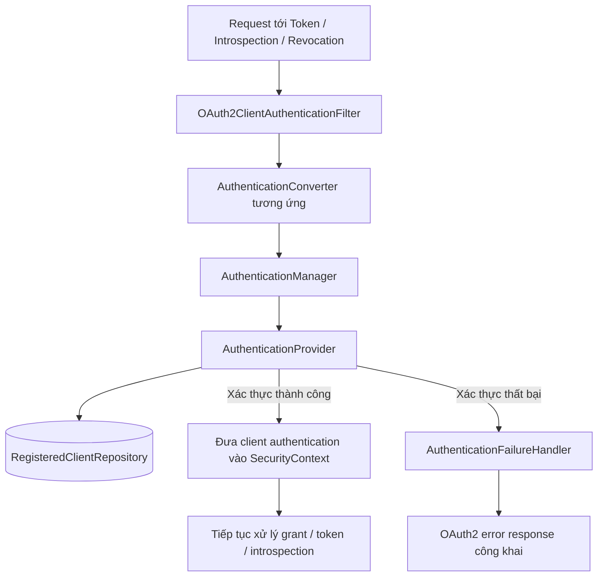

# Xử lý invalid_client và hạn chế rò rỉ thông tin định danh

## Mục tiêu bài học

Trong chương **Xác thực client** của module **SPRING_SECURITY_OAUTH2_OIDC_AUTHORIZATION_SERVER**, bài học tập trung vào lỗi OAuth 2.0 `invalid_client` và cách bảo vệ thông tin liên quan đến client khi xây dựng, cấu hình, kiểm thử và vận hành **Authorization Server** với **Spring Security**, **Spring Authorization Server** trong **Spring Boot**.

Một client hợp lệ có thể dùng `client_secret_basic`, `client_secret_post`, `private_key_jwt`, mTLS hoặc các phương thức khác được máy chủ hỗ trợ. Client cũng có thể là **public client** dùng `ClientAuthenticationMethod.NONE` trong luồng phù hợp với PKCE. Khi xác thực client không thành công, Authorization Server cần phản hồi đúng chuẩn, nhưng không được vô tình tiết lộ client ID nào đã đăng ký, secret có đúng một phần hay không, tenant nào đang sử dụng hệ thống hoặc chi tiết kho khóa/DB nội bộ.

Sau bài học, bạn có thể:

- Phân biệt `invalid_client` với `invalid_request`, `invalid_grant`, `unauthorized_client` và lỗi token của Resource Server.
- Áp dụng HTTP status, `WWW-Authenticate` và OAuth2 error response theo RFC 6749.
- Hiểu `OAuth2ClientAuthenticationFilter`, authentication converter/provider và `errorResponseHandler` của Spring Authorization Server.
- Thiết kế phản hồi công khai nhất quán, log/audit an toàn, rate limiting và quy trình điều tra lỗi mà không lộ credential hay dữ liệu định danh.
- Kiểm thử trường hợp client không tồn tại, secret sai, sai authentication method, public client, JWT client assertion và cấu hình reverse proxy.
- Xây phương án vận hành thực tế để phát hiện dò client, credential stuffing và lỗi cấu hình triển khai.

> **Nguyên tắc:** Phản hồi gửi cho client phải đủ để client sửa giao thức, đồng thời giữ thông tin về sự tồn tại và cấu hình bí mật của registered client ở phía máy chủ. Không cố che mọi loại lỗi thành một mã duy nhất: OAuth 2.0 quy định những lỗi khác nhau và có yêu cầu HTTP cụ thể.

## 1. `invalid_client` nghĩa là gì?

RFC 6749, mục 5.2, định nghĩa `invalid_client` khi **client authentication failed**. Các trường hợp tiêu biểu:

- Không tìm thấy `client_id` khi cần xác thực client.
- Client đã đăng ký nhưng secret hoặc chữ ký client assertion sai.
- Request cần xác thực client nhưng không gửi credential.
- Phương thức xác thực client không được máy chủ/client registration chấp nhận.
- Chứng chỉ mTLS không hợp lệ hoặc không khớp thông tin đã đăng ký trong luồng yêu cầu mTLS.

Ví dụ một confidential client đã đăng ký phương thức `client_secret_basic`, nhưng request tới `/oauth2/token` dùng HTTP Basic với client secret sai. Authorization Server không thể chứng thực danh tính client và trả lỗi `invalid_client`.

**Client ID thường là định danh, không phải bí mật.** Nó có thể xuất hiện trong authorization request hoặc cấu hình OAuth2 Client. Tuy nhiên, việc xác nhận client ID có tồn tại, thuộc tenant nào, hoạt động hay bị vô hiệu hóa, hoặc dùng phương thức xác thực nào có thể làm lộ thông tin hữu ích cho kẻ tấn công. Vì vậy, không trả những chi tiết này trong lỗi công khai.

### 1.1. `invalid_client` khác các lỗi thường gặp thế nào?

| Lỗi | Bản chất | Ví dụ | Có nên tiết lộ chi tiết nhạy cảm? |
|---|---|---|---|
| `invalid_client` | Xác thực client thất bại. | Unknown client, secret sai, assertion không hợp lệ. | Không; dùng mô tả chung. |
| `invalid_request` | Request sai cấu trúc/tham số. | Tham số lặp, dùng đồng thời hai cơ chế xác thực client, thiếu trường bắt buộc. | Chỉ thông báo thông tin giao thức cần thiết, không phản chiếu credential. |
| `invalid_grant` | Authorization grant/refresh token không hợp lệ. | Code hết hạn/đã dùng, code không thuộc client, refresh token bị thu hồi, PKCE sai. | Không trả mã/giá trị grant; tránh tiết lộ trạng thái token ngoài phạm vi cần thiết. |
| `unauthorized_client` | Client đã được nhận diện nhưng không được phép dùng grant. | Confidential client chỉ cho phép `client_credentials` nhưng lại gửi `authorization_code`. | Tuân thủ chuẩn; không biến lỗi thành kênh tra cứu client trước xác thực. |
| `unsupported_grant_type` | Máy chủ không hỗ trợ grant type được yêu cầu. | Request grant type không được server triển khai. | Có thể phản hồi theo chuẩn, không lộ cấu hình nội bộ. |
| `invalid_scope` | Scope sai/ngoài phạm vi cho phép. | Client xin scope không được đăng ký. | Không tiết lộ metadata tenant/quyền ẩn. |
| `invalid_token` | Resource Server từ chối Bearer token theo RFC 6750. | Access token hết hạn hoặc chữ ký không hợp lệ. | Khác `invalid_client` ở token endpoint. |

**Thứ tự kiểm tra có ý nghĩa.** Một request vừa có client secret sai vừa có grant không được phép thường phải thất bại ở **client authentication** trước khi có thể nói về quyền của client. Đừng triển khai “kiểm tra client tồn tại rồi trả `unauthorized_client`” trước khi xác thực, vì cách đó tiết lộ danh sách client qua lỗi.

### 1.2. Endpoint nào liên quan đến client authentication?

Theo cấu hình thông thường của Spring Authorization Server, `OAuth2ClientAuthenticationFilter` xử lý việc xác thực client tại:

- **Token Endpoint** (`/oauth2/token`) khi áp dụng phương thức xác thực client.
- **Token Introspection Endpoint** (`/oauth2/introspect`).
- **Token Revocation Endpoint** (`/oauth2/revoke`).
- Các endpoint/extension khác, như PAR hoặc dynamic client registration, nếu tính năng và chính sách giao thức yêu cầu xác thực client.

Không nên đồng nhất `invalid_client` ở Token Endpoint với lỗi **đăng nhập người dùng** ở `/login` hay lỗi Bearer token của Resource Server. Mỗi nơi có contract, filter và error handling riêng.

Với **public client** dùng `ClientAuthenticationMethod.NONE`, không có client secret để xác minh. Nó vẫn cần được nhận diện đúng, dùng grant phù hợp, redirect URI hợp lệ và PKCE cho Authorization Code flow. **Không coi mọi request không có secret đều là `invalid_client`**, vì public client là một trường hợp hợp lệ theo giao thức.

## 2. HTTP status và phản hồi lỗi đúng RFC 6749

### 2.1. Cấu trúc lỗi OAuth2

Phản hồi token error gồm một trường `error` bắt buộc; `error_description` và `error_uri` là tùy chọn. Ví dụ phản hồi an toàn cho client xác thực sai:

```http
HTTP/1.1 401 Unauthorized
Content-Type: application/json
Cache-Control: no-store
Pragma: no-cache
WWW-Authenticate: Basic realm="oauth2-client"

{"error":"invalid_client"}
```

Đây là mẫu cho **request đã cố xác thực bằng HTTP Basic `Authorization` header**. Giá trị `realm` là nhãn chung được tổ chức lựa chọn, không chứa client ID, tenant ID hay URL quản trị bí mật. Trong triển khai thực tế, hãy kiểm tra hành vi mặc định của phiên bản Spring Authorization Server đang dùng.

Tránh trả:

```json
{
  "error": "invalid_client",
  "error_description": "Client acme-admin exists, but its secret expired at 2026-10-31"
}
```

Mô tả này giúp kẻ tấn công xác nhận client tồn tại, loại lỗi cụ thể và trạng thái vòng đời secret. Nội bộ có thể ghi mã nguyên nhân trong audit có quyền kiểm soát, nhưng không công bố nội dung như trên qua HTTP.

### 2.2. Khi nào dùng 400, khi nào dùng 401?

Theo RFC 6749 `5.2`:

1. Token error response thường dùng **HTTP 400**, trừ trường hợp chuẩn quy định khác.
2. Với `invalid_client`, Authorization Server **có thể** trả **HTTP 401** để thông báo cơ chế HTTP authentication được hỗ trợ.
3. Nếu client đã cố xác thực bằng **`Authorization` request header**, Authorization Server **phải** trả **HTTP 401** và kèm **`WWW-Authenticate` phù hợp với scheme đã dùng**.

Do đó, không nên viết middleware biến **mọi** lỗi Token Endpoint thành HTTP 200 hoặc 400. Ví dụ với `client_secret_basic`, trả 400 thay vì 401 và bỏ `WWW-Authenticate: Basic ...` có thể vi phạm yêu cầu của RFC.

Ngược lại, với request gửi credential qua form `client_secret_post`, 400 `invalid_client` có thể hợp lệ; cách phản hồi cụ thể cần nhất quán với giao thức và phiên bản framework. **Không dựa riêng vào 400/401 để xác định có client ID tồn tại hay không.**

### 2.3. Cần hạn chế nội dung nào trong phản hồi?

| Thành phần response | Khuyến nghị |
|---|---|
| `error` | Dùng error code chuẩn như `invalid_client`. |
| `error_description` | Có thể bỏ trống; nếu dùng, chỉ mô tả chung và ổn định, không nói “unknown ID” hoặc “wrong secret”. |
| `error_uri` | Nếu có, chỉ trỏ tới tài liệu công khai về cách cấu hình client; không nhúng client ID, account hay mã nội bộ. |
| `WWW-Authenticate` | Đáp ứng RFC cho request dùng HTTP Authorization; không lộ phương thức riêng của một client cụ thể. |
| Header custom | Tránh `X-Client-Exists`, `X-Secret-Expired`, `X-Tenant-ID` và các header chẩn đoán rò rỉ. |
| Cache/Content-Type | Dùng nội dung JSON đúng dạng OAuth2; cân nhắc `Cache-Control: no-store`, `Pragma: no-cache` cho endpoint nhạy cảm. |
| Redirect | Token Endpoint trả phản hồi trực tiếp theo giao thức; không đưa client về trang login có query chứa secret. |

Không phản chiếu `client_id`, `client_secret`, `client_assertion`, token hoặc toàn bộ request vào `error_description`. Nếu có correlation ID, sinh ngẫu nhiên ở server, tránh encode dữ liệu định danh vào ID này.

## 3. Luồng client authentication trong Spring Authorization Server

### 3.1. Các thành phần chính

Spring Authorization Server có `OAuth2ClientAuthenticationFilter` để chuyển dữ liệu credential trong request thành Authentication và chuyển tới các AuthenticationProvider phù hợp.



Một số phương thức được hỗ trợ theo tài liệu phiên bản: `client_secret_basic`, `client_secret_post`, `client_secret_jwt`, `private_key_jwt`, `tls_client_auth`, `self_signed_tls_client_auth` và `none` cho public client.

Phần cần nhận diện:

| Thành phần | Vai trò |
|---|---|
| `RegisteredClientRepository` | Tìm cấu hình client và phương thức xác thực đã đăng ký. |
| `ClientSecretAuthenticationProvider` | Xác thực secret của confidential client. |
| `JwtClientAssertionAuthenticationProvider` | Kiểm tra JWT client assertion theo phương thức được hỗ trợ và policy tương ứng. |
| `X509ClientCertificateAuthenticationProvider` | Xác thực client theo chứng chỉ mTLS khi được cấu hình. |
| `PublicClientAuthenticationProvider` | Xử lý luồng xác thực public client/PKCE phù hợp. |
| `OAuth2ClientAuthenticationConfigurer` | Điểm cấu hình converter, provider, success/failure handler. |
| `OAuth2ErrorAuthenticationFailureHandler` | Thành phần xử lý OAuth2 error response chuẩn trong các endpoint hỗ trợ. |

**Đừng tự viết lại toàn bộ client authentication** chỉ để đổi thông điệp `invalid_client`. Framework đã có converter/provider cho các phương thức chuẩn. Nếu cần tăng kiểm soát bảo mật, ưu tiên cấu hình đúng `RegisteredClient`, bảo vệ kho secret và thiết lập logging/proxy, rồi mới tùy biến failure handler khi có kết quả kiểm thử chứng minh nhu cầu.

### 3.2. Khung `SecurityFilterChain` dùng cơ chế mặc định

Ví dụ dưới dùng cấu hình kiểu **Spring Authorization Server 1.x và Spring Security 6.2+**:

```java
@Configuration(proxyBeanMethods = false)
class AuthorizationServerSecurityConfiguration {

    @Bean
    @Order(1)
    SecurityFilterChain authorizationServerSecurityFilterChain(HttpSecurity http)
            throws Exception {

        OAuth2AuthorizationServerConfigurer authorizationServer =
                OAuth2AuthorizationServerConfigurer.authorizationServer();

        http.securityMatcher(authorizationServer.getEndpointsMatcher())
            .with(authorizationServer, configurer ->
                configurer
                    .clientAuthentication(clientAuthentication -> {
                        // Giữ converter/provider và failure handler mặc định.
                        // Chỉ thay khi có yêu cầu và kiểm thử theo RFC.
                    })
                    .oidc(Customizer.withDefaults()))
            .authorizeHttpRequests(authorize -> authorize
                    .anyRequest().authenticated());

        return http.build();
    }
}
```

Đoạn mã là khung minh họa, chưa gồm imports và các Bean cần thiết như `RegisteredClientRepository`, `OAuth2AuthorizationService`, `JWKSource`, cấu hình đăng nhập và `AuthorizationServerSettings`. Để chạy production còn cần cấu hình lưu trữ bền vững, khóa ký, TLS, auditing và các lớp bảo vệ mạng.

Nếu dự án dùng Spring Security có API Authorization Server đã tích hợp, hãy đối chiếu package/method theo chính phiên bản dependency; không trộn import từ nhiều dòng tài liệu khác nhau.

### 3.3. Cấu hình `RegisteredClient` với đúng authentication method

Ví dụ client machine-to-machine dùng HTTP Basic:

```java
RegisteredClient inventoryClient = RegisteredClient
        .withId("inventory-job-v1")
        .clientId("inventory-job")
        .clientSecret(passwordEncoder.encode(
                environment.getRequiredProperty("INVENTORY_CLIENT_SECRET")))
        .clientAuthenticationMethod(ClientAuthenticationMethod.CLIENT_SECRET_BASIC)
        .authorizationGrantType(AuthorizationGrantType.CLIENT_CREDENTIALS)
        .scope("inventory.read")
        .build();
```

Các biến `passwordEncoder` và `environment` được inject từ cấu hình ứng dụng; đây là phần khai báo client, **không phải source file Java hoàn chỉnh**. Ví dụ có thể dùng `PasswordEncoderFactories.createDelegatingPasswordEncoder()` hoặc bộ mã hóa được cấu hình phù hợp với ứng dụng. Không lưu secret rõ dưới Git hoặc ghi secret đã gửi vào request logs.

Với deployment thật, dùng một `RegisteredClientRepository` bền vững, tránh tạo lại secret hash/ID nội bộ tùy tiện mỗi lần startup, có quy trình cấp phát/rotation secret và kiểm tra owner/scope/expiry. Khi sử dụng JWT client assertion hoặc mTLS, thay phương thức xác thực và cấu hình khóa/chứng chỉ tương ứng; không tiếp tục giả định mọi client đều có `client_secret`.

Nếu server hỗ trợ `client_secret_post`, chỉ cho phép client đã đăng ký phương thức đó; không chấp nhận nhiều phương thức đồng thời trong cùng request. **Không truyền client secret qua URL/query string** vì dễ rò rỉ qua browser history, access log và hệ thống giám sát.

## 4. Rò rỉ thông tin định danh client xảy ra ở đâu?

### 4.1. Phân biệt “client không tồn tại” và “secret sai”

Kẻ tấn công có danh sách client ID giả định:

```text
billing-service
inventory-job
company-acme-production
admin-console
```

Hắn gửi cùng kiểu request với secret sai tới Token Endpoint, rồi quan sát:

- HTTP status: `404` cho ID không tồn tại nhưng `401` cho ID tồn tại.
- JSON body: `unknown_client` so với `secret_invalid` (mã tự chế).
- `error_description`: “client is disabled”, “client is valid; certificate expired”.
- Header: `X-Registered-Client: true` hoặc `WWW-Authenticate` khác nhau tùy ID.
- Kích thước body, response template, cache policy hoặc mức độ trì hoãn.
- Các endpoint phụ hoặc API quản trị cho phép tra cứu client không xác thực.

Nếu cùng loại **lỗi xác thực client** nhưng response khác biệt theo việc client có tồn tại, hệ thống trở thành công cụ dò danh sách client.

**Biện pháp:** với các yêu cầu cùng phương thức xác thực và cùng lớp nguyên nhân, chuẩn hóa `error`, nội dung mô tả và chính sách HTTP phù hợp với RFC; không tiết lộ trạng thái registration, expiry, tenant hay phương thức khóa ký. Khác biệt bắt buộc bởi chuẩn, ví dụ `invalid_request` cho request sai cú pháp, vẫn phải được giữ.

### 4.2. Rò rỉ qua thời gian xử lý

Ngay cả khi status và body giống nhau, đường xử lý có thể khác:

```text
Unknown client:
    SELECT không tìm thấy -> trả invalid_client ngay

Known client, wrong secret:
    SELECT tìm thấy -> BCrypt.matches(secret, hash) -> trả invalid_client
```

Nếu thời gian xử lý khác nhau rõ và lặp lại có tính hệ thống, kẻ tấn công có thể **suy luận xác suất** client tồn tại qua nhiều request. Hạn mức truy cập, nhiễu mạng, cache và DB tải cao làm đo timing khó, nhưng đây vẫn là rủi ro cần xem xét với hệ thống giá trị cao.

Hướng xử lý:

- Dùng `PasswordEncoder.matches(...)` phù hợp, không so sánh secret theo kiểu `String.equals(...)` tự viết.
- Tránh tạo endpoint tự kiểm `client_id` rồi trả khác nhau trước xác thực.
- Với chính sách chống enumeration nghiêm ngặt, có thể đánh giá phương án thực hiện thao tác xác minh hash giả khi không tìm thấy client; thiết kế **phải qua security review, benchmark và bảo vệ DoS**. Không tùy tiện tạo BCrypt hash mới cho từng request vì làm tăng chi phí CPU và có thể bị lạm dụng.
- Kết hợp rate limit, quotas, monitoring và kiểm thử thống kê timing có kiểm soát. Không khẳng định “constant time tuyệt đối” cho toàn luồng HTTP/DB.

**Thêm độ trễ ngẫu nhiên đơn thuần không giải quyết tận gốc rò rỉ.** Sự khác biệt theo nhánh logic vẫn có thể được suy ra khi thử lặp đủ nhiều lần; làm chậm mọi request cũng có thể khiến token issuance thành mục tiêu DoS.

### 4.3. Rò rỉ qua log, tracing và telemetry

Request token có thể chứa:

- `Authorization: Basic ...` là mã hóa Base64 của client ID và secret; **Base64 không phải mã hóa bảo mật**.
- Form fields `client_secret`, `client_assertion`, `code`, `refresh_token`, `code_verifier`.
- Cookie phiên, certificate, header từ proxy, request body của introspection và revocation.

Một log HTTP chi tiết từ gateway, ingress, reverse proxy, APM hoặc exception handler có thể ghi lại những dữ liệu này dù code của ứng dụng không chủ động log. Cần kiểm soát **toàn chuỗi quan sát** chứ không chỉ Java logger.

Tuyệt đối tránh:

```java
log.warn("Client auth failed: clientId={}, secret={}, request={}",
        clientId, rawClientSecret, request);
```

Thay bằng audit có cấu trúc với các trường đã được duyệt, ví dụ:

```json
{
  "event_type": "oauth.client_auth.failure",
  "event_time": "2026-11-16T00:00:00Z",
  "request_id": "opaque-request-id",
  "endpoint": "/oauth2/token",
  "method": "POST",
  "auth_method_category": "client_secret_basic",
  "error_code": "invalid_client",
  "reason_category": "credential_validation_failed",
  "source_ip_category": "public-network",
  "environment": "staging"
}
```

Đây là **mẫu audit minh họa**, không phải schema do Spring Authorization Server tự sinh. Nếu cần client identifier để hỗ trợ điều tra, dùng ID nội bộ đã kiểm soát truy cập hoặc **HMAC có khóa audit riêng** thay vì hash trần dễ dò với các client ID có entropy thấp. Không log secret, assertion JWT, private key, raw token, authorization code, password hay `Authorization` header.

### 4.4. Rò rỉ qua màn hình, đường dẫn và báo lỗi của client

Các trang hỗ trợ như “Kiểm tra client ID”, “Quên client secret”, “Đã tồn tại client này” có thể tiết lộ registry nếu không xác thực người yêu cầu. Cần yêu cầu quyền quản trị, xác minh ownership, hạn chế đoán tên và kiểm soát quyền xem metadata từng tenant.

**Authorization Endpoint khác Token Endpoint**: nếu `client_id` không hợp lệ hoặc `redirect_uri` không xác minh được, **không tự redirect trình duyệt tới URI do attacker cung cấp** chỉ để đưa lỗi về client. RFC 6749 yêu cầu xử lý các tình huống redirect URI không hợp lệ an toàn; có thể hiển thị lỗi chung trên máy chủ sau khi kiểm chứng dữ liệu, không phản chiếu request nhạy cảm ra URL.

## 5. Thiết kế phản hồi công khai nhất quán

Bảng quyết định là công cụ hữu ích để giữ giao thức đúng và giảm disclosure:

| Tình huống | Lớp lỗi hướng ra ngoài | Chi tiết giữ lại phía server |
|---|---|---|
| Unknown client với HTTP Basic | `invalid_client`; 401 + `WWW-Authenticate: Basic`. | Không tìm thấy client ID. |
| Known client nhưng secret sai với HTTP Basic | `invalid_client`; cùng mẫu công khai như trên. | Hash mismatch; có thể đánh dấu lỗi credential nội bộ. |
| Known client nhưng secret hết hạn | `invalid_client`, không công khai ngày hết hạn. | Secret expired/rotation state. |
| Client Basic thiếu header hoặc credential gửi sai nơi | `invalid_client` hoặc `invalid_request` theo chính xác cấu trúc request và policy. | Chỉ ra thiếu/sai cơ chế trong log bảo vệ. |
| Hai cơ chế xác thực cùng request | `invalid_request` theo RFC 6749; không cố hợp nhất mù quáng. | Duplicate/multiple authentication mechanisms. |
| Client xác thực hợp lệ, grant bị cấm | `unauthorized_client`. | Danh sách grant được đăng ký. |
| Client xác thực hợp lệ, authorization code hết hạn | `invalid_grant`. | Trạng thái grant và issuer/client association. |
| Public client Authorization Code + PKCE | Xử lý theo `NONE`/PKCE hợp lệ; không mặc định đòi secret. | PKCE binding, redirect/client registration. |
| Introspection: client xác thực hợp lệ, token không active | `active:false` theo RFC 7662, không tiết lộ chi tiết token. | Trạng thái token thực tế. |
| Revocation: client xác thực hợp lệ, token không xác định | Phản hồi thành công theo RFC 7009 khi phù hợp; không xác nhận token tồn tại. | Trạng thái token/authorization. |

Bảng phản ánh **nguyên tắc giao thức**, còn mapping status cụ thể cần kiểm thử theo phiên bản. Không tạo API HTTP riêng kiểu `GET /clients/{clientId}/exists` mà không có xác thực quản trị và quyền tenant thích hợp.

### 5.1. Có nên tùy chỉnh `errorResponseHandler`?

Spring Authorization Server cung cấp `OAuth2ClientAuthenticationConfigurer.errorResponseHandler(AuthenticationFailureHandler)` để tùy chỉnh response khi xác thực client thất bại. Mặc định framework đã có logic tạo lỗi OAuth2. **Ưu tiên giữ mặc định** nếu đã đúng chuẩn và không lộ thông tin. Chỉ thay khi có yêu cầu công khai hóa lỗi/telemetry rõ ràng, có test xác minh RFC 6749.

Điểm mở rộng nằm trong cấu hình như sau:

```java
OAuth2AuthorizationServerConfigurer authorizationServer =
        OAuth2AuthorizationServerConfigurer.authorizationServer();

http.securityMatcher(authorizationServer.getEndpointsMatcher())
    .with(authorizationServer, configurer ->
        configurer.clientAuthentication(clientAuthentication ->
            clientAuthentication.errorResponseHandler(
                new OAuth2ErrorAuthenticationFailureHandler()
            )
        )
    );
```

Đây là **mã minh họa vị trí tích hợp** sử dụng chính failure handler chuẩn (tương đương hướng xử lý mặc định ở phiên bản hỗ trợ). Để dùng trong class thật, cần imports, security chain, Bean phụ trợ và đối chiếu package của phiên bản. Nếu cài handler riêng, tuyệt đối **không làm mất yêu cầu 401 + WWW-Authenticate** cho HTTP Authorization header hoặc viết `exception.getMessage()` vào body.

### 5.2. Bộ quy tắc cho handler tùy chỉnh

Một custom failure handler hợp lệ cần:

1. Nhận diện lỗi do client authentication; chỉ chuẩn hóa chi tiết **khi đó là `invalid_client`**, không nuốt toàn bộ `invalid_request`/`unauthorized_client`/`invalid_grant`.
2. Duy trì HTTP 401 và `WWW-Authenticate` với request xác thực qua `Authorization` header theo RFC; bảo đảm phù hợp scheme, ví dụ Basic.
3. Giữ `error: invalid_client` ổn định cho cùng lớp lỗi, không đưa trạng thái client/secret vào `error_description`.
4. Trả Content-Type JSON và cache headers phù hợp, không tạo redirect tới trang login hoặc URL do request cung cấp.
5. Ghi audit nội bộ an toàn, không xuất request body/header đầy đủ; giới hạn event cardinality để tránh làm nghẽn hệ thống.
6. Tách cơ chế giới hạn tần suất/DoS khỏi logic phản hồi OAuth2 cơ bản; áp dụng policy nhất quán và có thông báo/throttling theo hợp đồng.
7. Có kiểm thử tích hợp cho HTTP Basic, form secret, JWT assertion, mTLS và public client theo các phương thức thực sự được hỗ trợ.

**Không nên chỉ đặt `response.setStatus(400)` cho mọi ngoại lệ**: điều này làm mất thông tin cần cho client hợp lệ và có thể vi phạm RFC. Tương tự, không chuyển mọi lỗi thành HTTP 200 để “không lộ thông tin”; client có thể nhầm đó là response thành công và thư viện OAuth2 từ chối định dạng.

### 5.3. Ví dụ phản hồi và kiểm thử HTTP Basic

Trường hợp request sai credential:

```http
POST /oauth2/token HTTP/1.1
Host: auth.example.com
Authorization: Basic [BASE64_OF_TEST_CLIENT_ID_AND_WRONG_TEST_SECRET]
Content-Type: application/x-www-form-urlencoded

grant_type=client_credentials&scope=inventory.read
```

`[BASE64_OF_TEST_CLIENT_ID_AND_WRONG_TEST_SECRET]` chỉ là placeholder; không dùng trong request thật. Với request xác thực qua Authorization header, response phải phù hợp:

```http
HTTP/1.1 401 Unauthorized
WWW-Authenticate: Basic realm="oauth2-client"
Content-Type: application/json

{"error":"invalid_client"}
```

Hai trường hợp (1) client ID chưa đăng ký, (2) client ID có thật nhưng secret sai nên có **hình dạng phản hồi công khai nhất quán** đối với cùng phương thức. Trong hệ thống có method authentication khác, các status và header bắt buộc theo chuẩn có thể khác; kiểm thử theo **một tập tình huống tương đương** thay vì bắt mọi lỗi tạo ra response giống nhau bất chấp giao thức.

## 6. Các phương thức xác thực và bề mặt rò rỉ đặc thù

### 6.1. `client_secret_basic`

Với Basic, HTTP `Authorization` header chứa client ID và secret được Base64-encode. Nguy cơ thường gặp:

- Gateway/APM ghi nguyên header.
- Copy lệnh curl có secret vào shell history/process arguments.
- Retry handler/logging interceptor ghi lại request nhiều lần.
- Client gửi secret nhầm hostname hoặc dùng HTTP thay HTTPS.

Cần TLS end-to-end phù hợp trust boundary, ẩn header trong log, secret có entropy cao, bộ mã hóa phù hợp khi lưu, rotation và thu hồi theo chính sách. Khi credential sai, giữ response không tiết lộ cụ thể ID hay secret; tuân thủ 401 + `WWW-Authenticate`.

### 6.2. `client_secret_post`

Với form credential, secret nằm trong request body:

```text
grant_type=client_credentials&client_id=inventory-job&client_secret=[REDACTED]
```

Nếu sử dụng phương thức này, bảo vệ body khỏi wire logging, tracing, APM, debug request dumps và history của công cụ kiểm thử. RFC 6749 khuyến nghị HTTP Basic thay cho đưa client secret trong request body khi có thể; không truyền secret qua query parameter.

Đừng cho client dùng cả `client_secret_basic` và `client_secret_post` cùng lúc; dùng nhiều cơ chế xác thực trong một request là lỗi cấu trúc `invalid_request` theo RFC 6749.

### 6.3. `private_key_jwt` và `client_secret_jwt`

Với client assertion JWT, server kiểm tra thuật toán cho phép, chữ ký, issuer/subject phù hợp client, audience/token endpoint, `exp`/`nbf`/`iat` theo policy và `jti` để giảm replay khi yêu cầu. Chi tiết check phải theo chuẩn JWT client authentication được áp dụng và version framework.

Lỗi không được công khai: “client có JWK ID X nhưng chữ ký Y sai”, “khóa Z đã thay”, “JWT hợp lệ nhưng principal là tenant A”. Trả `invalid_client` chung cho lỗi xác thực phù hợp; audit nội bộ lưu loại nguyên nhân đã được phân loại an toàn. Không log raw assertion, vì nó là credential có thể bị tái sử dụng trong thời hạn hợp lệ.

### 6.4. mTLS client authentication

Với `tls_client_auth` hoặc `self_signed_tls_client_auth`, cần xác thực chứng chỉ từ **kênh TLS tin cậy**; nếu kết thúc TLS ở proxy, phải có hợp đồng rõ về danh tính client được chuyển tiếp và phòng chống header giả. Không tin `X-Client-Cert` do Internet client tự gửi.

Không trả phân biệt “client ABC tồn tại nhưng certificate fingerprint không khớp” ra public HTTP. Quá trình xác thực TLS có thể thất bại **trước khi request tới Spring Boot**, nên error response trên wire có thể là lỗi TLS/proxy thay vì OAuth2 JSON. Thiết kế giám sát cần nhìn được cả hai tầng.

### 6.5. `none` với public client

`ClientAuthenticationMethod.NONE` là lựa chọn cho client không thể bảo vệ secret như native app hoặc SPA trong những luồng được hỗ trợ. Nó **không** có nghĩa “bỏ xác thực cho mọi grant”. Authorization Code flow phải kiểm tra client registration, redirect URI, PKCE và liên kết code/client. Không cấp token cho yêu cầu `client_credentials` chỉ có `client_id` mà thiếu phương thức xác thực confidential client hợp lệ.

Đánh giá riêng các lỗi `invalid_grant`, `invalid_request` và `invalid_client` của public-client flow; không lấy ví dụ Basic rồi áp nguyên cho SPA.

## 7. Giảm dò client ID và credential stuffing

### 7.1. Threat model thực tế

Một kẻ tấn công có thể thu thập client ID từ JavaScript public, tài liệu tích hợp hoặc nhật ký bị lộ rồi:

- Gửi nhiều secret khác nhau để thử credential.
- Dò client ID theo quy luật tên tổ chức/dịch vụ.
- Đo thời gian và mã lỗi để phỏng đoán client nào có thật.
- Tạo lượng lớn request hash verification làm cạn CPU.
- Tập trung vào client có quyền nhạy cảm hoặc credential sắp hết hạn.

Một response chung không đủ. Cần **phòng thủ nhiều lớp**.

### 7.2. Kiểm soát ở gateway và server

| Lớp | Kiểm soát gợi ý |
|---|---|
| Network/Ingress | TLS, WAF theo nguy cơ, kiểm soát IP/ASN nếu phù hợp, connection limit, request size limit. |
| Rate limiting | Hạn mức theo nguồn mạng và theo client ID dạng hash/HMAC đã chuẩn hóa; chú ý NAT và môi trường nhiều instance. |
| Authentication | Secret mạnh, không chấp nhận phương thức chưa đăng ký, JWT assertion/mTLS khi có yêu cầu bảo mật cao. |
| Client registry | Quản lý owner, quyền, scope, trạng thái client/credential và rotation có audit. |
| Token issuance | Giới hạn scope/audience, phát hiện bất thường, kiểm soát grant type, revoke/disable client theo quy trình. |
| Logging/monitoring | Tỷ lệ `invalid_client`, chiều tăng theo IP hoặc identifier, failure burst, tỷ lệ thành công sau nhiều lần thất bại. |
| Incident response | Cảnh báo, khóa/rotate credential, rà soát client và điều tra bằng trace ID không lộ secret. |

**Lưu ý riêng về rate limit theo client ID:** nếu server áp dụng chính sách khác nhau rõ ràng giữa ID tồn tại và không tồn tại, mã lỗi `429` và header rate limit cũng có thể trở thành kênh dò danh sách. Hãy thiết kế chính sách nhất quán theo lớp request và đánh giá leakage từ chính limiter. Không làm nghẽn những client khác chỉ vì cùng IP NAT hoặc một actor cố tình gửi ID của nạn nhân.

Rate limit không nên áp dụng bằng một Thread.sleep tùy ý trong filter, vì có thể cạn thread phục vụ các client hợp lệ. Ưu tiên limiter có khả năng mở rộng ở gateway/edge và lưu trạng thái hạn mức nhất quán nếu chạy nhiều replica.

### 7.3. Sự kiện audit nào hữu ích?

Các trường có ích cho quan sát mà thường không cần log credential:

- Timestamp và correlation/request ID do server tạo.
- Endpoint, HTTP method, loại auth method theo nhóm, environment.
- OAuth2 error code công khai và **reason category nội bộ** (unknown registration, secret mismatch, invalid assertion, unsupported auth method...).
- Identifier nội bộ đã chuẩn hóa/HMAC nếu cần theo dõi theo client mà vẫn bảo vệ danh sách tên.
- IP đã được xử lý theo chính sách privacy; không tin `X-Forwarded-For` từ nguồn không đáng tin.
- Kết quả rate limit, số lần thất bại trong cửa sổ thời gian, tín hiệu sự cố.

Chỉ những nhân sự và hệ thống có quyền mới được truy cập reason category. Hạn chế retention, số lượng giá trị phân biệt và khả năng tìm kiếm theo client identity. Không trộn event audit đặc quyền vào log chung public.

## 8. Kiểm thử bảo mật cho `invalid_client`

Mục tiêu kiểm thử là chứng minh hai nhóm yêu cầu cùng lúc: **tuân thủ giao thức** và **không làm lộ client identity/secret**.

### 8.1. Ma trận kiểm thử

| Tình huống | Kỳ vọng bên ngoài |
|---|---|
| Không có registered client ID, dùng Basic với secret giả | `invalid_client`; 401 + `WWW-Authenticate` cho Basic. |
| Client có thật nhưng Basic secret sai | Cùng lớp phản hồi công khai với unknown client ở hàng trên. |
| Client đúng ID/secret | Đi tiếp đến xử lý grant; không có `invalid_client`. |
| Client thiếu credential khi bắt buộc xác thực | Từ chối phù hợp `invalid_client` theo request/method. |
| Client có thật nhưng gửi phương thức chưa đăng ký | Xác thực thất bại; không tiết lộ method của riêng client trong body. |
| Request có Basic và form secret đồng thời | `invalid_request`; không chấp nhận mâu thuẫn phương thức. |
| JWT client assertion sai chữ ký hoặc audience | `invalid_client`, không tiết lộ key/tenant/subject cụ thể. |
| mTLS certificate không hợp lệ | Từ chối ở đúng tầng TLS/proxy hoặc client auth; không lộ chi tiết đăng ký. |
| Public client Authorization Code + PKCE hợp lệ | Có thể hoàn thành flow nếu các điều kiện khác đạt. |
| Public client dùng Client Credentials mà không có xác thực hợp lệ | Từ chối; không tự cấp token. |
| Client hợp lệ, sai grant/refresh token | Phản hồi lỗi grant tương ứng, không nhầm `invalid_client`. |
| Introspection: client không hợp lệ | Không trả trạng thái token, trả lỗi xác thực client. |
| Introspection: client hợp lệ, token lạ | Theo RFC 7662, trả trạng thái không active khi phù hợp. |
| Revocation: client hợp lệ, token lạ | Theo RFC 7009, không xác nhận token có từng tồn tại. |
| Gửi 100+ request dò ID giả | Không tiết lộ qua body/header; limiter/alert hoạt động theo test plan. |
| Unknown ID và wrong secret cùng method | Response tương đương về error/status/headers; xem xét timing qua phép đo có kiểm soát. |

Không dùng các credential production để kiểm thử; tạo fixture client ID, secret và key riêng. Bộ test cần biết **lỗi nào thuộc client authentication**, **lỗi nào thuộc grant processing** để tránh false positive.

### 8.2. Ví dụ integration test với Spring MockMvc

Test sau là ví dụ rút gọn cho token endpoint có `client_secret_basic`. Nó giả định application context có đầy đủ Authorization Server, fixture client `integration-client` và secret test `test-secret`. Import và setup fixture chưa được lặp lại.

```java
@SpringBootTest
@AutoConfigureMockMvc
class InvalidClientResponseTest {

    @Autowired
    MockMvc mvc;

    @Test
    void wrongBasicSecretReturnsGenericInvalidClient() throws Exception {
        mvc.perform(post("/oauth2/token")
                .with(httpBasic("integration-client", "wrong-secret"))
                .contentType(MediaType.APPLICATION_FORM_URLENCODED)
                .param("grant_type", "client_credentials"))
            .andExpect(status().isUnauthorized())
            .andExpect(header().string(
                    HttpHeaders.WWW_AUTHENTICATE,
                    org.hamcrest.Matchers.startsWith("Basic")))
            .andExpect(jsonPath("$.error").value("invalid_client"))
            .andExpect(jsonPath("$.error_description").doesNotExist());
    }

    @Test
    void unknownClientHasSamePublicErrorCategory() throws Exception {
        mvc.perform(post("/oauth2/token")
                .with(httpBasic("unknown-integration-client", "wrong-secret"))
                .contentType(MediaType.APPLICATION_FORM_URLENCODED)
                .param("grant_type", "client_credentials"))
            .andExpect(status().isUnauthorized())
            .andExpect(header().string(
                    HttpHeaders.WWW_AUTHENTICATE,
                    org.hamcrest.Matchers.startsWith("Basic")))
            .andExpect(jsonPath("$.error").value("invalid_client"));
    }
}
```

**Lưu ý khi chạy trên framework thật:** handler mặc định theo từng phiên bản có thể thêm mô tả lỗi, challenge header hoặc định dạng khác. Mục tiêu test là **policy công khai đã được lựa chọn**; nếu test kỳ vọng không có `error_description` nhưng framework mặc định cung cấp mô tả chung an toàn, có thể điều chỉnh assertion để kiểm tra **không có dữ liệu nhạy cảm**, hoặc áp dụng handler chuẩn hóa sau khi xem xét. Không chỉnh status 401 hoặc bỏ `WWW-Authenticate` chỉ để test qua.

### 8.3. Kiểm tra leakage không chỉ ở JSON

Các test cần so sánh **cùng phương thức xác thực** giữa unknown client và wrong secret:

1. Chụp status, `error`, `error_description`, `WWW-Authenticate`, body size và custom headers.
2. Xác minh response không chứa client ID, tenant name, secret fragment, DB/table name, stack trace, exception type nội bộ hay URL private.
3. Kiểm tra gateway/access logs và APM đã che `Authorization`, `client_secret`, `client_assertion`, `code`, `refresh_token`.
4. Thử request từ hai IP/định danh test khác nhau, kiểm tra limiter không phát tín hiệu xác nhận client existence.
5. Đo thời gian nhiều lần trong môi trường có kiểm soát để xem có chênh lệch đáng kể hay không; diễn giải thống kê và ảnh hưởng cache/JIT/DB, không kết luận từ một request.
6. Thử credential rotation, disable client và nhiều replica để xác nhận không rò thông tin trạng thái qua sự khác biệt phản hồi.

**Đừng thêm vào log kiểm thử các credential thực để “dễ debug”.** Có thể dùng marker/test secrets giả được cô lập và quét log/artifact sau khi test kết thúc.

## 9. Quy trình điều tra `invalid_client` trong vận hành

Khi một client hợp lệ báo không lấy được token, nhóm vận hành cần hỗ trợ được họ **mà không tiết lộ chi tiết client registry qua public error**.

Quy trình:

1. **Tiếp nhận:** hỏi thời điểm, môi trường, request/correlation ID và loại grant/auth method; không yêu cầu khách gửi client secret hay raw assertion qua chat/ticket.
2. **Đối chiếu:** xác nhận endpoint `/oauth2/token` và issuer, HTTP method, đúng tenant và client registration theo kênh quản trị đã xác thực.
3. **Kiểm tra method:** client được đăng ký `client_secret_basic` hay `private_key_jwt`, mTLS...? Có đang gửi cả Basic lẫn form secret không?
4. **Kiểm tra credential lifecycle:** secret đã rotate/hết hạn, JWT assertion có đúng audience/expiry, chứng chỉ có còn hợp lệ và được proxy chuyển đúng hay không.
5. **Kiểm tra log đặc quyền:** dùng request ID tra reason category ở hệ thống audit; không đưa nguyên nguyên nhân nhạy cảm vào response public.
6. **Sửa nguồn lỗi:** cập nhật client configuration/secret qua kênh bảo mật, kiểm tra rollback/rotation và đo tỷ lệ `invalid_client` sau triển khai.
7. **Nếu nghi bị tấn công:** hạn chế luồng xấu, điều tra dò client, rotate credential cần thiết, rà soát access logs/monitoring và phân quyền; không bật debug ghi toàn bộ request.

Ví dụ một developer đổi từ `client_secret_basic` sang `client_secret_post` nhưng quên cập nhật `RegisteredClient.clientAuthenticationMethod(...)`. Public response vẫn là `invalid_client`; trong kênh hỗ trợ đã xác thực, đội vận hành có thể hướng dẫn kiểm tra cấu hình phương thức. Không phải mở API public cho developer thử lần lượt tất cả phương thức rồi dựa vào thông báo lỗi để chọn.

### 9.1. Sự cố thường gặp

| Biểu hiện | Nguyên nhân có thể | Kiểm tra phù hợp |
|---|---|---|
| `invalid_client` sau deploy | Secret injection sai môi trường, secret rotate lệch, config repository không đồng bộ. | So sánh version secret và client registration qua kênh nội bộ. |
| Chỉ một replica trả lỗi | Cache/DB stale, cấu hình client khác nhau, mTLS context lệch. | So sánh deployment config, registry và audit của từng instance. |
| Client báo lỗi sau khi đổi hostname Token Endpoint | JWT assertion audience vẫn trỏ endpoint cũ; issuer/metadata đổi. | Đối chiếu audience của assertion với chính sách token endpoint. |
| Basic “đúng” nhưng server từ chối | URL encode client ID/secret hoặc công cụ HTTP tạo header sai; server lưu hash không khớp. | Kiểm tra client SDK và policy encoding; không log raw header. |
| Client machine-to-machine bị chặn bất thường | Rate limit quá nghiêm hoặc chặn chung nguồn NAT. | Xem metrics theo policy, IP/NAT và client traffic hợp lệ. |
| Lộ client ID trong lỗi | Custom handler trả `exception.getMessage()` hoặc phản chiếu request. | Dùng generic error, kiểm thử response diff và redaction. |
| User login nhận lỗi JSON `invalid_client` | Request đi sai endpoint/filter chain. | Kiểm tra `SecurityFilterChain`, matcher, grant và login route. |

## 10. Các ngộ nhận cần tránh

| Ngộ nhận | Cách hiểu đúng |
|---|---|
| “`client_id` luôn bí mật như mật khẩu.” | Nhiều loại client công bố client ID; điều cần tránh là xác nhận registry, tenant, credential và trạng thái nội bộ qua response. |
| “Đổi `invalid_client` thành `404` sẽ bảo mật hơn.” | Khác biệt status giữa unknown/known client có thể tăng khả năng enumeration, và còn làm sai hợp đồng OAuth2. |
| “Mọi lỗi phải trả cùng HTTP 200.” | OAuth2 và RFC 6749 có error code/status bắt buộc, đặc biệt trường hợp Authorization header. |
| “Nếu secret sai nên trả ngày hết hạn để client sửa nhanh.” | Thông tin vòng đời secret chỉ nên xuất hiện qua kênh quản trị xác thực, không qua token error public. |
| “Chỉ cần ẩn secret trong app log.” | Gateway/APM/proxy và client SDK cũng có thể ghi Header Basic, form body và assertion. |
| “Thêm sleep ngẫu nhiên là hết timing attack.” | Cần thiết kế luồng kiểm tra, giới hạn tốc độ, test thống kê và giảm khác biệt xử lý. |
| “Public client không có secret là `invalid_client`.” | `none` và PKCE có cơ chế riêng; vẫn phải kiểm grant, redirect URI và yêu cầu bảo mật theo chuẩn. |
| “Lỗi `invalid_token` là lỗi xác thực client.” | `invalid_token` của Bearer token/Resource Server khác `invalid_client` của Authorization Server. |

## 11. Bài tập thực hành

**Bối cảnh:** Một Spring Boot Authorization Server có hai RegisteredClient: `inventory-job` xác thực bằng Basic và `partner-api` xác thực bằng `private_key_jwt`. Nhóm bảo mật phát hiện custom handler đang trả thông báo khác nhau khi client ID không tồn tại và khi secret sai.

Thực hiện theo thứ tự:

1. Tạo hai client fixture trong repository thử nghiệm với scope/grant riêng; dùng secret/hash và khóa ký **chỉ dùng cho test**.
2. Gửi request HTTP Basic với (a) client không tồn tại, (b) client tồn tại nhưng secret sai, (c) client hợp lệ. Ghi lại status, header, error và body length.
3. Phân loại lỗi `invalid_client`/`invalid_request`/`unauthorized_client`/`invalid_grant` để tránh gộp nhầm.
4. Sửa custom handler hoặc bỏ handler tùy biến để dùng framework chuẩn, bảo đảm không công khai client existence và vẫn giữ yêu cầu `401 + WWW-Authenticate` cho Basic.
5. Bật redaction ở gateway/test logging; thử tìm chuỗi secret, JWT assertion, `Authorization` và refresh token trong log sau khi chạy test.
6. Thử JWT assertion sai audience/chữ ký và quan sát response generic; xác minh thông tin hỗ trợ chi tiết chỉ có trong audit đặc quyền.
7. Thử limiter với lượng request giả được giới hạn trong môi trường test, kiểm tra hành vi không tạo oracle mới cho sự tồn tại client.
8. Viết checklist triển khai và điều tra theo request ID; mô tả cách xử lý client hợp lệ bị lỗi mà không yêu cầu gửi secret.

**Tiêu chí đạt:** request sai credential không được cấp token; client unknown và client wrong-secret cùng phương thức không thể phân biệt bằng thông báo public không cần thiết; Basic failure đúng status/challenge; logs không chứa credential; đội vận hành vẫn có đủ audit để chẩn đoán.

## 12. Checklist trước khi triển khai

- [ ] Đã xác định chính xác khi nào lỗi thuộc client authentication và khi nào thuộc grant validation.
- [ ] `invalid_client` được trả theo RFC 6749; HTTP Basic failure không làm mất `401`/`WWW-Authenticate`.
- [ ] Unknown client và wrong secret không lộ khác biệt không cần thiết trong body/header.
- [ ] Không tiết lộ client tồn tại, disabled/expired state, tenant, credential hay khóa trong `error_description`.
- [ ] `RegisteredClient` có phương thức xác thực, grant, scope và secret/certificate/JWK hợp lệ.
- [ ] Public clients dùng `none`/PKCE theo luồng phù hợp; không đòi secret vô lý.
- [ ] Gateway/APM/ingress/server logs đều che Basic header, `client_secret`, assertion và token.
- [ ] Đã kiểm tra khả năng timing leakage và không dùng giải pháp trì hoãn gây DoS.
- [ ] Rate limit/alerting được cấu hình để giảm credential stuffing mà không tạo oracle mới.
- [ ] Audit có request ID và reason category nội bộ được phân quyền, không lộ ra response.
- [ ] Có test cho Basic, form, JWT assertion, mTLS và public client theo tính năng thực tế.
- [ ] Introspection/revocation và redirect URI validation giữ đúng contract giao thức.
- [ ] Client credential rotation, hỗ trợ người tích hợp, incident response có chủ sở hữu rõ ràng.

## Tổng kết

Trong Spring Authorization Server, `invalid_client` là mã lỗi chuẩn cho thất bại **xác thực client**. Cần trả đúng OAuth2 error response, đặc biệt **HTTP 401 kèm `WWW-Authenticate` cho request cố xác thực bằng HTTP Authorization header**. Thông báo công khai nên không tiết lộ client có tồn tại, secret sai hay hết hạn, tenant hoặc lý do nội bộ.

Giảm rò rỉ hiệu quả cần đồng bộ từ `RegisteredClientRepository`, converter/provider và failure handler của Spring Security, tới gateway, logging, audit, rate limiting và kiểm thử phản hồi/timing. Một cách triển khai tốt vừa bảo vệ thông tin định danh vừa duy trì khả năng chẩn đoán cho các client hợp lệ thông qua kênh hỗ trợ đã xác thực.

## Tài liệu tham khảo

1. [RFC 6749, mục 5.2 — OAuth 2.0 Error Response](https://www.rfc-editor.org/rfc/rfc6749#section-5.2): `invalid_client`, `invalid_request`, `invalid_grant` và quy tắc status/`WWW-Authenticate`.
2. [Spring Authorization Server — Configuration Model](https://docs.spring.io/spring-authorization-server/reference/configuration-model.html): `OAuth2ClientAuthenticationConfigurer`, authentication converters/providers và `errorResponseHandler`.
3. [Spring Authorization Server — Protocol Endpoints](https://docs.spring.io/spring-authorization-server/reference/protocol-endpoints.html): token, introspection, revocation và failure handling.
4. [OAuth2ErrorAuthenticationFailureHandler API](https://docs.spring.io/spring-authorization-server/docs/current/api/org/springframework/security/oauth2/server/authorization/web/authentication/OAuth2ErrorAuthenticationFailureHandler.html): cơ chế tạo response lỗi OAuth2.
5. [Spring Authorization Server — Core Model Components](https://docs.spring.io/spring-authorization-server/reference/core-model-components.html): `RegisteredClient`, `ClientAuthenticationMethod`, repository và token/authorization model.
6. [RFC 7662 — OAuth 2.0 Token Introspection](https://www.rfc-editor.org/rfc/rfc7662): client authorization và response `active:false` cho token không active.
7. [RFC 7009 — OAuth 2.0 Token Revocation](https://www.rfc-editor.org/rfc/rfc7009): xử lý revoke và token không xác định.
8. [RFC 9700 — OAuth 2.0 Security Best Current Practice](https://www.rfc-editor.org/rfc/rfc9700): các khuyến nghị bảo mật mới cho OAuth2.
9. [RFC 7523 — JWT Profile for OAuth 2.0 Client Authentication](https://www.rfc-editor.org/rfc/rfc7523): định dạng và kiểm tra JWT client assertion.

