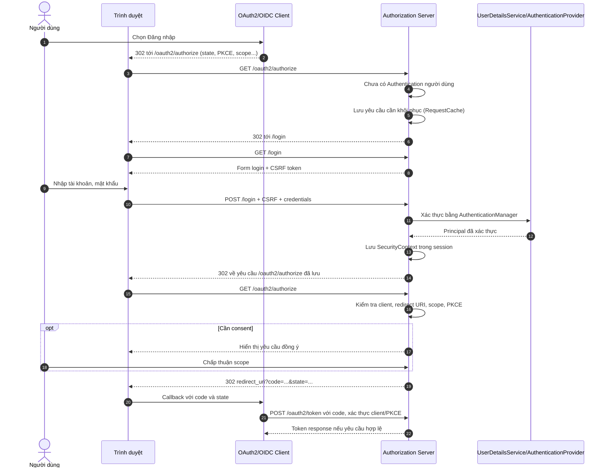
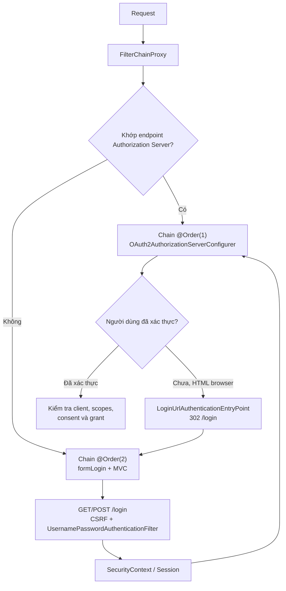

# Tích hợp form login vào Authorization Server

## 1. Tại sao Authorization Server vẫn cần màn hình đăng nhập?

Một **OAuth 2.0 Authorization Server** phát hành token cho client, nhưng trong luồng **Authorization Code** nó còn cần biết **người dùng cuối (resource owner)** là ai trước khi quyết định cho phép client truy cập tài nguyên. Nếu người dùng chưa có phiên xác thực tại Authorization Server, hệ thống cần một cơ chế đăng nhập tương tác, chẳng hạn **form login**, passkey hoặc đăng nhập liên kết.

Với **Spring Security**, `formLogin()` cung cấp cơ chế xác thực username/password qua trình duyệt. Với **Spring Authorization Server**, `OAuth2AuthorizationServerConfigurer` xử lý yêu cầu cấp quyền và các endpoint giao thức. Hai thành phần **phối hợp** nhưng không thay thế lẫn nhau.

Ví dụ: ứng dụng **Orders Web** gửi trình duyệt tới `https://auth.example.com/oauth2/authorize`. Nếu người dùng chưa đăng nhập, Authorization Server chuyển trình duyệt tới `/login`, xác thực tài khoản, đưa người dùng trở lại yêu cầu cấp quyền và có thể hiển thị **consent**. Chỉ sau đó mới trả **authorization code** tới `redirect_uri` của Orders Web.

Bài thuộc chương **Đăng nhập người dùng** trong module `SPRING_SECURITY_OAUTH2_OIDC_AUTHORIZATION_SERVER`. Mục tiêu là học cách **thiết kế, cấu hình, bảo mật, kiểm thử và vận hành** form login cùng OAuth 2.0/OpenID Connect (OIDC) Authorization Server trong Spring Boot.

### Sau bài này, bạn cần làm được

1. Phân biệt xác thực **người dùng** với xác thực **OAuth client**, kiểm tra grant và xác minh access token.
2. Cấu hình đúng **hai SecurityFilterChain** để endpoint OAuth 2.0/OIDC hoạt động cùng trang đăng nhập.
3. Giải thích cơ chế **entry point → request cache → form login → session → quay về authorization request**.
4. Xây trang login riêng với **CSRF protection**, xử lý lỗi, logout và URL an toàn.
5. Kiểm thử đường thành công, mật khẩu sai, consent, session hết hạn, reverse proxy và các lỗi redirect thường gặp.

> **Phạm vi API:** Ví dụ sử dụng Spring Boot 3.x, Spring Security 6.2+ và **Spring Authorization Server 1.x** có `HttpSecurity.with(...)` cùng `OAuth2AuthorizationServerConfigurer.authorizationServer()`. Ở dòng Spring Security 7.x, API DSL Authorization Server có thể khác; cần đối chiếu tài liệu đúng phiên bản, không trộn import một cách máy móc.

## 2. Hiểu đúng ba chủ thể và hai phiên đăng nhập

| Chủ thể | Trách nhiệm | Thứ dùng để chứng minh danh tính |
| --- | --- | --- |
| **Người dùng** | Đăng nhập tại Authorization Server và quyết định consent nếu cần | Username/password, MFA hoặc phương thức xác thực khác |
| **OAuth2 Client** | Khởi tạo yêu cầu cấp quyền, nhận callback, đổi authorization code | Client secret/private key nếu là confidential client; PKCE cho luồng code |
| **Resource Server** | Nhận access token và bảo vệ API | Chữ ký/issuer/audience/scope và chính sách quyền |

Form login tại Authorization Server tạo **phiên xác thực người dùng trên miền của Authorization Server**. OAuth2 Client có thể tạo **phiên riêng trên miền của mình** sau khi nhận và xác minh token. Hai session này không phải một; logout một bên không tự động kết thúc mọi phiên ở bên còn lại.

Hãy phân biệt:

- **`GET /login`** là trang người dùng nhập thông tin, **`POST /login`** thường do `UsernamePasswordAuthenticationFilter` xử lý.
- **`GET /oauth2/authorize`** là yêu cầu cấp quyền qua trình duyệt, do các thành phần của Authorization Server xử lý.
- **`POST /oauth2/token`** là nơi client đổi code hoặc sử dụng grant khác; không phải endpoint để gửi username/password của người dùng theo cách form login.

**Đặc biệt:** Dùng `formLogin()` **không đồng nghĩa bật Resource Owner Password Credentials grant**. Password grant đã bị loại khỏi khuyến nghị trong hướng dẫn bảo mật OAuth hiện đại. Với Authorization Code, mật khẩu chỉ được gửi tới trang login của Authorization Server, **không đi qua OAuth2 Client**.

## 3. Luồng từ authorization request tới phiên đăng nhập



Luồng thực tế còn phụ thuộc việc người dùng đã đăng nhập, chính sách consent, yêu cầu `prompt` của OIDC và cấu hình client. Nếu session Authorization Server đã hợp lệ và chính sách cho phép, bước hiện form có thể **được bỏ qua**, nhưng grant/redirect/consent vẫn phải được xác minh.

### 3.1. Điều gì được lưu ở đâu?

| Dữ liệu | Thành phần quản lý | Tác dụng |
| --- | --- | --- |
| `SecurityContext` / `Authentication` người dùng | Spring Security, thường gắn với HTTP session | Cho Authorization Server biết ai đã đăng nhập |
| Request chờ khôi phục | `RequestCache`, thường `HttpSessionRequestCache` | Quay lại URL `/oauth2/authorize` sau login |
| `state`, `nonce`, `code_verifier` của OAuth Client | Phía **OAuth2/OIDC Client** | Ràng buộc callback, ID token và quá trình đổi code |
| Authorization code, trạng thái token | `OAuth2AuthorizationService` | Cấp/đổi/hủy token theo giao thức |
| Consent của người dùng đối với client | `OAuth2AuthorizationConsentService` | Lưu quyền đã chấp thuận khi cần |

Lưu ý: **RequestCache không phải OAuth2AuthorizationService**; session đăng nhập không phải kho lưu token. Trong môi trường nhiều instance, các loại dữ liệu này có yêu cầu chia sẻ/truy xuất khác nhau.

## 4. Tại sao nên có hai SecurityFilterChain?

Spring Security chọn **`SecurityFilterChain` đầu tiên có matcher phù hợp**. Vì vậy, một cấu hình phổ biến là:

- Chain **ưu tiên 1** xử lý các OAuth 2.0/OIDC protocol endpoint.
- Chain **ưu tiên 2** xử lý `/login`, `/logout`, các trang MVC và các endpoint ứng dụng không thuộc chain giao thức.



**`securityMatcher(...)`** giới hạn những URL mà chain nhận vào. Nó khác `requestMatchers(...)` trong `authorizeHttpRequests`: matcher thứ hai chỉ quyết định quyền **sau khi một chain đã được chọn**. Nếu bạn đưa `/login` vào nhầm chain, để `@Order` sai hoặc matcher quá rộng, form login có thể bị chuyển hướng lặp hoặc trả 404.

## 5. Cấu hình hai chain trong Spring Boot

Ví dụ sau tập trung vào cấu trúc xác thực người dùng. Dùng cùng một `HttpSecurity` được Spring cung cấp cho mỗi bean filter chain.

```java
import org.springframework.context.annotation.Bean;
import org.springframework.context.annotation.Configuration;
import org.springframework.core.annotation.Order;
import org.springframework.http.MediaType;
import org.springframework.security.config.Customizer;
import org.springframework.security.config.annotation.web.builders.HttpSecurity;
import org.springframework.security.config.annotation.web.configuration.EnableWebSecurity;
import org.springframework.security.oauth2.server.authorization.config.annotation.web.configurers.OAuth2AuthorizationServerConfigurer;
import org.springframework.security.web.SecurityFilterChain;
import org.springframework.security.web.authentication.LoginUrlAuthenticationEntryPoint;
import org.springframework.security.web.util.matcher.MediaTypeRequestMatcher;

@Configuration
@EnableWebSecurity
public class SecurityConfig {

    @Bean
    @Order(1)
    SecurityFilterChain authorizationServerSecurityFilterChain(HttpSecurity http)
            throws Exception {

        OAuth2AuthorizationServerConfigurer authorizationServer =
                OAuth2AuthorizationServerConfigurer.authorizationServer();

        http
            .securityMatcher(authorizationServer.getEndpointsMatcher())
            .with(authorizationServer, configurer ->
                configurer.oidc(Customizer.withDefaults())
            )
            .authorizeHttpRequests(authorize ->
                authorize.anyRequest().authenticated()
            )
            .exceptionHandling(exceptions -> exceptions
                .defaultAuthenticationEntryPointFor(
                    new LoginUrlAuthenticationEntryPoint("/login"),
                    new MediaTypeRequestMatcher(MediaType.TEXT_HTML)
                )
            )
            // Hỗ trợ các endpoint OIDC cần xác minh Bearer JWT, như UserInfo.
            .oauth2ResourceServer(resourceServer ->
                resourceServer.jwt(Customizer.withDefaults())
            );

        return http.build();
    }

    @Bean
    @Order(2)
    SecurityFilterChain applicationSecurityFilterChain(HttpSecurity http)
            throws Exception {

        http
            .authorizeHttpRequests(authorize ->
                authorize.anyRequest().authenticated()
            )
            .formLogin(Customizer.withDefaults());

        return http.build();
    }
}
```

**Đây không phải toàn bộ dự án chạy độc lập:** một Authorization Server thực tế còn cần `RegisteredClientRepository`, `OAuth2AuthorizationService`, `OAuth2AuthorizationConsentService` (nếu dùng consent), `AuthorizationServerSettings`, `JWKSource`/`JwtDecoder` cho OIDC/JWT, và nguồn xác thực người dùng. Nếu bật `oauth2ResourceServer().jwt()` nhưng thiếu decoder hợp lệ, ứng dụng có thể không khởi động hoặc endpoint JWT không hoạt động như mong đợi.

### 5.1. Giải thích các lựa chọn quan trọng

1. **`@Order(1)`** cho giao thức: request `/oauth2/authorize`, `/oauth2/token` và endpoint được configurer quản lý phải vào chain này.
2. **`getEndpointsMatcher()`** giữ chain giao thức không chiếm `/login`. Không dùng `anyRequest` ở cấp `securityMatcher` của chain 1.
3. **`oidc(Customizer.withDefaults())`** bật OIDC khi hệ thống cần ID token/discovery/UserInfo; nếu chỉ triển khai OAuth 2.0 thuần, không nhất thiết phải bật.
4. **`anyRequest().authenticated()`** yêu cầu xác thực trong chain; các protocol filter vẫn thực hiện logic phù hợp từng endpoint, chẳng hạn client authentication ở token endpoint.
5. **`defaultAuthenticationEntryPointFor(..., TEXT_HTML)`** chuyển trình duyệt chưa đăng nhập tới `/login`, thay vì biến tất cả request giao thức thành chuyển hướng HTML. Token endpoint cần tiếp tục trả lỗi giao thức thích hợp cho client máy với máy.
6. **`formLogin(Customizer.withDefaults())`** cung cấp trang login mặc định (`GET /login`) và xử lý form (`POST /login`) ở chain ứng dụng, bảo vệ bằng CSRF theo cấu hình Spring Security.

Với hệ thống hỗ trợ OIDC, `/userinfo` nhận bearer token và không đồng nhất với việc yêu cầu người dùng đang có session tại trình duyệt. Cần đặt cấu hình resource server phù hợp vào Authorization Server chain theo hướng dẫn phiên bản.

## 6. Xác thực username/password thực sự diễn ra như thế nào?

Form login là một chức năng của **Spring Security authentication**, không phải của `OAuth2AuthorizationServerConfigurer`.

### 6.1. Đường đi của POST login

1. Browser gửi `POST /login` với form fields (mặc định `username`, `password`) và CSRF token.
2. `CsrfFilter` kiểm tra token nếu endpoint cần CSRF protection.
3. `UsernamePasswordAuthenticationFilter` tạo `UsernamePasswordAuthenticationToken` chưa được xác thực.
4. `AuthenticationManager` (thường `ProviderManager`) gọi provider tương ứng, ví dụ `DaoAuthenticationProvider`.
5. Provider dùng `UserDetailsService` tìm tài khoản và `PasswordEncoder` kiểm tra mật khẩu.
6. Khi thành công, Spring Security tạo `Authentication` đã xác thực, lưu `SecurityContext` qua cơ chế persistence/session đã cấu hình, áp chính sách session fixation và gọi success handler.
7. Success handler thường đưa trình duyệt về URL đã được lưu bởi request cache; nếu không có URL cần khôi phục, dùng đích mặc định của ứng dụng.

Nếu đăng nhập thất bại, trình duyệt thường được đưa đến `/login?error` hoặc trang lỗi đã cấu hình. **Không gửi plaintext password vào token endpoint** chỉ vì Authorization Server cần biết principal của người dùng.

### 6.2. Nguồn người dùng và PasswordEncoder

Ví dụ cấu hình **tài khoản thử nghiệm**:

```java
@Bean
PasswordEncoder passwordEncoder() {
    return PasswordEncoderFactories.createDelegatingPasswordEncoder();
}

@Bean
UserDetailsService userDetailsService(PasswordEncoder passwordEncoder) {
    UserDetails alice = User.withUsername("alice")
            .password(passwordEncoder.encode("change-me-in-test-only"))
            .roles("USER")
            .build();

    return new InMemoryUserDetailsManager(alice);
}
```

Ví dụ này **chỉ dùng học tập và kiểm thử**, không đưa tài khoản/mật khẩu viết cứng vào production. Với hệ thống thật, tích hợp `UserDetailsService` hoặc `AuthenticationProvider` với cơ sở dữ liệu/IdP, quản lý khóa tài khoản, trạng thái kích hoạt, MFA, audit và cơ chế phục hồi tài khoản.

**Mật khẩu phải được lưu bằng hàm băm phù hợp cho mật khẩu**, không mã hóa đối xứng để giải mã khi login và không dùng SHA-256 đơn thuần thay thế password hashing. `DelegatingPasswordEncoder` cho phép gắn prefix thuật toán và quản lý nâng cấp thuật toán theo cấu hình.

### 6.3. Principal ảnh hưởng gì đến authorization?

Sau login, `Authentication.getName()` thường là định danh principal được Authorization Server sử dụng khi liên kết authorization/consent. Trong OIDC, claim `sub` cần đại diện cho định danh người dùng ổn định theo chính sách của nhà cung cấp.

Nếu ứng dụng cho phép đổi username/email, cân nhắc dùng một **subject ID ổn định, không tái cấp** thay vì phụ thuộc email dễ thay đổi. Khi tùy biến `sub`/claims, phải bảo đảm các nguồn như UserInfo, consent, lưu trữ authorization và quy tắc quyền nhất quán.

## 7. Vì sao người dùng quay lại `/oauth2/authorize` sau login?

### 7.1. RequestCache và success handler

Khi trình duyệt gọi endpoint cần đăng nhập và Spring Security phát hiện chưa có principal, `ExceptionTranslationFilter` và authentication entry point phối hợp để:

- lưu yêu cầu ban đầu cần quay lại, thường bằng `HttpSessionRequestCache`;
- chuyển trình duyệt sang form login;
- sau thành công, `SavedRequestAwareAuthenticationSuccessHandler` có thể điều hướng về saved request.

Ví dụ:

```text
GET /oauth2/authorize?response_type=code&client_id=orders-web
    &scope=openid%20profile&state=...&code_challenge=...

  -> 302 /login
  -> GET /login
  -> POST /login (CSRF + username + password)
  -> 302 /oauth2/authorize?response_type=code&client_id=orders-web...
  -> Tiếp tục kiểm tra authorization/consent và phát code
```

Đây là mô hình khái quát: framework/version và cấu hình request cache quyết định hành vi khôi phục cụ thể. Nếu tích hợp tự viết, hãy kiểm tra đường dẫn đã lưu chỉ tới tài nguyên hợp lệ của ứng dụng; đừng biến query `redirect` do client tùy ý cung cấp thành một **open redirect** sau login.

**Không sử dụng `defaultSuccessUrl("/home", true)` một cách vô ý** khi Authorization Server cần khôi phục authorization request: tham số `alwaysUse=true` có thể ép mọi login chuyển đến `/home`, khiến client mãi không nhận authorization code.

### 7.2. Vì sao nhiều tab có thể khó xử lý?

Nếu người dùng mở nhiều luồng đăng nhập OAuth đồng thời, mỗi client lưu `state`/PKCE riêng nhưng **HTTP session phía Authorization Server có thể có một request cần khôi phục hiện hành** theo cách cấu hình request cache. Cần kiểm thử tình huống hai tab, tránh giả định mọi lượt redirect luôn độc lập nếu tự sửa `RequestCache` hoặc success handler.

Nếu cần workflow đa tab phức tạp, hãy chọn giải pháp đã xét tới ràng buộc giao dịch, hết hạn và định tuyến sau login; không dùng biến global chung lưu `redirect_uri` hoặc `state`.

## 8. Tùy biến form login: trang `/signin` riêng

Trang login mặc định hữu ích khi thử nghiệm. Khi cần giao diện thương hiệu, accessibility, captcha hoặc thông báo chính sách, tạo trang riêng nhưng **giữ filter xử lý POST và CSRF protection** của Spring Security.

### 8.1. Đổi login page và entry point thống nhất

Để tránh chuyển hướng sang `/login` khi trang thật là `/signin`, phải thay **cả hai**:

Trong **Authorization Server chain**:

```java
.exceptionHandling(exceptions -> exceptions
    .defaultAuthenticationEntryPointFor(
        new LoginUrlAuthenticationEntryPoint("/signin"),
        new MediaTypeRequestMatcher(MediaType.TEXT_HTML)
    )
)
```

Trong **application chain**:

```java
.authorizeHttpRequests(authorize -> authorize
    .requestMatchers("/signin", "/assets/**").permitAll()
    .anyRequest().authenticated()
)
.formLogin(form -> form
    .loginPage("/signin")
    .loginProcessingUrl("/signin")
    .failureUrl("/signin?error")
    .permitAll()
)
```

Đây là **đoạn DSL rút gọn** để thay trong hai bean ở phần 5, không phải hai bean độc lập. Trong cấu hình thật, giữ các thiết lập khác của chain. `loginPage` là URL hiển thị HTML bằng GET; `loginProcessingUrl` là URL mà `UsernamePasswordAuthenticationFilter` nhận POST — **không cần tự viết controller xử lý POST mật khẩu**.

### 8.2. Controller chỉ phục vụ trang HTML

```java
@Controller
class LoginPageController {

    @GetMapping("/signin")
    String loginPage() {
        return "signin";
    }
}
```

Nếu dùng Thymeleaf, tạo trang `signin.html` trong thư mục templates của ứng dụng (đây là **minh họa thiết kế**, không phải yêu cầu tạo tệp ngoài bài học):

```html
<!doctype html>
<html lang="vi" xmlns:th="http://www.thymeleaf.org">
<head>
  <meta charset="utf-8">
  <title>Đăng nhập</title>
</head>
<body>
  <main>
    <h1>Đăng nhập</h1>
    <p th:if="${param.error}" role="alert">
      Tên đăng nhập hoặc mật khẩu không hợp lệ.
    </p>
    <form th:action="@{/signin}" method="post">
      <label for="username">Tên đăng nhập</label>
      <input id="username" name="username" autocomplete="username" required>

      <label for="password">Mật khẩu</label>
      <input id="password" name="password" type="password"
             autocomplete="current-password" required>

      <input type="hidden"
             th:name="${_csrf.parameterName}"
             th:value="${_csrf.token}">
      <button type="submit">Đăng nhập</button>
    </form>
  </main>
</body>
</html>
```

Trong ví dụ, `${_csrf.parameterName}` và `${_csrf.token}` là các biểu thức Thymeleaf đọc dữ liệu CSRF của request. `th:action="@{/signin}"` giúp tạo form action có context path khi triển khai theo cấu hình servlet phù hợp. Tránh hard-code `action="/signin"` nếu ứng dụng chạy dưới `/auth` và không có rewrite tương ứng. Với tích hợp Thymeleaf/Spring MVC có cơ chế tự thêm trường CSRF cho form POST, hãy chọn một cách đưa token, tránh tạo hai trường ẩn trùng tên.

**Yêu cầu với form tùy chỉnh:**

- Phục vụ trang `GET /signin` không cần đăng nhập, nếu không sẽ tạo vòng lặp redirect.
- Chỉ cho phép `POST` thông qua `UsernamePasswordAuthenticationFilter`; không tự xử lý mật khẩu tại MVC controller.
- Giữ **CSRF token**. Ví dụ hiển thị trường ẩn tường minh để giải thích cơ chế; nếu Thymeleaf đã tự chèn CSRF input, không thêm trường trùng lặp.
- Không lặp lại mật khẩu, user input không tin cậy hoặc thông tin nhạy cảm trong response lỗi.
- Hạn chế JavaScript, dùng CSP/escape HTML và giữ đường dẫn tài nguyên CSS/JS được phép truy cập.
- Đảm bảo tab keyboard, label, thông báo lỗi và các yêu cầu truy cập phù hợp.

### 8.3. CSRF trên login khác `state` trong OAuth

**CSRF token của form** ràng buộc một POST nhập thông tin với ngữ cảnh trang mà trình duyệt đã nhận. **OAuth `state`** ràng buộc callback authorization response với giao dịch OAuth do client khởi tạo. Chúng giải quyết hai điểm tấn công khác nhau; không lấy `state` thay thế CSRF token của POST login.

Không tắt `csrf()` toàn cục chỉ vì `POST /oauth2/token` không gửi form CSRF token. Spring Authorization Server và Spring Security có thể quản lý chính sách CSRF của các endpoint giao thức; form login và consent cần được bảo vệ phù hợp.

## 9. Authorization request sau login còn cần được kiểm tra gì?

Form login chỉ kết luận principal người dùng đã được xác thực. Authorization Server còn phải xác minh **yêu cầu cấp quyền**:

| Nội dung | Bên thực hiện | Ví dụ |
| --- | --- | --- |
| Client có tồn tại và được đăng ký không? | Authorization Server | `client_id=orders-web` |
| Grant/response type có được phép không? | Authorization Server | `response_type=code` |
| Redirect URI có chính xác không? | Authorization Server | `https://app.example.com/login/oauth2/code/orders` |
| Scope nào được phép? | Authorization Server, consent policy | `openid profile orders.read` |
| PKCE hợp lệ chưa? | Authorization Server | `code_challenge_method=S256` |
| Người dùng có cần consent không? | Authorization Server | Chấp thuận `orders.read` |
| Callback thuộc đúng giao dịch ban đầu không? | **OAuth Client** | Đối chiếu `state` |
| ID token thuộc đúng yêu cầu đăng nhập không? | **OIDC Client** | Đối chiếu `nonce` khi dùng |

Đặc biệt, **Authorization Server không nên chấp nhận `redirect_uri` không được đăng ký** chỉ vì người dùng đã nhập đúng mật khẩu. Đó là kiểm tra ranh giới giữa client và máy chủ ủy quyền, độc lập với kết quả user authentication.

Với OIDC, scope `openid` báo hiệu yêu cầu xác thực danh tính; Authorization Server phát hành ID token khi luồng hợp lệ. **ID token không phải access token** và không nên được API sử dụng thay cho access token để phân quyền.

## 10. Consent và form login là hai bước riêng

**Login** trả lời: *Người dùng là ai?* **Consent** trả lời: *Người dùng có chấp thuận để client này nhận các scope được yêu cầu không?*

Ví dụ:

1. Alice nhập mật khẩu và đăng nhập thành công tại Authorization Server.
2. Orders Web yêu cầu `orders.read` và `orders.write`.
3. Máy chủ xác định client cần consent và hiện màn hình chấp thuận.
4. Alice chỉ chấp thuận các quyền theo chính sách triển khai cho phép.
5. Authorization Server chỉ cấp quyền/token theo kết quả hợp lệ.

Cấu hình client có thể dùng:

```java
RegisteredClient client = RegisteredClient.withId(UUID.randomUUID().toString())
        .clientId("orders-web")
        .clientSecret(encodedClientSecret)
        .clientAuthenticationMethod(
                ClientAuthenticationMethod.CLIENT_SECRET_BASIC)
        .authorizationGrantType(AuthorizationGrantType.AUTHORIZATION_CODE)
        .authorizationGrantType(AuthorizationGrantType.REFRESH_TOKEN)
        .redirectUri("https://app.example.com/login/oauth2/code/orders-web")
        .scope(OidcScopes.OPENID)
        .scope("profile")
        .scope("orders.read")
        .clientSettings(ClientSettings.builder()
                .requireProofKey(true)
                .requireAuthorizationConsent(true)
                .build())
        .build();
```

Đây là ví dụ `RegisteredClient` rút gọn; `encodedClientSecret` phải là giá trị đã được mã hóa, cung cấp từ nguồn bí mật an toàn, không hard-code. Khi bật `requireAuthorizationConsent(true)`, màn hình consent và storage cần được cấu hình để người dùng có thể hoàn thành luồng. Với client thực tế, scope, redirect URI, authentication method và TTL phải được xác định theo yêu cầu hệ thống.

**Không tự động đồng ý mọi scope** sau khi login để “giảm bước” mà bỏ qua chính sách quản trị. Nếu tùy biến consent page, bảo vệ POST bằng CSRF, hiển thị tên client và scope từ nguồn đã đăng ký, không tin nhãn quyền do client tự khai báo.

## 11. Bảo vệ form login trong production

### 11.1. HTTPS, cookie, session fixation

- Trang form, POST mật khẩu, authorization endpoint, callback và các endpoint token công khai đều cần **HTTPS**.
- Session cookie nên có `Secure`, `HttpOnly` và `SameSite` phù hợp flow. `Path` phải nhất quán với context path và reverse proxy.
- Khi login thành công, Spring Security có cơ chế **session fixation protection**; đừng tắt mà không có lý do bảo mật rõ ràng.
- Tạo chính sách timeout cho session, reauthentication khi cần và kết thúc phiên an toàn khi logout.
- Trong môi trường nhiều node, cần chiến lược **shared session** hoặc sticky routing được thiết kế cẩn thận, nhất là khi request trước login và sau login có thể tới hai node khác nhau.

Ví dụ cấu hình cookie tham khảo trong Spring Boot:

```yaml
server:
  servlet:
    session:
      cookie:
        secure: true
        http-only: true
        same-site: lax
  forward-headers-strategy: framework
```

Nếu TLS kết thúc ở proxy, bảo đảm proxy cung cấp thông tin scheme/host tin cậy và không để Internet tự ý điều khiển `X-Forwarded-*`. Đừng chỉ sửa issuer để che lỗi redirect login từ HTTPS về HTTP.

### 11.2. Chống dò mật khẩu và credential stuffing

- Dùng **rate limiting** tại gateway/ứng dụng, backoff phù hợp và giám sát theo nhiều tín hiệu; tránh chỉ dựa vào IP vì có NAT/shared networks.
- Chặn hoặc thử thách những lượt đăng nhập có rủi ro cao, đồng thời thiết kế tránh lạm dụng cơ chế khóa tài khoản làm DoS.
- Sử dụng **MFA**, passkey hoặc chính sách xác thực mạnh cho tài khoản có quyền cao; lưu bằng chứng xác thực để áp chính sách step-up khi cần.
- Trả thông điệp lỗi đăng nhập chung như “Tên đăng nhập hoặc mật khẩu không hợp lệ” thay vì xác nhận tài khoản có tồn tại.
- Không log password, CSRF token, session ID hoặc các credential liên quan.

### 11.3. CSRF, XSS và response headers

Không bỏ qua CSRF cho login và consent forms. Escape dữ liệu hiển thị trên giao diện, hạn chế inline JavaScript, cấu hình CSP khi có thể và bảo vệ các tài nguyên được nạp trong trang. Kiểm soát đường dẫn `returnUrl`/`continue` để không tạo **open redirect** sau xác thực.

### 11.4. Đăng xuất có nhiều lớp

`POST /logout` của Spring Security thường kết thúc session phía Authorization Server theo cấu hình; OIDC RP-Initiated Logout có endpoint/quy tắc riêng khi bật. Logout session Authorization Server **không tự thu hồi** mọi access token đã cấp và không nhất thiết đăng xuất từng ứng dụng client.

Thiết kế logout phải cân nhắc phiên client, access token có thời hạn, refresh token, revocation và OIDC logout khi sử dụng. Tránh nói “logout toàn hệ thống” nếu chỉ xóa cookie của Authorization Server.

## 12. Tích hợp tài khoản nội bộ, SSO và MFA

Form login là một cách **thu thập credential người dùng**; `OAuth2AuthorizationServerConfigurer` không bắt buộc sử dụng đúng cách này. Hệ thống có thể:

- dùng `UserDetailsService` với kho người dùng nội bộ;
- dùng custom `AuthenticationProvider` tích hợp LDAP/Active Directory hoặc hệ thống nhận diện hiện có;
- sử dụng **Spring Security OAuth2 Login** để liên kết tới nhà cung cấp danh tính ngoài, sau đó thiết lập `Authentication` người dùng ở Authorization Server;
- tích hợp các cơ chế MFA/step-up, passkey hoặc xác thực thích nghi theo rủi ro.

Khi Authorization Server đóng vai **OIDC Provider** cho các client, việc nó đăng nhập người dùng bằng phương thức nào là **chi tiết nội bộ**. Client nhận token/kết quả giao thức, không nên được trao mật khẩu người dùng.

Tích hợp IdP ngoài cần bảo vệ thêm các luồng `state`, `nonce`, issuer và callback của **chính Authorization Server khi nó đóng vai client đối với IdP ngoài**. Không nhầm những giao dịch liên kết đó với OAuth giao dịch giữa Orders Web và Authorization Server.

## 13. Bảng kiểm thử end-to-end

| Ca thử | Bước cần quan sát | Kết quả mong đợi |
| --- | --- | --- |
| Người dùng chưa đăng nhập gọi `/oauth2/authorize` | Chọn AS chain, entry point, redirect | `302` tới login HTTPS, không mất tham số giao dịch |
| GET trang login mặc định | Application chain | Có trang login khả dụng; tài nguyên CSS/JS được phép truy cập |
| POST đúng username/password và CSRF | `UsernamePasswordAuthenticationFilter` | Session được tạo/cập nhật an toàn, quay về authorization request |
| POST sai password | User authentication provider | Không tạo session xác thực; thông báo lỗi phù hợp |
| POST thiếu/sai CSRF | `CsrfFilter` | Bị từ chối, không đăng nhập thành công |
| GET `/signin` trong custom form mà chưa đăng nhập | Matcher và permit rules | Truy cập được, không tạo vòng lặp 302 |
| Sau login, client yêu cầu consent | Authorization endpoint | Hiển thị scope/client đúng và xử lý chấp thuận |
| Client redirect URI không được đăng ký | Authorization endpoint | Từ chối yêu cầu, không chuyển code tới URI sai |
| OAuth client dùng state sai tại callback | **OAuth2 Client** | Từ chối callback, không tạo phiên đăng nhập client |
| Đổi authorization code với PKCE sai | Token endpoint | Không cấp token |
| `POST /oauth2/token` với client secret sai | Client authentication filter | OAuth error đúng; không chuyển sang HTML login |
| Session hết hạn trước khi quay lại `/oauth2/authorize` | AS + login chain | Đăng nhập lại an toàn, không cấp token trước xác thực |
| Mở hai lượt đăng nhập ở hai tab | RequestCache, session, client state | Không nhầm callback/giao dịch, không làm mất dữ liệu bảo mật |
| Tắt cookie hoặc sai `Secure/Path` | Browser/network | Phát hiện vòng lặp login và xác định lỗi cookie |
| Chạy qua reverse proxy `/auth` | Context path/forwarded headers | Redirect, POST action, login và consent đều dùng public URL đúng |
| Hai node xử lý các bước khác nhau | Session store, authorization service | Không mất Authentication, code hoặc consent |

### 13.1. Test MVC và test giao thức khác nhau

**Unit/MockMvc test** có thể kiểm tra `GET /signin`, `POST /signin` thiếu CSRF, xác thực đúng/sai, và handler chuyển hướng. Khi dùng `Spring Security Test`, có thể sử dụng `csrf()` với MockMvc để kiểm tra POST được bảo vệ; giả lập `@WithMockUser` chỉ xác minh hành vi với principal có sẵn, **không kiểm tra đường xử lý mật khẩu thật**.

**Integration/end-to-end test** cần chạy toàn bộ luồng qua trình duyệt hoặc HTTP client quản lý cookie, thực hiện:

1. Tạo yêu cầu authorization hợp lệ cho RegisteredClient đã đăng ký.
2. Quan sát redirect tới login, lấy CSRF token và giữ session cookie.
3. Gửi POST login hợp lệ qua đúng URL.
4. Theo redirect quay về authorization request, xử lý consent nếu được yêu cầu.
5. Nhận code và state ở callback của client thử nghiệm.
6. Đổi code bằng PKCE/credential theo loại client; xác minh token và issuer.

Không thể kết luận cấu hình đúng chỉ vì endpoint `/login` trả HTTP 200. Bài test phải chứng minh **người dùng quay về được authorization flow và client nhận kết quả hợp lệ**.

## 14. Chẩn đoán các lỗi phổ biến

| Triệu chứng | Nguyên nhân có thể | Hướng kiểm tra |
| --- | --- | --- |
| `/oauth2/authorize` trả 401/403 thay vì 302 login | Thiếu HTML entry point hoặc matcher/chain không phù hợp | Kiểm tra chain ưu tiên 1 và MediaType matcher |
| Trình duyệt lặp `/login` ↔ `/oauth2/authorize` | Login URL bị bảo vệ, session cookie thất lạc, request cache lỗi | Mở tab Network, kiểm tra Set-Cookie/Cookie/Location |
| `GET /signin` trả 404 | Chưa có controller/view hoặc template sai vị trí | Kiểm tra controller GET, template engine, mapping |
| `POST /signin` trả 404/405 | `loginProcessingUrl` không khớp action form hoặc request rơi sai chain | Kiểm tra DSL, `th:action`, servlet context |
| `POST /login` trả 403 | CSRF token thiếu/sai hoặc session mất | Kiểm tra `_csrf` và cookie; không tắt CSRF toàn cục |
| Đăng nhập xong vào `/` thay vì quay lại OAuth authorize | Success handler đã ép target, RequestCache không lưu | Kiểm tra `defaultSuccessUrl(..., true)` và SavedRequest |
| Login thành công nhưng Authorization Server vẫn coi anonymous | SecurityContext chưa lưu/session không được gửi | Kiểm tra security context repository, session policy, nhiều node |
| POST token bị redirect sang trang login | Request matcher, filter chain hoặc error handling sai | Client authentication cần OAuth error, không phải HTML |
| Redirect login dùng `http://localhost` phía sau TLS proxy | Sai forwarded headers hoặc context path | Chốt canonical issuer, sửa proxy/header strategy và link |
| Đăng nhập đúng nhưng ID token `sub` không ổn định | Principal name phụ thuộc username/email thay đổi | Thiết kế subject ID ổn định, kiểm tra mapping OIDC |
| Consent lặp lại ở mỗi request | Consent service không bền vững hoặc chính sách consent thay đổi | Kiểm tra `OAuth2AuthorizationConsentService` và client settings |

### 14.1. Quan sát log an toàn

Chỉ nên ghi **correlation ID**, endpoint, filter chain đã chọn, loại lỗi và thông tin vận hành tối thiểu. Không ghi password, CSRF token, session cookie, authorization code, access token, refresh token hoặc client secret vào log. Khi debug, phân biệt **failure của form login** với **`invalid_client` của OAuth client** và **`invalid_grant` của token endpoint**.

## 15. Tình huống thực hành: Orders Web đăng nhập qua Spring Authorization Server

Hệ thống gồm ba thành phần:

- **Orders Web**: confidential OAuth2/OIDC Client, nhận callback tại `https://orders.example.com/login/oauth2/code/orders-web`.
- **Authorization Server**: `https://auth.example.com`, xác thực nhân viên bằng form login và cung cấp consent.
- **Orders API**: Resource Server, chỉ chấp nhận access token đúng issuer, audience và scope.

Luồng mong đợi:

1. Orders Web tạo `state`, `nonce` và PKCE verifier/challenge; chuyển trình duyệt tới Authorization Server.
2. AS chain nhận `/oauth2/authorize`, phát hiện chưa có `Authentication` người dùng, lưu yêu cầu cần khôi phục và chuyển sang `/login`.
3. Application chain xử lý `GET /login`/`POST /login`. Provider kiểm tra mật khẩu và chính sách người dùng; Spring Security giữ `SecurityContext` trong session.
4. Người dùng trở lại `/oauth2/authorize`. Authorization Server kiểm tra client, redirect URI, scope, PKCE và consent nếu cần.
5. Code được gửi tới callback đã đăng ký của Orders Web. Orders Web đối chiếu `state`, đổi code kèm PKCE và client authentication.
6. Orders Web xác minh ID token/nonce và mở session ứng dụng; Orders API kiểm tra access token cùng quyền trên đơn hàng được truy cập.

Nếu nhân viên đã đăng nhập tại Authorization Server, một yêu cầu OAuth mới có thể không cần hiện lại form. Nếu client muốn yêu cầu xác thực lại theo chính sách, OIDC có các tham số như `prompt=login` hoặc `max_age`; việc thực thi phải được kiểm tra với đúng phiên bản và chính sách máy chủ.

Một lỗi thực tế thường gặp: đội triển khai tùy biến form login rồi đặt `defaultSuccessUrl("/dashboard", true)`. Người dùng đăng nhập thành công nhưng **Orders Web không nhận code** vì authorization request bị bỏ qua. Giải pháp là giữ hoặc thay success handler theo cách bảo toàn request cache và flow, không chỉ kiểm tra trang dashboard có mở được.

## 16. Checklist trước khi triển khai production

- **Cấu trúc filter chain:** AS chain nhận protocol endpoint; application chain nhận login/logout và view; `@Order`/matcher đã được kiểm thử.
- **Xác thực người dùng:** provider/kho danh tính phù hợp; mật khẩu được băm an toàn; khóa tài khoản và MFA khi cần.
- **Form login:** login URL nhất quán với authentication entry point; POST dùng CSRF; thông báo lỗi không tiết lộ dữ liệu nhạy cảm.
- **Phiên:** cookie HTTPS/Secure/HttpOnly/SameSite, timeout, session fixation protection, RequestCache, khả năng hoạt động qua nhiều node.
- **Giao thức:** client registration, redirect URI, PKCE, scope, consent, issuer/JWK và OIDC claims được xác minh.
- **Redirect & proxy:** không có open redirect; login/consent action dùng public URL đúng cả khi có context path và TLS termination.
- **Vận hành:** giới hạn đăng nhập thất bại, audit không lộ credential, giám sát session/consent errors, kế hoạch rotation và thu hồi.
- **Kiểm thử:** có cả đường thành công từ `/oauth2/authorize` qua form login tới token, và các ca lỗi CSRF/session/password/redirect.

## 17. Tổng kết

**Form login là cơ chế xác thực người dùng của Spring Security; Spring Authorization Server dùng kết quả xác thực đó để tiếp tục một yêu cầu OAuth 2.0/OIDC.** Hai `SecurityFilterChain` giúp tách endpoint giao thức khỏi giao diện login, còn `LoginUrlAuthenticationEntryPoint` và `RequestCache` đóng vai trò nối lại hành trình người dùng sau khi đăng nhập.

Để tự kiểm tra sự hiểu biết, hãy luôn trả lời bốn câu hỏi:

1. **Ai đang đăng nhập?** — Người dùng tại `/login`, không phải OAuth client.
2. **Đăng nhập thành công được lưu ở đâu?** — Trong `SecurityContext`/session theo cấu hình Spring Security.
3. **Tại sao lại quay về `/oauth2/authorize`?** — Vì authorization request đang chờ được khôi phục sau login.
4. **Login xong đã cấp token ngay chưa?** — Chưa. Authorization Server còn xác minh client, grant, redirect URI, PKCE, consent và chính sách trước khi cấp code/token.

### Tài liệu tham khảo

- [Spring Authorization Server — Getting Started](https://docs.spring.io/spring-authorization-server/reference/getting-started.html)
- [Spring Authorization Server — Configuration Model](https://docs.spring.io/spring-authorization-server/reference/configuration-model.html)
- [Spring Authorization Server — Core Model Components](https://docs.spring.io/spring-authorization-server/reference/core-model-components.html)
- [Spring Security — Form Login](https://docs.spring.io/spring-security/reference/servlet/authentication/passwords/form.html)
- [Spring Security — Multiple SecurityFilterChain](https://docs.spring.io/spring-security/reference/servlet/configuration/java.html)
- [Spring Security — CSRF Protection](https://docs.spring.io/spring-security/reference/servlet/exploits/csrf.html)
- [Spring Security — Session Management](https://docs.spring.io/spring-security/reference/servlet/authentication/session-management.html)
- [RFC 6749 — The OAuth 2.0 Authorization Framework](https://www.rfc-editor.org/rfc/rfc6749)
- [RFC 9700 — Best Current Practice for OAuth 2.0 Security](https://www.rfc-editor.org/rfc/rfc9700)
- [OpenID Connect Core 1.0](https://openid.net/specs/openid-connect-core-1_0.html)
