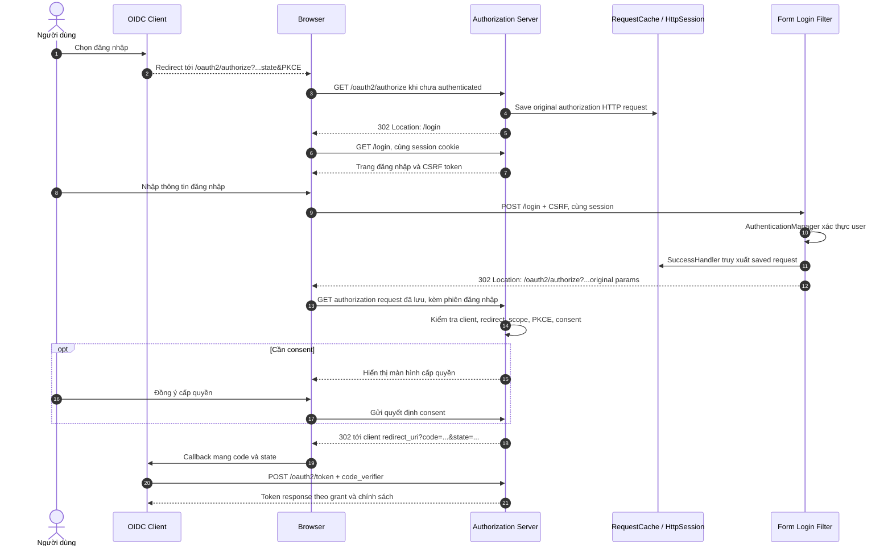

# Khôi phục authorization request sau khi đăng nhập thành công

## 1. Vấn đề: người dùng chưa đăng nhập khi client yêu cầu ủy quyền

Trong chương **Đăng nhập người dùng** của module `SPRING_SECURITY_OAUTH2_OIDC_AUTHORIZATION_SERVER`, chúng ta tập trung vào một điểm chuyển tiếp quan trọng: **OAuth 2.0/OpenID Connect Authorization Server phải tiếp tục yêu cầu ủy quyền ban đầu sau khi người dùng hoàn thành đăng nhập**.

Mục tiêu của module là học cách thiết kế, cấu hình, bảo mật, kiểm thử và vận hành Authorization Server bằng **Spring Security** và **Spring Authorization Server** trong ứng dụng **Spring Boot**. Nếu việc khôi phục yêu cầu thất bại, người dùng có thể đăng nhập thành công nhưng chỉ nhìn thấy trang chủ, gặp vòng lặp đăng nhập, hoặc bị báo thiếu `client_id`/`response_type` khi quay lại luồng OAuth2/OIDC.

Giả sử một OIDC client là ứng dụng web `portal.example.com`. Khi người dùng chọn “Đăng nhập”, browser được chuyển tới Authorization Server:

```http
GET /oauth2/authorize?response_type=code
    &client_id=portal-web
    &redirect_uri=https%3A%2F%2Fportal.example.com%2Flogin%2Foauth2%2Fcode%2Fas
    &scope=openid%20profile%20orders.read
    &state=<client-generated-state>
    &nonce=<client-generated-nonce>
    &code_challenge=<pkce-code-challenge>
    &code_challenge_method=S256
Host: auth.example.com
```

Nếu người dùng chưa có phiên đăng nhập tại `auth.example.com`, server cần:

1. Nhận và giữ lại **yêu cầu `/oauth2/authorize` ban đầu**.
2. Điều hướng tới `/login` và xác thực người dùng.
3. Sau khi đăng nhập thành công, chuyển trình duyệt về yêu cầu `/oauth2/authorize` đã lưu.
4. Tiếp tục kiểm tra client, redirect URI, scope, PKCE, consent và cấp **Authorization Code** khi mọi điều kiện được đáp ứng.
5. Chuyển trình duyệt về `redirect_uri` đã đăng ký kèm `code` và `state`; **OIDC client** sau đó mới đổi code lấy token tại Token Endpoint.

Không được tự tạo Authorization Code trong login success handler: **đăng nhập người dùng** và **ra quyết định ủy quyền/cấp code** là hai trách nhiệm riêng. Việc khôi phục request giữ cho xử lý OAuth2/OIDC đi qua các bộ lọc và `AuthenticationProvider` chuẩn của Authorization Server.

## 2. Authorization request nào cần khôi phục?

Trong tài liệu Spring Security, từ “authorization request” xuất hiện ở nhiều ngữ cảnh:

| Khái niệm | Thành phần quản lý | Khi nào sử dụng? |
| --- | --- | --- |
| **HTTP request `GET /oauth2/authorize`** gửi tới Authorization Server | Servlet request, `SecurityFilterChain`, có thể được `RequestCache` lưu tạm | **Chủ đề chính của bài này:** quay lại yêu cầu đang chờ sau khi người dùng đăng nhập |
| **Yêu cầu cấp quyền OAuth2** đã được parse và xác minh | `OAuth2AuthorizationEndpointFilter`, Converter/Provider, và khi thích hợp `OAuth2AuthorizationService` | Kiểm tra client, scope, user, consent; tạo authorization code |
| **`OAuth2AuthorizationRequest` ở phía OAuth2 Client** | Thường là `OAuth2AuthorizationRequestRepository` của Spring Security OAuth2 Client | Client ghi nhớ `state`/redirect khi **chính client** chuyển đến nhà cung cấp định danh khác |

Ba cơ chế này **không hoán đổi cho nhau**. Khi viết ứng dụng Authorization Server dùng form login nội bộ, thường cần hiểu **`RequestCache` của Spring Security Servlet**. Không nên dùng `HttpSessionOAuth2AuthorizationRequestRepository` của OAuth2 Client làm giải pháp thay thế mặc định để khôi phục `GET /oauth2/authorize` tại Authorization Server.

Authorization Code chưa được phát hành ở thời điểm người dùng bị chuyển đến login. Vì thế, việc “khôi phục authorization request” không đồng nghĩa “phát lại một code đã tồn tại”. Thông thường server **đưa browser quay lại endpoint** để tiếp tục xử lý trong trạng thái đã có principal được xác thực.

## 3. Luồng đầy đủ: từ Authorization Endpoint tới login rồi quay lại



**Chú ý hai nơi chuyển hướng:**

- **Sau đăng nhập**: browser quay lại **Authorization Server** tại `/oauth2/authorize` với các tham số ban đầu.
- **Sau ủy quyền thành công**: browser mới tới **callback của client** tại `redirect_uri`, nhận `code` và `state`.

Nếu login success handler chuyển thẳng đến callback của client, client sẽ không có code do Authorization Server phát hành hợp lệ. Nếu nó chuyển tới `/oauth2/authorize` nhưng làm rơi `state` hoặc `code_challenge`, giao dịch có thể bị từ chối hoặc mất các bảo vệ mà client đã thiết lập.

## 4. Spring Security lưu và trả lại request bằng những thành phần nào?

### 4.1. `ExceptionTranslationFilter` và `AuthenticationEntryPoint`

Trong một Servlet `SecurityFilterChain`, khi request tới tài nguyên cần người dùng xác thực nhưng chưa có phiên hợp lệ, cơ chế bảo mật có thể đi qua `ExceptionTranslationFilter`:

1. Xác định request cần bắt đầu quá trình xác thực.
2. Dùng `RequestCache.saveRequest(...)` để lưu HTTP request ban đầu **nếu được cấu hình và request phù hợp điều kiện lưu**.
3. Gọi `AuthenticationEntryPoint` để điều hướng người dùng đến `/login` hoặc trả phản hồi xác thực thích hợp.

Với ứng dụng web tương tác, `LoginUrlAuthenticationEntryPoint("/login")` thường tạo HTTP redirect tới trang đăng nhập. Cách xử lý thực tế có thể đi qua filter và provider của Spring Authorization Server, nhưng nguyên tắc vẫn là phải duy trì yêu cầu ban đầu cho đến khi browser quay lại.

### 4.2. `HttpSessionRequestCache` và `DefaultSavedRequest`

`HttpSessionRequestCache` là một triển khai `RequestCache` của Spring Security. Nó có thể giữ thông tin của request bị gián đoạn trong `HttpSession`, dưới dạng `SavedRequest` (thường là `DefaultSavedRequest`), bao gồm URL/URI, query string và dữ liệu cần thiết để xây dựng lại request.

```text
HTTP session của browser
  ├── Các dữ liệu phiên do Spring Security quản lý
  ├── SavedRequest: GET /oauth2/authorize?client_id=...&state=...
  └── Dữ liệu CSRF/ứng dụng khác theo cấu hình
```

Không cần đưa toàn bộ query string Authorization Server vào hidden input của form login. Khi dùng `RequestCache` đúng cách, browser có thể đăng nhập tại URL `/login` độc lập và sau đó được điều hướng lại yêu cầu gốc.

**Cần cùng phiên HTTP** giữa các bước. Với `HttpSessionRequestCache`, nếu cookie phiên không được gửi về sau login, session bị xóa, hoặc ứng dụng dùng chính sách stateless, saved request có thể không còn. Việc Spring Security thay đổi session ID để chống session fixation thông thường **không đồng nghĩa mất toàn bộ session attributes**; lỗi thường xảy ra khi có mã tùy chỉnh xóa/tạo phiên mà không di chuyển trạng thái cần thiết.

### 4.3. `SavedRequestAwareAuthenticationSuccessHandler`

Sau khi người dùng xác thực thành công bằng form login, `SavedRequestAwareAuthenticationSuccessHandler` có thể:

1. Tìm `SavedRequest` trong `RequestCache`.
2. Nếu có request phù hợp, redirect browser về URL đã lưu.
3. Nếu không có, sử dụng cơ chế điều hướng mặc định (`defaultTargetUrl`, các tuỳ chọn khác của handler).

Trong cấu hình form login thông thường của Spring Security, cơ chế điều hướng sau xác thực đã hỗ trợ saved request. Một cấu hình `successHandler` riêng có thể vô tình phá vỡ hành vi này nếu luôn `sendRedirect("/")` hoặc ép `alwaysUseDefaultTargetUrl=true`.

**`SavedRequestAwareAuthenticationSuccessHandler` không tạo code, token hoặc consent.** Nó chỉ giúp browser trở lại luồng HTTP mà request đã bị gián đoạn.

### 4.4. `RequestCacheAwareFilter` và xử lý request khi quay lại

Khi browser truy cập lại URL đã lưu, `RequestCacheAwareFilter` có thể lấy request được lưu và bọc request hiện tại theo cơ chế Spring Security tương ứng. Authorization Endpoint tiếp nhận request, đọc các tham số OAuth2 như bình thường.

Tại bước này, các thành phần Spring Authorization Server như `OAuth2AuthorizationEndpointFilter`, `OAuth2AuthorizationCodeRequestAuthenticationConverter` và `OAuth2AuthorizationCodeRequestAuthenticationProvider` xử lý yêu cầu theo giao thức, kiểm tra trạng thái user và client. Việc có saved request **không được phép bỏ qua** bất kỳ kiểm tra OAuth2/OIDC nào.

### 4.5. `SecurityContext` phải tồn tại khi quay lại

Sau login, `Authentication` của người dùng cần được giữ cho các request kế tiếp theo chiến lược `SecurityContextRepository` và session của ứng dụng. Nếu login hiển thị thành công nhưng request tiếp theo bị xem là anonymous, Authorization Server có thể chuyển browser về login lần nữa.

Lưu request và lưu `SecurityContext` là **hai việc khác nhau**: request cache giữ đích cần quay lại; security context lưu danh tính đã xác thực. Cả hai phải hoạt động đúng trong kiến trúc đăng nhập tương tác.

## 5. Mẫu cấu hình hai SecurityFilterChain cho Spring Authorization Server

Trong Spring Boot dùng Spring Security 6.x và Spring Authorization Server 1.x, một cấu hình phổ biến có:

- **Chain 1** dành cho endpoint OAuth2/OIDC, được chọn trước nhờ matcher và `@Order(1)`.
- **Chain 2** dành cho phần còn lại của ứng dụng, gồm `/login`, form login và các trang liên quan.

Ví dụ rút gọn sau dùng API configurer hỗ trợ `OAuth2AuthorizationServerConfigurer.authorizationServer()`. Các import và logic cần cho cấu hình hạ tầng khác được ghi rõ trong phần giải thích:

```java
import org.springframework.context.annotation.Bean;
import org.springframework.context.annotation.Configuration;
import org.springframework.core.annotation.Order;
import org.springframework.http.MediaType;
import org.springframework.security.config.Customizer;
import org.springframework.security.config.annotation.web.builders.HttpSecurity;
import org.springframework.security.oauth2.server.authorization.config.annotation.web.configurers.OAuth2AuthorizationServerConfigurer;
import org.springframework.security.web.SecurityFilterChain;
import org.springframework.security.web.authentication.LoginUrlAuthenticationEntryPoint;
import org.springframework.security.web.util.matcher.MediaTypeRequestMatcher;

@Configuration
public class AuthorizationServerSecurityConfiguration {

    @Bean
    @Order(1)
    SecurityFilterChain authorizationServerSecurityFilterChain(HttpSecurity http)
            throws Exception {
        OAuth2AuthorizationServerConfigurer authorizationServer =
                OAuth2AuthorizationServerConfigurer.authorizationServer();

        http
            .securityMatcher(authorizationServer.getEndpointsMatcher())
            .with(authorizationServer, configurer ->
                    configurer.oidc(Customizer.withDefaults()))
            .authorizeHttpRequests(authorize ->
                    authorize.anyRequest().authenticated())
            .exceptionHandling(exceptions ->
                    exceptions.defaultAuthenticationEntryPointFor(
                            new LoginUrlAuthenticationEntryPoint("/login"),
                            new MediaTypeRequestMatcher(MediaType.TEXT_HTML)));

        return http.build();
    }

    @Bean
    @Order(2)
    SecurityFilterChain applicationSecurityFilterChain(HttpSecurity http)
            throws Exception {
        http
            .authorizeHttpRequests(authorize ->
                    authorize.anyRequest().authenticated())
            .formLogin(Customizer.withDefaults());

        return http.build();
    }
}
```

**Vì sao mẫu này liên quan trực tiếp đến việc khôi phục request?**

1. Một request `GET /oauth2/authorize` thuộc các endpoint của Authorization Server, không bị chain ứng dụng với `anyRequest` bắt trước.
2. Khi browser cần đăng nhập, entry point HTML đưa browser tới `/login`; cơ chế request cache tiêu chuẩn có thể nhớ yêu cầu gốc.
3. `/login` được chain ứng dụng xử lý bằng form login; khi xác thực thành công, success handler mặc định có thể đưa browser về saved request.
4. Browser quay lại Authorization Endpoint trong trạng thái authenticated, tiếp tục kiểm tra client/ủy quyền rồi mới phát code.

Đoạn trên là **khung filter chain**, chưa phải một Authorization Server hoàn chỉnh. Để chạy flow thật, còn cần `RegisteredClientRepository`, trạng thái authorization/consent, cấu hình xác thực người dùng, issuer, signing key/JWK và các bean phụ thuộc. Các endpoint OIDC như UserInfo có thể đòi hỏi cấu hình Resource Server/JWT decoder tương ứng; hãy theo tài liệu của phiên bản đang dùng.

**Không dùng `securityMatcher("/**")` cho chain 1 rồi trông đợi chain 2 xử lý login**. `FilterChainProxy` chọn chain đầu tiên khớp; chain Authorization Server nếu bao trùm `/login` có thể khiến đăng nhập lặp lại hoặc không còn form login filter.

## 6. Khi phải tùy chỉnh login success handler hoặc RequestCache

Nếu chỉ cần trở lại URL yêu cầu ủy quyền, **ưu tiên giữ cơ chế `SavedRequestAwareAuthenticationSuccessHandler` mặc định**. Tùy chỉnh chỉ khi ứng dụng cần thêm logic sau đăng nhập, dùng cơ chế đăng nhập khác, hay đã thay request cache.

### 6.1. Dùng chung RequestCache giữa hai chain

Khi muốn kiểm soát rõ request cache, có thể khai báo một bean dùng chung cho chain Authorization Server và form login:

```java
import org.springframework.context.annotation.Bean;
import org.springframework.context.annotation.Configuration;
import org.springframework.security.web.savedrequest.HttpSessionRequestCache;
import org.springframework.security.web.savedrequest.RequestCache;

@Configuration(proxyBeanMethods = false)
class RequestCacheConfiguration {

    @Bean
    RequestCache authorizationRequestCache() {
        return new HttpSessionRequestCache();
    }
}
```

Đưa bean trên vào cả hai `SecurityFilterChain`:

```java
// Phần chèn vào chain 1, bên cạnh securityMatcher và AuthorizationServerConfigurer:
http.requestCache(cache -> cache.requestCache(authorizationRequestCache));

// Phần chèn vào chain 2:
http.requestCache(cache -> cache.requestCache(authorizationRequestCache));
```

Trong hai method tạo chain, bổ sung tham số `RequestCache authorizationRequestCache` do Spring inject. Đây là **hai đoạn chèn vào cấu hình mục 5**, không phải file Java hoàn chỉnh riêng. Việc dùng chung cache giúp cả filter ở chain Authorization Server và logic redirect ở chain login truy cập cùng saved request trong session.

Nếu application đã cấu hình `HttpSessionRequestCache` bằng matching parameter, request matcher hoặc session attribute name riêng, hãy kiểm tra các thiết lập đó thống nhất ở cả nơi lưu và nơi khôi phục. Tránh tạo hai cơ chế lưu trữ khác nhau rồi giả định login success handler sẽ tự thấy saved request.

### 6.2. Gắn success handler có chủ đích

Nếu cần tự cấu hình success handler, vẫn có thể sử dụng `SavedRequestAwareAuthenticationSuccessHandler`:

```java
import org.springframework.security.web.authentication.SavedRequestAwareAuthenticationSuccessHandler;
import org.springframework.security.web.savedrequest.RequestCache;

// Trong method applicationSecurityFilterChain(..., RequestCache requestCache):
SavedRequestAwareAuthenticationSuccessHandler successHandler =
        new SavedRequestAwareAuthenticationSuccessHandler();
successHandler.setRequestCache(requestCache);
successHandler.setDefaultTargetUrl("/");

http
    .requestCache(cache -> cache.requestCache(requestCache))
    .formLogin(login -> login.successHandler(successHandler));
```

`setDefaultTargetUrl("/")` trong ví dụ chỉ định đích **dự phòng khi không có saved request**; nó không được dùng để đè lên yêu cầu ủy quyền đã lưu. Đừng gọi `setAlwaysUseDefaultTargetUrl(true)` khi muốn resume. Lưu ý đây là **đoạn thay thế phần cấu hình form login** trong method tương ứng; phải kết hợp với `authorizeHttpRequests` và chain đã nêu ở mục 5.

Nếu login success handler cần ghi audit, cập nhật last-login hoặc xử lý MFA, nên cho logic đó thực hiện xong rồi **ủy quyền việc điều hướng** cho saved-request-aware handler thay vì tự nối chuỗi URL từ tham số do client gửi.

### 6.3. Chỉ lưu request cần thiết

Một request cache mặc định có thể lưu cả yêu cầu khác nếu chúng cũng yêu cầu authentication. Với hệ thống phức tạp, cân nhắc giới hạn những request được lưu bằng `RequestMatcher` phù hợp hoặc tách tuyến truy cập, chẳng hạn chỉ các `GET /oauth2/authorize` cần resume.

Tuy nhiên, việc tùy chỉnh matcher phải tính tới **context path, các endpoint đã đổi đường dẫn**, flow đăng nhập đang sử dụng và khả năng client yêu cầu ủy quyền từ nhiều tab. Một matcher sai có thể làm saved request biến mất. Không nên thay RequestCache mặc định chỉ để làm “tối ưu” khi chưa có bài kiểm thử khôi phục request.

## 7. Ví dụ HTTP minh họa trước, trong và sau đăng nhập

### Bước 1 – Browser truy cập Authorization Endpoint

```http
GET /oauth2/authorize?response_type=code&client_id=portal-web&redirect_uri=https%3A%2F%2Fportal.example.com%2Fcallback&scope=openid%20profile&state=st-123&nonce=n-456&code_challenge=challenge-value&code_challenge_method=S256 HTTP/1.1
Host: auth.example.com
Accept: text/html
```

Khi chưa đăng nhập, server có thể lưu request vào session và redirect:

```http
HTTP/1.1 302 Found
Location: /login
Set-Cookie: JSESSIONID=<session-id>; Path=/; HttpOnly; Secure; SameSite=Lax
```

`Set-Cookie` ở đây là **minh họa của cấu hình phiên và cookie an toàn**, không phải một header chắc chắn xuất hiện trong mọi response hoặc mọi môi trường. Tên cookie, `Secure`, `SameSite` và cách tạo session phụ thuộc Servlet container, proxy và cấu hình ứng dụng.

### Bước 2 – Người dùng hoàn tất form login

```http
POST /login HTTP/1.1
Host: auth.example.com
Cookie: JSESSIONID=<same-session>
Content-Type: application/x-www-form-urlencoded

username=alice&password=<password-from-form>&_csrf=<valid-csrf-token>
```

Ví dụ này chỉ diễn đạt luồng HTTP; không đưa mật khẩu thực vào log hoặc công cụ kiểm thử chia sẻ. Nếu CSRF token không hợp lệ, Spring Security có thể trả `403`, và success handler sẽ **không được gọi**.

### Bước 3 – Success handler trả browser về Authorization Endpoint

```http
HTTP/1.1 302 Found
Location: https://auth.example.com/oauth2/authorize?response_type=code&client_id=portal-web&redirect_uri=...&scope=...&state=st-123&nonce=n-456&code_challenge=...&code_challenge_method=S256
```

Browser dùng session đã xác thực để gửi lại yêu cầu ủy quyền. Trong các trường hợp cần consent, server có thể hiển thị trang yêu cầu cấp quyền trước khi cấp code.

### Bước 4 – Server hoàn tất authorization flow

```http
HTTP/1.1 302 Found
Location: https://portal.example.com/callback?code=<authorization-code>&state=st-123
```

Client **phải kiểm tra `state`** với giá trị đã tạo; khi đổi code tại `/oauth2/token`, phải gửi **`code_verifier` gốc** tương ứng với `code_challenge`. Nếu là OIDC, client còn kiểm tra ID Token và `nonce` theo quy tắc giao thức.

**Không nhầm giá trị `state` với HTTP session ID.** `state` do OAuth2/OIDC client quản lý để liên kết yêu cầu/response; HTTP session tại Authorization Server giữ trạng thái đăng nhập và saved request của browser. Chúng giải quyết các vấn đề khác nhau.

## 8. Những tham số nào phải giữ nguyên khi tiếp tục?

| Giá trị trong `/oauth2/authorize` | Ý nghĩa | Nếu mất hoặc bị sửa |
| --- | --- | --- |
| `client_id` | Xác định client đã đăng ký | Không xác định được client hợp lệ |
| `response_type=code` | Yêu cầu Authorization Code Flow | Không xác định đúng response type |
| `redirect_uri` | Callback được ràng buộc với client | Lỗi redirect URI hoặc nguy cơ sai đích |
| `scope` | Phạm vi truy cập và `openid` khi dùng OIDC | Không đúng giao dịch ban đầu hoặc bị từ chối |
| `state` | Liên kết callback với yêu cầu khởi tạo phía client | Client có thể từ chối callback hoặc mất bảo vệ CSRF |
| `code_challenge` và `code_challenge_method` | Ràng buộc PKCE giữa Authorization Code và bên giữ verifier | Đổi code thất bại hoặc mất ràng buộc bắt buộc |
| `nonce` | Liên kết ID Token với request OIDC | Client không thể xác minh nonce đã yêu cầu |
| `prompt`, `max_age`, `login_hint`, `acr_values` (nếu được hỗ trợ) | Gợi ý hoặc yêu cầu mức/độ mới của xác thực OIDC | Hành vi xác thực không còn đúng mục đích request |

Những tham số này **không phải dữ liệu đáng tin chỉ vì đã được cache**. Khi quay lại, Spring Authorization Server vẫn phải kiểm tra chúng theo quy tắc OAuth2/OIDC và cấu hình `RegisteredClient`. Không được thay thế kiểm tra giao thức bằng việc tin rằng request từng được lưu trong session.

Không nên lưu `client_secret` hoặc `code_verifier` vào URL authorization request. `code_verifier` phải được giữ ở phía **client** tới lúc đổi code; server chỉ nhận `code_challenge` ở bước authorization và `code_verifier` ở bước token.

## 9. Khi cần consent, request được tiếp tục như thế nào?

**Đăng nhập thành công không đồng nghĩa người dùng đã đồng ý cấp mọi quyền.** Ví dụ `portal-web` yêu cầu `openid profile orders.read`, nhưng server đặt `requireAuthorizationConsent(true)` cho client.

Luồng hợp lý là:

1. Nhận yêu cầu ủy quyền ban đầu và redirect login nếu chưa authenticated.
2. Xác thực người dùng và quay lại `/oauth2/authorize`.
3. Authorization Server xác định consent cần lấy theo client và scope đang yêu cầu.
4. Hiển thị consent page, nhận sự đồng ý hợp lệ và lưu trạng thái phù hợp qua `OAuth2AuthorizationConsentService`.
5. Chỉ sau các kiểm tra và quyết định consent mới hoàn tất cấp authorization code.

Nếu ứng dụng tự redirect tới callback ngay sau login, nó có thể **bỏ qua consent** hoặc làm mất scope. Nếu tự dựng consent form, phải duy trì đầy đủ client, state, quyền và cơ chế chống CSRF theo hướng dẫn của Authorization Server; không tin các scope tự ý gửi lên từ browser mà thiếu kiểm tra.

Một số luồng OIDC có `prompt=none` yêu cầu không tương tác với người dùng. Nếu chưa có phiên đáp ứng yêu cầu, server phải tuân thủ **quy tắc lỗi OIDC phù hợp** (chẳng hạn `login_required`) thay vì cưỡng bức hiển thị login tương tác. Vì vậy không được giả định mọi authorization request chưa authenticated đều phải hiển thị form login.

## 10. Session, cookie và triển khai nhiều instance

### 10.1. Session là phụ thuộc thực tế của HttpSessionRequestCache

`HttpSessionRequestCache` yêu cầu browser gửi lại đúng cookie phiên. Những thay đổi sau có thể làm việc resume thất bại:

- Chuyển sang `SessionCreationPolicy.STATELESS` cho chain cần form login và saved request.
- Gọi `session.invalidate()` hoặc xóa `SPRING_SECURITY_SAVED_REQUEST` trước khi handler lấy lại request.
- Đặt cookie `Path` quá hẹp khiến request `/login` hoặc `/oauth2/authorize` không nhận cùng cookie.
- Dùng `SameSite`, domain hoặc `Secure` không phù hợp với sơ đồ HTTPS/proxy; browser không gửi session cookie khi cần.
- Người dùng xóa cookie hoặc session hết hạn trong lúc đang đăng nhập.

**Session fixation protection** là tính năng bảo mật cần giữ; Spring Security thường chuyển/migrate trạng thái cần thiết theo cấu hình session management. Không tắt bảo vệ fixation chỉ để khôi phục saved request. Nếu có custom session strategy, kiểm thử rằng saved request và security context còn hợp lệ sau chuyển session.

### 10.2. Load balancer và session dùng chung

Ở hệ thống nhiều node, một request ban đầu có thể đi vào node A còn POST login đi vào node B. Nếu cả hai dùng HTTP session in-memory độc lập, node B không thấy saved request của node A.

Cách vận hành tùy kiến trúc:

- Dùng **Spring Session** với repository dùng chung khi yêu cầu HA và session có thể được phục vụ bởi nhiều instance.
- Sticky session có thể giảm hiện tượng chuyển node nhưng không thay thế chiến lược khôi phục phiên khi node mất.
- Cấu hình cookie, TTL session, clock và serialization của dữ liệu session nhất quán.
- Kiểm thử qua load balancer thật với chuỗi redirect `/oauth2/authorize -> /login -> /oauth2/authorize`.

Kho session để resume **khác** `OAuth2AuthorizationService` lưu authorization/code/token và `OAuth2AuthorizationConsentService` lưu consent. Trong môi trường nhiều node, cần xem cả ba loại trạng thái theo yêu cầu tính sẵn sàng.

### 10.3. Reverse proxy, issuer và URL trong saved request

Một lỗi phổ biến: browser truy cập `https://auth.example.com`, nhưng server ở sau proxy nhận `http://auth-internal:9000`. Nếu URL được lưu/khôi phục thành host nội bộ, login success handler có thể điều hướng sai địa chỉ.

Kiểm tra `AuthorizationServerSettings.issuer`, cấu hình forwarded headers của Spring Boot, ingress/proxy và redirect URL; chỉ tin forwarded headers từ proxy được kiểm soát. Không để client bên ngoài tự giả mạo `X-Forwarded-Host` để điều khiển redirect của hệ thống.

## 11. Một request cache trong session và vấn đề nhiều tab

Một `HttpSessionRequestCache` mặc định thường lưu một **saved request hiện hành** cho session. Nếu người dùng mở song song:

```text
Tab A: /oauth2/authorize?client_id=portal-A&state=aaa
Tab B: /oauth2/authorize?client_id=portal-B&state=bbb
```

request tới sau có thể ghi đè request lưu trước tùy luồng bảo mật và cấu hình cache. Khi người dùng hoàn tất login trong Tab A, browser có thể được dẫn tới request của Tab B. Đây là giới hạn cần lưu ý với các ứng dụng có nhiều đăng nhập song song hoặc giao diện nhiều tab.

Không sửa bằng cách lưu một tham số `returnUrl` bất kỳ do người dùng cung cấp rồi redirect trực tiếp: cách đó có thể mở **open redirect** hoặc làm mất trạng thái OAuth2. Nếu sản phẩm thật sự cần quản lý nhiều giao dịch đồng thời, thiết kế cơ chế lưu request theo transaction ID ngẫu nhiên, gắn với session/browser, có TTL, chống replay, giới hạn callback và kiểm thử kỹ trước khi thay cơ chế framework.

Đối với nhiều ứng dụng thông thường, nhận biết giới hạn của cache mặc định và kiểm thử hành vi thực tế là đủ cho bước học này.

## 12. Chẩn đoán lỗi theo triệu chứng

| Triệu chứng | Nguyên nhân thường gặp | Cách xác minh |
| --- | --- | --- |
| Login thành công nhưng luôn về `/` | Custom success handler bỏ qua saved request; `alwaysUseDefaultTargetUrl=true` | Kiểm tra cấu hình `formLogin`, session và `RequestCache` |
| Browser về `/oauth2/authorize` nhưng thiếu query | Redirect thủ công chỉ dùng path, không dùng `SavedRequest.getRedirectUrl()` | Kiểm tra Location header của response login |
| Vòng lặp `/login -> /oauth2/authorize -> /login` | Security context không được lưu; cookie không được gửi; chain sai | Kiểm tra SecurityContextRepository, cookie và filter chain |
| `GET /oauth2/authorize` bị chain ứng dụng xử lý | Matcher hoặc `@Order` không đúng | Kiểm tra filter chain đầu tiên match request |
| `POST /login` trả 403 | CSRF token thiếu/sai; POST không đúng endpoint xử lý login | Kiểm tra token CSRF, cookie/session và `loginProcessingUrl` |
| Login hiện 404 | Không có form login hoặc trang login tùy chỉnh chưa được cung cấp | Kiểm tra `formLogin`, trang `/login` và chain ứng dụng |
| Callback client có `error=invalid_request` | `client_id`, redirect URI, scope, PKCE, nonce hoặc tham số khác sai | Đọc lỗi OAuth2, xác minh request ban đầu và config client |
| Code đổi tại Token Endpoint lỗi `invalid_grant` | Code hết hạn/đã dùng, sai client/redirect hoặc `code_verifier` | Kiểm tra token request và PKCE của giao dịch |
| Redirect ra host/port nội bộ | Reverse proxy/issuer/forwarded headers sai | So sánh URL bên ngoài và `Location` sau login |
| Chỉ lỗi khi chạy nhiều node | HTTP session không dùng chung/sticky session không ổn định | Theo dõi node tiếp nhận hai bước và nơi lưu session |
| Tab A bị chuyển sang client của Tab B | Saved request bị ghi đè trong cùng session | Kiểm thử song song và xem chiến lược RequestCache |
| `prompt=none` xuất hiện trang login | Chưa xử lý đúng yêu cầu xác thực không tương tác OIDC | Kiểm tra chính sách OIDC và lỗi `login_required` |

### 12.1. Trình tự debug hiệu quả

1. **Xác nhận request ban đầu** đến đúng `/oauth2/authorize` với `client_id`, `response_type`, `redirect_uri`, `state` và PKCE hợp lệ.
2. **Xác nhận chain được chọn**: Authorization Server chain ở `/oauth2/authorize`, application login chain ở `/login`.
3. **Xác nhận saved request tồn tại** sau redirect login; chỉ kiểm tra endpoint/host và tên tham số đã được làm mờ, không in toàn bộ request có giá trị nhạy cảm.
4. **Xác nhận HTTP session duy trì** qua GET login, POST login và GET authorization sau đó.
5. **Xác nhận success handler** dùng saved request thay vì một URL cố định.
6. **Xác nhận Authorization Server tiếp tục xử lý** cùng client/redirect/PKCE và có thể hiển thị consent.
7. **Xác nhận callback và token exchange** với client thật trong môi trường test.

Đừng kết luận “request đã khôi phục” chỉ vì `POST /login` trả 302: cần kiểm tra **`Location` trỏ tới đúng authorization request** và request tiếp theo thực sự đi qua endpoint.

## 13. Kiểm thử tích hợp với MockMvc

### 13.1. Mục tiêu kiểm thử

Một kiểm thử có ý nghĩa cần kiểm tra **cùng phiên HTTP**, **đúng URL redirect sau login** và **còn các tham số của giao dịch**. Các fixture sau cần được thiết lập trong môi trường test:

- Một `RegisteredClient` có `client_id=portal-web`, grant `authorization_code`, redirect URI `https://portal.example.com/callback`, scope `openid`, PKCE được bật.
- Một user thử nghiệm `alice` có mật khẩu chỉ dùng trong test.
- Các bean Authorization Server cần thiết; nếu bật OIDC cần cấu hình khóa ký/decoder phù hợp.
- Form login `POST /login` và request cache dùng session.

### 13.2. Ví dụ test kiểm tra resume sau form login

```java
import org.junit.jupiter.api.Test;
import org.springframework.beans.factory.annotation.Autowired;
import org.springframework.boot.test.autoconfigure.web.servlet.AutoConfigureMockMvc;
import org.springframework.boot.test.context.SpringBootTest;
import org.springframework.mock.web.MockHttpSession;
import org.springframework.test.web.servlet.MockMvc;
import org.springframework.test.web.servlet.MvcResult;

import static org.assertj.core.api.Assertions.assertThat;
import static org.springframework.security.test.web.servlet.request.SecurityMockMvcRequestPostProcessors.csrf;
import static org.springframework.test.web.servlet.request.MockMvcRequestBuilders.get;
import static org.springframework.test.web.servlet.request.MockMvcRequestBuilders.post;
import static org.springframework.test.web.servlet.result.MockMvcResultMatchers.status;

@SpringBootTest
@AutoConfigureMockMvc
class AuthorizationRequestResumeTest {

    @Autowired
    MockMvc mockMvc;

    @Test
    void afterLoginRedirectsBackToOriginalAuthorizationRequest() throws Exception {
        MvcResult start = mockMvc.perform(get("/oauth2/authorize")
                        .param("response_type", "code")
                        .param("client_id", "portal-web")
                        .param("redirect_uri", "https://portal.example.com/callback")
                        .param("scope", "openid")
                        .param("state", "state-for-test")
                        .param("nonce", "nonce-for-test")
                        .param("code_challenge", "E9Melhoa2OwvFrEMTJguCHaoeK1t8URWbuGJSstw-cM")
                        .param("code_challenge_method", "S256")
                        .header("Accept", "text/html"))
                .andExpect(status().is3xxRedirection())
                .andReturn();

        assertThat(start.getResponse().getRedirectedUrl()).contains("/login");

        MockHttpSession session =
                (MockHttpSession) start.getRequest().getSession(false);
        assertThat(session).isNotNull();

        MvcResult login = mockMvc.perform(post("/login")
                        .session(session)
                        .with(csrf())
                        .param("username", "alice")
                        .param("password", "test-password"))
                .andExpect(status().is3xxRedirection())
                .andReturn();

        String location = login.getResponse().getRedirectedUrl();
        assertThat(location).contains("/oauth2/authorize");
        assertThat(location).contains("client_id=portal-web");
        assertThat(location).contains("state=state-for-test");
        assertThat(location).contains("code_challenge=");
    }
}
```

Đây là **mẫu integration test định hướng**, cần được chạy với các bean/test fixture thực tế. Giá trị `code_challenge` trong test là ví dụ S256 hợp lệ từ RFC 7636, tương ứng với `code_verifier` mẫu `dBjftJeZ4CVP-mB92K27uhbUJU1p1r_wW1gFWFOEjXk`. Trong ứng dụng thật, phải tạo verifier ngẫu nhiên mới cho mỗi giao dịch và dẫn xuất `code_challenge = BASE64URL(SHA256(ASCII(code_verifier)))`. Mục tiêu ở test này là kiểm tra phần **resume URL sau login**, chưa xác nhận issuance/token response; `state` và `nonce` trong ví dụ cũng chỉ là fixture tĩnh, còn client production phải sinh giá trị khó đoán cho mỗi giao dịch.

Để chứng minh hoàn chỉnh, tiếp tục gửi request `GET` tới URL được trả về (giữ phiên đã đăng nhập) rồi xác minh authorization code được tạo hoặc consent được yêu cầu. Với consent được bật, test cần hoàn tất bước đó rồi mới kiểm tra callback. Cuối cùng đổi code bằng cùng verifier tại `/oauth2/token`.

### 13.3. Các test âm tính cần có

| Ca test | Kỳ vọng |
| --- | --- |
| Login sai mật khẩu | Không quay lại flow như người dùng đã authenticated |
| POST login thiếu CSRF hợp lệ | Bị từ chối theo cấu hình CSRF |
| Phiên bị mất trước POST login | Không thể resume request cũ; ứng dụng xử lý theo fallback phù hợp |
| User login vào hệ thống mà không có saved request | Redirect đến URL mặc định hợp lệ, không dựng `/oauth2/authorize` vô nghĩa |
| Client ID/redirect URI không hợp lệ | Authorization Server từ chối yêu cầu, không tự phát code |
| PKCE challenge/verifier không khớp | Token Endpoint không phát token |
| Nhiều tab đồng thời | Đo hành vi cache thực tế và giới hạn giao dịch song song |
| Profile proxy/multi-node | Redirect công khai đúng host và request được giữ qua các node |
| OIDC `prompt=none` khi chưa login | Lỗi OIDC thích hợp thay vì yêu cầu tương tác trái quy tắc |

Trong kiểm thử giao thức, `state` và `nonce` là giá trị do **client fixture** kiểm tra; `RequestCache` của Authorization Server chỉ giúp request được xử lý trở lại. Không biến saved request thành nguồn tin cậy về quyền hoặc danh tính.

## 14. Bảo mật khi khôi phục authorization request

### 14.1. Tránh open redirect

Sai lầm phổ biến là thêm tham số `returnUrl` vào form login và gọi:

```java
// MÃ MINH HỌA KHÔNG AN TOÀN — KHÔNG DÙNG
response.sendRedirect(request.getParameter("returnUrl"));
```

Nếu `returnUrl` do người dùng tự nhập, kẻ tấn công có thể dẫn browser sang domain khác sau đăng nhập. Cách an toàn hơn là dùng saved request do cơ chế bảo mật lưu trong phiên, rồi vẫn để Authorization Endpoint xác minh `redirect_uri` của OAuth2 client. Nếu sản phẩm cần custom return target, nó phải có kiểm tra allowlist/nguồn gốc/chống replay và được thiết kế độc lập với tham số `redirect_uri` của OAuth2.

### 14.2. Chống login CSRF và session fixation

Form `POST /login` cần CSRF protection khi dùng cookie/session authentication. Session fixation protection phải được giữ và kiểm thử. Không tắt CSRF toàn cục chỉ vì một số endpoint giao thức OAuth2 như Token Endpoint chấp nhận POST.

Sau xác thực, cần bảo đảm security context thuộc về **đúng user vừa đăng nhập**, và mọi bước sau vẫn xác minh quyền và consent. Saved request không phải bằng chứng xác thực người dùng.

### 14.3. Không ghi dữ liệu nhạy cảm vào log

Tránh log nguyên URL authorization/callback vì có thể chứa `state`, `nonce`, `login_hint` hoặc `code`. Những giá trị này có thể tiết lộ thông tin giao dịch và hỗ trợ tấn công phát lại nếu bị lộ trong thời gian hiệu lực. Trong log vận hành, ưu tiên correlation ID, đường dẫn endpoint, trạng thái redirect, lý do lỗi đã chuẩn hóa và thời gian xử lý; không log token, mật khẩu, verifier hay client secret.

### 14.4. Hạn chế nhầm lẫn user và client

Một người dùng đăng nhập thành công ở Authorization Server không có nghĩa client nào cũng được quyền lấy token. Sau resume, server vẫn phải kiểm tra:

- `client_id` tồn tại và được đăng ký tại issuer.
- `redirect_uri` hợp lệ theo đăng ký.
- Grant, response type, scope và yêu cầu PKCE/OIDC phù hợp.
- Principal/consent đáp ứng chính sách.
- Authorization Code có hạn sử dụng ngắn, chỉ đổi được một lần và được ràng buộc với client/redirect/PKCE.

Đó là lý do **không chuyển thẳng tới `redirect_uri` trong success handler**.

## 15. Checklist vận hành

Trước khi đưa luồng đăng nhập OAuth2/OIDC lên staging hoặc production, xác nhận:

1. **Authorization Server chain** được ưu tiên cho các endpoint OAuth2/OIDC; chain ứng dụng xử lý `/login`.
2. Form login, success handler, RequestCache và SecurityContextRepository hoạt động nhất quán với session đã chọn.
3. Sau login, `Location` trỏ về `/oauth2/authorize` và giữ nguyên mọi tham số giao dịch cần thiết.
4. Authorization Endpoint tiếp tục kiểm tra client, redirect URI, scope, PKCE, trạng thái người dùng và consent.
5. OAuth2 client xác minh `state`; với OIDC, xác minh `nonce`/ID Token; đổi code bằng `code_verifier` chính xác.
6. Không có ép redirect về trang chủ hoặc redirect trực tiếp đến callback từ login success handler.
7. Cookie session bảo mật, CSRF và chống session fixation đã được kiểm tra.
8. Reverse proxy công bố đúng URL HTTPS, issuer; không chấp nhận forwarded header giả mạo.
9. Hệ thống nhiều node có giải pháp session phù hợp; thử luồng khi request rơi vào các node khác nhau.
10. Hành vi nhiều tab, session hết hạn, lỗi consent và `prompt=none` được kiểm thử theo đặc điểm sản phẩm.
11. Log và tracing giúp chẩn đoán redirect mà không lộ password, token hoặc dữ liệu nhạy cảm trong URL.

## 16. Bài tập và câu hỏi tự đánh giá

**Bài tập 1 – Đọc lỗi redirect.** Một người dùng đến `/oauth2/authorize?client_id=portal-web&state=abc`, đăng nhập thành công nhưng bị chuyển đến `/`. Hãy chỉ ra cách xác minh `RequestCache`, `SavedRequestAwareAuthenticationSuccessHandler` và tùy chọn `defaultSuccessUrl("/", true)`.

**Bài tập 2 – Sửa sai SecurityFilterChain.** Ứng dụng đặt chain `anyRequest()` trước chain Authorization Server. Hãy sửa matcher và `@Order`, rồi giải thích vì sao `/login` phải được chain ứng dụng xử lý.

**Bài tập 3 – Giữ tham số PKCE.** Viết integration test bắt đầu bằng `GET /oauth2/authorize` có `state`, `nonce` và `code_challenge`, rồi xác minh browser được redirect trở lại URL đầy đủ sau login. Tiếp tục mô phỏng đổi code với `code_verifier` hợp lệ.

**Bài tập 4 – Nhiều node.** Reproduce tình trạng request ban đầu đi vào node A và POST login vào node B. Xác định vì sao session không được chia sẻ khiến request không khôi phục và đề xuất mô hình lưu session.

**Câu hỏi ôn tập:**

1. `HttpSessionRequestCache` lưu dữ liệu gì và sống ở đâu?
2. `SavedRequestAwareAuthenticationSuccessHandler` khác `OAuth2AuthorizationEndpointFilter` ở trách nhiệm nào?
3. Tại sao không tự dùng `redirect_uri` làm đích redirect ngay sau login?
4. Khi nào client thấy lỗi `invalid_grant` dù authorization request đã khôi phục?
5. `state` khác HTTP session ID và khác `nonce` ở chỗ nào?
6. Vì sao `HttpSessionOAuth2AuthorizationRequestRepository` ở phía OAuth2 Client không phải lời giải mặc định cho bài toán của Authorization Server?
7. Có thể khôi phục request bằng cơ chế session nếu chain dùng `SessionCreationPolicy.STATELESS` không?
8. Một người dùng mở hai tab đăng nhập hai client khác nhau; giới hạn nào của request cache cần xét?
9. Tại sao `prompt=none` có thể yêu cầu trả lỗi thay vì chuyển người dùng đến form login?
10. Kiểm thử nào chứng minh login không chỉ thành công mà **Authorization Code Flow được tiếp tục**?

## 17. Tài liệu tham khảo

- [Spring Security — Request Cache](https://docs.spring.io/spring-security/reference/servlet/architecture.html)
- [Spring Security — Authentication Success Handler](https://docs.spring.io/spring-security/reference/servlet/authentication/architecture.html)
- [Spring Security — Form Login](https://docs.spring.io/spring-security/reference/servlet/authentication/passwords/form.html)
- [Spring Security — Session Management](https://docs.spring.io/spring-security/reference/servlet/authentication/session-management.html)
- [Spring Authorization Server — Getting Started](https://docs.spring.io/spring-authorization-server/reference/getting-started.html)
- [Spring Authorization Server — Protocol Endpoints](https://docs.spring.io/spring-authorization-server/reference/protocol-endpoints.html)
- [RFC 6749 — OAuth 2.0 Authorization Framework](https://www.rfc-editor.org/rfc/rfc6749)
- [RFC 7636 — Proof Key for Code Exchange (PKCE)](https://www.rfc-editor.org/rfc/rfc7636)
- [OpenID Connect Core 1.0](https://openid.net/specs/openid-connect-core-1_0.html)

**Ghi nhớ:** sau khi người dùng đăng nhập, Authorization Server phải đưa browser về **yêu cầu `/oauth2/authorize` ban đầu** trong phiên đã xác thực, rồi tiếp tục chính các bước xác minh client, scope, consent và PKCE của giao thức. `RequestCache` giữ địa chỉ cần quay lại; success handler thực hiện redirect; Authorization Endpoint mới là nơi quyết định có thể cấp Authorization Code hay không.
