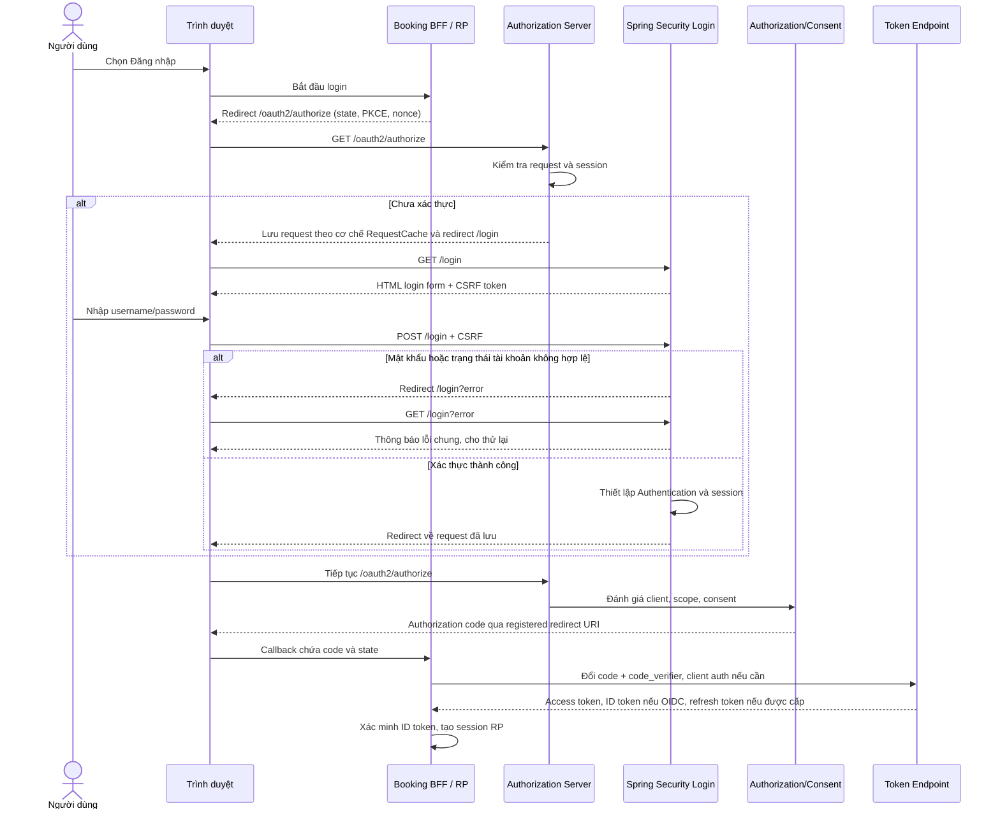
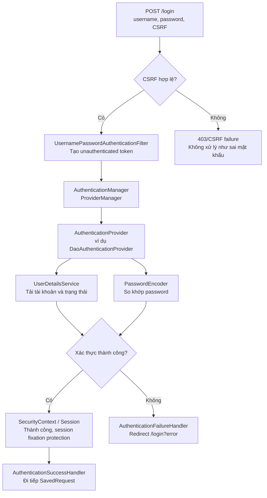
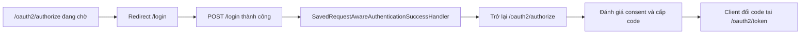

# Xây dựng trang đăng nhập và xử lý lỗi xác thực

## 1. Bối cảnh và mục tiêu

Trong một **OAuth 2.0/OpenID Connect (OIDC) Authorization Server** xây dựng bằng **Spring Security**, **Spring Authorization Server** và Spring Boot, màn hình đăng nhập là nơi người dùng chứng minh danh tính trước khi Authorization Server xét cấp quyền cho client. Một trang đăng nhập có giao diện đẹp nhưng xử lý session, lỗi xác thực hoặc redirect sai vẫn có thể khiến luồng Authorization Code + PKCE bị hỏng hay mở ra lỗ hổng bảo mật.

Ví dụ: người dùng mở ứng dụng đặt phòng, nhấn **Đăng nhập**, được chuyển đến Authorization Server. Người dùng nhập sai mật khẩu một lần, nhập đúng ở lần tiếp theo và mong được đưa trở lại ứng dụng đang chờ authorization code. Khi xây dựng trang đăng nhập riêng, hệ thống phải đồng thời thực hiện đúng các việc sau:

- Hiển thị trang `GET /login` và xử lý form `POST /login`.
- Giữ an toàn cho mật khẩu, CSRF token, session cookie và thông báo lỗi.
- Tôn trọng cơ chế xác thực người dùng và trạng thái tài khoản.
- Bảo toàn authorization request ban đầu để quay lại `/oauth2/authorize` sau khi login thành công.
- Phân biệt **lỗi đăng nhập của người dùng** với **lỗi xác thực client, grant hoặc token của OAuth**.
- Không phát hành authorization code, ID token hay access token trước khi hoàn tất điều kiện xác thực và cấp quyền.

Bài học này thuộc chương **Đăng nhập người dùng**, tập trung vào cách **thiết kế, cấu hình, bảo mật, kiểm thử và vận hành** trang login và xử lý lỗi xác thực. Sau bài học, bạn có thể xây dựng một form login tùy biến, giải thích được vai trò các filter/handler và kiểm thử đầy đủ cả đường thành công lẫn thất bại.

## 2. Phân biệt đăng nhập người dùng với xác thực OAuth client

Trong một Authorization Server có ít nhất hai loại xác thực khác nhau:

| Hoạt động | Chủ thể được xác thực | Thành phần điển hình | Kết quả |
|---|---|---|---|
| **User authentication** | End-User, ví dụ `user-42` | `formLogin`, `AuthenticationProvider`, `UserDetailsService` và session | `Authentication` của người dùng trong ngữ cảnh Spring Security |
| **Client authentication** | OAuth client, ví dụ `booking-bff` | Cơ chế Token Endpoint và client authentication provider | Chứng minh client được phép dùng grant và token endpoint |
| **OIDC authentication** | User được OpenID Provider xác thực cho Relying Party | Luồng OIDC, ID token, claims | RP xác minh ID token và thiết lập phiên ứng dụng |
| **Authorization/consent** | Quyết định cấp quyền cho client | Authorization Endpoint, consent page/policy | Authorization code hoặc grant phù hợp |

**User login thành công không đồng nghĩa client đã được cấp access token.** Tại Authorization Endpoint, AS còn phải kiểm tra client registration, redirect URI, scope, PKCE, trạng thái grant và consent nếu có. Tại Token Endpoint, client phải chứng minh các điều kiện đổi code thành token.

Tương tự, **lỗi mật khẩu của người dùng không phải `invalid_client`**. Một lỗi `invalid_client` thường liên quan xác thực OAuth client; lỗi `invalid_grant` có thể xuất hiện khi đổi authorization code/refresh token không hợp lệ. Những lỗi giao thức đó cần được trả theo contract OAuth thay vì đổi thành màn hình “Sai mật khẩu”.

### 2.1. Trang login thuộc chain nào?

Spring Authorization Server cung cấp các endpoint OAuth/OIDC và cấu hình bảo mật tương ứng, nhưng trang login của người dùng thường dựa trên **Spring Security form login** tại ứng dụng. Khi dùng nhiều `SecurityFilterChain`:

- **Authorization Server chain** xử lý các OAuth/OIDC endpoints như `/oauth2/authorize`, `/oauth2/token`.
- **Application/login chain** xử lý `GET /login`, `POST /login` và những trang web liên quan.
- Nếu có **Admin API** hoặc Resource Server trong cùng ứng dụng, chúng có thể cần chain riêng với chính sách khác.

`FilterChainProxy` chọn chain khớp theo thứ tự; nếu một chain bắt mọi request đặt trước AS chain, request có thể không đi qua endpoint filter cần thiết.

## 3. Luồng từ Authorization Request đến trang đăng nhập

Giả sử:

- **Client/RP:** `booking-bff` tại `https://app.example.com`.
- **Authorization Server/OP:** `https://auth.example.com`.
- **Resource Server:** `https://api.example.com`.
- **Grant:** Authorization Code + PKCE.
- **Scope:** `openid profile bookings.read`.



Sơ đồ khái quát luồng thành công và lỗi. Việc lưu request, điều hướng login, OIDC prompt và consent phụ thuộc cấu hình thực tế; không phải mọi request đến `/oauth2/authorize` đều tạo session hoặc luôn hiển thị màn hình login.

### 3.1. Tại sao cần giữ lại authorization request?

Authorization request ban đầu có các tham số như:

```http
GET /oauth2/authorize?response_type=code&client_id=booking-bff
    &redirect_uri=https%3A%2F%2Fapp.example.com%2Flogin%2Foauth2%2Fcode%2Fbooking-bff
    &scope=openid%20profile%20bookings.read
    &state=OPAQUE_RANDOM_STATE
    &nonce=OPAQUE_RANDOM_NONCE
    &code_challenge=PKCE_CHALLENGE
    &code_challenge_method=S256
```

Nếu người dùng chưa đăng nhập, một luồng form login thông thường sẽ đưa người dùng đến trang đăng nhập nhưng vẫn giữ khả năng **tiếp tục đúng yêu cầu gốc**. Spring Security có các thành phần như `RequestCache` và `SavedRequestAwareAuthenticationSuccessHandler` để phục hồi request trước khi xác thực.

Không nên tự lấy một giá trị `returnUrl` từ query rồi chuyển trình duyệt đến URL đó sau login; nếu không kiểm soát chặt, sẽ tạo **open redirect**. Cũng không nên dựng lại authorization request bằng cách tự ghép `client_id`, `state` và `redirect_uri` từ dữ liệu do browser tự gửi sau login.

### 3.2. Nếu người dùng nhập sai mật khẩu?

Spring Security không nên xem đó là lỗi giao thức `/oauth2/authorize` do client gây ra. Thông thường:

1. `UsernamePasswordAuthenticationFilter` nhận `POST /login`.
2. `AuthenticationManager` gọi provider thích hợp.
3. Provider từ chối credential.
4. `AuthenticationFailureHandler` chuyển tới `/login?error` hoặc xử lý theo cách đã cấu hình.
5. Trang login hiển thị **thông báo chung**, giữ lại khả năng thử lại.
6. Khi xác thực sau đó thành công, request đã lưu được tiếp tục nếu session/request cache còn hợp lệ.

**Không đưa username/password, exception message hoặc stack trace lên redirect URL.**

## 4. Cấu hình hai `SecurityFilterChain` cho AS và login

Đoạn Java sau minh họa tổ chức cấu hình theo kiểu Spring Security hiện đại. Nó cần được tích hợp cùng các bean của Authorization Server trong ứng dụng thực tế.

```java
@Configuration
@EnableWebSecurity
public class AuthorizationServerLoginSecurityConfig {

    @Bean
    @Order(1)
    SecurityFilterChain authorizationServerSecurityFilterChain(
            HttpSecurity http) throws Exception {

        OAuth2AuthorizationServerConfigurer authorizationServer =
            OAuth2AuthorizationServerConfigurer.authorizationServer();

        http
            .securityMatcher(authorizationServer.getEndpointsMatcher())
            .with(authorizationServer, as ->
                as.oidc(Customizer.withDefaults()))
            .authorizeHttpRequests(authorize ->
                authorize.anyRequest().authenticated())
            .exceptionHandling(exceptions -> exceptions
                .defaultAuthenticationEntryPointFor(
                    new LoginUrlAuthenticationEntryPoint("/login"),
                    new MediaTypeRequestMatcher(MediaType.TEXT_HTML)))
            .oauth2ResourceServer(resourceServer ->
                resourceServer.jwt(Customizer.withDefaults()));

        return http.build();
    }

    @Bean
    @Order(2)
    SecurityFilterChain loginSecurityFilterChain(
            HttpSecurity http) throws Exception {

        http
            .authorizeHttpRequests(authorize -> authorize
                .requestMatchers("/assets/**").permitAll()
                .anyRequest().authenticated())
            .formLogin(form -> form
                .loginPage("/login")
                .loginProcessingUrl("/login")
                .failureUrl("/login?error")
                .permitAll());

        return http.build();
    }
}
```

Các import Java đã được lược bớt để tập trung vào kiến trúc. Cần khai báo dependency tương thích, `RegisteredClientRepository`, `OAuth2AuthorizationService`, `OAuth2AuthorizationConsentService`, cấu hình `AuthorizationServerSettings`/issuer, khóa ký/JWK và cơ chế xác thực người dùng để hệ thống thực sự chạy. Đoạn trên không phải cấu hình production đầy đủ.

**Chú ý về `oauth2ResourceServer().jwt()`:** Mẫu này thường được dùng khi Authorization Server bật các chức năng OIDC cần xử lý Bearer token, chẳng hạn UserInfo. Trong dự án thực tế cần có `JwtDecoder` thích hợp và kiểm tra quy định của phiên bản framework.

### 4.1. Vì sao cấu hình này hoạt động?

- `@Order(1)` ưu tiên AS chain cho các endpoint do `authorizationServer.getEndpointsMatcher()` quản lý.
- `LoginUrlAuthenticationEntryPoint("/login")` chuyển request **trình duyệt tương tác** chưa được xác thực về trang login.
- `@Order(2)` đặt login chain cho những request còn lại, gồm `GET /login` và `POST /login`.
- `formLogin().loginPage("/login")` thông báo trang login do ứng dụng cung cấp.
- `loginProcessingUrl("/login")` là endpoint xử lý POST do Spring Security filter xử lý.
- `failureUrl("/login?error")` cấu hình hướng đi khi xác thực thất bại.
- `permitAll()` cho phép truy cập những URL phục vụ form login theo cơ chế của `formLogin`.

Phần `/assets/**` cho phép trình duyệt tải CSS/hình ảnh cần thiết trước khi đăng nhập. Chỉ công khai tài nguyên thực sự cần thiết; không mở những API nhạy cảm chỉ vì chúng nằm cạnh trang đăng nhập.

### 4.2. Những lỗi cấu hình chain thường gặp

| Sai sót | Hiện tượng |
|---|---|
| Chain `anyRequest()` có thứ tự ưu tiên cao hơn AS chain | `/oauth2/authorize` hoặc `/oauth2/token` đi nhầm xử lý |
| `GET /login` vẫn yêu cầu authenticated | Redirect loop giữa `/login` và chính nó |
| `POST /login` không được xử lý bởi chain chứa form login | `404`, `405` hoặc authentication không chạy |
| Tự định nghĩa controller `@PostMapping("/login")` song song filter login | Xung đột đường xử lý và nguy cơ bỏ qua Spring Security |
| Đặt `SessionCreationPolicy.STATELESS` cho login form cần session | Login thành công nhưng không duy trì được ngữ cảnh/xử lý request đã lưu |
| Tắt CSRF trên toàn bộ ứng dụng | Form login/consent và thao tác web dễ bị giả mạo request |
| Dùng matcher `/oauth2/**` tự viết cho AS | Có thể bỏ sót endpoint OIDC ở `/.well-known/**` hoặc endpoint khác |
| Hard-code `defaultSuccessUrl("/", true)` | Sau login có thể bỏ qua authorization request ban đầu |

Cần nhớ `securityMatcher` chọn chain; `authorizeHttpRequests` quyết định quyền bên trong chain. Chúng không thay thế nhau.

## 5. Tạo controller hiển thị trang đăng nhập

Với `formLogin` tùy biến, controller thường chỉ cần phục vụ **GET**:

```java
@Controller
public class LoginPageController {

    @GetMapping("/login")
    public String loginPage() {
        return "login";
    }
}
```

Trong ví dụ sử dụng Thymeleaf, view `"login"` tương ứng với template `src/main/resources/templates/login.html`. Controller không xử lý POST chứa mật khẩu; `UsernamePasswordAuthenticationFilter` của Spring Security sẽ thực hiện việc đó tại `/login` khi request đi đúng chain.

Nếu muốn hiển thị banner sau logout hoặc sau lỗi, trang có thể đọc các query parameter thông thường như `error` và `logout`, nhưng chúng chỉ phục vụ giao diện. Đừng xem `?error` là bằng chứng audit rằng xác thực thật sự đã thất bại: người dùng có thể tự gõ URL đó.

### 5.1. Template Thymeleaf có khả năng sử dụng thực tế

```html
<!doctype html>
<html lang="vi" xmlns:th="http://www.thymeleaf.org">
<head>
  <meta charset="utf-8">
  <meta name="viewport" content="width=device-width, initial-scale=1">
  <title>Đăng nhập</title>
</head>
<body>
  <main>
    <h1>Đăng nhập</h1>

    <p th:if="${param.error != null}"
       role="alert">
      Không thể đăng nhập. Vui lòng kiểm tra thông tin và thử lại.
    </p>

    <p th:if="${param.logout != null}"
       role="status">
      Bạn đã đăng xuất.
    </p>

    <form th:action="@{/login}" method="post">
      <div>
        <label for="username">Tên đăng nhập</label>
        <input id="username"
               name="username"
               type="text"
               autocomplete="username"
               required>
      </div>

      <div>
        <label for="password">Mật khẩu</label>
        <input id="password"
               name="password"
               type="password"
               autocomplete="current-password"
               required>
      </div>

      <button type="submit">Đăng nhập</button>
    </form>
  </main>
</body>
</html>
```

Các chi tiết có ý nghĩa:

- `method="post"` không đưa mật khẩu lên URL/query string.
- `name="username"` và `name="password"` phù hợp tham số mặc định của form login. Nếu cấu hình `usernameParameter(...)` hoặc `passwordParameter(...)` thì template phải thống nhất theo tên mới.
- `th:action="@{/login}"` tạo đường dẫn tương ứng với context path. Với tích hợp Thymeleaf/Spring Security phù hợp, cơ chế xử lý form có thể tự thêm hidden CSRF token.
- `role="alert"` giúp công cụ hỗ trợ tiếp cận thông báo lỗi.
- Nội dung lỗi chung tránh tiết lộ tài khoản nào tồn tại hoặc nguyên nhân nội bộ.

### 5.2. CSRF token phải thực sự có trong HTML được render

Trong ứng dụng servlet dùng CSRF protection, POST form cần gửi token hợp lệ. Khi sử dụng Thymeleaf với `th:action` và Spring Security, cơ chế request data value processor thường thêm hidden field tương ứng. **Hãy kiểm tra HTML đã render trong integration test** để chắc chắn form thực sự chứa token.

Nếu chọn công nghệ template không tự tích hợp CSRF, có thể cần thêm hidden input theo token mà backend cung cấp:

```html
<input type="hidden"
       th:name="${_csrf.parameterName}"
       th:value="${_csrf.token}">
```

Chọn **một cách tích hợp CSRF đúng** để tránh tạo trường trùng không cần thiết. Tên và nguồn token phải khớp `CsrfTokenRepository`/cơ chế CSRF của Spring Security. Không tự đặt token cố định hoặc lấy token của request khác. Với trang login đơn giản, giữ CSRF mặc định thường an toàn hơn tắt bảo vệ chỉ để POST thành công.

### 5.3. Giao diện và trải nghiệm sử dụng

Trang đăng nhập cần phục vụ được người dùng mà không làm giảm bảo mật:

- Dùng HTTPS, nội dung và liên kết thuộc origin tin cậy của Authorization Server.
- Trình bày logo/tên của AS và chỉ hiển thị metadata client lấy từ nguồn đáng tin nếu cần; tránh tin tên ứng dụng trong query parameter.
- Form có label rõ, hỗ trợ keyboard, focus, autocomplete phù hợp và thông báo lỗi dễ hiểu.
- Không giữ giá trị mật khẩu trong HTML/JavaScript, session, hidden input hoặc thông báo lỗi.
- Không nhúng script bên thứ ba không cần thiết vào trang có trường mật khẩu.
- Có đường dẫn khôi phục tài khoản/mật khẩu, hỗ trợ MFA theo chính sách và cơ chế phản hồi khi tài khoản cần hỗ trợ.

## 6. Authentication pipeline khi POST /login

`formLogin` sử dụng các thành phần Spring Security. Hiểu từng lớp giúp tùy biến đúng chỗ và chẩn đoán lỗi.



`UsernamePasswordAuthenticationFilter` lấy tham số form và yêu cầu `AuthenticationManager` xác thực. `DaoAuthenticationProvider` là một cách triển khai phổ biến khi dùng `UserDetailsService` và `PasswordEncoder`. Ứng dụng có thể dùng provider khác cho LDAP, SSO, MFA hoặc cơ chế xác thực riêng, nhưng vẫn phải giữ hợp đồng Spring Security.

### 6.1. Cấu hình người dùng và bộ mã hóa mật khẩu

Có thể sử dụng `UserDetailsService` để tải người dùng từ nguồn tin cậy và `PasswordEncoder` để so khớp mật khẩu đã băm. Ví dụ bean riêng:

```java
@Bean
PasswordEncoder passwordEncoder() {
    return PasswordEncoderFactories.createDelegatingPasswordEncoder();
}
```

`DelegatingPasswordEncoder` hỗ trợ phân biệt thuật toán băm theo định dạng đã cấu hình (ví dụ một hash có prefix encoder). Đây là một lựa chọn thuận tiện để quản lý migration thuật toán; sản phẩm phải chọn thuật toán hiện đại có cấu hình phù hợp, chính sách nâng cấp hash và bảo vệ dữ liệu người dùng.

Tuyệt đối không:

- Lưu mật khẩu ở dạng rõ hoặc tự “mã hóa hai chiều” để so sánh.
- Tự so sánh password bằng `storedPassword.equals(rawPassword)`.
- Log request body của `POST /login`.
- Lấy mật khẩu từ query string hoặc header tự định nghĩa rồi coi là tương đương an toàn.
- Coi một đối tượng `Authentication` do controller tạo với `authenticated=true` là xác thực hợp lệ khi chưa qua provider đáng tin.

### 6.2. Trạng thái tài khoản là một phần của xác thực

Provider có thể xem xét tài khoản bị khóa, vô hiệu hóa, hết hạn hay yêu cầu đổi credential. Các exception thường gặp trong Spring Security gồm:

| Exception hoặc tình huống | Ý nghĩa điển hình | Cách xử lý ở UI công khai |
|---|---|---|
| `BadCredentialsException` | Credential không đúng | Thông báo chung |
| `UsernameNotFoundException` | Không tìm thấy người dùng trong nguồn dữ liệu | Không để lộ sự tồn tại của username |
| `DisabledException` | Tài khoản chưa/không được kích hoạt | Thông báo trung tính; hỗ trợ qua quy trình riêng |
| `LockedException` | Tài khoản bị khóa | Không tiết lộ chi tiết không cần thiết; có quy trình hỗ trợ |
| `AccountExpiredException` | Tài khoản hết hiệu lực | Xử lý theo policy, thông báo phù hợp |
| `CredentialsExpiredException` | Credential cần đổi/hết hạn | Có thể mở luồng khôi phục an toàn sau khi xác minh ngữ cảnh |
| `AuthenticationServiceException` hoặc lỗi backend | Có vấn đề khi xử lý xác thực | Thông báo không tiết lộ chi tiết; alert/monitor phía server |
| CSRF token thiếu/sai | Request bị chặn trước khi xác thực | `403`/trang lỗi phù hợp, không ghi nhận như sai mật khẩu |

Các exception phụ thuộc provider và đường xử lý; không phải mọi ứng dụng phát sinh tất cả các loại trên. Thường nên phân loại chi tiết **ở log/audit nội bộ**, còn response công khai dùng thông báo trung tính để tránh **username enumeration**.

## 7. Đăng nhập thành công: quay lại đúng luồng OAuth

Sau khi user được xác thực, Spring Security thiết lập `SecurityContext` và xử lý session theo cơ chế cấu hình. Thành phần xử lý thành công thường chuyển trình duyệt về request đang chờ trước login, nếu còn `SavedRequest`.



Hành vi này quan trọng đối với OIDC Authorization Code Flow: client đã tạo `state`, `nonce` và PKCE trước khi redirect. Client phải nhận authorization response của chính request đó và tự kiểm tra `state`. Việc thay đổi ngữ cảnh hoặc đưa user tới URL khác có thể khiến client mất liên kết giữa response với request đã khởi tạo.

### 7.1. Tránh ép redirect về trang chủ

Ví dụ cấu hình có nguy cơ gây sai luồng:

```java
// Ví dụ KHÔNG nên sao chép cho luồng đang cần SavedRequest.
.formLogin(form -> form
    .loginPage("/login")
    .defaultSuccessUrl("/", true));
```

Tham số `true` thường ép điều hướng về URL chỉ định sau mọi lần thành công, có thể bỏ qua authorization request đang chờ. Nên giữ hành vi success handler mặc định phù hợp hoặc dùng handler tùy biến vẫn **tôn trọng SavedRequest**.

Nếu cần trang đích dự phòng cho trường hợp user truy cập `/login` trực tiếp, có thể cấu hình fallback mà **không ép bỏ SavedRequest** và kiểm thử luồng end-to-end.

### 7.2. Không lấy redirect URL tùy ý từ phía người dùng

Một form chứa `<input name="returnUrl" value="https://...">` không chứng minh đích đó an toàn. Nếu muốn triển khai điều hướng tùy biến, hãy lấy nguồn từ request cache hoặc từ danh sách đường dẫn nội bộ đã kiểm tra; không redirect đến URL ngoài do người dùng tự khai.

**OAuth redirect URI** phải được Authorization Server kiểm tra với URI đã đăng ký của client. Nó khác với **redirect sau form login nội bộ**. Không đánh đồng hai loại redirect hoặc cho controller login tự bỏ qua quy tắc redirect URI của OAuth.

## 8. Xử lý lỗi xác thực bằng `AuthenticationFailureHandler`

Với nhu cầu phổ biến, cấu hình sau đủ để chuyển người dùng về màn hình lỗi:

```java
.formLogin(form -> form
    .loginPage("/login")
    .loginProcessingUrl("/login")
    .failureUrl("/login?error")
    .permitAll());
```

Spring Security sẽ dùng failure handling thích hợp với form login. Trang nhận `GET /login?error` và hiển thị một thông báo chung như trong template.

### 8.1. Khi nào cần failure handler riêng?

Có thể cần custom `AuthenticationFailureHandler` nếu sản phẩm yêu cầu:

- Cập nhật trạng thái cảnh báo đăng nhập thất bại theo policy.
- Ghi correlation ID của sự kiện xác thực.
- Chọn màn hình phù hợp với phương thức login, nhưng vẫn che lý do nhạy cảm.
- Hỗ trợ luồng khôi phục tài khoản khi đã có bằng chứng phù hợp.
- Tích hợp observability mà không làm thay đổi logic authentication.

Ví dụ gắn một handler chuẩn vào cấu hình:

```java
@Bean
AuthenticationFailureHandler genericLoginFailureHandler() {
    return new SimpleUrlAuthenticationFailureHandler("/login?error");
}

// Tại formLogin:
.formLogin(form -> form
    .loginPage("/login")
    .failureHandler(genericLoginFailureHandler())
    .permitAll());
```

Đây là các đoạn cấu hình minh họa, **không đặt nguyên snippet `.formLogin(...)` độc lập ngoài một `HttpSecurity`**. Khi dùng custom handler, cần chắc chắn handler xử lý redirect hoặc response đúng, không tiết lộ nguyên nhân credential và không làm mất request context cần thiết.

Có thể dùng `AuthenticationEventPublisher` hoặc Spring Security authentication events để ghi audit cho login success/failure thay vì nhồi mọi side effect vào failure handler. Cần xác nhận sự kiện được publish bởi provider/manager thực tế và hệ thống ghi audit không chứa mật khẩu hoặc token.

### 8.2. Cách phân loại lỗi nội bộ và thông báo bên ngoài

| Nguyên nhân phía server | Message cho người dùng | Hành động nội bộ |
|---|---|---|
| Sai username/password | “Không thể đăng nhập. Vui lòng kiểm tra thông tin và thử lại.” | Ghi failure count và phát hiện bất thường |
| Account locked/disabled | Thông báo trung tính hoặc hướng dẫn hỗ trợ an toàn | Kiểm tra trạng thái, không để lộ bằng response |
| Database/LDAP/IdP bị lỗi | “Tạm thời không thể đăng nhập. Vui lòng thử lại sau.” | Cảnh báo sự cố, correlation ID |
| CSRF invalid | Trang lỗi/refresh form phù hợp; không coi là password failure | Kiểm tra CSRF token, session và proxy/cookie |
| Quá nhiều lần thử | Thông báo chung và hướng dẫn chờ theo chính sách | Rate limiting, alert, chống khóa tài khoản bằng DoS |
| Session hết hạn trong khi đăng nhập | Yêu cầu tải lại trang hoặc khởi động lại luồng | Kiểm tra session/request cache |
| MFA thất bại | Thông báo không tiết lộ dữ liệu nhạy cảm | Theo dõi attempts và policy của MFA |

Không nên đưa tên exception từ server như `BadCredentialsException` hoặc `LockedException` vào thông báo công khai. Lý do chi tiết cần được lưu ở hệ thống giám sát bảo mật có phân quyền.

### 8.3. JSON/API login và form login không giống nhau

Với browser form login, Spring Security thường **redirect** tới `/login?error`. Nếu sản phẩm làm login bằng AJAX/JSON, cần thiết kế handler trả status/body phù hợp và có bảo vệ CSRF/cookie hoặc kiến trúc token được đánh giá đầy đủ.

**Không bắt mặc định `POST /oauth2/token` trả HTML login page**. Token Endpoint phục vụ OAuth client và phải dùng phản hồi lỗi theo OAuth như `invalid_client` hoặc `invalid_grant`. Một handler chung trả `200 OK` kèm `{"message":"Sai mật khẩu"}` cho mọi endpoint sẽ phá tương thích giao thức và cản trở kiểm thử.

## 9. Phân biệt lỗi login, authorization và token

Ba đường xử lý có contract khác nhau:

| Nơi xảy ra lỗi | Ví dụ | Phản hồi/hành vi phù hợp |
|---|---|---|
| **Form login** `POST /login` | Sai mật khẩu | Failure handler của Spring Security; redirect về trang login hoặc response chuyên biệt |
| **Authorization Endpoint** `/oauth2/authorize` | Client không hợp lệ, redirect URI sai, consent bị từ chối | Theo quy tắc OAuth; chỉ redirect lỗi tới URI được phép khi an toàn |
| **Token Endpoint** `POST /oauth2/token` | Code hết hạn, PKCE sai, client credential sai | OAuth error response như `invalid_grant`, `invalid_client` |
| **OIDC Authentication Request** | `prompt=none` nhưng không thể xác thực im lặng | Xử lý lỗi OIDC như `login_required` theo đặc tả và hỗ trợ thực tế |
| **Resource Server API** | Access token thiếu/hết hạn hoặc thiếu scope | `401`/`403` phù hợp, challenge Bearer theo cơ chế RS |

### 9.1. Lỗi redirect URI không được chuyển tùy tiện

Nếu OAuth Authorization Request có redirect URI không hợp lệ, Authorization Server **không được gửi browser đến URI đó để báo lỗi**, vì điều đó có thể tạo open redirect. Giao thức OAuth có quy tắc khi nào được redirect kèm error và khi nào phải xử lý lỗi cục bộ.

Custom login page không nên tự nhận `redirect_uri` từ URL và thực hiện redirect vì nghĩ đó là địa chỉ quay về an toàn. Việc xác minh URI thuộc trách nhiệm xử lý Authorization Request.

### 9.2. OIDC `prompt` và `max_age`

Trong OIDC, client có thể yêu cầu hành vi xác thực đặc biệt:

- `prompt=login` đề nghị OP xác thực lại người dùng.
- `prompt=none` yêu cầu không hiển thị giao diện tương tác; nếu không thể hoàn thành, OP cần xử lý lỗi phù hợp như `login_required`.
- `max_age` đặt giới hạn độ “mới” của authentication; ID token có thể cần `auth_time` theo quy tắc OIDC.

**Không áp quy tắc “mọi request chưa có session đều redirect /login” một cách mù quáng** nếu hệ thống phải tuân thủ `prompt=none`. Cần kiểm tra khả năng và cấu hình của phiên bản Spring Authorization Server đối với các tham số OIDC này; xử lý ở lớp OIDC/provider phù hợp, không tự vá bằng servlet filter hoặc JavaScript trang login.

### 9.3. Consent denial là lỗi gì?

Người dùng có thể đăng nhập đúng nhưng từ chối scope mà client yêu cầu. Đây là quyết định **không cấp quyền**, thường gắn với `access_denied` trong OAuth; không phải lỗi `BadCredentialsException`. Trang login và audit không nên ghi “đăng nhập thất bại” khi người dùng chỉ từ chối consent.

## 10. Bảo mật bắt buộc cho trang login

### 10.1. HTTPS, cookie và session

Toàn bộ luồng browser login cần HTTPS. Session cookie nên có `Secure`, `HttpOnly` và `SameSite` phù hợp luồng redirect/SSO; phải kiểm thử ảnh hưởng của SameSite với cách client và OP tương tác. Dữ liệu session cần có timeout, rotation ID sau xác thực và chính sách concurrent session khi cần.

Với nhiều instance:

- Chọn chiến lược chia sẻ session hoặc duy trì affinity phù hợp; **Spring Session** có thể hỗ trợ session store dùng chung.
- `OAuth2AuthorizationService` và `OAuth2AuthorizationConsentService` là kho khác với HTTP session. Lưu authorization bằng JDBC **không tự chia sẻ session login**.
- Kiểm tra tác động của restart, TTL, request cache và load balancer lên request đang chờ.

Tránh cấu hình `SessionCreationPolicy.STATELESS` cho browser form login nếu ứng dụng dựa trên session để duy trì authentication và SavedRequest. Nếu xây một hệ thống thực sự không dùng session, bạn phải thiết kế lại flow và security requirements phù hợp.

### 10.2. CSRF và chống giả mạo yêu cầu

Form `POST /login`, consent, logout và các thao tác state-changing dựa trên cookie/session cần bảo vệ CSRF theo mô hình Spring Security. Một POST login thiếu hoặc sai CSRF token thường bị từ chối **trước bước xác thực credential**.

Nếu ai đó “sửa” lỗi 403 bằng `csrf.disable()` trên toàn ứng dụng, họ có thể mở thêm các đường tấn công. Hãy xác minh token trong HTML, cookie/session, proxy, context path và filter chain trước khi thay đổi chính sách CSRF.

### 10.3. Phòng chống brute force và credential stuffing

Các biện pháp phù hợp gồm:

- Rate limit theo tín hiệu kết hợp như account, IP và đặc điểm thiết bị, với kiểm soát tránh khóa tài khoản hàng loạt do kẻ tấn công gây ra.
- Chính sách lockout/throttling dựa trên rủi ro, có khả năng giám sát và phục hồi an toàn.
- MFA hoặc passkey khi phù hợp đối tượng người dùng và mức bảo đảm cần thiết.
- Cảnh báo hành vi đăng nhập bất thường.
- Tách thông báo công khai khỏi lý do nội bộ để giảm account enumeration.
- Bảo vệ endpoint khôi phục mật khẩu và xác minh email theo mức tương xứng với login.

Rate limit ở gateway hữu ích nhưng không tự thay thế chính sách cho từng account; chính sách account không nên chỉ dựa trên IP vì IP có thể được chia sẻ hoặc thay đổi.

### 10.4. XSS, clickjacking và tài nguyên ngoài

Trang login có credential; vì vậy nên:

- Escape dữ liệu hiển thị như tên client, thông báo lỗi hoặc tham số URL.
- Áp dụng Content Security Policy phù hợp, hạn chế inline script và tài nguyên ngoài.
- Bảo vệ chống clickjacking bằng header thích hợp (chẳng hạn `frame-ancestors`).
- Không dùng script bên thứ ba có thể đọc trường mật khẩu nếu không có lý do rất rõ và kiểm soát chặt.
- Không log toàn bộ form, query, authorization headers hoặc session cookies.

### 10.5. Chính sách mật khẩu và MFA

UI chỉ là mặt hiển thị. Mọi kiểm soát mật khẩu, trạng thái tài khoản, MFA và assurance level phải được quyết định ở **AuthenticationManager/provider** hoặc giải pháp xác thực đáng tin, không bằng hidden field hay JavaScript có thể bị sửa.

Nếu hệ thống yêu cầu MFA để đăng nhập hoặc cấp scope nhạy cảm, phải đảm bảo authorization code chỉ được cấp sau khi điều kiện xác thực bắt buộc đã hoàn thành. Không phát token sau bước “đúng mật khẩu” rồi coi MFA là thao tác tùy chọn phía giao diện.

## 11. Đăng xuất, session timeout và login lại

Logout của Authorization Server không giống việc thu hồi access token đã phát hành. Tương tự, người dùng logout khỏi Relying Party có thể vẫn còn session SSO tại OP.

| Tình huống | Hành vi thường gặp | Điều cần kiểm tra |
|---|---|---|
| Login lần đầu chưa có session AS | Hiển thị form login | SavedRequest và CSRF |
| Nhập sai credential | Hiển thị thông báo lỗi | Không mất ngữ cảnh cần thiết, không lộ user existence |
| Login thành công | Tạo/đổi session và tiếp tục request đã lưu | Redirect an toàn, code chỉ cấp sau policy/consent |
| Session AS hết hạn | Authorization request mới có thể cần login | Cookie, timeout, RequestCache |
| User logout ở RP | RP xóa session của mình | AS session có thể còn |
| User logout ở AS | AS session bị kết thúc | RP session/token cũ có thể còn; cần phối hợp logout nếu yêu cầu |
| Client yêu cầu `prompt=login` | Có thể cần xác thực lại | OIDC policy, `auth_time` |
| Client yêu cầu `prompt=none` | Không được hiển thị UI tương tác | OIDC error nếu không thể xử lý im lặng |

Nếu sản phẩm muốn “đăng xuất khỏi tất cả thiết bị”, phải xác định rõ cần thu hồi **AS sessions**, **RP sessions**, **refresh tokens** và/hoặc **access tokens** như thế nào. Xóa cookie login không tự khiến Resource Server từ chối mọi JWT access token còn hạn.

## 12. Đo lường và audit lỗi xác thực

Trang login là nơi có nhiều hoạt động nhạy cảm. Audit nên giúp trả lời “đã xảy ra chuyện gì?” mà không gây lộ credential.

### 12.1. Dữ liệu có thể ghi

- Event type: `LOGIN_SUCCESS`, `LOGIN_FAILURE`, `LOGIN_THROTTLED`, `SESSION_EXPIRED`, `MFA_FAILED`.
- Dấu thời gian chuẩn, request/correlation ID.
- Principal ID đáng tin khi xác thực thành công; với đăng nhập thất bại cần giới hạn việc lưu username thô theo chính sách privacy.
- Nhóm lý do nội bộ: bad credentials, account state, backend error, CSRF.
- Nguồn truy cập và tín hiệu rủi ro đã chuẩn hóa, nếu cần.
- Thông tin client/flow được xác thực ở mức đủ dùng, tránh ghi query chứa secret hoặc token.

### 12.2. Dữ liệu tuyệt đối tránh ghi

- Raw password, password hash, OTP, recovery code.
- Authorization header, refresh/access token, authorization code, ID token.
- Session cookie, CSRF token hoặc form body chưa che dữ liệu.
- Stack trace/SQL query trong response trả tới người dùng.
- Thông báo khác nhau quá chi tiết ở UI làm lộ tài khoản có tồn tại hay không.

Các metric hữu ích: tỷ lệ login success/failure, login latency, 403 do CSRF, số redirect loop, tỷ lệ MFA failure, số session hết hạn khi đang authorization và bất thường sau lần phát hành phiên bản mới.

Audit có thể được ghi từ authentication events, handler hoặc service theo thiết kế. **Ghi audit không được tự làm lộ dữ liệu và cần có chiến lược xử lý khi kho audit gặp sự cố**: các chức năng nhạy cảm cần quyết định fail-open/fail-closed dựa trên chính sách, không mặc định nuốt mọi lỗi.

## 13. Kiểm thử thực tế với Spring Security và Spring Authorization Server

Với login page tùy biến, phải kiểm thử cả **controller/template**, **SecurityFilterChain**, **authentication provider** và **luồng OAuth/OIDC**.

### 13.1. Bảng ca kiểm thử tối thiểu

| Ca kiểm thử | Thiết lập | Kết quả mong đợi |
|---|---|---|
| `GET /login` | Chưa có session | `200`, hiển thị form, CSS cần thiết tải được |
| Template CSRF | Render `GET /login` | Form POST có CSRF token hợp lệ theo tích hợp |
| Login thành công | Đúng tài khoản/mật khẩu, CSRF hợp lệ | Xác thực thành công, session đúng, chuyển về saved request hoặc fallback |
| Sai mật khẩu | POST với credential sai, CSRF đúng | Redirect `/login?error`; không tạo authenticated session |
| Username không tồn tại | POST tên người dùng lạ | Message công khai không làm lộ user existence |
| Account locked/disabled | POST credential cho tài khoản bị chặn | Không đăng nhập; audit đúng và UI phù hợp |
| CSRF thiếu/sai | POST `/login` không hợp lệ | Bị từ chối; không coi là password failure |
| Login page chưa permitAll | Thử `GET /login` | Test phát hiện redirect loop |
| Authorization Request chưa login | GET `/oauth2/authorize` hợp lệ | Redirect tới login và lưu request cần tiếp tục |
| Đăng nhập xong với OAuth request | Xác thực thành công | Quay lại đúng request, tiếp tục consent/code |
| Failure rồi success | Sai mật khẩu, thử lại đúng | Không mất ngữ cảnh authorization cần thiết |
| Session fixation | Trước và sau login | Session ID/protection được áp dụng theo cấu hình |
| Session timeout | Đợi session hết hạn | Không còn authenticated; luồng mới yêu cầu login đúng |
| Redirect ngoài do user cung cấp | Tham số `returnUrl` độc hại | Không open redirect |
| OIDC `prompt=none` | Không có session hợp lệ | Không hiển thị interactive login; lỗi giao thức phù hợp nếu được hỗ trợ |
| Token Endpoint client auth sai | `/oauth2/token` | Lỗi OAuth đúng; không redirect login HTML |
| Multiple filter chains | AS endpoints và login | Mỗi request đi đúng chain |
| Multi-instance | Login node A, authorize node B | Hoạt động nhất quán theo session/storage strategy |

### 13.2. Ví dụ test cho form login thất bại

Với `MockMvc` và spring-security-test, một test tình huống có thể như sau:

```java
@Test
void wrongPasswordRedirectsToGenericLoginError() throws Exception {
    mockMvc.perform(post("/login")
            .with(csrf())
            .param("username", "alice")
            .param("password", "wrong-password"))
        .andExpect(status().is3xxRedirection())
        .andExpect(redirectedUrl("/login?error"));
}

@Test
void missingCsrfIsRejected() throws Exception {
    mockMvc.perform(post("/login")
            .param("username", "alice")
            .param("password", "wrong-password"))
        .andExpect(status().isForbidden());
}
```

Những test này giả định app đã có `MockMvc`, cấu hình form login và CSRF bảo vệ, user store/test setup tương ứng. Không nên coi chúng là toàn bộ kiểm thử login. Cần thêm integration test kiểm tra **authorization request được giữ và tiếp tục sau login**, vì đây là phần dễ bị hỏng nhất khi tùy biến trang đăng nhập của Authorization Server.

### 13.3. Test message của trang login

Nếu dùng `?error`, kiểm tra HTML render ra đúng **một thông báo chung**, không có exception class, password, access token hoặc stack trace. Nếu dùng localization, kiểm tra văn bản ở từng locale vẫn giữ tính trung tính. Một test chỉ xác nhận status `200` chưa đủ để khẳng định trang login an toàn.

### 13.4. Kiểm thử và bảo vệ đường đi thành công

Ở một luồng Authorization Code + PKCE + OIDC hoàn chỉnh, cần kiểm tra:

1. Client tạo `state`, `nonce`, PKCE verifier/challenge.
2. Trình duyệt chưa đăng nhập được chuyển đến `/login`.
3. Sau login, Authorization Server xử lý đúng authorization request gốc.
4. Consent được xét theo policy.
5. Client nhận authorization code ở **registered redirect URI**.
6. Client đổi code với PKCE và xác thực client phù hợp.
7. RP xác minh ID token và `state`/`nonce` theo OIDC.
8. Resource Server chỉ chấp nhận access token phù hợp, không dùng ID token thay access token.

Các bước này chứng minh trang login tùy biến không phá ranh giới OAuth/OIDC. Không có bước nào yêu cầu trang login tự phát token.

## 14. Chẩn đoán lỗi thường gặp

| Triệu chứng | Nguyên nhân khả dĩ | Kiểm tra đầu tiên |
|---|---|---|
| `/login` trả `404` | Chưa có controller/template | Mapping `GET /login`, view resolver, template |
| `/login` chuyển hướng tới chính nó | Chưa permitAll hoặc chain sai | `@Order`, matcher, `formLogin().permitAll()` |
| POST login trả `403` | CSRF token thiếu/sai hoặc policy khác | HTML rendered form, CSRF repository, session cookie |
| POST login trả `404`/`405` | Login processing URL/chain không khớp | `loginProcessingUrl`, filter chain, method |
| Luôn báo sai mật khẩu | `PasswordEncoder` không khớp hash, provider/user store sai | UserDetailsService, password hash, provider |
| Sau login quay về trang chủ, không trở lại client | Success handler ép redirect | SavedRequestAware behavior, `defaultSuccessUrl(..., true)` |
| Login xong nhưng `/authorize` vẫn yêu cầu login | Session mất, cookie sai, stateless, node khác | Cookie, session store, same-site, load balancer |
| Authorization bị lỗi sau login | Redirect URI/client/scope/PKCE sai | Log OAuth validation có redaction, registered client |
| `/oauth2/token` trả HTML login | Chain/entry point không phù hợp | AS matcher, token endpoint client auth/error |
| Người dùng thấy stack trace hoặc `LockedException` | Render trực tiếp exception trong view | Failure handler/view model, error redaction |
| Consent cứ lặp lại | Consent state chưa được lưu/đọc đúng | `OAuth2AuthorizationConsentService`, principal, client |
| CSS login không tải | Tài nguyên bị bảo vệ | Static resource matcher và cache policy |

### 14.1. Quy trình điều tra từng bước

Với lỗi cụ thể, hãy trả lời theo thứ tự:

1. Request vào **URL và HTTP method** nào?
2. Nó được chọn bởi **SecurityFilterChain** nào?
3. Có bị chặn bởi **CSRF** trước khi tới login filter không?
4. Nếu có credential, **AuthenticationProvider** nào nhận và từ chối/chấp nhận?
5. Failure/success handler đã trả status, location và cookie gì?
6. Browser có gửi đúng cookie session trong lần chuyển hướng tiếp theo không?
7. `SavedRequest` còn đúng authorization request gốc không?
8. Nếu login thành công nhưng không cấp code/token, lỗi ở **authorization/consent/grant** hay ở login?

Cách tách lớp này tránh mất thời gian sửa template khi sự cố thực ra do client registration, CSRF hoặc request cache.

## 15. Tình huống nâng cao: xác thực lại và MFA

Một Authorization Server doanh nghiệp có thể yêu cầu xác thực mạnh hơn khi client xin scope nhạy cảm, ví dụ `payments.approve` hoặc quyền truy cập dữ liệu cá nhân.

Quy trình hợp lý:

- Policy xác định mức bảo đảm xác thực cần có.
- Spring Security authentication flow kiểm tra người dùng đã đạt mức đó chưa.
- Nếu chưa, người dùng thực hiện bước MFA/reauthentication phù hợp.
- Chỉ khi hoàn tất yêu cầu xác thực, Authorization Server mới tiếp tục cấp quyền/token.
- Nếu dùng OIDC và cần biểu diễn assurance/time, các claim như `acr`, `amr`, `auth_time` cần dựa trên thông tin xác thực có thể chứng minh và kiểm tra hỗ trợ của OP/RP.

**Không phát ID token ghi `amr=["mfa"]` chỉ vì frontend gửi tham số `mfa=true`.** Claim xác thực phải được xây từ kết quả của một cơ chế tin cậy ở phía server.

Lỗi MFA cũng là lỗi authentication ở mức phù hợp, nhưng UX và trạng thái phiên có thể cần luồng nhiều bước. Khi điều chỉnh login flow, phải bảo toàn authorization request, chống CSRF/replay và đặt giới hạn thời gian cho phiên xác thực dở dang.

## 16. Checklist triển khai

Khi review một trang login tùy biến cho Spring Authorization Server, hãy kiểm tra:

- **Phạm vi:** `/oauth2/authorize` và `/oauth2/token` ở AS chain; `/login` ở login chain đúng thứ tự?
- **GET/POST:** Controller chỉ hiển thị trang; `POST /login` được Spring Security xử lý?
- **CSRF:** Form có token hợp lệ và protection không bị tắt trên toàn bộ ứng dụng?
- **Credential:** Password chỉ gửi qua HTTPS POST, hash/encoder đúng, không log raw input?
- **Session:** Xác thực thành công có tạo ngữ cảnh/session phù hợp, chống session fixation và hoạt động qua nhiều node?
- **SavedRequest:** Đăng nhập có quay lại authorization request gốc, không ép redirect tới URL tùy ý?
- **Failure UX:** Có thông báo trung tính, không tiết lộ user existence, trạng thái tài khoản hoặc stack trace?
- **Backend errors:** Phân biệt bad credentials, CSRF, service outage và OAuth errors ở đúng lớp?
- **Account policy:** Throttle, MFA, lockout, recovery và audit được thực thi ở backend?
- **OAuth/OIDC:** Client auth, redirect URI, PKCE, `state`, consent, token generation vẫn nằm trong luồng chuẩn?
- **OIDC parameters:** `prompt`, `max_age` và các ngữ nghĩa xác thực lại được xử lý phù hợp với phiên bản triển khai?
- **Observability:** Có correlation ID/metrics/audit, che token/credential và xử lý alert?
- **Tests:** Có integration test cho cả login failure, success, request cache, CSRF, chain routing và nhiều instance?

### Kiến thức cốt lõi

Trang `GET /login` chỉ là phần hiển thị. **Spring Security form login** xử lý `POST /login`, xác minh credential bằng `AuthenticationManager`/provider, quyết định thành công hoặc thất bại qua handler, và duy trì authentication/session theo cấu hình. **Spring Authorization Server** tiếp tục chịu trách nhiệm kiểm tra client, authorization request, consent, PKCE, code/token và phản hồi giao thức.

Một thiết kế đúng phải đưa người dùng sau login về **authorization request đã được giữ an toàn**, hiển thị **lỗi đăng nhập trung tính**, và không trộn lẫn lỗi user authentication với OAuth `invalid_client`/`invalid_grant`. Bảo vệ CSRF, cookie/session, mật khẩu, redirect và logging là điều kiện bắt buộc để trang login tùy biến có thể vận hành an toàn.

## Tài liệu tham khảo

- [Spring Authorization Server — Reference](https://docs.spring.io/spring-authorization-server/reference/)
- [Spring Authorization Server — Protocol Endpoints](https://docs.spring.io/spring-authorization-server/reference/protocol-endpoints.html)
- [Spring Security — Form Login](https://docs.spring.io/spring-security/reference/servlet/authentication/passwords/form.html)
- [Spring Security — Servlet Authentication Architecture](https://docs.spring.io/spring-security/reference/servlet/authentication/architecture.html)
- [Spring Security — Session Management](https://docs.spring.io/spring-security/reference/servlet/authentication/session-management.html)
- [Spring Security — CSRF](https://docs.spring.io/spring-security/reference/servlet/exploits/csrf.html)
- [Spring Security — Multiple SecurityFilterChain](https://docs.spring.io/spring-security/reference/servlet/configuration/java.html#_multiple_httpsecurity_instances)
- [RFC 6749 — The OAuth 2.0 Authorization Framework](https://www.rfc-editor.org/rfc/rfc6749)
- [RFC 7636 — Proof Key for Code Exchange](https://www.rfc-editor.org/rfc/rfc7636)
- [RFC 9700 — Best Current Practice for OAuth 2.0 Security](https://www.rfc-editor.org/rfc/rfc9700)
- [OpenID Connect Core 1.0](https://openid.net/specs/openid-connect-core-1_0.html)
