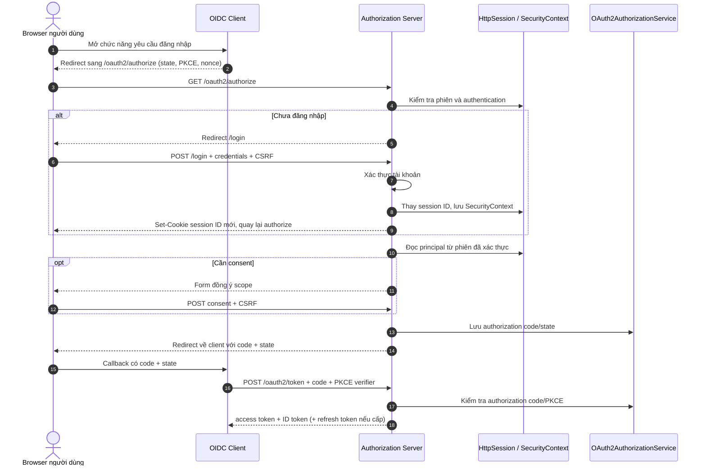
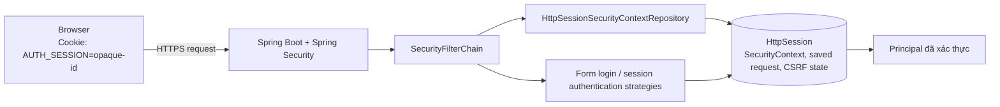
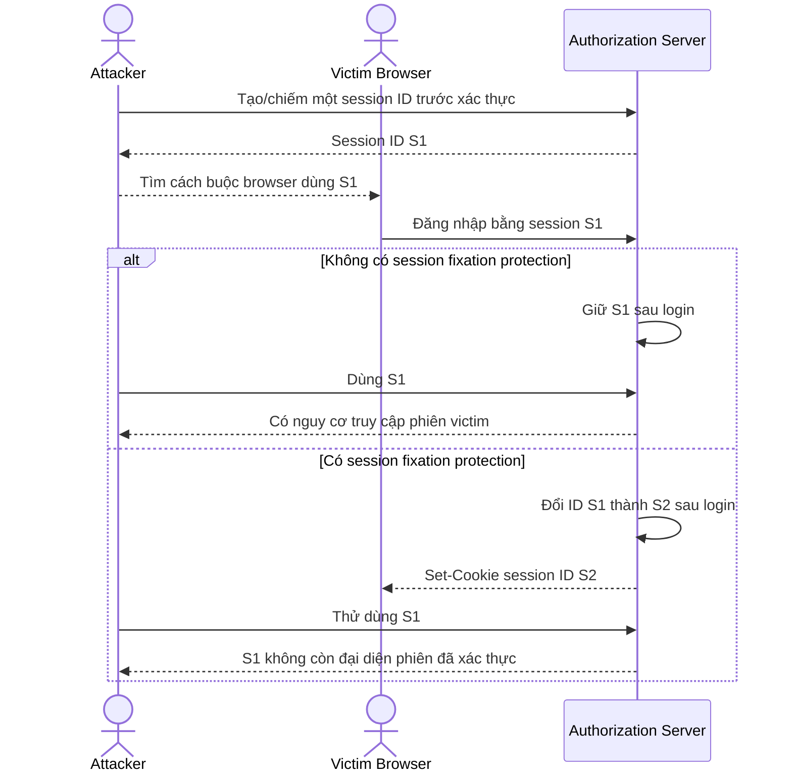
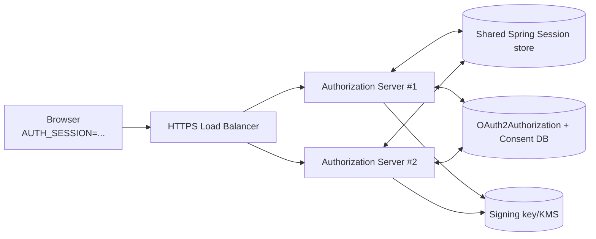
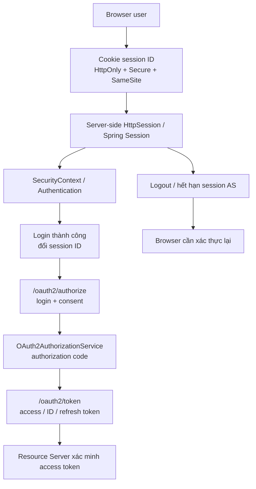

# Chính sách session, cookie và chống session fixation

## 1. Vì sao Authorization Server cần quản lý phiên đăng nhập?

Trong chương **Đăng nhập người dùng** của module **SPRING_SECURITY_OAUTH2_OIDC_AUTHORIZATION_SERVER**, Spring Boot và Spring Security không chỉ cần xác thực đúng tên đăng nhập/mật khẩu mà còn phải quản lý **phiên đăng nhập trình duyệt (browser session)** an toàn. Spring Authorization Server (SAS) cung cấp endpoint và xử lý giao thức OAuth 2.0/OpenID Connect (OIDC), nhưng việc duy trì đăng nhập, quản lý cookie, chống session fixation và xử lý đăng xuất liên quan trực tiếp đến cơ chế phiên của ứng dụng.

Sau bài học, bạn có thể:

- Phân biệt **HTTP session đăng nhập**, **authorization code**, **access token**, **ID token** và **refresh token**.
- Chọn chính sách tạo/hết hạn phiên phù hợp với Authorization Server có đăng nhập tương tác.
- Cấu hình cookie phiên với `Secure`, `HttpOnly`, `SameSite`, `Path`, `Domain` và thời gian tồn tại.
- Hiểu tấn công **session fixation** và cơ chế thay session ID sau khi xác thực thành công bằng `changeSessionId()`.
- Cấu hình `SecurityFilterChain`, `SessionCreationPolicy`, logout, quản lý phiên đồng thời và lưu phiên phân tán theo nhu cầu.
- Kiểm thử phiên trước/sau đăng nhập, callback OAuth2/OIDC, CSRF, cookie và hành vi trong môi trường reverse proxy.

**Phạm vi:** Tài liệu tập trung vào luồng người dùng truy cập Authorization Server thông qua trình duyệt. Các đoạn mã minh họa API phổ biến trong **Spring Boot 3.x / Spring Security 6.x / Spring Authorization Server 1.x**; đối chiếu phiên bản framework thực tế khi áp dụng. Với server chỉ thực hiện `client_credentials` mà không có người dùng đăng nhập, yêu cầu phiên trình duyệt sẽ khác.

> Ba chữ “session”, “token” và “cookie” không đồng nghĩa. Cookie thường chỉ chứa mã định danh phiên, còn session server-side giữ trạng thái đăng nhập; OAuth2 token là credential giao thức có vòng đời riêng.

## 2. Bản đồ trạng thái trong luồng Authorization Code + OIDC

Giả sử người dùng mở một ứng dụng web cần đăng nhập qua Authorization Server ở `https://auth.example.com`. Ứng dụng web là **OIDC Client**, còn Authorization Server xác thực người dùng và phát hành token theo chính sách.



Sơ đồ cho thấy hai nhóm trạng thái độc lập:

| Trạng thái | Lưu ở đâu? | Mục đích |
| --- | --- | --- |
| **HTTP session của AS** | Servlet container, Spring Session hoặc kho session khác | Gắn browser với `SecurityContext` đã xác thực và ngữ cảnh tương tác như saved request/CSRF. |
| **Cookie session** | Browser, thường mang session ID opaque | Để AS nhận ra session trong các request tiếp theo. |
| **Authorization code và token metadata** | `OAuth2AuthorizationService` | Dùng khi đổi authorization code, refresh token, revoke hoặc introspect. |
| **Consent** | `OAuth2AuthorizationConsentService` | Ghi nhận scope người dùng đã chấp thuận theo chính sách. |
| **OIDC ID token** | Phản hồi token dành cho OIDC Client | Client xác minh danh tính người dùng theo `iss`, `aud`, chữ ký và các claim. |
| **Access token** | Client mang tới Resource Server | API xác minh token và quyền, không nhận cookie session của AS như credential truy cập API. |

**Điểm cần nhớ:** Browser vẫn có thể đăng nhập tại AS trong khi client đã hết access token; ngược lại, logout phiên AS không tự làm mọi JWT access token đã phát hành mất hiệu lực. Cần thiết kế chính sách logout và token lifecycle riêng.

## 3. HTTP session được tạo và sử dụng ở chặng nào?

HTTP là giao thức không lưu trạng thái giữa các request. Khi trình duyệt truy cập lại AS, servlet container đọc session ID từ cookie, tìm `HttpSession` tương ứng và cung cấp dữ liệu server-side. Spring Security có thể lưu `SecurityContext` vào một `SecurityContextRepository` dựa trên session.



Lưu ý sơ đồ chỉ minh họa các thành phần liên quan. Tùy cấu hình, CSRF token có thể được lưu hoặc trì hoãn sinh trong session; saved request do `RequestCache` quản lý; cách lưu `SecurityContext` có thể thay đổi nếu dùng repository tùy chỉnh.

### 3.1. Khi nào một session được tạo?

Một session có thể được tạo **trước đăng nhập**, chẳng hạn để giữ request ban đầu tới `/oauth2/authorize` hoặc phục vụ CSRF token. Sau khi đăng nhập thành công, session có thể được tiếp tục với **ID mới**. Không nên giả định rằng chỉ request `POST /login` mới tạo session.

Ví dụ:

1. Browser chưa đăng nhập gọi `/oauth2/authorize?...`.
2. AS chuyển browser tới `/login`; request cache có thể lưu URL authorize vào session.
3. Browser tải trang login và gửi form kèm CSRF token.
4. Spring Security xác thực người dùng, thực hiện session fixation protection và lưu authentication.
5. Request cache khôi phục URL authorize để người dùng tiếp tục consent/code flow.

Nếu cấu hình làm mất session hoặc request cache giữa các bước, người dùng có thể bị quay về trang sai, mất thông tin authorize hoặc lặp màn hình login.

### 3.2. Những chính sách liên quan đến session

| Chính sách | Câu hỏi cần trả lời | Gợi ý |
| --- | --- | --- |
| **Tạo phiên** | Có cần lưu trạng thái đăng nhập browser? | Với form login/OIDC authorization tương tác, thường cần session. |
| **Idle timeout** | Không hoạt động bao lâu thì phiên bị hết hạn? | Chọn theo độ nhạy ứng dụng và thời gian thao tác login/consent. |
| **Absolute lifetime** | Có cho một phiên sống vô hạn nếu liên tục hoạt động? | Nếu có yêu cầu giới hạn tuyệt đối, cần chính sách bổ sung ngoài idle timeout. |
| **Fixation protection** | Session ID có đổi sau khi đăng nhập? | Trên Servlet hiện đại, ưu tiên `changeSessionId()`. |
| **Concurrent sessions** | Một người dùng được đăng nhập cùng lúc ở bao nhiêu nơi? | Tùy chính sách bảo mật và trải nghiệm, không phải lúc nào cũng bắt buộc giới hạn một phiên. |
| **Logout** | Khi logout, server có hủy session và cookie không? | Hủy session AS và làm hết hiệu lực ngữ cảnh đăng nhập; xem xét logout OIDC riêng. |
| **Distributed session** | Khi nhiều instance AS, request có thể đi tới instance khác không? | Dùng shared session store hoặc topology phù hợp; đồng bộ key và authorization state riêng. |

## 4. Chọn `SessionCreationPolicy` đúng ngữ cảnh

Spring Security cung cấp `SessionCreationPolicy`, thường gặp các giá trị:

| Chính sách | Hành vi chính | Phù hợp với |
| --- | --- | --- |
| `ALWAYS` | Spring Security chủ động tạo HTTP session | Luồng cần có session trước một bước xử lý nhất định; cần cân nhắc tài nguyên và số session không cần thiết. |
| `IF_REQUIRED` | Chỉ tạo session khi cần | Lựa chọn phổ biến cho ứng dụng có form login và OAuth2/OIDC authorization qua browser. |
| `NEVER` | Không tự tạo session nhưng có thể dùng session đã tồn tại | Tình huống đặc biệt; có thể làm luồng login/saved request khó dự đoán nếu không thiết kế thêm. |
| `STATELESS` | Không tạo hoặc dùng HTTP session để lấy/lưu `SecurityContext` | Phù hợp với API Resource Server chỉ xác thực Bearer token; thường **không phù hợp để áp toàn bộ AS có browser login**. |

Với **Authorization Server có form login**, `IF_REQUIRED` là điểm khởi đầu hợp lý. Không nên áp dụng `STATELESS` cho tất cả filter chain chỉ vì OAuth2 token endpoint là API.

**Vì sao?** Token endpoint nhận grant bằng HTTP request hậu trường và có thể xác thực client mà không dựa vào cookie browser. Nhưng authorization endpoint tương tác cần biết người dùng đang đăng nhập, giữ request trước login và xử lý consent; phần này thường dựa vào session.

### 4.1. Tách chain giao thức và chain ứng dụng

Một ứng dụng Spring Authorization Server thường có:

- **AS chain** ưu tiên cao: xử lý `/oauth2/authorize`, `/oauth2/token`, JWKS, discovery và endpoint OIDC được bật.
- **Application chain**: xử lý `/login`, logout, trang lỗi và các tài nguyên ứng dụng.

Hai chain cùng hoạt động trong một ứng dụng servlet và có thể chia sẻ session/security context phù hợp. Phải kiểm tra `securityMatcher` và `@Order` để request tới đúng chain.

## 5. Session fixation là tấn công gì?

**Session fixation** là tình huống kẻ tấn công tìm cách khiến nạn nhân sử dụng một session ID mà kẻ tấn công đã biết hoặc kiểm soát **trước khi nạn nhân đăng nhập**. Nếu server vẫn giữ nguyên session ID sau khi xác thực, kẻ tấn công có thể dùng lại ID đó để truy cập phiên đã được nâng thành phiên xác thực.



### 5.1. Cơ chế mặc định của Spring Security

Trên servlet container hỗ trợ Servlet 3.1 trở lên, Spring Security thường dùng `changeSessionId()` khi đăng nhập thành công. Phương pháp này **đổi ID của session đang có**, giữ lại các thuộc tính cần thiết thay vì chỉ thay username trong session dưới ID cũ.

Các phương án lịch sử/cấu hình khác:

- `changeSessionId()`: yêu cầu servlet container đổi ID của session hiện có; phù hợp trên servlet hiện đại.
- `migrateSession()`: tạo session mới và chuyển các thuộc tính từ session cũ; có thể quan sát tác động tới listener/state.
- `newSession()`: tạo session mới nhưng không sao chép toàn bộ application attributes; có thể làm mất dữ liệu cần cho flow nếu không chuẩn bị.
- `none()`: không áp dụng session fixation protection; **không nên chọn** cho ứng dụng có đăng nhập tương tác trừ khi có lý do kỹ thuật đặc biệt và biện pháp thay thế đã được đánh giá.

**Cần tránh hai nhầm lẫn:** Session fixation protection diễn ra tại **thời điểm authentication thành công**, không phải trên mọi request; và đổi session ID **không đồng nghĩa logout, xóa authorization code hoặc thu hồi access token**.

### 5.2. Cấu hình tường minh

Trong application security chain:

```java
http.sessionManagement(session -> session
        .sessionCreationPolicy(SessionCreationPolicy.IF_REQUIRED)
        .sessionFixation(fixation -> fixation.changeSessionId()));
```

Khi sử dụng `formLogin()` với các cơ chế Spring Security tiêu chuẩn, chiến lược session authentication được áp dụng vào quá trình đăng nhập. Nếu ứng dụng tự viết filter hoặc endpoint authentication và tự đặt `SecurityContext`, phải bảo đảm **SessionAuthenticationStrategy được thực thi** và `SecurityContext` được lưu đúng qua `SecurityContextRepository`. Việc chỉ gọi `SecurityContextHolder.getContext().setAuthentication(...)` không bảo đảm mọi cơ chế bảo vệ phiên sẽ chạy trong cấu hình hiện đại.

### 5.3. Vì sao thay ID mà vẫn cần chống XSS và CSRF?

Session fixation khác session hijacking:

- **Fixation:** kẻ tấn công biết trước ID chưa xác thực và tìm cách buộc nạn nhân đăng nhập bằng ID đó.
- **Hijacking:** kẻ tấn công chiếm được session ID đang hợp lệ (ví dụ qua lộ cookie, mã độc hoặc kênh truyền không an toàn).

`changeSessionId()` giúp chống **fixation**, nhưng không thay thế HTTPS, `HttpOnly`, phòng vệ XSS, CSRF token, hạn phiên và phát hiện truy cập bất thường. Nếu session ID mới bị đánh cắp sau login, rủi ro hijacking vẫn tồn tại.

## 6. Cấu hình cookie phiên an toàn

Cookie thường mang một session ID opaque, chẳng hạn:

```http
Set-Cookie: AUTH_SESSION=<opaque-session-id>; Path=/; HttpOnly; Secure; SameSite=Lax
```

Trình duyệt gửi lại cookie trong request phù hợp:

```http
GET /oauth2/authorize HTTP/1.1
Host: auth.example.com
Cookie: AUTH_SESSION=<opaque-session-id>
```

**Không nhét access token, refresh token, client secret hoặc toàn bộ `SecurityContext` vào cookie session.** Session ID là credential nhạy cảm dù bản thân nó không mô tả danh tính trực tiếp.

### 6.1. Các thuộc tính quan trọng

| Thuộc tính | Tác dụng | Chính sách khởi đầu |
| --- | --- | --- |
| `Secure` | Browser chỉ gửi cookie qua HTTPS (với các khác biệt loopback theo browser). | **Bật trong production**; local HTTP có thể cần cấu hình riêng. |
| `HttpOnly` | JavaScript phía browser không đọc trực tiếp cookie qua `document.cookie`. | **Bật** để giảm nguy cơ lộ session ID qua XSS. |
| `SameSite=Lax` | Hạn chế gửi cookie trên nhiều request cross-site, vẫn hỗ trợ một số điều hướng top-level. | Lựa chọn thực dụng cho SSO dựa vào top-level GET redirect; cần kiểm thử flow thực tế. |
| `SameSite=Strict` | Hạn chế cross-site chặt hơn | Có thể phá trải nghiệm điều hướng từ client sang AS và một số flow SSO. |
| `SameSite=None` | Cho phép gửi trong ngữ cảnh cross-site theo chính sách browser | Phải đi kèm `Secure`; tăng yêu cầu CSRF/third-party cookie compatibility. |
| `Path` | Giới hạn các đường dẫn gửi cookie | `/` nếu login và OAuth2 endpoints cùng ứng dụng/host cần chia sẻ session. |
| `Domain` | Phạm vi hostname có thể nhận cookie | Ưu tiên **không đặt** để tạo host-only cookie; không mở rộng sang toàn bộ subdomain nếu không cần. |
| `Max-Age`/`Expires` | Tuổi thọ cookie tại browser | Không đồng nghĩa với thời gian hiệu lực server-side của session; mặc định session cookie thường phù hợp. |

**`HttpOnly` không chặn mọi XSS:** script độc hại vẫn có thể phát các request thay người dùng trong cùng origin. Cần output encoding, CSP khi phù hợp, phòng vệ injection và CSRF token.

**`SameSite` không thay thế CSRF token:** browser, top-level navigation, subdomain “same-site” và một số kiểu POST có hành vi khác nhau; form login, logout và consent vẫn cần chính sách CSRF phù hợp.

### 6.2. Tác động của `SameSite` đến OIDC

Với **Authorization Code Flow** thông thường, browser từ ứng dụng client được redirect bằng **top-level GET** tới `/oauth2/authorize`. Cookie `SameSite=Lax` của Authorization Server thường vẫn được gửi trong kiểu điều hướng này, giúp người dùng có SSO session tiếp tục sử dụng.

Một số tình huống cần kiểm thử thêm:

- Client dùng `response_mode=form_post`: POST cross-site **trở lại client** có thể không gửi cookie `SameSite=Lax` của **client**, dù AS hoạt động đúng. Đây là vấn đề chính sách cookie của relying party, không nên giải quyết bằng cách hạ bảo vệ cookie AS trên diện rộng.
- AS được nhúng trong iframe hoặc thực hiện silent authentication qua third-party context: cookie `Lax` có thể không được gửi; browser ngày càng hạn chế third-party cookies.
- Khi một ứng dụng thực sự cần `SameSite=None`, cookie phải có `Secure`, và vẫn phải tính đến các chính sách chặn cookie của trình duyệt.
- `SameSite=Strict` có thể khiến request lần đầu đến AS từ một site khác không mang session cookie, dẫn đến màn hình login lại.

Không chọn `None` chỉ với lý do “OIDC có redirect”. Với flow redirect top-level phổ biến, `Lax` là điểm bắt đầu hợp lý; chỉ nới chính sách sau khi xác định rõ nhu cầu và kiểm thử.

### 6.3. Host-only cookie và tiền tố `__Host-`

Trong production chạy HTTPS, tên cookie dạng `__Host-AUTH_SESSION` có thể giúp áp đặt những thuộc tính cookie an toàn trên browser hỗ trợ:

- Có thuộc tính `Secure`.
- Có `Path=/`.
- **Không đặt** thuộc tính `Domain`.

Tiền tố `__Host-` giúp giới hạn phạm vi cookie vào host đã cấp cookie. Nếu hệ thống sử dụng nhiều subdomain, cần xem xét thiết kế SSO dựa vào redirect/issuer thay vì chia sẻ cookie session của AS sang các ứng dụng client.

### 6.4. Cấu hình Spring Boot cho servlet session

Một cấu hình khởi đầu trong `application.yml`:

```yaml
server:
  port: 9000
  servlet:
    session:
      timeout: 20m
      tracking-modes: cookie
      cookie:
        name: AUTH_SESSION
        http-only: true
        secure: true
        same-site: lax
        path: /
```

Ở đây:

- `timeout: 20m` thường là **thời gian không hoạt động** để session server-side hết hạn; không tự tạo “absolute lifetime” 20 phút từ lúc đăng nhập.
- `tracking-modes: cookie` ưu tiên theo dõi session qua cookie thay vì URL rewriting như `;jsessionid=...`, vốn có thể rò rỉ trong link và log.
- `secure: true` phù hợp HTTPS. Với local chỉ chạy `http://localhost:9000`, cần profile riêng và xác nhận hành vi cookie trong browser.

Ví dụ cho local:

```yaml
# application-local.yml — chỉ dùng với loopback HTTP
server:
  servlet:
    session:
      cookie:
        secure: false
```

Ứng dụng kích hoạt profile local bằng cấu hình môi trường riêng của máy; khi triển khai production, giữ `Secure=true`, dùng HTTPS và kiểm tra `Set-Cookie` thực tế. Không hard-code `secure: false` vào cấu hình mặc định được đưa lên public Internet.

**Điểm thường bỏ sót:** `server.servlet.session.cookie.max-age` điều khiển tuổi thọ cookie trong browser; `server.servlet.session.timeout` điều khiển server-side idle timeout. Cookie còn trong browser không có nghĩa session phía server vẫn còn, và ngược lại.

## 7. Ví dụ cấu hình Spring Security cho Authorization Server

Dưới đây là ví dụ cấu hình lõi giúp người học thấy rõ **hai chain** và chính sách phiên. Các `import` được lược bỏ để tập trung vào API; cần bộ dependency Spring Boot/Spring Security/SAS tương thích.

### 7.1. Chain cho giao thức OAuth2/OIDC

```java
@Configuration(proxyBeanMethods = false)
@EnableWebSecurity
public class AuthorizationServerSecurityConfig {

    @Bean
    @Order(1)
    SecurityFilterChain authorizationServerChain(HttpSecurity http)
            throws Exception {

        OAuth2AuthorizationServerConfigurer authorizationServer =
                OAuth2AuthorizationServerConfigurer.authorizationServer();

        http
            .securityMatcher(authorizationServer.getEndpointsMatcher())
            .with(authorizationServer, configurer ->
                    configurer.oidc(Customizer.withDefaults()))
            .authorizeHttpRequests(authorize ->
                    authorize.anyRequest().authenticated())
            .exceptionHandling(exceptions ->
                    exceptions.defaultAuthenticationEntryPointFor(
                            new LoginUrlAuthenticationEntryPoint("/login"),
                            new MediaTypeRequestMatcher(MediaType.TEXT_HTML)))
            .oauth2ResourceServer(oauth2 ->
                    oauth2.jwt(Customizer.withDefaults()));

        return http.build();
    }

    @Bean
    @Order(2)
    SecurityFilterChain applicationChain(HttpSecurity http)
            throws Exception {

        http
            .authorizeHttpRequests(authorize ->
                    authorize
                        .requestMatchers("/login", "/error").permitAll()
                        .anyRequest().authenticated())
            .formLogin(Customizer.withDefaults())
            .sessionManagement(session -> session
                    .sessionCreationPolicy(
                            SessionCreationPolicy.IF_REQUIRED)
                    .sessionFixation(fixation ->
                            fixation.changeSessionId()))
            .logout(logout -> logout
                    .logoutUrl("/logout")
                    .invalidateHttpSession(true)
                    .deleteCookies("AUTH_SESSION")
                    .logoutSuccessUrl("/login?logout"));

        return http.build();
    }
}
```

**Giải thích:**

- Chain AS được chọn trước để nhận đúng các endpoint OAuth2/OIDC.
- Chain ứng dụng cung cấp form login (thông thường ở `/login`) và thực thi session fixation protection khi user authentication thành công.
- `IF_REQUIRED` cho phép tạo session khi cần, giúp giữ login state và saved request.
- Logout invalidate HTTP session và yêu cầu xóa cookie tên `AUTH_SESSION` (đã cấu hình ở Boot).
- `logoutUrl("/logout")` sử dụng quy tắc CSRF mặc định cho logout qua POST khi CSRF được bật. Không mở GET logout tùy tiện vì dễ bị CSRF logout.
- Với SAS/OIDC có UserInfo, `oauth2ResourceServer().jwt()` ở AS chain phục vụ xử lý bearer token theo cấu hình.

Ví dụ này **chưa phải Authorization Server hoàn chỉnh**: còn cần `RegisteredClientRepository`, `OAuth2AuthorizationService`, `OAuth2AuthorizationConsentService`, `AuthorizationServerSettings`, khóa ký/JWK, `JwtDecoder` (khi cần OIDC) và nguồn xác thực người dùng. Phần này chỉ minh họa cách phiên tham gia vào cấu hình security.

### 7.2. Nguồn danh tính local

Nếu chưa tích hợp identity provider, có thể dùng một tài khoản demo với mật khẩu truyền từ biến môi trường:

```java
@Bean
PasswordEncoder passwordEncoder() {
    return new BCryptPasswordEncoder();
}

@Bean
UserDetailsService userDetailsService(
        PasswordEncoder encoder,
        @Value("${LOCAL_AS_USER_PASSWORD}") String password) {

    UserDetails alice = User.withUsername("alice")
            .password(encoder.encode(password))
            .roles("USER")
            .build();

    return new InMemoryUserDetailsManager(alice);
}
```

Không commit mật khẩu, cookie ID hay các token thực vào source, test fixture công khai hoặc log. Trong production, thay in-memory user bằng nguồn danh tính được quản trị và các cơ chế MFA/lockout/reset mật khẩu theo yêu cầu.

### 7.3. Không cấu hình toàn AS thành stateless

Nếu áp dụng:

```java
http.sessionManagement(session ->
        session.sessionCreationPolicy(
                SessionCreationPolicy.STATELESS));
```

cho mọi chain, ứng dụng có thể không lưu `SecurityContext` trong HTTP session sau form login, dẫn đến yêu cầu `/oauth2/authorize` tiếp theo không thấy principal đã xác thực. Cấu hình stateless phù hợp hơn với **Resource Server API** chấp nhận Bearer token; một hệ thống có thể dùng những chain riêng cho các nhóm request khác nhau.

Đối với AS, không nên cố cấu hình token endpoint và authorize endpoint theo các giả định trái nhau về session/security context mà chưa kiểm thử toàn luồng. Khi cần chính sách riêng cho token endpoint, đánh giá matcher và thiết kế chain một cách tường minh.

## 8. Thời hạn phiên: idle, absolute và xác thực lại

### 8.1. Idle timeout

Một session timeout 20 phút có nghĩa là sau khoảng thời gian **không có hoạt động liên quan** theo cơ chế của session store, server có thể hết hạn session đó. Đây không phải giới hạn cứng 20 phút tính từ lúc người dùng đăng nhập.

| Thời điểm | Tình huống | Hệ quả |
| --- | --- | --- |
| 09:00 | Người dùng đăng nhập AS | Session bắt đầu trạng thái xác thực. |
| 09:10 | Browser tương tác với AS, session được truy cập | Idle timeout có thể được gia hạn theo cơ chế store/container. |
| 09:35 | Không có request tới AS trong hơn 20 phút | Session có thể đã hết hạn; authorize tiếp theo cần đăng nhập lại. |
| 10:00 | Client vẫn có access token chưa hết hạn | API vẫn có thể chấp nhận token theo chính sách token, độc lập session AS. |

Bảng chỉ mô tả logic điển hình; thời gian chính xác phụ thuộc cách cập nhật last accessed time, container/session store và yêu cầu bảo mật.

### 8.2. Absolute session lifetime

Nhiều hệ thống muốn bắt buộc đăng nhập lại sau một khoảng thời gian tối đa, kể cả người dùng liên tục hoạt động. `server.servlet.session.timeout` chỉ là cấu hình timeout phiên thông thường và **không tự cung cấp chính sách absolute lifetime**.

Nếu sản phẩm cần giới hạn tuyệt đối, hãy thiết kế thêm thông tin thời điểm đăng nhập/cấp authentication, kiểm tra nó ở một điểm tin cậy và yêu cầu xác thực lại khi vượt hạn. Cân nhắc cả MFA, thời gian xác thực gần nhất và tác động UX của luồng OAuth2/OIDC.

### 8.3. OIDC `max_age` và `auth_time`

OIDC có tham số `max_age` để client thể hiện yêu cầu về độ mới của việc xác thực; `auth_time` có thể cho biết thời điểm authentication diễn ra trong ID token theo yêu cầu và profile. Điều này **khác** thời gian sống session cookie.

Không tự kết luận rằng chỉ cấu hình cookie/session timeout là AS đã đáp ứng mọi yêu cầu `max_age` hoặc step-up authentication. Cần xác minh khả năng xử lý của phiên bản SAS, chính sách authentication hiện tại và triển khai thêm nếu nghiệp vụ yêu cầu reauthentication.

## 9. Giới hạn phiên đăng nhập đồng thời

Một số hệ thống yêu cầu mỗi tài khoản chỉ có tối đa một hoặc vài phiên đang hoạt động. Spring Security hỗ trợ concurrent-session control, nhưng cách vận hành cần gắn với session registry và môi trường triển khai.

Ví dụ local một instance:

```java
http.sessionManagement(session -> session
        .sessionFixation(fixation -> fixation.changeSessionId())
        .sessionConcurrency(concurrency -> concurrency
                .maximumSessions(1)
                .maxSessionsPreventsLogin(false)
                .expiredUrl("/login?expired")));
```

Ý nghĩa trong cấu hình mẫu:

- `maximumSessions(1)`: giới hạn tối đa một phiên theo cơ chế theo dõi của Spring Security.
- `maxSessionsPreventsLogin(false)`: khi xuất hiện lần đăng nhập mới, cơ chế có thể làm hết hiệu lực một phiên cũ thay vì ngăn login mới.
- `expiredUrl("/login?expired")`: điều hướng phiên bị đánh dấu expired đến URL thông báo khi nó gửi request tiếp theo.

Với servlet container session và `SessionRegistryImpl`, đăng ký `HttpSessionEventPublisher` thường cần thiết để registry nắm được sự kiện hủy session:

```java
@Bean
HttpSessionEventPublisher httpSessionEventPublisher() {
    return new HttpSessionEventPublisher();
}
```

**Giới hạn cần hiểu:** concurrent session control là tùy chọn chính sách, không phải mặc định OAuth2/OIDC yêu cầu. Với nhiều instance, chỉ dùng registry trong bộ nhớ có thể khiến giới hạn được áp dụng riêng từng instance. Cần thiết kế session registry chia sẻ, ví dụ tích hợp phù hợp với Spring Session, và kiểm thử khi user login ở các node khác nhau.

Nếu nhiều người dùng hợp pháp chia sẻ một tài khoản (một trường hợp cần đánh giá nghiệp vụ), giới hạn quá chặt có thể gây đăng xuất liên tục. Không chọn “1 session” như quy tắc chung cho mọi sản phẩm.

## 10. Logout và sự khác nhau giữa phiên AS và token

### 10.1. Local logout

Một logout thành công thường gồm:

1. Xác nhận yêu cầu logout hợp lệ và đúng phương thức HTTP/CSRF policy.
2. Xóa authentication khỏi security context.
3. Invalidate HTTP session ở AS.
4. Xóa cookie session phù hợp với `Path`/`Domain` đã đặt.
5. Điều hướng đến trang xác nhận hoặc màn hình đăng nhập.

Dùng `logout(...).invalidateHttpSession(true).deleteCookies("AUTH_SESSION")` trong application chain để thực hiện phần tiêu chuẩn. Nếu dùng tên `SESSION` của Spring Session hoặc tên cookie tùy chỉnh khác, phải cập nhật đúng tên cookie ở cấu hình logout.

### 10.2. OIDC logout là luồng có ranh giới rộng hơn

OIDC **RP-Initiated Logout** có thể sử dụng endpoint `/connect/logout` khi tính năng được hỗ trợ và cấu hình. AS phải kiểm tra các tham số và điều kiện redirect theo profile được sử dụng; client cũng có session đăng nhập riêng, nên kết quả cần được phối hợp giữa các bên.

**Xóa cookie của AS không tự động:**

- Xóa cookie session đang thuộc về OIDC Client khác hostname.
- Thu hồi mọi refresh token đã cấp cho client.
- Làm access token JWT chưa hết hạn bị từ chối bởi Resource Server đang kiểm tra offline.
- Kết thúc session tại một identity provider bên ngoài, nếu AS dùng federation/SSO với IdP.

Do đó, “đăng xuất khỏi AS”, “đăng xuất khỏi client”, “thu hồi token” và “đăng xuất khỏi upstream IdP” là những thao tác có mối liên hệ nhưng khác nhau về giao thức và phạm vi.

### 10.3. Cookie cũ sau logout

Khi session đã bị invalidate, browser có thể còn gửi cookie cũ trong một số trường hợp (ví dụ thuộc tính xóa cookie không trùng `Path`/`Domain`). Server phải coi ID đó là không còn hiệu lực. Kiểm tra cả **server-side invalidation** và **response Set-Cookie xóa cookie**, thay vì chỉ nhìn một trong hai.

## 11. Spring Session và nhiều Authorization Server instance

### 11.1. Khi nào cần shared session store?

Nếu AS chạy nhiều instance sau load balancer, browser có thể đăng nhập tại instance A rồi gửi authorize request tiếp theo đến instance B. Với servlet session chỉ nằm trong memory của A, B có thể không thấy `SecurityContext` đã xác thực.



**Quan trọng:** Shared HTTP session store giải quyết phiên đăng nhập browser, còn shared `OAuth2AuthorizationService` giải quyết authorization code/access/refresh token state. Hai kho lưu trạng thái phục vụ mục đích khác nhau. Signing key và issuer cũng phải nhất quán giữa các instance.

Sticky session tại load balancer có thể giảm số lần gặp sự cố khi chỉ dùng in-memory session, nhưng có rủi ro khi failover, scale hoặc rolling deployment. Với yêu cầu HA, cần kế hoạch session persistence/distribution rõ ràng.

### 11.2. Ví dụ Spring Session với Redis

Một cách phổ biến trên Spring Boot là bổ sung dependency Spring Session Redis cùng Spring Data Redis tương thích, rồi cấu hình kết nối:

```xml
<dependency>
    <groupId>org.springframework.session</groupId>
    <artifactId>spring-session-data-redis</artifactId>
</dependency>
<dependency>
    <groupId>org.springframework.boot</groupId>
    <artifactId>spring-boot-starter-data-redis</artifactId>
</dependency>
```

```yaml
spring:
  data:
    redis:
      host: localhost
      port: 6379
  session:
    timeout: 20m
```

Trên những phiên bản Spring Boot có auto-configuration tương ứng, dependency có thể thiết lập `SessionRepositoryFilter` để dùng Spring Session thay session thuần của container. Cần xác nhận bean/condition report và hành vi thực tế theo version đã chọn, kể cả cách serialize `SecurityContext`/principal, TTL và failure handling khi Redis gián đoạn.

**Cookie serializer có thể khác** giữa servlet session thuần và Spring Session. Không giả định mọi property `server.servlet.session.cookie.*` đều được áp dụng giống nhau khi đổi implementation; kiểm tra response `Set-Cookie` ở hệ thống thật và cấu hình `CookieSerializer` nếu cần.

Ví dụ nếu muốn đặt cookie tường minh **chỉ khi dùng Spring Session** trong production HTTPS:

```java
@Bean
@Profile("prod")
CookieSerializer cookieSerializer() {
    DefaultCookieSerializer serializer = new DefaultCookieSerializer();
    serializer.setCookieName("__Host-AUTH_SESSION");
    serializer.setUseHttpOnlyCookie(true);
    serializer.setUseSecureCookie(true);
    serializer.setSameSite("Lax");
    serializer.setCookiePath("/");
    return serializer;
}
```

Đối với prefix `__Host-`, **không cấu hình cookie Domain**. Nếu logout policy đang xóa cookie tên `AUTH_SESSION`, cần đổi sang `__Host-AUTH_SESSION` theo cấu hình production để khớp tên thực tế. Đừng đăng ký bean Spring Session `CookieSerializer` này nếu ứng dụng chỉ sử dụng session container và chưa có Spring Session dependency.

### 11.3. Vấn đề dữ liệu và vận hành

- **Bảo vệ Redis/session store:** chỉ truy cập qua mạng tin cậy, xác thực/authorization thích hợp, mã hóa kết nối nếu môi trường yêu cầu.
- **Không lưu token vào session tùy tiện:** giới hạn state, kích thước object và lifetime; tránh serialized class thay đổi khiến session cũ không deserialize được sau rollout.
- **Phân vùng dữ liệu:** dùng namespace/tên key phù hợp môi trường, tránh va chạm với session của ứng dụng khác.
- **Khả năng chịu lỗi:** quy định hành vi khi shared store chậm hoặc ngừng hoạt động; đừng mặc nhiên coi session đã xác thực nếu không đọc được store.
- **Concurrent sessions:** nếu cần giới hạn trên nhiều node, chọn cơ chế registry tương thích session store và kiểm thử cross-node login/logout.
- **Giám sát:** session creation/expiration, auth failure, storage latency và tần suất login lại; không log session ID.

## 12. Cookie dưới reverse proxy, HTTPS và CORS

### 12.1. HTTPS termination tại gateway

Khi ingress/load balancer xử lý TLS rồi chuyển HTTP nội bộ vào Spring Boot, ứng dụng phải có cấu hình trusted forwarded headers phù hợp để nhận biết scheme/host công khai. Nếu cấu hình sai, redirect URL, issuer hoặc cờ `Secure` của cookie có thể không đúng.

Ví dụ Spring Boot có thể dùng:

```yaml
server:
  forward-headers-strategy: framework
```

Điều này chỉ an toàn khi **proxy tin cậy đặt và làm sạch** các header `Forwarded`/`X-Forwarded-*` trước khi request tới ứng dụng. Không tin header do client Internet trực tiếp tự gửi. Issuer OAuth2/OIDC nên được cố định theo HTTPS public URL trong `AuthorizationServerSettings`.

### 12.2. CORS không thay thế chính sách cookie

CORS kiểm soát cách browser cho phép JavaScript đọc response cross-origin; `SameSite` và cookie attributes ảnh hưởng việc browser gửi cookie; CSRF là vấn đề bảo vệ các thao tác thay đổi trạng thái. Ba cơ chế có mục đích khác nhau.

Authorization Code + OIDC redirect flow thường dựa trên top-level browser navigation, không cần mở rộng CORS cho mọi origin. Không bật `Access-Control-Allow-Origin: *` kết hợp credential hoặc mở CORS không giới hạn chỉ để giải quyết login cookie. Nếu cần cross-origin XHR kèm cookie, phải thiết kế CORS, `SameSite`, CSRF và origin allowlist cụ thể.

## 13. Kiểm thử session fixation và cookie theo hành vi thực tế

### 13.1. Kịch bản trước và sau login

Khi có session trước login, hãy kiểm tra:

1. Mở browser profile riêng và truy cập authorization endpoint của client hợp lệ.
2. Ghi nhận **session ID cũ** tại phía server/test harness hoặc quan sát cookie ID ở DevTools trong môi trường kiểm thử an toàn. Không sao chép ID thật vào log công khai.
3. Thực hiện `POST /login` hợp lệ kèm CSRF token.
4. Xác minh browser nhận session ID **mới** và session cũ không còn cho phép sử dụng trạng thái đã xác thực.
5. Xác minh principal và saved authorization request vẫn được khôi phục đúng sau khi đổi ID.
6. Hoàn thành consent, redirect code về client và đổi code thành token theo PKCE.
7. Dùng ID cũ trong môi trường kiểm thử cô lập để chắc chắn không truy cập được authentication của phiên mới.

**Không khẳng định “ID phải đổi” nếu ban đầu hoàn toàn chưa có session.** Test cần chủ động tạo pre-auth session, chẳng hạn bằng saved authorize request hoặc CSRF flow. `changeSessionId()` là cơ chế đổi ID của session hiện có.

### 13.2. Ví dụ kiểm thử tích hợp bằng Spring Security Test

Với `MockMvc`, có thể xác minh login hoạt động và response được redirect:

```java
@Test
void successfulLoginRedirectsAfterAuthentication() throws Exception {
    mockMvc.perform(post("/login")
            .param("username", "alice")
            .param("password", testPassword)
            .with(csrf()))
        .andExpect(status().is3xxRedirection());
}
```

Đây là **kiểm thử một phần**. Để xác minh session fixation, cần thêm kịch bản tạo session trước login, so sánh ID session trước/sau authentication và kiểm tra ID cũ không còn đại diện phiên đã xác thực. Test trong servlet container hoặc end-to-end browser giúp xác minh hành vi `Set-Cookie` thực tế mà mock có thể không phản ánh đầy đủ.

### 13.3. Ma trận kiểm thử

| Kịch bản | Điều cần xác minh |
| --- | --- |
| Đăng nhập từ session chưa xác thực | Session ID đổi khi login thành công; authentication được lưu. |
| Đăng nhập thất bại | Không nâng session thành authenticated; không cấp authorization code dựa trên phiên thất bại. |
| Saved request tới `/oauth2/authorize` | Sau login, người dùng quay lại đúng flow, giữ tham số OAuth2 và PKCE. |
| Cookie production qua HTTPS | `Secure`, `HttpOnly`, `SameSite`, `Path` và tên cookie đúng cấu hình. |
| Cookie local qua HTTP loopback | Profile local hoạt động; không vô tình tắt Secure trên public hostname. |
| `SameSite=Lax` với OIDC redirect | Browser top-level GET vẫn hỗ trợ SSO session hợp lệ theo hành vi browser mục tiêu. |
| `SameSite=None` nếu thật sự dùng | Có `Secure` và kiểm thử browser policy/third-party context. |
| Form login không có CSRF token | Request thay đổi trạng thái bị từ chối theo chính sách. |
| Consent POST không có CSRF token | Không chấp nhận consent trái phép. |
| Idle timeout | Session hết hạn theo chính sách; authorize yêu cầu login lại. |
| Logout | Session AS invalidated, cookie bị xóa và request tiếp theo không còn authentication. |
| Token sau logout | Quan sát đúng chính sách TTL/revocation; không giả định JWT tự bị thu hồi. |
| Concurrent login | Giới hạn và hành vi với phiên cũ khớp chính sách nếu tính năng được bật. |
| Nhiều instance AS | Login A, authorize B vẫn nhận phiên khi dùng shared session store. |
| Store không sẵn sàng | Không chấp nhận mù quáng phiên không thể xác minh; báo lỗi và giám sát phù hợp. |
| Reverse proxy | Issuer, redirect, scheme, `Secure` và hostname nhất quán ở URL public. |

### 13.4. Quan sát lỗi mà không lộ session ID

Log hữu ích gồm correlation ID, nhóm lỗi login, authentication failure/lockout, số phiên mới/hết hạn, timeout và lỗi session store. Các trường phải **che hoàn toàn**: `Cookie`, `Set-Cookie`, session ID, raw authorization code, token và password. Giữ audit metadata phù hợp chính sách dữ liệu, không biến log thành kho credential.

## 14. Những lỗi thường gặp

| Hiện tượng | Nguyên nhân thường gặp | Cách xác định |
| --- | --- | --- |
| Login xong vẫn quay lại login | `STATELESS` áp cho browser flow, security chain sai, cookie không được gửi hoặc session store không đọc được | Kiểm tra `SecurityFilterChain`, session policy, `Set-Cookie` và request `Cookie`. |
| Không thấy session ID đổi sau login | Chưa có session pre-auth hoặc custom authentication bỏ qua session strategy | Tạo session trước login trong test, kiểm tra chiến lược `changeSessionId()` và auth filter. |
| Local HTTP đăng nhập luôn mất session | Cookie `Secure=true` nhưng browser không gửi cookie trong cách truy cập local hiện tại | Kiểm tra profile, DevTools và hành vi loopback browser. |
| OIDC login lại khi điều hướng từ client | `SameSite=Strict` hoặc cookie không thuộc hostname đang gọi | Thử `Lax`, giữ issuer/hostname nhất quán và kiểm tra redirect. |
| `form_post` callback mất phiên client | Cookie của **client** có `SameSite=Lax/Strict` và không được gửi trên cross-site POST | Kiểm tra cookie tại relying party; không tự động hạ bảo vệ cookie của AS. |
| Consent submit trả 403 | Thiếu CSRF token hoặc session/CSRF token đã thay sau login | Kiểm tra form và lifecycle CSRF, không tắt CSRF toàn cục. |
| Phiên cũ còn sau logout | Logout không invalidate session hoặc xóa sai tên/Path/Domain cookie | Kiểm tra server-side state và Set-Cookie xóa cookie. |
| Dùng OAuth JWT gọi API vẫn thành công sau logout | Logout AS không tự revoke JWT | Thiết kế access token TTL và revocation theo yêu cầu. |
| Sau scale-out người dùng bị mất login | Session chỉ ở memory từng node hoặc không nhất quán serializer | Triển khai shared session và kiểm thử cross-node. |
| Concurrent-session limit không hoạt động | Registry chỉ local hoặc thiếu session lifecycle events | Kiểm tra `SessionRegistry`, `HttpSessionEventPublisher` và registry phân tán. |
| Production cookie thiếu Secure hoặc redirect thành HTTP | Trusted proxy headers, TLS termination hoặc configuration sai | Kiểm tra response qua public HTTPS gateway và cấu hình forwarded headers. |
| URL chứa `;jsessionid=...` | Session tracking qua URL được phép | Chỉ cho phép session tracking bằng cookie và kiểm thử redirect/log. |

## 15. Checklist triển khai

- [ ] Phân biệt session của AS, session của client và OAuth2 authorization/token state.
- [ ] AS có browser login sử dụng chính sách session phù hợp, thường là `IF_REQUIRED`.
- [ ] Filter chain AS và chain login có matcher, `@Order` và request cache đúng để không mất authorize flow.
- [ ] Session ID được đổi sau authentication thành công theo `changeSessionId()` hoặc chiến lược an toàn tương đương.
- [ ] Custom authentication (nếu có) thực hiện session authentication strategy và lưu `SecurityContext` đúng cách.
- [ ] Cookie của AS có `HttpOnly`, `Secure` trong HTTPS production, `SameSite` phù hợp và phạm vi `Path`/`Domain` tối thiểu.
- [ ] Không cho session ID xuất hiện trong URL/log; dùng cookie tracking.
- [ ] Form login, logout và consent giữ CSRF protection thích hợp.
- [ ] Idle timeout được cấu hình; absolute timeout và reauthentication được thiết kế riêng nếu cần.
- [ ] Giới hạn số phiên đồng thời chỉ được bật khi có nhu cầu và có registry phù hợp topology.
- [ ] Logout invalidate session AS và xóa đúng cookie; ảnh hưởng đến token/client session được nêu rõ.
- [ ] Khi chạy nhiều instance, session store, authorization store, issuer và signing keys phù hợp kiến trúc.
- [ ] Kiểm thử cookie qua public HTTPS reverse proxy, kể cả metadata/redirect/issuer.
- [ ] Đã chạy kịch bản pre-auth ID → login → đổi ID → authorize/consent và logout.
- [ ] Không log cookie, session ID, credential, authorization code hoặc token thật.

## 16. Tổng kết mô hình bảo mật



**Chính sách phiên, cookie và chống session fixation là tầng bảo vệ danh tính đang đăng nhập trong trình duyệt.** Spring Security giúp đổi session ID, lưu `SecurityContext` và quản lý logout; Spring Boot và Spring Session hỗ trợ cấu hình cookie, timeout và kho phiên; Spring Authorization Server sử dụng authentication đó để hoàn thành OAuth2/OIDC flow. Việc vận hành an toàn đòi hỏi kiểm soát cả session lẫn token, kiểm thử redirect/CSRF/logout và bảo đảm tính nhất quán khi mở rộng Authorization Server ra nhiều instance.
