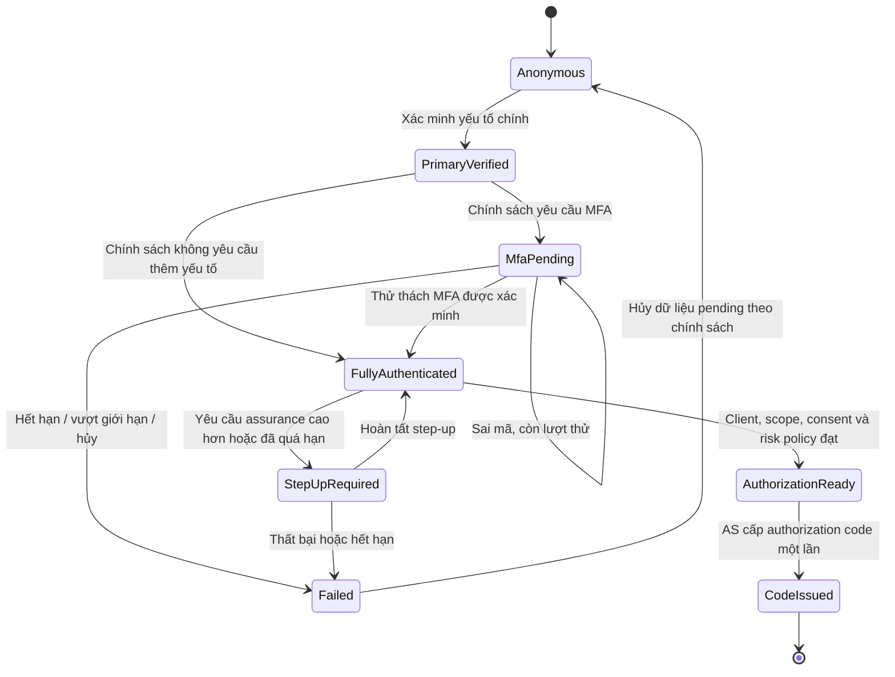

# Tích hợp MFA và điều kiện hoàn thành xác thực trước khi cấp code

Trong **OAuth 2.0/OpenID Connect (OIDC) Authorization Server**, người dùng có thể phải hoàn thành nhiều bước xác thực trước khi ứng dụng được cấp **authorization code**. Ví dụ, sau khi nhập mật khẩu thành công, người dùng còn cần xác minh bằng TOTP, passkey/WebAuthn hoặc một yếu tố thứ hai theo chính sách. Đăng nhập bằng yếu tố đầu tiên chỉ chứng minh **một phần của yêu cầu xác thực**; nếu hệ thống phát authorization code ngay lúc đó, ứng dụng OAuth2 Client có thể tiếp tục đổi code lấy token dù người dùng chưa hoàn thành MFA.

Bài học thuộc chương **Đăng nhập người dùng** của module **SPRING_SECURITY_OAUTH2_OIDC_AUTHORIZATION_SERVER** hướng dẫn cách thiết kế, cấu hình, bảo mật, kiểm thử và vận hành điều kiện MFA khi sử dụng **Spring Security và Spring Authorization Server trong Spring Boot**. Nội dung tập trung vào việc phân biệt xác thực người dùng, xác thực client, consent và cấp authorization code; xây dựng trạng thái xác thực nhiều bước; đặt cơ chế chặn tại đúng vị trí; liên hệ với OIDC; và kiểm thử các đường đi có khả năng bỏ qua MFA.

> **Nguyên tắc xuyên suốt:** Authorization Server chỉ cấp code khi **toàn bộ điều kiện xác thực người dùng đang có hiệu lực** đã được đáp ứng, cùng với các kiểm tra client, request và consent cần thiết. Không dùng riêng việc `Authentication.isAuthenticated() == true` hoặc có session cookie để suy ra MFA đã hoàn tất.

## 1. MFA là gì trong luồng OAuth 2.0/OIDC?

**Multi-Factor Authentication (MFA)** yêu cầu xác minh bằng những yếu tố độc lập thuộc các nhóm khác nhau, thường gồm:

| Nhóm yếu tố | Ví dụ | Điều cần hiểu |
|---|---|---|
| **Knowledge – điều người dùng biết** | Mật khẩu, PIN độc lập | Hai mật khẩu/PIN không tự trở thành hai yếu tố khác loại |
| **Possession – điều người dùng sở hữu** | Security key, ứng dụng xác thực có TOTP, thiết bị có khóa mật mã | Cần chứng minh quyền sở hữu thật sự; mã có thể bị phishing hoặc đánh cắp |
| **Inherence – đặc điểm của người dùng** | Sinh trắc học được xác minh trong cơ chế phù hợp | Phải đánh giá kiến trúc xác thực; dữ liệu sinh trắc học thô không nên chuyển về AS tùy tiện |

MFA **khác với hai màn hình đăng nhập**. Nếu form thứ nhất hỏi mật khẩu và form thứ hai hỏi một câu hỏi bảo mật, hai bước này có thể vẫn chủ yếu dựa trên cùng nhóm knowledge. Một số cơ chế xác thực có thể mang nhiều yếu tố trong **một lần tương tác**; chẳng hạn authenticator có khóa được bảo vệ bằng xác minh người dùng. Tuy nhiên, **không kết luận mọi passkey mặc nhiên đáp ứng mọi chính sách MFA**: phải xem loại authenticator, kết quả user verification, nguồn credential và mức bảo đảm mà hệ thống định nghĩa.

### 1.1. Authorization Server xác thực ai?

Trong Authorization Code flow:

- **Người dùng (resource owner)** đăng nhập ở Authorization Server/OpenID Provider (OP), có thể cần MFA.
- **OAuth2 Client / OIDC Relying Party** khởi tạo authorization request và nhận authorization code qua redirect.
- **Authorization Server** kiểm tra client, redirect URI, scope, chính sách xác thực và consent, sau đó mới cấp code.
- **Resource Server** xác minh access token và quyền truy cập API; nó không thay thế quá trình xác thực người dùng tại AS.

**Client authentication** bằng `client_secret_basic`, `client_secret_post`, mTLS hoặc `private_key_jwt` chỉ chứng minh danh tính **ứng dụng** ở endpoint tương ứng. Nó không chứng minh người dùng đã qua MFA. Tương tự, **PKCE** bảo vệ việc đổi authorization code, không tự thực hiện yếu tố xác thực thứ hai.

### 1.2. Khi nào một flow không có MFA người dùng?

Grant `client_credentials` chạy dưới danh tính client, **không yêu cầu resource owner đăng nhập** theo flow chuẩn. Do đó không được áp đặt giao diện TOTP của người dùng vào token request `client_credentials`. Nếu cần xác thực mạnh cho machine client, dùng chính sách client authentication phù hợp; không lẫn với user MFA.

Việc đổi refresh token hoặc đổi authorization code lấy token cũng thường diễn ra qua **back channel**. Trong Authorization Code flow, yếu tố người dùng cần được giải quyết **trước khi cấp code**; không chờ đến token endpoint mới yêu cầu trình duyệt nhập OTP. Với refresh token, phải có chính sách riêng về thời hạn bảo đảm xác thực và yêu cầu tương tác lại khi cần.

## 2. Điều kiện hoàn thành trước khi cấp authorization code

Một authorization request chỉ được cho phép đi tới bước phát hành code khi các điều kiện liên quan đều thỏa:

| Điều kiện | Ai chịu trách nhiệm? | Ví dụ kiểm tra |
|---|---|---|
| **Request và client hợp lệ** | Authorization Server | `client_id` tồn tại, `redirect_uri` đã đăng ký, response type/grant/scope được phép |
| **Người dùng đã được nhận diện** | Cơ chế user authentication | Yếu tố chính xác thực đúng tài khoản, không dùng dữ liệu từ client làm bằng chứng đăng nhập |
| **MFA hoàn thành theo chính sách** | Authentication flow và chốt bảo đảm tại AS | TOTP hợp lệ chưa tái sử dụng, WebAuthn assertion hợp lệ, hoặc cơ chế thay thế được phê duyệt |
| **Bằng chứng còn đủ mới và gắn đúng ngữ cảnh** | Session/assurance policy của AS | Cùng subject và session, thời điểm MFA trong giới hạn cho hành động đang yêu cầu |
| **Không có yêu cầu tương tác chưa hoàn tất** | AS/OP | Cần reauthentication hoặc step-up thì chưa thể cấp code |
| **Consent được xử lý nếu bắt buộc** | Authorization Server | Người dùng đã đồng ý với scope được yêu cầu theo chính sách |
| **Chính sách bảo mật còn hợp lệ** | AS và hệ thống danh tính | Tài khoản không bị vô hiệu hóa; đăng nhập không bị khóa/risk policy chặn |

**Không phải mọi flow đều có cùng yêu cầu MFA.** Ví dụ chính sách có thể yêu cầu MFA với mọi authorization request, hoặc yêu cầu mức bảo đảm cao hơn khi client xin scope `payments.write`, khi có rủi ro thiết bị, khi phiên quá cũ hoặc khi RP có yêu cầu xác thực phù hợp. Điểm bắt buộc là **không cấp code nếu mức bảo đảm thực tế chưa đạt mức được áp dụng cho giao dịch đó**.

## 3. Trạng thái xác thực nhiều bước: thiết kế thành state machine

Một mô hình an toàn nên tách trạng thái đăng nhập bằng yếu tố đầu tiên khỏi trạng thái đã hoàn thành:



Trong thực tế, yêu cầu đăng nhập và consent có thể sắp theo nhiều trình tự; sơ đồ thể hiện **điều kiện trước khi cấp code**, không áp đặt mọi màn hình phải theo một thứ tự cứng. Nếu consent đã được xử lý trong một bước trước MFA, AS vẫn phải chặn việc cấp code cho đến khi assurance đạt yêu cầu.

### 3.1. Ý nghĩa các trạng thái

| Trạng thái | Điều đã biết | Điều **chưa** được phép |
|---|---|---|
| `Anonymous` | Chưa xác minh được principal dùng cho authorization | Cấp code cần resource owner |
| `PrimaryVerified` | Yếu tố chính đúng; biết danh tính dự kiến | Khẳng định MFA hoàn tất |
| `MfaPending` | Có thử thách MFA gắn với login transaction | Cấp code hoặc thiết lập phiên cuối cùng nếu policy yêu cầu MFA |
| `FullyAuthenticated` | Có bằng chứng hoàn thành chính sách hiện tại | Tự động bỏ qua các chính sách step-up cho giao dịch khác |
| `StepUpRequired` | Phiên hiện tại có thể vẫn hợp lệ ở mức thấp, nhưng không đủ cho yêu cầu mới | Cấp code cho yêu cầu cần assurance cao hơn |
| `AuthorizationReady` | Các điều kiện cấp quyền cần thiết đều thỏa | Lấy quyền vượt quá client/scope/consent |

Một lỗi nghiêm trọng là sau khi mật khẩu đúng, code gọi `SecurityContextHolder.getContext().setAuthentication(...)` với `UsernamePasswordAuthenticationToken` đã đánh dấu `authenticated=true`, rồi chỉ hiển thị trang MFA như **một bước giao diện tùy chọn**. Nếu authorization endpoint chỉ kiểm tra phiên “đã xác thực”, người dùng có thể gọi trực tiếp `/oauth2/authorize` để vượt qua màn hình MFA.

**Hai chiến lược có thể kết hợp:**

1. **Giữ trạng thái xác thực chưa hoàn tất:** sau yếu tố chính, lưu một transaction `MfaPending` phía server, chưa thiết lập final authenticated principal có thể được AS sử dụng.
2. **Chốt kiểm tra bảo đảm trước authorization endpoint:** dù ứng dụng có session xác thực ở mức thấp, chặn phát hành code khi policy yêu cầu assurance cao hơn.

Chỉ dựa vào cờ `isAuthenticated()` là không đủ vì cờ đó không mô tả **cách xác thực**, **độ mới** hoặc **mức bảo đảm**.

## 4. Luồng đầy đủ: Authorization Code + PKCE và MFA

Giả sử `https://portal.example.com` là confidential OAuth2 Client, `https://identity.example.com` là Authorization Server kiêm OpenID Provider, và `https://api.example.com` là Resource Server.

```mermaid
sequenceDiagram
    autonumber
    actor U as Người dùng
    participant B as Browser
    participant C as Portal (OAuth2 Client/RP)
    participant AS as Identity (Authorization Server/OP)
    participant M as MFA verifier / Evidence store
    participant API as Resource Server

    U->>B: Truy cập chức năng cần đăng nhập
    B->>C: GET /documents
    C-->>B: Redirect authorization request (state, PKCE, nonce)
    B->>AS: GET /oauth2/authorize?... 
    AS-->>B: Trang đăng nhập
    U->>B: Nhập yếu tố chính
    B->>AS: POST login qua HTTPS
    AS->>AS: Xác minh yếu tố chính; tạo MfaPending
    AS-->>B: Chuyển đến /mfa/challenge
    U->>B: Cung cấp bằng chứng MFA
    B->>AS: POST /mfa/verify + CSRF token
    AS->>M: Xác minh challenge, nonce/thời hạn, chống replay
    alt MFA sai hoặc chưa hoàn tất
        M-->>AS: Từ chối
        AS-->>B: Retry có giới hạn / lỗi an toàn; CHƯA cấp code
    else MFA hợp lệ
        M-->>AS: Evidence gắn subject, session, thời điểm, method
        AS->>AS: Đánh dấu assurance đạt chính sách
        AS->>AS: Kiểm tra lại authorization request, consent nếu cần
        AS-->>B: Redirect tới URI đã đăng ký với code, state
        B->>C: GET callback?code=...&state=...
        C->>AS: POST /oauth2/token (code, code_verifier, client auth)
        AS-->>C: Access token và ID Token khi là OIDC
        C->>API: GET /documents + Bearer access token
        API-->>C: Tài nguyên nếu token và quyền hợp lệ
        C-->>B: Nội dung được phép
    end
```

**Điểm kiểm soát then chốt nằm trước bước AS cấp authorization code.** Client chỉ nhận code sau khi trạng thái assurance được xác minh và chính sách chấp nhận. Sau đó token endpoint vẫn phải kiểm tra code, PKCE, client authentication, quyền grant và các ràng buộc thông thường.

### 4.1. Authorization request minh họa

```http
GET /oauth2/authorize?response_type=code&client_id=portal-web&redirect_uri=https%3A%2F%2Fportal.example.com%2Flogin%2Foauth2%2Fcode%2Fcompany&scope=openid%20profile%20documents.read&state=STATE_RANDOM&code_challenge=PKCE_CHALLENGE&code_challenge_method=S256&nonce=NONCE_RANDOM HTTP/1.1
Host: identity.example.com
```

`STATE_RANDOM`, `PKCE_CHALLENGE` và `NONCE_RANDOM` là placeholder; sản phẩm thật phải dùng giá trị ngẫu nhiên an toàn. AS phải kiểm tra client và redirect URI theo registration. **Không dựa vào việc client tự đặt tham số “mfa=true”** để chấp nhận rằng người dùng đã qua MFA.

Khi MFA chưa hoàn tất, AS có thể hướng người dùng đến giao diện MFA thuộc **chính origin tin cậy của AS**. Sau khi thành công, hệ thống khôi phục giao dịch authorization được liên kết an toàn với phiên và để luồng mặc định hoàn thành; tránh việc tạo code thủ công từ một controller MFA.

## 5. Thiết kế dữ liệu và bằng chứng xác thực MFA

MFA cần nhiều dữ liệu hơn một boolean lưu trong session. Với mỗi giao dịch, hệ thống nên phân biệt:

| Dữ liệu | Mục đích | Kiểm soát |
|---|---|---|
| `subjectId` | Ràng buộc MFA với đúng người dùng | Không nhận subject tự khai từ request MFA làm nguồn tin |
| `sessionId` hoặc session binding | Ngăn mượn bằng chứng của phiên khác | Gắn với session server-side; xử lý session fixation |
| `challengeId`/nonce | Nhận diện thử thách đang chờ | Ngẫu nhiên, TTL ngắn, chỉ sử dụng một lần |
| `method`/factor type | Biết phương thức thực sự đã xác minh | Không lấy từ hidden form field chưa kiểm chứng |
| `completedAt`/`mfaTime` | Tính độ mới của MFA | Thời gian server; so với chính sách step-up |
| `assuranceLevel`/`acr` nội bộ | Phản ánh mức bảo đảm theo chính sách tổ chức | Không nâng mức chỉ vì client yêu cầu bằng tham số |
| `attemptCount` và hạn thử | Chống brute force hoặc lạm dụng push | Lưu/đồng bộ trên server, có rate limiting |
| `pendingAuthorizationId` | Liên kết với authorization request đang chờ | Không tin redirect URI lấy từ request mới không được xác minh |
| `outcome`/audit metadata | Theo dõi thành công, thất bại, enrollment/recovery | Không ghi OTP, seed, recovery code, raw credential |

### 5.1. Bằng chứng MFA phải được phát sinh từ kiểm tra thật

Ứng dụng không nên chấp nhận:

```http
POST /mfa/verify HTTP/1.1
Content-Type: application/x-www-form-urlencoded

userId=alice&mfaCompleted=true&assurance=high
```

Các tham số `mfaCompleted` và `assurance` do trình duyệt gửi đều **không đáng tin cậy**. Backend phải xác minh OTP/WebAuthn assertion hoặc cơ chế khác, chỉ khi hợp lệ mới tự tạo bằng chứng có session/user binding. Với TOTP, hạn chế số lần thử, dung sai thời gian hợp lý và chống dùng lại cùng mã ở các bước chấp nhận. Với WebAuthn, xác minh challenge, origin, RP ID, chữ ký và các thuộc tính authenticator cần thiết.

### 5.2. TTL, one-time challenge và chống replay

Trạng thái pending phải có thời hạn. Sau khi challenge được sử dụng thành công hoặc bị hủy, không cho sử dụng lại. Việc “verify rồi mark consumed” cần thực hiện **nguyên tử theo khả năng của storage** để hai request song song không cùng sử dụng một challenge.

Nếu user đổi tài khoản, đổi session, logout, reset mật khẩu hoặc có hành động vô hiệu hóa phiên, bằng chứng MFA và pending authorization liên quan phải được làm mới/thu hồi theo policy. Trong cụm nhiều node, không lưu challenge ở bộ nhớ riêng mỗi node nếu request có thể được chuyển qua node khác.

### 5.3. “MFA mới hoàn thành” khác “MFA hoàn thành từ lâu”

Một phiên có thể đã qua MFA vào buổi sáng nhưng chiều tối xin quyền chuyển tiền. Chính sách nhạy cảm có thể yêu cầu **step-up** hoặc MFA trong một cửa sổ thời gian ngắn hơn. Vì vậy:

- Lưu và đánh giá thời điểm xác minh yếu tố quan trọng, **không chỉ cờ `mfa=true` vĩnh viễn**.
- Gắn bằng chứng với subject, phiên, loại yếu tố, mức assurance và thời gian.
- Khi policy thay đổi, dùng bằng chứng thực tế để quyết định có cần thử thách mới.
- Không tự suy rằng **access token mới hoặc refresh token mới** chứng minh người dùng vừa hoàn thành MFA.

## 6. Tích hợp Spring Security: ranh giới cần đặt chốt

Spring Authorization Server xây trên Spring Security filter chain. Đăng nhập người dùng thường thuộc một `SecurityFilterChain` cho form login/identity service; các endpoint OAuth2/OIDC được cấu hình qua `OAuth2AuthorizationServerConfigurer` trong chain có thứ tự ưu tiên phù hợp.

**Rủi ro tích hợp thường gặp:** Khi mật khẩu đúng, form login của Spring Security có thể thiết lập `Authentication` đã xác thực. Nếu MFA chỉ xuất hiện dưới dạng trang chuyển hướng sau login, một request mới đến `/oauth2/authorize` có thể được authorization endpoint xử lý trước khi controller MFA hoàn thành.

Cần áp dụng **một trong những thiết kế có kiểm chứng**:

1. **MFA là phần của quy trình authentication trước khi sinh final `Authentication`**: yếu tố đầu tiên tạo trạng thái `MfaPending` chứ không phát hành principal cuối cùng cho AS.
2. **Assurance gate ở trước bộ xử lý authorization**: mọi authorization request phải xác minh bằng chứng MFA server-side trước khi được chuyển đến filter cấp code.
3. **Kết hợp hai cách** để tránh sai sót khi phần login hoặc MFA flow thay đổi.

Một rule ở trang giao diện hoặc một `@PreAuthorize` trong controller **không bảo vệ tự động** endpoint OAuth2 do Spring Security filter xử lý. Cũng không nên tin rằng chỉ cấu hình `authorizeHttpRequests(...authenticated())` đủ để suy ra MFA: rule này không biết phương thức hay độ mới của xác thực, và thứ tự filter xử lý có thể khiến rule được chạy **sau** filter chuyên trách authorization endpoint.

### 6.1. Khung cấu hình Authorization Server và MFA gate

Ví dụ dưới đây minh họa **vị trí gắn chốt** với phiên bản Spring Authorization Server sử dụng `OAuth2AuthorizationServerConfigurer.authorizationServer()` và `HttpSecurity.with(...)`:

```java
@Bean
@Order(1)
SecurityFilterChain authorizationServerChain(
        HttpSecurity http,
        MfaAuthorizationGateFilter mfaGate) throws Exception {

    OAuth2AuthorizationServerConfigurer authorizationServer =
        OAuth2AuthorizationServerConfigurer.authorizationServer();

    http.securityMatcher(authorizationServer.getEndpointsMatcher())
        .with(authorizationServer, server ->
            server.oidc(Customizer.withDefaults()))
        .authorizeHttpRequests(auth -> auth
            .anyRequest().authenticated())
        .exceptionHandling(ex -> ex
            .defaultAuthenticationEntryPointFor(
                new LoginUrlAuthenticationEntryPoint("/login"),
                new MediaTypeRequestMatcher(MediaType.TEXT_HTML)))
        .addFilterBefore(
            mfaGate, OAuth2AuthorizationEndpointFilter.class);

    return http.build();
}
```

`MfaAuthorizationGateFilter` là **lớp tùy chỉnh giả định**, không có sẵn trong Spring Authorization Server. Ứng dụng thực phải cung cấp bean và kiểm tra thứ tự của filter trong **chính chain** đang xử lý authorization endpoint. Đây chưa phải cấu hình chạy độc lập: cần `RegisteredClientRepository`, `JWKSource`/token generator, `AuthorizationServerSettings`/issuer, lưu authorization/consent và chain đăng nhập theo phiên bản đang dùng.

**Không dùng đoạn cấu hình như bằng chứng đã chặn được MFA bypass.** Phải có integration test gửi request thật qua filter chain, bao gồm thử gọi authorization endpoint trực tiếp sau yếu tố thứ nhất.

### 6.2. Pseudocode cho chốt kiểm tra trước authorization endpoint

Một mô hình logic cho custom `OncePerRequestFilter`:

```java
// PSEUDOCODE: MfaPolicy, AuthorizationTransactionStore và
// AssuranceEvidenceService là các dịch vụ do ứng dụng tự triển khai.
protected void doFilterInternal(
        HttpServletRequest request,
        HttpServletResponse response,
        FilterChain chain) throws IOException, ServletException {

    if (!authorizationEndpointMatcher.matches(request)) {
        chain.doFilter(request, response);
        return;
    }

    Authentication user =
        SecurityContextHolder.getContext().getAuthentication();

    // Người dùng chưa đăng nhập: để phần login/AS xử lý như thường.
    if (user == null || !user.isAuthenticated()) {
        chain.doFilter(request, response);
        return;
    }

    RequiredAssurance required = mfaPolicy.forAuthorizationRequest(request);

    if (!assuranceEvidenceService.isSatisfied(
            user, request.getSession(false), required)) {
        transactionStore.rememberPendingAuthorization(
            request, user, required);
        response.sendRedirect(
            request.getContextPath() + "/mfa/challenge");
        return;
    }

    chain.doFilter(request, response);
}
```

Đây là **pseudocode kiến trúc**, không phải Java có thể biên dịch nguyên trạng; các biến, matcher và dịch vụ cần tự triển khai. Điểm mấu chốt:

- **Chốt phải nằm trước filter có thể cấp code**, và phải bảo vệ cả các biến thể request đến authorization endpoint theo cấu hình (không chỉ một trang login).
- `mfaPolicy.forAuthorizationRequest` không được tin các claim tự khai như `mfa=true`, `acr=high`; phải phối hợp registered client, scope, policy máy chủ và thông tin request đã kiểm tra.
- `isSatisfied` kiểm tra **bằng chứng server-side gắn subject, session, mức và thời gian**. Không chỉ nhìn session attribute do một controller có thể set tùy ý.
- `rememberPendingAuthorization` chỉ lưu dữ liệu cần thiết trong transaction server-side với TTL và ràng buộc phiên; không phát hành code, không tự redirect đến URI do request cung cấp.
- Khi MFA hoàn tất, **đưa giao dịch quay lại bộ xử lý authorization chuẩn**, để Spring Authorization Server tự kiểm tra request, consent và phát code. Không gọi một phương thức “tự tạo code” từ controller MFA.
- Trong code thật phải xử lý tình huống request POST consent, tương tác với CSRF/session và phục hồi giao dịch an toàn; không replay bừa bãi request body đã hết hiệu lực.

Nếu `AnonymousAuthenticationToken` tồn tại trong context, `isAuthenticated()` của nó có thể là `true`. Vì vậy khi kiểm tra “đã đăng nhập người dùng”, phải **nhận diện anonymous principal đúng cách** bằng cơ chế Spring Security thích hợp thay vì chỉ dựa trên cờ `isAuthenticated()`; pseudocode trên lược bỏ chi tiết đó. Ngoài ra, nếu dùng authentication chưa hoàn tất mà framework vẫn đánh dấu `authenticated`, gate phải kiểm tra **assurance thực tế** để ngăn cấp code.

### 6.3. Xác thực yếu tố thứ hai tại /mfa/verify

Một xử lý MFA an toàn cần:

1. Chỉ nhận challenge đang chờ gắn với session đã hoàn thành yếu tố chính; không lấy `userId` hoặc phương thức từ form làm bằng chứng tin cậy.
2. Áp dụng **CSRF protection** với POST, giới hạn số lần thử và thời gian thử thách.
3. Xác minh challenge bằng service tin cậy, hạn chế replay và ghi nhận kết quả một cách nguyên tử.
4. Khi hợp lệ, đánh dấu bằng chứng server-side **theo subject, session, time, factor/method**; nếu kiến trúc dùng token pending, chuyển sang final authenticated principal tại thời điểm phù hợp.
5. Xử lý session fixation, cập nhật session/cookie và làm sạch pending challenge.
6. Tiếp tục authorization transaction đã được bảo vệ; để AS xác nhận lại client, redirect URI, scope, consent và các yêu cầu hiện hành.

**Không set `MFA_DONE=true` trong một cookie không được ký/kiểm chứng rồi tin vào nó.** Cookie hoặc request parameter có thể bị chỉnh sửa. Nếu dùng lưu trữ phân tán, dữ liệu evidence cần toàn vẹn, TTL, khóa theo principal/session và xóa được khi logout.

## 7. OIDC: `acr`, `amr` và `auth_time` biểu diễn mức xác thực

OIDC cung cấp các claim liên quan đến sự kiện xác thực. Chúng có ý nghĩa **đối với Relying Party (RP)**, nhưng không tự động thay cơ chế thực thi MFA ở OP.

| Claim | Ý nghĩa | Cách sử dụng đúng |
|---|---|---|
| `auth_time` | Thời điểm người dùng đã được xác thực, dưới dạng Unix timestamp | Phản ánh thời điểm xác thực theo ngữ nghĩa OIDC; cần khi xử lý yêu cầu `max_age` |
| `acr` | Authentication Context Class Reference: mức/ngữ cảnh bảo đảm theo quy ước đã thỏa thuận | RP dùng để hiểu mức assurance; AS chỉ công bố mức **thực sự đạt** |
| `amr` | Authentication Methods References: các phương thức đã dùng | Ví dụ `["pwd","otp"]` nếu đó là bằng chứng thực tế; không tự bịa nếu chưa xác minh |

Ví dụ **payload minh họa** của một ID Token:

```json
{
  "iss": "https://identity.example.com",
  "sub": "user-42",
  "aud": "portal-web",
  "iat": 1794850000,
  "exp": 1794850600,
  "auth_time": 1794849900,
  "acr": "urn:example:authn:mfa",
  "amr": ["pwd", "otp"]
}
```

Payload không phải JWT đã được ký. Giá trị `urn:example:authn:mfa` chỉ minh họa **tên lớp bảo đảm nội bộ**; trước khi production, AS và RP phải thống nhất rõ quy tắc ánh xạ. Không dùng nhãn chuẩn như AAL2 một cách tùy tiện nếu chưa đánh giá chứng cứ/cơ chế tương ứng.

**Quan trọng:** Relying Party kiểm tra chữ ký, issuer, audience, thời hạn và nonce khi áp dụng trước khi tin vào ID Token. Đưa `amr=["pwd","otp"]` vào token **không chứng minh hệ thống thực sự thực thi MFA** nếu phần login có thể bị bypass.

### 7.1. `max_age`, `prompt` và `acr_values`

Các tham số OIDC thường liên quan đến mức xác thực:

| Tham số | Ý nghĩa chính | Liên hệ MFA |
|---|---|---|
| `max_age` | Thời gian tối đa kể từ lần xác thực người dùng; OP phải đáp ứng yêu cầu reauthentication theo OIDC | Không đồng nghĩa “MFA phải mới trong N giây”; cần kết hợp policy MFA riêng |
| `prompt=login` | Yêu cầu OP xác thực lại người dùng | Không tự chỉ định phải dùng phương thức MFA nào |
| `prompt=none` | Không được tương tác với người dùng | Nếu cần MFA/step-up mới, phải trả lỗi OIDC thích hợp thay vì hiển thị UI |
| `acr_values` | Các giá trị ACR được RP yêu cầu theo thứ tự ưu tiên | **Không mặc nhiên là ràng buộc bắt buộc**; OP cần xử lý theo hợp đồng/chính sách |
| `claims` yêu cầu `acr` essential | RP có thể yêu cầu claim/context cụ thể theo OIDC | Phải xử lý theo đặc tả và policy được thỏa thuận, không đơn thuần tin input |

Khi client gửi `acr_values=urn:example:authn:mfa`, OP không nên suy ra rằng MFA đã xảy ra; nó là **đầu vào yêu cầu**, không phải **bằng chứng xác thực**. AS quyết định có hỗ trợ giá trị ACR đó, phải thực thi những yếu tố nào và có cần từ chối request nếu không đáp ứng được theo hợp đồng.

Với `prompt=none`, nếu session hiện tại chưa đủ điều kiện và cần tương tác MFA, OP phải **không hiển thị trang thử thách MFA**. Tùy nguyên nhân và quy tắc OIDC, phản hồi có thể dùng `login_required` hoặc `interaction_required` (hay mã phù hợp khác), được trả theo authorization error response an toàn. Khi callback có `state`, phải xử lý/bảo toàn theo yêu cầu.

### 7.2. ID Token khác access token

- **ID Token** dành cho OIDC RP: xác thực thông tin về sự kiện đăng nhập, có thể mang `acr`, `amr`, `auth_time`.
- **Access token** dành cho Resource Server: kiểm soát quyền truy cập API theo issuer, audience, expiry, scope/quyền và chính sách nghiệp vụ.

Nếu API cần điều kiện assurance cao để thực hiện thao tác nhạy cảm, phải thiết kế **hợp đồng được kiểm chứng với API**, không chỉ tin dữ liệu do frontend gửi. Có thể đưa claim assurance được phát hành có kiểm soát vào access token khi phù hợp hoặc thực hiện cơ chế step-up/chính sách tập trung; Resource Server phải xác minh token và đánh giá freshness/policy.

### 7.3. Customization claim trong Spring Authorization Server

Spring Authorization Server cho phép tùy biến JWT claim bằng `OAuth2TokenCustomizer<JwtEncodingContext>`. Ví dụ minh họa ý tưởng, **không phải implementation hoàn chỉnh**:

```java
@Bean
OAuth2TokenCustomizer<JwtEncodingContext> oidcAssuranceClaims(
        AuthenticationEvidenceReader evidenceReader) {

    return context -> {
        if (!OidcParameterNames.ID_TOKEN.equals(
                context.getTokenType().getValue())) {
            return;
        }

        // Đọc evidence đã xác minh từ auth transaction / session
        // theo thiết kế thực tế, KHÔNG từ input claim của client.
        AuthenticationEvidence evidence = evidenceReader.forContext(context);
        if (evidence == null) {
            return; // Không tự khẳng định đã có MFA.
        }

        context.getClaims().claim("acr", evidence.acr());
        context.getClaims().claim("amr", evidence.amr());
        context.getClaims().claim(
            "auth_time", evidence.authTime().getEpochSecond());
    };
}
```

`AuthenticationEvidenceReader`, `AuthenticationEvidence` và `forContext` là **thành phần do ứng dụng tự thiết kế**. Đoạn code chỉ cho thấy **điểm tùy biến** và ý nghĩa ánh xạ claim. Trong thực tế phải đảm bảo evidence còn hiệu lực và gắn đúng authorization/subject; điều này quan trọng cả khi phát hành lại token hoặc khi request không còn session trình duyệt. OIDC yêu cầu xử lý `auth_time` đúng khi `max_age` được sử dụng; việc evidence vắng mặt không phải lý do để bỏ qua các yêu cầu bắt buộc của flow.

Không gắn cố định `acr=high` hoặc `amr=["pwd","otp"]` cho mọi ID Token trong cấu hình để “đạt chuẩn MFA”. Claims phải phản ánh **thực tế xác thực**, không phải trạng thái mong muốn.

## 8. Phân biệt MFA bắt buộc, MFA theo rủi ro và step-up

| Chính sách | Khi nào kích hoạt? | Ví dụ |
|---|---|---|
| **MFA bắt buộc mỗi phiên** | Mọi phiên đăng nhập phải hoàn thành MFA trước authorization | Portal nội bộ nhạy cảm |
| **MFA theo client/scope** | Client hoặc yêu cầu quyền nhất định có mức assurance cao | `payments.write` cần xác minh thứ hai |
| **Risk-based MFA** | Ngữ cảnh rủi ro: thiết bị lạ, vị trí bất thường, IP/ngữ cảnh đăng nhập, hành vi khả nghi | Yêu cầu thêm yếu tố khi nguy cơ tăng |
| **Step-up trong phiên** | User đã đăng nhập ở mức thấp nhưng request mới cần assurance cao hơn | Đang đọc tài liệu, sau đó yêu cầu ký giao dịch |
| **Reauthentication theo thời gian** | Khoảng thời gian xác thực/mfa evidence vượt ngưỡng | Yêu cầu xác thực mới trước thao tác có tác động lớn |

Chính sách nên được xác định từ **server-side policy**, đối chiếu registered client, scope, mức rủi ro và bằng chứng đã có. Không cho phép client tự giảm yêu cầu MFA bằng tham số như `mfa=false`, hoặc tự chỉ định `acr` đã đạt.

### 8.1. Ví dụ một người dùng, hai client

Giả sử người dùng đã xác thực bằng mật khẩu + TOTP khi đăng nhập portal A. Sau đó họ mở portal B có yêu cầu WebAuthn phishing-resistant và MFA được xác minh trong 5 phút gần nhất.

Phiên SSO của OP có thể đủ cho portal A, nhưng **chưa chắc đủ cho portal B**. OP cần đối chiếu mức assurance thực tế và freshness với chính sách áp dụng cho B; nếu chưa đạt, yêu cầu step-up trước khi phát authorization code cho B. Khi hoàn thành step-up, OP phát ID Token phản ánh bằng chứng mới đúng mức.

**Có phiên SSO** không có nghĩa mọi client đều được mặc định nhận cùng một mức bảo đảm.

### 8.2. Refresh token và thời gian hiệu lực của MFA

Một refresh token được cấp sau MFA có thể còn hợp lệ lâu hơn cửa sổ freshness của yếu tố thứ hai. Khi client dùng refresh token để xin access token mới, **đó không phải sự kiện người dùng vừa nhập OTP**. Nếu ứng dụng/API cần assurance mới, chính sách có thể yêu cầu interactive authorization/step-up hoặc hạn chế các quyền được cấp khi quá hạn.

Không tự đặt `auth_time=now` mỗi lần refresh token hoặc mint access token. `auth_time` nói về sự kiện xác thực người dùng, không phải thời điểm cấp token.

## 9. Các phương thức MFA thường gặp và tích hợp an toàn

### 9.1. TOTP theo RFC 6238

TOTP dựa trên secret được enrol cho người dùng và thời gian:

- Khi enrol, sinh secret mạnh ở server và cung cấp kênh đăng ký được bảo vệ; yêu cầu xác minh mã đầu tiên trước khi kích hoạt yếu tố.
- Khi xác minh, kiểm tra mã theo thời gian server với cửa sổ lệch đồng hồ được giới hạn hợp lý.
- Giới hạn số lần thử theo account, challenge, session và nguồn request; tránh brute force mã ngắn.
- Ngăn một mã/challenge hợp lệ được chấp nhận lặp lại khi chính sách yêu cầu one-time acceptance.
- Bảo vệ seed TOTP ở storage, có kiểm soát truy cập và quy trình khôi phục; không ghi seed/OTP vào log, analytics hoặc event.
- Cần cân nhắc phishing: người dùng có thể bị dụ nhập TOTP vào trang giả. TOTP **không phải phishing-resistant MFA**.

Ví dụ hai hệ thống cùng dùng TOTP, nhưng một hệ thống chấp nhận cùng mã nhiều lần trong cùng cửa sổ thời gian và không giới hạn số lần thử: dù có “MFA” trên giao diện, khả năng chống replay và đoán mã vẫn yếu.

### 9.2. WebAuthn/FIDO2 và passkey

WebAuthn sử dụng khóa bất đối xứng, challenge, RP ID/origin và các cờ authenticator để xác minh người dùng theo ngữ cảnh web. Khi dùng cho MFA/step-up:

- Gắn challenge một lần với đúng subject/session/transaction, có TTL.
- Xác minh chữ ký assertion, challenge, origin, RP ID hash và chính sách authenticator.
- Kiểm tra yêu cầu user presence/user verification và các thuộc tính bổ sung theo mức bảo đảm cần đạt.
- Quản lý vòng đời credential: đăng ký, tên thiết bị, xóa/thu hồi, thay thiết bị, lost authenticator và backup.
- Không coi việc frontend gửi “WebAuthn success” là bằng chứng; backend phải xác minh cryptographic assertion.

Phương thức này có thể chống phishing tốt hơn mã OTP nếu triển khai đúng, nhưng **có đáp ứng chính sách MFA cụ thể hay không phải dựa vào authenticator và chuẩn/đánh giá áp dụng**.

### 9.3. Push approval, SMS và email OTP

- **Push approval:** có nguy cơ push fatigue hoặc người dùng bấm đồng ý nhầm. Nên dùng number matching/transaction binding khi phù hợp, giới hạn số yêu cầu và hiển thị ngữ cảnh rõ.
- **SMS OTP:** phụ thuộc mạng điện thoại, có rủi ro SIM swap, chuyển số, phishing và độ tin cậy kênh; cần đánh giá theo quy định/mức bảo đảm của tổ chức.
- **Email OTP:** tài khoản email có thể bị xâm phạm hoặc cùng thiết bị/môi trường với yếu tố đầu tiên; không tự coi đó là yếu tố độc lập đủ mạnh cho mọi chính sách.

Chọn yếu tố theo **threat model và assurance policy**; không chỉ theo mức độ thuận tiện tích hợp.

### 9.4. Recovery codes và lost factor

Khôi phục MFA là một phần của thiết kế xác thực, vì một luồng “quên OTP” yếu có thể trở thành **đường bỏ qua MFA**. Với recovery code:

1. Tạo mã ngẫu nhiên đủ mạnh, phân phối khi thiết lập MFA qua kênh an toàn.
2. Lưu bản hash và chỉ chấp nhận mỗi mã **một lần**.
3. Rate limit, audit và thông báo khi dùng recovery hoặc thay đổi yếu tố.
4. Áp dụng chính sách assurance riêng: dùng recovery code có thể yêu cầu enrol lại factor và không được khẳng định cùng `acr` như WebAuthn.
5. Yêu cầu xác minh bổ sung khi đổi số điện thoại/thiết bị/seed TOTP hoặc reset toàn bộ yếu tố.

Không cho phép đường “bỏ qua MFA” chỉ dựa trên email chưa được bảo vệ mà vẫn ghi nhận `MFA_SUCCESS`.

## 10. Bảo vệ phiên, CSRF và giao dịch authorization

### 10.1. Session và cookie

Với ứng dụng Spring Boot chạy trong browser:

```yaml
server:
  servlet:
    session:
      cookie:
        secure: true
        http-only: true
        same-site: lax
```

Đây là **gợi ý cho mô hình web sử dụng HTTPS**, không phải cấu hình đầy đủ của hệ thống MFA. Cần điều chỉnh `SameSite` khi OIDC sử dụng các response mode khác (ví dụ `form_post`), callback cross-site, iframe hoặc các luồng tương tác đặc biệt. Bật CSRF protection với các thao tác thay đổi trạng thái, đặc biệt `POST /mfa/verify`, đăng ký/xóa yếu tố và consent.

Sau khi login/MFA thành công, cần xử lý **session fixation**, bảo đảm bằng chứng pending không dùng được ở session mới không có liên kết tin cậy. Khi logout hoặc session hết hạn, xóa trạng thái pending và bằng chứng MFA theo chính sách.

### 10.2. CSRF và điều hướng qua browser

Client gửi authorization request có `state` để liên kết callback với giao dịch phía client. Nhưng **`state` không thay thế CSRF protection của form đăng nhập/MFA phía AS**.

Ngoài ra:

- Không chuyển hướng đến `redirect_uri` từ query của form MFA; chỉ AS, sau khi kiểm tra registration, mới được phát authorization response.
- Không đưa OTP, seed, credential, session secret hoặc raw challenge private data vào URL.
- Lưu authorization transaction server-side và gắn với session/challenge; tránh dùng open redirect hoặc replay POST thiếu CSRF.
- Khi trả lỗi MFA, chỉ hiển thị thông báo an toàn; không phản chiếu mật khẩu, OTP hoặc chi tiết hệ thống.
- Dùng HTTPS/TLS; đặt `Referrer-Policy` phù hợp và hạn chế analytics/tracker trên trang login/MFA.

### 10.3. MFA pending giữa nhiều AS instance

Nếu AS có nhiều node, cần lưu session/challenge/evidence ở nguồn dùng chung hoặc có thiết kế sticky session chặt chẽ cùng cơ chế failover. Việc user làm yếu tố chính ở node A rồi nhập OTP tới node B không được tạo trạng thái mơ hồ.

Chú ý tính nguyên tử khi tiêu thụ challenge và khống chế số lần thử. Khi cập nhật policy/MFA enrollment, các node cần nhìn thấy thay đổi đủ nhanh để không chấp nhận yếu tố đã thu hồi.

## 11. Xử lý lỗi khi MFA chưa hoàn tất

### 11.1. Phân biệt lỗi xác thực người dùng và lỗi OAuth

| Trường hợp | Ứng xử phù hợp |
|---|---|
| Sai mật khẩu | Ở bước login, từ chối an toàn, không tạo final authenticated session |
| Sai OTP/WebAuthn assertion | Ở bước MFA, từ chối/cho thử lại có giới hạn; **chưa cấp code** |
| Challenge hết hạn | Hủy pending transaction hoặc tạo challenge mới theo policy; không cấp code cũ |
| User hủy MFA trong flow tương tác | Kết thúc/hủy giao dịch; authorization endpoint quyết định error response theo giao thức nếu có thể |
| Client có redirect URI không hợp lệ | Không redirect kết quả đến URI chưa được đăng ký/tin cậy |
| OIDC `prompt=none` nhưng cần MFA | Trả lỗi OIDC thích hợp qua authorization response an toàn, **không hiển thị UI** |
| Client authentication tại token endpoint sai | Lỗi OAuth `invalid_client`, không chuyển tới trang MFA người dùng |
| API access token sai/hết hạn | Resource Server trả lỗi Bearer phù hợp, không sửa bằng cách set session MFA ở AS |

Không nhất thiết mọi lỗi OTP là OAuth `access_denied`. Khi người dùng đang đứng tại trang MFA, hệ thống có thể hiển thị lỗi nhập OTP để thử lại mà **chưa kết thúc authorization transaction**. Nếu giao dịch bị hủy và có redirect URI hợp lệ, AS mới chọn authorization error response thích hợp. Việc biến tất cả lỗi MFA thành HTTP 500 hoặc JSON OAuth ở form login có thể làm hỏng trải nghiệm và kiểm thử.

### 11.2. Chống lộ thông tin và tấn công đoán mã

Không trả thông báo quá cụ thể như “mã đúng nhưng tài khoản đã bị khóa ở bước 4”, không cho brute force số lượng không giới hạn, không ghi raw OTP vào log và không tạo trạng thái timing dễ phân biệt giữa những tài khoản không tồn tại nếu làm lộ thông tin nhạy cảm. Dùng rate limiting, lockout có kiểm soát, telemetry và cảnh báo khi có dấu hiệu tấn công; thiết kế để tránh denial-of-service đơn giản do kẻ khác cố tình khóa tài khoản.

## 12. Ví dụ use case: Step-up cho giao dịch nhạy cảm

Giả sử ứng dụng `portal-web` có hai nhóm quyền:

- `documents.read`: chính sách cho phép phiên đã xác thực và mức bảo đảm thông thường.
- `payments.approve`: chính sách yêu cầu WebAuthn hoặc MFA đạt mức assurance đã định và đã xác minh trong vòng 5 phút.

**Kịch bản A — người dùng mới xác thực bằng mật khẩu:** Client yêu cầu `documents.read` và AS kiểm tra policy tương ứng. Nếu policy cho phép, AS có thể cấp code; nếu hệ thống đặt MFA bắt buộc cho mọi phiên thì vẫn phải MFA trước. Khi client yêu cầu `payments.approve`, AS yêu cầu step-up, **không cấp code cho scope nhạy cảm trước khi đạt yêu cầu**.

**Kịch bản B — người dùng đã qua MFA nhưng quá thời gian:** Session vẫn có thể hợp lệ cho hoạt động thông thường, song evidence MFA đã cũ. AS yêu cầu xác minh lại theo policy cho `payments.approve`.

**Kịch bản C — client yêu cầu `acr_values` mức cao:** AS chỉ cấp kết quả đáp ứng mức assurance đó khi thực tế có bằng chứng; nếu không hỗ trợ, xử lý theo hợp đồng OIDC và policy. Không tự nâng claim `acr` vì tham số request nói “high”.

**Kịch bản D — token được refresh sau 30 phút:** Không coi refresh token grant là một lần MFA mới. Resource Server phải kiểm tra điều kiện assurance/freshness theo hợp đồng của API nếu thao tác yêu cầu mức cao.

Từ các kịch bản trên có thể rút ra một tiêu chí thiết kế: **“MFA complete” luôn phải có nghĩa đối với một mức assurance và một thời điểm**, không chỉ là cờ chung cho mọi scope và client.

## 13. Kiểm thử tích hợp: chứng minh không thể cấp code sớm

Đây là phần quan trọng nhất của bài khi triển khai thực tế. Unit test một hàm xác minh TOTP chưa đủ. Cần **integration test đi qua SecurityFilterChain và authorization endpoint thực** để chứng minh code chỉ được phát khi chính sách được đáp ứng.

### 13.1. Ma trận kiểm thử

| Tình huống | Kết quả bắt buộc |
|---|---|
| Chưa đăng nhập, client request hợp lệ | Đi qua login; **chưa có authorization code** |
| Mật khẩu đúng, MFA đang chờ | Không có redirect về client với `code`; authorization endpoint bị chặn/đưa đến MFA |
| Gọi thẳng `/oauth2/authorize` sau yếu tố đầu tiên | Vẫn bị chặn, không bypass qua URL trực tiếp |
| MFA đúng và policy đã đạt | AS có thể tiếp tục consent nếu cần; chỉ sau các điều kiện mới cấp code |
| MFA sai | Không cấp code; tăng bộ đếm thử có kiểm soát |
| Challenge MFA hết hạn | Không cấp code; phải tạo challenge mới hoặc đăng nhập lại |
| Dùng lại OTP/challenge đã tiêu thụ | Bị từ chối theo chính sách chống replay |
| MFA ở user A, authorization ở user B | Không dùng được bằng chứng của A để cấp code cho B |
| Session hết hạn/đã logout | Pending MFA và evidence cũ không được dùng để hoàn tất giao dịch |
| Hai request verify đồng thời một challenge | Chỉ một lần sử dụng được chấp nhận; không cấp nhiều quyền ngoài ý muốn |
| Consent chưa hoàn thành | Dù MFA xong vẫn chưa cấp code nếu yêu cầu consent |
| Client/redirect URI không hợp lệ | Không chuyển hướng code/error đến URI chưa tin cậy |
| `prompt=none` khi cần MFA | Authorization error OIDC thích hợp, không có giao diện tương tác |
| `max_age` vượt giới hạn | Thực hiện reauthentication theo OIDC trước khi cấp code |
| Scope mới cần step-up | Không cấp code cho request đó nếu assurance chưa đạt |
| Refresh token dùng khi MFA đã cũ | Không đánh dấu “MFA vừa hoàn tất”; áp dụng policy freshness phù hợp |
| `client_credentials` | Không bắt OTP người dùng; vẫn xác thực client/grant/scope |
| ID Token với `acr`/`amr` | Claims phản ánh factor/mức thực sự; sai/evidence thiếu không được khai khống |

### 13.2. Phác thảo test quan trọng: request trước và sau MFA

Ví dụ dưới đây là **kịch bản kiểm thử giả lập có fixture**, dùng pseudocode do domain MFA tùy dự án. Trọng tâm là quan sát chính authorization endpoint, không mock kết quả phát hành code:

```text
Given:
  - Registered client "portal-web" cho authorization_code + PKCE.
  - User "alice" đã vượt qua yếu tố chính.
  - Session "S1" có MfaPending, chưa có evidence thỏa policy.
  - Authorization request có state và redirect URI đã đăng ký.

When:
  - GET /oauth2/authorize bằng cookie của S1.

Then:
  - Response không chứa Location=redirect_uri?code=...
  - User được đưa tới /mfa/challenge hoặc phản hồi chặn phù hợp.
  - OAuth2AuthorizationService không lưu code được phát hành cho request này.

When:
  - POST /mfa/verify với challenge hợp lệ, đúng CSRF và session.
  - Tiếp tục cùng authorization transaction thông qua flow AS.

Then:
  - Evidence MFA gắn với alice/S1 và thời điểm xác thực.
  - Sau kiểm tra policy/consent, AS redirect tới redirect URI tin cậy.
  - Redirect chứa code một lần và state khớp giao dịch.
  - Token endpoint vẫn yêu cầu code hợp lệ, PKCE và client authentication.
```

Nếu ứng dụng chuyển session ID sau MFA để chống session fixation, test cần theo dõi **session binding sau khi rotate**; không cứng nhắc yêu cầu ID chuỗi S1 vẫn như cũ. Tương tự, test response không nhất thiết luôn là HTTP 302 đến `/mfa/challenge` nếu ứng dụng có cơ chế lỗi/giao diện khác; điều phải chứng minh là **không có code khi thiếu bằng chứng**.

### 13.3. Kiểm thử API và claim

Nếu RP hoặc Resource Server dựa vào `acr`/`amr` để quyết định bảo mật, cần test:

1. ID Token sau mật khẩu đơn thuần không khai `amr=["pwd","otp"]`.
2. ID Token sau MFA chỉ chứa claim phù hợp với yếu tố đã được xác minh.
3. Token cũ/refresh không bị ghi đè `auth_time` thành thời điểm cấp token mới.
4. Client không sửa được `acr` bằng cách thay query, header hoặc claim tự khai.
5. Resource Server chỉ chấp nhận claim assurance từ access token/nguồn đáng tin sau khi đã xác minh issuer, audience, chữ ký/thời hạn và quyền tương ứng.

### 13.4. Kiểm thử giao diện và khả năng phục hồi

Đừng chỉ kiểm thử thành công khi mạng ổn định. Cần kiểm tra:

- Người dùng mở hai tab với hai authorization request khác nhau.
- Nhập OTP sau khi challenge hết hạn hoặc thiết bị lệch giờ.
- Reload/back/forward browser trong lúc MFA pending.
- Client mất kết nối trong lúc verify nhưng request đã được xử lý.
- Provider WebAuthn/TOTP không khả dụng; ứng dụng từ chối an toàn hoặc dùng fallback có policy.
- User thay đổi hoặc gỡ MFA device trong khi một session khác đang chờ.
- Nhiều node AS xử lý cùng phiên/challenge.

Mọi tình huống thất bại phải **không cấp code trái chính sách**, đồng thời hiển thị thông báo đủ rõ để người dùng có thể bắt đầu lại một giao dịch hợp lệ.

## 14. Quan sát vận hành và xử lý sự cố

Một hệ thống MFA tốt cần khả năng xác định vì sao authorization không tiến lên mà không thu thập dữ liệu nhạy cảm.

| Chỉ số/sự kiện | Mục đích | Cần tránh |
|---|---|---|
| `primary_auth_success` / `failure` | Phân biệt lỗi mật khẩu với yếu tố thứ hai | Log mật khẩu |
| `mfa_challenge_issued` | Biết có phát sinh thử thách theo policy | Lộ raw challenge/OTP |
| `mfa_verify_success` / `failure` | Theo dõi tỉ lệ thành công, phát hiện abuse | Log TOTP seed hoặc WebAuthn private data |
| `mfa_step_up_required` | Quan sát lý do request cần assurance cao hơn | Log thông tin nhạy cảm của giao dịch |
| `authorization_code_issued` | Xác nhận code chỉ phát sau policy/consent | Log nguyên authorization code |
| `mfa_recovery_used` | Phát hiện dùng fallback hoặc nguy cơ takeover | Log recovery code |
| `challenge_expired/replayed` | Phát hiện timeout, replay hoặc lỗi đồng hồ | Ghi toàn bộ request body |

Sử dụng correlation ID cho authorization transaction, subject ID phù hợp chính sách riêng tư, mã client, kết quả policy và timestamps. **Không lưu OTP, TOTP seed, raw secret, credential, authorization code, access token hay refresh token** trong log, tracing hoặc error response. Thiết lập rate limit và cảnh báo cho số lần thử bất thường; phân biệt các sự cố do thiếu node affinity, clock drift hoặc cache/evidence hết hạn.

Với TOTP, bảo đảm thời gian server đồng bộ. Với WebAuthn, giám sát lỗi challenge/origin/RP ID/attestation theo mức cần thiết mà không thu thập dữ liệu sinh trắc học. Với environment nhiều node, kiểm thử session store và các tác vụ revoke/expire khi deployment rolling upgrade.

## 15. Sai lầm triển khai dễ tạo MFA bypass

| Sai lầm | Hậu quả | Phòng tránh |
|---|---|---|
| Mật khẩu đúng đã tạo final authenticated session và chỉ redirect tới trang MFA | User có thể gọi trực tiếp authorization endpoint để lấy code | Pending state và assurance gate trước phát hành code |
| Kiểm tra MFA chỉ trong một controller login | Filter OAuth2 có thể xử lý authorization ngoài controller | Kiểm tra trên mọi đường có thể dẫn đến phát code |
| Lưu `mfa=true` trong form/cookie không kiểm chứng | Request giả mạo đánh dấu đã hoàn tất | Evidence server-side gắn user, session, thời gian, challenge |
| Chấp nhận lại TOTP/challenge đã dùng | Replay, xử lý đồng thời | One-time consume và atomicity |
| Không giới hạn retry OTP | Brute force mã ngắn | Rate limiting và hành vi khóa/hạn thử phù hợp |
| Cho recovery yếu hơn nhưng vẫn gắn `acr` cao | RP tin sai mức assurance | Phân loại recovery riêng và tính đúng assurance |
| Tự tin rằng `acr_values=high` nghĩa user đã MFA | Client điều khiển claim bảo mật | Server kiểm tra evidence/policy, chỉ khai claim thực tế |
| Dựa vào `Authentication.isAuthenticated()` như tiêu chí MFA | Không biết factor/mức/thời điểm | Mô hình authentication context riêng |
| Dùng `prompt=none` rồi vẫn hiển thị MFA | Vi phạm yêu cầu không tương tác OIDC | Trả lỗi OIDC phù hợp |
| Tin rằng refresh token mới là MFA mới | Phiên assurance được kéo dài trái policy | Lưu `auth_time`/`mfaTime` thật và áp dụng freshness |
| Chỉ kiểm tra giao diện, không test filter chain | Không phát hiện bypass bằng HTTP request trực tiếp | Integration test trước/sau MFA |
| Tạo code trong controller `/mfa/verify` | Bỏ qua validation client, PKCE, consent của AS | Quay lại luồng authorization chuẩn |

## 16. Checklist thiết kế trước khi triển khai

1. **Định nghĩa assurance policy:** khi nào bắt buộc MFA, factor nào đạt mức nào, thời gian freshness bao lâu, scope/client nào cần step-up?
2. **Rõ trạng thái pending/final:** yếu tố đầu tiên hoàn thành có vô tình tạo final authenticated session cho AS không?
3. **Chốt đúng điểm:** đã bảo vệ mọi authorization request trước khi Spring Authorization Server có thể cấp code chưa?
4. **Bằng chứng gắn đúng ngữ cảnh:** subject, session, challenge, time, method, assurance được xác minh server-side chưa?
5. **Chống replay/brute force:** one-time challenge, rate limit, TTL, TOTP drift, WebAuthn verification có đủ không?
6. **Consent và client checks:** MFA success có còn đi qua RegisteredClient validation, redirect URI, scope, PKCE/consent và code một lần không?
7. **OIDC đúng ngữ nghĩa:** `acr`, `amr`, `auth_time` có phản ánh xác thực thực tế? `prompt=none`, `max_age` và yêu cầu reauthentication được xử lý?
8. **Recovery và factor changes:** enrollment, thay thiết bị, mất yếu tố, backup code, account recovery có cùng mức kiểm soát phù hợp không?
9. **Bảo vệ browser/session:** HTTPS, secure cookie, CSRF, session fixation, tránh open redirect, không ghi credential vào URL/log?
10. **Đã kiểm thử bypass chưa:** direct GET `/oauth2/authorize` sau primary login, đa tab, session expiry, replay, step-up, nhiều node và refresh token?
11. **Quan sát vận hành:** có phân loại event và cảnh báo bất thường nhưng vẫn che OTP/token/secret?
12. **Tương thích phiên bản:** đã kiểm tra DSL, security filter ordering và OIDC/token customization của đúng phiên bản Spring được dùng?

## 17. Tổng kết

MFA trong Spring Security OAuth2/OIDC Authorization Server là một **điều kiện của xác thực người dùng và assurance policy**, không phải một trang OTP đặt sau form login. Authorization Server chỉ được cấp authorization code khi người dùng đã đạt **mức bảo đảm thực tế cần thiết**, điều kiện consent và tính hợp lệ của client/authorization request cũng đã thỏa.

Thiết kế nên có **trạng thái pending rõ ràng**, **bằng chứng xác thực server-side gắn phiên và thời gian**, **một chốt chặn trước thành phần có thể phát hành code** và kiểm thử qua filter chain để chứng minh không có đường bypass. OIDC cho phép truyền thông tin về sự kiện xác thực bằng `acr`, `amr`, `auth_time`, nhưng các claim này phải dựa trên bằng chứng thật; việc client yêu cầu một mức cao không có nghĩa mức đó đã đạt.

Kết hợp những nguyên tắc trên với TLS, PKCE, client authentication, session/CSRF protection, anti-replay, recovery policy và quan sát vận hành giúp hệ thống **Spring Authorization Server** xử lý đăng nhập nhiều yếu tố an toàn và có thể kiểm chứng.

## 18. Tài liệu chuẩn để tra cứu

- [RFC 6749 — OAuth 2.0 Authorization Framework](https://www.rfc-editor.org/rfc/rfc6749): authorization code, vai trò AS/Client và yêu cầu endpoint.
- [RFC 7636 — PKCE](https://www.rfc-editor.org/rfc/rfc7636): bảo vệ authorization code khi đổi token.
- [RFC 9700 — OAuth 2.0 Security Best Current Practice](https://www.rfc-editor.org/rfc/rfc9700): các khuyến nghị bảo mật OAuth2 hiện đại.
- [OpenID Connect Core 1.0](https://openid.net/specs/openid-connect-core-1_0.html): `acr`, `amr`, `auth_time`, `max_age`, `prompt`, `acr_values` và ID Token.
- [RFC 6238 — TOTP](https://www.rfc-editor.org/rfc/rfc6238): thuật toán mật khẩu một lần theo thời gian.
- [Web Authentication: WebAuthn](https://www.w3.org/TR/webauthn-3/): xác minh assertion/challenge, RP ID, origin và authenticator.
- [NIST SP 800-63B — Authentication and Authenticator Management](https://pages.nist.gov/800-63-4/sp800-63b.html): nguyên tắc quản lý authenticator và mức bảo đảm xác thực.
- [Spring Security Reference](https://docs.spring.io/spring-security/reference/servlet/authentication/index.html): security filters, authentication và session security.
- [Spring Authorization Server Reference](https://docs.spring.io/spring-authorization-server/reference/): cấu hình Authorization Server, OIDC và tùy biến token.
