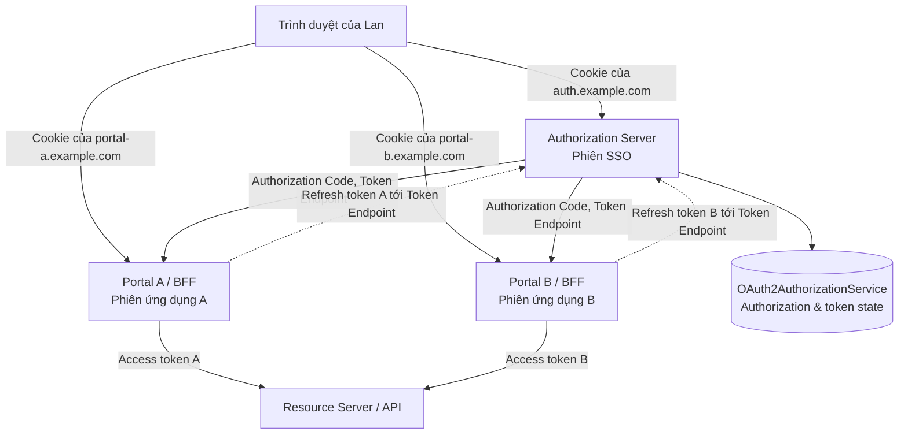
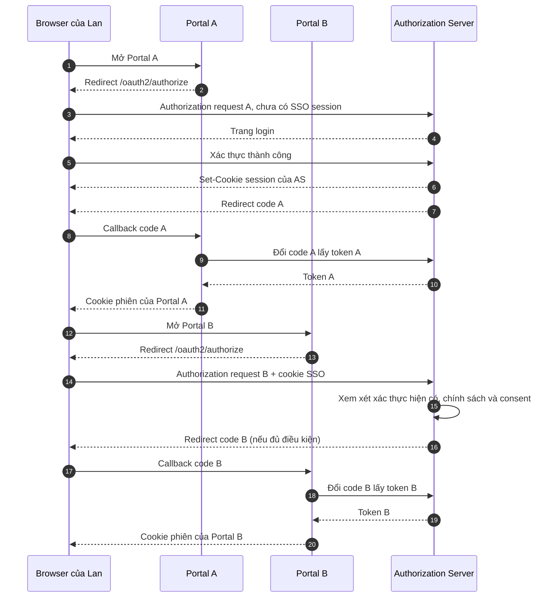
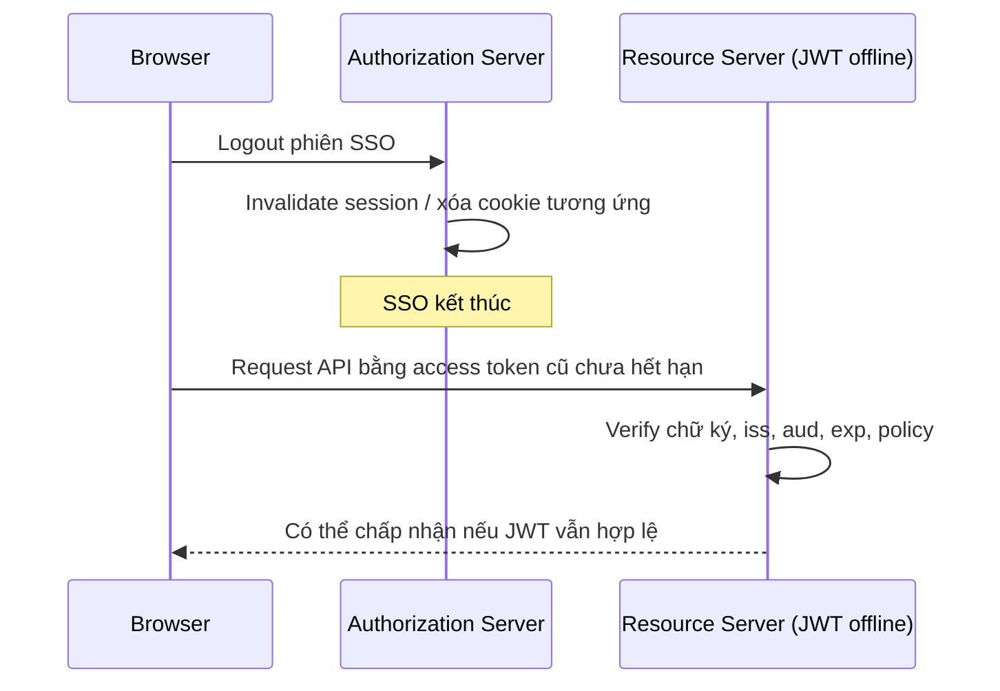
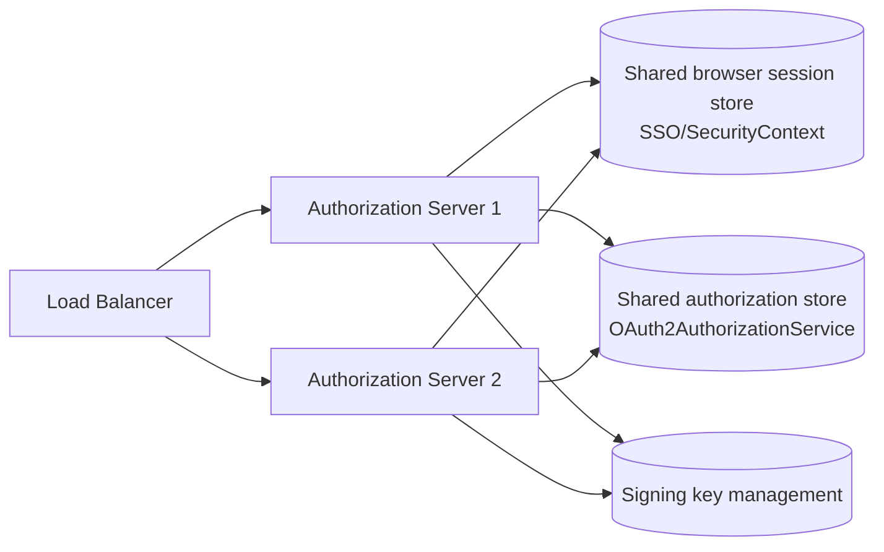

# Phân biệt phiên đăng nhập SSO với vòng đời access token và refresh token

## 1. Vấn đề thực tế: đã đăng xuất nhưng API vẫn nhận token?

Trong một hệ thống **OAuth 2.0 / OpenID Connect (OIDC)**, người dùng có thể đăng nhập một lần tại **Authorization Server**, mở nhiều ứng dụng không cần nhập lại mật khẩu, sau đó đóng trình duyệt hoặc đăng xuất một ứng dụng. Tuy nhiên, một access token đã phát hành có thể vẫn được API chấp nhận, và một refresh token hợp lệ có thể tiếp tục đổi lấy access token mới. Điều này không nhất thiết là lỗi: **phiên đăng nhập SSO, phiên ứng dụng, access token và refresh token có cơ chế quản lý riêng**.

Trong module **SPRING_SECURITY_OAUTH2_OIDC_AUTHORIZATION_SERVER**, chúng ta học cách thiết kế, cấu hình, bảo mật, kiểm thử và vận hành OAuth2/OIDC Authorization Server bằng **Spring Security**, **Spring Authorization Server** và **Spring Boot**. Bài này thuộc chương **Đăng nhập người dùng**, tập trung vào mối quan hệ giữa **single sign-on (SSO) session** và **vòng đời token**, đồng thời chỉ ra cách thiết kế logout, kiểm soát phiên, thu hồi token và kiểm thử hệ thống một cách nhất quán.

Một tình huống xuyên suốt:

- Người dùng **Lan** truy cập ứng dụng **Portal A**, được chuyển đến `https://auth.example.com` đăng nhập.
- Sau đó Lan mở **Portal B**, cũng dùng Authorization Server này. Vì phiên SSO tại Authorization Server còn hợp lệ, Lan có thể không phải nhập lại thông tin đăng nhập.
- Portal A và Portal B nhận **những authorization/token riêng** theo từng `client_id`, scope và chính sách.
- Lan nhấn **Đăng xuất** ở Portal A. Điều đó không mặc nhiên đồng nghĩa Lan đã đăng xuất Portal B, chấm dứt phiên SSO tại Authorization Server hay thu hồi token của cả hai ứng dụng.

### Sau bài học, bạn cần trả lời được

1. Cookie phiên SSO của Authorization Server có giống cookie phiên của Portal A/B không?
2. Access token hết hạn có buộc người dùng phải đăng nhập lại không?
3. Vì sao refresh token có thể tiếp tục hoạt động sau khi phiên SSO đã hết hạn?
4. Đăng xuất khỏi ứng dụng khác gì đăng xuất khỏi Identity Provider/Authorization Server?
5. Khi cần “đăng xuất khỏi tất cả thiết bị” hoặc ngăn một JWT đã bị lộ, phải triển khai thêm những lớp nào?

## 2. Phân biệt bốn trạng thái độc lập

| Thành phần | Nằm ở đâu? | Dùng để làm gì? | Cơ chế hết hiệu lực điển hình |
| --- | --- | --- | --- |
| **Phiên SSO tại Authorization Server** | Phiên xác thực người dùng tại `auth.example.com`, thường gắn với cookie trình duyệt và session state phía server | Nhận biết người dùng đã xác thực để xử lý **authorization request** sau mà không luôn phải nhập lại mật khẩu | Session timeout, logout tại AS, mất hoặc hết cookie, thay đổi chính sách xác thực |
| **Phiên của ứng dụng (RP/client session)** | Portal A, Portal B hoặc BFF, thường bằng cookie riêng từng origin | Duy trì đăng nhập tại **ứng dụng đó**, ánh xạ tới thông tin người dùng/token lưu phía server khi cần | Local logout, session timeout, session invalidation |
| **Access token** | Client nhận từ Token Endpoint và gửi cho Resource Server | Cho phép truy cập API trong thời gian, scope, audience và chính sách được cấp | `exp`/TTL, revocation/status check, chính sách Resource Server, giới hạn sender-constrained token |
| **Refresh token** | Client giữ theo kiến trúc được phép; Authorization Server quản lý trạng thái | Xin access token mới qua **Refresh Token grant** mà không bắt buộc thực hiện lại browser authorization flow | TTL, rotation/invalidated, explicit revocation, chính sách client/grant hoặc phiên liên quan nếu triển khai ràng buộc |

**OIDC ID token** là loại token thứ năm cần hiểu đúng: nó truyền thông tin về một **sự kiện xác thực người dùng** cho OIDC Client. ID token không thay session cookie, không phải access token để gọi API và không chứng minh rằng phiên SSO **vẫn còn sống tại thời điểm hiện tại** chỉ vì ID token trước đó có chữ ký hợp lệ.

Một sơ đồ ranh giới:



Đường nét đứt chỉ request refresh token. Với SPA trực tiếp, token có thể được quản lý phía browser thay vì BFF; sơ đồ chọn **backend/BFF** để nhấn mạnh rằng cookie trình duyệt và OAuth token là hai đối tượng riêng.

### 2.1. Cookie không tự trở thành access token

Trình duyệt gửi cookie theo domain/path/thuộc tính cookie. API thường kiểm tra **Bearer access token** (hoặc cơ chế tài nguyên khác do hệ thống thiết kế). Một cookie như `JSESSIONID` ở Authorization Server **không** được xem là access token hợp lệ cho API, cũng không tự đi kèm mọi request đến Resource Server khác origin.

Cùng tên `JSESSIONID` vẫn có thể biểu diễn những phiên **khác nhau trên các host khác nhau**. Vì vậy không suy luận từ tên cookie rằng phiên Portal A, Portal B và Authorization Server là một.

### 2.2. Có thể đồng thời xảy ra những trạng thái nào?

| Phiên SSO | Phiên Portal A | Access token A | Refresh token A | Ý nghĩa |
| --- | --- | --- | --- | --- |
| Còn | Còn | Còn hạn | Còn hiệu lực | Người dùng đang hoạt động bình thường |
| Còn | Đã logout | Còn hạn | Còn hiệu lực | Local logout không mặc nhiên revoke token đã phát hành |
| Hết | Còn | Còn hạn | Còn hiệu lực | Ứng dụng có thể tiếp tục dùng API và refresh nếu chính sách cho phép |
| Hết | Hết | Còn hạn | Đã revoke | API xác minh JWT offline **có thể** còn chấp nhận access token đến khi hết hạn |
| Còn | Còn | Hết hạn | Còn hiệu lực | Có thể refresh access token mới mà không hiện màn hình login |
| Còn | Còn | Hết hạn | Hết hạn hoặc bị revoke | Client cần một authorization flow mới; nhờ SSO còn hiệu lực nên có thể không cần nhập mật khẩu |

Bảng là các trạng thái **có thể xảy ra trong một hệ thống được cấu hình phù hợp**, không khẳng định mọi Spring Authorization Server mặc định đều cấp refresh token cho mọi client. Đặc biệt, với public SPA, khả năng nhận refresh token chịu chính sách riêng của implementation và phiên bản.

## 3. Phiên SSO ở Authorization Server được tạo và dùng khi nào?

SSO nói về việc **tái sử dụng lần xác thực người dùng** giữa những ứng dụng tin cậy cùng sử dụng một nhà cung cấp danh tính (Identity Provider / OpenID Provider). Nó không có nghĩa mọi ứng dụng dùng chung một session object.

### 3.1. Lần đăng nhập đầu tiên

1. Lan mở Portal A. Portal A phát hiện chưa có phiên ứng dụng hoặc cần xác thực.
2. Portal A điều hướng browser đến **Authorization Endpoint** của Authorization Server qua Authorization Code flow, thường có `client_id`, `redirect_uri`, `scope=openid`, `state`, PKCE và `nonce` theo thiết kế.
3. Authorization Server kiểm tra người dùng đã xác thực tại **chính Authorization Server** chưa. Nếu chưa, Spring Security điều hướng tới trang login.
4. Sau khi xác thực thành công, Spring Security có thể lưu `SecurityContext` trong session; browser nhận cookie phiên của Authorization Server.
5. Authorization Server kiểm tra client, consent và các chính sách liên quan, phát hành authorization code cho Portal A.
6. Portal A đổi code ở Token Endpoint, nhận token và thiết lập **phiên ứng dụng A**.

### 3.2. Mở một ứng dụng thứ hai

Khi Lan mở Portal B và được chuyển đến Authorization Endpoint cùng Authorization Server, browser mang **cookie phiên của Authorization Server** nếu các điều kiện cookie/trình duyệt cho phép. Authorization Server nhận ra Lan đang có một lần xác thực đủ điều kiện, nên **có thể** hoàn thành authorization request mà không cần nhập lại mật khẩu.

Tuy vậy, Authorization Server vẫn phải xử lý **client B** riêng: redirect URI, grant, PKCE, scope, yêu cầu consent, chính sách MFA/step-up và những hạn chế khác. “Có SSO” **không** đồng nghĩa “bỏ qua consent” hoặc “cấp cho Portal B cùng token của Portal A”.



Token A và B thuộc **các authorization** và chính sách khác nhau. Có thể trùng `sub` (cùng người dùng), nhưng `aud`, scope, client, thời hạn và dữ liệu session có thể khác.

### 3.3. Các yếu tố có thể buộc xác thực lại dù SSO còn cookie

- Phiên SSO hết hạn do idle timeout, absolute timeout hoặc bị hủy.
- Nhà cung cấp danh tính yêu cầu phương thức xác thực mạnh hơn (MFA/passkey), xác minh lại cho thao tác nhạy cảm hoặc đổi mức đảm bảo xác thực.
- OIDC request dùng `prompt=login` hoặc `max_age` buộc kiểm tra tuổi của lần xác thực; `max_age=0` yêu cầu xác thực lại trong ngữ cảnh thích hợp.
- Phiên hiện tại không đáp ứng yêu cầu xác thực theo `acr_values`/chính sách provider.
- Consent của client B chưa có hoặc yêu cầu scope mới.
- Browser không gửi được cookie SSO vì cấu hình cookie, chính sách browser, cross-site tracking protection hoặc người dùng xóa cookie.

Đối với `prompt=none`, OIDC client yêu cầu **không có giao diện tương tác**. Nếu Authorization Server không thể xác thực/ủy quyền trong trạng thái hiện có, nó trả lỗi OIDC thích hợp như `login_required` hoặc `interaction_required`, thay vì âm thầm yêu cầu người dùng đăng nhập qua UI.

## 4. Phiên ứng dụng (Relying Party) khác phiên SSO

Trong OIDC, ứng dụng dùng kết quả xác thực từ OpenID Provider thường được gọi là **Relying Party (RP)**. Sau khi xác minh ID token và hoàn tất OAuth2/OIDC flow, RP có thể tạo **cookie/session riêng** để duy trì người dùng đã đăng nhập vào chính ứng dụng.

Ví dụ:

```text
Host                     Trạng thái
auth.example.com         SSO session của Authorization Server (Lan)
portal-a.example.com     RP session của Portal A (Lan)
portal-b.example.com     RP session của Portal B (Lan)

Nếu Portal A xóa cookie/HttpSession của mình:
  - RP session A chấm dứt;
  - SSO session tại auth.example.com có thể vẫn còn;
  - RP session B có thể vẫn còn;
  - access/refresh token A hoặc B không tự bị xóa/revoke.
```

Một RP không nhất thiết dùng `HttpSession`: ứng dụng có thể dùng session store ngoài, gateway session hoặc một kiến trúc khác. Bản chất vẫn là **RP quản lý phiên ứng dụng của nó**, Authorization Server quản lý lần xác thực tại Identity Provider, và OAuth tokens có lifecycle riêng.

### 4.1. Vì sao local logout rồi vào lại ứng dụng có thể không hỏi mật khẩu?

Sau khi Portal A local logout, Lan mở Portal A một lần nữa:

1. Portal A không thấy RP session, nên bắt đầu OIDC authorization mới.
2. Browser được redirect sang Authorization Server.
3. Phiên SSO tại Authorization Server **vẫn còn**, nên server có thể xác thực Lan mà không hiển thị login.
4. Portal A lại nhận authorization code và tạo một RP session mới.

Đây là hành vi SSO đúng thiết kế. Nếu yêu cầu “đăng xuất là phải nhập lại mật khẩu”, phải xác định đó là **local logout**, **logout tại OpenID Provider**, **ép xác thực mới** hay **thu hồi phiên toàn cục**; mỗi yêu cầu có cách triển khai khác nhau.

## 5. Access token có vòng đời độc lập với browser session

**Access token** là credential dùng để truy cập Resource Server. Nó thường có các ràng buộc:

- `exp` hoặc thời gian hết hạn được xác định từ `TokenSettings.accessTokenTimeToLive(...)`.
- `iss`, `aud`, scope/authorities và những claims khác tùy định dạng token và chính sách.
- Khả năng bị vô hiệu hóa/tra cứu trạng thái tại Authorization Server, tùy implementation và loại token.
- Các giới hạn của Resource Server: đúng audience, action, tenant, subject, resource ownership, token format, key, revocation policy.

### 5.1. Access token hết hạn có buộc đăng nhập lại không?

**Không nhất thiết.** Khi access token hết hạn:

- Nếu client có refresh token hợp lệ và được phép dùng, nó có thể gọi Token Endpoint với `grant_type=refresh_token` để nhận access token mới.
- Nếu không có refresh token hoặc refresh thất bại, client có thể bắt đầu **Authorization Code flow** mới.
- Nếu phiên SSO tại Authorization Server vẫn hợp lệ, flow mới có thể hoàn thành **không cần hỏi mật khẩu** (nhưng vẫn có thể yêu cầu consent/step-up).
- Nếu phiên SSO cũng hết hạn, Authorization Server mới yêu cầu xác thực lại theo chính sách.

Access token hết hạn là một sự kiện **của token**, không phải bằng chứng rằng `SecurityContext` trong Authorization Server đã bị xóa.

### 5.2. Vì sao logout tại Authorization Server không tự chặn JWT đang tồn tại?

Nếu Resource Server xác minh JWT offline, nó thường xác minh chữ ký và các claims như `iss`, `aud`, `exp`, `nbf` mà **không gọi Authorization Server trên mỗi request**. Do đó:



**Session logout không làm chữ ký của JWT thay đổi.** Nếu yêu cầu thu hồi hiệu lực gần như ngay lập tức, phải thiết kế **revoke/status check** ở API: access token TTL ngắn, opaque/reference token + introspection, denylist theo token/session, kiểm tra trạng thái tập trung hoặc cơ chế tương đương. Cache introspection/denylist cũng quyết định độ trễ áp dụng. Cần thử nghiệm hành vi thật của Resource Server, không khẳng định logout đã “khóa mọi API” chỉ từ việc xóa cookie.

### 5.3. Opaque token có gì khác?

Opaque token thường được Resource Server kiểm tra qua **Token Introspection Endpoint**. Authorization Server có thể dùng `OAuth2AuthorizationService` để xác định token còn active hay không. Nếu token bị revoke, introspection có thể trả `active=false`. Nhưng nếu Resource Server **cache kết quả introspection**, token vẫn có thể được chấp nhận trong khoảng TTL của cache theo cấu hình.

Điều này tạo ra một tiêu chí vận hành cụ thể: **thời gian từ lúc revoke đến lúc tất cả Resource Server từ chối token**.

## 6. Refresh token không phải phiên SSO được đóng gói

Refresh token cho phép client yêu cầu access token mới mà không phải chuyển browser đến Authorization Endpoint ở mỗi lần hết hạn. Đây là credential nhạy cảm, thường có thời hạn dài hơn access token và được quản lý bởi **OAuth2AuthorizationService** cùng chính sách của **RegisteredClient**.

### 6.1. Vòng đời của refresh token

```mermaid
sequenceDiagram
    autonumber
    participant C as Confidential client / BFF
    participant AS as Token Endpoint
    participant R as RegisteredClientRepository
    participant S as OAuth2AuthorizationService
    participant G as OAuth2TokenGenerator
    C->>AS: POST grant_type=refresh_token + client authentication
    AS->>R: Xác thực client, kiểm tra grant/policy
    AS->>S: findByToken(refresh_token)
    S-->>AS: Authorization + trạng thái refresh token
    AS->>AS: Kiểm tra hiệu lực, client, scope và policy
    AS->>G: generate(access token; refresh token mới nếu cần)
    G-->>AS: Token mới
    AS->>S: save(authorization cập nhật)
    AS-->>C: Access token mới (+ refresh token nếu rotate)
```

**Không có bước trình duyệt gửi cookie SSO** trong sơ đồ này. Token Endpoint kiểm tra **refresh token + client authentication hoặc client binding phù hợp + chính sách của grant**. Bởi vậy, **refresh token có thể còn hoạt động sau khi SSO session hết hạn**, nếu ứng dụng không thiết kế thêm ràng buộc hoặc quy trình thu hồi.

Ngược lại, **SSO session còn sống không cứu được refresh token đã bị revoke**. Client phải chuyển sang authorization flow mới nếu chính sách cho phép.

### 6.2. Chính sách refresh token trong Spring Authorization Server

Trong `RegisteredClient.TokenSettings`, có thể thiết lập TTL và chính sách rotation/reuse:

```java
import java.time.Duration;
import org.springframework.security.oauth2.server.authorization.settings.TokenSettings;

TokenSettings tokenSettings = TokenSettings.builder()
        .accessTokenTimeToLive(Duration.ofMinutes(10))
        .refreshTokenTimeToLive(Duration.ofHours(8))
        .reuseRefreshTokens(false)
        .build();
```

Đây là đoạn cấu hình **chính sách token**, chưa phải bean Authorization Server đầy đủ. Khi dùng `reuseRefreshTokens(false)`, ứng dụng cần kiểm tra chính xác hành vi cấp refresh token mới và xử lý token cũ của phiên bản framework đang chạy. **Rotation không đồng nghĩa mặc nhiên có phát hiện tấn công replay, rút toàn bộ token family hoặc liên kết token với cookie SSO**; những quy tắc phát hiện và phản ứng cần được xác minh, thiết kế bổ sung theo threat model.

Với confidential client, chỉ cấp `refresh_token` grant nếu có yêu cầu và client authentication đủ mạnh. Với public clients, phải tuân thủ ràng buộc về PKCE, sender-constraining/rotation và chính sách của Authorization Server; không giả định mọi Spring Authorization Server đều phát refresh token cho SPA. Trong hướng dẫn SPA với PKCE của Spring Authorization Server 1.5.x, public client **không được cấp refresh token theo implementation mặc định**, vì vậy một kiến trúc SPA trực tiếp cần thiết kế lại trải nghiệm session hoặc xem xét BFF.

### 6.3. Refresh token bị mất cắp nguy hiểm thế nào?

Refresh token cho phép xin thêm access token, nên thời hạn dài làm tăng rủi ro khi bị lộ. Biện pháp:

- Lưu phía backend/BFF hoặc kho bảo mật phù hợp; không gửi refresh token vào URL, log, telemetry hoặc third-party scripts.
- Dùng HTTPS, client authentication hoặc sender constraints khi phù hợp.
- Giới hạn scope/TTL, rotation, phát hiện reuse/replay theo chính sách và thu hồi khi nghi lộ.
- Bảo đảm Token Endpoint kiểm tra trạng thái authorization/registered client và áp dụng chính sách vô hiệu hóa khi client bị khóa.
- Định nghĩa rõ phản ứng khi người dùng đổi mật khẩu, khóa tài khoản, sign-out all devices, consent bị thu hồi hoặc quản trị viên disable client.

## 7. Spring Security session và OAuth2AuthorizationService lưu hai loại state khác nhau

Một Authorization Server Spring Boot thường có **hai lớp lưu trữ** không nên nhầm:

| Cấu phần | Dữ liệu quản lý | Trách nhiệm |
| --- | --- | --- |
| **Spring Security session / SecurityContextRepository** | `Authentication` và trạng thái bảo mật của HTTP session người dùng ở Authorization Server | Nhận diện người dùng trong **browser interaction** sau khi login |
| **OAuth2AuthorizationService** | Authorization code, access token, refresh token, ID token và metadata gắn với một authorization | Quản lý state của **OAuth2/OIDC grants và token** |
| **OAuth2AuthorizationConsentService** | Consent đã ghi cho cặp client và người dùng | Hỗ trợ quyết định xin lại quyền |
| **RegisteredClientRepository** | Client ID, grants, scopes, redirect URIs, authentication methods, token settings | Cung cấp chính sách client cho cả authorization và token requests |

Trong Spring Security dùng login theo session, `SecurityContext` có thể được lưu qua `HttpSessionSecurityContextRepository` hoặc một `SecurityContextRepository` được cấu hình phù hợp. Tùy application/session management, HTTP session có thể do servlet container, Spring Session với kho chung hoặc implementation khác quản lý.

**Lưu ý:** có `JdbcOAuth2AuthorizationService` không có nghĩa người dùng đã có SSO session chung giữa các instance. Nếu SSO session nằm trong bộ nhớ process A nhưng request kế tiếp đi tới process B, hệ thống cần session clustering, sticky routing có giới hạn hoặc giải pháp chia sẻ session tương ứng. Tương tự, có Spring Session Redis/JDBC không mặc nhiên làm authorization code và refresh token bền vững; phải cấu hình `OAuth2AuthorizationService` riêng.



Ngoài session và authorization store, cần kiểm soát **issuer, signing keys/JWKS, consent và client data** thống nhất để xử lý flow xuyên instance. Nếu từng node tự sinh khóa ký, JWT/JWKS có thể khác nhau dù session/authorization store đã dùng chung.

## 8. Ba kiểu đăng xuất thường bị gọi chung là “logout”

### 8.1. Local logout tại RP

Mục tiêu: kết thúc **phiên của một ứng dụng**.

- RP xóa hoặc vô hiệu hóa session cookie và server-side session của mình.
- Với BFF, cần quyết định xóa server-side token storage và có gọi Token Revocation Endpoint hay không.
- Không mặc nhiên kết thúc phiên SSO của Authorization Server.
- Không mặc nhiên đăng xuất các RP khác.

Kết quả: người dùng có thể vào lại RP và được Authorization Server xác thực qua SSO mà không phải nhập mật khẩu.

### 8.2. Logout tại Authorization Server / OpenID Provider

Mục tiêu: kết thúc **phiên xác thực SSO** tại OP/AS.

- Session xác thực của browser tại AS bị vô hiệu hóa theo cơ chế logout.
- Lần authorization request sau có thể yêu cầu đăng nhập lại, tùy các cơ chế xác thực khác và chính sách.
- Không tự kết thúc mọi RP session đang sống nếu không có cơ chế **logout propagation**.
- Không tự thu hồi access/refresh token đã phát hành, trừ khi application triển khai chính sách đó.

### 8.3. Single Logout (SLO) / OIDC logout phối hợp

OIDC mô tả những cơ chế giúp RP và OP phối hợp logout:

| Cơ chế | Chức năng chính | Điều cần thiết kế |
| --- | --- | --- |
| **RP-Initiated Logout** | RP yêu cầu OP kết thúc phiên, thường bằng điều hướng browser tới end-session endpoint | RP nhận metadata endpoint, `id_token_hint`/các tham số hỗ trợ, `post_logout_redirect_uri` hợp lệ |
| **Front-Channel Logout** | OP yêu cầu RP logout qua browser, thường bằng URI được đăng ký | Browser có thể chặn third-party cookie/iframe; không coi việc gửi request là đã xác nhận dọn sạch mọi session |
| **Back-Channel Logout** | OP gửi logout token tới endpoint của RP qua kết nối server-to-server | Kiểm tra chữ ký, issuer/audience, sự kiện logout, `sid`/`sub`, replay và ánh xạ RP sessions |

**Không phải tất cả các cơ chế này đều tự được bật** khi thêm `spring-boot-starter-oauth2-authorization-server` hoặc đặt `oidc(Customizer.withDefaults())`. Cần xác minh endpoint mà phiên bản/provider hỗ trợ, metadata công bố, đăng ký client, và logic xử lý tại từng RP.

### 8.4. Thế nào là “đăng xuất khỏi mọi thiết bị”?

Đây là **yêu cầu nghiệp vụ vượt quá local logout**. Một giải pháp hoàn chỉnh phải có danh mục session và các authorization theo user/client/device, cùng:

1. Chặn/đóng những session SSO liên quan tại Authorization Server.
2. Thông báo/thu hồi session tại các RP/BFF nếu hệ thống hỗ trợ back-channel/front-channel logout.
3. Thu hồi refresh token, authorization code chưa dùng và các authorization liên quan theo chính sách.
4. Giải quyết access token đang hiệu lực tại Resource Server, đặc biệt JWT offline.
5. Đo và ghi nhận độ trễ khi các node/cache/API áp dụng lệnh logout toàn cục.

Không thể chứng minh “đã logout mọi nơi” chỉ bằng việc `request.getSession().invalidate()` tại một request hay xóa một cookie của trình duyệt hiện tại.

## 9. Ví dụ cấu hình Spring Security: logout session không phải revoke token

### 9.1. Ở chính Authorization Server

Giả sử hệ thống đã cấu hình **Authorization Server SecurityFilterChain** riêng ở `@Order(1)` để xử lý các OAuth2/OIDC protocol endpoints. Một chain application/login có độ ưu tiên tiếp theo có thể cấu hình form login và local session logout như sau:

```java
import org.springframework.context.annotation.Bean;
import org.springframework.core.annotation.Order;
import org.springframework.security.config.Customizer;
import org.springframework.security.config.annotation.web.builders.HttpSecurity;
import org.springframework.security.web.SecurityFilterChain;

@Bean
@Order(2)
SecurityFilterChain userLoginSecurityFilterChain(HttpSecurity http)
        throws Exception {

    http
        .authorizeHttpRequests(auth -> auth
            .requestMatchers("/assets/**").permitAll()
            .anyRequest().authenticated())
        .formLogin(Customizer.withDefaults())
        .logout(logout -> logout
            .logoutUrl("/logout")
            .invalidateHttpSession(true)
            .clearAuthentication(true)
            .deleteCookies("JSESSIONID"));

    return http.build();
}
```

Đoạn code chỉ minh họa **logout của session dùng form login trong Spring Security**. Nó không thay thế Authorization Server chain, OIDC logout endpoint, persistence hay các bean khác. Với CSRF mặc định, request POST `/logout` là cách thực hiện cần ưu tiên; không tự mở GET logout cho thao tác thay đổi trạng thái.

**Điều không được kết luận từ đoạn code:** rằng `OAuth2AuthorizationService` đã xóa tất cả refresh token, rằng các portal đã logout, hoặc JWT access token cũ chắc chắn bị mọi Resource Server từ chối. Muốn những kết quả đó, cần thiết kế thêm.

### 9.2. Tại một ứng dụng OIDC Client (Relying Party)

Trong **Spring Boot RP** dùng `oauth2Login()`, có thể dùng `OidcClientInitiatedLogoutSuccessHandler` để thực hiện luồng RP-Initiated Logout khi nhà cung cấp hỗ trợ endpoint:

```java
import org.springframework.context.annotation.Bean;
import org.springframework.security.config.Customizer;
import org.springframework.security.config.annotation.web.builders.HttpSecurity;
import org.springframework.security.oauth2.client.registration.ClientRegistrationRepository;
import org.springframework.security.oauth2.client.oidc.web.logout.OidcClientInitiatedLogoutSuccessHandler;
import org.springframework.security.web.SecurityFilterChain;

@Bean
SecurityFilterChain rpSecurityFilterChain(
        HttpSecurity http,
        ClientRegistrationRepository registrations) throws Exception {

    OidcClientInitiatedLogoutSuccessHandler logoutHandler =
            new OidcClientInitiatedLogoutSuccessHandler(registrations);
    logoutHandler.setPostLogoutRedirectUri("{baseUrl}/");

    http
        .authorizeHttpRequests(auth -> auth
            .requestMatchers("/").permitAll()
            .anyRequest().authenticated())
        .oauth2Login(Customizer.withDefaults())
        .logout(logout -> logout.logoutSuccessHandler(logoutHandler));

    return http.build();
}
```

Đoạn này thuộc **ứng dụng RP**, không phải cấu hình Authorization Server. Nó dựa trên OIDC provider metadata có `end_session_endpoint` và redirect logout URI được OP cho phép. Cần kiểm tra đăng ký `post_logout_redirect_uri`, cách lưu ID token, CSRF của logout request và cơ chế session của RP; handler không tự thu hồi mọi access/refresh token hoặc đăng xuất toàn bộ ứng dụng khác.

## 10. Thiết kế chính sách session và token rõ ràng

### 10.1. Không dùng một TTL duy nhất để mô tả toàn bộ trải nghiệm

Giả sử sản phẩm yêu cầu: “Người dùng đang làm việc có thể tiếp tục trong 8 giờ; một lệnh khóa tài khoản phải chặn yêu cầu cấp token mới nhanh; API nhạy cảm phải chặn token cũ trong vòng 30 giây”.

Không thể đáp ứng trọn vẹn chỉ bằng `accessTokenTimeToLive(8h)` hoặc `server.servlet.session.timeout=8h`. Phải tách:

| Mục tiêu | Lớp cần cấu hình/triển khai | Điều kiện cần đo |
| --- | --- | --- |
| Người dùng không phải nhập mật khẩu nhiều lần | Phiên SSO, idle/absolute timeout, step-up | SSO còn hợp lệ khi chuyển giữa RP theo chính sách |
| Ứng dụng giữ trạng thái qua request | RP session / BFF session storage | Session TTL, cookie, logout và scale |
| API dùng credential ngắn hạn | Access token TTL, issuer/audience/scopes | API từ chối access token hết hạn |
| Có thể xin access token mới | Refresh token grant/rotation và authorization state | Refresh thành công/thất bại theo chính sách |
| Khóa tài khoản ngăn cấp token mới | User status/lifecycle guard tại Authorization Server | Mọi Token/Authorization Endpoint instance từ chối yêu cầu không hợp lệ |
| Thu hồi token đang lưu hành gần như ngay | Introspection/denylist/session-bound check tại API | Token cũ bị API từ chối trong SLA yêu cầu |

### 10.2. Vì sao `server.servlet.session.timeout` không điều khiển token TTL?

`server.servlet.session.timeout` ảnh hưởng HTTP session theo cấu hình servlet, nhưng không sửa thời gian hết hạn access/refresh token đã phát hành. `RegisteredClient.TokenSettings` có `accessTokenTimeToLive(...)` và `refreshTokenTimeToLive(...)` độc lập. Mỗi bên có thêm chính sách riêng về refresh rotation, step-up, session idle và absolute lifetime.

Ví dụ:

```yaml
server:
  servlet:
    session:
      timeout: 30m  # HTTP session của ứng dụng này, không phải access-token TTL
```

Và cấu hình token đã đăng ký cho **một client**:

```java
TokenSettings tokenSettings = TokenSettings.builder()
        .accessTokenTimeToLive(Duration.ofMinutes(10))
        .refreshTokenTimeToLive(Duration.ofHours(8))
        .reuseRefreshTokens(false)
        .build();
```

Ở đây một request API với access token hợp lệ **không tự động kéo dài SSO session**. Tương tự, refresh token grant thành công **không mặc định cập nhật thời gian xác thực người dùng** trong phiên SSO.

### 10.3. Cookie và CSRF

Nếu dùng session cookie, cấu hình HTTPS, `Secure`, `HttpOnly`, `SameSite` phù hợp luồng điều hướng giữa RP và OP; hiểu rằng một số OIDC front-channel/silent-login flows chịu ảnh hưởng của trình duyệt chặn third-party cookie. Dùng CSRF protection cho state-changing requests dựa trên cookie. Đối với OAuth Authorization Code, kiểm tra `state`, PKCE và `nonce` khi thích hợp với OIDC.

**Không lưu raw access/refresh token vào log, URL, tracing hoặc cookie không được bảo vệ.** Với BFF, ưu tiên giữ token server-side và dùng cookie phiên HttpOnly cho browser; vẫn phải chống XSS/CSRF và kiểm soát API endpoints.

## 11. Dòng thời gian minh họa: khi nào phải login lại?

Giả sử một hệ thống triển khai chính sách như sau:

- Phiên SSO có thời hạn idle 30 phút theo cấu hình triển khai.
- Portal A có RP session 20 phút.
- Access token A sống 10 phút.
- Refresh token A sống 8 giờ và được phép refresh theo chính sách.
- API xác minh JWT offline và chưa có trạng thái revoke tập trung.

Đây **chỉ là dữ liệu giả định để phân tích**, không phải default Spring Authorization Server.

```mermaid
timeline
    title Ví dụ timeline của phiên và token
    09:00 : Lan login tại Authorization Server
          : Phiên SSO và Portal A được tạo
          : Access token A cấp lần đầu
    09:10 : Access token A hết hạn
          : Portal A dùng refresh token hợp lệ
    09:15 : Lan mở Portal B
          : Có thể dùng lại SSO của AS
    09:40 : SSO session hết idle theo giả định
          : RP session và token có thể còn riêng
    09:45 : Portal A refresh nếu credential/state còn hợp lệ
    10:00 : Lan bắt đầu authorization flow mới
          : AS yêu cầu đăng nhập nếu không còn session hợp lệ
```

Từ timeline này:

1. **09:10**, access token hết hạn nhưng không cần browser login lại vì có refresh token hợp lệ.
2. **09:15**, Portal B nhận một authorization riêng. Tái sử dụng SSO không đồng nghĩa dùng lại access token A.
3. **09:40**, SSO session hết hạn không lập tức vô hiệu hóa access token của Portal A/B hoặc các refresh token còn hợp lệ.
4. **09:45**, refresh có thể thành công mà không cần SSO cookie, nếu Authorization Server không có chính sách ràng buộc refresh với session đã hết.
5. **10:00**, authorization flow mới cần kiểm tra lại người dùng; nếu session SSO không còn, cần login mới.

**Thời điểm trong bảng cần được tính theo hoạt động thực tế và idle timeout.** Ví dụ 09:40 giả định không có hoạt động làm kéo dài idle session trong khoảng liên quan. Trong hệ thống thật, mỗi redirect hoặc request có thể ảnh hưởng thời gian sống của session tùy thiết kế.

## 12. Các tình huống logout và tác động lên token

| Sự kiện | SSO session AS | RP session | Access token đã cấp | Refresh token đã cấp |
| --- | --- | --- | --- | --- |
| Logout cục bộ Portal A | Thường giữ nguyên | Portal A kết thúc, Portal B có thể còn | Có thể vẫn hợp lệ | Có thể vẫn hợp lệ; cần revoke nếu chính sách yêu cầu |
| Logout tại AS | Kết thúc theo session/OP policy | Không tự đóng toàn bộ RP | Không tự revoke | Không tự revoke |
| RP-Initiated Logout | Có thể được OP kết thúc khi xử lý đúng | RP khởi tạo đã local logout; các RP khác tùy cơ chế SLO | Không tự revoke | Không tự revoke |
| Back-Channel Logout đến RP | OP session/logout event theo ngữ cảnh | RP được thông báo cần kết thúc session liên quan | Phụ thuộc chính sách thu hồi token | Phụ thuộc chính sách, thường phải xử lý rõ |
| Access token hết hạn | Không đổi | Không đổi | Hết hạn, API phải từ chối | Có thể vẫn còn hiệu lực |
| Refresh token bị revoke | Không đổi, trừ chính sách bổ sung | Không đổi, trừ chính sách bổ sung | JWT cũ có thể còn hạn | Không thể refresh với token đã revoke |
| Khóa tài khoản người dùng | **Phụ thuộc lifecycle enforcement** | Không tự đóng nếu không có propagation | Phụ thuộc kiểm tra tại Resource Server | Phụ thuộc token/authorization revocation và chính sách AS |
| Admin disable OAuth client | Không nhất thiết kết thúc SSO của user | Có thể cần chính sách riêng | JWT đã cấp có thể vẫn được API chấp nhận | Token Endpoint cần từ chối theo chính sách client và thu hồi tương ứng |

Bảng mô tả **hành vi điển hình khi không có mở rộng tùy biến**; một sản phẩm có thể cố ý liên kết session và token trong một chính sách mạnh hơn. Khi viết đặc tả, phải ghi chính xác **điều kiện và tác động** của từng thao tác thay vì dùng chung từ “logout”.

## 13. Kiểm thử tích hợp trong Spring Boot

Chỉ kiểm tra form login thành công là chưa đủ. Cần các kịch bản có **hai RP**, HTTP session thực, token phát hành qua giao thức và Resource Server xác thực token.

### 13.1. Ma trận thử nghiệm tối thiểu

| Kịch bản | Bước thực hiện | Kết quả mong đợi |
| --- | --- | --- |
| SSO giữa hai RP | Login tại A, tiếp tục authorization cho B bằng cùng browser | B có thể không cần login lại nếu AS session và policy cho phép; B vẫn nhận token riêng |
| Local logout A | Logout A rồi mở B | Phiên B/AS còn theo policy; token A không tự bị coi là revoked |
| Local logout A rồi login lại | Mở lại A khi SSO cookie AS còn | Có thể đăng nhập lại A qua SSO mà không cần nhập mật khẩu |
| OP logout | Logout AS, sau đó bắt đầu authorization mới | Yêu cầu xác thực lại khi không còn SSO hợp lệ |
| Access hết hạn, refresh còn | Chờ/token fixture access hết hạn rồi refresh | Token Endpoint cấp token mới nếu refresh hợp lệ và client đủ quyền |
| AS session hết hạn, refresh còn | Hết session AS rồi gọi refresh bằng backend | Refresh có thể thành công theo policy, không bắt buộc có browser cookie |
| Refresh bị revoke | Revoke refresh token, thử refresh lại | `invalid_grant` hoặc lỗi thích hợp theo endpoint |
| JWT offline sau logout | Logout AS/RP, gọi API bằng JWT chưa hết hạn | Ghi nhận đúng hiệu lực thực tế; không giả định bị chặn tức thời |
| Opaque token introspection | Revoke opaque token và gọi API | API phải từ chối sau khi introspection/cache policy cập nhật |
| SLO | Trigger RP-Initiated/Back-Channel Logout | RP liên quan đóng session đúng event/`sid`/`sub` và kiểm tra authenticity |
| Multi-instance | Login tại node A, redirect/token tại B | Session và authorization state dùng chung hoặc định tuyến đúng |
| Browser policy | Test SameSite/cookie/third-party protection | SSO và logout flow hoạt động trong các browser được hỗ trợ |

### 13.2. Ví dụ các assertion kiểm thử

Các câu kiểm tra sau mô tả **ý định kiểm thử**, không phải phương thức có sẵn trong Spring Authorization Server:

```text
Given: user đã login ở AS, Portal A đã có RP session
When:  Portal B bắt đầu authorization request
Then:  nếu AS session đủ điều kiện, không bắt user nhập mật khẩu
And:   B có authorization/token riêng, không lấy lại token A

Given: Portal A có access JWT còn hạn và refresh token còn hiệu lực
When:  user logout local tại Portal A
Then:  phiên RP A kết thúc
And:   yêu cầu refresh/token revoke làm theo chính sách ứng dụng
And:   không khẳng định API đã từ chối JWT nếu chỉ xác minh offline

Given: SSO cookie của AS hết hạn nhưng refresh token còn active
When:  BFF gọi Token Endpoint với refresh token + client authentication
Then:  kết quả theo grant và token policy, không bị phụ thuộc máy móc
       vào sự có mặt của cookie SSO trên request backend
```

### 13.3. Công cụ kiểm chứng và chỉ số vận hành

- Kiểm tra response của Authorization Endpoint (redirect và login), Token Endpoint (grant/scope/error), Token Revocation và Introspection.
- Trong test, xác định session cookie thuộc host nào, không chụp/in cookie value thật trong log dùng chung.
- Theo dõi số lần user phải login lại, refresh thành công/thất bại, `invalid_grant`, logout events và latency khi revoke.
- Với JWT offline, đo độ trễ từ lúc yêu cầu khóa/logout toàn cục đến khi API từ chối token cũ; đó là chỉ số bảo mật độc lập với trạng thái session của AS.
- Kiểm thử race giữa refresh rotation, logout và revoke; tránh phát token mới ngay sau khi session/account/client đã bị khóa nếu chính sách yêu cầu fail-closed.

## 14. Những hiểu nhầm phổ biến

| Nhầm lẫn | Cách hiểu đúng |
| --- | --- |
| “Có SSO là tất cả ứng dụng dùng chung cookie.” | Mỗi RP thường có session riêng; Authorization Server có SSO session riêng. |
| “Login tại Portal B sẽ nhận lại access token Portal A.” | B có authorization riêng theo `client_id` và scopes; SSO chỉ tái sử dụng xác thực của user. |
| “Access token hết hạn thì phải nhập mật khẩu.” | Có thể refresh hoặc thực hiện authorization flow mới tận dụng SSO session. |
| “Refresh token là cookie SSO.” | Refresh token là credential của grant, kiểm tra qua Token Endpoint; SSO cookie dùng trong browser authentication. |
| “Hết SSO session khiến refresh token tự hết hạn.” | Không mặc định; refresh token có TTL và revocation policy riêng. |
| “Logout ứng dụng sẽ logout tất cả RP.” | Local logout chỉ kết thúc phiên tại ứng dụng đó trừ khi có logout propagation. |
| “OIDC RP-Initiated Logout tự revoke mọi token.” | Logout OP và token revocation là các tác vụ riêng, cần tích hợp rõ. |
| “Xóa `JSESSIONID` sẽ xóa authorization record.” | HTTP session và `OAuth2AuthorizationService` là các kho state khác nhau. |
| “JWT đã revoke trong AS luôn bị API từ chối.” | Resource Server xác minh JWT offline không tự nhận trạng thái revocation. |
| “Có JdbcOAuth2AuthorizationService là đã có SSO đa node.” | Browser session/SecurityContext cần cơ chế chia sẻ riêng. |
| “ID token còn hạn nghĩa SSO session còn sống.” | ID token mô tả kết quả xác thực ở một thời điểm; không phải truy vấn trạng thái OP hiện tại. |
| “SSO cho phép bỏ qua consent, MFA và step-up.” | Các chính sách này có thể vẫn yêu cầu tương tác lại. |

## 15. Cách thiết kế yêu cầu bảo mật thành những điều có thể kiểm thử

Thay vì viết “Người dùng logout phải hết quyền truy cập ngay”, hãy tách thành các yêu cầu kiểm chứng được:

1. **Logout RP**: sau khi logout, cookie/session RP không còn dùng để truy cập các trang được bảo vệ tại chính RP; nếu RP dùng BFF thì token server-side được xử lý theo policy.
2. **Logout SSO**: browser không còn xác thực tại OP; authorization flow mới yêu cầu login khi không có phương thức session khác hợp lệ.
3. **Revoke refresh**: mọi refresh token thuộc phạm vi được chỉ định không thể tiếp tục lấy access token; định nghĩa token family và xử lý reuse khi dùng rotation.
4. **Dừng token issuance**: Token/Authorization Endpoint không tiếp tục cấp token cho user/client bị disable; đo độ trễ thực thi trên toàn bộ node.
5. **Chặn access token cũ**: Resource Servers từ chối token theo SLA; định nghĩa riêng cho opaque token, JWT offline, cache và session-bound checks.
6. **Đăng xuất RP khác**: các RP được thông báo bằng cơ chế OIDC logout phù hợp, xác minh event và kết thúc đúng session tương ứng.
7. **Đo lường và truy vết**: ghi audit ai yêu cầu logout/revoke, phạm vi, thời điểm thực thi và các bước chưa hoàn tất, nhưng không chứa secret/token.

Khi các yêu cầu được diễn đạt như vậy, nhóm phát triển mới chọn đúng thành phần của Spring Security, Spring Authorization Server, Spring Session, Token Revocation, Introspection và OIDC Logout để triển khai, kiểm thử và vận hành.

## 16. Tài liệu tham khảo

- [OpenID Connect Core 1.0](https://openid.net/specs/openid-connect-core-1_0.html): xác thực OIDC, ID token, `prompt`, `max_age`, `auth_time` và các yêu cầu authorization.
- [OpenID Connect RP-Initiated Logout 1.0](https://openid.net/specs/openid-connect-rpinitiated-1_0.html): RP yêu cầu OP xử lý logout.
- [OpenID Connect Front-Channel Logout 1.0](https://openid.net/specs/openid-connect-frontchannel-1_0.html): logout qua browser.
- [OpenID Connect Back-Channel Logout 1.0](https://openid.net/specs/openid-connect-backchannel-1_0.html): logout token và thông báo logout qua server-to-server.
- [Spring Security — Session Management](https://docs.spring.io/spring-security/reference/servlet/authentication/session-management.html): SecurityContext và HTTP sessions.
- [Spring Security — Logout](https://docs.spring.io/spring-security/reference/servlet/authentication/logout.html): local logout, SecurityContext và session invalidation.
- [Spring Security — OAuth2 Login](https://docs.spring.io/spring-security/reference/servlet/oauth2/login/index.html): ứng dụng OIDC/OAuth2 Client sử dụng login qua provider.
- [Spring Authorization Server — Core Model Components](https://docs.spring.io/spring-authorization-server/reference/core-model-components.html): `OAuth2AuthorizationService`, `RegisteredClient`, token và consent.
- [Spring Authorization Server — Protocol Endpoints](https://docs.spring.io/spring-authorization-server/reference/protocol-endpoints.html): OAuth2/OIDC authorization, token, introspection, revocation và logout endpoint.
- [Spring Authorization Server — SPA Authentication with PKCE](https://docs.spring.io/spring-authorization-server/reference/guides/how-to-pkce.html): hành vi đối với public SPA và refresh token.
- [RFC 6749 — OAuth 2.0](https://www.rfc-editor.org/rfc/rfc6749): authorization code, access token và refresh token grant.
- [RFC 7009 — Token Revocation](https://www.rfc-editor.org/rfc/rfc7009) và [RFC 7662 — Token Introspection](https://www.rfc-editor.org/rfc/rfc7662): thu hồi và kiểm tra trạng thái token.
- [RFC 9700 — OAuth 2.0 Security Best Current Practice](https://www.rfc-editor.org/rfc/rfc9700): bảo vệ refresh token, PKCE và các yêu cầu bảo mật OAuth2 hiện đại.

**Điểm cốt lõi:** **SSO** giúp các client tái sử dụng việc xác thực người dùng tại Authorization Server; **RP session** giữ đăng nhập tại từng ứng dụng; **access token** cho quyền truy cập API có thời hạn; **refresh token** cho phép xin token mới theo grant và chính sách. Chúng có thể tương tác, nhưng **không tự động cùng sống hoặc cùng chết**. Khi thiết kế Spring Security OAuth2/OIDC Authorization Server, hãy quy định rõ từng loại session/token được tạo, gia hạn, vô hiệu hóa và kiểm tra ở đâu, rồi kiểm chứng bằng các bài test phản ánh hệ thống thật.
