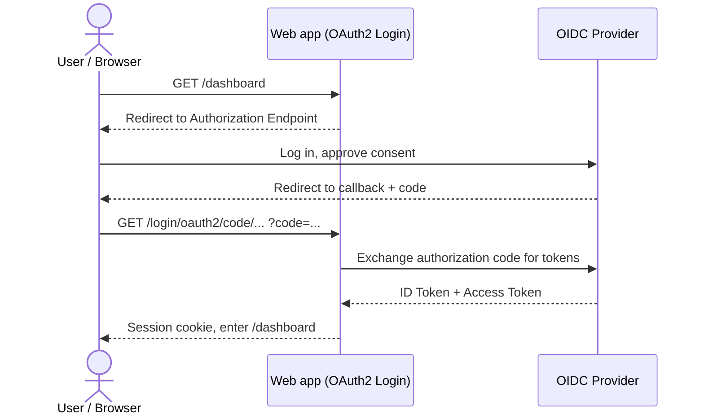
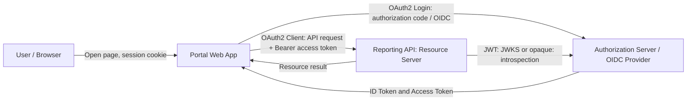

# 1.2. Distinguishing OAuth2 Login, OAuth2 Client, and Resource Server

In Spring Security, **OAuth2 Login**, **OAuth2 Client**, and **OAuth2 Resource Server** are three feature groups that solve three different questions:

- **OAuth2 Login:** How does a user log into **our application** using an account from an identity provider such as Google or an OpenID Connect (OIDC) system?
- **OAuth2 Client:** How does **our application** obtain, manage, and use an access token to call **a protected API of another system**?
- **Resource Server:** How does **our API** receive an access token from a caller and authenticate and authorize that request?

The most important point: **these are three security roles/capabilities, not three OAuth 2.0 grant types**. A Spring application can take on one, two, or all three roles, depending on the architecture.

## 1. Viewing from the Four OAuth 2.0 Components

| Component | Responsibility | Example |
| --- | --- | --- |
| **Resource Owner** | Entity that has the right to allow access to resources; usually the user | A user who owns their personal profile and calendar |
| **Client** | Application requesting access to resources | A web application for task management |
| **Authorization Server** | Authenticates, processes authorization, and issues tokens | An OIDC provider or an internal token-issuing service |
| **Resource Server** | Provides protected APIs/resources and validates access tokens | A calendar API or an orders API |

For example: a user opens the web application `portal.example.com`, logs in via an OIDC Provider, and then the portal calls `calendar-api.example.com`. In this situation:

1. **Portal uses OAuth2 Login** to log the user in.
2. **Portal acts as an OAuth2 Client** when obtaining/using an access token to call the Calendar API.
3. **Calendar API acts as a Resource Server** when validating the access token and deciding whether to allow access.
4. **OIDC Provider/Authorization Server** issues tokens. It is a separate component; `oauth2Login()` or `oauth2ResourceServer()` **does not turn** the application into an Authorization Server.

OAuth 2.0 focuses on **authorization**. **OIDC** builds on OAuth 2.0 to add a standard mechanism for **authentication**, specifically via the **ID Token**. Therefore, you must distinguish *logging in a user* from *being authorized to call an API*.

## 2. Direct Comparison Table

| Perspective | OAuth2 Login | OAuth2 Client | OAuth2 Resource Server |
| --- | --- | --- | --- |
| **Main question** | *Who is logging into the application?* | *With which token does the application call another API?* | *Does the incoming API request have a valid token and sufficient permissions?* |
| **Key HTTP direction** | Browser ↔ application ↔ identity provider | Application → Authorization Server / external API | Caller → our API |
| **Entity to authenticate** | The logging-in user | Client/user when requesting permission; the token represents the corresponding grant | The access token accompanying the incoming request |
| **Primary outcome** | User's `Authentication` in the application; usually has a login session | `OAuth2AuthorizedClient` containing an access token and possibly a refresh token | `Authentication` corresponding to the accepted bearer token |
| **Common grants** | `authorization_code` (typically with OIDC) | `authorization_code`, `client_credentials`, `refresh_token`, and supported extension grants | **Does not execute a grant** when handling normal requests |
| **Spring Security mechanism** | `http.oauth2Login(...)` | `http.oauth2Client(...)`, `OAuth2AuthorizedClientManager`, HTTP client integration | `http.oauth2ResourceServer(...).jwt(...)` or `opaqueToken(...)` |
| **Common application types** | Web apps with users and browsers | Web apps, BFFs, backends calling APIs, service-to-service | REST APIs, microservices, API gateways validating bearer tokens |
| **Provides a default login page?** | Can provide a default login page and initiate redirects | Does not mean logging into the application | Has no default browser login flow |
| **Validates incoming tokens to an API?** | Not its primary function | Not its primary function | Yes |

**Subtle distinction:** OAuth2 Login often **uses OAuth2 Client capabilities under the hood**, because the login process also needs to send the browser to the Authorization Server and exchange the authorization code for tokens. However, configuring OAuth2 Client alone does not mean user login is enabled; conversely, a successful login does not mean every outbound HTTP request automatically carries an access token.

## 3. OAuth2 Login: Logging Users into the Application

### 3.1. Processing Flow

A web application using `oauth2Login()` with an OIDC provider typically handles this as follows:

1. The user requests a page requiring authentication, such as `/dashboard`.
2. The application redirects the browser to the provider's Authorization Endpoint, along with parameters such as `client_id`, `redirect_uri`, `state`, `scope`, and PKCE when applicable.
3. The user logs in and grants consent on the provider side.
4. The provider redirects the browser back to the application's callback with an **authorization code**.
5. The application backend exchanges the code for tokens at the Token Endpoint; in OIDC, the response typically includes an **ID Token** and an **access token**.
6. Spring Security validates the appropriate information, builds a principal (`OidcUser` for OIDC, or `OAuth2User` for non-OIDC OAuth2 providers), and stores the authentication in `SecurityContext`.
7. In a session-based web application, subsequent requests are usually recognized via a **session cookie**. The browser **does not need** to send an access token to the web app itself just because it uses OAuth2 Login.

Simplified diagram:



> **An ID Token is different from an access token.** An OIDC ID Token proves authentication session details for the **client** (with `aud` typically being the client ID). An access token is designed to **access a Resource Server**. Never send an ID Token instead of an access token to an API just because both may be in JWT format.

### 3.2. Spring Boot Example: Logging In with Google OIDC

Common dependencies for a web app:

```gradle
dependencies {
    implementation 'org.springframework.boot:spring-boot-starter-security'
    implementation 'org.springframework.boot:spring-boot-starter-oauth2-client'
}
```

Client declaration in `application.yml`:

```yaml
spring:
  security:
    oauth2:
      client:
        registration:
          google:
            client-id: ${GOOGLE_CLIENT_ID}
            client-secret: ${GOOGLE_CLIENT_SECRET}
            scope: openid, profile, email
```

Example `SecurityFilterChain`:

```java
@Configuration
class WebLoginSecurity {
    @Bean
    SecurityFilterChain webSecurity(HttpSecurity http) throws Exception {
        http
            .authorizeHttpRequests(auth -> auth
                .requestMatchers("/", "/public/**").permitAll()
                .anyRequest().authenticated()
            )
            .oauth2Login(Customizer.withDefaults());
        return http.build();
    }
}
```

Here `HttpSecurity`, `SecurityFilterChain`, `@Configuration`, `@Bean`, and `Customizer` come from the corresponding Spring Security/Spring Framework packages; the example omits `import` statements to focus on configuration. With the default configuration, the flow can be started via `/oauth2/authorization/google`; the default callback is `/login/oauth2/code/google`. The callback URL must be registered correspondingly at the provider. In real deployments, you must configure HTTPS, reverse proxy, and `redirect_uri` for the exact public address.

When the provider supports the OIDC standard and the `openid` scope is requested, the principal can be an `OidcUser`:

```java
@GetMapping("/whoami")
Map<String, Object> whoami(@AuthenticationPrincipal OidcUser user) {
    return Map.of(
        "subject", user.getSubject(),
        "displayName", user.getFullName() == null ? "" : user.getFullName()
    );
}
```

The example above only illustrates an endpoint in a `@RestController`; returning sensitive information must be evaluated according to application requirements. If logging in through an OAuth2 Provider that does not support OIDC, such as some GitHub configurations, Spring Security may use `OAuth2User` and data from the provider's UserInfo/API instead of `OidcUser`.

### 3.3. When OAuth2 Login Is the Right Choice

- A website featuring **"Sign in with Google"** or "Login with Corporate SSO".
- A Backend for Frontend (BFF) managing user login sessions and then accessing other services on their behalf.
- An application needing to read OIDC identity information (`sub`, possibly name/email depending on scope) to link with an internal account.

**Do not choose `oauth2Login()` alone** to protect a purely machine-called API using `Authorization: Bearer ...`: that is a Resource Server problem.

## 4. OAuth2 Client: Obtaining and Using Tokens to Call Other APIs

### 4.1. Responsibilities and Grant Types

In OAuth 2.0, the **client** is the application requesting access permissions. Spring Security OAuth2 Client supports managing `ClientRegistration`, obtaining tokens, renewing them when appropriate, and attaching tokens to outgoing requests.

| Scenario | Grant / mechanism | Entity represented by the access permission |
| --- | --- | --- |
| Web app calling an API on behalf of a user after their approval | `authorization_code`, potentially continued with `refresh_token` | Permissions delegated by the user to the client |
| Service A calling Service B without an interactive user | `client_credentials` | Application/service A itself |
| Access token expired and a valid refresh token exists | `refresh_token` | Renews previously granted permissions; not a new login step |

`client_credentials` **does not log in a user** and does not automatically create an `OidcUser`. A service token must not be assumed by default to represent a specific individual. Which grants are permitted depends on the Authorization Server, client type, and registration configuration.

Important objects in Spring Security:

- `ClientRegistration`: describes client ID, client secret/client authentication method, grant type, scopes, and provider endpoints.
- `ClientRegistrationRepository`: looks up registrations by `registrationId`.
- `OAuth2AuthorizedClient`: binds a registration to the received access token and (if present) refresh token.
- `OAuth2AuthorizedClientService` / `OAuth2AuthorizedClientRepository`: stores or loads authorized clients; the choice depends on a service environment or web request environment.
- `OAuth2AuthorizedClientManager`: coordinates issuing/reissuing tokens through `OAuth2AuthorizedClientProvider`; commonly paired with `RestClient` or `WebClient` when calling APIs.

### 4.2. Service-to-Service Example with `client_credentials`

Suppose `orders-service` needs to call `reporting-api`. `orders-service` is the **OAuth2 Client**; `reporting-api` is the **Resource Server**.

Dependencies:

```gradle
dependencies {
    implementation 'org.springframework.boot:spring-boot-starter-oauth2-client'
    implementation 'org.springframework.boot:spring-boot-starter-web'
}
```

`application.yml` on the **orders-service** side:

```yaml
spring:
  security:
    oauth2:
      client:
        registration:
          reporting:
            provider: company-idp
            client-id: ${REPORTING_CLIENT_ID}
            client-secret: ${REPORTING_CLIENT_SECRET}
            authorization-grant-type: client_credentials
            scope: report.read
        provider:
          company-idp:
            token-uri: https://idp.example.com/oauth2/token
```

Example using `OAuth2AuthorizedClientManager` outside the context of a user's HTTP request:

```java
@Configuration
class ReportingOAuth2ClientConfig {

    @Bean
    OAuth2AuthorizedClientManager authorizedClientManager(
            ClientRegistrationRepository registrations,
            OAuth2AuthorizedClientService authorizedClients) {

        OAuth2AuthorizedClientProvider provider =
            OAuth2AuthorizedClientProviderBuilder.builder()
                .clientCredentials()
                .build();

        var manager = new AuthorizedClientServiceOAuth2AuthorizedClientManager(
            registrations, authorizedClients);
        manager.setAuthorizedClientProvider(provider);
        return manager;
    }
}
```

Calling an API with a bearer token:

```java
@Service
class ReportingClient {
    private final OAuth2AuthorizedClientManager tokenManager;
    private final RestClient restClient = RestClient.create();

    ReportingClient(OAuth2AuthorizedClientManager tokenManager) {
        this.tokenManager = tokenManager;
    }

    String getSummary() {
        var request = OAuth2AuthorizeRequest
            .withClientRegistrationId("reporting")
            .principal("orders-service")
            .build();

        OAuth2AuthorizedClient client = tokenManager.authorize(request);
        if (client == null) {
            throw new IllegalStateException("Cannot authorize reporting client");
        }

        return restClient.get()
            .uri("https://reporting-api.example.com/api/summary")
            .headers(headers -> headers.setBearerAuth(
                client.getAccessToken().getTokenValue()))
            .retrieve()
            .body(String.class);
    }
}
```

In this example, the manager requests a token from the Token Endpoint, stores/reuses the authorized client according to the configured policy, and can request a new token when needed. `principal("orders-service")` is simply **an identifier used in the authorized client management context** for this job; it does not mean the service is logging in with a user account of that name. The example shows classes in the same package with common Spring `import` statements omitted, and uses Spring Framework 6.1+'s `RestClient`.

In a real application, you can register an `OAuth2ClientHttpRequestInterceptor` on `RestClient` to automatically add bearer tokens to outbound requests instead of setting headers manually. You must select the right client registration for each call so you do not send the wrong token to an unrelated API.

### 4.3. Common Pitfalls

- `oauth2Client()` **does not mean** the user has been logged into the web app. It supports the OAuth client role, including authorization code and other applicable grants.
- Declaring `spring.security.oauth2.client.registration` only describes how to obtain tokens; API-calling code still must use the token via `RestClient`, `WebClient`, or an OAuth2-integrated HTTP client.
- A client can be a **confidential client** (backend securely holds a secret) or a **public client** (SPA/mobile cannot keep a secret). Public clients use authorization code with PKCE per proper design; **never embed a client secret in JavaScript/mobile apps**.
- An access token can be a JWT or an opaque string. An OAuth2 Client does not need to parse the token itself to use it; the token is a credential to send to the appropriate Resource Server.

## 5. Resource Server: Protecting APIs That Accept Bearer Tokens

### 5.1. Processing Flow

A client that already has an access token calls the API:

```http
GET /api/reports HTTP/1.1
Host: reporting-api.example.com
Authorization: Bearer eyJhbGciOi...
```

On the `reporting-api` side, Spring Security Resource Server:

1. Extracts the bearer token from the `Authorization` header (default mechanism).
2. **Validates the token**: for JWT, checks the signature, expiration, and claims according to configuration; for opaque tokens, can use the Authorization Server's introspection endpoint.
3. Converts a valid token into an `Authentication` and authorities in Spring Security.
4. Enforces authorization rules such as scope `report.read` for the protected endpoint.
5. Allows the request or returns an appropriate error: typically **401 Unauthorized** when unauthenticated/token is invalid; **403 Forbidden** when authenticated but lacking sufficient permissions.

A Resource Server **does not** redirect the browser to an SSO page, **does not** perform an authorization code exchange on every request, and **does not** need to call the Authorization Server for every JWT if it can verify signatures using public keys fetched from JWKS and cached appropriately. For opaque tokens, the introspection mechanism may require calling the Authorization Server.

### 5.2. JWT Resource Server Example

Dependencies:

```gradle
dependencies {
    implementation 'org.springframework.boot:spring-boot-starter-web'
    implementation 'org.springframework.boot:spring-boot-starter-security'
    implementation 'org.springframework.boot:spring-boot-starter-oauth2-resource-server'
}
```

`application.yml` on the **reporting-api** side:

```yaml
spring:
  security:
    oauth2:
      resourceserver:
        jwt:
          issuer-uri: https://idp.example.com/realms/enterprise
          audiences: reporting-api
```

Java example:

```java
@Configuration
class ReportingApiSecurity {
    @Bean
    SecurityFilterChain apiSecurity(HttpSecurity http) throws Exception {
        http
            .authorizeHttpRequests(auth -> auth
                .requestMatchers("/api/reports/**")
                    .hasAuthority("SCOPE_report.read")
                .anyRequest().authenticated()
            )
            .oauth2ResourceServer(oauth2 ->
                oauth2.jwt(Customizer.withDefaults()));
        return http.build();
    }
}
```

When a JWT has a scope claim such as `"scope": "report.read"`, Spring Security by default maps the scope to the authority `SCOPE_report.read`. Validating `aud` ensures the token was issued for the intended API; configuring `issuer-uri` mainly helps discover metadata/JWKS and validate the issuer, **and issuer validation should not be treated as a substitute for audience validation**. The `audiences` property depends on the Spring Boot version in use; a custom `JwtValidator` can be configured when needed.

For JWTs, `JwtDecoder` verifies the signature and configured claims, and then `JwtAuthenticationConverter` can convert claims into authorities. For opaque tokens, use `oauth2ResourceServer(oauth2 -> oauth2.opaqueToken(...))` and configure introspection accordingly; the API must not attempt to `Base64`/decode an opaque token as a JWT.

### 5.3. How Do Bearer Tokens and Session Cookies Differ?

| Case | Commonly Used Mechanism |
| --- | --- |
| User accessing a server-rendered UI after OAuth2 Login | Session cookie linked to the login state at the web app |
| A service calling a protected REST API | `Authorization: Bearer <access_token>` on every request |
| SPA/mobile calling an API | Access token transmitted under an appropriate token-protection design (typically via bearer header) |

You should not disable CSRF globally for the entire application just because OAuth2 is present: **endpoints using session cookies** have a different risk model from stateless APIs that only accept bearer headers. If an application serves both browsers and APIs, you should separate `SecurityFilterChain`s by URL area and configure CSRF, sessions, and entry points for each area.

## 6. How the Three Capabilities Work Together in Real Architecture

The following diagram shows a common setup where **one web app handles both OAuth2 Login and OAuth2 Client**:



Note that the diagram describes logical responsibilities: with **JWT**, the Resource Server typically fetches/updates verification keys from JWKS when needed rather than contacting the Authorization Server on every request. The web app can use an access token tied to the user or a separate service-to-service token; the choice must match business needs and permission scopes.

One application can both provide a web UI and expose REST APIs. In that case, **two authentication mechanisms are needed for the two endpoint groups**, for example:

```java
@Bean
@Order(1)
SecurityFilterChain apiChain(HttpSecurity http) throws Exception {
    http
        .securityMatcher("/api/**")
        .authorizeHttpRequests(auth -> auth.anyRequest().authenticated())
        .sessionManagement(session -> session
            .sessionCreationPolicy(SessionCreationPolicy.STATELESS))
        .oauth2ResourceServer(oauth2 ->
            oauth2.jwt(Customizer.withDefaults()));
    return http.build();
}

@Bean
@Order(2)
SecurityFilterChain browserChain(HttpSecurity http) throws Exception {
    http
        .authorizeHttpRequests(auth -> auth
            .requestMatchers("/", "/assets/**").permitAll()
            .anyRequest().authenticated())
        .oauth2Login(Customizer.withDefaults());
    return http.build();
}
```

These are **two chains within the same application**; Spring Security picks the first chain matching the request. A real-world configuration must also decide CSRF/CORS policies, session storage, and error handling for each area; if a stateless API only accepts bearer tokens, CSRF can be configured appropriately **within the API chain**. OAuth2 Client for outbound calls is an independent responsibility and can also be integrated into this application.

## 7. Choosing Configuration Using Business Questions

| Need | Suitable Capability | Reason |
| --- | --- | --- |
| "Users click **Sign in with Google** to enter the website" | **OAuth2 Login** | Establishes user identity/login session for the website |
| "Backend calls a partner API **on behalf of a user** who granted permission" | **OAuth2 Client**, often combined with **OAuth2 Login** if the backend itself manages login | Holds and uses access tokens for external APIs |
| "Service automatically sends a report every night" | **OAuth2 Client** with `client_credentials` if supported by the Authorization Server | Uses an application token without needing a browser/user |
| "API `/api/orders` only accepts requests with a valid access token and `orders.read`" | **Resource Server** | Validates bearer tokens along with access permissions |
| "A BFF logs in employees, calls APIs, and also exposes a bearer endpoint for another service" | **OAuth2 Login + OAuth2 Client + Resource Server** | Each capability handles a different flow |
| "System must **issue** access tokens to other applications" | **Authorization Server**, a different component/problem | The three capabilities being compared do not create an OAuth2 Authorization Server |

## 8. Common Mistakes and How to Fix Them

1. **Confusing OAuth2 Login with OAuth2 Client.** Login creates authentication for the user in the application; client manages obtaining/using tokens to call external resources. The two capabilities may share an authorization code, but they serve different goals.
2. **Confusing OAuth2 Client with Resource Server.** Client **sends** a bearer token when calling an API; Resource Server **receives and validates** a bearer token. One service can be a client toward API B and a resource server for API A.
3. **Using `oauth2Login()` for a pure bearer REST API.** An API that does not need a login page will typically use Resource Server. Enabling OAuth2 Login can lead to redirecting to a login page instead of returning `401` as expected by the API.
4. **Using an ID Token to call APIs.** An ID Token is for the client to authenticate user identity; an API needs an access token with the proper `aud`/scope.
5. **Assuming any JWT with a valid signature can be used.** A Resource Server must validate the issuer, expiration, trusted algorithm/key, audience, and required permissions. Do not skip validations just because you can read the JWT payload.
6. **Assuming `client_credentials` represents a user.** This grant represents the client's permissions. If business logic requires user permissions, design an appropriate delegation flow instead of attaching a fake user identity to a service token.
7. **Assuming a successful login means another API will automatically accept the cookie.** A portal's session cookie and an API's access token have different purposes, scopes, and recipients.
8. **Assuming a Resource Server must call the IdP for every request.** This depends on the token type and validation method: JWTs are typically verified locally using trusted keys; opaque tokens typically require introspection.

## 9. Self-Check Knowledge

**Scenario A.** An admin portal logs in via company SSO, then calls the orders API on behalf of an employee. What is needed?

**Answer:** The admin portal uses **OAuth2 Login** to authenticate the employee, and **OAuth2 Client** to obtain/send the appropriate access token when calling the API. The orders API needs **Resource Server** to validate and authorize the access token.

**Scenario B.** A headless scheduler uses `client_credentials` to call an API every hour. Is `oauth2Login()` needed?

**Answer:** **No.** The scheduler uses **OAuth2 Client** to obtain and send the application's token; the target API uses **Resource Server**.

**Scenario C.** `GET /api/data` sends a bearer token with scope `data.read`, but the token was issued for another API. Is checking only signature and scope enough?

**Answer:** **Not yet.** The Resource Server also needs to confirm the token is valid for the **intended audience** (as well as issuer, expiration, and related constraints). Tokens with the same scope are not implicitly allowed across different APIs.

**Scenario D.** A backend receives tokens from clients and wants to protect `/api/data`. Is it right to use `oauth2Client()` because both contain "OAuth2"?

**Answer:** **No.** For **incoming** requests, the backend must configure **Resource Server**. Only add OAuth2 Client when the backend also needs to **call other external APIs**.

## 10. Official References

- [Spring Security — OAuth 2.0 Login](https://docs.spring.io/spring-security/reference/servlet/oauth2/login/index.html)
- [Spring Security — OAuth 2.0 Client](https://docs.spring.io/spring-security/reference/servlet/oauth2/client/index.html)
- [Spring Security — OAuth2 Authorized Clients and RestClient](https://docs.spring.io/spring-security/reference/servlet/oauth2/client/authorized-clients.html)
- [Spring Security — OAuth 2.0 Resource Server](https://docs.spring.io/spring-security/reference/servlet/oauth2/resource-server/index.html)
- [Spring Security — JWT Resource Server](https://docs.spring.io/spring-security/reference/servlet/oauth2/resource-server/jwt.html)
- [OpenID Connect Core 1.0](https://openid.net/specs/openid-connect-core-1_0.html)

**Key Takeaway:** **Login** authenticates *the user in the application*; **Client** requests and uses *tokens to call outbound*; **Resource Server** authenticates and authorizes *tokens sent into the API*. Decide based on **the request flow and the application's responsibilities**, not from the token name or whether the system uses OIDC.
