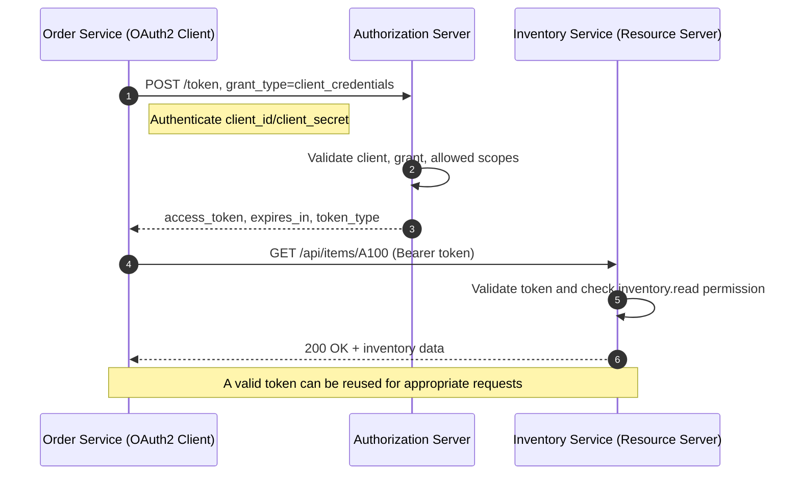

# 1.4. Service-to-Service Communication with Client Credentials Use Case

## 1. Problem: A Service Calling Another Service's API

In microservices architectures, not every API call originates from a logged-in user. For example:

- **Order Service** checks inventory at **Inventory Service** before confirming an order.
- A **scheduled job** calls a Reporting API every night to aggregate metrics.
- A **message consumer** receives an event from a queue and calls an internal service's API.
- A backend application connects to a partner's API using a registered application identity.

These cases require authenticating **the calling service**. They typically do not have an interactive user, browser, login page, or callback URL to run an Authorization Code flow.

OAuth 2.0 provides the **Client Credentials Grant**: the client authenticates with credentials issued to itself, receives an **access token** from the Authorization Server, and uses the token to call the API. In Spring, **Spring Security OAuth2 Client** provides the mechanism to configure clients, obtain tokens, and manage the token lifecycle.

> **Principle:** With `client_credentials`, the access token represents the access permissions of the **client/service**, not implicitly an end user. The receiving service must still perform authentication and authorization on the **Resource Server** side.

## 2. Components and Processing Flow

The running use case throughout this lesson: `orders-service` needs to read stock quantities from `inventory-service`.

| Component | Responsibility | Example |
| --- | --- | --- |
| **OAuth2 Client** | Requests access tokens and calls APIs | `orders-service` |
| **Authorization Server** | Authenticates the client, issues tokens per allowed grant and permissions | `https://id.example.com/realms/demo` |
| **Resource Server** | Protected API, validates tokens and permissions | `inventory-service` |
| **Client registration** | Declares client ID, authentication method, grant, scopes, and token endpoint | Registration named `inventory` |
| **Access token** | Access credential sent in a Bearer header | Short-lived token |

### 2.1. Sequence Diagram



Explanation:

1. An administrator registers `orders-service` as a **confidential client** at the Authorization Server and enables the `client_credentials` grant.
2. When it needs to access the Inventory API, Order Service sends a request to the **token endpoint**, authenticating its application identity and requesting the `inventory.read` scope.
3. The Authorization Server checks the client's permissions and issues a time-limited access token.
4. Order Service attaches the `Authorization: Bearer <access_token>` header when calling the Inventory API.
5. Inventory Service validates the token (signature or introspection, expiration, issuer, audience) and permissions for the corresponding endpoint.
6. When the token expires, the OAuth2 Client requests a new token. This grant normally **does not need a refresh token**.

The access token may be a **JWT** or an **opaque token**, depending on the Authorization Server. The client should not decode the token and depend on internal claims; validating the token is the Resource Server's responsibility.

### 2.2. HTTP-Level Token Request Example

With `client_secret_basic` client authentication:

```http
POST /realms/demo/protocol/openid-connect/token HTTP/1.1
Host: id.example.com
Authorization: Basic <base64(client_id:client_secret)>
Content-Type: application/x-www-form-urlencoded

grant_type=client_credentials&scope=inventory.read
```

Example response:

```json
{
  "access_token": "<access-token>",
  "token_type": "Bearer",
  "expires_in": 300,
  "scope": "inventory.read"
}
```

| Field | Meaning |
| --- | --- |
| `access_token` | Token used to access the API; must be protected like a secret |
| `token_type` | Usually `Bearer`; the holder can use it within the granted scope |
| `expires_in` | Number of seconds the token remains valid from issuance |
| `scope` | Permissions actually granted by the Authorization Server, which may be narrower than requested |

The path `/realms/demo/protocol/openid-connect/token` is only a **Keycloak-style example**; other providers have different URLs and policies. Besides secrets, an Authorization Server may support client authentication methods such as `private_key_jwt` or mTLS.

## 3. Choosing the Right Use Case and Distinguishing from OIDC

| Need | Suitable Solution | Identity / Context |
| --- | --- | --- |
| Service A accesses Service B using Service A's own permissions | **Client Credentials** | Application identity |
| User logs in and lets an application access their data | **Authorization Code + PKCE** (depending on app type) | User together with client |
| API accepts a Bearer token and checks permissions | **OAuth2 Resource Server** | Identity/permissions in the token |
| Service A calls B on behalf of a user, and B needs the user's identity | Token propagation/delegation or token exchange if supported by the system | Delegated user context |

**When to use:** server-to-server jobs, background workers, schedulers, batch jobs, backend integrations with service-level access.

**When it is insufficient:** Order Service needs to read data specific to each logged-in user and Inventory Service needs to verify that user. A `client_credentials` token does not inherently carry user permissions; you must design an appropriate user authorization flow.

### How Do OAuth 2.0 and OIDC Differ in This Lesson?

**Client Credentials is an OAuth 2.0 grant**, not an OpenID Connect (OIDC) user login flow. An Authorization Server can support both OAuth 2.0 and OIDC on the same infrastructure, but for machine-to-machine communication:

- The service uses an **access token** to call APIs.
- Normally there is **no ID token** used to authenticate a user.
- The `openid` scope is not needed just to run Client Credentials.
- There are no browser redirects, login screens, or interactive user steps.

Thus, the module name **Spring Security OAuth 2.0 OIDC Client** covers multiple kinds of OAuth clients; this use case focuses on OAuth 2.0 Client Credentials.

## 4. Implementing Order Service with Spring Security OAuth2 Client

Suppose there are two separate Spring Boot applications:

- **Order Service:** calls `GET https://inventory.internal.example/api/items/{sku}`, acting as an OAuth2 Client.
- **Inventory Service:** validates the token and requires the `inventory.read` scope, acting as a Resource Server.

The examples use the **Spring Boot 3.x / Spring Security 6.x** style, a Servlet application, and `RestClient`. Domain names, URLs, scopes, payloads, and client identifiers are illustrative only; align them with your real Authorization Server and API contract.

### 4.1. Dependencies

In Order Service's `pom.xml`:

```xml
<dependencies>
    <dependency>
        <groupId>org.springframework.boot</groupId>
        <artifactId>spring-boot-starter-web</artifactId>
    </dependency>
    <dependency>
        <groupId>org.springframework.boot</groupId>
        <artifactId>spring-boot-starter-oauth2-client</artifactId>
    </dependency>
</dependencies>
```

The OAuth2 Client starter provides the `ClientRegistrationRepository`, `OAuth2AuthorizedClientService`, and token-issuance/management infrastructure.

### 4.2. Configuring Client Registration

In Order Service's `application.yml`:

```yaml
spring:
  security:
    oauth2:
      client:
        registration:
          inventory:
            provider: internal-idp
            client-id: ${INVENTORY_CLIENT_ID}
            client-secret: ${INVENTORY_CLIENT_SECRET}
            client-authentication-method: client_secret_basic
            authorization-grant-type: client_credentials
            scope:
              - inventory.read
        provider:
          internal-idp:
            token-uri: https://id.example.com/realms/demo/protocol/openid-connect/token

inventory:
  base-url: https://inventory.internal.example
```

| Configuration | Role |
| --- | --- |
| `registration.inventory` | Local ID used by code to select the client |
| `client-id`, `client-secret` | Identifier/credentials issued by the Authorization Server |
| `authorization-grant-type` | The `client_credentials` grant |
| `client-authentication-method` | Authentication method against the token endpoint |
| `scope` | Requested permissions, which must be within the permissions granted to the client |
| `provider.internal-idp.token-uri` | Endpoint that issues access tokens |

`inventory` is the **registration name** in Spring; it does not have to match `client-id`. Never put real secrets directly in the repository; inject them from the environment or a secret manager.

### 4.3. Configuring the Manager for Machine-to-Machine Jobs

`AuthorizedClientServiceOAuth2AuthorizedClientManager` is suited for tasks that do not depend on a user's HTTP request, such as schedulers, consumers, or internal services.

```java
import org.springframework.context.annotation.Bean;
import org.springframework.context.annotation.Configuration;
import org.springframework.security.oauth2.client.AuthorizedClientServiceOAuth2AuthorizedClientManager;
import org.springframework.security.oauth2.client.OAuth2AuthorizedClientManager;
import org.springframework.security.oauth2.client.OAuth2AuthorizedClientProvider;
import org.springframework.security.oauth2.client.OAuth2AuthorizedClientProviderBuilder;
import org.springframework.security.oauth2.client.OAuth2AuthorizedClientService;
import org.springframework.security.oauth2.client.registration.ClientRegistrationRepository;

@Configuration
public class OAuth2ClientConfiguration {

    @Bean
    OAuth2AuthorizedClientManager authorizedClientManager(
            ClientRegistrationRepository registrations,
            OAuth2AuthorizedClientService authorizedClients) {

        OAuth2AuthorizedClientProvider provider =
                OAuth2AuthorizedClientProviderBuilder.builder()
                        .clientCredentials()
                        .build();

        var manager = new AuthorizedClientServiceOAuth2AuthorizedClientManager(
                registrations, authorizedClients);
        manager.setAuthorizedClientProvider(provider);
        return manager;
    }
}
```

`OAuth2AuthorizedClientProvider` handles the grant and decides when a new token is needed. `OAuth2AuthorizedClientManager` coordinates the authorization process; `OAuth2AuthorizedClientService` stores and looks up authorized client state by registration and principal.

### 4.4. Requesting a Token and Calling the Inventory API

```java
import org.springframework.beans.factory.annotation.Value;
import org.springframework.security.oauth2.client.OAuth2AuthorizeRequest;
import org.springframework.security.oauth2.client.OAuth2AuthorizedClient;
import org.springframework.security.oauth2.client.OAuth2AuthorizedClientManager;
import org.springframework.stereotype.Service;
import org.springframework.web.client.RestClient;

@Service
public class InventoryGateway {

    private static final String SERVICE_PRINCIPAL = "orders-service";

    private final OAuth2AuthorizedClientManager authorizedClientManager;
    private final RestClient inventoryApi;

    public InventoryGateway(
            OAuth2AuthorizedClientManager authorizedClientManager,
            @Value("${inventory.base-url}") String inventoryBaseUrl) {
        this.authorizedClientManager = authorizedClientManager;
        this.inventoryApi = RestClient.builder()
                .baseUrl(inventoryBaseUrl)
                .build();
    }

    public InventoryItem findItem(String sku) {
        OAuth2AuthorizeRequest request = OAuth2AuthorizeRequest
                .withClientRegistrationId("inventory")
                .principal(SERVICE_PRINCIPAL)
                .build();

        OAuth2AuthorizedClient client =
                authorizedClientManager.authorize(request);
        if (client == null) {
            throw new IllegalStateException(
                    "Unable to obtain access token for Inventory API");
        }

        return inventoryApi.get()
                .uri("/api/items/{sku}", sku)
                .headers(headers -> headers.setBearerAuth(
                        client.getAccessToken().getTokenValue()))
                .retrieve()
                .body(InventoryItem.class);
    }

    public record InventoryItem(String sku, int availableQuantity) {}
}
```

Explanation of key points:

1. `withClientRegistrationId("inventory")` uses the exact client declared in `application.yml`.
2. `principal("orders-service")` is a **stable technical identifier** for the manager to store/look up the authorized client; it is **not** an end-user name and does not make the Authorization Server treat the token as if that user logged in.
3. `authorize(request)` retrieves an authorized client with a still-valid token or executes the Client Credentials Grant when needed. You must handle a `null` result.
4. `headers(...setBearerAuth(...))` places the access token in `Authorization: Bearer ...`.
5. `RestClient` sends the call to Inventory Service and maps the JSON response to the application data type.

Do not manually POST to the token endpoint on every request when already using `OAuth2AuthorizedClientManager`. Also avoid storing an access token in a static field and reusing it forever, because the token will expire.

> If the application uses **WebFlux/WebClient**, use the corresponding **Reactive OAuth2 Client** components, such as `ReactiveOAuth2AuthorizedClientManager`. The example above is for a Servlet application.

## 5. On the Inventory Service Side: The Resource Server Must Validate the Token

Order Service obtaining a token does not mean the API is already secure. **Inventory Service** must validate the access token and enforce authorization policies.

### 5.1. Dependencies and JWT Configuration

In Inventory Service's `pom.xml`:

```xml
<dependency>
    <groupId>org.springframework.boot</groupId>
    <artifactId>spring-boot-starter-oauth2-resource-server</artifactId>
</dependency>
```

Example `application.yml` when the Authorization Server issues JWTs:

```yaml
spring:
  security:
    oauth2:
      resourceserver:
        jwt:
          issuer-uri: https://id.example.com/realms/demo
```

`issuer-uri` is the **issuer** address declared by the JWT, typically the realm/tenant root. It is **different** from the `token-uri` used in Order Service. Spring Security needs access to the corresponding metadata/JWK to validate the JWT using the Authorization Server's signature.

If the Authorization Server issues **opaque tokens**, Inventory Service must configure **token introspection** instead of JWT decoding; you cannot assume an opaque token string can be processed as a JWT.

### 5.2. Scope-Based Authorization

```java
import org.springframework.context.annotation.Bean;
import org.springframework.context.annotation.Configuration;
import org.springframework.http.HttpMethod;
import org.springframework.security.config.Customizer;
import org.springframework.security.config.annotation.web.builders.HttpSecurity;
import org.springframework.security.web.SecurityFilterChain;

@Configuration
public class InventorySecurityConfiguration {

    @Bean
    SecurityFilterChain apiSecurity(HttpSecurity http) throws Exception {
        http.authorizeHttpRequests(authorize -> authorize
                .requestMatchers(HttpMethod.GET, "/api/items/**")
                .hasAuthority("SCOPE_inventory.read")
                .anyRequest().denyAll());

        http.oauth2ResourceServer(oauth2 -> oauth2
                .jwt(Customizer.withDefaults()));

        return http.build();
    }
}
```

For JWTs containing a `scope` or `scp` claim in a format supported by Spring Security, scopes are typically mapped to authorities prefixed with `SCOPE_`. Thus the `inventory.read` scope corresponds to the `SCOPE_inventory.read` authority. Some Authorization Servers place permissions in custom claims such as `roles` or other structures; in those cases you must configure a converter matching the real token format.

**Validating audience (`aud`) is an important constraint:** Inventory Service should only accept tokens issued specifically for the Inventory API itself (e.g., `inventory-api`). Validating only signature and issuer does not guarantee the token is intended for the right resource. Configure an additional **audience validator** matching your Spring Security version and the Authorization Server's token contract; do not assume merely declaring `issuer-uri` checks every desired audience.

In addition to token validation, Inventory Service must still enforce business permissions, tenant boundaries, or data scopes when required. Scopes do not replace the entire application authorization model.

### 5.3. Division of Security Responsibilities

| Decision | Responsible Component |
| --- | --- |
| Are the Client ID/secret valid? | Authorization Server |
| Is the client allowed to use the `client_credentials` grant? | Authorization Server |
| Is the client allowed to request `inventory.read`? | Authorization Server |
| Is the access token valid, unexpired, and matching the expected issuer and audience? | Resource Server |
| Does the token have permission to call `GET /api/items/{sku}`? | Resource Server |
| Which inventory data may be returned according to business rules? | Inventory Service |

Grant only the minimum permissions necessary for each service. Do not share one client ID with every scope across all microservices.

## 6. Token Lifecycle and Production Operations

### 6.1. How Spring Security Reuses Tokens

`OAuth2AuthorizedClientService` stores authorized clients by **registration ID / principal** pair. When calls share `inventory` and `orders-service`, the manager can reuse a still-valid token. When the token expires or needs reissuance per the provider mechanism, the manager executes a new Client Credentials Grant.

Most Client Credentials implementations issue a new access token instead of a refresh token. With multiple instances of Order Service, each instance may store tokens in its own memory and send token requests concurrently; keep the Authorization Server's limits and capacity in mind. The default token storage mechanism can differ depending on application configuration; never assume tokens are shared across instances automatically.

### 6.2. Secrets, Privileges, and Networking

- Store `client_secret` in a secret manager or protected environment configuration; support secret rotation.
- Only call the token endpoint and APIs over **HTTPS/TLS**, verifying certificates and hostnames.
- Never log access tokens, secrets, raw `Authorization` headers, or token endpoint responses.
- Each service should have its own client and minimal scopes, such as `inventory.read` rather than `inventory.write` if it only reads.
- For higher security requirements, consider client authentication with `private_key_jwt` or mTLS if supported by the provider.
- Separate issuers, registrations, and credentials across dev/staging/production environments.
- Apply timeouts, bounded retries, and transient error handling when the Authorization Server or target API experiences disruptions. Avoid continuous retries when client credentials are wrong.
- When designing actions **on behalf of a user**, never use a service token as proof of user consent; choose an appropriate user authorization/context mechanism.

### 6.3. Incident Monitoring Without Exposing Tokens

Collect HTTP status codes, token acquisition latency, token endpoint failure counts, API response times, `clientRegistrationId`, and correlation IDs. Only log non-sensitive information; avoid printing tokens or secrets into traces/exceptions and monitoring systems.

## 7. Handling Common Errors

| Symptom | What to Check | Resolution |
| --- | --- | --- |
| Token endpoint returns `invalid_client` | Wrong client ID/secret, disabled client, mismatched authentication method | Check registration and authentication policy at the Authorization Server |
| Token endpoint returns `unauthorized_client` | Client is not permitted to use `client_credentials` | Grant the appropriate grant type to the client |
| Token endpoint returns `invalid_scope` | Scope does not exist or has not been granted to the client | Cross-check scopes against the Authorization Server configuration |
| Inventory returns **401 Unauthorized** | Missing/invalid Bearer token, expired token, wrong signature/issuer/audience | Check token validation and Resource Server configuration |
| Inventory returns **403 Forbidden** | Token is valid but lacks `inventory.read` or the corresponding authority | Cross-check scopes, claims, and `SCOPE_inventory.read` |
| API or token endpoint call times out / returns 5xx | Target service, network, or Authorization Server outage | Check sanitized logs and adjust timeouts/retries |
| Fails to acquire a new token after the old one expires | Wrong registration, principal, provider, or new grant request failed | Check `OAuth2AuthorizedClientManager` and errors from the token endpoint |

In standard HTTP configuration, **401** usually indicates missing/invalid authentication, while **403** usually indicates authenticated but insufficient permissions. Gateways and custom handlers can alter the actual HTTP status codes; trace the full request path.

## 8. Flow Verification Illustration

Before integrating Java code, you can verify the client registration in a test environment. Example with Bash and `curl`:

```bash
# Retrieve real values from the system's environment/secret manager.
export INVENTORY_CLIENT_ID="orders-service"
export INVENTORY_CLIENT_SECRET="<secret-from-secret-manager>"

curl --fail-with-body \
  -u "$INVENTORY_CLIENT_ID:$INVENTORY_CLIENT_SECRET" \
  --data-urlencode "grant_type=client_credentials" \
  --data-urlencode "scope=inventory.read" \
  "https://id.example.com/realms/demo/protocol/openid-connect/token"
```

This is an **illustrative** command and has not been run against any server. In real work, avoid recording or sharing responses containing access tokens. Once you have a token from a test environment, the request to the Inventory API looks like:

```http
GET /api/items/A100 HTTP/1.1
Host: inventory.internal.example
Authorization: Bearer <received-access-token>
```

Behaviors to verify:

1. Client is granted `inventory.read` and token has the right audience → API reading stock responds successfully.
2. No token sent → typically **401**.
3. Valid token sent without `inventory.read` → typically **403**.
4. Expired token, wrong issuer, or wrong audience sent → API rejects it.
5. After the token expires, calling through `InventoryGateway` again → manager issues a new token if the Authorization Server is available and the client still has permissions.

If a request fails, determine whether the error occurred **while requesting the token** or **while the API validated the token** before changing configuration. The two stages belong to different components.

## 9. Summary of the Orders → Inventory Use Case

**Order Service** uses OAuth2 Client and the `client_credentials` grant to request an access token with an application identity. The **Authorization Server** issues tokens per allowed grant and scopes. **Inventory Service** acts as a Resource Server, validating the token and checking `inventory.read` and business policies.

In Spring Security, `ClientRegistration` describes how to connect to the Authorization Server, `OAuth2AuthorizedClientManager` manages acquiring and reusing access tokens, and the HTTP client puts the token into the Bearer header. For secure implementation, the caller protects credentials and manages the token lifecycle; the receiver checks validity, audience, permissions, and the request's data boundaries.
