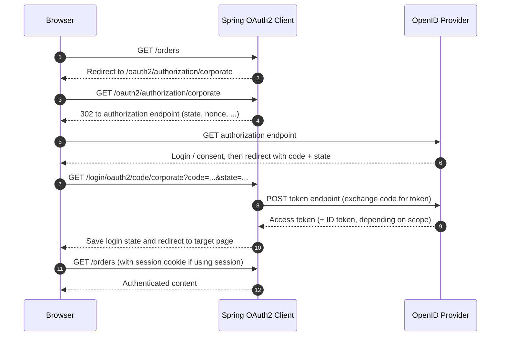
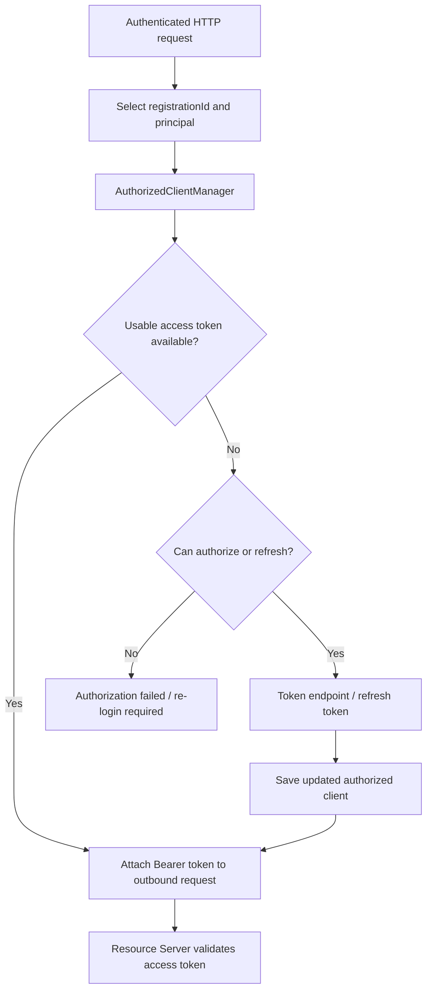

# 1.5. Servlet and Reactive Architectures in Spring Security

In a Spring application, OAuth 2.0 Client is responsible for directing users to an identity provider to log in, or obtaining and using access tokens when the application calls a protected API. Spring Security supports two primary execution models: **Servlet** (typically paired with Spring MVC) and **Reactive** (typically paired with Spring WebFlux). Both models share the same OAuth 2.0/OpenID Connect (OIDC) concepts, but differ in how they receive HTTP requests, propagate security context, store state, and execute asynchronous operations.

The goal of this lesson is to understand each model's processing flow, identify the corresponding Spring Security components, configure OAuth2 Login/OIDC and OAuth2 Client on both sides, and choose the right architecture for a real application.

## 1. Two HTTP Execution Models

### 1.1. Servlet: Filter Chain on Spring MVC

In a traditional Servlet application, the servlet container (such as Tomcat) receives an HTTP request and passes it through a chain of `jakarta.servlet.Filter`. Spring Security participates via `DelegatingFilterProxy` pointing to the `springSecurityFilterChain` bean, typically `FilterChainProxy`. This component selects the matching `SecurityFilterChain` and applies filters such as authentication, authorization, session management, or OAuth2 Login before the request reaches `DispatcherServlet`/the controller.

A synchronous request is typically processed on a single thread for most of its lifecycle; blocking I/O operations such as making HTTP calls with `RestClient` or accessing JDBC can hold that thread while waiting. Servlet also supports asynchronous processing, so Servlet should not be understood as completely unable to run async. The difference lies in its programming model and default security APIs based on Servlet request/response and filters.

```text
Browser -> Servlet container
           -> DelegatingFilterProxy
           -> FilterChainProxy
           -> SecurityFilterChain (Servlet Filter)
           -> DispatcherServlet -> Spring MVC Controller
```

Typical components:

- `HttpSecurity`: DSL for building security configuration.
- `SecurityFilterChain`: filter chain applied per `RequestMatcher`.
- `SecurityContextHolder`: accesses the `SecurityContext` of the current processing thread; the common strategy is `ThreadLocal`.
- `SecurityContextRepository`: loads/saves security context across requests when needed, such as via HTTP session.
- `OAuth2AuthorizationRequestRedirectFilter` and `OAuth2LoginAuthenticationFilter`: participate in the redirect/callback flow of OAuth2 Login.

### 1.2. Reactive: WebFilter Chain on Spring WebFlux

In a Reactive application, Spring WebFlux represents requests with `ServerWebExchange` and handles security through `org.springframework.web.server.WebFilter`. Spring Security uses `WebFilterChainProxy` to execute one or more `SecurityWebFilterChain`s; the request is then routed to a WebFlux handler/controller.

Asynchronous logic is usually described with Project Reactor's `Mono<T>` or `Flux<T>`. When I/O is performed using non-blocking APIs, a small number of event-loop threads can serve many connections waiting on I/O. However, merely returning a `Mono` does not automatically turn a JDBC operation, blocking HTTP call, or `Thread.sleep` into non-blocking I/O.

```text
Browser -> Reactive HTTP server
           -> WebFilterChainProxy
           -> SecurityWebFilterChain (WebFilter)
           -> WebFlux Handler/Controller
           -> Mono / Flux (Reactor pipeline)
```

Typical components:

- `ServerHttpSecurity`: security DSL for WebFlux.
- `SecurityWebFilterChain`: WebFilter chain protecting requests.
- `ReactiveSecurityContextHolder`: accesses the `SecurityContext` attached to the Reactor `Context`, rather than assuming a fixed thread.
- `ServerSecurityContextRepository`: loads/saves security context, which can use `WebSession`.
- `OAuth2AuthorizationRequestRedirectWebFilter` and `OAuth2LoginAuthenticationWebFilter`: components executing redirect/callback in WebFlux OAuth2 Login.

### 1.3. Quick Comparison Table

| Aspect | Servlet / Spring MVC | Reactive / Spring WebFlux |
|---|---|---|
| HTTP abstraction | `HttpServletRequest`, `HttpServletResponse` | `ServerWebExchange`, `ServerHttpRequest` |
| Security chain | `SecurityFilterChain`, Servlet `Filter` | `SecurityWebFilterChain`, `WebFilter` |
| Configuration DSL | `HttpSecurity` | `ServerHttpSecurity` |
| Context during processing | `SecurityContextHolder`, usually `ThreadLocal` | `ReactiveSecurityContextHolder`, Reactor `Context` |
| Controller return/handling style | Direct values, `Callable`, `DeferredResult`,... | `Mono<T>`, `Flux<T>`, and types supported by WebFlux |
| Common HTTP client | `RestClient` (blocking), or `WebClient` | `WebClient` with reactive pipelines |
| Client registration repository | `ClientRegistrationRepository` | `ReactiveClientRegistrationRepository` |
| OAuth2 client manager | `OAuth2AuthorizedClientManager` | `ReactiveOAuth2AuthorizedClientManager` |
| Authorized client repository | `OAuth2AuthorizedClientRepository` | `ServerOAuth2AuthorizedClientRepository` |
| Common session state | `HttpSession` | `WebSession` |

**The two stacks cannot swap APIs simply by renaming classes.** For instance, a `SecurityFilterChain` bean does not configure WebFlux security; similarly, `SecurityWebFilterChain` does not run in Spring MVC. When both `spring-boot-starter-web` and `spring-boot-starter-webflux` are placed on the classpath, Spring Boot usually prefers the Servlet application type; having the `WebClient` library does not prove that the server is running Reactive.

## 2. Shared OAuth 2.0/OIDC Concepts for Both Stacks

Before comparing implementations, distinguish the objects and roles:

| Term | Meaning |
|---|---|
| **OAuth2 Client** | Application requesting authorization and using an access token to access resources on behalf of a user or the application itself. |
| **Authorization Server / OpenID Provider (OP)** | System authenticating users, handling consent, and issuing tokens; when supporting OIDC, it provides ID Tokens and identity information. |
| **Resource Server** | API receiving bearer access tokens and validating them to decide whether to grant access. This is a different role from OAuth2 Client, even though one application may hold both roles. |
| **`ClientRegistration`** | Configuration of a client: `registrationId`, `clientId`, grant type, scopes, redirect URI, provider endpoints/issuer. |
| **`OAuth2AuthorizedClient`** | Result of a client having been authorized for a principal: holds `ClientRegistration` and access token, and possibly a refresh token. |
| **`Authentication` / `SecurityContext`** | Authenticated user state with respect to the Spring application itself. Not identical to `OAuth2AuthorizedClient`. |
| **ID Token** | OIDC token describing the user authentication result, with claims such as `iss`, `sub`, `aud`, `exp`. |
| **Access Token** | Authorization credential sent to a Resource Server; never use an ID Token in place of a bearer access token for an API. |

In OIDC, applications commonly register the `openid` scope alongside scopes like `profile` and `email`. With the `openid` scope and an OIDC-supporting provider, `oauth2Login()` uses the OIDC authentication mechanism, where the principal is usually `OidcUser`. An OAuth 2.0 authorization-code flow without OIDC can still log in under the OAuth2 Login model, but the principal and identity data differ from OIDC.

Two configurations often confused:

- `oauth2Login()`: integrates **interactive browser-based login**, receives the authorization code at the callback, and establishes login state in the application.
- `oauth2Client()`: supports **managing an authorized client** to obtain, store, refresh, or use access tokens when the application calls other services. Can be configured alongside `oauth2Login()`.

OAuth 2.0 Client does not automatically turn an application into a Resource Server. If the application needs to accept and validate bearer JWTs on incoming APIs, configure the `oauth2ResourceServer()` role separately as needed.

## 3. OIDC Login Flow in Both Architectures

Suppose a browser visits `/orders`, the application uses a provider with `registrationId=corporate`, and requires the user to perform OIDC login:



Explanation of key points:

1. A request requiring authentication is intercepted by the security filter chain or web filter chain. The entry point typically initiates the login process.
2. The default path `/oauth2/authorization/{registrationId}` initiates the Authorization Request; Spring Security generates the relevant parameters and saves the state needed to verify the callback.
3. The browser goes to the Authorization Server; Spring never directly reads the user's password at the provider.
4. The provider redirects back to the default path `/login/oauth2/code/{registrationId}` with `code` and `state`. The actual redirect URI must be registered to match at the provider.
5. Spring Security checks request/callback correlation (especially `state`), exchanges the code at the token endpoint, and processes and verifies OIDC information as configured. For OIDC, ID Token verification includes appropriate checks for issuer, audience, signature, expiration, and protocol constraints.
6. After successful authentication, the application creates `Authentication` in the security context; tokens are managed attached to the authorized client. Subsequent requests use the configured state storage mechanism, usually a session.

**The difference lies in the infrastructure handling steps 1, 2, 5, and 6:** Servlet executes via `Filter`, `HttpSession`, and synchronous APIs; Reactive executes via `WebFilter`, `WebSession`, and `Mono` chains. The OIDC protocol with the provider remains the authorization-code flow in both models.

### 3.1. State in Servlet

When redirecting out, `HttpSessionOAuth2AuthorizationRequestRepository` is a default choice for storing the Authorization Request, enabling `state` verification at callback. Upon successful authentication, `SecurityContext` is used during the request and can be persisted via `SecurityContextRepository`. `OAuth2AuthorizedClient` data is stored/retrieved via `OAuth2AuthorizedClientRepository` or `OAuth2AuthorizedClientService`, depending on configuration.

### 3.2. State in Reactive

WebFlux has equivalent components, such as `WebSessionServerOAuth2AuthorizationRequestRepository` for storing the Authorization Request in `WebSession`. Authentication state is represented in the Reactor context while the pipeline executes; persistence across requests depends on `ServerSecurityContextRepository`. `ServerOAuth2AuthorizedClientRepository` and `ReactiveOAuth2AuthorizedClientService` manage authorized clients under their respective strategies.

Because Reactor can switch schedulers/threads, calling `SecurityContextHolder.getContext()` directly inside reactive processing can easily return unexpected results. When you need to work with the security context in a pipeline, use `ReactiveSecurityContextHolder.getContext()`:

```java
Mono<String> currentUserName() {
    return ReactiveSecurityContextHolder.getContext()
            .map(context -> context.getAuthentication().getName());
}
```

This `Mono` only emits a value when subscribed within a context that already has an appropriate security context, such as an authenticated WebFlux request-processing chain.

## 4. Configuring a Servlet Application with OAuth2 Login/OIDC

A Servlet application uses the dependencies corresponding to Spring MVC, Spring Security, and OAuth2 Client:

```xml
<!-- Excerpt from pom.xml dependencies -->
<dependency>
    <groupId>org.springframework.boot</groupId>
    <artifactId>spring-boot-starter-web</artifactId>
</dependency>
<dependency>
    <groupId>org.springframework.boot</groupId>
    <artifactId>spring-boot-starter-security</artifactId>
</dependency>
<dependency>
    <groupId>org.springframework.boot</groupId>
    <artifactId>spring-boot-starter-oauth2-client</artifactId>
</dependency>
```

Example `application.yml` for an OpenID Provider supporting discovery via `issuer-uri`:

```yaml
spring:
  security:
    oauth2:
      client:
        registration:
          corporate:
            provider: corporate
            client-id: ${OIDC_CLIENT_ID}
            client-secret: ${OIDC_CLIENT_SECRET}
            authorization-grant-type: authorization_code
            scope:
              - openid
              - profile
              - email
        provider:
          corporate:
            issuer-uri: https://idp.example.org/realms/company
```

Here `corporate` is an internal registration name, not a fixed Spring value. The URI `idp.example.org` is only an example; replace it with the actual issuer and set up environment variables holding the client credentials. Through OIDC discovery, Spring can locate endpoints/public keys from the provider's metadata. If the provider does not support discovery, you must declare the required endpoints according to the provider's capabilities.

Example Spring Security Servlet configuration (with `import` statements omitted):

```java
@Configuration
@EnableWebSecurity
class ServletSecurityConfig {

    @Bean
    SecurityFilterChain webSecurity(HttpSecurity http) throws Exception {
        http
            .authorizeHttpRequests(auth -> auth
                .requestMatchers("/", "/error").permitAll()
                .anyRequest().authenticated()
            )
            .oauth2Login(Customizer.withDefaults())
            .oauth2Client(Customizer.withDefaults());

        return http.build();
    }
}
```

`http.build()` creates the `SecurityFilterChain`; `oauth2Login()` registers the filters needed for redirects and callbacks. With the default configuration, users can initiate login via `/oauth2/authorization/corporate`, and the callback is `/login/oauth2/code/corporate`. The provider must accept the redirect URI corresponding to the application's real domain.

To call an external API using an access token, `RestClient` can use `OAuth2ClientHttpRequestInterceptor`. The interceptor works with `OAuth2AuthorizedClientManager` to acquire and update tokens, then attaches the bearer token to the request:

```java
import static org.springframework.security.oauth2.client.web.client
        .RequestAttributeClientRegistrationIdResolver.clientRegistrationId;

@Configuration
class ServletHttpClientConfig {
    @Bean
    RestClient downstreamRestClient(OAuth2AuthorizedClientManager manager) {
        return RestClient.builder()
                .requestInterceptor(new OAuth2ClientHttpRequestInterceptor(manager))
                .build();
    }
}

@RestController
class ServletOrdersController {
    private final RestClient downstreamRestClient;

    ServletOrdersController(RestClient downstreamRestClient) {
        this.downstreamRestClient = downstreamRestClient;
    }

    @GetMapping("/orders")
    String orders() {
        return downstreamRestClient.get()
                .uri("https://api.example.org/orders")
                .attributes(clientRegistrationId("corporate"))
                .retrieve()
                .body(String.class);
    }
}
```

This example illustrates a client calling on behalf of a logged-in user using the `corporate` registration. The API `api.example.org` must accept the access token and corresponding scope. `RestClient` is Spring Framework's synchronous API; do not mistake it for a non-blocking HTTP client.

If service-to-service communication with the `client_credentials` grant is needed, configure a separate `ClientRegistration` with this grant type and choose the right `principal`/authorized-client manager to avoid attaching a service token to a user identity. For work running outside a Servlet request (schedulers, message consumers), use `AuthorizedClientServiceOAuth2AuthorizedClientManager` together with `OAuth2AuthorizedClientService` rather than implicitly relying on `HttpServletRequest`.

## 5. Configuring a Reactive Application with OAuth2 Login/OIDC

With Spring WebFlux, the application uses `spring-boot-starter-webflux` instead of the Web MVC starter, together with security and OAuth2 Client:

```xml
<!-- Excerpt from pom.xml dependencies -->
<dependency>
    <groupId>org.springframework.boot</groupId>
    <artifactId>spring-boot-starter-webflux</artifactId>
</dependency>
<dependency>
    <groupId>org.springframework.boot</groupId>
    <artifactId>spring-boot-starter-security</artifactId>
</dependency>
<dependency>
    <groupId>org.springframework.boot</groupId>
    <artifactId>spring-boot-starter-oauth2-client</artifactId>
</dependency>
```

You can use the same `spring.security.oauth2.client.registration.*` and `provider.*` structure as in the Servlet section. Spring Boot creates the registration components appropriate for the application type, such as `InMemoryReactiveClientRegistrationRepository` for Reactive.

Corresponding WebFlux security configuration:

```java
@Configuration
@EnableWebFluxSecurity
class ReactiveSecurityConfig {

    @Bean
    SecurityWebFilterChain webSecurity(ServerHttpSecurity http) {
        return http
                .authorizeExchange(auth -> auth
                        .pathMatchers("/", "/error").permitAll()
                        .anyExchange().authenticated()
                )
                .oauth2Login(Customizer.withDefaults())
                .oauth2Client(Customizer.withDefaults())
                .build();
    }
}
```

Unlike `HttpSecurity`, `ServerHttpSecurity` does not create Servlet Filters. It builds a `SecurityWebFilterChain` for WebFlux, applying request matching, login handling, and authorization logic using Reactor publishers.

To call external APIs, combine `WebClient` with `ServerOAuth2AuthorizedClientExchangeFilterFunction`. This coordinates with `ReactiveOAuth2AuthorizedClientManager` to obtain/refresh tokens within the reactive pipeline, instead of manually reading tokens and making HTTP calls:

```java
import static org.springframework.security.oauth2.client.web.reactive.function.client
        .ServerOAuth2AuthorizedClientExchangeFilterFunction.clientRegistrationId;

@Configuration
class ReactiveHttpClientConfig {
    @Bean
    WebClient downstreamWebClient(ReactiveOAuth2AuthorizedClientManager manager) {
        var oauth2 = new ServerOAuth2AuthorizedClientExchangeFilterFunction(manager);
        return WebClient.builder()
                .filter(oauth2)
                .build();
    }
}

@RestController
class ReactiveOrdersController {
    private final WebClient downstreamWebClient;

    ReactiveOrdersController(WebClient downstreamWebClient) {
        this.downstreamWebClient = downstreamWebClient;
    }

    @GetMapping("/orders")
    Mono<String> orders() {
        return downstreamWebClient.get()
                .uri("https://api.example.org/orders")
                .attributes(clientRegistrationId("corporate"))
                .retrieve()
                .bodyToMono(String.class);
    }
}
```

`Mono<String>` represents the result that will arrive when the downstream API responds. Do not call `block()` or `subscribe()` in a WebFlux controller: the framework subscribes to the publisher itself when writing the HTTP response. Blocking calls on event-loop threads can degrade throughput and latency across the entire application.

`DefaultReactiveOAuth2AuthorizedClientManager` is suited for web flows that have a `ServerWebExchange`. If handling tokens in a background job or service without a request, `AuthorizedClientServiceReactiveOAuth2AuthorizedClientManager` backed by `ReactiveOAuth2AuthorizedClientService` is a better fit. Do not directly transfer Servlet's `OAuth2AuthorizedClientManager` to WebFlux because their API contracts and request contexts differ.

## 6. Downstream API Call Flow and Token Lifecycle Management

In both models, successful login is only part of the story. When an application calls a Resource Server, Spring Security must also manage the authorized client and token expiration:



Components by layer of responsibility:

| Layer | Servlet | Reactive |
|---|---|---|
| Client registration | `ClientRegistrationRepository` | `ReactiveClientRegistrationRepository` |
| Load/save authorized client in web request | `OAuth2AuthorizedClientRepository` | `ServerOAuth2AuthorizedClientRepository` |
| Save authorized client via service | `OAuth2AuthorizedClientService` | `ReactiveOAuth2AuthorizedClientService` |
| Coordinate authorization/refresh | `OAuth2AuthorizedClientManager` | `ReactiveOAuth2AuthorizedClientManager` |
| Grant type strategy | `OAuth2AuthorizedClientProvider` | `ReactiveOAuth2AuthorizedClientProvider` |
| Attach bearer token to HTTP request | `OAuth2ClientHttpRequestInterceptor` for `RestClient` or Servlet `WebClient` integration | `ServerOAuth2AuthorizedClientExchangeFilterFunction` for `WebClient` |

**Grant type strategy is an intentional configuration.** With `authorization_code`, the user must participate in the initial redirect step; with `refresh_token`, the system can request a new access token while the refresh token remains valid; with `client_credentials`, the client uses its own credentials to obtain a token and does not represent an end user. Spring Security supports additional grants/extensions depending on version and configuration, though you cannot assume every provider permits every grant.

A user's token should not be sent by default to every host. For example, `setDefaultOAuth2AuthorizedClient(true)` can cause many outbound requests to attach the logged-in user's token; only enable it when the target API scope is strictly controlled. Explicitly specifying `registrationId` or the authorized client per request is generally easier to audit. When an API returns 401 due to a revoked token, configure appropriate failure handling to remove the invalid authorized client and re-run authorization when needed.

## 7. SecurityContext, Threads, and Non-Blocking Behavior

### 7.1. Why `ThreadLocal` Is Not Enough in WebFlux

Suppose a pipeline has an asynchronous API call step and then resumes on a different thread. If code reads the principal via `SecurityContextHolder.getContext()` inside a custom callback, it may not see the context used by the initial request. With Reactor, the security context propagates along the **publisher chain**; use `ReactiveSecurityContextHolder` or the principal-injection mechanism provided by Spring WebFlux.

Example of handlers returning authenticated user info without touching threads directly:

```java
// Servlet controller
@GetMapping("/whoami")
String whoami(Authentication authentication) {
    return authentication.getName();
}

// Reactive controller (in a separate WebFlux application)
@GetMapping("/whoami")
Mono<String> whoami(Mono<Principal> principal) {
    return principal.map(Principal::getName);
}
```

The two handlers above are **two separate examples**, not placed with the same endpoint signature in one controller. Injecting `Authentication`/`Principal` through the argument resolver suited to each stack helps avoid unnecessary coupling to the current thread.

### 7.2. Blocking I/O in Reactive

The following pattern creates risk:

```java
// Do not do this on the WebFlux event-loop:
Mono<String> result = Mono.just(restClient.get()
        .uri("https://api.example.org/orders")
        .retrieve()
        .body(String.class));
```

The `restClient.get()...body(...)` call already executes before constructing the `Mono`, so it remains blocking. If you must integrate a blocking library in WebFlux, isolate the task properly (for instance `Mono.fromCallable(...)` combined with `Schedulers.boundedElastic()`), bound concurrency, and understand its impact on thread pools; ideally use non-blocking drivers/clients when building an end-to-end Reactive architecture.

### 7.3. Sessions and Multi-Instance Deployment

In both stacks, interactive login applications typically maintain a server-side session and send a session cookie back to the browser. When running multiple instances, the OAuth2 callback may hit a different instance from the one that initiated the request. Design session/state storage and routing appropriately, such as a shared session store. Authorized client data containing access/refresh tokens must be protected at rest; never log tokens or client secrets.

`state` binds the authorization response to the initial request; in OIDC, `nonce` binds the ID Token to the authentication request; PKCE strengthens protection of the authorization code when enabled. These safeguards depend on the flow, provider, and configuration; do not disable default checks just to work around a callback error.

## 8. Choosing Servlet or Reactive for an OAuth2/OIDC Client?

| Scenario | Suitable Direction | Reason |
|---|---|---|
| Existing Spring MVC app, services using JPA/JDBC and blocking libraries | Servlet | Matches the execution model and current ecosystem, easier to operate without wrapping many blocking calls. |
| API gateway/BFF with many downstream HTTP calls using non-blocking `WebClient` pipelines | Reactive | Can leverage async I/O under high connection concurrency when the entire path is designed accordingly. |
| Application only needs standard OIDC Login, session storage, and page rendering | Both | Protocol-level security is similar; decide based on the rest of the application. |
| Batch or scheduled task acquiring client credentials tokens | Both | What matters is choosing a service-based manager independent of web requests and an appropriate HTTP client. |
| App has both `spring-boot-starter-web` and uses `WebClient` to call APIs | Usually still Servlet | Using `WebClient` does not automatically switch the runtime server or security chain to Reactive. |

Neither option is automatically more secure or achieves higher throughput in every situation. Reactive can help under high concurrent I/O load, whereas blocking code, heavy CPU processing, or context-management complexity can negate those gains. Team familiarity, library integration, and operational characteristics are important factors.

## 9. Common Architectural Mistakes

1. **Using the wrong type of security chain.** WebFlux apps need `SecurityWebFilterChain` and `ServerHttpSecurity`; Spring MVC needs `SecurityFilterChain` and `HttpSecurity`. If filters do not seem to apply, first verify which web application type actually started.
2. **Confusing login with inbound API authentication.** `oauth2Login()` creates an interactive browser login session, whereas APIs receiving bearer tokens usually need `oauth2ResourceServer()`. Sending bearer tokens as a client to downstream services is the job of `oauth2Client()` and authorized-client integration.
3. **Redirect URI mismatch.** Check scheme/host/port, `/login/oauth2/code/{registrationId}` path, reverse proxy, and registered value at the provider. Behind a reverse proxy, the external URL may differ from the internal URL.
4. **Losing state after redirect.** Check cookies, session store, SameSite/Secure, load balancing, and persistence of the saved Authorization Request; do not disable `state` validation.
5. **Confusing ID Token with access token.** ID Tokens are for the client to verify user identity; downstream APIs usually require an access token with the right issuer, audience, and scopes.
6. **Reading security context on another thread.** In WebFlux, use the Reactor context or argument resolvers; in Servlet, consider propagation mechanisms supported by Spring Security when spawning async tasks.
7. **Blocking the event loop with `block()` or `RestClient`.** Choose the right HTTP client and keep reactive chains non-blocking whenever possible.
8. **Manually refreshing tokens in multiple places.** Use `OAuth2AuthorizedClientManager` or `ReactiveOAuth2AuthorizedClientManager` to centralize token management and failure handling.
9. **Using a web-request-bound manager in a background job.** Choose a service-based authorized-client manager and an appropriate principal for tasks without a web request.
10. **Accidentally forwarding tokens to another API.** Explicitly specify the client registration and target host scope instead of attaching tokens by default to every outbound request.

## 10. Architectural Example: A BFF Calling an Orders API

Consider a system consisting of a browser, a Backend for Frontend (BFF) app, an OpenID Provider, and an Orders API:

```text
                      +-------------------+
                      | OpenID Provider   |
                      | login, ID Token,  |
                      | access/refresh    |
                      +---------^---------+
                                |
                         Authorization Code
                                |
Browser -- session cookie -->  BFF  -- bearer access token --> Orders API
                              |
                  Spring Security OAuth2 Client
                  (Servlet or Reactive)
```

1. The browser logs into the BFF via OIDC; the user gets a BFF login session.
2. The BFF uses the corresponding `OAuth2AuthorizedClient` to call the Orders API with an access token; the API validates the access token in the Resource Server role.
3. If the token expires, the authorized-client manager applies the configured strategy to refresh or require re-login.
4. The BFF returns only the required business data to the browser. Access/refresh tokens and the client secret are managed on the server and do not need to be sent to browser JavaScript.

With a Spring MVC BFF, this chain runs through Servlet filters and typically calls downstream services with `RestClient`. With a WebFlux BFF, the same protocol runs through WebFilters and can call downstream services non-blockingly with `WebClient`. The difference is the **execution model and Spring Security APIs**, not that OAuth2/OIDC requires a different login protocol.

## 11. Self-Check on Architectural Understanding

- When `SecurityFilterChain` is configured while the application runs WebFlux, why might requests fail to enforce the expected rules?
- If `WebClient` is used inside Spring MVC, do the security context and web application type automatically switch to Reactive?
- After a user completes OIDC login, which object represents identity within the application, and which object holds the access token for calling the Orders API?
- Why might `SecurityContextHolder` be unsuitable for reading the principal inside a Reactor pipeline?
- Why might `DefaultReactiveOAuth2AuthorizedClientManager` be unsuitable for a scheduled task without a `ServerWebExchange`?
- When encountering `redirect_uri_mismatch` or missing `state`, which configuration layers need to be checked?

## References

- [Spring Security — OAuth2 Client (Servlet)](https://docs.spring.io/spring-security/reference/servlet/oauth2/client/index.html)
- [Spring Security — OAuth2 Client (Reactive)](https://docs.spring.io/spring-security/reference/reactive/oauth2/client/index.html)
- [Spring Security — Authorized Client Features (Servlet)](https://docs.spring.io/spring-security/reference/servlet/oauth2/client/authorized-clients.html)
- [Spring Security — Authorized Client Features (Reactive)](https://docs.spring.io/spring-security/reference/reactive/oauth2/client/authorized-clients.html)
- [Spring Security — OAuth2 Login (Reactive)](https://docs.spring.io/spring-security/reference/reactive/oauth2/login/core.html)
