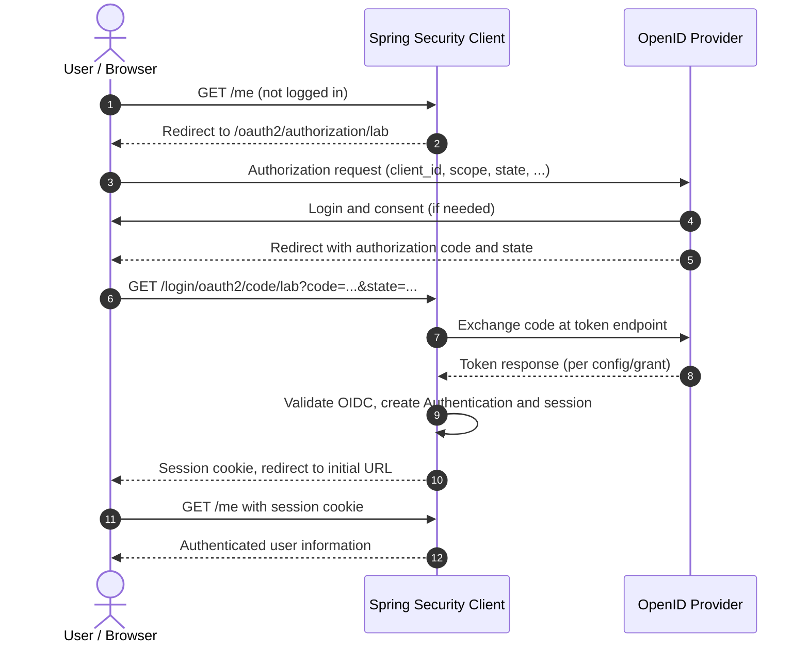

# 1.9. Organizing Documentation and Hands-On Scenarios

> **Topic:** Spring Security OAuth 2.0 OIDC Client  
> **Chapter:** 1. Overview  
> **Focus:** Turning OAuth 2.0 and OpenID Connect (OIDC) concepts into a documentation set that can be referenced, run, observed, and extended across real-world scenarios.

An OIDC login integration project typically spans multiple parts across different systems: the browser, the Spring Boot application, the Identity Provider (IdP), and resource APIs. Keeping only a snippet of `application.yml` and a "Login" button may let learners log in successfully, yet still leave them unable to explain where tokens come from, how the application maintains sessions, or why an API call is rejected.

This lesson shows how to **organize documentation by learning journey and processing flow**, and how to design **hands-on scenarios with clear preconditions, actions, and observable outcomes**. It serves as a practical roadmap for the deeper lessons ahead, without requiring all features to be implemented at once.

## 1. Learning Objectives and Scope

After this lesson, you will be able to:

1. Divide documentation into clear sections: protocol fundamentals, application configuration, login flow, API calls, session/token management, security, and troubleshooting.
2. Identify the responsibilities of the **OAuth 2.0 Client**, **OpenID Provider/Authorization Server**, **Resource Server**, and **browser** in an integration diagram.
3. Design each hands-on lab with objectives, environment setup, reproduction steps, expected outcomes, and signals to observe.
4. Sequence scenarios from basic OIDC login to using access tokens, token expiration, logout, and misconfigurations.
5. Record useful technical evidence without putting client secrets, access tokens, refresh tokens, or session cookies into documentation.

**Lesson boundary:** Spring Security plays the **Client** role inside a Spring Boot application, typically a web app with user login. A separate Resource Server is set up to illustrate access token usage. Building a full Authorization Server or implementing the OIDC protocol from scratch is out of scope.

## 2. Component Map Required in the Documentation

Before organizing directories, align on each component's role:

| Component | Primary Responsibility | Place in Sample Scenario |
|---|---|---|
| Browser | Navigates login redirects, holds application session cookies, and sends HTTP requests | User visits `http://localhost:8080` |
| OAuth 2.0/OIDC Client | Redirects to IdP, handles callbacks, exchanges authorization code for tokens, authenticates login, and manages authorized clients | Spring Boot `web-client` application |
| Authorization Server / OpenID Provider | Authenticates users, requests consent when needed, issues tokens, and publishes metadata/JWK | IdP at `http://localhost:9000` (illustrative example) |
| Resource Server | Protects APIs, validates access tokens, and enforces access permissions | Spring Boot API at `http://localhost:8081` |

Three concepts to separate from the very beginning:

- **OIDC ID token** tells the Client about the user authentication event, such as `sub`, `iss`, `aud`; an ID token is **not** a token for calling arbitrary APIs.
- **OAuth 2.0 access token** is sent to the Resource Server to request access to resources. The API must verify appropriate conditions, such as signature/issuer/audience when using JWTs and required permissions (scopes/authorities).
- **HTTP session** is the login state of the web application. The browser usually holds a session cookie; an application cookie is not synonymous with an API access token.

Standard login flow diagram with Authorization Code:



In the documentation, mark **responsibility handoff points**: browser redirects, Client handles callback, IdP issues tokens, Resource Server evaluates API requests. These points help isolate errors faster than simply writing "login failed".

## 3. Principles for Organizing a Learning Documentation Set

A good documentation set should answer three questions: *What do I need to understand? How do I try running it? Where do I inspect the behavior?*

### 3.1. Organizing by Reader Intent

| Document Group | Question to Answer | Typical Content |
|---|---|---|
| Overview | What roles and flows exist in the system? | Architecture diagrams, terminology, trust boundaries |
| Foundations | Why does the app need code, state, scope, ID token? | Authorization Code, OAuth 2.0, OIDC, PKCE, discovery |
| Configuration | What needs to be set up at the IdP and in Spring? | Client registration, redirect URI, issuer, dependencies |
| Processing Flow | Which endpoints do requests pass through? | Login, callback, token exchange, API request, logout |
| Practice | How do we reproduce and observe specific behaviors? | Labs with steps and expected outcomes |
| Operations / Security | Where do errors occur and how are they diagnosed? | Safe logging, 401/403, token expiry, CSRF, misconfigurations |
| Reference | Where to look up API or specification details? | Official documentation links and version notes |

Put **stable concepts** in the foundations section, **provider-specific details** in the configuration section, and **repeatable procedures** in the lab section. For example, never include a real `client-secret` value inside an Authorization Code explanation; never turn a specific IdP's settings screen into the general definition of OIDC.

### 3.2. Suggested Directory Structure

This is one way to organize a learning project; directory names can vary by project:

```text
spring-security-oidc-client-lab/
├── README.md                         # Goals, diagrams, starting paths
├── docs/
│   ├── 00-overview.md                # Roles and terminology
│   ├── 01-oauth2-oidc-basics.md      # OAuth 2.0, OIDC, grants, tokens, scopes
│   ├── 02-environment.md             # Ports, IdP, client registration, environment variables
│   ├── 03-oidc-login-flow.md         # Login, callback, state, session
│   ├── 04-api-access.md              # Authorized client, access token, resource API
│   ├── 05-session-token-lifecycle.md # Sessions, expiration, refresh, logout
│   ├── 06-security-notes.md          # HTTPS, PKCE, CSRF, protecting secrets
│   ├── troubleshooting.md            # Symptoms, causes, how to verify
│   └── glossary.md                   # Standardized terminology
├── labs/
│   ├── LAB-00-environment.md
│   ├── LAB-01-oidc-login.md
│   ├── LAB-02-user-claims.md
│   ├── LAB-03-call-resource-api.md
│   ├── LAB-04-token-expiry.md
│   ├── LAB-05-logout.md
│   ├── LAB-06-errors.md
│   └── LAB-07-multiple-clients.md
├── apps/
│   ├── web-client/                   # Spring Security OAuth2/OIDC Client application
│   └── resource-api/                 # API protected with access tokens
├── infra/
│   └── identity-provider/            # IdP setup guides/declarations for the lab environment
├── scripts/                          # Startup scripts and sample data without secrets
└── .env.example                      # Environment variable names, placeholder values
```

`README.md` is a concise navigation page: describing the problem, prerequisites, a link to `docs/02-environment.md`, the ordered lab table, and how to reset to the initial state. Conceptual docs do not need to copy full source code; when helpful, point to the exact class name, endpoint, or config file inside `apps/`.

### 3.3. Rules That Keep Documentation Maintainable

- **One term, one name:** consistently use "Client", "OpenID Provider/IdP", "Resource Server", "ID token", and "access token"; if synonyms appear, explain them in `glossary.md`.
- **Label examples clearly:** domains, ports, and client names in this lesson are lab configurations only; readers must know which values to replace when using another IdP.
- **Record environment versions:** code examples below illustrate familiar configurations on Spring Boot 3.x and Spring Security 6.x; when using another branch, check the corresponding APIs in official docs.
- **Bidirectional links:** explanations of refresh tokens point to the token-expiry lab; labs link back to concepts so learners understand the underlying behavior.
- **Every lab has a clear starting state:** who needs to log in, which client is registered, and what data must exist before running.
- **Never store secrets in the repo:** record only environment variable names and placeholder values; redact screenshots, URLs, and logs before sharing.

## 4. Roadmap of Hands-On Scenarios

Labs should build on one another, with one primary behavior per exercise. Learners can start at LAB-00 without understanding every advanced topic upfront.

| Lab | Scenario | Preconditions | Observable Outcomes |
|---|---|---|---|
| **LAB-00** | Set up environment | Java, applications, and local IdP available | Discovery endpoint is reachable; Client starts with valid configuration |
| **LAB-01** | OIDC login via Authorization Code | Registered Client and redirect URI | Browser goes to IdP, callbacks to Client, `/me` returns authenticated user |
| **LAB-02** | Read identity and claims | LAB-01 succeeds | Distinguish stable `sub` from mutable profile attributes; know claim sources |
| **LAB-03** | Call Resource Server | API validating access tokens exists | Client sends access token to API; API responds per scope/authority |
| **LAB-04** | Token expiration and renewal | Short token lifetime configured in lab | Distinguish access token lifetime from HTTP session; observe renewal or re-login requirement per config |
| **LAB-05** | Logout | Active login session | Identify difference between application logout and IdP logout |
| **LAB-06** | Intentional misconfigurations | Stable working environment | Recognize mismatched redirect URI, issuer, scope, `state`, token signature, and 401/403 |
| **LAB-07** | Multiple clients/providers | Two valid registration configurations | Select the right registration and isolate each provider's config |

**Optional extensions:** PKCE for public clients, mapping groups/roles to authorities, separating `SecurityFilterChain`s for web vs. API, validating JWT audience, automated testing with IdP integration, and `client_credentials` for machine-to-machine jobs. The `client_credentials` flow has no logged-in user and is not an OIDC login; place it as a comparison exercise after learners master user-based Clients.

## 5. Preparing a Shared Practice Environment

Each lab inherits the same topology to make comparing results easier:

```text
Browser ── HTTP :8080 ──> Spring Boot web-client
                               │
                               ├── OIDC discovery / login / token ──> IdP :9000
                               │
                               └── access token ──> Resource API :8081
```

### 5.1. Preparing the Identity Provider

The example uses an OpenID Connect-supporting IdP, such as a locally running Keycloak instance. The values `lab`, `web-client`, and port `9000` are placeholders for the lab, **not mandatory product defaults**:

1. Start the IdP and create a `lab` realm/tenant or equivalent configuration space.
2. Create a test user with profile attributes to observe `sub`, `preferred_username`, and `email` if returned by the provider.
3. Register an OAuth 2.0/OIDC Client named `web-client` using Authorization Code; for a server-side Spring MVC app, you can use a confidential client with a client secret issued specifically for the lab.
4. Declare the exact redirect URI: `http://localhost:8080/login/oauth2/code/lab`.
5. Allow the `openid` scope and, if supported by the IdP, `profile` and `email`; configure API permissions in later labs.
6. Identify the **issuer URI** published by the IdP, e.g., `http://localhost:9000/realms/lab`; inspect its discovery document (`.../.well-known/openid-configuration`) to see the authorization endpoint, token endpoint, and `jwks_uri`.

**Note:** `redirect-uri` belongs to the Client configuration and must match the value registered at the IdP. `issuer-uri` must match the actual issuer in tokens and metadata; arbitrarily replacing a hostname with an internal address can break issuer checks or endpoint access. Real environments require HTTPS and proper secret management.

### 5.2. Dependencies and Spring Security Client Configuration

For a Spring MVC app, you need the web and OAuth 2.0 Client starters. Maven example:

```xml
<dependency>
    <groupId>org.springframework.boot</groupId>
    <artifactId>spring-boot-starter-web</artifactId>
</dependency>
<dependency>
    <groupId>org.springframework.boot</groupId>
    <artifactId>spring-boot-starter-oauth2-client</artifactId>
</dependency>
```

Example `application.yml` for the `lab` registration:

```yaml
server:
  port: 8080

spring:
  security:
    oauth2:
      client:
        registration:
          lab:
            provider: lab
            client-id: web-client
            client-secret: ${OAUTH_CLIENT_SECRET}
            authorization-grant-type: authorization_code
            redirect-uri: "{baseUrl}/login/oauth2/code/{registrationId}"
            scope:
              - openid
              - profile
              - email
        provider:
          lab:
            issuer-uri: http://localhost:9000/realms/lab
```

Before running, provide `OAUTH_CLIENT_SECRET` via an environment variable or lab secret store; never commit the real value. `lab` is the **registrationId**, which also appears in `/oauth2/authorization/lab` and `/login/oauth2/code/lab`. `issuer-uri` enables Spring Security to discover provider metadata when discovery is supported.

Example configuration protecting endpoints and enabling login:

```java
import org.springframework.context.annotation.Bean;
import org.springframework.context.annotation.Configuration;
import org.springframework.security.config.Customizer;
import org.springframework.security.config.annotation.web.builders.HttpSecurity;
import org.springframework.security.web.SecurityFilterChain;

@Configuration
public class SecurityConfig {
    @Bean
    SecurityFilterChain securityFilterChain(HttpSecurity http) throws Exception {
        return http
            .authorizeHttpRequests(auth -> auth
                .requestMatchers("/", "/error").permitAll()
                .anyRequest().authenticated())
            .oauth2Login(Customizer.withDefaults())
            .oauth2Client(Customizer.withDefaults())
            .build();
    }
}
```

And an endpoint to observe identity without exposing tokens:

```java
import java.util.Map;
import org.springframework.security.core.annotation.AuthenticationPrincipal;
import org.springframework.security.oauth2.core.oidc.user.OidcUser;
import org.springframework.web.bind.annotation.GetMapping;
import org.springframework.web.bind.annotation.RestController;

@RestController
public class ProfileController {
    @GetMapping("/me")
    public Map<String, String> me(@AuthenticationPrincipal OidcUser user) {
        return Map.of(
            "subject", user.getSubject(),
            "issuer", user.getIdToken().getIssuer().toString()
        );
    }
}
```

This example uses OIDC because the registration includes the `openid` scope. If using pure OAuth 2.0 login, the principal type and user-info source may differ. Sample code illustrates concepts; when integrating into a project, add appropriate packages, build configuration, and infrastructure components.

## 6. Standard Template for Writing a Lab Guide

So that others can reproduce the exact same results, each `LAB-XX-*.md` should follow a consistent layout:

```markdown
# LAB-XX — Scenario Name

## Objectives
- After the lab, what can the learner explain/observe?

## Related Knowledge
- Links to foundational docs and flow diagrams.

## Prerequisites
- Versions, applications, IdP, sample data, environment variables.

## Steps
1. Concrete action.
2. URL/endpoint or file to modify.
3. How to restore if the lab requires intentionally inducing an error.

## Expected Results
- HTTP behavior, screens, and system state to observe.

## How to Observe
- Browser Network, sanitized logs, status codes,
  allowed principals/claims to display.

## Self-Explanation Questions
- Why did the result happen? Which component decides this behavior?

## Cleanup and Next Steps
- Revert error-testing config; point to the next lab.
```

**Distinguish "action" from "conclusion":** "Open `/me`" is an action; "when unauthenticated, redirected to IdP; after logging in, `subject` is displayed" is the expected result. Explicitly specify whether observation happens in the browser, Client, or Resource Server so 302, 401, and 403 are not confused.

## 7. Three Detailed Sample Implementation Scenarios

### LAB-01 — From Accessing a Protected Page to OIDC Login

**Objective:** observe the complete Authorization Code flow and explain why the application can establish a session after receiving the callback.

**Prerequisites:** LAB-00 complete; IdP has a test user; Client has registered redirect URI and valid `issuer-uri`, `client-id`, and `client-secret`.

**Steps:**

1. Open a private browser window to rule out existing sessions, then visit `http://localhost:8080/me`.
2. Observe the redirect request to the IdP page. If a login-method selection page appears, select the `lab` registration via `/oauth2/authorization/lab`.
3. Log in with the lab account. Follow the redirect chain back to the registered callback path.
4. Once the application processes the callback, access `/me` again. Record `subject` and `issuer` (do not record raw tokens, cookies, or authorization codes).
5. Open Developer Tools → Network and identify the redirects visible from the browser. Compare them against the sequence diagram in section 2.

**Expected Results:** before logging in, the protected URL requires authentication; after the callback is processed successfully, `/me` returns identity info and subsequent requests use the application's session. The token endpoint is typically called by the Client from the server side, so it will not necessarily appear as a direct browser request.

**Self-Explanation:** why must the Client validate `state` at the callback? Why is `openid` required for OIDC login? Why does a session cookie differ from an ID token?

### LAB-03 — Using an Access Token to Call a Protected API

**Objective:** distinguish user login at the Client from permission to call a Resource Server.

**Prerequisites:** LAB-01 succeeds; `resource-api` is running on port `8081`, supports bearer access token validation, and the IdP issues the required scopes/audience for the API in the lab environment.

**API Setup:** you can use `spring-boot-starter-oauth2-resource-server` with a JWT configuration pointing to the matching issuer; here the Resource Server is responsible for validating the access token and checking permissions. If the provider issues opaque access tokens, an appropriate introspection mechanism is required instead of assuming tokens are JWTs.

**Steps:**

1. In `resource-api`, create a protected endpoint such as `GET /api/messages`, permitting only an explicit permission/scope like `messages.read`.
2. In `web-client`, use Spring Security's **OAuth2AuthorizedClient** mechanism to obtain the access token issued for the user and attach it to the `Authorization: Bearer ...` header when calling the API. Never substitute the ID token.
3. Invoke the endpoint via a Client feature, such as a "View messages" button on a post-login page.
4. Retry without a valid access token or with a token missing the scope; compare status codes and Resource Server responses.

**Expected Results:** the API returns data when the access token is valid and holds the required permission; the API typically returns **401 Unauthorized** when the token is missing/unverified and **403 Forbidden** when authenticated but lacking permission. Exact responses depend on Resource Server and security filter configuration.

**Self-Explanation:** why does the API still require a bearer access token even though the Client already has an HTTP session? Which component decides token issuance, and which component decides access to `/api/messages`?

### LAB-06 — Diagnosing Intentional Misconfigurations

**Objective:** connect an observed error to the right configuration layer or responsible component.

**Prerequisites:** LAB-01 runs reliably; save a copy of the valid configuration to restore after each experiment.

| Variant | Fault-Inducing Action | Signals to Look For | Isolation Direction |
|---|---|---|---|
| Wrong redirect URI | Change the registered URI at the IdP or Client so both mismatch | IdP rejects request/redirect | Compare the **exact** URI, including scheme, host, port, and path |
| Wrong issuer | Change `issuer-uri` to an incorrect value | Discovery fails or issuer validation fails | IdP metadata, reachability, and `iss` claim |
| Missing `openid` | Remove the `openid` scope from the OIDC registration | Login behavior/principal type differs from expected | Distinguish OAuth 2.0 login from OIDC login |
| Token missing scope | Do not grant required API permission | API may return 403 | Scope/authority checked by Resource Server |
| Invalid callback | Try a modified callback URL or request lacking valid context | Client rejects authentication | Correlation/`state` protection; never try disabling validation |
| Expired token | Wait for token expiry or use a lab environment with short TTL | Client requests new token when supported, or API rejects | `expires_at`, refresh capability, login session, Client config |

After each variant, **revert to the initial configuration** and re-run the valid login flow before moving to the next fault. Isolating one variable at a time helps pinpoint root causes instead of stacking multiple overlapping errors.

## 8. Additional Scenarios Across the Login Lifecycle

### 8.1. Claims, Principals, and Permission Mapping

In LAB-02, let learners inspect `OidcUser`, the ID token, and optional UserInfo supported by the provider. `sub` is the issuer-assigned identifier; do not use email as an immutable identifier key. Profile claims (`name`, `email`, `preferred_username`) can be absent, change, or require corresponding scopes. If the application maps `groups`/`roles` to `GrantedAuthority`, document explicitly that this is a **rule of the specific application and IdP in use**, not that every OIDC token includes a `roles` field by default.

### 8.2. Token Expiration, Refresh, and Sessions

LAB-04 should configure a short access token lifetime in the test environment, then observe three moments: immediately after login, when the access token expires, and after the Client tries calling the API again. When a refresh token and matching config exist, Spring Security can reissue the access token via the authorized client. If there is no refresh token, refresh is disallowed, or the IdP session has expired, subsequent flows may require re-authorization. **Never deduce that an expired access token means the application's HTTP session has also expired**, or vice versa.

### 8.3. Logout at the Client and at the IdP

LAB-05 should separate two cases. **Local logout** clears authentication/session state inside the application; **OIDC RP-Initiated Logout** (if supported by the provider) also redirects to the IdP's end-session endpoint to terminate the session on the provider side. Logging out at the Client does not guarantee the user is logged out of every application sharing the same IdP. Document CSRF requirements for the logout endpoint, post-logout navigation, and verifying a fresh session using a private window.

### 8.4. Multiple Client Registrations

LAB-07 demonstrates two IdPs or two registrations with separate `registrationId` values, such as `lab` and `partner`. Documentation should list each registration's login URL, `issuer-uri`, `client-id`, `client-secret`, scopes, and redirect URI. Never share one `registrationId` across two configurations and end up unsure which provider owns a callback.

### 8.5. Boundary Between Web Application and API

Web applications usually redirect to the IdP when login is needed. A JSON-returning API usually needs an appropriate **401/403** response for API clients to handle, rather than automatically redirecting API callers to an HTML login page. When a project serves both web UI and APIs, include a dedicated guide explaining endpoint rules and how to organize corresponding `SecurityFilterChain`s.

## 9. Observing the System Without Exposing Sensitive Information

Not everything visible in the Network tab or logs should be copied verbatim into documentation. The table below helps pick safe evidence:

| Allowed in Lab Docs | Must Mask or Avoid Saving |
|---|---|
| Endpoint names, HTTP status, redirect sequence, error timing | `client_secret`, access tokens, refresh tokens, verbatim ID tokens |
| Claim names and dummy values, e.g., `sub: demo-user-123` | Authorization codes, session cookies, CSRF tokens, real `state` values |
| Public Issuer URI of demo environment | Test user credentials, URLs containing sensitive auth codes |
| Summarized and sanitized error messages | Screenshots exposing tokens or session cookies |

When diagnosing issues, it is most helpful to answer in sequence: **which endpoint was requested → which component handled it → which HTTP status returned → which configuration/condition applies**. Only raise log levels in controlled test environments and never enable token value logging in production.

## 10. Matrix Cross-Referencing Concepts, Source Code, and Outcomes

To keep docs from turning into scattered notes, maintain a navigation table from concepts to practical evidence:

| Concept | Where to Read | Where to Try | Minimum Observation |
|---|---|---|---|
| Client registration | `docs/02-environment.md` | LAB-00, LAB-01 | `registrationId`, redirect URI, issuer metadata |
| Authorization Code + OIDC login | `docs/03-oidc-login-flow.md` | LAB-01 | Redirect → callback → principal/session |
| OIDC claims | `docs/03-oidc-login-flow.md` | LAB-02 | `sub`, `iss`, optional claims |
| Authorized client + access token | `docs/04-api-access.md` | LAB-03 | Successful API call / insufficient permissions |
| Token/session expiration | `docs/05-session-token-lifecycle.md` | LAB-04 | Token lifetime vs. session state |
| Logout | `docs/05-session-token-lifecycle.md` | LAB-05 | Local session and IdP session |
| Config/security errors | `docs/troubleshooting.md` | LAB-06 | Error symptoms and where to check |
| Multiple providers | `docs/02-environment.md` | LAB-07 | Distinguishing issuer and `registrationId` |

This matrix also makes adding new labs easier: each topic should have an explanation page, a hands-on exercise, and a meaningful observable outcome. If adding a "token with wrong audience" scenario, attach it to API protection and JWT validation at the Resource Server instead of mixing it into the login guide.

## 11. Misconceptions to Address Immediately in Documentation

| Common Misconception | Correct Explanation |
|---|---|
| "OAuth 2.0 and OIDC are the same thing." | OAuth 2.0 focuses on authorization; OIDC adds a user authentication layer and ID tokens on top of OAuth 2.0. |
| "Having an ID token lets you call APIs." | APIs use access tokens issued for appropriate resources/permissions; ID tokens are for the Client to verify login. |
| "Successful login means the API will permit every operation." | User authentication at the Client and resource authorization at the API are two separate decisions. |
| "A 302 redirect is the same as a 401 error." | 302 is typically browser behavior starting login; 401 indicates an unauthenticated request under an API interface. |
| "`client-secret` is a user login password." | Client secrets authenticate the Client to the Authorization Server via the appropriate client authentication method; they do not replace user credentials. |
| "Spring logout always terminates SSO." | Local logout and IdP logout are distinct steps; support and configuration depend on the provider. |
| "If a refresh token exists, every API call automatically refreshes." | You must use an appropriate authorized client/manager mechanism, satisfy reissuance conditions, and handle errors when refresh is no longer valid. |

## 12. Self-Study Order and Sensible Stopping Points

An effective hands-on path is: **read architecture → set up IdP/Client → OIDC login → inspect principal → call API with access token → verify token lifecycle and logout → reproduce errors → expand to multiple providers**. You do not need to learn configuring every grant type, every IdP, and every application type all at once.

Learners can consider the overview complete when they can sketch the path of a single login, know which file holds Client config, identify which endpoints/flows belong to the IdP, and point out evidence for three states: **unauthenticated**, **logged into the application**, and **authorized to access the API**. When an error appears, first determine whether it belongs to redirect, token exchange, OIDC validation, application session, or API authorization, then open the corresponding doc and lab.

## 13. References for Further Expansion

- [Spring Security — OAuth 2.0 Login](https://docs.spring.io/spring-security/reference/servlet/oauth2/login/index.html): OAuth 2.0/OIDC login mechanism for Servlet applications.
- [Spring Security — OAuth 2.0 Client](https://docs.spring.io/spring-security/reference/servlet/oauth2/client/index.html): client registration, authorized clients, and calling protected resources.
- [Spring Security — OAuth 2.0 Resource Server](https://docs.spring.io/spring-security/reference/servlet/oauth2/resource-server/index.html): protecting APIs with bearer tokens.
- [OpenID Connect Core 1.0](https://openid.net/specs/openid-connect-core-1_0.html): definition of ID tokens, authentication, and core OIDC requirements.
- [OAuth 2.0 — RFC 6749](https://www.rfc-editor.org/rfc/rfc6749): roles, authorization flows, and tokens in OAuth 2.0.

When consulting official documentation, select the branch matching your project's Spring Security version and check the IdP's own documentation for discovery, logout, claim mapping, and refresh token policies.
