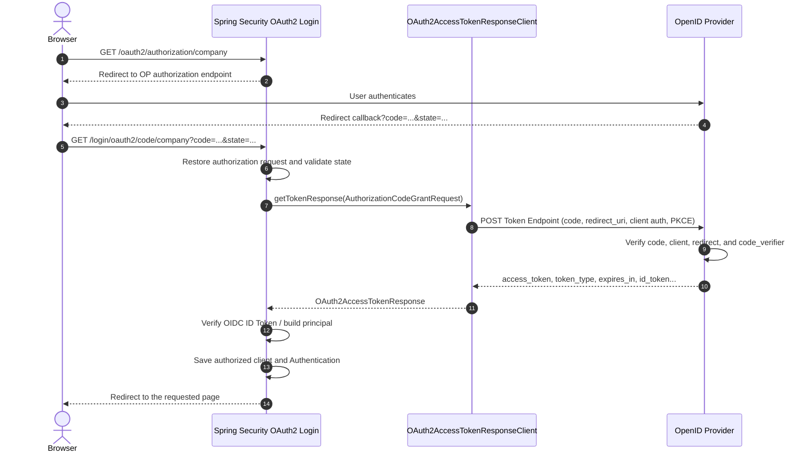

# 10.1. OAuth2AccessTokenResponseClient and the Role of Token Exchange

## 1. From Authorization Code to Token: Which Step Actually Calls the Token Endpoint?

In a **Spring Security OAuth 2.0 / OIDC Client** application, the user may have already signed in successfully at the OpenID Provider (OP), and the browser is redirected back to the application's callback:

```http
GET /login/oauth2/code/company?code=temporary-code&state=expected-state HTTP/1.1
Host: portal.example.com
```

At that point, the application has only received an **authorization code**. This is a temporary code used to exchange for tokens—it is not yet an access token or an ID Token. Spring Security must send an HTTP request **from the backend to the Token Endpoint** of the Authorization Server. The receiving server validates the code, client authentication, redirect URI, and PKCE (if used), and then returns the token response.

**`OAuth2AccessTokenResponseClient`** is the Spring Security interface responsible for **sending the token request and converting the response from the Token Endpoint into an `OAuth2AccessTokenResponse`**.

Running example throughout this lesson:

- **Employee Portal** is a Spring Boot MVC/Servlet application that signs users in via OIDC using Authorization Code.
- The client registration named `company` points to the issuer `https://id.example.com/realms/company`.
- The OP issues a code via the browser callback; the backend uses `OAuth2AccessTokenResponseClient<OAuth2AuthorizationCodeGrantRequest>` to exchange the code for tokens.
- The result includes an **access token** and, for the OIDC Authorization Code flow, an **ID Token** in the token response. Spring Security proceeds to verify the ID Token and establish a login session.

> **Key point:** `OAuth2AccessTokenResponseClient` is responsible for **the HTTP exchange at the Token Endpoint** and parsing the response. It **does not authenticate the user on its own**, **does not directly decide API access permissions**, and **does not replace** `state` correlation, PKCE, or ID Token verification.

## 2. The Token Endpoint in OAuth 2.0 and OIDC Architecture

### 2.1. Participating Components

| Component | Role |
| --- | --- |
| **Browser** | Follows the redirect to the OP, then brings the authorization code back to the application |
| **Spring Security OAuth2 Client** | Creates the authorization request, handles the callback, and orchestrates exchanging the code for tokens |
| **`ClientRegistrationRepository`** | Looks up registration configuration: client ID, grant, token endpoint, and client authentication method |
| **`OAuth2LoginAuthenticationFilter`** | Receives the Authorization Code callback in a Servlet application |
| **`OAuth2AccessTokenResponseClient`** | Sends the token request to the Authorization Server and reads the token response |
| **Authorization Server / OpenID Provider** | Authenticates the client, validates the grant/code, and issues the access token and ID Token if applicable |
| **`OAuth2AuthorizedClientRepository` / service** | Stores authorized client information including the received tokens |
| **`Authentication` / `SecurityContext`** | Represents the authenticated identity and maintains the login session |

### 2.2. End-to-End Flow Diagram



Key observation: **`OAuth2AccessTokenResponseClient` operates on the server side**, inside callback processing. The browser never needs to know the client secret or receive tokens directly from the token endpoint in this server-side application model.

### 2.3. How Authorization Endpoint and Token Endpoint Differ

| Aspect | Authorization Endpoint | Token Endpoint |
| --- | --- | --- |
| Typical caller? | Browser via redirect | OAuth2 Client backend via HTTP POST |
| Purpose | Authenticate/authorize and issue an authorization code | Exchange a code, refresh a token, or request a token under another grant |
| Primary data | `client_id`, `redirect_uri`, `scope`, `state`, PKCE challenge | `grant_type`, `code` / `refresh_token`, `redirect_uri`, PKCE verifier, client authentication |
| Result | Redirect back to the application with `code` + `state` or an error | Token response or OAuth error |
| Spring customization point | `OAuth2AuthorizationRequestResolver` | **`OAuth2AccessTokenResponseClient`** |
| Requires a browser? | For interactive Authorization Code: yes | No browser needed for the backend request |

A common mistake is adding a Token Endpoint parameter to `OAuth2AuthorizationRequestResolver` and expecting it to appear when exchanging the code. The two requests belong to **two different phases** and have separate extension points.

## 3. The `OAuth2AccessTokenResponseClient` Interface

### 3.1. Basic Contract

Conceptual summary of the interface in the Servlet stack:

```java
public interface OAuth2AccessTokenResponseClient<
        T extends AbstractOAuth2AuthorizationGrantRequest> {

    OAuth2AccessTokenResponse getTokenResponse(T authorizationGrantRequest);
}
```

The snippet above shows the core signature for explanation; the full interface and imports are provided by Spring Security in the `org.springframework.security.oauth2.client.endpoint` package.

There are three elements to distinguish:

- **`T` — grant request**: the input data required for **one specific OAuth grant type**.
- **`getTokenResponse(...)`**: the method that performs the exchange with the Authorization Server (or a suitable custom implementation).
- **`OAuth2AccessTokenResponse`**: the parsed result from the token response after a successful exchange.

This interface is generic because **Authorization Code, Client Credentials, and Refresh Token have different requests**, even though all of them receive a token response following the OAuth 2.0 protocol.

### 3.2. Common Grant Requests

| Grant | Generic Input `T` | RestClient-Based Implementation |
| --- | --- | --- |
| Authorization Code | `OAuth2AuthorizationCodeGrantRequest` | `RestClientAuthorizationCodeTokenResponseClient` |
| Client Credentials | `OAuth2ClientCredentialsGrantRequest` | `RestClientClientCredentialsTokenResponseClient` |
| Refresh Token | `OAuth2RefreshTokenGrantRequest` | `RestClientRefreshTokenTokenResponseClient` |

The types above belong to Spring Security's OAuth2 Client components. In versions that support extended grants such as JWT Bearer or Token Exchange, corresponding request and token response client types are also provided.

**Do not use a Client Credentials client to exchange an authorization code.** Although both communicate with the Token Endpoint, each grant has different `grant_type` values, parameters, and lifecycle orchestration.

### 3.3. Synchronous vs. Reactive

This lesson focuses on **Spring MVC/Servlet**:

| Servlet Stack | Reactive/WebFlux Stack |
| --- | --- |
| `OAuth2AccessTokenResponseClient<T>` | `ReactiveOAuth2AccessTokenResponseClient<T>` |
| `OAuth2AccessTokenResponse getTokenResponse(T)` | `Mono<OAuth2AccessTokenResponse> getTokenResponse(T)` |
| HTTP implementation uses `RestClient` or `RestOperations` depending on version | HTTP implementation typically relies on `WebClient` |
| Configured via `HttpSecurity` and `SecurityFilterChain` | Configured via `ServerHttpSecurity` and `SecurityWebFilterChain` |

Do not pass a Servlet-style `OAuth2AccessTokenResponseClient` into an API that expects a reactive client. Differences in return types and execution models affect the entire configuration.

## 4. What Is Inside `OAuth2AuthorizationCodeGrantRequest`?

When a callback is valid, Spring Security already has the initialized context before calling the Token Endpoint. This data is packaged inside an `OAuth2AuthorizationCodeGrantRequest`.

Conceptually:

```text
OAuth2AuthorizationCodeGrantRequest
  ├─ ClientRegistration
  │    ├─ registrationId
  │    ├─ clientId
  │    ├─ clientAuthenticationMethod
  │    ├─ authorizationGrantType = authorization_code
  │    ├─ redirectUri
  │    └─ providerDetails.tokenUri
  │
  └─ OAuth2AuthorizationExchange
       ├─ OAuth2AuthorizationRequest
       │    ├─ state
       │    ├─ redirectUri
       │    ├─ scopes / attributes
       │    └─ code_verifier (when using PKCE, kept on the client)
       └─ OAuth2AuthorizationResponse
            ├─ code
            ├─ state
            └─ redirectUri
```

Important fields:

| Data | Purpose |
| --- | --- |
| `getClientRegistration()` | Identifies the Token Endpoint, client ID, and client authentication method |
| `getAuthorizationExchange()` | Accesses the original request and callback response to obtain the code, redirect URI, and PKCE data |
| `getAuthorizationResponse().getCode()` | The authorization code to send in the token request |
| `getAuthorizationRequest().getRedirectUri()` | The redirect URI used in the Authorization Request |
| Authorization request attributes | May contain `code_verifier` to complete PKCE |

With default Servlet OAuth2 Login, Spring Security constructs the grant request after verifying callback correlation. The token response client **does not need to manually read the `code` query parameter from `HttpServletRequest`**.

**Do not treat `OAuth2AuthorizationCodeGrantRequest` as an object to persist long-term.** The authorization code and code verifier are temporary credentials; once processed, they must follow the library's security lifecycle.

## 5. HTTP Request Sent to the Token Endpoint for Authorization Code Grant

### 5.1. Example with `client_secret_basic`

Suppose the client registration is:

```text
registrationId: company
clientId:       employee-portal
tokenUri:       https://id.example.com/realms/company/protocol/openid-connect/token
grant:          authorization_code
authentication: client_secret_basic
redirectUri:    https://portal.example.com/login/oauth2/code/company
```

An illustrative request:

```http
POST /realms/company/protocol/openid-connect/token HTTP/1.1
Host: id.example.com
Authorization: Basic <base64-encoded-client-id-and-secret>
Content-Type: application/x-www-form-urlencoded
Accept: application/json

grant_type=authorization_code&code=<authorization-code>&redirect_uri=https%3A%2F%2Fportal.example.com%2Flogin%2Foauth2%2Fcode%2Fcompany
```

This is a protocol example, not a request sent to a real server. In HTTP Basic, the client ID/secret are encoded according to the applicable format; **Base64 is not secret encryption**, so connections to the Token Endpoint must use **HTTPS/TLS**.

If the client authentication method is `client_secret_post`, the secret can be placed in the form body as specified by the provider. If it is `private_key_jwt` or mTLS, the request has its own requirements. **The method must match the configuration on the Authorization Server** and cannot be switched arbitrarily between options.

### 5.2. When Using PKCE

PKCE binds the authorization code to the client that initiated the authorization request. During the authorization request phase, Spring sends:

```text
code_challenge=<challenge-from-verifier>
code_challenge_method=S256
```

When exchanging the code, the Token Endpoint additionally receives:

```text
code_verifier=<initial-verifier>
```

The Authorization Server checks whether the verifier matches the original challenge. An attacker who only obtains the code without the verifier cannot complete the token exchange in a properly configured PKCE flow.

**The code verifier only appears at the Token Endpoint**; do not place it in the authorization URL, callback query string, or logs. If custom code loses the verifier between starting login and handling the callback, the token endpoint may return `invalid_grant`.

### 5.3. Successful Token Response

An illustrative JSON response:

```http
HTTP/1.1 200 OK
Content-Type: application/json
Cache-Control: no-store
Pragma: no-cache

{
  "access_token": "<access-token>",
  "token_type": "Bearer",
  "expires_in": 3600,
  "refresh_token": "<refresh-token-if-issued>",
  "scope": "openid profile email",
  "id_token": "<id-token>"
}
```

Not every provider or grant returns a `refresh_token`; for an OIDC Authorization Code flow with the `openid` scope, a valid token response must include an ID Token according to the applicable specification.

| Field | Purpose |
| --- | --- |
| `access_token` | Credential for the client to call authorized APIs/Resource Servers |
| `token_type` | Token type; typically `Bearer` |
| `expires_in` | Number of seconds the access token remains valid from issuance |
| `refresh_token` | Used to obtain a new access token when allowed by the provider |
| `scope` | Actual granted permissions, which may differ from the requested scope |
| `id_token` | OIDC authentication assertion for the user; must be **verified** by the OIDC login layer |

**`OAuth2AccessTokenResponseClient` converts the response, while ID Token verification belongs to OIDC authentication.** Receiving `id_token` in the JSON does not mean that `iss`, `aud`, `nonce`, or the signature are valid.

## 6. What Information Does `OAuth2AccessTokenResponse` Store?

A Spring Security token response result carries these main parts:

```text
OAuth2AccessTokenResponse
  ├─ getAccessToken()
  │     ├─ tokenValue  (SENSITIVE)
  │     ├─ tokenType
  │     ├─ issuedAt
  │     ├─ expiresAt
  │     └─ scopes
  ├─ getRefreshToken()       (may be null)
  └─ getAdditionalParameters()
        ├─ id_token         (OIDC, if present in token response)
        └─ additional provider-specific parameters
```

The data received from the Token Endpoint can be transferred into an `OAuth2AuthorizedClient` by higher-level components. `OAuth2AccessTokenResponse` itself **is not a token storage repository** and is not responsible for deciding what authorities a user holds.

### 6.1. Reading Results Without Exposing Tokens

Code example illustrating how to access metadata:

```java
OAuth2AccessTokenResponse response =
        accessTokenResponseClient.getTokenResponse(grantRequest);

OAuth2AccessToken accessToken = response.getAccessToken();

Instant expiresAt = accessToken.getExpiresAt();
Set<String> scopes = accessToken.getScopes();

boolean hasRefreshToken = response.getRefreshToken() != null;
boolean hasOidcIdToken = response.getAdditionalParameters()
        .containsKey("id_token");
```

This is an **illustrative logic snippet** assuming `accessTokenResponseClient` and `grantRequest` are already in scope, not a standalone program. The corresponding imports belong to `org.springframework.security.oauth2.core` and `java.time/java.util`.

Do not write `getTokenValue()` or `getRefreshToken().getTokenValue()` to logs, public HTTP responses, metric labels, or traces.

### 6.2. A Token Response Does Not Mean the User Is Already Authenticated

An OAuth 2.0 access token may represent a client or a user depending on the grant. The token response client does not know the business purpose of the API receiving the token, does not validate access tokens at a Resource Server, and does not construct a session on its own.

In OIDC Login, additional steps typically include:

1. Verifying the ID Token against issuer, audience, signature/algorithm, expiration, and nonce when applicable.
2. Loading/reconciling UserInfo if needed.
3. Creating the authenticated principal and authorities according to policy.
4. Saving the appropriate `OAuth2AuthorizedClient` and `Authentication` into the login context.

Therefore, receiving `200 OK` from the token endpoint **does not guarantee that login has completed**.

## 7. Commonly Used Spring Security Implementations

Class names and default implementations vary across Spring Security versions. For **Spring Security 6.4+** projects, `RestClient`-based classes are the modern choice for token exchange. In many older Spring Security 6.x projects, you may encounter `DefaultAuthorizationCodeTokenResponseClient` based on `RestOperations`. In Spring Security 7, `RestClient*TokenResponseClient` classes are the default direction.

| Use Case | Java Class | Notes |
| --- | --- | --- |
| Authorization Code, RestClient | `RestClientAuthorizationCodeTokenResponseClient` | Uses HTTP `RestClient` to exchange a code for tokens |
| Authorization Code, older implementation | `DefaultAuthorizationCodeTokenResponseClient` | Present in 6.x versions; based on `RestOperations` |
| Client Credentials | `RestClientClientCredentialsTokenResponseClient` | Obtains tokens for a client/service without a user callback |
| Refresh Token | `RestClientRefreshTokenTokenResponseClient` | Requests a new access token using a refresh token |
| Reactive Authorization Code | `WebClientReactiveAuthorizationCodeTokenResponseClient` | For reactive WebFlux, returns `Mono` |

Choose the API/implementation **appropriate for your version** and avoid creating two different token response clients for the same flow unnecessarily. The sections below use `RestClientAuthorizationCodeTokenResponseClient` to demonstrate custom configuration.

## 8. Spring Boot Servlet Setup for Authorization Code / OIDC Login

### 8.1. Dependencies

Maven example for **Spring Boot 3.x / Spring Security 6.4+**:

```xml
<dependencies>
    <dependency>
        <groupId>org.springframework.boot</groupId>
        <artifactId>spring-boot-starter-web</artifactId>
    </dependency>
    <dependency>
        <groupId>org.springframework.boot</groupId>
        <artifactId>spring-boot-starter-security</artifactId>
    </dependency>
    <dependency>
        <groupId>org.springframework.boot</groupId>
        <artifactId>spring-boot-starter-oauth2-client</artifactId>
    </dependency>
</dependencies>
```

The `spring-boot-starter-oauth2-client` library provides the OAuth2 Client and OIDC Login components. When examples use `RestClient`, choose a Spring Security version that supports `RestClientAuthorizationCodeTokenResponseClient`; this class was introduced in Spring Security 6.4.

### 8.2. Client Registration Configuration

```yaml
spring:
  security:
    oauth2:
      client:
        registration:
          company:
            provider: company-idp
            client-id: ${COMPANY_CLIENT_ID}
            client-secret: ${COMPANY_CLIENT_SECRET}
            client-authentication-method: client_secret_basic
            authorization-grant-type: authorization_code
            redirect-uri: "{baseUrl}/login/oauth2/code/{registrationId}"
            scope:
              - openid
              - profile
              - email
        provider:
          company-idp:
            issuer-uri: https://id.example.com/realms/company
```

`issuer-uri` points to the provider's OIDC issuer. In environments with valid OIDC Discovery, Spring can automatically retrieve `authorization_endpoint`, `token_endpoint`, and `jwks_uri`.

Summary table relating properties to token exchange:

| Property | Impact |
| --- | --- |
| `registration.company` | ID identifying the client used in the flow |
| `client-id` | Identifies the application when sending the token request |
| `client-secret` | Confidential client authentication secret if required by the provider |
| `client-authentication-method` | Determines how client credentials are sent to the Token Endpoint |
| `authorization-grant-type` | Selects `authorization_code` |
| `redirect-uri` | Must stay consistent across the authorization request, token request, and app registration |
| `provider.*.issuer-uri` | Identifies the trusted OP, enabling Token Endpoint discovery and ID Token validation |
| `scope: openid` | Indicates OIDC Login and requires an ID Token per the protocol |

**Never hard-code client secrets** in source code. Use environment variables/a secret manager and always send token requests over HTTPS.

### 8.3. Default Configuration: No Need to Create a Custom Token Response Client Yet

```java
import org.springframework.context.annotation.Bean;
import org.springframework.context.annotation.Configuration;
import org.springframework.security.config.Customizer;
import org.springframework.security.config.annotation.web.builders.HttpSecurity;
import org.springframework.security.web.SecurityFilterChain;

@Configuration
public class SecurityConfig {

    @Bean
    SecurityFilterChain securityFilterChain(HttpSecurity http) throws Exception {
        http.authorizeHttpRequests(authorize -> authorize
                .requestMatchers("/", "/css/**", "/error").permitAll()
                .anyRequest().authenticated()
            )
            .oauth2Login(Customizer.withDefaults());

        return http.build();
    }
}
```

With `oauth2Login`, Spring Security automatically configures OAuth2 Login and selects the appropriate token response client based on your version/auto-configuration. The browser starts login at `/oauth2/authorization/company`, returns to `/login/oauth2/code/company`, and the framework calls the Token Endpoint.

**Declaring a separate `OAuth2AccessTokenResponseClient` bean is not required for standard flows.** Only create/configure one when you have a real requirement: adding provider-required parameters, custom headers, proxy/timeout settings, or adapting responses from a provider with non-standard behavior.

## 9. Customizing the Token Endpoint with `RestClientAuthorizationCodeTokenResponseClient`

A common requirement is that the Authorization Server expects an extra parameter, such as `audience` (a provider extension parameter), in the token request for **one specific registration**.

We will keep the default `grant_type`, `code`, `redirect_uri`, client authentication, and PKCE parameters unchanged, and only add `audience` for the `company` registration.

### 9.1. Creating an `OAuth2AccessTokenResponseClient` Bean

```java
package com.example.portal.security;

import org.springframework.context.annotation.Bean;
import org.springframework.context.annotation.Configuration;
import org.springframework.security.oauth2.client.endpoint.OAuth2AccessTokenResponseClient;
import org.springframework.security.oauth2.client.endpoint.OAuth2AuthorizationCodeGrantRequest;
import org.springframework.security.oauth2.client.endpoint.RestClientAuthorizationCodeTokenResponseClient;
import org.springframework.util.LinkedMultiValueMap;
import org.springframework.util.MultiValueMap;

@Configuration
public class TokenEndpointConfig {

    @Bean
    OAuth2AccessTokenResponseClient<OAuth2AuthorizationCodeGrantRequest>
            authorizationCodeTokenResponseClient() {

        var client = new RestClientAuthorizationCodeTokenResponseClient();

        client.addParametersConverter(grantRequest -> {
            MultiValueMap<String, String> params = new LinkedMultiValueMap<>();
            String registrationId = grantRequest
                    .getClientRegistration()
                    .getRegistrationId();

            if ("company".equals(registrationId)) {
                params.set("audience", "https://api.example.com");
            }

            return params;
        });

        return client;
    }
}
```

Key points:

1. The generic `OAuth2AuthorizationCodeGrantRequest` clearly declares that the bean serves the **Authorization Code Grant**.
2. `RestClientAuthorizationCodeTokenResponseClient` handles sending the HTTP request and parsing the token response.
3. `addParametersConverter(...)` receives the grant request and appends parameters to the form body.
4. Only the `company` registration receives `audience`; other registrations retain the default parameters.
5. The value `https://api.example.com` is an example of an audience that a provider might require—it is **not a mandatory OAuth 2.0 parameter**.
6. If a provider does not support `audience`, do not add this parameter.

Spring Security already supplies the standard parameters. Never build a manual parameter map containing only `audience` and accidentally drop `code`, `redirect_uri`, or `code_verifier`.

### 9.2. Wiring the Client into `oauth2Login().tokenEndpoint()`

You can wire it explicitly in `SecurityFilterChain`:

```java
import org.springframework.context.annotation.Bean;
import org.springframework.context.annotation.Configuration;
import org.springframework.security.config.annotation.web.builders.HttpSecurity;
import org.springframework.security.oauth2.client.endpoint.OAuth2AccessTokenResponseClient;
import org.springframework.security.oauth2.client.endpoint.OAuth2AuthorizationCodeGrantRequest;
import org.springframework.security.web.SecurityFilterChain;

@Configuration
public class LoginSecurityConfig {

    @Bean
    SecurityFilterChain securityFilterChain(
            HttpSecurity http,
            OAuth2AccessTokenResponseClient<OAuth2AuthorizationCodeGrantRequest>
                    tokenResponseClient) throws Exception {

        http.authorizeHttpRequests(authorize -> authorize
                .requestMatchers("/", "/error").permitAll()
                .anyRequest().authenticated()
            )
            .oauth2Login(oauth2 -> oauth2
                .tokenEndpoint(token -> token
                    .accessTokenResponseClient(tokenResponseClient))
            );

        return http.build();
    }
}
```

This snippet is an **alternative** to the minimal `SecurityFilterChain` in section 8.3. In a sample project, define only **one primary filter chain** unless you intentionally use multiple security matchers and `@Order`.

Starting from Spring Security 6.2, a bean with the generic type `OAuth2AccessTokenResponseClient<OAuth2AuthorizationCodeGrantRequest>` can also be picked up automatically by Spring Security to configure default OAuth2 Client components depending on conditions and version. Explicit wiring here makes it clear **where** OAuth2 Login uses the custom token response client.

### 9.3. HTTP Result Before and After Customization

**Before adding the converter:**

```text
POST /token
Content-Type: application/x-www-form-urlencoded

grant_type=authorization_code
&code=<code>
&redirect_uri=<redirect-uri>
&code_verifier=<verifier-if-PKCE>
```

**After adding the converter for `company`:**

```text
POST /token
Content-Type: application/x-www-form-urlencoded

grant_type=authorization_code
&code=<code>
&redirect_uri=<redirect-uri>
&code_verifier=<verifier-if-PKCE>
&audience=https%3A%2F%2Fapi.example.com
```

Line breaks are added here for readability rather than representing the raw wire format; client authentication headers/body also depend on the registration. Most importantly, the converter **preserves all standard parameters** while adding the provider-specific parameter.

## 10. Other Extension Points of Token Response Client

`RestClientAuthorizationCodeTokenResponseClient` provides customization hooks for **request headers**, **form parameters**, **RestClient HTTP transport**, **response mapping**, and **OAuth error handling**. Choose the least intrusive extension point that satisfies the requirement.

### 10.1. Adding or Replacing HTTP Headers

When you need to add a header required by a provider, use `addHeadersConverter(...)`:

```java
RestClientAuthorizationCodeTokenResponseClient tokenClient =
        new RestClientAuthorizationCodeTokenResponseClient();

tokenClient.addHeadersConverter(grantRequest -> {
    HttpHeaders headers = new HttpHeaders();

    if ("company".equals(
            grantRequest.getClientRegistration().getRegistrationId())) {
        headers.add("X-Integration-Name", "employee-portal");
    }

    return headers;
});
```

This is an illustrative snippet inside configuration code with the appropriate `HttpHeaders` and `RestClientAuthorizationCodeTokenResponseClient` imports.

**`addHeadersConverter` appends headers to the standard configuration.** If you need to replace how all headers are generated, `setHeadersConverter(...)` offers full control, but it can easily strip `Authorization`, `Content-Type`, or client authentication policies. Unless explicitly required, keep the default converter.

In particular, **never log `Authorization: Basic ...` headers** or headers containing client assertions or mTLS-related credentials. Sending client credentials must follow the `ClientAuthenticationMethod` configured on the registration and the Authorization Server's requirements.

### 10.2. Three Ways to Customize Form Parameters

| API | Behavior | Suitable Use Case |
| --- | --- | --- |
| `addParametersConverter(...)` | Appends form parameters to standard parameters | Adding `audience`, `resource`, or vendor parameters |
| `setParametersConverter(...)` | Supplies a replacement converter to add/override values, while default parameters are still prepared by the class | Provider needs to override a specific parameter |
| `setParametersCustomizer(...)` | Mutates the parameter map directly, able to remove or alter default values | Interoperability with providers that have special requirements, requiring deep protocol knowledge |

Example of adding `resource` for a registration per provider convention:

```java
tokenClient.addParametersConverter(grantRequest -> {
    MultiValueMap<String, String> params = new LinkedMultiValueMap<>();

    if ("partner".equals(
            grantRequest.getClientRegistration().getRegistrationId())) {
        params.set("resource", "https://partner.example.com/api");
    }

    return params;
});
```

`resource` can serve as a **Resource Indicator** where supported by the Authorization Server. Not every provider accepts this parameter for the same grant. Review the provider's OAuth/OIDC contract before configuring it.

When using `setParametersCustomizer`, you can modify default parameters such as `grant_type`, `code`, `redirect_uri`, or `code_verifier`. That capability is powerful, but it can also easily cause the Token Endpoint to reject requests or introduce security bugs. Use it only when there is a precise technical reason and the protocol contract is verified.

### 10.3. Replacing `RestClient` for Proxy, TLS, or Timeout

In enterprise networks, the Token Endpoint may only be reachable through a proxy, mTLS, or specific timeout settings. `RestClientAuthorizationCodeTokenResponseClient` accepts a configured `RestClient` via `setRestClient(...)`.

Example of a **minimal `RestClient` structure with the required components**:

```java
RestClient restClient = RestClient.builder()
        .messageConverters(converters -> {
            converters.clear();
            converters.add(new FormHttpMessageConverter());
            converters.add(
                    new OAuth2AccessTokenResponseHttpMessageConverter());
        })
        .defaultStatusHandler(new OAuth2ErrorResponseErrorHandler())
        .build();

RestClientAuthorizationCodeTokenResponseClient tokenClient =
        new RestClientAuthorizationCodeTokenResponseClient();

tokenClient.setRestClient(restClient);
```

This is a transport configuration example assuming the corresponding classes/imports from Spring MVC and Spring Security are present. The created `RestClient` can be extended with a `ClientHttpRequestFactory`, proxy, TLS, and timeouts per deployment requirements.

Why are these converters and error handler important?

- **`FormHttpMessageConverter`** serializes form parameters into an HTTP body with `application/x-www-form-urlencoded`.
- **`OAuth2AccessTokenResponseHttpMessageConverter`** converts the JSON token response into an `OAuth2AccessTokenResponse` object.
- **`OAuth2ErrorResponseErrorHandler`** recognizes OAuth error responses such as `invalid_grant` or `invalid_client` and translates them into Spring Security's OAuth error mechanism.

If you replace `RestClient` with an instance that only has a generic JSON converter, token exchange may fail to send the form body or parse the response. If you replace the error handler carelessly, the application may lose useful OAuth error codes.

**Do not blindly retry an authorization code on timeout.** It is a single-use code: the Token Endpoint may have already exchanged the code successfully while the response was lost in transit. Retrying with the same code may return `invalid_grant` and complicate troubleshooting.

### 10.4. Token Responses from Providers That Deviate from the Standard Format

An OAuth 2.0 Token Endpoint is expected to return the standard fields defined by the protocol. However, when integrating with legacy systems, you may encounter:

- `expires_in` returned in an unexpected type or format.
- Extension fields outside the standard list.
- Certain values requiring special conversion before Spring uses them.

`OAuth2AccessTokenResponseHttpMessageConverter` offers an extension point for a **converter from a parameter map to `OAuth2AccessTokenResponse`**. This is the proper place for controlled normalization instead of writing a custom HTTP controller to fetch tokens manually.

The processing pipeline should look like this:

```text
HTTP 200 from Token Endpoint
        |
        v
HTTP message converter reads response
        |
        v
Map/JSON token parameters normalized if needed
        |
        v
OAuth2AccessTokenResponse
        |
        v
Authentication Provider / Authorized Client Provider continues processing
```

For special fields containing tokens, ensure the data is preserved intact in `additionalParameters` when upstream OIDC steps need it. **Never fabricate a dummy ID Token or bypass ID Token verification** just to keep OAuth2 Login moving forward.

A custom implementation of `OAuth2AccessTokenResponseClient` can also return `OAuth2AccessTokenResponse`, but doing so makes you fully responsible for HTTP, client authentication, PKCE, JSON parsing, OAuth errors, and secret protection. Prefer library-supported customizers/converters whenever they cover the requirement.

## 11. Role in `oauth2Login`, `oauth2Client`, and `OAuth2AuthorizedClientManager`

Although the interface name contains "AccessTokenResponse", it is not used solely during interactive login. The same contract appears across multiple **OAuth2 authorization grants** and configurations.

### 11.1. `oauth2Login`: Exchanging the Code During Login

For session-based websites:

```java
http.oauth2Login(oauth2 -> oauth2
        .tokenEndpoint(token -> token
                .accessTokenResponseClient(authorizationCodeClient))
);
```

Here `authorizationCodeClient` has the type:

```java
OAuth2AccessTokenResponseClient<OAuth2AuthorizationCodeGrantRequest>
```

After receiving the response, the **OAuth2 Login Authentication Provider** still performs validation, builds the principal, and stores `Authentication`. `OAuth2AccessTokenResponseClient` is just one link in the chain.

### 11.2. `oauth2Client`: Authorization Code for Calling APIs

When the application acts as an OAuth2 Client using the Authorization Code Grant to obtain tokens for calling APIs, the corresponding Servlet configuration is:

```java
http.oauth2Client(oauth2 -> oauth2
        .authorizationCodeGrant(codeGrant -> codeGrant
                .accessTokenResponseClient(authorizationCodeClient))
);
```

`oauth2Client` does not automatically imply an **OIDC login session**. It supports authorizing a client to access resources in context. A website can use both `oauth2Login` and `oauth2Client`, in which case you should clearly design **which flow uses which token client** and how authorized clients are persisted.

### 11.3. Client Credentials: No Authorization Code or Callback

Suppose a scheduled job uses `client_credentials` to call a Reports API. The Token Endpoint receives a request like:

```http
POST /oauth2/token HTTP/1.1
Host: auth.example.com
Authorization: Basic <encoded-client-credentials>
Content-Type: application/x-www-form-urlencoded

grant_type=client_credentials&scope=reports.read
```

Spring Security uses the type:

```java
OAuth2AccessTokenResponseClient<OAuth2ClientCredentialsGrantRequest>
```

and provides `RestClientClientCredentialsTokenResponseClient` in versions that support `RestClient`.

Example configuring a custom provider:

```java
import org.springframework.security.oauth2.client.OAuth2AuthorizedClientProvider;
import org.springframework.security.oauth2.client.OAuth2AuthorizedClientProviderBuilder;
import org.springframework.security.oauth2.client.endpoint.RestClientClientCredentialsTokenResponseClient;

RestClientClientCredentialsTokenResponseClient clientCredentialsTokenClient =
        new RestClientClientCredentialsTokenResponseClient();

OAuth2AuthorizedClientProvider provider =
        OAuth2AuthorizedClientProviderBuilder.builder()
            .clientCredentials(configurer -> configurer
                    .accessTokenResponseClient(clientCredentialsTokenClient))
            .build();
```

This is a **provider configuration snippet**, not a standalone class. In a real application, the provider must be attached to an `OAuth2AuthorizedClientManager` and paired with a `ClientRegistrationRepository` and an appropriate authorized client repository or service.

**Client Credentials does not require a browser authorization callback**, so you never pass `OAuth2AuthorizationCodeGrantRequest` into this grant's client.

### 11.4. Refresh Token: Requesting a New Token for an Authorized Session

If the provider issues a refresh token and policy permits, the OAuth2 Client can use:

```java
OAuth2AccessTokenResponseClient<OAuth2RefreshTokenGrantRequest>
```

With `RestClient`: `RestClientRefreshTokenTokenResponseClient`.

The request typically includes `grant_type=refresh_token` and `refresh_token`, along with the appropriate client authentication method. Its goal is to obtain a new access token when needed, coordinated by `OAuth2AuthorizedClientManager`/provider.

**Refresh Token Grant is not a new authorization code callback.** Do not confuse token renewal with the initial login.

### 11.5. Comparing Responsibilities

| Component | When Called | Primary Output |
| --- | --- | --- |
| `OAuth2AuthorizationRequestResolver` | When the browser starts the Authorization Code flow | `OAuth2AuthorizationRequest` and redirect URI |
| `OAuth2LoginAuthenticationFilter` | When the browser returns to the login callback | Starts authentication from the authorization response |
| **`OAuth2AccessTokenResponseClient`** | When a grant needs to exchange with the Token Endpoint | `OAuth2AccessTokenResponse` |
| `OAuth2AuthorizedClientProvider` | When authorization or token renewal is needed | `OAuth2AuthorizedClient` |
| `OAuth2AuthorizedClientManager` | Coordinates authorized clients for the application | Client holding an access token in context |
| `OAuth2AuthorizedClientRepository` / service | After obtaining an authorized client or when looking it up | Persisted token state |
| `OAuth2UserService` / `OidcUserService` | When creating the user principal in OAuth2/OIDC Login | `OAuth2User` / `OidcUser` |
| `SecurityContextRepository` | Persists authentication across requests/sessions | `SecurityContext` |

`OAuth2AccessTokenResponseClient` does not save the user session and is not the place to decide roles. **Each layer handles one responsibility** in the pipeline.

## 12. OIDC: How Does `id_token` Appear in the Token Response and How Is It Processed?

For an Authorization Code flow with the `openid` scope, the OP's Token Endpoint returns an **ID Token** per the OIDC specification. In Spring Security, the response client parses the HTTP response, while `OidcAuthorizationCodeAuthenticationProvider` and related components handle identity verification.

Logical flow:

```text
OAuth2AccessTokenResponse
   ├─ OAuth2AccessToken (access token)
   ├─ OAuth2RefreshToken (if present)
   └─ Additional parameters
         └─ id_token
              |
              v
        OIDC authentication provider
              |
              +-- Verify signature/issuer/audience/timestamps/nonce
              +-- Fetch UserInfo when needed and applicable
              |
              v
        OidcUser + Authentication
              |
              v
        SecurityContext and user session
```

### 12.1. Why Doesn't the Token Response Client Decode and Trust the ID Token Automatically?

A JWT can be Base64URL-decoded to inspect its payload without knowing any key. That **does not prove authenticity**. The OIDC Client must verify:

- The signature using a trusted key from JWKS or a mechanism matching the registered algorithm.
- `iss` matches the configured OP.
- `aud` contains the expected client ID.
- `exp`, `iat`, `nonce`, and other claims are valid for the flow.
- `azp`, `auth_time`, or related claims according to OIDC conditions.

If validation fails, the application must not create an authenticated session merely because the Token Endpoint returned HTTP 200.

### 12.2. Access Token and ID Token Serve Two Different Audiences

| Token | Consumer | Purpose |
| --- | --- | --- |
| **ID Token** | OIDC Client (Employee Portal) | Proves user authentication details under OIDC |
| **Access token** | Resource Server/API | Authorizes API calls based on scopes/audience and policies |
| **Refresh token** | OAuth2 Client at the token endpoint | Requests a new access token when permitted |

An API should not accept an ID Token as a Bearer access token merely because both are JWTs. Conversely, a web application should not read an unverified access token as an ID Token to identify the user.

## 13. Token Endpoint Errors: Which Codes Are Returned and Where Are They Handled?

When the Token Endpoint rejects a request, the OAuth response usually includes an error code in the JSON body alongside an appropriate HTTP status.

Example:

```http
HTTP/1.1 400 Bad Request
Content-Type: application/json
Cache-Control: no-store

{
  "error": "invalid_grant",
  "error_description": "Authorization code is invalid or expired"
}
```

`OAuth2AccessTokenResponseClient`/HTTP transport is responsible for detecting the error and translating it into Spring Security's exception mechanism, typically involving `OAuth2AuthorizationException`/`OAuth2Error`. The Login Authentication layer above decides the next action, such as invoking the failure handler and redirecting the user to a login error page.

### 13.1. Error Classification Table

| Error / Symptom | Possible Cause | What to Check |
| --- | --- | --- |
| `invalid_client` | Wrong client ID/secret, disabled client, or wrong authentication method | `ClientRegistration`, secret manager, Authorization Server config |
| `invalid_grant` | Expired/already-used code, redirect URI mismatch, wrong PKCE verifier, or invalid token request | Authorization request, callback, redirect URI, PKCE |
| `unauthorized_client` | Client is not permitted to use the current grant | Grant policies on the Authorization Server |
| `unsupported_grant_type` | Grant is not supported by the Token Endpoint | `authorization-grant-type` and provider |
| `invalid_scope` | Requested scope is invalid or not allowed | Scope registration and provider policies |
| `invalid_request` | Missing/malformed form parameter, duplicate field, or provider requires additional info | Parameter converters and token endpoint contract |
| HTTP 401 | Client authentication failed or rejected by provider policy | Basic header / client assertion / mTLS |
| HTTP 429 | Provider rate limiting | Bounded retry strategy and authorized client caching |
| HTTP 5xx | Server error at the Token Endpoint | Provider health, logs, timeout/circuit breaker |
| Timeout/DNS/TLS | Backend cannot reach the Token Endpoint | Network, trust store, proxy, endpoint, and TLS |
| Unparseable response | Invalid content type/JSON/token fields or misconfigured converter | `RestClient`, message converters, provider response |

**Specific error codes vary by provider**, and some HTTP errors may lack a standard OAuth JSON body. Therefore, log the error type, HTTP status, and correlation ID while redacting sensitive data.

### 13.2. Distinguishing Errors Before and After the Token Endpoint

```text
Browser callback code + state
    |
    +-- wrong state / missing original request
    |      → OAuth2 Login/correlation, never reached token client
    |
    v
OAuth2AccessTokenResponseClient sends POST
    |
    +-- invalid_grant / invalid_client / timeout
    |      → token endpoint / client authentication / PKCE
    |
    v
HTTP token response succeeds
    |
    +-- unparseable JSON
    |      → response converter / content type / provider
    |
    v
OIDC ID Token validation
    |
    +-- wrong issuer / signature / audience / nonce
    |      → OIDC authentication, not HTTP token client
    |
    v
Authentication created
    |
    +-- API returns 403 or admin page is forbidden
           → application authorization, role/scope mapping
```

Accurately identifying where an error occurs helps resolve issues without breaking security layers.

### 13.3. Retries Must Account for Each Grant's Nature

Not all token requests have the same retryability:

- **Authorization Code:** the code is single-use. If the request was processed at the OP but the response was lost, retrying may return `invalid_grant`. Never retry endlessly or blindly resend the same code multiple times.
- **Client Credentials:** a new grant can be executed once the token endpoint recovers, but use timeouts, bounded retries, and backoff to avoid overloading the server.
- **Refresh Token:** **refresh token rotation** may be active. Retrying with the same refresh token after a lost response may be rejected or trigger reuse detection policies. Understand the provider's policy first.
- **Client credential / misconfiguration errors:** repeated retries will never fix `invalid_client` or `unauthorized_client`.

The token response client operates very close to the network and credentials, so every retry, proxy, and HTTP client customization must be evaluated per grant.

## 14. Security Considerations When Customizing Token Exchange

### 14.1. Protecting Secrets and Tokens

- Store `client_secret` or private keys in a suitable secret manager/vault/KMS; never hard-code them in code, public YAML, or frontend assets.
- Only contact the Token Endpoint over **HTTPS/TLS** with valid certificate verification enabled.
- Avoid logging raw form bodies, Basic Authorization headers, client assertions, `code_verifier`, authorization codes, access tokens, refresh tokens, or ID Tokens.
- Apply credential rotation and separate client registrations across development/staging/production.
- Do not forward the raw token response to the browser merely to finish an OIDC session; session-based apps can keep tokens on the backend according to policy.

### 14.2. Preserving Security Data Provided by Spring

When customizing the token request, avoid:

- Altering `grant_type` to something inconsistent with the `OAuth2AuthorizationGrantRequest` type.
- Overwriting `code` with unvalidated data read from query parameters.
- Changing `redirect_uri` to differ from the original authorization request and the value registered at the provider.
- Sending `code_verifier` to logs or placing it on the authorization URL.
- Disabling client authentication to "fix" an `invalid_client` error.
- Bypassing `state`/`nonce` validation at the login layer to force token exchange to proceed.

These safeguards work together: `state` binds the callback, PKCE binds the code, client authentication binds the application, and ID Token validation binds the user's identity.

### 14.3. Protecting Multi-Provider Environments

If an application has `company` and `partner` registrations:

- Each registration must have its own correct issuer, token URI, and client credentials.
- When adding a provider-specific parameter, inspect `grantRequest.getClientRegistration().getRegistrationId()` so it only applies to the intended provider.
- Never read the token URI or host directly from unverified browser input.
- Never send `company` credentials to the `partner` Token Endpoint.
- If a shared token response client is needed, keep per-provider policies cleanly isolated and do not override defaults for other providers.

**Selecting the token endpoint from managed `ClientRegistration` entries** rather than arbitrary request parameters reduces the risk of SSRF and credential leakage.

### 14.4. Observing the System Without Leaking Data

Useful log/metric information might look like:

```text
oauth.token.exchange
  registration_id=company
  grant_type=authorization_code
  result=success
  duration_ms=<duration>

oauth.token.exchange
  registration_id=partner
  grant_type=authorization_code
  result=failure
  oauth_error=invalid_client
```

This is an example of monitoring data **with secrets stripped**, not actual output. Avoid putting tokens, secrets, codes, or full JSON responses into trace spans or metric labels. When correlation is needed, generate a dedicated correlation ID for observability rather than using the raw authorization code.

## 15. Guide to Observing Behavior in a Learning Environment

The following steps describe a **hands-on practice scenario**, without claiming connection to a real Authorization Server.

### 15.1. Success Flow

1. Register a confidential web client at the OP, enable the Authorization Code Grant, and configure the exact callback URI.
2. Set `COMPANY_CLIENT_ID` and `COMPANY_CLIENT_SECRET` in the Spring Boot runtime environment.
3. Run the application with `oauth2Login` and the `company` client registration.
4. Open `http://localhost:8080/oauth2/authorization/company` in the browser.
5. Complete sign-in at the OP; the browser is redirected back to the callback with `code` and `state`.
6. Spring Security restores the authorization request, validates correlation, and uses `OAuth2AccessTokenResponseClient` to send a POST request to the Token Endpoint.
7. The Token Endpoint returns valid JSON; Spring proceeds to process the OIDC ID Token and create `Authentication`.
8. The browser is redirected to the target page. Subsequent requests rely on the session/cookie to maintain the login according to policy.

With a custom `audience` configuration, verify **via safe backend or provider-side observability** that the parameter was sent for the `company` registration. There is no need to enable logging of the full HTTP form body.

### 15.2. Why Doesn't Browser DevTools Show the Token Request?

In a server-side Spring Boot application, token exchange is a **backend HTTP request → Authorization Server**, not browser → Token Endpoint. Browser DevTools typically only shows:

```text
GET /oauth2/authorization/company
  → 302 Redirect to OP

Login interaction at OP
  → 302 Callback with code and state

GET /login/oauth2/code/company?code=...&state=...
  → 302 after backend processing

GET /dashboard
  → 200 OK after session is authenticated
```

To observe the token POST, use masked technical logs, HTTP client metrics, distributed tracing, or provider audit logs without exposing client secrets or tokens.

### 15.3. Error Differentiation Scenarios

| Scenario Intentionally Created in a Test Environment | Expected Outcome to Understand |
| --- | --- |
| Callback missing `state` or mismatched `state` | Never reaches valid token exchange; blocked at correlation |
| Wrong client secret | Token Endpoint returns a client authentication error |
| Used or expired code | Token Endpoint rejects with `invalid_grant` |
| Wrong PKCE verifier | Token Endpoint rejects the grant |
| Provider requires `audience` but converter didn't send it | Token Endpoint may reject or issue a token without the expected audience, depending on policy |
| `access_token` in response missing or malformed | Token response converter or upper layer cannot use the response |
| ID Token has wrong `iss`/`aud` | Token exchange may succeed, but OIDC Login still fails |
| Access token lacks required scope when calling API | Resource Server returns an authorization error, not a token exchange error |

These are **behavioral scenarios**, not a STEP 4 QA checklist and not a claim of automated execution.

## 16. Common Misconceptions

### 16.1. "Having `OAuth2AccessTokenResponseClient` means the user is logged in?"

**No.** It is only the HTTP client that fetches tokens. The application still needs a valid `ClientRegistration`, authorization request/callback handling, `state` verification, OIDC validation, `Authentication` creation, and session persistence for a login website.

### 16.2. "Can `OAuth2AccessTokenResponseClient` be used to call business APIs?"

That is not its primary purpose. `OAuth2AccessTokenResponseClient` calls the **Token Endpoint** to obtain tokens. To call a Resource Server/business API, use `RestClient`/`WebClient` or an appropriate API client and attach the Bearer access token managed by `OAuth2AuthorizedClientManager`/repository.

### 16.3. "Can one implementation be shared across all grants?"

The generic interface is the same, but **grant requests and form parameters differ**. Use the corresponding client for Authorization Code; Client Credentials and Refresh Token have their own implementations and token lifecycle policies. You can share controlled HTTP transport configuration, but do not swap grant request types arbitrarily.

### 16.4. "To add `prompt` or `login_hint`, should I modify the token client?"

Typically **no**. `prompt`, `login_hint`, and `ui_locales` are parameters of the **Authorization Request** sent by the browser to the Authorization Endpoint. Use `OAuth2AuthorizationRequestResolver` to customize them. The Token Endpoint receives grant-specific form parameters such as `code`, `redirect_uri`, `code_verifier`, or additional provider-required parameters.

### 16.5. "Do I need to configure `RestClientAuthorizationCodeTokenResponseClient` manually?"

Not for standard cases. Spring Security already provides a default implementation based on your version. Configure one explicitly only when you need provider-specific parameters, custom headers, proxy/timeout settings, response conversion, or custom error handling.

### 16.6. "Why did the Token Endpoint return 200 but no login session was created?"

The OIDC Client still has to verify the **ID Token** and its claims, create the principal, and save the SecurityContext/session. If the ID Token is invalid, missing a matching nonce, has a mismatched issuer/audience, or encounters a UserInfo error, login can still fail after token exchange.

### 16.7. "Should retries be placed directly inside a custom token client?"

Only add retries when you fully understand the grant type and the single-use nature of temporary credentials. Authorization Code and refresh token rotation are very sensitive to retries after timeouts. Choose a retry/circuit-breaker policy tailored to the provider and strictly avoid unbounded retries.

### 16.8. "When customizing `RestClient`, do I need to configure JSON converters?"

You may need **specialized** converters for form requests, OAuth2 token responses, and OAuth2 errors. A hand-built `RestClient` constructed carelessly might omit `FormHttpMessageConverter`, `OAuth2AccessTokenResponseHttpMessageConverter`, or `OAuth2ErrorResponseErrorHandler`. Start from the default configuration or assemble all required components properly.

## 17. Summary of the Token Exchange Role

In the **Authorization Code + OIDC Login** flow, Spring Security goes through these steps:

1. The browser receives an authorization code from the Authorization Server and returns to the callback.
2. Spring Security restores the authorization request and validates `state` and correlation data.
3. OAuth2 Login constructs an **`OAuth2AuthorizationCodeGrantRequest`** from the registration and authorization exchange.
4. **`OAuth2AccessTokenResponseClient`** sends the request to the Token Endpoint, performs configured client authentication/PKCE, and converts the HTTP response into an **`OAuth2AccessTokenResponse`**.
5. Upstream OIDC components proceed to verify the ID Token and create the authenticated principal.
6. Spring saves the authorized client/Authentication and redirects the user to the target page.

The benefit of understanding this interface clearly is knowing **where to hook in when the Token Endpoint requires special parameters or transport**, while avoiding rewriting callback handling, token exchange, OIDC validation, and session management from scratch.

For a **standard configuration**, all you need is a proper `ClientRegistration` and `oauth2Login(Customizer.withDefaults())`. When **Token Endpoint customization** is needed, create a `RestClientAuthorizationCodeTokenResponseClient`, use `addParametersConverter`/`addHeadersConverter` or configure an appropriate `RestClient`, and attach it at `oauth2Login().tokenEndpoint().accessTokenResponseClient(...)`. Each grant uses its matching response client type, and every change must preserve the security requirements of OAuth 2.0/OIDC.

### References

- [Spring Security — Authorization Grant Support (Servlet)](https://docs.spring.io/spring-security/reference/servlet/oauth2/client/authorization-grants.html)
- [Spring Security — OAuth2 Client: token request customization](https://docs.spring.io/spring-security/reference/servlet/oauth2/index.html)
- [Spring Security — OAuth2 Login Advanced Configuration](https://docs.spring.io/spring-security/reference/servlet/oauth2/login/advanced.html)
- [Spring Security — OAuth2 Client Core Interfaces and Classes](https://docs.spring.io/spring-security/reference/servlet/oauth2/client/core.html)
- [OAuth 2.0, RFC 6749: Access Token Request and Response](https://www.rfc-editor.org/rfc/rfc6749#section-4.1.3)
- [PKCE, RFC 7636](https://www.rfc-editor.org/rfc/rfc7636)
- [OpenID Connect Core 1.0: Authorization Code Flow](https://openid.net/specs/openid-connect-core-1_0.html#CodeFlowAuth)
