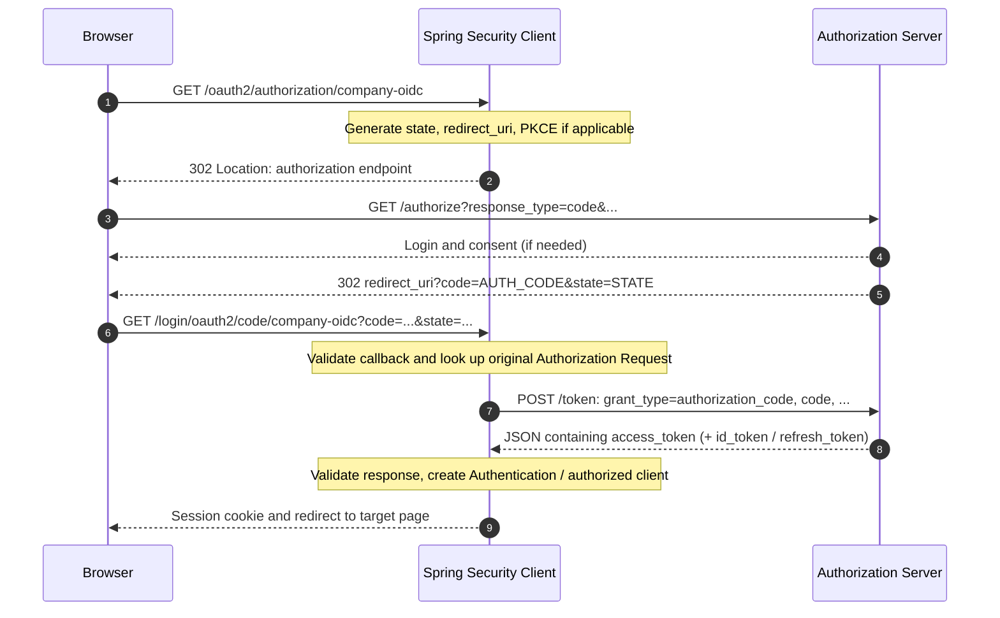
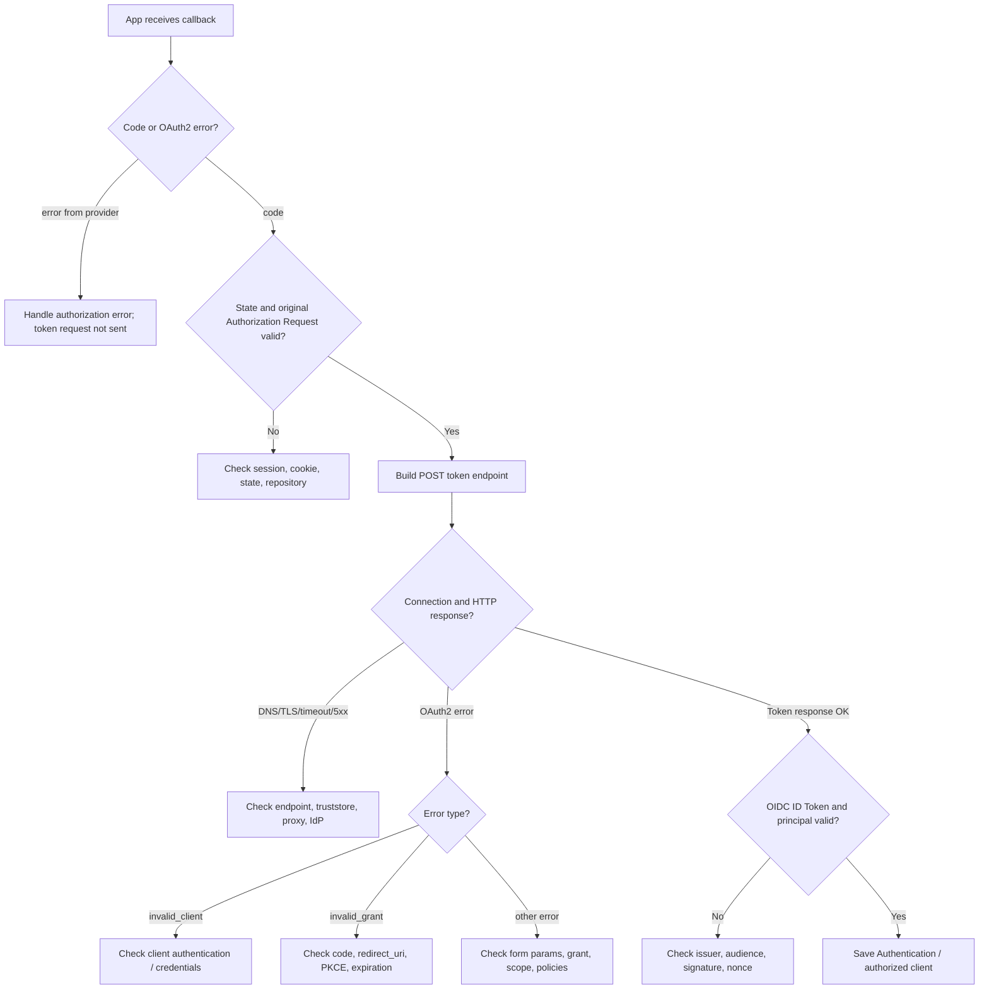

# 10.2. Requesting Token Exchange with an Authorization Code

In a **Spring Security OAuth 2.0 / OpenID Connect (OIDC) Client**, after the user authenticates with the Authorization Server (or OpenID Provider), the browser is redirected back to the application with an **authorization code**. This code is not yet an access token. The Spring application must send an HTTP request to the **token endpoint** to exchange the code for an access token and, depending on the protocol, receive an ID Token or a refresh token as well.

This is the defining step of the **Authorization Code Grant**: the browser only carries a short-lived authorization code in the callback, while the server-side application performs the token request over a direct connection to the identity provider. Spring Security provides built-in components to validate the callback, construct a properly formatted request, authenticate the client, send `code_verifier` when using PKCE, parse the token response, and complete login.

The goal of this lesson is to understand the **authorization code token exchange request** precisely: when the request is sent, which fields must be included, how they relate to the preceding Authorization Request, how to configure it in Spring Security, and how to troubleshoot common errors.

## 1. Where Does the Token Request Fit in the Authorization Code Flow?

Three types of HTTP requests are very easy to confuse:

| Phase | Who Sends It? | Target Endpoint | Purpose |
|---|---|---|---|
| Authorization initiation | Browser redirected by the application | Provider's authorization endpoint | User signs in and grants consent if needed. |
| Callback | Provider redirects the **browser** back to the application | `/login/oauth2/code/{registrationId}` (default in Servlet) | Sends `code` and `state` back to the client. |
| **Exchanging code for tokens** | **Spring OAuth2 Client backend** | Provider's **token endpoint** | Sends `authorization_code`, `code`, and binding parameters to obtain tokens. |

The path `/oauth2/authorization/{registrationId}` belongs to the application and is used to **initiate** sign-in. The path `/login/oauth2/code/{registrationId}` also belongs to the application, and is used to **receive the callback**. The token endpoint, such as `https://idp.example.org/realms/company/protocol/openid-connect/token`, belongs to the provider and is called by Spring from the backend via HTTP POST.



When sending the token request, **the browser does not need to send the client secret or access token**. A confidential client authenticates with the provider on the backend channel. If the application uses a public client—such as an application that cannot keep a secret—the client authentication method can be `none`, and PKCE plays a crucial role.

## 2. Prerequisites for Exchanging an Authorization Code

A token exchange is only meaningful once the client has received an authorization code from a valid authorization request. Before Spring sends the HTTP POST, the following conditions must hold or be verified by the protocol:

1. **The Authorization Server issued a code:** the callback contains the `code` parameter and satisfies the required checks, rather than returning `error=access_denied` or another OAuth2 authorization error.
2. **The client can identify the original authorization request:** the `state` value and associated data must match the request stored in the session/repository.
3. **`ClientRegistration` identifies the right provider:** `token-uri`, `client-id`, client authentication method, and grant type must match the registered client.
4. **The code is still valid:** the code is short-lived, typically single-use, and bound to both the client and the redirect URI according to provider policy.
5. **Consistent Redirect URI:** if `redirect_uri` was sent in the Authorization Request, the token request must send the exact same value as required by OAuth 2.0.
6. **Consistent PKCE if applicable:** the token request must carry the `code_verifier` matching the `code_challenge` sent when initiating authorization.
7. **Proper client authentication:** a confidential client must use its registered method, such as `client_secret_basic`; a public client does not send a client secret.

Do not treat "the callback has a code" as proof that the user has logged in successfully. Spring must complete the token exchange and corresponding verification steps before establishing the application principal.

## 3. HTTP POST Format to the Token Endpoint

Under the OAuth 2.0 Authorization Code Grant, the standard request uses **HTTP POST** with an `application/x-www-form-urlencoded` body. Example of a confidential client using `client_secret_basic` and PKCE:

```http
POST /realms/company/protocol/openid-connect/token HTTP/1.1
Host: idp.example.org
Content-Type: application/x-www-form-urlencoded
Accept: application/json
Authorization: Basic <CLIENT_CREDENTIALS_REDACTED>

grant_type=authorization_code&
code=AUTHORIZATION_CODE&
redirect_uri=https%3A%2F%2Fapp.example.org%2Flogin%2Foauth2%2Fcode%2Fcompany-oidc&
code_verifier=ORIGINAL_PKCE_VERIFIER
```

This is an illustrative HTTP snippet. In an actual request, the form body is encoded as a valid single line on the wire, and credentials must be generated by the HTTP client according to the configured client authentication method. Do not copy examples and write real `Authorization` headers into documentation or logs.

### 3.1. Fields to Understand

| Field | Required / When Used | Explanation |
|---|---|---|
| `grant_type` | Required | Fixed value `authorization_code` so the provider knows which grant type is being exchanged. |
| `code` | Required | The code from the authorization response; must keep its exact value, never swapped for an ID Token or access token. |
| `redirect_uri` | Required if sent in the authorization request; Spring usually sends it | Must match the redirect URI used when requesting the code, including scheme/host/port/path per provider rules. |
| `client_id` | Needed to identify the client; how it is sent depends on client authentication | For public clients, usually sent in the body. With `client_secret_basic`, client identity is conveyed in the Authorization header. |
| `client_secret` | **Not** required for every client | With `client_secret_post`, the secret is sent in the form body; with `client_secret_basic`, via HTTP Basic. Public clients (`none`) have no secret. |
| `code_verifier` | Required when the authorization request used PKCE | Secret random string from that authorization attempt; the provider checks it against the previously received `code_challenge`. |
| Extension parameters such as `resource`, `audience` | Only when required by the provider/API contract | May be needed by certain Authorization Servers; not part of the mandatory default parameter set for every token request. |

**There is no `state` in a standard token request body.** `state` is used to correlate the callback with the Authorization Request and must be verified before performing the token exchange. Likewise, `code_challenge` belongs to the **authorization request**; the token request sends **`code_verifier`**. OIDC `nonce` belongs to the authentication request and is verified against the ID Token, not passed as a default parameter in the code exchange form.

### 3.2. Why Must `redirect_uri` Match?

Suppose the browser starts the flow with:

```text
redirect_uri=https://app.example.org/login/oauth2/code/company-oidc
```

Yet the token request sends:

```text
redirect_uri=http://internal-app:8080/login/oauth2/code/company-oidc
```

The provider may return `invalid_grant` because the value does not match the URI used when issuing the code. A common cause is a reverse proxy causing the application to build URLs using its internal address. Inspect the actual request, forwarded headers configuration, context path, and the redirect URI registered with the provider.

Do not rewrite the redirect URI during the token exchange phase to "match" the domain where the code happens to run. Ensure consistency starting from the step that creates the Authorization Request.

### 3.3. Client Authentication Is Part of the Token Request

A token endpoint typically supports one or more client authentication methods:

- **`client_secret_basic`:** passes the client ID and client secret via HTTP Basic over TLS. This is the common choice for confidential clients.
- **`client_secret_post`:** passes the client ID and secret in the form body. Use only when allowed by the provider and security policy.
- **`none`:** public clients that do not prove identity with a secret; requires PKCE per specification/provider policy.
- **`private_key_jwt` or key/certificate-based methods:** the client generates an assertion or uses a cryptographic mechanism accepted by the provider; requires dedicated configuration and must never be replaced with a dummy secret.

A registration must declare the right `client-authentication-method`. If the provider expects `client_secret_basic` but the client sends `client_secret_post` or vice versa, the token endpoint may return `invalid_client` even if `client-id` is correct.

### 3.4. Public Client with PKCE

Example where the client has no secret; the form body must identify the client and include the verifier:

```http
POST /oauth2/token HTTP/1.1
Host: idp.example.org
Content-Type: application/x-www-form-urlencoded

grant_type=authorization_code&
client_id=public-client&
code=AUTHORIZATION_CODE&
redirect_uri=https%3A%2F%2Fapp.example.org%2Fcallback&
code_verifier=ORIGINAL_PKCE_VERIFIER
```

This is an HTTP illustration, **not a recommendation to use a public client for every Spring MVC application**. A BFF/server-side app that can hold a secret can operate as a confidential client while still using PKCE to strengthen authorization code protection. Client classification must match the registration profile at the provider.

## 4. How Does PKCE Link the Two HTTP Requests?

PKCE (Proof Key for Code Exchange, RFC 7636) makes an intercepted authorization code hard for a third party to exchange for tokens.

When initiating the Authorization Request, the client generates a high-entropy `code_verifier` and derives `code_challenge`. With the common `S256` method:

\[
\text{code\_challenge}
= \operatorname{BASE64URL\_NO\_PAD}\left(\operatorname{SHA256}(\text{ASCII(code\_verifier)})\right)
\]

Parameters across the two steps:

| Authorization Endpoint | Token Endpoint |
|---|---|
| `code_challenge=<derived value>` | `code_verifier=<original random value>` |
| `code_challenge_method=S256` | No need to resend `code_challenge_method` in the code exchange form. |
| `state` to correlate the response | Never substitute `state` for `code_verifier`. |

The Authorization Server records the challenge when issuing the code, then recomputes the value from the verifier in the token request. If they do not match, the provider rejects the request. The code and verifier belong to the **same** authorization attempt; never reuse a static verifier across sessions.

In Spring Security, when PKCE is enabled by configuration and version, the associated data is carried in `OAuth2AuthorizationRequest` and the request repository so the verifier can be sent during code exchange. If you implement a custom resolver or repository, you must preserve these attributes and not break state storage lifecycles. You never manually append `code_verifier` to a browser URL.

**PKCE does not completely replace checking `state`, issuer, redirect URI, or client authentication.** Each mechanism protects a different part of the protocol.

## 5. Spring Security Servlet Performs the Token Request Automatically

For Servlet/MVC applications using `spring-boot-starter-oauth2-client`, you normally **do not need to write a `POST /token` controller**. When the provider redirects back to `/login/oauth2/code/{registrationId}`, the Spring Security filter chain handles the token exchange step.

Main component flow:

```text
Browser callback /login/oauth2/code/company-oidc
       |
       v
OAuth2LoginAuthenticationFilter
       |
       +--> AuthorizationRequestRepository
       |    (look up original request, verify state)
       |
       +--> ClientRegistrationRepository
       |    (look up clientId, tokenUri, method, redirectUri)
       |
       v
OAuth2 login authentication provider
       |
       v
OAuth2AccessTokenResponseClient<OAuth2AuthorizationCodeGrantRequest>
       |
       +--> HTTP POST /token (authorization_code)
       |
       v
OAuth2AccessTokenResponse
       |
       +--> process OAuth2 user / OIDC ID Token per flow
       |
       v
Authentication + OAuth2AuthorizedClient
```

Key Java types:

| Type / Component | Role |
|---|---|
| `OAuth2AuthorizationRequest` | Original authorization request details (scopes, state, redirect URI, related attributes). |
| `OAuth2AuthorizationResponse` | Callback response details, containing `code` or an OAuth2 error. |
| `OAuth2AuthorizationExchange` | Combines the initial request and callback response for token exchange. |
| `OAuth2AuthorizationCodeGrantRequest` | Object representing the authorization code exchange request on the client. |
| `OAuth2AccessTokenResponseClient<OAuth2AuthorizationCodeGrantRequest>` | Interface that sends the token request and parses the token response in Servlet. |
| `OAuth2AccessTokenResponse` | Token endpoint result: access token, scopes, refresh token (if any), additional parameters. |
| `OAuth2AuthorizedClient` | Access/refresh token data issued for a registration and principal, used by the app for subsequent API calls. |
| `OAuth2LoginAuthenticationFilter` | Servlet filter that receives the callback and initiates authentication in Spring Security. |

Spring Security provides HTTP client implementations of the token response client interface, such as `RestClientAuthorizationCodeTokenResponseClient` in newer Spring Security versions; older versions may use `DefaultAuthorizationCodeTokenResponseClient`. API contracts and connection mechanisms may vary by version. The core behavior remains the same: Spring constructs a token request from the Authorization Code Grant, sends it over HTTPS, and processes the response.

### 5.1. Configuring `ClientRegistration` with Token Endpoint via OIDC Discovery

Example `application.yml`:

```yaml
spring:
  security:
    oauth2:
      client:
        registration:
          company-oidc:
            provider: company
            client-id: "${OIDC_CLIENT_ID}"
            client-secret: "${OIDC_CLIENT_SECRET}"
            client-authentication-method: client_secret_basic
            authorization-grant-type: authorization_code
            redirect-uri: "{baseUrl}/login/oauth2/code/{registrationId}"
            scope:
              - openid
              - profile
              - email
        provider:
          company:
            issuer-uri: "https://idp.example.org/realms/company"
```

`issuer-uri` is the exact identifier of the OpenID Provider. When the provider supports OIDC discovery and exposes valid metadata, Spring can locate `authorization_endpoint`, `token_endpoint`, `jwks_uri`, and other required metadata automatically.

In this example, actual values for `client-id` and `client-secret` must come from environment variables/a secret manager. URIs and domains are illustrative data. The provider must be configured to accept the corresponding client authentication method, redirect URI, and scopes.

### 5.2. When You Must Declare the Token URI Explicitly

If the provider does not support discovery, or the application requires manual configuration, you can declare endpoints directly:

```yaml
spring:
  security:
    oauth2:
      client:
        registration:
          my-provider:
            client-id: "${OAUTH_CLIENT_ID}"
            client-secret: "${OAUTH_CLIENT_SECRET}"
            authorization-grant-type: authorization_code
            client-authentication-method: client_secret_basic
            redirect-uri: "{baseUrl}/login/oauth2/code/{registrationId}"
            scope: [profile.read]
        provider:
          my-provider:
            authorization-uri: "https://auth.example.org/oauth2/authorize"
            token-uri: "https://auth.example.org/oauth2/token"
            user-info-uri: "https://auth.example.org/api/userinfo"
            user-name-attribute: "id"
```

The second example demonstrates OAuth2 Login with a non-OIDC provider, so there is no `openid` scope or `issuer-uri`. For UserInfo-based OAuth2 Login, configuring `user-info-uri` and `user-name-attribute` depends on the provider. When choosing OIDC Login, configure the issuer and appropriate ID Token verification instead of treating an arbitrary OAuth2 provider as an OpenID Provider.

Never swap `token-uri` with the authorization endpoint or the application callback: those are three distinct addresses serving three different steps.

### 5.3. Spring Security Configuration

```java
import org.springframework.context.annotation.Bean;
import org.springframework.context.annotation.Configuration;
import org.springframework.security.config.Customizer;
import org.springframework.security.config.annotation.web.builders.HttpSecurity;
import org.springframework.security.web.SecurityFilterChain;

@Configuration
class SecurityConfig {

    @Bean
    SecurityFilterChain filterChain(HttpSecurity http) throws Exception {
        http
            .authorizeHttpRequests(authorize -> authorize
                .requestMatchers("/", "/error").permitAll()
                .anyRequest().authenticated()
            )
            .oauth2Login(Customizer.withDefaults())
            .oauth2Client(Customizer.withDefaults());

        return http.build();
    }
}
```

When `oauth2Login()` is enabled and the application has a valid `ClientRegistration`, Spring Security orchestrates the redirect/callback/token exchange. `oauth2Client()` enables authorized client management for use cases where the application calls downstream APIs. You do not need to call the token endpoint manually from an MVC controller after the user has signed in with OAuth2 Login.

### 5.4. Checking That a Token Was Obtained

After authentication, a Servlet controller can inject the corresponding authorized client:

```java
import org.springframework.security.oauth2.client.OAuth2AuthorizedClient;
import org.springframework.security.oauth2.client.annotation.RegisteredOAuth2AuthorizedClient;
import org.springframework.web.bind.annotation.GetMapping;
import org.springframework.web.bind.annotation.RestController;

@RestController
class IdentityController {

    @GetMapping("/session/token-metadata")
    String tokenMetadata(
            @RegisteredOAuth2AuthorizedClient("company-oidc")
            OAuth2AuthorizedClient client) {

        // Illustrates metadata only; do not send the access token to the browser.
        return "registration=" + client.getClientRegistration().getRegistrationId()
                + ", expiresAt=" + client.getAccessToken().getExpiresAt();
    }
}
```

This example only applies when the registration has already been authorized for the current principal. Storing `OAuth2AuthorizedClient` depends on the repository/service in use. Never return `client.getAccessToken().getTokenValue()` or the refresh token to the browser just to verify that token exchange occurred.

## 6. Spring Security Reactive Uses Corresponding Components

In WebFlux, the OAuth2/OIDC logic and token request fields remain similar at the protocol level, while the pipeline and Java types differ from Servlet:

| Servlet | Reactive WebFlux |
|---|---|
| `HttpSecurity`, `SecurityFilterChain` | `ServerHttpSecurity`, `SecurityWebFilterChain` |
| `ClientRegistrationRepository` | `ReactiveClientRegistrationRepository` |
| `OAuth2AccessTokenResponseClient<OAuth2AuthorizationCodeGrantRequest>` | `ReactiveOAuth2AccessTokenResponseClient<OAuth2AuthorizationCodeGrantRequest>` |
| Default Servlet HTTP client per version | `WebClientReactiveAuthorizationCodeTokenResponseClient` (Reactive example) |
| `OAuth2AuthorizedClientRepository` | `ServerOAuth2AuthorizedClientRepository` |

Example enabling login in WebFlux:

```java
@Bean
SecurityWebFilterChain webFluxSecurity(ServerHttpSecurity http) {
    return http
            .authorizeExchange(exchange -> exchange
                    .pathMatchers("/", "/error").permitAll()
                    .anyExchange().authenticated()
            )
            .oauth2Login(Customizer.withDefaults())
            .oauth2Client(Customizer.withDefaults())
            .build();
}
```

Never use a Servlet `OAuth2AccessTokenResponseClient` directly as a Reactive client. Likewise, never call `block()` on the WebFlux event loop to perform token exchange manually. Spring Security WebFlux already provides a non-blocking flow when using the proper reactive components.

## 7. Token Response: What Does the Provider Return?

When the token request succeeds, the Authorization Server usually returns HTTP 200 with JSON containing the access token. For the OIDC Authorization Code Flow, the response also includes an ID Token per OIDC requirements:

```http
HTTP/1.1 200 OK
Content-Type: application/json
Cache-Control: no-store
Pragma: no-cache

{
  "access_token": "<ACCESS_TOKEN_REDACTED>",
  "token_type": "Bearer",
  "expires_in": 3600,
  "refresh_token": "<OPTIONAL_REFRESH_TOKEN_REDACTED>",
  "id_token": "<OIDC_ID_TOKEN_REDACTED>",
  "scope": "openid profile email"
}
```

This illustrates an OIDC provider that issues a refresh token. Each provider may include its own additional parameters; `refresh_token` is not guaranteed to appear in every code exchange. In a **non-OIDC** Authorization Code Flow, `id_token` is not returned by default.

| Response Property | Meaning |
|---|---|
| `access_token` | Credential for calling Resource Servers with the granted permissions; the app must keep it secret and avoid logging it. |
| `token_type` | Token type, usually `Bearer`. How the access token is used must match the issued token type. |
| `expires_in` | Access token lifetime, in seconds from issuance or per provider semantics. |
| `refresh_token` | Can be used to request a new access token if allowed by the provider; optional, and storage policy is critical. |
| `scope` | Actual granted permissions, which may differ from the requested scopes; in OAuth2, this field may be omitted if unchanged from the request. |
| `id_token` | OIDC token describing the authentication event, containing claims such as `iss`, `sub`, `aud`, `exp`; never use it as an API access token. |

Spring Security processes the token response via the appropriate client, maps it to an `OAuth2AccessTokenResponse` model, and attaches the access token to the authorized client. When using `oauth2Login()`, the framework also authenticates the user identity, fetches UserInfo if needed, and builds `Authentication`.

### 7.1. OIDC Does Not Stop at Receiving JSON

For OIDC Login, receiving `id_token` does not mean the ID Token is safe to trust. Appropriate OIDC constraints must be verified, including:

- Signature using the provider's keys, allowed algorithms, and corresponding metadata/JWK Set.
- `iss` matches the expected issuer.
- `aud` contains the appropriate client ID; `azp` when applicable.
- `exp`, `iat`, and related timestamp constraints.
- `nonce` when sent in the authorization request.
- Other protocol checks depending on the flow and provider.

Spring Security OIDC supports these checks through its authentication components and validators. Never disable issuer, audience, or signature verification to bypass configuration errors.

### 7.2. Login Principal Differs from `OAuth2AuthorizedClient`

After success, there are two perspectives:

1. **`Authentication` / `SecurityContext`**: the user is authenticated with the application; the principal may be an `OidcUser` in OIDC Login.
2. **`OAuth2AuthorizedClient`**: the registration along with its access token and refresh token (if any), used for calling downstream APIs.

An access token can expire or be revoked while the login session still remains active. Conversely, having a valid access token from client credentials does not establish an end-user login session. The two kinds of state should not be conflated.

## 8. Should You Send Token Requests Manually with `curl`?

In a production Spring Security system, let the OAuth2 Client send the token request. When learning the protocol or diagnosing a test environment, you may craft a manual request to observe the format.

### 8.1. Confidential Client Using HTTP Basic

**Illustrative** example using placeholders and a test authorization code:

```bash
curl --request POST 'https://idp.example.org/oauth2/token' \
  --user 'my-client:LOCAL_TEST_SECRET' \
  --header 'Content-Type: application/x-www-form-urlencoded' \
  --data-urlencode 'grant_type=authorization_code' \
  --data-urlencode 'code=ONE_TIME_AUTH_CODE' \
  --data-urlencode 'redirect_uri=https://app.example.org/login/oauth2/code/company-oidc' \
  --data-urlencode 'code_verifier=ORIGINAL_PKCE_VERIFIER'
```

`curl --user` typically generates HTTP Basic authentication. Note that the example above **cannot succeed with dummy codes/secrets**. With real codes, an authorization code is single-use, short-lived, and must be exchanged by the exact client with matching redirect URI and verifier. When testing manually, you must also preserve the initial request state and PKCE policy.

Never put real secrets on the command line in shared environments: command history, process lists, and logging systems can record them. Use secure credential injection mechanisms in real environments.

### 8.2. Public Client Using PKCE, No Secret Sent

```bash
curl --request POST 'https://idp.example.org/oauth2/token' \
  --header 'Content-Type: application/x-www-form-urlencoded' \
  --data-urlencode 'grant_type=authorization_code' \
  --data-urlencode 'client_id=public-client' \
  --data-urlencode 'code=ONE_TIME_AUTH_CODE' \
  --data-urlencode 'redirect_uri=https://app.example.org/callback' \
  --data-urlencode 'code_verifier=ORIGINAL_PKCE_VERIFIER'
```

The provider must register the client as public and accept the corresponding authentication method. Simply deleting the client secret from a confidential client does not automatically make that registration a valid public client.

### 8.3. Why Not Call the Token Endpoint from the Browser for a Confidential Client?

If the browser calls the token endpoint directly, you risk exposing the client secret or tokens to JavaScript and the browser environment, while also running into CORS and provider policies. For a Spring MVC/BFF application that holds credentials on the server, token exchange should run **server-to-server**, with the application maintaining a session for the browser.

A public-client SPA executing Authorization Code + PKCE is a different architecture: it is never issued a confidential client secret, and token storage must account for browser constraints. Do not copy that model into a BFF without reconsidering the OAuth2 Client role.

## 9. Customizing the Token Request When a Provider Has Special Requirements

Most standard flows can be configured through `ClientRegistration` while letting Spring Security handle the rest. When a provider requires an extra parameter at the token endpoint—such as `resource` or a contract-specific parameter—customize the **token response client** rather than building a custom controller to exchange codes for tokens.

In Spring Security versions with `RestClientAuthorizationCodeTokenResponseClient`, you can configure a parameter-adding converter:

```java
import org.springframework.context.annotation.Bean;
import org.springframework.context.annotation.Configuration;
import org.springframework.http.LinkedMultiValueMap;
import org.springframework.http.MultiValueMap;
import org.springframework.security.oauth2.client.endpoint.OAuth2AccessTokenResponseClient;
import org.springframework.security.oauth2.client.endpoint.OAuth2AuthorizationCodeGrantRequest;
import org.springframework.security.oauth2.client.endpoint.RestClientAuthorizationCodeTokenResponseClient;

@Configuration
class TokenEndpointConfig {

    @Bean
    OAuth2AccessTokenResponseClient<OAuth2AuthorizationCodeGrantRequest>
    authorizationCodeTokenResponseClient() {

        var client = new RestClientAuthorizationCodeTokenResponseClient();

        client.addParametersConverter(grantRequest -> {
            MultiValueMap<String, String> extras = new LinkedMultiValueMap<>();
            extras.add("resource", "https://api.example.org");
            return extras;
        });

        return client;
    }
}
```

This example is only appropriate when the provider **actually supports** the `resource` parameter and the application needs tokens scoped to that resource. It is not a required parameter for every OAuth2 token request. Never accept arbitrary `resource`/`audience` values from the browser to broaden token scope.

You can wire the client above into OAuth2 Login configuration explicitly:

```java
@Bean
SecurityFilterChain securityFilterChain(
        HttpSecurity http,
        OAuth2AccessTokenResponseClient<OAuth2AuthorizationCodeGrantRequest>
                tokenResponseClient) throws Exception {

    http.authorizeHttpRequests(authorize -> authorize
            .anyRequest().authenticated()
        )
        .oauth2Login(oauth2 -> oauth2
            .tokenEndpoint(token -> token
                .accessTokenResponseClient(tokenResponseClient)
            )
        );

    return http.build();
}
```

The two snippets in this section form a standalone example; do not declare two overlapping `SecurityFilterChain` beans in a real application. If you are on an older Spring Security version without `RestClientAuthorizationCodeTokenResponseClient`, choose the token client implementation and configuration API supported by that version. For WebFlux, use the corresponding reactive access-token-response client.

**Customization principle:** add only the parameters required by the provider and keep all default protocol elements intact, such as `grant_type`, `code`, `redirect_uri`, client authentication, and `code_verifier`. These parameters are tied to the original Authorization Request; dropping or overwriting them easily breaks flow integrity.

### 9.1. When Do You Need a Custom HTTP Client or Timeout?

In production environments, the token request is a direct HTTP call to the provider; you may need to configure timeouts, proxies, a TLS truststore, or safe logging on the HTTP client. Keep in mind:

- Choose timeouts adequate to detect network failures and allow the application to fail gracefully.
- Trust only approved CAs/certificates; never disable TLS certificate verification.
- Never log `Authorization` headers, `client_secret`, `code`, `code_verifier`, token responses, or cookies.
- For the HTTP POST exchanging an authorization code, **never automatically retry blindly** after a timeout. The provider may have already consumed the code on the first request, so a retry will receive `invalid_grant`. Distinguish pre-send connection errors from ambiguous outcomes and handle re-authentication through a safe flow.

## 10. Token Endpoint Errors and How to Classify Them

The token endpoint can return OAuth2 errors as JSON. Example:

```http
HTTP/1.1 400 Bad Request
Content-Type: application/json
Cache-Control: no-store

{
  "error": "invalid_grant",
  "error_description": "Authorization code is invalid or expired"
}
```

`error_description` is supplied by the provider and is not always stable or safe to display verbatim to end users. Do not branch security logic based on free-form descriptions; prefer standard error codes and processing context.

| Error Code / Symptom | Possible Cause | How to Diagnose |
|---|---|---|
| `invalid_client` | Wrong client ID/secret, rotated secret, mismatched client authentication method | Check `client-id`, `basic/post/none` method, credentials on the provider, and the right tenant. |
| `invalid_grant` | Expired or already-used code, code belongs to another client, wrong redirect URI, wrong PKCE verifier, or invalid refresh token in another flow | Check delay between callback and token request, single-use code enforcement, redirect URI, `code_verifier`, and client registration. |
| `invalid_request` | Missing required `grant_type`/`code`/`redirect_uri`, malformed body encoding, duplicate/invalid parameters | Check request contract per grant type, `Content-Type`, and custom converters. |
| `unsupported_grant_type` | Provider has not enabled `authorization_code` for the client or the token endpoint rejects this grant | Check grant type configuration on the provider and registration in Spring. |
| `invalid_scope` | Invalid scope or client is not authorized for it; sometimes occurs earlier at the authorization endpoint | Check registered scopes and provider policy. |
| HTTP 401/403 | Client authentication failed or policy blocked the token endpoint | Check OAuth2 error code in body, auth method, proxy/gateway, and provider policies. |
| HTTP 404 | Wrong token URI, confused with authorization endpoint, wrong realm/tenant or base path | Compare against discovery metadata/configured URL. |
| HTTP 429 | Provider rate limit | Check traffic load, login frequency, and provider retry guidance; remember codes are single-use. |
| HTTP 5xx, timeout, TLS/DNS | Provider or network issue | Check connectivity, TLS truststore, proxy, IdP status; avoid blindly retrying codes. |
| Unparseable token response | Wrong `Content-Type`/JSON, missing `access_token` or `token_type`, provider uses non-standard format | Inspect sanitized HTTP response and token response client compatibility. |
| Token exchange succeeded but OIDC Login failed | Missing/invalid ID Token, wrong issuer/audience/nonce/signature, or UserInfo issue | Investigate post-token OIDC verification rather than blaming the token request. |

### 10.1. Distinguishing `invalid_grant` from `invalid_client`

These two errors have very different remediations:

**`invalid_client`:** authenticating the *client application* with the provider failed. Do not keep asking the user to log in again if the secret is wrong; fix the client credentials, authentication method, or provider configuration.

**`invalid_grant`:** the *authorization grant* was rejected. For an authorization code, check the code itself, single-use rules, expiration, redirect URI, PKCE, and client binding. An `invalid_grant` right after a callback typically cannot be fixed by changing the secret without evidence.

### 10.2. Why Can a Callback Succeed While the Token Request Fails?

The provider can redirect to the callback with a code that was valid when issued, yet code exchange still fails if:

1. The application takes too long or the code expires.
2. The code is submitted twice due to duplicate callback requests or uncontrolled retries.
3. The token endpoint receives a different redirect URI than the original authorization request.
4. The PKCE verifier is lost from the session/Authorization Request repository.
5. The client authentication method or secret does not match the provider.
6. The endpoint points to a different realm/tenant than the one that issued the code.

Therefore, track each stage separately: **authorization redirect → callback validation → token exchange → ID Token validation → session establishment**.

## 11. Protecting Information During Code Exchange

The token endpoint exchanges sensitive data; baseline safeguards include:

- **TLS:** use HTTPS to the real token endpoint and verify certificates. Never disable TLS to work around environment issues.
- **Keep client credentials secret:** store secrets in the backend/secret manager; never commit them to Git, embed them in HTML, or pass them to browser JavaScript.
- **Keep codes and verifiers short-lived:** authorization codes are single-use; `code_verifier` is a per-PKCE-transaction secret that must accompany only the matching request.
- **Preserve `state` checks:** the token request must only run after a callback is validly correlated with an initiated Authorization Request.
- **Avoid logging tokens:** never log form bodies containing codes, HTTP Basic headers, access tokens, refresh tokens, or ID Tokens. When tracing is needed, log only `registrationId`, a sanitized endpoint, phase, and error code.
- **Control proxy configuration:** properly forwarding scheme/host may be required so `redirect_uri` does not drift.
- **Protect authorized client storage:** persisted refresh tokens and access tokens must have access controls, encryption, and lifetimes aligned with policy.
- **Do not treat a token as unconditional authorization:** the Resource Server must verify the access token and authorization policies on every API.

If an error must be shown to the user, keep the message high-level such as "Unable to complete sign-in, please try again or contact support"; detailed technical diagnostics belong in controlled logs/traces without secrets.

## 12. Business Example: BFF Login Followed by Calling Reports API

Suppose we have a reporting portal:

```text
Browser
  |
  | 1. /oauth2/authorization/company-oidc
  v
Spring MVC BFF
  |                               OpenID Provider
  | 2. Authorization redirect ----------> |
  | <--------- 3. code via browser ------- |
  |                                        |
  | 4. POST token endpoint --------------> |
  | <------ 5. access_token + id_token --- |
  |
  | 6. Save login session + authorized client
  |
  | 7. GET Reports API (Authorization: Bearer access_token)
  v
Reports Resource Server
```

Sequence:

1. The user signs in with `company-oidc`, requesting scopes `openid profile reports.read`.
2. The backend receives the callback `code` and `state`, and retrieves the stored Authorization Request.
3. Spring sends a token request with `grant_type=authorization_code`, `code`, `redirect_uri`, client authentication credentials, and `code_verifier` when using PKCE.
4. The provider returns an access token, an ID Token, and optionally a refresh token; Spring verifies OIDC and establishes login.
5. When the user requests the reports list, the backend uses the appropriate authorized client to call the Reports API with the **access token**, never the ID Token.
6. The Reports API validates the token, issuer, audience, scopes, and business permissions before returning data.

If an `invalid_grant` error occurs at step 3, investigate the authorization code exchange. If login succeeds but the Reports API returns 403 at step 6, inspect the selected token and API permissions. These two failures belong to different boundaries and have different fixes.

## 13. Workflow for Diagnosing a Failed Token Request



When diagnosing, start with these questions:

1. Does the callback include `code` and a `state` matching the stored request?
2. Does the token URI belong to the right issuer/tenant and use valid HTTPS?
3. Which `authorization_code` grant and client authentication method is the registration using?
4. Does the provider accept that `client_id`/credential at the token endpoint?
5. Is the `redirect_uri` sent in the token request **identical** to the URI used when requesting the code?
6. If PKCE is used, was `code_verifier` preserved properly across the redirect/callback?
7. Is the code still valid, unused, and free from blind retries after ambiguous network errors?
8. If a token response was received, is the failure in token parsing, OIDC validation, or the downstream API call?

You do not need to log full request bodies or print tokens to answer these questions. Use trace IDs, timestamps, `registrationId`, and sanitized error codes.

## 14. Misconceptions to Avoid

| Misconception | Correct Understanding |
|---|---|
| "A callback with a code means login is complete." | The code is only the input to token exchange; authentication still needs to complete. |
| "The browser needs to POST to the token endpoint." | For a Spring MVC/BFF confidential client, the Spring backend calls the token endpoint directly. |
| "Every client must send `client_secret`." | Public clients using `none` have no secret; authentication depends on client type. |
| "PKCE sends `code_challenge` in the POST token request." | The token request sends `code_verifier`; the challenge was sent to the authorization endpoint. |
| "`state` is a required form parameter of the token request." | State correlates the callback with the Authorization Request; it is not part of the standard token request form. |
| "Exchanging a code can be retried freely." | Codes are typically single-use; after a timeout, the code may already be consumed. |
| "Scopes requested in the Authorization Request are guaranteed to be granted." | Actual permissions depend on the provider and token response, and are later checked by APIs. |
| "Having an access token means a valid OIDC Login exists." | OIDC Login also requires an ID Token and its corresponding verification steps. |
| "The client must manually POST to the token endpoint in every controller." | Spring Security provides the token response client and handles the login flow automatically. |
| "Returned tokens must be sent straight to the frontend." | With a server-side BFF, tokens can remain on the backend while maintaining a browser session. |

## 15. Practice Questions

1. List the required fields of an `authorization_code` token request and explain which field is only present when using PKCE.
2. Why must `redirect_uri` in the token request match the value sent to the authorization endpoint?
3. How do two clients using `client_secret_basic` and `none` differ in the HTTP code exchange request?
4. Why shouldn't `state` be sent in place of `code_verifier`?
5. In Spring Security Servlet, which component handles the callback and which component is responsible for sending the token request?
6. When receiving `invalid_client`, which configurations should you check first?
7. When receiving `invalid_grant`, why should you inspect code expiration, redirect URI, and PKCE before changing the client secret?
8. When token exchange succeeds but OIDC Login still fails, which ID Token claims/conditions might need inspection?
9. Why should a timeout during code exchange not lead to blind retries?
10. Why does the Reports API require an access token and perform its own authorization checks even though the user already logged into the BFF?

## References

- [RFC 6749 — Authorization Code Grant, Access Token Request](https://datatracker.ietf.org/doc/html/rfc6749#section-4.1.3)
- [RFC 6749 — Access Token Response](https://datatracker.ietf.org/doc/html/rfc6749#section-4.1.4)
- [RFC 6749 — Token Endpoint](https://datatracker.ietf.org/doc/html/rfc6749#section-3.2)
- [RFC 7636 — Proof Key for Code Exchange (PKCE)](https://datatracker.ietf.org/doc/html/rfc7636)
- [OpenID Connect Core 1.0 — Token Endpoint](https://openid.net/specs/openid-connect-core-1_0.html#TokenEndpoint)
- [Spring Security Reference — OAuth2 Login, Core Configuration](https://docs.spring.io/spring-security/reference/servlet/oauth2/login/core.html)
- [Spring Security Reference — OAuth2 Login, Advanced Configuration](https://docs.spring.io/spring-security/reference/servlet/oauth2/login/advanced.html)
- [Spring Security Reference — OAuth2 Client (Servlet)](https://docs.spring.io/spring-security/reference/servlet/oauth2/client/index.html)
- [Spring Security Reference — OAuth2 Client (Reactive)](https://docs.spring.io/spring-security/reference/reactive/oauth2/client/index.html)
