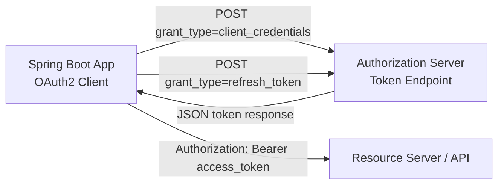
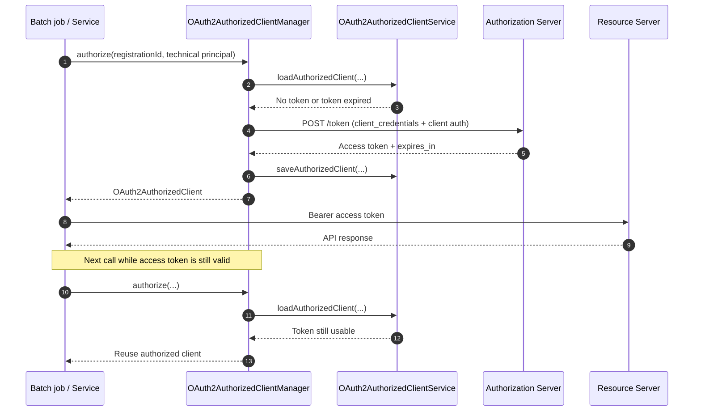
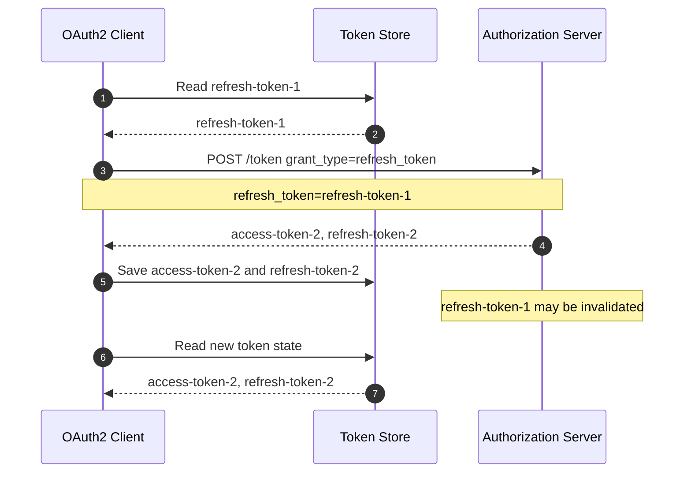
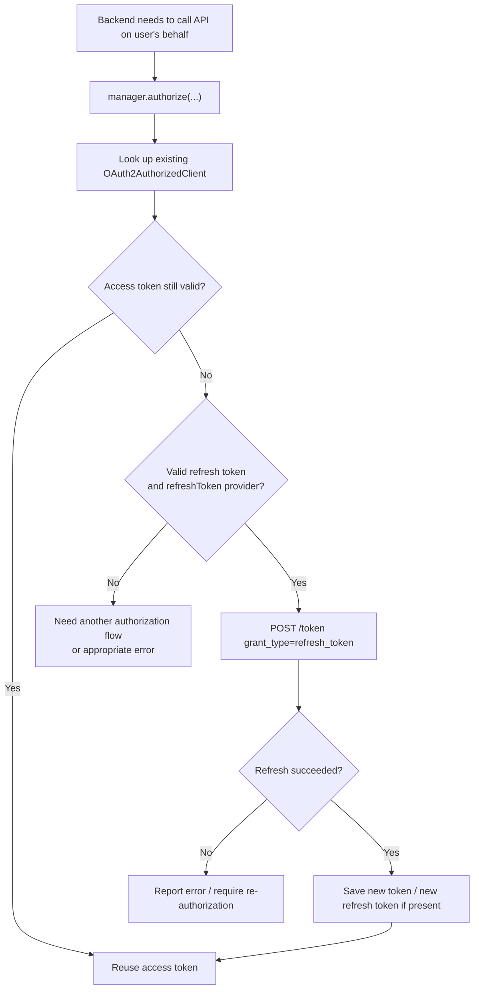

# 10.3. Client Credentials Requests and Refresh Token Requests

In a **Spring Security OAuth 2.0 / OIDC Client**, when an application wants to obtain an access token, it typically sends an HTTP request to the Authorization Server's **Token Endpoint**. Two requests that are very easy to confuse are:

1. **Client Credentials Grant**: the application uses **the client's own identity** to request an access token, typically for machine-to-machine communication.
2. **Refresh Token Grant**: the client uses a **previously issued refresh token** to request a new access token when the current access token has expired or is about to expire.

Both call the token endpoint and may require client authentication, yet **the basis for issuing the token** and **the permission context** differ. This lesson walks from the HTTP request and token response to how Spring Security manages these requests in real-world applications.

> Terminology note: "client credentials" is sometimes also used to mean **the client's authentication credentials** (client ID, client secret, private key, certificate). Client authentication at the token endpoint can appear across *multiple grants*, including the refresh token grant. It is not synonymous with using **`grant_type=client_credentials`**.

## 1. Role of the Token Endpoint

The Token Endpoint belongs to the **Authorization Server** and receives token requests over a TLS/HTTPS-protected connection. For the standard grants covered here, the method is typically **HTTP POST** with **`application/x-www-form-urlencoded`** content.



Three kinds of values to distinguish:

| Value | Where Is It Sent? | What Is It Used For? |
| --- | --- | --- |
| **Client credential** | Token Endpoint, according to the registered client authentication method | Proves the client application's identity when policy requires it |
| **Access token** | Resource Server/API | Grants access to resources within the appropriate scopes, audience, and lifetime |
| **Refresh token** | Token Endpoint | Obtains a new access token without repeating the entire initial authorization flow |

Never send a **refresh token** in the `Bearer` header to a Resource Server, and never use an **access token** like a password to invoke the refresh token grant.

Example token endpoint address (illustrative):

```text
https://id.example.test/realms/company/protocol/openid-connect/token
```

The actual address comes from the Authorization Server/OpenID Provider metadata or provider configuration in Spring Security. It is **different** from the authorization endpoint used for browser redirects and **different** from the client's redirect/callback URI.

### 1.1. A Token Request Has Two Layers of Information

A single request can carry both simultaneously:

- **Client authentication**: identifies *which application* is calling (for example, HTTP Basic with client ID and secret, or another method).
- **Grant request**: specifies *on what basis* the application is requesting a token (for example, `client_credentials` or `refresh_token`).

Diagram:

```text
HTTP POST /token
├── Client authentication
│   └── Authorization: Basic <client-id-and-secret>
└── Form body
    ├── grant_type=...
    └── Grant-specific parameters
```

**Do not conflate the grant name with the client authentication method.** A confidential client can authenticate with Basic in both grants, whereas a public client might be issued a refresh token under provider policy without a client secret.

## 2. Client Credentials Grant: The Client Requests Permissions for Itself

### 2.1. When Is It Used?

The **Client Credentials Grant** is for a client accessing resources using **the application's own identity and permissions**, not on behalf of an interactively logged-in user.

Examples:

- A batch job reading reports from an internal API.
- A payment backend calling an accounting API with service-to-service permissions.
- Microservice A calling microservice B under a workload-specific access policy.
- A scheduled task pulling analytics data nightly.

This is not a substitute for "logging a user in without a UI". If an operation requires a specific user's permissions, use an appropriate user authorization flow such as Authorization Code, or a delegation/token-exchange mechanism supported by the system.

### 2.2. Standard HTTP Request

The client sends **`grant_type=client_credentials`** in the token request body.

```http
POST /realms/company/protocol/openid-connect/token HTTP/1.1
Host: id.example.test
Content-Type: application/x-www-form-urlencoded
Authorization: Basic <base64-client-credentials>

grant_type=client_credentials&scope=reports.read
```

Components:

| Component | Required? | Meaning |
| --- | --- | --- |
| `grant_type=client_credentials` | Yes | Selects the Client Credentials Grant |
| `scope` | Optional per spec; depends on server policy | Permissions the client is requesting, such as `reports.read` |
| Client authentication | Yes for clients using this standard grant | Proves application identity using a method accepted by the OP/AS |
| `redirect_uri` | No | This grant does not redirect a browser |
| User's `username` / `password` | No | There is no user signing in during this flow |
| `refresh_token` | No | A refresh token is not used to initiate the Client Credentials Grant |

In the example, the value after `Authorization: Basic` is only a placeholder. With client secret basic, the OAuth2 library handles encoding the client ID and secret per protocol rules. Never hardcode or manually construct credentials and write them to logs.

**The Client Credentials Grant is only appropriate when the client can protect its own credentials.** A SPA running in JavaScript or a mobile app distributed to many users cannot keep a shared client secret truly confidential, so this confidential-client pattern should not be deployed directly on end-user devices.

### 2.3. Successful Token Response

The Authorization Server verifies client authentication, confirms the grant is allowed, and checks the requested scopes, then returns a JSON response.

```http
HTTP/1.1 200 OK
Content-Type: application/json
Cache-Control: no-store
Pragma: no-cache

{
  "access_token": "<access-token-value>",
  "token_type": "Bearer",
  "expires_in": 3600,
  "scope": "reports.read"
}
```

Common fields:

- **`access_token`**: the token string issued by the server; may be a JWT or opaque token depending on implementation.
- **`token_type`**: typically `Bearer`.
- **`expires_in`**: lifetime in seconds from when the response was generated, per server-provided data.
- **`scope`**: granted scopes; may differ from requested scopes when permitted by policy.

Under OAuth 2.0, for the Client Credentials Grant, **a refresh token is typically not issued and the specification states one should not be included in the response**. When the access token expires, the client simply **uses its own credentials again to request a new token**. Do not design business logic that requires a refresh token for this grant.

Do not expect an **OIDC ID token** in a Client Credentials Grant response: an OIDC ID token conveys the result of user authentication to a client, whereas this flow represents an application identity.

### 2.4. Using the Access Token to Call a Resource Server

After obtaining the token, the backend sends it to the API as required by the Resource Server, typically:

```http
GET /v1/reports HTTP/1.1
Host: api.example.test
Authorization: Bearer <access-token-value>
```

The Resource Server must verify the signature or perform introspection depending on token type, as well as check issuer, audience, expiration, scopes/authorities, and endpoint authorization rules.

**Holding an access token does not guarantee access to every API.** A token issued for `reports.read` may lack permissions for `reports.write`; an access token for API A should not be reused arbitrarily for API B if the audience does not match.

## 3. Lifecycle of the Client Credentials Grant



Note three points:

1. **Both a client registration and a technical principal are needed** so Spring Security can save, look up, and reuse the authorized client under the same key. In this case, `principalName` is an identifier for storage, not proof that a real human user has signed in.
2. **Every time a token is needed, the application should go through `OAuth2AuthorizedClientManager`** or a suitable HTTP client integration, rather than caching a raw token string forever in a field and guessing its expiration.
3. **This grant requires no browser, authorization code, redirect URI, OIDC nonce, or interactive user consent screen.** Authorization policy is governed by the client registration and Authorization Server configuration.

An application may store tokens in memory or in a durable store; if multiple replicas share a client registration, consider caching, principal isolation, and token request rate limits at the server.

## 4. Refresh Token Grant: Obtaining a New Access Token from Existing Authorization

### 4.1. Where Does a Refresh Token Come From?

In certain flows with prior authorization, such as the Authorization Code Grant, the Authorization Server may issue both an **access token** and a **refresh token**. For example, after a user completes OIDC login via a browser, the application backend receives:

```json
{
  "access_token": "<access-token-1>",
  "token_type": "Bearer",
  "expires_in": 900,
  "refresh_token": "<refresh-token-1>",
  "scope": "openid profile orders.read",
  "id_token": "<oidc-id-token>"
}
```

This is an example response for **Authorization Code + OIDC** when the server **allows issuing a refresh token**; not every login includes a refresh token.

Typically:

- The access token has a short lifetime and is accepted by Resource Servers within the appropriate timeframe and scope.
- The refresh token has its own lifetime, usually longer, and is stored and controlled more strictly.
- The refresh token is **only sent to the Authorization Server**, never used to call APIs.
- When a new access token is needed, the client can use the refresh token through mechanisms supported by the provider.
- In web applications, the refresh token is stored in the backend/service or a trusted token store per architecture; never send it to the browser merely because the user signed in.

The Refresh Token Grant **does not require redirecting the browser to the OP**, provided the refresh token is still valid and policy conditions are satisfied. It does not mean a user account never needs to re-authenticate.

### 4.2. HTTP Request to Refresh a Token

Basic request:

```http
POST /realms/company/protocol/openid-connect/token HTTP/1.1
Host: id.example.test
Content-Type: application/x-www-form-urlencoded
Authorization: Basic <base64-client-credentials>

grant_type=refresh_token&refresh_token=<refresh-token-1>
```

Standard parameters:

| Component | Required? | Meaning |
| --- | --- | --- |
| `grant_type=refresh_token` | Yes | Selects the Refresh Token Grant |
| `refresh_token` | Yes | The refresh token issued to the matching client/context |
| `scope` | Optional | May only request scopes within the already-granted permissions; cannot escalate permissions via refresh |
| Client authentication | Depends on client type and server policy | Confidential clients usually must authenticate; public clients rely on appropriate protections |
| `code`, `code_verifier` | No | These are authorization code exchange parameters, not part of a standard refresh grant |
| `username`, `password` | No | Do not resend user passwords |

**A very easy detail to confuse:** a confidential client can still send its client ID/secret in the `Basic` header of a refresh request, yet **the grant type is `refresh_token`, not `client_credentials`**.

For public clients (such as native/browser clients), never simulate a client secret capable of remaining confidential. The Authorization Server must apply appropriate refresh token protections, such as rotation or sender-constraining per modern policy. Exact behavior depends on the provider and supported protocol version.

### 4.3. Token Response on Successful Refresh

```http
HTTP/1.1 200 OK
Content-Type: application/json
Cache-Control: no-store
Pragma: no-cache

{
  "access_token": "<access-token-2>",
  "token_type": "Bearer",
  "expires_in": 900,
  "scope": "openid profile orders.read",
  "refresh_token": "<refresh-token-2>"
}
```

This response illustrates the case where the server **rotates refresh tokens**: `refresh-token-2` replaces `refresh-token-1`.

Key points to understand:

- **A new access token** is issued upon a successful refresh; its expiration must be updated.
- **A new refresh token may be issued**. If present, the client must persist the new token per the provider's contract; the server may revoke the old one.
- **Not every refresh response includes `refresh_token`**. If the server does not return a new one, handle reusing the existing refresh token according to server/framework policy.
- **New scopes cannot exceed the original authorization grant**; refreshing is not a way to escalate access.
- **An ID token is not guaranteed to appear in a refresh response**. Some OPs may issue a new ID token per OIDC rules, but clients must not assume every refresh re-authenticates the user or always returns an ID token.

A successful Refresh Token Grant **does not create a new interactive login**. It extends an existing authorization subject to the Authorization Server's conditions.

## 5. Refresh Token Rotation and the Risk of Reusing Old Tokens

When refresh tokens are **rotated**, the server may issue a new refresh token and invalidate the previous one. This helps detect or limit cases where a refresh token is copied and used without authorization, while also requiring accurate repository updates.



**Race condition scenario:** two instances read `refresh-token-1` simultaneously and both invoke refresh. Under strict token rotation, the second request may receive `invalid_grant` because the old token has already been used. Some providers also enforce reuse detection and revoke the entire token family.

Multi-replica applications should consider consistent refresh token management—such as centralized state storage, synchronizing refreshes per authorized client, token version tracking, and sensible retry policies. Never loop retries endlessly with a refresh token that has already been rejected.

**A refresh token can expire or be revoked** due to password changes, re-authentication policies, user consent revocation, OP logout (if configured by the provider), or client changes. Never infer refresh token lifetime solely from access token expiration.

## 6. Comparing the Two Token Requests

| Criterion | Client Credentials Grant | Refresh Token Grant |
| --- | --- | --- |
| `grant_type` parameter | `client_credentials` | `refresh_token` |
| Credential used to request access | Client authorized to obtain an access token for itself | Refresh token tied to a previously granted authorization/client |
| User actively interacting? | Not needed | Not needed at the time of refresh |
| Carries user permissions? | Usually no; application permissions | Can be tied to a prior user authorization |
| Minimal body | `grant_type=client_credentials` | `grant_type=refresh_token&refresh_token=...` |
| Client authentication | Required per grant spec and server config | Depends on client type/policy; confidential clients usually must authenticate |
| `scope` | Can request within client's allowed permissions | Cannot expand beyond originally granted scopes |
| Refresh token in response | Per OAuth 2.0 spec, **should not** be issued | May return a new token when rotation is enabled |
| How to obtain a token after expiration | Resend a `client_credentials` request | Send a `refresh_token` request if the refresh token is valid |
| Relationship to OIDC ID token | No standard OIDC user login | May belong to a prior OIDC login lifecycle; a new ID token is not always issued |

A client registration can be configured to support specific grants according to Authorization Server policy. However, **you cannot switch from `refresh_token` to `client_credentials` and expect to preserve the previous user's identity and permissions**.

## 7. How Spring Security Models and Orchestrates Tokens

In Spring Security OAuth2 Client, the key abstractions are:

| Component | Responsibility |
| --- | --- |
| **`ClientRegistration`** | Describes client ID, secret or authentication method, grant type, token URI, scopes, and provider |
| **`ClientRegistrationRepository`** | Looks up a registration by `registrationId` |
| **`OAuth2AuthorizedClient`** | Holds the registration, principal name, access token, and refresh token if present |
| **`OAuth2AuthorizedClientService`** | Saves/loads/removes authorized clients by registration ID and principal; suited for tasks independent of Servlet requests |
| **`OAuth2AuthorizedClientRepository`** | Saves/loads authorized clients within an HTTP Servlet request/response context |
| **`OAuth2AuthorizedClientManager`** | Coordinates issuing, reloading, or refreshing an authorized client |
| **`OAuth2AuthorizedClientProvider`** | Handles specific token-acquisition strategies such as `clientCredentials()` or `refreshToken()` |

In short:

```text
ClientRegistration
   |
   v
OAuth2AuthorizedClientManager
   |-- load Authorized Client --> Service/Repository
   |
   +-- OAuth2AuthorizedClientProvider
         |-- clientCredentials() --> POST grant_type=client_credentials
         +-- refreshToken()       --> POST grant_type=refresh_token
   |
   +-- save Authorized Client --> Service/Repository
   |
   v
Access token to call API
```

**`OAuth2AuthorizedClient` does not make network calls directly to refresh itself.** It is a state container. Obtaining new tokens is carried out by the **manager/provider** together with the token response client.

If an application reads an expired access token directly from a repository and sends it straight to a Resource Server, it will not automatically renew just because a refresh token exists on the object.

## 8. Spring Boot Configuration for Both Scenarios

Suppose the system has two registrations:

1. `billing-service`: the backend fetches tokens via the Client Credentials Grant to call a billing API.
2. `company-login`: users sign in via OIDC using Authorization Code; if the provider issues a refresh token, the backend can refresh the access token during the session.

```yaml
spring:
  security:
    oauth2:
      client:
        registration:
          billing-service:
            provider: company
            client-id: ${BILLING_CLIENT_ID}
            client-secret: ${BILLING_CLIENT_SECRET}
            authorization-grant-type: client_credentials
            scope:
              - billing.read

          company-login:
            provider: company
            client-id: ${LOGIN_CLIENT_ID}
            client-secret: ${LOGIN_CLIENT_SECRET}
            authorization-grant-type: authorization_code
            redirect-uri: "{baseUrl}/login/oauth2/code/{registrationId}"
            scope:
              - openid
              - profile
              - orders.read

        provider:
          company:
            issuer-uri: ${OIDC_ISSUER_URI}
```

This is an example for **confidential web/backend clients**. The `issuer-uri` value must point to a provider with valid metadata discovery. If your organization uses separate providers/tenants for workloads and user login, declare separate providers instead of reusing an issuer out of habit.

For this configuration:

- `billing-service` **does not use** `oauth2Login()` to obtain tokens. A service or batch job requests tokens through the manager.
- `company-login` is initiated via browser login and produces an authorized client bound to the user upon success.
- Each registration has its **own client ID, secret, grant, and scopes**, even when sharing the same Authorization Server.
- Never place client secrets, refresh tokens, or access tokens into Git files, logs, or HTTP responses sent to the frontend.

### 8.1. Common Dependencies

For Maven/Spring Boot:

```xml
<dependency>
    <groupId>org.springframework.boot</groupId>
    <artifactId>spring-boot-starter-security</artifactId>
</dependency>
<dependency>
    <groupId>org.springframework.boot</groupId>
    <artifactId>spring-boot-starter-oauth2-client</artifactId>
</dependency>
```

Spring Boot manages the Spring Security version via dependency management. You do not need to hand-roll OAuth2 token requests with a raw HTTP client when the framework already supports the needed grants.

## 9. Spring Security: `client_credentials` for Services and Batch Jobs

For tasks without a Servlet request/response, the right choice is **`AuthorizedClientServiceOAuth2AuthorizedClientManager`**.

### 9.1. Creating the Manager and Provider

```java
import org.springframework.beans.factory.annotation.Qualifier;
import org.springframework.context.annotation.Bean;
import org.springframework.context.annotation.Configuration;
import org.springframework.security.oauth2.client.AuthorizedClientServiceOAuth2AuthorizedClientManager;
import org.springframework.security.oauth2.client.OAuth2AuthorizedClientManager;
import org.springframework.security.oauth2.client.OAuth2AuthorizedClientProvider;
import org.springframework.security.oauth2.client.OAuth2AuthorizedClientProviderBuilder;
import org.springframework.security.oauth2.client.OAuth2AuthorizedClientService;
import org.springframework.security.oauth2.client.registration.ClientRegistrationRepository;

@Configuration
class ServiceOAuth2Config {

    @Bean("machineAuthorizedClientManager")
    OAuth2AuthorizedClientManager machineAuthorizedClientManager(
            ClientRegistrationRepository registrations,
            OAuth2AuthorizedClientService authorizedClients) {

        OAuth2AuthorizedClientProvider provider =
                OAuth2AuthorizedClientProviderBuilder.builder()
                    .clientCredentials()
                    .build();

        AuthorizedClientServiceOAuth2AuthorizedClientManager manager =
                new AuthorizedClientServiceOAuth2AuthorizedClientManager(
                    registrations, authorizedClients);

        manager.setAuthorizedClientProvider(provider);
        return manager;
    }
}
```

`clientCredentials()` is the provider for `grant_type=client_credentials`. When no token exists or the current one is expired, it can request a new token using the registration configuration. While the token remains valid, the manager can typically reuse the saved authorized client.

You do not need to add `refreshToken()` just to "refresh" a `client_credentials` access token. This grant obtains a new token directly using the client's own credentials.

### 9.2. Requesting an Access Token from the Manager

```java
import org.springframework.beans.factory.annotation.Qualifier;
import org.springframework.security.oauth2.client.OAuth2AuthorizeRequest;
import org.springframework.security.oauth2.client.OAuth2AuthorizedClient;
import org.springframework.security.oauth2.client.OAuth2AuthorizedClientManager;
import org.springframework.stereotype.Service;

@Service
class BillingAccessTokenProvider {

    private final OAuth2AuthorizedClientManager manager;

    BillingAccessTokenProvider(
            @Qualifier("machineAuthorizedClientManager")
            OAuth2AuthorizedClientManager manager) {
        this.manager = manager;
    }

    String accessTokenForBilling() {
        OAuth2AuthorizeRequest request = OAuth2AuthorizeRequest
                .withClientRegistrationId("billing-service")
                .principal("billing-batch")
                .build();

        OAuth2AuthorizedClient authorizedClient = manager.authorize(request);

        if (authorizedClient == null) {
            throw new IllegalStateException(
                    "Cannot authorize billing-service");
        }

        return authorizedClient.getAccessToken().getTokenValue();
    }
}
```

Here:

- `billing-service` is the **registration ID**, used to load the client ID, secret, and token endpoint.
- `billing-batch` is the **technical principal name**, allowing the service to store and look up the authorized client consistently. It is not a login username and is never sent in the body like a password.
- When the service calls `manager.authorize(request)`, the manager/provider handles the token lifecycle within the configured providers.
- The token is used strictly internally to make requests to authorized APIs; **never return the token to a controller for arbitrary frontend use**.

In a production application, you can integrate the manager with `RestClient` or `WebClient` via the appropriate OAuth2 client integration rather than extracting the raw string and setting headers manually. That ensures a consistent mechanism for authorization, token caching, error handling, and HTTP calls.

### 9.3. Why Not Use a Random Principal Each Time?

The authorized client store is typically keyed by **`(registrationId, principalName)`**. If every call uses a different principal:

```text
billing-batch-001
billing-batch-002
billing-batch-003
...
```

the manager cannot find the token saved on the previous call, leading to unnecessary token issuance and state accumulation. For a workload sharing an application-level token, choose a stable technical principal aligned with your authorization design and tenancy isolation.

Do not share the same principal across workloads that truly require distinct scopes or policies if doing so would mix tokens across contexts.

## 10. Spring Security: Refreshing a Logged-In User's Token

After a user signs in via `oauth2Login()`, Spring Security can store an **`OAuth2AuthorizedClient`** bound to that user, containing the access token and refresh token if issued by the OP. When the backend needs to call an API on the user's behalf, the manager can refresh an expired access token.

### 10.1. Manager Within a Servlet Request

For Servlet applications, `DefaultOAuth2AuthorizedClientManager` works with `OAuth2AuthorizedClientRepository`. Example:

```java
import org.springframework.context.annotation.Bean;
import org.springframework.context.annotation.Configuration;
import org.springframework.security.oauth2.client.DefaultOAuth2AuthorizedClientManager;
import org.springframework.security.oauth2.client.OAuth2AuthorizedClientManager;
import org.springframework.security.oauth2.client.OAuth2AuthorizedClientProvider;
import org.springframework.security.oauth2.client.OAuth2AuthorizedClientProviderBuilder;
import org.springframework.security.oauth2.client.registration.ClientRegistrationRepository;
import org.springframework.security.oauth2.client.web.OAuth2AuthorizedClientRepository;

@Configuration
class WebOAuth2Config {

    @Bean
    OAuth2AuthorizedClientManager webAuthorizedClientManager(
            ClientRegistrationRepository registrations,
            OAuth2AuthorizedClientRepository authorizedClients) {

        OAuth2AuthorizedClientProvider provider =
                OAuth2AuthorizedClientProviderBuilder.builder()
                    .authorizationCode()
                    .refreshToken()
                    .build();

        DefaultOAuth2AuthorizedClientManager manager =
                new DefaultOAuth2AuthorizedClientManager(
                    registrations, authorizedClients);

        manager.setAuthorizedClientProvider(provider);
        return manager;
    }
}
```

Here:

- `authorizationCode()` represents the grant used in interactive login.
- `refreshToken()` enables the provider to handle an authorized client with a valid refresh token when a new access token is needed.
- `DefaultOAuth2AuthorizedClientManager` uses the repository in a Servlet request context, suitable for requests coming from users interacting with the web app.
- This is an example of an **explicitly configured manager**; many Spring Boot/Spring Security integrations already configure a default manager or support it out of the box depending on version. Do not declare duplicate managers serving the same role if your app already has an appropriate configuration.

### 10.2. Requesting a Token During an Authenticated Request

Example service calling the manager when the user's `Authentication` is available:

```java
import org.springframework.beans.factory.annotation.Qualifier;
import org.springframework.security.core.Authentication;
import org.springframework.security.oauth2.client.OAuth2AuthorizeRequest;
import org.springframework.security.oauth2.client.OAuth2AuthorizedClient;
import org.springframework.security.oauth2.client.OAuth2AuthorizedClientManager;
import org.springframework.stereotype.Service;

@Service
class UserApiTokenProvider {

    private final OAuth2AuthorizedClientManager manager;

    UserApiTokenProvider(
            @Qualifier("webAuthorizedClientManager")
            OAuth2AuthorizedClientManager manager) {
        this.manager = manager;
    }

    String accessTokenForUser(Authentication userAuthentication) {
        OAuth2AuthorizeRequest request = OAuth2AuthorizeRequest
                .withClientRegistrationId("company-login")
                .principal(userAuthentication)
                .build();

        OAuth2AuthorizedClient authorizedClient = manager.authorize(request);

        if (authorizedClient == null) {
            throw new IllegalStateException(
                    "User client authorization is unavailable");
        }

        return authorizedClient.getAccessToken().getTokenValue();
    }
}
```

Invoke this service **inside an authenticated HTTP request** that has a Servlet request/response context suitable for the web manager. The token is then used internally to call the appropriate Resource Server; this example returns a string at the service layer purely for clarity.

**Do not use the exact snippet above directly inside an arbitrary background job**, because `DefaultOAuth2AuthorizedClientManager` requires a Servlet context. For background tasks without an HTTP request, consider `AuthorizedClientServiceOAuth2AuthorizedClientManager` and an appropriate mechanism for retrieving the persisted principal/authorized client.

### 10.3. Refresh Is Not Triggered on Every Manager Call

A common misconception is "every `authorize()` call hits the token endpoint." In reality, the manager loads the existing authorized client and reuses the access token if it is still valid. Only when the token is expired or nearing expiration—and a valid refresh token plus matching provider exist—does it perform a refresh request.

Exact behavior also depends on clock skew settings, token expiry, provider configuration, and persisted state.



**If there is no refresh token** or the server rejects the refresh, an application using Authorization Code Login may need to initiate a **new authorization flow via the browser**. You cannot obtain a new authorization code by sending the user's password to the token endpoint as a shortcut.

## 11. Client Authentication at the Token Endpoint

### 11.1. Client Secret Basic

This is the familiar mechanism for confidential clients: the client ID and secret are placed in the HTTP Basic header. Spring Security supports configuring:

```yaml
spring:
  security:
    oauth2:
      client:
        registration:
          billing-service:
            client-authentication-method: client_secret_basic
```

Token request:

```http
Authorization: Basic <base64-encoded-client-credentials>
Content-Type: application/x-www-form-urlencoded
```

**Basic does not encrypt the secret against eavesdropping**; Base64 is merely a text encoding. HTTPS/TLS protects the request in transit. Credentials must be kept secret, access-controlled, and rotated per policy.

### 11.2. Client Secret Post

Some Authorization Servers use or require `client_secret_post`, which places the client ID and secret in the form body:

```http
POST /oauth2/token HTTP/1.1
Host: id.example.test
Content-Type: application/x-www-form-urlencoded

grant_type=client_credentials&client_id=<client-id>&client_secret=<client-secret>
```

Configured accordingly:

```yaml
client-authentication-method: client_secret_post
```

This is a **client authentication method**, not a different grant. Even though the secret is transmitted differently, the request still has `grant_type=client_credentials`.

When supported by the server, authenticating in the HTTP `Authorization` header helps reduce the risk of secrets being captured by components that log request bodies; however, headers must also be redacted in logs. Avoid putting client secrets in URL query strings.

### 11.3. Advanced Authentication Methods

Depending on the system, a confidential client may use:

- **`private_key_jwt`**: the client signs an assertion with a private key.
- **Mutual TLS (mTLS)**: the client authenticates with a certificate.
- Other authentication and token-binding mechanisms supported by the Authorization Server.

Not every method is enabled by default in every Spring Security version. Verify the provider configuration, client type, key material, and token response client in use.

### 11.4. Public Clients and Refresh Tokens

A public client cannot protect a shared client secret the way a confidential backend can. In an Authorization Code + PKCE flow, a public client may receive a refresh token **only when permitted by the provider**, paired with theft/abuse mitigations such as rotation or sender-constrained tokens. Never embed a static secret into SPA/mobile code and treat it as trustworthy client authentication.

## 12. The `scope` Parameter and Permission Boundaries

### 12.1. Scope in the Client Credentials Grant

The client can request scopes such as:

```text
grant_type=client_credentials&scope=reports.read
```

The Authorization Server only grants scopes permitted for that client. A client not authorized for `reports.write` cannot elevate its privileges simply by changing the `scope` parameter in the request.

If a requested scope is unacceptable, the server may return `invalid_scope` or a corresponding error.

### 12.2. Scope in the Refresh Token Grant

During refresh, the client may omit `scope` and let the server preserve the already-granted scope set. If `scope` is sent, per OAuth 2.0, the requested scopes **must not include any permissions outside the originally granted scope**.

For example, if the original grant had:

```text
openid profile orders.read orders.write
```

A refresh request can ask for a narrower scope when supported by the server:

```text
grant_type=refresh_token
refresh_token=<refresh-token>
scope=orders.read
```

But it cannot arbitrarily add:

```text
scope=admin.full_access
```

if that permission was never granted.

**Scope is not the entirety of an authorization policy.** The Resource Server must also validate audience, subject/client identity, and resource-level policies. Tokens from the Client Credentials Grant usually express workload permissions, whereas tokens from user authorization can express permissions in a user context.

## 13. Token Endpoint Errors: Handling by Root Cause

The Token Endpoint typically returns an error JSON payload with an appropriate HTTP status:

```http
HTTP/1.1 400 Bad Request
Content-Type: application/json
Cache-Control: no-store
Pragma: no-cache

{
  "error": "invalid_grant",
  "error_description": "Refresh token is expired or revoked"
}
```

Common codes:

| Error Code | Where It Commonly Occurs | Interpretation and Handling |
| --- | --- | --- |
| **`invalid_client`** | Either grant when client authentication fails | Check client ID, secret, authentication method, disabled client; never retry infinitely |
| **`unauthorized_client`** | Client is not permitted to use the grant | Check grants enabled for the client on the AS |
| **`unsupported_grant_type`** | Server does not support the requested grant type | Verify `grant_type` and AS capabilities |
| **`invalid_request`** | Missing/malformed body or invalid parameter | Check HTTP POST, content type, encoding, and parameters |
| **`invalid_scope`** | Requested scope is invalid or not permitted | Check registered scope list and granted permissions |
| **`invalid_grant`** | Common with refresh tokens or authorization code exchange | Refresh token expired/revoked/wrong client; re-authorization may be required |
| **`server_error`** / **`temporarily_unavailable`** | AS is experiencing system issues | Distinguish transient outages from configuration/credential errors |

**HTTP 401 from a Resource Server** is not always a token endpoint error. It can come from an expired token, revoked token, wrong audience, missing header, or API rules. Never automatically assume every 401 simply means refreshing the token and retrying in an infinite loop.

### 13.1. `invalid_client` in `client_credentials`

Example:

```text
grant_type=client_credentials
Authorization: Basic <wrong-client-secret>
```

The Authorization Server rejects client authentication. Steps:

1. Confirm you are using the right client ID/secret for the environment.
2. Check whether the secret has been rotated or revoked.
3. Check whether the server expects `client_secret_basic`, `client_secret_post`, or another mechanism.
4. Check clock synchronization/certificates if using JWT assertions or mTLS.
5. After fixing the configuration, request a new token through the standard flow.

Never log secrets or return them in response bodies to users for "debugging".

### 13.2. `invalid_grant` When Refreshing

Possible causes:

- The refresh token is expired or revoked.
- The refresh token belongs to a different client or was used in the wrong context.
- The client sent an old refresh token after rotation.
- Two instances refreshed the same old token concurrently.
- OP policy requires fresh login/consent.
- The provider does not permit this refresh token to continue.

The system may need to remove the now-invalid authorized client and initiate re-authorization with the user, or surface an appropriate error if the flow is non-interactive. Never endlessly reuse a failed refresh token, and never switch to a password grant to bypass OP policy.

### 13.3. Classifying Errors for Retries

| Situation | Recommended Action |
| --- | --- |
| Network/transient error or OP temporarily unavailable | Bounded retries with backoff/jitter per SLA |
| Wrong/revoked client secret | Report misconfiguration; do not retry continuously |
| Grant not authorized | Fix registration/policy; do not auto-retry |
| Refresh token expired/revoked | Clear invalid state per policy; require new authorization |
| API 401 due to expired token | Let manager/integration obtain a fresh token; bounded retry for safe requests |
| API 403 due to insufficient permissions | Check scopes, audience, and policies; refreshing usually won't help if permission wasn't granted |

For mutating HTTP POST calls, retrying can cause duplicate side effects. If the system must retry after a refresh, evaluate idempotency, retry limits, and business transaction handling.

## 14. Security and Operations

### 14.1. Always Use TLS and Protect Client Secrets

Token requests carrying credentials or refresh tokens contain sensitive data. Never send them over unencrypted HTTP, never log raw request bodies or headers, and never place tokens in URL query parameters. Secrets should be supplied via a secret manager, protected environment variables, or equivalent mechanism; separate secrets across staging/production and rotate them periodically.

### 14.2. Treat Refresh Tokens as High-Value Credentials

Refresh tokens usually live longer than access tokens. If stolen, an attacker can mint many new access tokens until the refresh token expires, is revoked, or triggers anomaly detection.

- Store refresh tokens in a storage tier aligned with your architecture, restricting read access.
- Consider encryption at rest and always protect transport with TLS.
- Support rotation and update persisted tokens consistently.
- Remove or invalidate unusable token state according to policy.
- Never return refresh tokens from the backend to browser JavaScript just to make API calls "easier".

### 14.3. Never Expose Tokens in Logs, Metrics, or Exceptions

Do not log:

```text
Authorization: Basic ...
Authorization: Bearer ...
refresh_token=...
client_secret=...
access_token=...
id_token=...
```

When observability is needed, log only controlled metadata: registration ID, grant type, provider, HTTP status, error category, latency, and a non-sensitive internal request ID. Error descriptions from servers can also contain sensitive details, so filter them or avoid logging them verbatim.

### 14.4. Least Privilege and Environment Isolation

- Request the smallest scopes needed for the business task.
- Avoid reusing production client secrets in local/staging environments whenever separation is possible.
- Enable only the grants each client actually needs.
- For machine-to-machine workloads, prefer workload identity and strong credential protection suited to your infrastructure.
- For JWT access tokens, the Resource Server must verify signature, issuer, audience, and expiration; for opaque tokens, configure introspection appropriately.
- Never treat an HTTP 200 from the token endpoint as proof that the Resource Server will accept every permission.

## 15. Diagnostics in Spring Security

When an API call fails, trace the actual path of the token:

```text
Application needs to call API
    |
    v
OAuth2AuthorizedClientManager.authorize(...)
    |
    +-- Valid authorized client exists?
    |     └── Yes -> reuse token
    |
    +-- Expired, has refresh token and provider?
    |     └── Yes -> POST grant_type=refresh_token
    |
    +-- Registration uses client_credentials?
          └── Yes -> POST grant_type=client_credentials
    |
    v
Save new token if issuance succeeds
    |
    v
HTTP client sends Bearer token to Resource Server
```

Symptom-based checklist:

| Symptom | What to Check |
| --- | --- |
| `manager.authorize(...)` returns `null` | Does the provider support the grant/registration in the current context? Are principal and client registration correct? |
| Batch job reports missing HTTP request | Are you using `DefaultOAuth2AuthorizedClientManager` outside a Servlet request? Use the service-based manager for batch jobs |
| `invalid_client` from token endpoint | Secret, client authentication method, client ID, environment |
| `unauthorized_client` when requesting M2M token | Is `client_credentials` enabled for this client? |
| Token in cache yet API reports expired | Did the call go through the manager beforehand? Clock skew, token expiry, token from another instance? |
| User logs in via OIDC but never refreshes | Did the OP issue a refresh token? Is `refreshToken()` provider configured? Does the authorized client store still hold the entry? |
| Refresh succeeds once, next call returns `invalid_grant` | Is rotation enabled without saving the new token? Are multiple instances refreshing concurrently? |
| API returns 403 | Scopes/audience/authorization policy; do not assume refresh fixes it |
| Tokens disappear after restart | Is the authorized-client service/repository in-memory or session-backed rather than a durable/shared store? |
| Multiple services mint too many tokens | Does the technical principal name change on every call? Is token caching shared appropriately? |

If temporary technical logging is needed, you can consider:

```yaml
logging:
  level:
    org.springframework.security.oauth2.client: DEBUG
```

Only enable this in controlled environments and ensure HTTP client/logging configurations do not leak tokens, secrets, or raw token requests.

## 16. Practical Scenarios

### Scenario 1 — Automated Reporting Batch Job

**Problem:** every night the application exports reports from an API with no logged-in user.

**Choice:** Client Credentials Grant.

```text
registrationId: reporting-service
grant_type: client_credentials
scope: reports.read
principalName: reporting-batch
```

Use `AuthorizedClientServiceOAuth2AuthorizedClientManager` with the `clientCredentials()` provider. When the old token expires, the manager can obtain a new token using the application's credentials. Do not use an employee account and the password grant to run batch jobs.

### Scenario 2 — User Logged In via OIDC, API Token Expired

**Problem:** the user is logged in and the session is still valid, yet the access token used to call an API has expired.

**Choice:** if the OP issued a refresh token, the manager has the `refreshToken()` provider, and the authorized client is still persisted, the client can send:

```text
grant_type=refresh_token
refresh_token=<existing-refresh-token>
```

Upon success, save the new access token and new refresh token if provided. If none exists or refresh is rejected, the application needs an appropriate re-authorization flow.

### Scenario 3 — Client Credentials Grant Yet Backend Looks Up Refresh Token

**Problem:** a service requests a token with `client_credentials` and then executes:

```java
String refreshToken = authorizedClient
        .getRefreshToken()
        .getTokenValue();
```

**Issue:** `getRefreshToken()` can be `null`. The Client Credentials Grant typically has no refresh token; this code risks a `NullPointerException`.

**Approach:** use the `clientCredentials()` manager/provider to request a new access token when needed; never access the refresh token as a mandatory property.

### Scenario 4 — Refresh Token Rotated Yet Store Was Not Updated

**Problem:** the first refresh succeeds; the second returns `invalid_grant`.

**Likely cause:** the server issued a new refresh token, but the application kept sending the old token, or multiple instances reused the same old token.

**Resolution:** use proper authorized-client storage/manager handling, persist the entire new response, and coordinate concurrency per provider policy. Never loop retries with a rejected refresh token.

### Scenario 5 — Confusing Client Secret Basic with Client Credentials Grant

**Problem:** a refresh request includes `Authorization: Basic ...`. A colleague concludes it is a Client Credentials Grant.

**Correction:** the Basic header only indicates the **client authentication method**. Look at the body:

```text
grant_type=refresh_token
```

That makes it a **Refresh Token Grant**, even though it authenticates with the same client ID and secret. `grant_type` determines the grant type, not where the client secret is sent.

### Scenario 6 — Resource Server Returns 401 Right After Obtaining a Fresh Token

**Problem:** the token endpoint returned 200, yet the API rejects the token.

**Causes to check:** token audience is not intended for that API, wrong issuer, missing scopes/authorities, signature/JWKS mismatch, clock skew, or missing Bearer header. Repeatedly refreshing will not fix an audience or scope that was issued incorrectly.

## 17. Self-Check Questions

**Question 1:** What is the fundamental difference between `client_credentials` and `refresh_token`?

> The Client Credentials Grant requests an access token based on the application's own identity/permissions. The Refresh Token Grant requests a new access token using a refresh token from a previously granted authorization, subject to Authorization Server policy.

**Question 2:** Which grant does a request with `Authorization: Basic ...` and `grant_type=refresh_token` belong to?

> Refresh Token Grant. Basic is the client authentication method; the `grant_type` value determines the grant.

**Question 3:** With `client_credentials`, is a refresh token required when the access token expires?

> No. The client normally obtains a new access token by resending a Client Credentials Grant request. Per the OAuth 2.0 specification, refresh tokens should not be issued for this grant.

**Question 4:** Why can't a refresh request be used to add the `admin` scope to a token originally granted only `orders.read`?

> The Refresh Token Grant cannot escalate beyond the originally granted permissions. Obtaining additional permissions requires another valid authorization flow/policy.

**Question 5:** An OIDC web application still has an active session, but `OAuth2AuthorizedClient.getAccessToken()` has expired. What state is needed for automatic refresh?

> There must be a valid refresh token, a configured `refreshToken()` provider, and a path through the manager/integration that handles the token lifecycle. Simply reading the token from the object does not trigger a refresh.

**Question 6:** After a refresh, the JSON returns a new `refresh_token`. Should the old refresh token continue to be used?

> No. Update the persisted state with the new token according to the provider's rotation policy; the old token may already be invalidated.

**Question 7:** Which manager should a batch job with no HTTP request use?

> `AuthorizedClientServiceOAuth2AuthorizedClientManager` paired with `OAuth2AuthorizedClientService` and the `clientCredentials()` provider for typical machine-to-machine flows.

**Question 8:** Is a refresh token ever sent to a Resource Server in the `Authorization: Bearer` header?

> No. Resource Servers consume access tokens. Refresh tokens are only used with the Token Endpoint to obtain new tokens.

---

## Key Takeaways

```text
CLIENT CREDENTIALS GRANT
POST /token
Authorization: <client-authentication>
grant_type=client_credentials
scope=<optional-scope>
    -> access_token
    -> When expired: call grant_type=client_credentials again


REFRESH TOKEN GRANT
POST /token
Authorization: <client-authentication-if-required>
grant_type=refresh_token
refresh_token=<existing-refresh-token>
scope=<optional-no-broader-scope>
    -> new access_token
    -> May include new refresh_token (rotation)
    -> On failure: handle error / re-authorize per policy
```

In Spring Security, **`OAuth2AuthorizedClientManager`** together with **`OAuth2AuthorizedClientProvider`** is the central coordinator of the token lifecycle:

- `clientCredentials()` fits when the application requests tokens as itself to call APIs.
- `refreshToken()` fits when an authorized client holds a refresh token and needs a new access token.
- **Client authentication** at the token endpoint is distinct from the **grant type**, even when two grants share the same client ID/secret.
- Never assume a token stays valid forever: respect expiration, rotation, grant policies, scopes/audience, and secure token storage.

### References

- [RFC 6749 §4.4 — Client Credentials Grant](https://www.rfc-editor.org/rfc/rfc6749#section-4.4)
- [RFC 6749 §6 — Refreshing an Access Token](https://www.rfc-editor.org/rfc/rfc6749#section-6)
- [RFC 6749 §5 — Issuing an Access Token](https://www.rfc-editor.org/rfc/rfc6749#section-5)
- [Spring Security — OAuth 2.0 Client (Servlet)](https://docs.spring.io/spring-security/reference/servlet/oauth2/client/index.html)
- [Spring Security API — OAuth2AuthorizedClientProviderBuilder](https://docs.spring.io/spring-security/reference/api/java/org/springframework/security/oauth2/client/OAuth2AuthorizedClientProviderBuilder.html)
