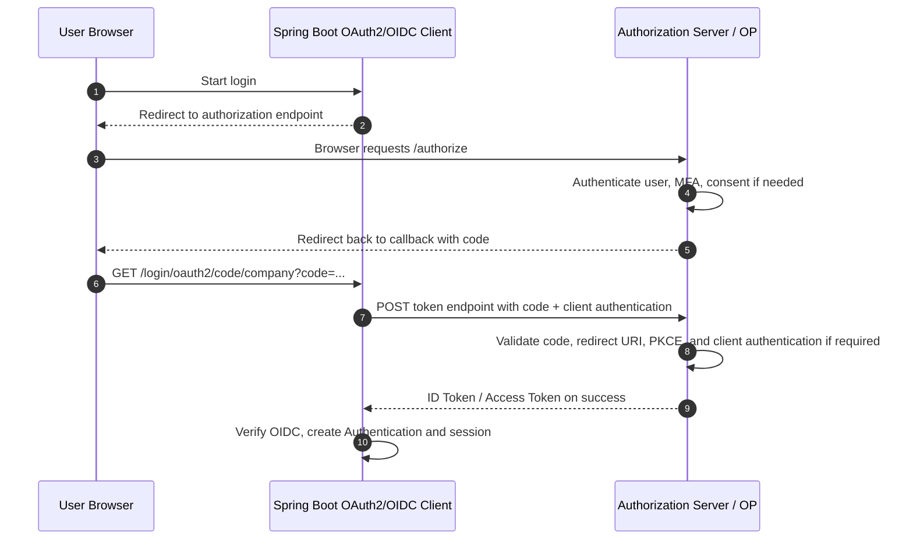
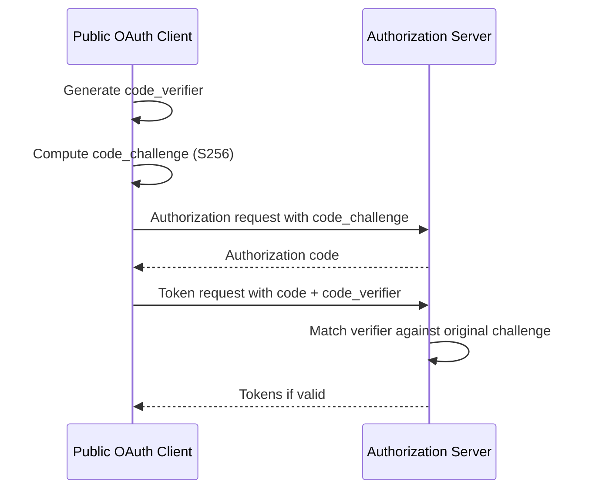
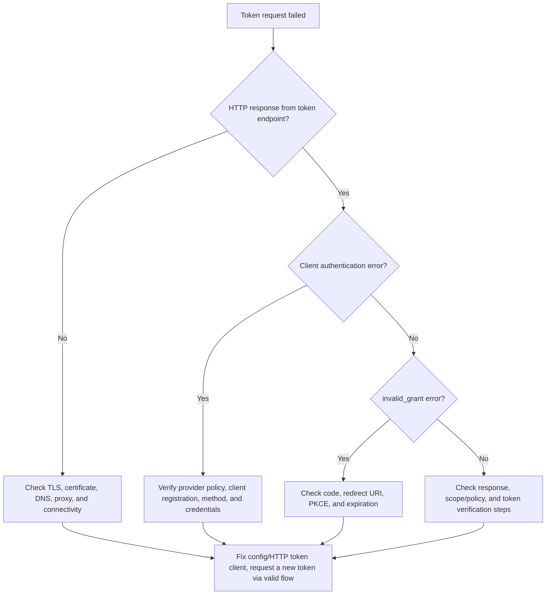

# 10.4. Choosing the Right Client Authentication Method for the Provider

In a Spring Security OAuth 2.0 / OpenID Connect (OIDC) Client, the **token endpoint** is where the application exchanges an authorization code for tokens or directly requests an Access Token under a supported grant. Upon receiving the request, the Authorization Server (AS) or OpenID Provider (OP) typically needs to know **which client is calling** and, for a *confidential client*, verify that client using an allowed authentication method.

The client authentication method at the token endpoint must align across **three places**: the provider's policies, the client registration stored at the provider, and how Spring Security actually constructs and sends the request. For example, if the provider only accepts `client_secret_post` while the client sends HTTP Basic, the token endpoint will reject the request even if the user just signed in successfully.

Common methods include:

- `client_secret_basic`: authenticates the client using HTTP Basic.
- `client_secret_post`: sends the client identifier and secret in the POST form body.
- `none`: a public client with no client secret; for Authorization Code Flow, PKCE should be configured.
- `private_key_jwt` or `client_secret_jwt`: uses a signed JWT client assertion to authenticate the client.
- `tls_client_auth` or `self_signed_tls_client_auth`: uses a client certificate in the TLS connection under an mTLS configuration.

This lesson explains when to use each method, how to read provider metadata, how to configure Spring Boot, and what constraints to watch for when integrating advanced methods.

## 1. What Is Client Authentication at the Token Endpoint?

In OAuth 2.0, two principals must be kept distinct:

1. **The Resource Owner / user** may sign in at the provider's authorization endpoint using a password, passkey, MFA, or another mechanism.
2. **The OAuth 2.0 Client / application** may have to prove **its own application identity** when calling the token endpoint.

These are two separate processes.

In the **Authorization Code Flow** of a backend web application:



**Client authentication** occurs when the backend calls the token endpoint. It does not mean the user has to type an extra application password in the browser. The client ID, secret, private key, or certificate establishes **the client's identity**, whereas the user account/MFA establishes **the user's identity**.

A `client_credentials` application also calls the token endpoint and typically must authenticate as a client, yet **there is no user login and no redirect/callback**.

### 1.1. Client Authentication Differs from Authorization and Token Validation

| Concept | Question Answered | Primary Verifier |
|---|---|---|
| **User authentication** | Who is this user? | OP/IdP during sign-in. |
| **Client authentication** | Is the application requesting tokens actually the registered client? | Authorization Server at the token endpoint. |
| **Authorization grant validation** | Is this code/grant valid for the client, redirect URI, and original request? | Authorization Server. |
| **PKCE** | Does the party exchanging the code hold the `code_verifier` bound to the authorization request? | Authorization Server at the token endpoint. |
| **OIDC ID Token validation** | Was the ID Token issued by the trusted OP for the intended client and login request? | OIDC Client. |
| **API access token validation** | Is the Access Token valid for the API and required permissions? | Resource Server/API. |

Selecting the right client authentication method **does not** replace checking `state`, PKCE, ID Token, audience, scopes, or business authorization rules.

## 2. Distinguish Confidential Clients from Public Clients Before Choosing

The choice depends on the application's ability to keep credentials secret.

| Client Type | Examples | Can Keep a Secret/Private Key Safely? | Token Endpoint Authentication Direction |
|---|---|---|---|
| **Confidential client** | A Spring Boot backend running on servers controlled by the organization. | Yes, when secrets/keys are stored server-side and operated properly. | `client_secret_basic`, `client_secret_post`, JWT assertion, or mTLS per provider. |
| **Public client** | A SPA running in a browser, or a desktop/mobile app distributed to user devices. | Cannot rely on a static secret embedded in the app remaining confidential. | Typically uses `none` with Authorization Code + PKCE; follow platform/provider guidance. |

**Being a public client does not mean the login flow needs no protection.** For the Authorization Code Flow, PKCE binds the code to the client holding the verifier. The client must also manage `state` and, when using OIDC, `nonce`, redirect URIs, and token validation as required.

**Being a confidential client does not mean you can skip PKCE.** Client authentication via secret/certificate and PKCE mitigate different threats; use PKCE whenever the provider and client type support it, especially when current policies mandate it.

Evaluate the real architecture carefully. An app with a SPA UI where a **backend-for-frontend (BFF)** acts as the OAuth2 Client and keeps tokens/secrets on the server can be registered as a confidential client at the BFF tier. The browser JavaScript must not be treated as the holder of that secret.

## 3. Sources of Truth That Determine the Right Method

Do not pick a method just because an Internet YAML snippet uses it. Cross-check three sources.

### 3.1. Authorization Server / OpenID Provider Metadata

For OIDC Providers that support discovery, metadata is typically published at the well-known URL for the issuer, for example:

```text
https://login.example.org/realms/company/.well-known/openid-configuration
```

Useful fields include:

| Metadata Field | Role |
|---|---|
| `issuer` | Provider identifier trusted by the application. |
| `token_endpoint` | URL called by the backend to request tokens. |
| `token_endpoint_auth_methods_supported` | Client authentication methods advertised as supported by the token endpoint. |
| `token_endpoint_auth_signing_alg_values_supported` | Signing algorithms advertised as supported for JWT client authentication when using JWT methods. |
| `authorization_endpoint` | Endpoint for the authorization code/redirect phase. |
| `jwks_uri` | OP public keys used for corresponding token verification; not automatically the client's keys. |

**Illustrative** metadata example, not tied to any specific provider:

```json
{
  "issuer": "https://login.example.org/realms/company",
  "authorization_endpoint": "https://login.example.org/realms/company/protocol/openid-connect/auth",
  "token_endpoint": "https://login.example.org/realms/company/protocol/openid-connect/token",
  "jwks_uri": "https://login.example.org/realms/company/protocol/openid-connect/certs",
  "token_endpoint_auth_methods_supported": [
    "client_secret_basic",
    "client_secret_post",
    "private_key_jwt"
  ],
  "token_endpoint_auth_signing_alg_values_supported": [
    "RS256",
    "PS256"
  ]
}
```

Checking `token_endpoint_auth_methods_supported` tells you **what the provider advertises globally**, not which methods your specific client is permitted to use.

In OpenID Connect Discovery, if `token_endpoint_auth_methods_supported` is absent, the specification defines a default rule for OIDC metadata (`client_secret_basic`). However, when working with a system that does not fully follow discovery, custom OAuth2 endpoints, or a provider with special configuration, verify the documentation and actual client registration rather than inferring the entire policy from a missing field.

### 3.2. Client Configuration at the Provider

When creating a client in the OP's admin console, you typically choose or receive:

- `client_id`.
- Client type: public or confidential.
- Permitted token endpoint authentication methods.
- `client_secret`, client public key/JWKS, or mTLS certificate depending on the method.
- Enabled grant types: `authorization_code`, `client_credentials`, etc.
- Allowed redirect URIs, scopes, PKCE policy, and other policies.

**Provider support for `private_key_jwt` does not mean a client currently registered with a secret can automatically use `private_key_jwt`.** You must register the public key or JWKS and enable that method for that specific client.

Similarly, if a provider supports both `client_secret_basic` and `client_secret_post` globally, but a specific client is configured only for `client_secret_post`, Spring's configuration must use that client's method.

### 3.3. Actual Capabilities of Spring Security and the HTTP Client

A YAML property states **configuration intent**. Spring Security must also have the mechanism to construct the request using that method:

- HTTP Basic or form-post secrets are standard out-of-the-box cases in OAuth2 Client.
- JWT client assertions require a signer, matching key/secret, algorithm, and assertion builder; this may require customizing the token request and related components depending on the Spring Security version.
- mTLS requires the HTTP client to actually perform TLS with a client certificate, trust material, and appropriate infrastructure configuration; setting the method name in the registration does not by itself perform a client-certificate TLS handshake.
- Public clients must support PKCE and must not send a secret as a credential.

Verify the **actual request sent** and which method the provider accepts, without logging raw credentials or tokens.

## 4. Quick Selection Table by Context

| Context | Selection Direction | Conditions to Verify |
|---|---|---|
| Spring Boot web backend using OIDC login, provider allows Basic. | `client_secret_basic` is usually a sensible starting point. | Confidential client, valid secret, permitted by metadata/registration. |
| Legacy provider only accepts credentials in the body. | `client_secret_post` if required by the provider. | HTTPS transport, secret protected, request body not logged. |
| SPA/mobile/native app acting as a public client. | `none` with Authorization Code + PKCE. | No embedded secret, valid redirect URI and PKCE, valid `state`/`nonce`. |
| Enterprise system requiring asymmetric auth and centralized key management. | `private_key_jwt` if supported. | Provider accepts JWT assertions, client public key/JWKS registered, signing and rotation implemented. |
| Provider requires a JWT assertion signed with a shared secret. | `client_secret_jwt` if allowed by policy. | Permitted HMAC algorithm and strong secret; protection/rotation; implementation support. |
| Server-to-server connection using client certificates. | `tls_client_auth` or `self_signed_tls_client_auth` per provider. | End-to-end mTLS through HTTP client/proxy, registered certificate, PKI policies. |
| Backend calling an API via `client_credentials`. | A confidential method allowed by the provider. | Token endpoint, client authentication, scopes/audience for the API; no OIDC user login. |

This table is a **decision guide**, not a list of interchangeable options. The final choice must match **the client's specific configuration on the Authorization Server**.

## 5. `client_secret_basic` — Authenticating via HTTP Basic

This is the most common method for confidential OAuth2/OIDC Clients. The backend sends `client_id` and `client_secret` via the HTTP `Authorization: Basic ...` header when calling the token endpoint.

Conceptual example with Authorization Code Grant:

```http
POST /oauth2/token HTTP/1.1
Host: login.example.org
Authorization: Basic <base64-encoded-client-credentials>
Content-Type: application/x-www-form-urlencoded

grant_type=authorization_code&
code=<authorization-code>&
redirect_uri=https%3A%2F%2Forders.example.org%2Flogin%2Foauth2%2Fcode%2Fcompany
```

The header value has been redacted. In OAuth 2.0, `client_id` and `client_secret` are form-encoded before creating the Basic credential; do not concatenate them naively if credentials contain special characters.

**Basic only Base64-encodes the credentials—it is not cryptographic encryption.** Connections must use proper HTTPS/TLS to protect credentials in transit.

### 5.1. Spring Boot Configuration

```yaml
spring:
  security:
    oauth2:
      client:
        registration:
          company:
            provider: company-oidc
            client-id: ${OIDC_CLIENT_ID}
            client-secret: ${OIDC_CLIENT_SECRET}
            client-authentication-method: client_secret_basic
            authorization-grant-type: authorization_code
            redirect-uri: "{baseUrl}/login/oauth2/code/{registrationId}"
            scope:
              - openid
              - profile
              - email
        provider:
          company-oidc:
            issuer-uri: https://login.example.org/realms/company
```

Key points to remember:

- `client-authentication-method` is a property under **registration**, because it describes how a **specific client** authenticates.
- `issuer-uri` lives under **provider** to resolve endpoints and OIDC metadata.
- Keep `client-secret` in server-side environment variables/a secret manager; never put it in JavaScript or Git.
- `authorization-grant-type=authorization_code` controls the grant; it is not a client authentication method name.
- `scope: openid` indicates an OIDC login request.

If Spring Security falls back to defaults for a confidential client, the result may be Basic depending on configuration and version. To avoid ambiguity during integration, set `client-authentication-method` explicitly to match the provider's requirement.

### 5.2. Strengths and Limitations

**Strengths:** widespread, simple to deploy, supported by most Authorization Servers, requires no extra JWT-signing or certificate infrastructure.

**Limitations:** shared secret between client and provider; requires rotation management, access control, and leak prevention in logs. Since HTTP Basic sends the secret on every token request, HTTPS is a strict operational safety requirement.

If the provider does not accept Basic for the registered client, retrying the same header repeatedly will not solve it. Verify the permitted method and update the configuration to match.

## 6. `client_secret_post` — Sending Credentials in the Form Body

With `client_secret_post`, the backend puts `client_id` and `client_secret` into the body of the POST request to the token endpoint.

Example:

```http
POST /oauth2/token HTTP/1.1
Host: login.example.org
Content-Type: application/x-www-form-urlencoded

grant_type=authorization_code&
code=<authorization-code>&
redirect_uri=https%3A%2F%2Forders.example.org%2Flogin%2Foauth2%2Fcode%2Fcompany&
client_id=<client-id>&
client_secret=<client-secret>
```

This is an illustrative request diagram; in real integrations, values must be properly URL-encoded and sent over HTTPS.

Configuration:

```yaml
spring:
  security:
    oauth2:
      client:
        registration:
          company:
            provider: company-oidc
            client-id: ${OIDC_CLIENT_ID}
            client-secret: ${OIDC_CLIENT_SECRET}
            client-authentication-method: client_secret_post
            authorization-grant-type: authorization_code
            redirect-uri: "{baseUrl}/login/oauth2/code/{registrationId}"
            scope: [openid, profile]
        provider:
          company-oidc:
            issuer-uri: https://login.example.org/realms/company
```

### 6.1. When Should You Choose It?

`client_secret_post` is useful when the provider requires it or the client registration is configured that way. It may be needed for certain legacy systems or integrations designed around body credentials.

However, do not choose `client_secret_post` thinking "putting the secret in the body is safer than a header." Both carry sensitive credentials and both require TLS. Form bodies can be captured in debug logs, reverse proxies, APMs, or HTTP inspection tools. Conversely, `Authorization` headers must be redacted just as carefully.

Never put `client_secret` into **URL query parameters**. URLs can be stored in browser history, access logs, analytics, and other systems.

### 6.2. Practical Differences from Basic

| Criterion | `client_secret_basic` | `client_secret_post` |
|---|---|---|
| Where credentials reside | `Authorization: Basic ...` header. | Form body of the token request. |
| HTTP method | Typically form POST to token endpoint. | Form POST to token endpoint. |
| Uses a client secret? | Yes. | Yes. |
| Requires HTTPS? | Yes. | Yes. |
| Must provider allow it? | Yes. | Yes. |
| Operational risk | Header/credential logging, leaking secret if unredacted. | Request body logging, leaking secret if unredacted. |

The choice is dictated by **the provider contract and security policy**; the two methods are not interchangeable if a provider only accepts one.

## 7. `none` — Public Clients and PKCE

A public client is not expected to protect a static `client_secret`. For a SPA/mobile/native client, the client authentication method value is typically `none`.

Illustrative registration example:

```yaml
spring:
  security:
    oauth2:
      client:
        registration:
          public-example:
            provider: public-oidc
            client-id: public-web-client
            client-authentication-method: none
            authorization-grant-type: authorization_code
            redirect-uri: "{baseUrl}/login/oauth2/code/{registrationId}"
            scope: [openid, profile]
        provider:
          public-oidc:
            issuer-uri: https://login.example.org/realms/public
```

**Note:** this is only an illustration of the configuration property. A Spring Boot Servlet application that keeps backend sessions does not magically become a SPA just by setting `none`; callback architecture, token storage, and browser interactions still must be designed properly. If the client truly is a public SPA/mobile app, never copy a server-side confidential login pattern and embed a secret in the client.

### 7.1. How Does PKCE Participate?

PKCE (Proof Key for Code Exchange) uses:

1. A randomly generated `code_verifier` per authorization request.
2. A `code_challenge`, typically computed with `S256`, sent to the authorization endpoint.
3. The `code_verifier` sent to the token endpoint when exchanging the authorization code.

Diagram:



For public clients using the Authorization Code Flow, PKCE is an essential requirement to stop an attacker who intercepts a code from exchanging it for tokens. The provider must support and enforce PKCE properly. On the Spring Security side, automatic PKCE generation depends on registration type and version/configuration; verify that **the authorization request actually carries `code_challenge` and the token request carries `code_verifier`** whenever your design relies on PKCE.

### 7.2. `none` Does Not Mean the Request Lacks a Client ID

A public client's token request still needs to identify the client, such as sending `client_id` in the form body alongside the authorization code and PKCE verifier per provider rules. `none` means **no secret-based or private-key-based client authentication is used**; it does not mean the Authorization Server is unaware of which client is requesting tokens.

If you configure `client-authentication-method: none` for a confidential client where the provider requires a secret, the request will be rejected. Conversely, embedding a static secret in a SPA does not turn it into a secure confidential client.

## 8. `private_key_jwt` — Authenticating the Client with a Private-Key-Signed JWT

With `private_key_jwt`, the client uses **its own private key** to sign a short-lived JWT and sends that JWT as a **client assertion** to the token endpoint. The provider already knows the client's public key/JWKS to verify the signature.

This model fits when an organization wants asymmetric key management, wants to avoid sending a shared secret in every token request, or needs to satisfy stricter policies.

### 8.1. Token Request at the Protocol Level

```http
POST /oauth2/token HTTP/1.1
Host: login.example.org
Content-Type: application/x-www-form-urlencoded

grant_type=authorization_code&
code=<authorization-code>&
redirect_uri=https%3A%2F%2Forders.example.org%2Flogin%2Foauth2%2Fcode%2Fcompany&
client_id=<client-id>&
client_assertion_type=urn%3Aietf%3Aparams%3Aoauth%3Aclient-assertion-type%3Ajwt-bearer&
client_assertion=<signed-client-assertion-jwt>
```

The JWT assertion typically contains claims such as:

```json
{
  "iss": "orders-web",
  "sub": "orders-web",
  "aud": "https://login.example.org/oauth2/token",
  "iat": 1760000000,
  "exp": 1760000060,
  "jti": "unique-assertion-id"
}
```

Timestamps are shown only to illustrate structure and do not represent a currently valid assertion.

Meaning:

- `iss` / `sub` identify the client; in common JWT client authentication usage, both equal the client ID.
- `aud` identifies the Authorization Server/token endpoint per profile/provider rules; it must match the exact value accepted by the provider.
- `exp` and `iat` bound the validity window.
- `jti` helps the provider detect replayed assertions if replay prevention is enforced.
- The JWT header includes `alg` and may include `kid` to aid key selection, depending on profile and provider.

**A client assertion is not an ID Token**: the assertion is signed **by the client to authenticate to the provider**, whereas an ID Token is issued **by the OP for the client to verify the user's identity**.

### 8.2. Implementation Prerequisites

Using `private_key_jwt` requires coordinating:

1. The provider advertises/supports the method and permits this client to use it.
2. The client registers a public key, certificate, or JWKS that the provider can verify.
3. The backend stores the private key securely—e.g., keystore/HSM/secret manager—and implements appropriate JWT signing.
4. The signing algorithm is accepted by the provider; metadata may list `token_endpoint_auth_signing_alg_values_supported`.
5. The assertion contains the right audience, lifetime, ID, and structure per the provider's profile.
6. The HTTP token client sends the assertion with the proper protocol parameters, error handling, and key rotation support.

Property example expressing intent:

```yaml
spring:
  security:
    oauth2:
      client:
        registration:
          company:
            provider: company-oidc
            client-id: ${OIDC_CLIENT_ID}
            client-authentication-method: private_key_jwt
            authorization-grant-type: authorization_code
            redirect-uri: "{baseUrl}/login/oauth2/code/{registrationId}"
            scope: [openid, profile]
        provider:
          company-oidc:
            issuer-uri: https://login.example.org/realms/company
```

**Setting `client-authentication-method: private_key_jwt` does not guarantee Spring Security knows which private key to sign with or configures a signer automatically.** Depending on version, you must choose or customize the token response client, request converter, JWT client authentication support, and key-provisioning mechanism per the Spring Security APIs in use. Do not assume a standalone YAML snippet is a complete runnable integration.

### 8.3. Comparison with `client_secret_basic`

| Criterion | Shared Secret (`client_secret_basic`) | `private_key_jwt` |
|---|---|---|
| Credential | Shared secret between client and provider. | Private key stays on the client; provider holds the public key. |
| Sent on each request | Secret inside the Basic header over TLS. | Signed JWT assertion, usually short-lived. |
| Rotation model | Rotate the secret in sync across both sides. | Manage key pairs/JWKS and staged key rollover. |
| Complexity | Lower. | Higher: signer, algorithm, audience, assertion TTL, rotation. |
| Provider dependency | Provider must allow Basic. | Provider must support JWT assertions and the chosen algorithm/keys. |

Protecting the private key and preventing assertion exposure remain essential; signing a JWT does not remove the need for HTTPS or grant validation.

## 9. `client_secret_jwt` — JWT Assertion Signed with a Shared Secret

`client_secret_jwt` also uses a **client assertion** at the token endpoint, except the JWT is signed with a **symmetric key** derived from the client secret rather than an asymmetric private key.

The overall flow resembles `private_key_jwt` by sending `client_assertion_type` and `client_assertion`; it differs in key type, algorithm, and how the provider verifies the signature.

What to verify:

- The provider enables `client_secret_jwt` for that specific client.
- The symmetric signing algorithm is allowed, and the secret has sufficient strength for the algorithm and standard in use.
- The client builds assertions with `iss`, `sub`, `aud`, `exp`, and any other claims required by the profile/provider.
- Assertion lifetime is short, with replay mitigation if required.
- The HTTP token client supports generating JWT assertions properly; extra configuration may be needed.

Property example **expressing only the intended method**:

```yaml
registration:
  company:
    client-id: ${OIDC_CLIENT_ID}
    client-secret: ${OIDC_CLIENT_SECRET}
    client-authentication-method: client_secret_jwt
    authorization-grant-type: authorization_code
```

Do not treat this as a complete configuration unless Spring Security has been wired with an assertion generator and the provider has enabled the matching method.

Compared to `private_key_jwt`, `client_secret_jwt` still relies on a **shared secret** that must be synchronized and protected on both sides. The fact that the secret does not appear verbatim in the form body does not allow lax secret management.

## 10. Client Authentication Using mTLS

**Mutual TLS (mTLS)** is a mechanism where not only does the client verify the server's TLS certificate, but the server also requires the client to present a valid certificate during the TLS handshake.

OAuth 2.0 defines mTLS-based client authentication methods such as:

| Method | Idea |
|---|---|
| `tls_client_auth` | Provider validates the client certificate against PKI/trust anchors and matching registration bindings. |
| `self_signed_tls_client_auth` | Provider uses registration/matching of a self-signed client certificate per deployment profile. |

Model:

```text
Spring Boot backend
  ├── ClientRegistration: client_id / auth method
  ├── HTTP client: key material + client certificate
  └── HTTPS handshake to token endpoint
            |
            v
Authorization Server
  ├── Verify client certificate per policy
  ├── Identify registered client
  └── Validate grant and issue token if valid
```

### 10.1. Why Isn't YAML Alone Enough?

Example selecting the method:

```yaml
registration:
  company:
    client-id: ${OIDC_CLIENT_ID}
    client-authentication-method: tls_client_auth
    authorization-grant-type: client_credentials
```

The `tls_client_auth` value does not automatically load a keystore, establish an mTLS connection, or configure a trust store on the HTTP client. You must also implement:

- KeyStore/PKCS#12, private key, and client certificate on the backend.
- The SSL/TLS context on the HTTP client that actually calls the token endpoint.
- Trust store and valid server certificate verification.
- Client certificate matching rules registered on the provider.
- Reverse proxy/service mesh TLS handling so the required certificate reaches the point of verification.
- Key/certificate rotation, expiry monitoring, and private key access controls.

In proxied architectures, identify **where TLS terminates** and where the provider actually verifies the certificate; never blindly trust an unauthenticated header carrying a certificate name sent by an external caller.

### 10.2. mTLS Client Authentication Differs from Token Binding

OAuth 2.0 mTLS also defines a mechanism for binding Access Tokens to a certificate in some deployments. That is a **separate capability**, not automatically active merely because the token endpoint requires a client certificate.

Check provider and Resource Server policies if you want certificate-bound access tokens. Client authentication at the token endpoint is only one part of the design.

### 10.3. When Is mTLS Appropriate?

mTLS is typically useful in service-to-service systems or enterprise environments with existing PKI infrastructure, mTLS gateways, strict transport security requirements, and formal certificate operations. It adds configuration and operational overhead, so it is not the default choice for every small Spring Boot project.

## 11. Spring Boot Properties and Spring Security `ClientRegistration`

In Spring Boot, the method is declared at:

```properties
spring.security.oauth2.client.registration.<registrationId>.client-authentication-method
```

Example `application.properties`:

```properties
spring.security.oauth2.client.registration.company.client-id=orders-web
spring.security.oauth2.client.registration.company.client-secret=${OIDC_CLIENT_SECRET}
spring.security.oauth2.client.registration.company.client-authentication-method=client_secret_basic
spring.security.oauth2.client.registration.company.authorization-grant-type=authorization_code
spring.security.oauth2.client.registration.company.redirect-uri={baseUrl}/login/oauth2/code/{registrationId}
spring.security.oauth2.client.registration.company.scope=openid,profile,email
spring.security.oauth2.client.provider.company.issuer-uri=https://login.example.org/realms/company
```

Here `company` is the **registration ID**, which does not have to equal `client_id`.

Spring Boot binds configuration properties into Spring Security's `ClientRegistration` model. A registration object holds client details, grant type, scopes, and provider endpoints sourced either directly from properties or via metadata discovery.

You can inspect the bound method:

```java
import org.springframework.security.oauth2.client.registration.ClientRegistration;
import org.springframework.security.oauth2.client.registration.ClientRegistrationRepository;
import org.springframework.stereotype.Component;

@Component
public class ClientAuthConfigurationView {

    private final ClientRegistrationRepository registrations;

    public ClientAuthConfigurationView(ClientRegistrationRepository registrations) {
        this.registrations = registrations;
    }

    public String configuredMethod(String registrationId) {
        ClientRegistration registration =
                registrations.findByRegistrationId(registrationId);

        if (registration == null) {
            throw new IllegalArgumentException("Unknown client registration");
        }

        return registration.getClientAuthenticationMethod().getValue();
    }
}
```

The example above only illustrates reading the **method name** for internal diagnostics. Never create a public endpoint that returns secrets, private keys, assertions, codes, or Access Tokens. If the app lets a request select a registration ID, restrict the selection to a trusted allowlist.

### 11.1. `client-authentication-method` vs. `authorization-grant-type`

These two properties are frequently confused:

```yaml
registration:
  company:
    client-authentication-method: client_secret_basic
    authorization-grant-type: authorization_code
```

- **`client-authentication-method`** answers: when calling the token endpoint, how does the client prove its identity?
- **`authorization-grant-type`** answers: which grant type does the client use to request a token?

Examples:

| Grant | Possible Client Auth Methods | User Involved? |
|---|---|---|
| `authorization_code` | Basic, post, JWT, mTLS, or none depending on client type. | Yes, interactive login/authorization via browser. |
| `client_credentials` | Typically requires confidential client authentication per provider. | No user login. |

Choosing `authorization_code` does not automatically enable `client_secret_basic` for all client types. Choosing `client_secret_basic` does not turn a `client_credentials` request into an OIDC login.

### 11.2. Relationship with `provider`

Client properties sit under `registration`, while issuer/token endpoints sit under `provider`:

```yaml
spring:
  security:
    oauth2:
      client:
        registration:
          company:
            provider: company-oidc
            client-id: ${OIDC_CLIENT_ID}
            client-secret: ${OIDC_CLIENT_SECRET}
            client-authentication-method: client_secret_basic
            authorization-grant-type: authorization_code
            scope: [openid, profile]
        provider:
          company-oidc:
            issuer-uri: https://login.example.org/realms/company
```

`provider: company-oidc` is an **internal alias**, not a `client-authentication-method` value or an endpoint URL. For OPs supporting discovery, `issuer-uri` tells Spring Security where to fetch metadata. When a provider does not support discovery, endpoints can be declared manually per the provider's OAuth 2.0 contract.

## 12. Three Examples of Choosing a Method by Integration Type

### 12.1. Spring Boot Web Application Signing In via OIDC

**Requirement:** users sign in with SSO; backend holds a secret; OP allows `client_secret_basic`.

```yaml
spring:
  security:
    oauth2:
      client:
        registration:
          employee-login:
            provider: employee-idp
            client-id: ${EMPLOYEE_CLIENT_ID}
            client-secret: ${EMPLOYEE_CLIENT_SECRET}
            client-authentication-method: client_secret_basic
            authorization-grant-type: authorization_code
            redirect-uri: "{baseUrl}/login/oauth2/code/{registrationId}"
            scope: [openid, profile, email]
        provider:
          employee-idp:
            issuer-uri: https://login.example.org/realms/staff
```

Enable login in Servlet:

```java
import org.springframework.context.annotation.Bean;
import org.springframework.context.annotation.Configuration;
import org.springframework.security.config.Customizer;
import org.springframework.security.config.annotation.web.builders.HttpSecurity;
import org.springframework.security.web.SecurityFilterChain;

@Configuration
public class SecurityConfiguration {

    @Bean
    SecurityFilterChain securityFilterChain(HttpSecurity http) throws Exception {
        http
            .authorizeHttpRequests(auth -> auth
                .requestMatchers("/", "/public/**").permitAll()
                .anyRequest().authenticated()
            )
            .oauth2Login(Customizer.withDefaults());

        return http.build();
    }
}
```

Flow:

1. Browser opens `/oauth2/authorization/employee-login`.
2. Spring Security builds the request, `state`, and PKCE if applicable by configuration.
3. OP authenticates the user and returns a code to `/login/oauth2/code/employee-login`.
4. Backend calls the token endpoint with the code and **`client_secret_basic`**.
5. OIDC client verifies the ID Token and creates `Authentication` and the session.

User sign-in and backend client authentication are **two distinct legs** of the flow and must be configured properly on both ends.

### 12.2. Backend Calling an API with Client Credentials

**Requirement:** a payment service calls a shipping management API; the token represents the service itself, not a logged-in user.

```yaml
spring:
  security:
    oauth2:
      client:
        registration:
          shipping:
            provider: internal-auth
            client-id: ${SHIPPING_CLIENT_ID}
            client-secret: ${SHIPPING_CLIENT_SECRET}
            client-authentication-method: client_secret_basic
            authorization-grant-type: client_credentials
            scope:
              - shipping.read
        provider:
          internal-auth:
            token-uri: https://auth.example.org/oauth2/token
```

For this grant:

- There is no `redirect-uri`, authorization code, user ID Token, or OAuth2 Login UI.
- The backend needs an appropriate OAuth2 Client/authorized client manager to obtain an Access Token under `client_credentials` and attach it to API requests.
- The API verifies the Access Token, audience/scopes, and the client's access permissions.
- If the provider requires `private_key_jwt` or mTLS for the service, integrate the corresponding mechanism instead of Basic.

Simply declaring a registration does not attach bearer tokens to HTTP requests automatically; you must configure your HTTP client to use the authorized client for the right registration.

### 12.3. Provider Only Permits Form-Post Secrets

**Requirement:** a backend web app already has a secret, but the token endpoint returns `invalid_client` when using Basic, and provider docs confirm the registration only supports `client_secret_post`.

Keep the other settings unchanged and switch the method:

```yaml
spring:
  security:
    oauth2:
      client:
        registration:
          partner-login:
            provider: partner-idp
            client-id: ${PARTNER_CLIENT_ID}
            client-secret: ${PARTNER_CLIENT_SECRET}
            client-authentication-method: client_secret_post
            authorization-grant-type: authorization_code
            redirect-uri: "{baseUrl}/login/oauth2/code/{registrationId}"
            scope: [openid, profile]
        provider:
          partner-idp:
            issuer-uri: https://partner.example.org
```

At the same time, verify that the provider allows `client_secret_post` for this client, the secret is valid, the redirect URI is registered, and logging redacts form bodies. Changing the client authentication method will not fix `state` errors, expired codes, or an ID Token with a mismatched issuer.

## 13. Advanced Methods Require Extra Configuration on the HTTP Token Client

A common pitfall is treating the `client-authentication-method` property as a "feature toggle" for all methods.

| Method | Is Setting the Property Alone Usually Enough for Common Flows? | Additional Pieces Often Needed |
|---|---|---|
| `client_secret_basic` | Usually yes, with a supported Spring Security client and provider acceptance. | Secret in environment, HTTPS, valid client registration. |
| `client_secret_post` | Usually yes, with a supported Spring Security client and provider acceptance. | Secret/HTTPS; protect body logs. |
| `none` | Not enough to secure the entire Authorization Code Flow. | Public client registration, PKCE, redirect URI, and client-appropriate token storage. |
| `private_key_jwt` | Do not assume it is enough. | JWT signer, key material, assertion converter, algorithms, client registration on provider. |
| `client_secret_jwt` | Do not assume it is enough. | Shared-secret assertion signer, algorithm, audience, and token client support. |
| `tls_client_auth` / `self_signed_tls_client_auth` | Not enough. | SSLContext/HTTP client using client certificate, trust store, certificate registration, network/proxy setup. |

Spring Security provides abstractions such as `ClientRegistration`, `OAuth2AccessTokenResponseClient`, and HTTP client/token request customizers depending on version. How extension points wire together changes across Spring Security generations; therefore, when integrating JWT assertions or mTLS, verify your Spring Security version and configure the exact APIs supported by that version.

**Do not rewrite the entire OAuth2/OIDC login callback** just to change how the client authenticates. Customize only the token request components while preserving Spring Security's `state`, PKCE, ID Token validation, authorized client, and session handling.

### 13.1. Operational Controls for JWT Assertions

When using JWT assertions:

- The client must sign with the registered key and allowed algorithm.
- `aud` must follow the provider's rules.
- `exp` must be short and system clocks must stay synchronized.
- `jti` should support replay detection when required by the profile/provider.
- Private keys/secrets must be rotated in a controlled way.
- Never log assertions or private keys. Even a short-lived assertion is a sensitive credential.
- Never enable disallowed algorithms or take the algorithm from untrusted input.

A token response returning `invalid_client` can stem from JWT audience, algorithm, or clock skew, not necessarily a wrong client ID.

### 13.2. Operational Controls for mTLS

When using mTLS:

- Client certificates must be valid, unexpired, and have a valid chain/trust path.
- The private key must be accessible to the process/HTTP client performing the TLS handshake.
- The provider must validate the certificate at the proper TLS termination point.
- Dev/staging/prod configurations must separate endpoints, keystores, and certificates.
- Certificate rotation must avoid breaking token acquisition across all instances simultaneously.
- Never accept unauthenticated "certificate name" headers in place of real mTLS.

## 14. Common Errors When Client Authentication Mismatches

The OAuth 2.0 error code at the token endpoint may be `invalid_client`, though the exact response varies by provider and how it reports errors. Distinguish client authentication errors from other Authorization Code Flow failures.

| Symptom | First Place to Check | Possible Cause |
|---|---|---|
| `invalid_client` when exchanging code | `client-id`, secret, `client-authentication-method`, and client config on provider. | Wrong credentials or token endpoint expects another method. |
| HTTP 401 with `WWW-Authenticate` | Client auth scheme required by token endpoint. | Missing/wrong Basic credentials or provider requires a different method. |
| HTTP 400 `invalid_request` | Form parameters and number of auth mechanisms sent. | Sending multiple auth methods at once or missing `client_assertion_type`. |
| `invalid_grant` after client auth succeeded | Authorization code, redirect URI, PKCE verifier, code state. | Code expired, already used, or failed grant constraints. |
| Basic fails yet post succeeds | Provider registration and policy. | Provider accepts body secret instead of Basic. |
| JWT assertion rejected | Public key/JWKS, `aud`, `iss`/`sub`, `exp`/`iat`, `jti`, `alg`. | Provider cannot verify signature or claims are wrong. |
| mTLS fails before receiving HTTP response | TLS client certificate, SSLContext, trust store, proxy. | Handshake/certificate failure below the OAuth 2.0 layer. |
| `none` on a confidential client fails | Client type and token endpoint auth policy. | Provider requires client authentication; request lacks valid credentials. |
| OP login succeeds yet app callback errors | Callback ordering, token request, ID Token validation, session. | User authenticated, but backend failed to complete token exchange/login. |
| API returns 401 even though token endpoint issued Access Token | Audience, scopes, token validation on Resource Server. | Token is not meant for that API or lacks permissions; not necessarily a client auth failure. |

### 14.1. `invalid_client` Is Not `invalid_grant`

For example, if the OP accepts the authorization code and callback is valid, yet the token endpoint returns `invalid_client`, check:

1. Does the client ID match the registration on the provider?
2. Is the secret/certificate/assertion valid?
3. Is `client-authentication-method` an allowed method for that client?
4. Does the HTTP token client send the credentials in the right location and encoding?
5. Is a proxy or TLS policy altering the request?

Conversely, `invalid_grant` typically points to the code, redirect URI, PKCE, or grant constraints. Do not fix a grant error by randomly switching from Basic to post.

### 14.2. Sending Both Basic and Body Secret Together

A request should never attempt to authenticate the client with multiple methods simultaneously—such as sending both `Authorization: Basic ...` **and** `client_secret` in the body to "improve odds of success." OAuth 2.0 forbids using multiple client authentication mechanisms in a single request like this.

Pick **one registered method accepted by the provider** for the token request.

### 14.3. Errors Caused by Differing Metadata and Client Policy

Provider metadata may advertise several supported methods globally while a specific client is configured for only one. Seeing `private_key_jwt` in discovery does not prove your registration is ready to use it.

When errors occur, examine both **provider metadata** and **the client registration on the provider**, then compare against Spring properties and the actual request sent.

### 14.4. Reverse Proxy or TLS Errors

An mTLS-enabled provider may terminate TLS at a gateway. If the gateway does not forward verified certificate details securely to the decision point, or the backend HTTP client does not present a certificate, the request will be rejected.

Likewise, a wrong token endpoint scheme/host, an untrusted server certificate, or misconfigured TLS interception can cause requests to fail before the provider even parses the grant. Always separate connectivity/TLS failures from protocol-level `invalid_client` errors.

## 15. How to Investigate Without Leaking Credentials

In real environments, log only enough information to pinpoint the stage and method:

- Client registration ID (such as `company`) and grant type, from trusted configuration.
- Configured client authentication method name.
- Configured token endpoint host/issuer, after sanitizing published details.
- Request timestamp, HTTP status, and standardized provider error code.
- Status "token exchange started/succeeded/failed" and a dedicated internal correlation ID.
- For JWTs, sanitized claim/algorithm error categories; for mTLS, handshake/certificate-expiry error categories without printing private keys or credentials.

**Never log:** `client-secret`, full HTTP Basic headers, bodies containing `client_secret`, JWT client assertions, private keys, keystore passwords, authorization codes, `code_verifier`, Access Tokens, ID Tokens, Refresh Tokens, or session cookies.

When inspecting HTTP requests in development, use tools with redaction and access controls; never paste raw token request captures into public issues.

### 15.1. Recommended Diagnostic Sequence



After fixing a client authentication configuration, **never reuse an already-exchanged or expired authorization code**. For the Authorization Code Flow, initiate a fresh login request to get a new code and state, then verify the flow. For Client Credentials, request a new token via the appropriate client mechanism.

## 16. Credential Protection and Long-Term Operational Principles

Even a provider-supported method can become insecure if credentials are operated poorly.

### 16.1. Keep Credentials Where They Belong

- For backend confidential clients, store secrets/private keys in a secret manager or appropriate keystore/HSM. Restrict read access strictly to the workloads that need them.
- Never hardcode secrets into committed YAML files, sample docs, container images, or frontend bundles.
- Never pass credentials in URL query strings.
- Protect connections to the token endpoint with HTTPS and server certificate verification.
- Establish rotation, revocation, and incident-response procedures for compromised credentials.

### 16.2. Distinguish Client Credentials from Issued Tokens

`client_secret` or a private key is used to **prove the client's identity** to the Authorization Server. Issued Access Tokens are used to access Resource Servers; Refresh Tokens are used to obtain new tokens when issued and permitted.

They are separate secrets with distinct lifecycles and protection policies. Rotating a client secret does not automatically invalidate all previously issued Access Tokens or SSO sessions immediately; revocation behavior depends on the Authorization Server, Resource Server, and token type.

### 16.3. Maintain Consistency Across Multiple Registrations

An application may simultaneously define:

- `employee-login`: `authorization_code` and `client_secret_basic` for employee login.
- `partner-login`: `authorization_code` and `client_secret_post` due to a partner provider contract.
- `reporting-service`: `client_credentials` and `private_key_jwt` when integrated with a signer.
- `legacy-api`: `client_credentials` and mTLS per internal policy.

Each registration needs its own provider, client ID, credentials, and authentication method. Never share one registration's secret or method with another merely because they run in the same Spring Boot application.

### 16.4. Changing Methods Requires Two-Sided Coordination

Migrating from `client_secret_basic` to `private_key_jwt` is both a protocol and operational change. You must prepare public keys/JWKS, update the client policy on the provider, deploy the signer, monitor errors, handle rotation, and plan the cutover.

Never flip a property in production before the provider is ready to accept the new method and all backend instances have the corresponding credentials.

## 17. References

- [Spring Security — OAuth2 Client Core (Servlet)](https://docs.spring.io/spring-security/reference/servlet/oauth2/client/core.html)
- [Spring Security — OAuth2 Login (Servlet)](https://docs.spring.io/spring-security/reference/servlet/oauth2/login/index.html)
- [Spring Boot — OAuth2 Client configuration](https://docs.spring.io/spring-boot/reference/web/spring-security.html)
- [OAuth 2.0 RFC 6749 — Client Authentication](https://www.rfc-editor.org/rfc/rfc6749#section-2.3)
- [OpenID Connect Core 1.0 — Client Authentication](https://openid.net/specs/openid-connect-core-1_0.html#ClientAuthentication)
- [OpenID Connect Discovery 1.0 — Provider Metadata](https://openid.net/specs/openid-connect-discovery-1_0.html)
- [RFC 7523 — JWT Assertion for OAuth 2.0 Client Authentication](https://www.rfc-editor.org/rfc/rfc7523)
- [RFC 7636 — PKCE](https://www.rfc-editor.org/rfc/rfc7636)
- [RFC 8705 — OAuth 2.0 Mutual-TLS Client Authentication](https://www.rfc-editor.org/rfc/rfc8705)
- [RFC 9700 — OAuth 2.0 Security Best Current Practice](https://www.rfc-editor.org/rfc/rfc9700)

When choosing a client authentication method at the token endpoint, start from **the client type and ability to protect credentials**, move to **provider metadata and policy**, and then verify **how Spring Security actually constructs the token request**. `client_secret_basic` or `client_secret_post` fits typical confidential clients; `none` pairs with public clients and PKCE; JWT assertions and mTLS serve stricter policies but require matching credential and HTTP client setups. A configuration is complete only when the provider accepts the method **for that registered client**, the request conforms to the protocol, and all authorization code/OIDC checks remain intact.
