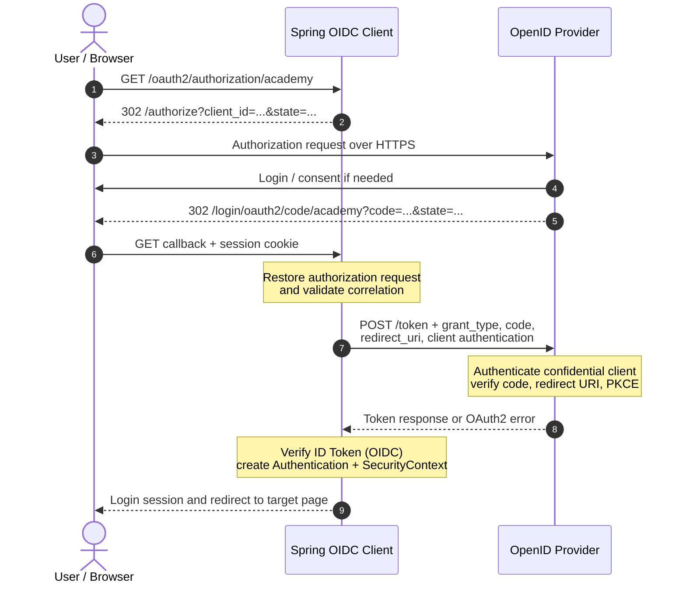

# 10.5. Client Secret Basic and Client Secret Post

In a **Spring Security OAuth 2.0 / OpenID Connect (OIDC) Client**, after the browser is redirected to the OpenID Provider (OP) and returns to the application with an `authorization code`, the Spring backend sends an **HTTP POST to the Token Endpoint** to exchange the code for tokens. In addition to validating the authorization code, the Authorization Server must also identify **which client is requesting tokens**. When the application is registered as a **confidential client** and issued a `client_secret`, two common client authentication methods are:

- **`client_secret_basic`:** sends `client_id` and `client_secret` via HTTP `Authorization: Basic ...`.
- **`client_secret_post`:** sends `client_id` and `client_secret` in the **form body** of the token request itself.

Both are **client authentication methods at the Token Endpoint**. They are not how the user enters a password, not a grant type, and do not dictate which algorithm signs the ID Token. In most standard integrations, **`client_secret_basic`** should be preferred when the Authorization Server supports it; `client_secret_post` is typically used when required by the provider or for compatibility.

This lesson applies to **Spring Boot 3.x, Spring Security 6.x, Servlet/Spring MVC applications using `oauth2Login()`**. Examples use a simulated OIDC provider and contain no real active secrets.

## 1. At Which Step Does Client Authentication Occur?

Look at the Authorization Code Flow from the browser to the Token Endpoint:



There are **two distinct authentications** in this diagram:

1. **End-user authentication:** the OP verifies who the user is, for example via password, passkey, or whatever method the organization requires.
2. **Client authentication:** the Token Endpoint verifies which backend application is exchanging the code for tokens and whether it is allowed to use the declared client registration.

For instance, the user is Employee A, while the OAuth2 client is the `academy-web` application. The `client_secret` belongs to `academy-web`, **not Employee A's password**.

### 1.1. Authorization Code Flow and Client Authentication Method Are Two Configuration Axes

| Concept | Spring Property | Example | Controls |
| --- | --- | --- | --- |
| **Authorization grant** | `authorization-grant-type` | `authorization_code` | How the client obtains tokens by exchanging an authorization code. |
| **Client authentication** | `client-authentication-method` | `client_secret_basic` | How the client presents its credentials to the Token Endpoint. |
| **Client credential** | `client-id`, `client-secret` | Environment variables | Values used to identify/authenticate the client per its OP registration. |
| **OIDC scope** | `scope` | `openid,profile` | Requests OIDC authentication and additional claims/scopes. |
| **Callback** | `redirect-uri` | `{baseUrl}/login/oauth2/code/{registrationId}` | Where the browser brings the authorization response back to the app. |

Setting `client-authentication-method: client_secret_post` **does not** turn `authorization_code` into another grant; the code exchange request is still an HTTP POST to the Token Endpoint.

## 2. Prerequisite: A Confidential Client with a Client Secret

OAuth 2.0 distinguishes client types by their ability to keep credentials confidential:

- **Confidential client:** a trusted component capable of keeping a secret safe, such as a Spring MVC backend running on a controlled server. The OP can issue a client secret or allow stronger authentication such as private keys.
- **Public client:** an application that cannot safely protect a static embedded secret, such as a single-page application running in a browser or a mobile app distributed to end users. Putting a client secret in frontend code **does not make it a confidential client**.

Both `client_secret_basic` and `client_secret_post` are only appropriate when the client **can genuinely protect the client secret** and the OP registers the matching method. If the client is public, design around **PKCE** and method `none` per OP policy, rather than trying to put a secret into JavaScript.

For server-side Spring, illustrative setup:

```text
Spring application: https://app.example.com
Registration ID:   academy
Client ID:         academy-web
Client secret:     issued and stored in the backend environment
Issuer:            https://idp.example.com/realms/academy
Callback:          https://app.example.com/login/oauth2/code/academy
Token endpoint:    URL published by OP metadata
```

The application must register the exact `redirect_uri` at the OP. The client secret, grant type, allowed redirect URIs, scopes, and client authentication method must all belong to **the same registration in the right issuer/tenant**.

## 3. How Does `client_secret_basic` Work?

### 3.1. HTTP Basic Structure at the Token Endpoint

`client_secret_basic` uses **HTTP Basic authentication** at the token endpoint. The client builds a string from the client ID and secret, Base64-encodes it, and places it in the `Authorization` header:

```http
POST /realms/academy/protocol/openid-connect/token HTTP/1.1
Host: idp.example.com
Content-Type: application/x-www-form-urlencoded
Authorization: Basic <base64-of-client-id-and-secret>

grant_type=authorization_code&code=ONE_TIME_CODE&redirect_uri=https%3A%2F%2Fapp.example.com%2Flogin%2Foauth2%2Fcode%2Facademy
```

This is an illustrative layout. Depending on the flow, the body also contains `code_verifier` when PKCE was used. When using `client_secret_basic`, **client authentication credentials live in the HTTP Basic header**, while the body carries the grant parameters.

According to **RFC 6749, Section 2.3.1**, the client ID and secret are **each form-URL-encoded first** before joining them as `client_id:client_secret` for HTTP Basic. Standard derivation:

```text
encodedId     = application/x-www-form-urlencoded(client_id)
encodedSecret = application/x-www-form-urlencoded(client_secret)
basicValue    = BASE64(ASCII(encodedId + ":" + encodedSecret))

Authorization: Basic <basicValue>
```

For example, with client ID `web:portal` and illustrative secret `s3cr+t &`:

```text
client_id     = web:portal
client_secret = s3cr+t &

form-encoded client_id     = web%3Aportal
form-encoded client_secret = s3cr%2Bt+%26

string before Base64:
web%3Aportal:s3cr%2Bt+%26
```

Encoding each part separately prevents a colon `:` in the client ID or special characters in the secret from being misinterpreted as the Basic authentication field separator. **Do not manually Base64-encode a raw concatenated credential string when either value contains special characters**; let the HTTP client/library enforce the OAuth 2.0 encoding rules.

### 3.2. Basic Is Not Secret Encryption

Base64 is **a reversible data encoding**, not cryptographic encryption. Anyone who sees the raw `Authorization` header can decode the client ID and secret. Real protection relies on:

- **Valid HTTPS/TLS** when calling the Token Endpoint.
- Never storing or logging the raw `Authorization` header.
- Never forwarding client credentials to other hosts.
- Managing secrets on the backend and restricting which people/systems can read them.
- Secret rotation and credential revocation following the OP's process.

Never try to "fix certificate errors" by disabling TLS certificate validation in the HTTP client.

### 3.3. Why Is Basic Usually Preferred?

RFC 6749 requires Authorization Servers to support HTTP Basic for clients issued a client password, and permits sending credentials in the body only as a limited fallback. For modern OAuth 2.0 Clients, Basic has the operational benefit of **separating client credentials from the grant form body**, making the client authentication layer cleaner to reason about.

However, Basic **is not automatically safe** if reverse proxies, gateways, tracing, or debug tools log headers. Security controls must cover everywhere the header travels.

## 4. How Does `client_secret_post` Work?

### 4.1. Placing Client ID and Secret in the Form Body

With `client_secret_post`, the Token Endpoint receives the secret inside the body of the HTTP POST itself:

```http
POST /realms/academy/protocol/openid-connect/token HTTP/1.1
Host: idp.example.com
Content-Type: application/x-www-form-urlencoded

grant_type=authorization_code&code=ONE_TIME_CODE&redirect_uri=https%3A%2F%2Fapp.example.com%2Flogin%2Foauth2%2Fcode%2Facademy&client_id=academy-web&client_secret=REPLACE_WITH_SECRET
```

Key–value pairs are encoded as `application/x-www-form-urlencoded`. If PKCE is used, the form body also includes `code_verifier`. In a `client_secret_post` request, **do not also send `Authorization: Basic` for the same client**.

This is still a **back-channel request sent by the Spring backend to the OP**. The browser never needs to know the secret and never sends the secret to the callback.

### 4.2. Why Is Body Authentication Considered Less Recommended?

RFC 6749 Section 2.3.1 permits placing client credentials in the request body when necessary, but explicitly states this approach is **not recommended** and should be limited to clients unable to use HTTP Basic. In practice, form bodies often pass through:

- Request loggers that record all form parameters.
- APM/tracing tools that capture request bodies.
- Reverse proxies or gateways with body-inspection features.
- Audit/debug systems that inadvertently save the client secret alongside grant parameters.

That does not mean Basic is "inherently invincible" or that a POST body cannot be protected: **both contain recoverable secrets** and both require TLS, log redaction, secure storage, and strict access control.

### 4.3. Misconceptions to Avoid

- **`client_secret_post` does not mean a different HTTP method than `client_secret_basic`.** Both use `POST /token`; the difference is where client credentials are placed.
- `client_secret_post` **does not** mean sending the secret in a query string or URL. Never use `GET /token?client_secret=...`.
- Do not send a JSON body such as `{"client_secret":"..."}` just because the name includes `post`. Standard OAuth 2.0 token requests use `application/x-www-form-urlencoded`, unless a provider explicitly documents a proprietary mechanism.
- Do not send the same secret in both the Basic header and the body. **A single token request must not use multiple client authentication methods simultaneously.**

## 5. Direct Comparison of the Two Methods

| Criterion | `client_secret_basic` | `client_secret_post` |
| --- | --- | --- |
| Where client ID/secret are sent | HTTP `Authorization: Basic ...` | Form body with `client_id` and `client_secret` |
| HTTP method | `POST` | `POST` |
| Token request content type | Usually `application/x-www-form-urlencoded` | Usually `application/x-www-form-urlencoded` |
| `grant_type`, `code`, `redirect_uri` | Body | Body |
| `code_verifier` with PKCE | Body | Body |
| Recoverable secret in request? | Yes, Base64 is trivially decoded | Yes, secret appears in the form body |
| Common exposure vectors | Header logging, proxy forwarding, traces | Body/form logging, APM, reverse proxies |
| RFC 6749 guidance | **Preferred method** with a client password | Allowed but **not recommended**; use for compatibility |
| Spring configuration | `client-authentication-method: client_secret_basic` | `client-authentication-method: client_secret_post` |

OIDC providers with discovery metadata may expose the **`token_endpoint_auth_methods_supported`** field:

```json
{
  "issuer": "https://idp.example.com/realms/academy",
  "token_endpoint": "https://idp.example.com/realms/academy/protocol/openid-connect/token",
  "token_endpoint_auth_methods_supported": [
    "client_secret_basic",
    "client_secret_post",
    "private_key_jwt"
  ]
}
```

This metadata example **is not real data from any specific provider**. The list indicates the methods advertised as supported at the Token Endpoint. Under OIDC Discovery, when this optional field is omitted, the default is `client_secret_basic`; however, **the actual client registration and OP policy still govern which method is allowed**.

Do not assume Spring Security switches back and forth between the two methods automatically just because metadata lists both. For a given client registration, Spring uses the configured `client-authentication-method`; if the OP or tenant imposes restrictions, configure the client side to match.

## 6. Configuring `client_secret_basic` in Spring Boot

### 6.1. Dependencies

A Spring MVC application can use the starters:

```xml
<dependencies>
    <dependency>
        <groupId>org.springframework.boot</groupId>
        <artifactId>spring-boot-starter-web</artifactId>
    </dependency>
    <dependency>
        <groupId>org.springframework.boot</groupId>
        <artifactId>spring-boot-starter-oauth2-client</artifactId>
    </dependency>
</dependencies>
```

With Gradle:

```groovy
dependencies {
    implementation 'org.springframework.boot:spring-boot-starter-web'
    implementation 'org.springframework.boot:spring-boot-starter-oauth2-client'
}
```

The OAuth2 Client starter integrates `ClientRegistration`, filters, and token exchange components for OAuth2/OIDC Login. You do not need to manually write `POST /token` just to use Basic.

### 6.2. `application.yml`

Complete example for a **confidential OIDC web client**:

```yaml
spring:
  security:
    oauth2:
      client:
        registration:
          academy:
            provider: academy-oidc
            client-id: ${OIDC_CLIENT_ID}
            client-secret: ${OIDC_CLIENT_SECRET}
            client-authentication-method: client_secret_basic
            authorization-grant-type: authorization_code
            scope:
              - openid
              - profile
              - email
            redirect-uri: "{baseUrl}/login/oauth2/code/{registrationId}"
        provider:
          academy-oidc:
            issuer-uri: ${OIDC_ISSUER_URI}
```

Explanation of each field:

| Field | Role |
| --- | --- |
| `registration.academy` | Client registration ID in Spring, used in login-initiation and callback URLs. |
| `provider: academy-oidc` | Links the registration to the OP's metadata. |
| `client-id` | Public identifier of the client, issued by the OP. |
| `client-secret` | Client password kept securely on the backend. |
| **`client-authentication-method`** | **Selects HTTP Basic when calling the Token Endpoint.** |
| `authorization-grant-type: authorization_code` | Uses Authorization Code Flow, independent of Basic/Post choice. |
| `scope: [openid, profile, email]` | Includes `openid` to perform OIDC Login. |
| `redirect-uri` | Callback to the Spring app; must match the URL registered at the OP. |
| `issuer-uri` | OIDC issuer published by the OP, used for discovery and issuer validation. |

Example environment variables (values are illustrative only):

```text
OIDC_CLIENT_ID=academy-web
OIDC_CLIENT_SECRET=<secret-issued-by-op>
OIDC_ISSUER_URI=https://idp.example.com/realms/academy
```

`OIDC_CLIENT_SECRET` must be supplied from the runtime environment/secret manager. **Never commit real values** into `application.yml`, `application.properties`, or source code. Also do not assume Spring Boot automatically reads a `.env` file unless an appropriate loader mechanism is configured.

### 6.3. Equivalent `application.properties`

```properties
spring.security.oauth2.client.registration.academy.provider=academy-oidc
spring.security.oauth2.client.registration.academy.client-id=${OIDC_CLIENT_ID}
spring.security.oauth2.client.registration.academy.client-secret=${OIDC_CLIENT_SECRET}
spring.security.oauth2.client.registration.academy.client-authentication-method=client_secret_basic
spring.security.oauth2.client.registration.academy.authorization-grant-type=authorization_code
spring.security.oauth2.client.registration.academy.scope=openid,profile,email
spring.security.oauth2.client.registration.academy.redirect-uri={baseUrl}/login/oauth2/code/{registrationId}
spring.security.oauth2.client.provider.academy-oidc.issuer-uri=${OIDC_ISSUER_URI}
```

Keep the exact syntax `client-authentication-method=client_secret_basic`. **Do not place this key under `spring.security.oauth2.client.provider.*`**: the client authentication method is a property of the **client registration**, not an endpoint property of the provider.

## 7. Switching to `client_secret_post` with a Single Property

If the OP registered the `academy-web` client to use `client_secret_post`, everything else can stay the same; change this key:

**YAML:**

```yaml
spring:
  security:
    oauth2:
      client:
        registration:
          academy:
            client-authentication-method: client_secret_post
```

**Properties:**

```properties
spring.security.oauth2.client.registration.academy.client-authentication-method=client_secret_post
```

These two snippets represent **the changed portion of the complete configuration in section 6**, not a standalone runnable configuration. After restarting with the full configuration, Spring uses the POST form method for token requests belonging to the `academy` registration.

There is no need to add `client_secret` to the Token Endpoint URI, set a Basic header manually, or write a controller. Ensure the OP permits the POST body method for the client; changing the property on only one side when the OP only accepts Basic will cause a client authentication error.

### 7.1. Can Different Providers or Registrations Use Different Methods?

Yes. Here is an example of two client registrations in the same application, each using the method matching its real registration:

```yaml
spring:
  security:
    oauth2:
      client:
        registration:
          corporate:
            provider: corporate-op
            client-id: ${CORP_CLIENT_ID}
            client-secret: ${CORP_CLIENT_SECRET}
            client-authentication-method: client_secret_basic
            authorization-grant-type: authorization_code
            scope: [openid, profile]
          partner:
            provider: partner-op
            client-id: ${PARTNER_CLIENT_ID}
            client-secret: ${PARTNER_CLIENT_SECRET}
            client-authentication-method: client_secret_post
            authorization-grant-type: authorization_code
            scope: [openid, profile]
        provider:
          corporate-op:
            issuer-uri: ${CORP_ISSUER_URI}
          partner-op:
            issuer-uri: ${PARTNER_ISSUER_URI}
```

When the browser starts login at `/oauth2/authorization/corporate`, Spring uses the `corporate` registration. When it starts at `/oauth2/authorization/partner`, Spring uses the `partner` registration. Each OP's Token Endpoint receives credentials using the exact method configured for that client.

The two registrations also have distinct callbacks under the default pattern: `/login/oauth2/code/corporate` and `/login/oauth2/code/partner`. Do not confuse the provider ID (`corporate-op`) with the registration ID (`corporate`) when registering callbacks.

## 8. Where Does Spring Security Perform Client Authentication?

### 8.1. Component Responsibilities

In Spring Security Servlet:

| Component | Role in the Flow |
| --- | --- |
| `OAuth2AuthorizationRequestRedirectFilter` | Initiates the flow and redirects the browser to the Authorization Endpoint. |
| `OAuth2LoginAuthenticationFilter` | Receives the callback containing the authorization code and state. |
| `AuthenticationManager` and OAuth2/OIDC authentication providers | Validates the authorization code result, exchanges the code for tokens, and builds the principal. |
| `OAuth2AccessTokenResponseClient` | Executes the HTTP token request and parses the token response for the corresponding grant. |
| `ClientRegistration` | Holds the client ID, secret, authentication method, grant, scopes, endpoints, and related details. |
| `OidcUserService` / `OAuth2UserService` | Builds the principal after receiving/verifying tokens and fetching user info as needed. |

In a standard `oauth2Login()` setup, Spring Security uses `ClientRegistration` details to build the token request and apply the configured **`clientAuthenticationMethod`**. Specific HTTP converters and access token response client classes may evolve across Spring Security versions, yet at the protocol level:

```text
ClientRegistration
   clientId / clientSecret
   clientAuthenticationMethod
            |
            v
Authorization code callback
            |
            v
OAuth2AuthorizationCodeGrantRequest
            |
            v
OAuth2AccessTokenResponseClient
   - grant_type, code, redirect_uri, PKCE verifier
   - client_secret_basic: Authorization header
   - client_secret_post: form body
            |
            v
POST Token Endpoint (HTTPS)
            |
            v
Access token + ID Token (OIDC)
```

**Never manually assemble an `Authorization` header from a browser request** or write a controller that posts secrets to the OP to replace the standard flow. The framework already wires authorization requests, callbacks, client registrations, and token exchange together.

### 8.2. Reading `client-authentication-method` in Java

When you need to verify that Spring Boot bound the registration as expected, you can run a startup snippet that prints only **the method name**, without reading or logging the secret:

```java
import org.springframework.boot.ApplicationRunner;
import org.springframework.context.annotation.Bean;
import org.springframework.context.annotation.Configuration;
import org.springframework.security.oauth2.client.registration.ClientRegistration;
import org.springframework.security.oauth2.client.registration.ClientRegistrationRepository;

@Configuration
class OAuth2ConfigurationInspector {

    @Bean
    ApplicationRunner showClientAuthenticationMethod(
            ClientRegistrationRepository repository) {
        return args -> {
            ClientRegistration client =
                    repository.findByRegistrationId("academy");

            if (client == null) {
                throw new IllegalStateException(
                        "Missing client registration: academy");
            }

            System.out.println(
                    "academy client authentication method: "
                            + client.getClientAuthenticationMethod().getValue());
        };
    }
}
```

With Basic configured, the expected value is `client_secret_basic`; after switching to POST, the expected value is `client_secret_post`. This is a development-time inspection example; do not leave a console-printing inspection bean in a production application.

### 8.3. Configuring via Java API Without Properties

Spring Security also represents the method with `ClientAuthenticationMethod`:

```java
import org.springframework.security.oauth2.core.ClientAuthenticationMethod;

ClientAuthenticationMethod method =
        ClientAuthenticationMethod.CLIENT_SECRET_BASIC;

// Or when required by the OP:
ClientAuthenticationMethod alternative =
        ClientAuthenticationMethod.CLIENT_SECRET_POST;
```

When constructing a `ClientRegistration` via the builder, you can use:

```java
// Illustrative builder snippet; other required properties
// (client ID/secret, grant, redirect URI, endpoints...) must be supplied.
ClientRegistration.withRegistrationId("academy")
    .clientAuthenticationMethod(
        ClientAuthenticationMethod.CLIENT_SECRET_BASIC);
```

This is an API illustration, **not a complete buildable configuration**. In Spring Boot, properties/YAML are generally preferred for managing credentials across deployment environments.

## 9. Token Request Parameters: What Changes and What Does Not?

The Authorization Code Flow sends standard parameters regardless of whether the client uses Basic or POST:

| Parameter | Purpose | Changes When Switching Methods? |
| --- | --- | --- |
| `grant_type=authorization_code` | Tells the OP an authorization code is being exchanged | No |
| `code` | Authorization code received from the callback | No |
| `redirect_uri` | Binds the code to the callback used in the authorization request | No |
| `code_verifier` | Proves PKCE when the authorization request included a challenge | No |
| `client_id` | Identifies the client | Appears in the Basic credential or form body depending on method |
| `client_secret` | Authenticates the client | Basic header or form body depending on method |

With `client_secret_basic`, for example, the **body** contains only:

```text
grant_type=authorization_code
code=CODE
redirect_uri=https://app.example.com/login/oauth2/code/academy
code_verifier=VERIFIER_IF_PKCE
```

Meanwhile, **credentials** reside in the Basic header. With `client_secret_post`, the body additionally includes:

```text
client_id=academy-web
client_secret=SECRET_VALUE
```

Let the framework URL-encode parameters properly. The `redirect_uri` sent in the token request must match the value used when requesting the code; differing scheme, host, port, path, or characters can cause the OP to return `invalid_grant`.

### 9.1. Does PKCE Replace the Client Secret?

For a **confidential client**, PKCE and client authentication serve two separate purposes:

- **PKCE:** binds the authorization code to the party that initiated the authorization request via `code_verifier`.
- **Client secret:** authenticates the registered client to the Token Endpoint.

A confidential client can **simultaneously use `client_secret_basic` and PKCE**, or `client_secret_post` and PKCE, if supported by the OP. This does not violate the single-client-authentication-method rule: **PKCE is not a client password authentication method**.

For public clients, use PKCE without assuming a secret can stay confidential; typically register `client-authentication-method: none` as supported by the OP. Never switch to `client_secret_post` just to "make PKCE work."

### 9.2. OIDC ID Token Verification Does Not Change

Successful client authentication only proves that the Token Endpoint accepted the **client credentials**. Afterward, the Spring Security OIDC Client must still verify the ID Token per all standard rules:

- Signature and allowed algorithm;
- `iss` matches the trusted issuer;
- `aud` targets the right client;
- Token is unexpired and satisfies timestamp checks;
- `nonce` and other OIDC constraints when used in the authorization request.

Choosing Basic or POST **does not weaken or replace** the ID Token validation step.

## 10. Verifying with Illustrative HTTP Requests

Occasionally you may need to send a manual token request in a permitted test environment to observe how credentials are formatted. This is a **back-channel** debugging activity, not a browser user flow. The authorization code must be **fresh, unused**, and tied to the right client and redirect URI; a code already exchanged by Spring cannot be reused to test another method.

### 10.1. `curl` Example with Basic

```bash
curl --request POST   --url 'https://idp.example.com/realms/academy/protocol/openid-connect/token'   --user 'academy-web:REPLACE_WITH_SECRET'   --header 'Content-Type: application/x-www-form-urlencoded'   --data-urlencode 'grant_type=authorization_code'   --data-urlencode 'code=FRESH_ONE_TIME_CODE'   --data-urlencode 'redirect_uri=https://app.example.com/login/oauth2/code/academy'
```

`curl --user` demonstrates HTTP Basic. When credentials contain special characters, pay attention to OAuth2 RFC 6749 per-component encoding before constructing Basic; generic Basic tools do not always perform OAuth2 form-encoding like the framework does. If the provider requires PKCE, add `--data-urlencode 'code_verifier=...'`.

### 10.2. `curl` Example with Client Secret POST

```bash
curl --request POST   --url 'https://idp.example.com/realms/academy/protocol/openid-connect/token'   --header 'Content-Type: application/x-www-form-urlencoded'   --data-urlencode 'grant_type=authorization_code'   --data-urlencode 'code=FRESH_ONE_TIME_CODE'   --data-urlencode 'redirect_uri=https://app.example.com/login/oauth2/code/academy'   --data-urlencode 'client_id=academy-web'   --data-urlencode 'client_secret=REPLACE_WITH_SECRET'
```

This example **does not use HTTP Basic**. The `client_secret` parameter is form-encoded into the request body; if the OP requires PKCE, still include `code_verifier`.

**Never put real secrets directly into shell history, committed scripts, CI logs, or recorded terminal sessions.** The illustrative commands above use placeholders; during real debugging, prefer tools that read credentials from a secret store, stdin, or mechanisms that do not expose secrets via command lines or process lists. Never enable `curl -v` and share raw headers/bodies containing secrets.

### 10.3. Why Not Use Manual Requests as the Main Login Flow?

Spring Security OAuth2 Login already manages `state`, callbacks, PKCE, codes, token responses, and ID Token validation. Calling the token endpoint manually can help verify Basic/Post compatibility, but replacing the main flow without preserving all those checks easily exposes the app to login CSRF, token mix-up, or credential leakage.

## 11. How to Determine Which Methods an OP Supports

Before selecting a method:

1. Read the OP's **client registration** configuration/docs to confirm whether the client is set to `client_secret_basic`, `client_secret_post`, or another method.
2. Identify the exact **Token Endpoint** from issuer discovery or trusted metadata.
3. Check `token_endpoint_auth_methods_supported` if published by the OP; this reflects global capability, not necessarily what a given client is permitted to use.
4. Ensure the client ID/secret belong to the right **issuer/realm/tenant** and are still active.
5. Configure `client-authentication-method` under Spring's **registration**.
6. Observe the token exchange using safe logs or HTTP mocks in a test environment to verify credentials are placed properly.

If an OP only accepts `private_key_jwt` or mTLS, toggling between Basic and Post will not fix the error. You must use the client authentication method matching the OP's capabilities and your Spring Security version's support.

### 11.1. Provider Metadata and Registration Are Not the Same

In YAML:

```yaml
registration:
  academy:
    provider: academy-oidc
    client-authentication-method: client_secret_basic
provider:
  academy-oidc:
    issuer-uri: https://idp.example.com/realms/academy
```

`academy-oidc` is the OP alias; `academy` is the registration ID. Provider configuration describes endpoints and the issuer, while **the method belongs on the registration** because different clients talking to the same OP may still be registered with different authentication methods.

## 12. Configuring `SecurityFilterChain` to Enable Token Exchange

A minimal `SecurityFilterChain` for a session-based website using OIDC login:

```java
import org.springframework.context.annotation.Bean;
import org.springframework.context.annotation.Configuration;
import org.springframework.security.config.Customizer;
import org.springframework.security.config.annotation.web.builders.HttpSecurity;
import org.springframework.security.web.SecurityFilterChain;

@Configuration
public class SecurityConfig {

    @Bean
    SecurityFilterChain securityFilterChain(HttpSecurity http) throws Exception {
        http
            .authorizeHttpRequests(authorize -> authorize
                .requestMatchers("/", "/error", "/assets/**").permitAll()
                .anyRequest().authenticated()
            )
            .oauth2Login(Customizer.withDefaults());

        return http.build();
    }
}
```

Initiation flow:

```text
GET https://app.example.com/oauth2/authorization/academy
```

Default callback:

```text
GET https://app.example.com/login/oauth2/code/academy?code=...&state=...
```

`OAuth2LoginAuthenticationFilter` receives the callback, `AuthenticationProvider` processes the grant, and `OAuth2AccessTokenResponseClient` executes the token request using the registration's method.

You do not need to write a custom filter bean to convert Basic to POST. If the application has multiple filter chains, the callback must match the chain with `oauth2Login()` enabled; otherwise it may be handled as a regular URL without triggering token exchange.

## 13. Common Token Endpoint Errors

| Symptom | Possible Cause | What to Check |
| --- | --- | --- |
| `invalid_client`, HTTP 400 or 401 | Wrong client ID/secret, method disallowed by OP, wrong tenant, rotated credentials | Check registration at OP and method in Spring; avoid printing secrets. |
| OP reports missing `client_id` | OP does not accept Basic or gateway stripped the `Authorization` header | Check whether token endpoint supports Basic and headers traverse proxies properly. |
| OP reports missing `client_secret` | Spring sends Basic while OP only reads form body, or POST used with unpopulated secret placeholder | Compare methods between OP and client registration. |
| `invalid_request` for duplicate authentication | Client sent both Basic header and form `client_secret` | Remove one method; never combine Basic and Post. |
| `invalid_grant` | Code expired/used, wrong redirect URI, missing/wrong PKCE verifier, code belongs to another client | Investigate code exchange; **do not assume** it is a `client_secret_basic`/`post` mismatch. |
| `unsupported_grant_type` | OP rejects the grant in the token request | Verify `authorization_code` is enabled and form body is valid. |
| `unauthorized_client` | Client is not permitted to use the current grant or flow | Check client configuration at the OP. |
| TLS handshake error | Expired cert/hostname mismatch, trust store missing CA | Fix TLS/CA/hostname; never disable certificate validation. |
| Login redirect succeeds but callback fails | Session/state/callback issue, not necessarily token method | Check `state`, cookies, and authorization request restoration before token exchange. |
| OIDC ID Token rejected | Wrong `iss`, `aud`, signature, nonce, or expiration | Inspect OIDC validation separately from client authentication. |
| Fails only in production | Proxy strips `Authorization`, wrong issuer/tenant, profile-specific secret wrong | Compare runtime config and check proxy/redaction/secret injection. |

### 13.1. Distinguishing `invalid_client` and `invalid_grant`

**`invalid_client`** typically occurs when the Token Endpoint fails to authenticate the application: wrong secret, wrong method, nonexistent client, or policy rejection. For clients authenticating with an HTTP `Authorization` header, OAuth 2.0 specifies a 401 response with an appropriate `WWW-Authenticate` header when header authentication fails, though real providers may vary in how they present errors.

**`invalid_grant`** refers to the presented grant: an expired, invalid, or already-used authorization code, mismatched redirect URI, or failed PKCE check. Switching `client_secret_basic` to `client_secret_post` cannot rescue an already-used code.

When debugging, record the sanitized error code, HTTP status, provider/registration ID, and timestamp; never copy raw request bodies containing secrets.

### 13.2. Spotting a Gateway Stripping the Basic Header

Some API gateways or reverse proxies consume the `Authorization` header to authenticate incoming callers and strip it before forwarding. If the Token Endpoint sits behind such a gateway, the OP may never receive the Basic credentials.

Verify whether the header is forwarded to **the right token endpoint** as designed and whether the gateway intentionally uses that header for another auth layer. Do not fix this by turning on raw header logging across the whole system. If the OP requires a POST body, use `client_secret_post` per the registered policy; do not switch methods arbitrarily just to mask a gateway misconfiguration.

## 14. Protecting Client Secrets in Operations

### 14.1. Storing and Supplying Secrets

Supply `client-secret` from:

- Process environment variables;
- Infrastructure/Kubernetes secret managers;
- Appropriately access-controlled externalized configuration sources.

Never commit secrets into source code, test fixtures, `application-prod.yml`, or documentation. Never send secrets to the browser or expose them via REST responses/Actuator. For server-side web clients, **all secret usage must stay on the trusted backend**.

Placeholder example:

```yaml
spring:
  security:
    oauth2:
      client:
        registration:
          academy:
            client-secret: ${OIDC_CLIENT_SECRET}
```

Protect against missing secrets by requiring the environment variable to be supplied. Avoid defaults like `${OIDC_CLIENT_SECRET:password}` in production, as they mask misconfigurations and create predictable credentials.

### 14.2. Never Log Secrets in Basic or Form Bodies

Exposure surface by method:

| Data Surface | Basic | POST |
| --- | --- | --- |
| HTTP `Authorization` header | **Contains Base64 credentials** | Normally does not carry this request's client password authentication |
| Form body | `grant_type`, `code`, `redirect_uri`, PKCE | Additionally contains **`client_id` and `client_secret`** |
| URL/query string | Must never contain client secret | Must never contain client secret |
| Tracing/metrics | Must redact Authorization header | Must redact `client_secret` in form body |
| Transport | Must be protected by TLS | Must be protected by TLS |

Secrets can leak through request dumps, HTTP interceptors, exception traces, debug logs, unencrypted packet captures, proxy body buffers, or diagnostic bundles. Enforce redaction policies across every layer: application, HTTP client, API gateway, proxy, APM, CI/CD, and operations.

### 14.3. Secret Rotation

When the OP rotates the client secret:

1. Issue the new secret in the OP per provider policy, noting whether a dual-secret overlap window exists.
2. Update the secret manager/environment for the Spring application.
3. Restart or refresh credential configuration as supported by the application.
4. Observe new token requests at a safe metadata level, confirming no `invalid_client` errors occur.
5. Revoke the old secret once traffic has shifted, following OP policy.

If the provider supports overlapping secrets during rotation, downtime can be avoided. If only one active secret is supported at a time, plan deployment accordingly. **Switching `client_secret_basic` to `client_secret_post` is not secret rotation.**

### 14.4. When Is Something Stronger Than a Shared Secret Needed?

For high-assurance or multi-operator environments, asymmetric client authentication (`private_key_jwt`) or mutual TLS may be a better fit when supported by both the OP and the Spring stack. Those belong to **other client authentication methods**, not variants of `client_secret_post`. This lesson only compares the two approaches that use a shared secret.

## 15. Common Mistakes in Spring Security Codebases

### 15.1. "Configuring `client-authentication-method` Under `provider`"

Wrong location. This property belongs at:

```text
spring.security.oauth2.client.registration.<registrationId>.client-authentication-method
```

Not:

```text
spring.security.oauth2.client.provider.<providerId>.client-authentication-method
```

The `provider` block holds issuer URIs and endpoints; `registration` holds how the client authenticates with the OP.

### 15.2. "Basic Uses GET, Post Uses POST"

Incorrect. The Authorization Code Flow Token Endpoint expects **POST** in both cases. Basic refers to the **HTTP authentication scheme**, whereas Post here describes placing the secret in the form body.

### 15.3. "I Configured POST, So I Don't Need HTTPS"

Incorrect. A POST body does not encrypt the secret. Over plain HTTP, credentials can be read in transit. **TLS is mandatory for a Token Endpoint carrying client passwords** per OAuth 2.0 requirements.

### 15.4. "Basic's Base64 Protects the Secret"

Incorrect. Base64 is trivially reversible. Security controls must rely on TLS, log redaction, access controls, and secret management.

### 15.5. "PKCE Makes the Secret Unnecessary"

False for a **confidential client registered with client authentication**. PKCE and client authentication protect against different threats. When the OP requires both, send the proper `code_verifier` alongside client credentials using the registered method.

### 15.6. "Receiving an ID Token Means the Secret Method Is Secure"

Successful token issuance only proves the OP accepted the request. Your operations might still leak the secret via logs, tracing, or proxies. The OIDC Client must also verify the ID Token and protect the user login session.

### 15.7. "Work Around Errors by Trying Every Method"

Do not automatically retry a token request with Basic and then POST when a code/secret is rejected, because:

- The client authentication method should be known ahead of time from the registration.
- Authorization codes are typically **single-use**; careless retries can burn the code.
- Uncontrolled fallback can send credentials using a weaker or disallowed method.
- The error might be `invalid_grant`/PKCE/redirect URI, unrelated to the auth method.

Choose the single method authorized by the OP, handle errors explicitly, and inspect the root cause.

## 16. Practice Exercise: Switching Methods While Keeping the Flow Intact

### Objective

Understand that switching only changes **where credentials sit** in the Token Endpoint request, while the authorization request, callback, and OIDC validation follow the exact same flow.

### Preparation

Suppose a test OP provisions a confidential client with `client_id=academy-web`, a secret from the environment, and redirect URI:

```text
http://localhost:8080/login/oauth2/code/academy
```

Configure Spring Security `oauth2Login()`, issuer discovery, and the matching client registration. If the OP supports both Basic and POST for the same client, you can run two separate logins; if it only supports one, test only the permitted one.

### Steps

1. Configure `client-authentication-method: client_secret_basic` and start the application.
2. Open `http://localhost:8080/oauth2/authorization/academy` and complete sign-in.
3. Confirm the backend performs token exchange and establishes an OIDC session; inspect the method name from `ClientRegistration` or a safely designed HTTP mock. Never screenshot raw secrets or headers for reports.
4. If the OP permits POST, switch to `client_secret_post`, restart the app, and initiate **a brand-new Authorization Code Flow**.
5. Compare the flows: the login-initiation URL, callback, and `grant_type` remain identical; only where `client_id`/`client_secret` are sent changes.
6. Hit a protected endpoint afterward to verify Spring creates `Authentication` once the ID Token validates.

Never reuse an authorization code from the Basic run in the POST run. Each code is short-lived and typically redeemable only once.

### What You Observe

```text
Login with Basic:
  Browser -> /oauth2/authorization/academy
  OP -> Callback code_A + state_A
  Spring -> POST /token
       Authorization: Basic <credential>
       Body: grant_type, code_A, redirect_uri, ...
  OP -> token response
  Spring -> verify OIDC, create session

Login with POST:
  Browser -> /oauth2/authorization/academy
  OP -> Callback code_B + state_B
  Spring -> POST /token
       Body: grant_type, code_B, redirect_uri,
             client_id, client_secret, ...
  OP -> token response
  Spring -> verify OIDC, create session
```

Both logins are independent and must verify `state`/PKCE/nonce per configuration. They are not simply two representations of the same issued code.

## 17. Self-Check Questions

**Question 1.** An application sends `POST /token` with `grant_type=authorization_code` and an `Authorization: Basic ...` header. Which method is the client using?

> `client_secret_basic`, provided the Basic header holds the client's credentials encoded per the OAuth2 standard.

**Question 2.** A Token Endpoint requires `client_secret_post`. Should `client_secret` be added to the callback URL `/login/oauth2/code/academy`?

> No. The client secret belongs in the **form body of the backend's request to the Token Endpoint**, never in the callback URL or JavaScript.

**Question 3.** When using Basic, the HTTP request is still a POST—true or false?

> True. Both methods are used inside `POST /token`; "Basic" describes how credentials are sent, not the HTTP method.

**Question 4.** If an app uses PKCE, can you omit the client secret from a confidential client that the OP requires to authenticate with a secret?

> No. PKCE proves possession of the verifier bound to the authorization code; a confidential client must still authenticate using the registered method whenever the OP requires it.

**Question 5.** Why might the Token Endpoint return `invalid_client` even when the client ID and secret look correct?

> The Basic/Post method may not match OP policy, the credentials may belong to another tenant, the secret may have rotated, a proxy may be stripping the Basic header, or Spring may be picking up the wrong environment variable. Check the method and registration before altering the flow.

**Question 6.** Can you send both `Authorization: Basic ...` and `client_secret` in the form body to "let the OP pick"?

> No. An OAuth2 Client must not use multiple client authentication methods in the same request. Choose the single method allowed by the OP.

**Question 7.** Is an OAuth2 client running in the browser with `client_secret` in its source code and configured as `client_secret_post` secure?

> No. A secret distributed to users is no longer secret. Redesign as a public client with PKCE or move token exchange into a controlled backend, matching the architecture and OP capabilities.

**Question 8.** The OP supports both `client_secret_basic` and `client_secret_post`. Which should you pick if there are no compatibility constraints?

> Generally prefer `client_secret_basic` per RFC 6749 guidance; still verify the specific OP/client registration policy and protect headers/logs.

## 18. Key Takeaways

- `client_secret_basic` and `client_secret_post` are **two ways to present client ID/secret when authenticating a client to the Token Endpoint**, both inside an HTTP POST request during the Authorization Code Flow.
- With **Basic**, credentials sit in `Authorization: Basic ...`; with **Post**, credentials sit in the `application/x-www-form-urlencoded` body.
- In Spring Boot, configure via **`spring.security.oauth2.client.registration.<registrationId>.client-authentication-method`**.
- Prefer **`client_secret_basic`** when supported by the OP and permitted by client policy. Use `client_secret_post` when required by the provider/compatibility, protecting form bodies from logging.
- **Never use both methods in the same request**, never put secrets in URLs, never put secrets in frontend code, and never disable HTTPS/TLS.
- Client secret authentication, PKCE, `state` verification, and OIDC ID Token validation **protect against different threats**; configuring the auth method never replaces the other checks.
- Let Spring Security execute token requests through `oauth2Login()` and its OAuth2 Client components unless you have a specific customization need backed by thorough security controls.

### References

- [RFC 6749 — OAuth 2.0, Section 2.3.1: Client Password](https://www.rfc-editor.org/rfc/rfc6749#section-2.3.1).
- [RFC 6749 — OAuth 2.0, Section 4.1.3: Access Token Request](https://www.rfc-editor.org/rfc/rfc6749#section-4.1.3).
- [RFC 9700 — Best Current Practice for OAuth 2.0 Security](https://www.rfc-editor.org/rfc/rfc9700).
- [OpenID Connect Discovery 1.0 — Provider Metadata](https://openid.net/specs/openid-connect-discovery-1_0.html).
- [OpenID Connect Core 1.0 — Client Authentication](https://openid.net/specs/openid-connect-core-1_0.html#ClientAuthentication).
- [Spring Security Reference — OAuth 2.0 Client](https://docs.spring.io/spring-security/reference/servlet/oauth2/client/index.html).
- [Spring Security Reference — OAuth 2.0 Login](https://docs.spring.io/spring-security/reference/servlet/oauth2/login/index.html).
- [Spring Security API — ClientAuthenticationMethod](https://docs.spring.io/spring-security/site/docs/current/api/org/springframework/security/oauth2/core/ClientAuthenticationMethod.html).
