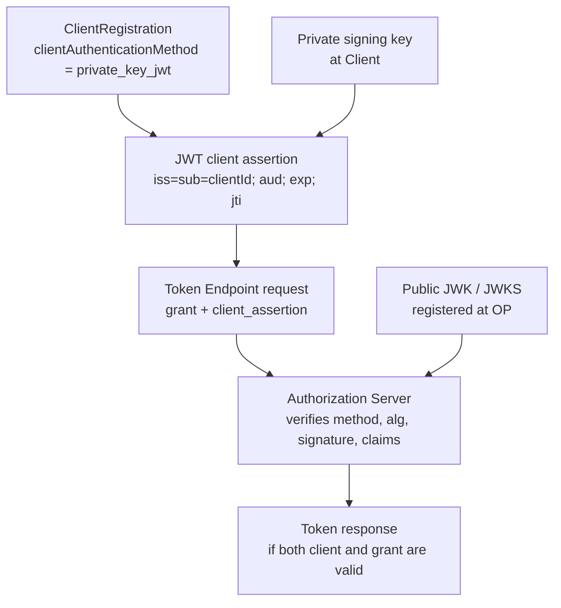

# 10.7. Private Key JWT, Client Secret JWT, and Their Integration Requirements

## Lesson Objectives

After this lesson, you will be able to:

- Explain **OAuth 2.0 Client authentication at the Token Endpoint** and distinguish authenticating the client from authenticating the user, exchanging an authorization code, and validating an access token.
- Differentiate the two OpenID Connect methods **`private_key_jwt`** and **`client_secret_jwt`**, including signing key types, how the Authorization Server verifies them, and which architecture each suits.
- Read and conceptually construct a **JWT Client Assertion** with `iss`, `sub`, `aud`, `exp`, `iat`, `jti` claims and `alg`, `kid` headers; transmit the assertion via `client_assertion_type` and `client_assertion`.
- Identify integration prerequisites: registering the client authentication method, signing algorithm, public JWK/JWKS or client secret, system clock synchronization, HTTPS, key management, and replay protection.
- Configure **Spring Security OAuth2/OIDC Client** to use `private_key_jwt` or `client_secret_jwt` when calling the Token Endpoint, including when refreshing access tokens.
- Diagnose root causes of errors such as `invalid_client`, wrong `aud`, key mismatches, invalid signatures, expired assertions, and `jti` reuse.

## 1. Context: The Token Endpoint Must Know Which Client Is Calling

Suppose **Learning Portal** is a backend Spring Boot application using **Campus Identity** as its Authorization Server/OpenID Provider. The user starts signing in at Learning Portal, is redirected to Campus Identity, completes authentication, and returns with an **authorization code**.

Learning Portal then sends the code to the Token Endpoint:

```http
POST /oauth2/token HTTP/1.1
Host: login.example.org
Content-Type: application/x-www-form-urlencoded

grant_type=authorization_code&code=<code>&redirect_uri=<registered-redirect-uri>
```

For a **confidential client** registered as requiring authentication at the Token Endpoint, the server must verify that the sender is indeed the client issued that code. Common methods include:

- `client_secret_basic`: client sends client ID and secret via HTTP Basic.
- `client_secret_post`: client sends ID and secret in the form body.
- `client_secret_jwt`: client creates a JWT assertion signed with a **symmetric key** derived from the client secret shared with the Authorization Server.
- `private_key_jwt`: client creates a JWT assertion signed with its own **private key**; the Authorization Server verifies it using the registered **public key**.

This lesson focuses on the last two methods, both of which use a **JWT as proof of client authentication**.

**Core point:** A JWT Client Assertion authenticates the **Client application** at the Token Endpoint; it is **not an ID Token**, **not an Access Token**, and **not a Refresh Token**.

### 1.1. Three Separate Questions

When Learning Portal completes an OIDC Authorization Code Flow, there are three distinct questions:

| Question | Mechanism Typically Involved |
| --- | --- |
| "Which application is calling the Token Endpoint?" | Client authentication, such as `private_key_jwt` or `client_secret_jwt` |
| "Does this authorization code belong to a valid transaction and client?" | Validation of code, redirect URI, PKCE when applicable, and grant state on the Authorization Server |
| "Which user authenticated?" | OIDC ID Token, validated by the Relying Party against issuer, audience, signature, and related rules |

A client assertion with a valid signature **does not automatically make an authorization code valid**. Likewise, a valid ID Token **never replaces client authentication** at the Token Endpoint.

## 2. Where Do the Two Methods Fit in the Flow?

```mermaid
sequenceDiagram
    autonumber
    actor U as End-User
    participant B as Browser
    participant C as Learning Portal (OAuth2/OIDC Client)
    participant AS as Campus Identity (Authorization Server)

    U->>B: Initiate login
    B->>C: GET /oauth2/authorization/campus
    C-->>B: Redirect to authorization endpoint
    B->>AS: client_id, redirect_uri, scope, state, PKCE...
    AS->>U: Login / consent when needed
    U-->>AS: Complete
    AS-->>B: Redirect back to client with code, state
    B->>C: GET /login/oauth2/code/campus?code=...
    C->>C: Build fresh JWT Client Assertion, sign with matching key
    C->>AS: POST token endpoint: code + client_assertion
    AS->>AS: Verify JWT assertion and authorization code
    AS-->>C: Access Token, ID Token if OIDC, optionally Refresh Token
    C->>C: Verify ID Token; establish app session
```

At the code exchange step, both methods typically send these form parameters:

```text
client_assertion_type = urn:ietf:params:oauth:client-assertion-type:jwt-bearer
client_assertion      = <signed-client-assertion-jwt>
```

The difference lies in **the signing key** and **how the Authorization Server verifies the signature**:

- With `private_key_jwt`, the client signs with a private key and the server verifies with a public key.
- With `client_secret_jwt`, both sides hold the same client secret; the client generates an HMAC signature and the server recomputes the signature with that secret.

`client_assertion_type` above specifies the **JWT Bearer Assertion** format under RFC 7523. It **does not** override `grant_type`. For the Authorization Code Flow, `grant_type` remains `authorization_code`; for the refresh token flow, it remains `refresh_token`.

## 3. What Does a JWT Client Assertion Contain?

It is a JWT created by the client at the moment authentication is needed. A standard compact JWS has the structure:

```text
BASE64URL(JWS Header).BASE64URL(Claims).BASE64URL(Signature)
```

Illustrative header for **`private_key_jwt`**:

```json
{
  "alg": "RS256",
  "kid": "portal-signing-key-2026-01",
  "typ": "JWT"
}
```

Illustrative payload:

```json
{
  "iss": "learning-portal-web",
  "sub": "learning-portal-web",
  "aud": "https://login.example.org/oauth2/token",
  "iat": 1893456000,
  "exp": 1893456060,
  "jti": "6a397bec-3b07-4cfa-94d3-1ec18d1b05f8"
}
```

The numeric timestamps above merely illustrate Unix timestamp formatting and do not represent a valid assertion at the time of reading. A valid JWT must be freshly generated and actually signed with a properly registered key; never copy example strings or `jti` values.

### 3.1. Claims in a Client Assertion

| Claim | Meaning | Integration Notes |
| --- | --- | --- |
| `iss` | Issuer of the client assertion | In JWT client authentication, usually must be the **Client ID** |
| `sub` | Subject of the assertion | Also usually must be the **Client ID**, not a user ID |
| `aud` | Authorization Server/Token Endpoint receiving the assertion | Value must match provider rules, usually the Token Endpoint URL |
| `exp` | Expiration timestamp of the assertion | Required by the JWT Bearer profile; keep short-lived |
| `iat` | Issued-at timestamp of the assertion | Very useful to bound assertion age; servers may enforce time policies |
| `nbf` | Not-before timestamp | Optional; watch out for clock skew |
| `jti` | Unique identifier of the assertion | Supports replay detection; generate a fresh random value per use |

For RFC 7523 client authentication, **`iss` and `sub` identify the client**, not the End-User. Wrong example:

```json
{
  "iss": "https://login.example.org",
  "sub": "student-123"
}
```

That is not a valid claim set to authenticate Learning Portal if its registered client ID is `learning-portal-web`. Do not confuse ID Token structure (issuer is the OP, subject is the user) with **Client Assertion** structure (issuer/subject is the client per profile).

### 3.2. How Should `aud` Be Chosen?

Typically:

```text
aud = https://login.example.org/oauth2/token
```

This binds the assertion to the designated **Authorization Server/Token Endpoint**. Some systems use the issuer identifier or another specific audience per profile and provider rules. Therefore, the client must follow the provider's official specification rather than guessing.

Example:

```text
OIDC Issuer:     https://login.example.org
Token Endpoint:  https://login.example.org/oauth2/token
```

If a provider requires the **Token Endpoint URL** as the audience, setting `aud = https://login.example.org` may be rejected even though the domain matches. Conversely, if a provider defines the audience as the issuer, follow that requirement.

Never use the **authorization endpoint** URL or Learning Portal's callback URL as `aud`, unless an Authorization Server explicitly specifies a highly unusual rule stating so.

### 3.3. Why Should `exp` Be Short and `jti` Be Unique?

A JWT client assertion is a credential that can be replayed if intercepted before expiration. Choose a short lifetime—such as **60 seconds** as supported by the provider—and generate a fresh `jti` for every assertion.

```text
Request A  -> jti=A, iat=t0, exp=t0+60
Request B  -> jti=B, iat=t1, exp=t1+60
Request C  -> jti=C, iat=t2, exp=t2+60
```

Never generate a JWT once at application startup and reuse the same string for all code exchanges and refresh calls: the assertion will expire, and reuse may be rejected. To enforce effective replay protection, the Authorization Server must track/check previously used assertions or enforce equivalent policies.

**`jti` is not a PKCE verifier.** PKCE binds the authorization code to the client that initiated the authorization request; `jti` uniquely identifies an individual JWT assertion.

## 4. Comparing `private_key_jwt` and `client_secret_jwt`

| Aspect | `private_key_jwt` | `client_secret_jwt` |
| --- | --- | --- |
| Signing key | Client's own **asymmetric private key** | Shared **symmetric client secret** |
| Example JWS algorithms | `RS256`, `PS256`, `ES256` if supported by provider | `HS256`, `HS384`, `HS512` if supported by provider |
| Authorization Server verifies with | Matching public key, via JWK/JWKS or registered key | Client secret held by the server |
| Must share private key? | **No.** Publish only the public key | Both sides must hold the same secret |
| Registration details | Client ID + auth method + public key or `jwks_uri` + algorithm | Client ID + auth method + strong secret + algorithm |
| Key rotation | Register new public JWK, change `kid`, overlap active keys | Coordinate secret rotation on both client and server |
| Key management | Private key in keystore/KMS/HSM or secret manager; public JWKS for verification | Secret manager protecting the shared secret |
| Risk if key leaks | Attacker holding the private key can impersonate the client until key is revoked | Attacker holding the client secret can impersonate the client until secret is changed |
| Best fit | Backend confidential clients needing strong key control, easy KMS/JWKS integration | Backend confidential clients with a strong secret and provider support for HMAC assertions |

Both are **client authentication with JWTs**, not a new grant type. Both require HTTPS, signature verification, and claim validation. `private_key_jwt` typically offers superior key distribution because the Authorization Server never needs to hold the client's private key.

### 4.1. Is `private_key_jwt` Always Automatically Secure?

No. If the private key sits in an unencrypted file, is committed to Git, has overly broad read permissions, or is extracted from a process, outsiders can impersonate the client. Implementation security also depends on:

- Generating keys with an appropriate algorithm/size and storing them securely.
- Registering the public key against the exact client ID.
- The Authorization Server accepting only permitted algorithms.
- Verifying `aud`, `exp`, `iss`, `sub`, `jti`, and replay protections.
- Having key rotation, revocation, and incident-response processes.

### 4.2. Can `client_secret_jwt` Use a Short, Guessable Secret?

No. HMAC JWT signing strength depends directly on the strength of the secret. Per JOSE/JWA requirements, HS256 requires a key of at least **256 bits** to meet minimum key-length rules; HS384/HS512 have corresponding higher requirements. An arbitrary short password used as a client secret may fail validation or be vulnerable to offline cracking if an assertion leaks.

`client_secret_jwt` does not make a weak secret stronger merely by wrapping it in a JWT. Use a high-entropy random secret issued per algorithm requirements and store it in a secret manager.

## 5. Registering the Authentication Method with the Authorization Server

The Authorization Server must know **which method this client is allowed to use**. Method names follow protocol conventions:

```text
private_key_jwt
client_secret_jwt
client_secret_basic
client_secret_post
none
```

An OIDC/OAuth provider may publish metadata:

```json
{
  "issuer": "https://login.example.org",
  "token_endpoint": "https://login.example.org/oauth2/token",
  "token_endpoint_auth_methods_supported": [
    "client_secret_basic",
    "private_key_jwt",
    "client_secret_jwt"
  ],
  "token_endpoint_auth_signing_alg_values_supported": [
    "RS256",
    "PS256",
    "ES256",
    "HS256"
  ]
}
```

This is **hypothetical metadata** for learning. Do not assume every real provider supports all of these values. The provider's OIDC Discovery or Authorization Server Metadata document is the source of truth for supported capabilities.

When setting up a registration, align:

1. **Client authentication method:** e.g., `private_key_jwt` specifically for client `learning-portal-web`.
2. **Signing algorithm:** must be among the provider's supported algorithms and allowed for the client.
3. **Public key or secret:** the server needs verification material to validate signatures.
4. **Assertion audience:** exact value accepted by the server.
5. **Time/replay policies:** max lifetime, clock skew, `jti`, client bindings.
6. **Allowed grant types:** `authorization_code`, `refresh_token`, `client_credentials`, etc. per config; JWT client auth does not authorize a grant by itself.
7. **Redirect URI and scopes:** must be registered accurately when using Authorization Code/OIDC Login; independent of JWT client auth.

### 5.1. Registering a Public JWK or JWKS for `private_key_jwt`

An RSA public JWK illustrating the structure:

```json
{
  "kty": "RSA",
  "use": "sig",
  "kid": "portal-signing-key-2026-01",
  "alg": "RS256",
  "n": "<base64url-public-modulus>",
  "e": "AQAB"
}
```

A public JWKS looks like:

```json
{
  "keys": [
    {
      "kty": "RSA",
      "use": "sig",
      "kid": "portal-signing-key-2026-01",
      "alg": "RS256",
      "n": "<base64url-public-modulus>",
      "e": "AQAB"
    }
  ]
}
```

This is illustrative JSON only; placeholders are not valid keys. You can register the **JWK Set** directly in the OP's client configuration or register a **`jwks_uri`** that the OP fetches as needed.

Example:

```text
https://portal.example.org/.well-known/client-jwks.json
```

This endpoint must publish **only the public JWK**. Never expose RSA private key fields such as `d`, `p`, `q`, `dp`, `dq`, `qi` or a private PEM key on a public endpoint.

**Distinguish the two JWKS endpoints:**

- **OP's JWKS:** publishes public keys so **the client can verify ID Tokens** and related tokens signed by the OP.
- **Client's JWKS:** publishes public keys so **the OP can verify `private_key_jwt` client assertions** signed by the Client.

These are two **opposite trust directions**. Configuring `issuer-uri` so Spring fetches the OP's JWKS **does not automatically register the Client's public key with the OP**.

### 5.2. Keys and `kid`

The assertion header can contain:

```json
{
  "alg": "RS256",
  "kid": "portal-signing-key-2026-01"
}
```

`kid` helps the Authorization Server pick the matching public key in the JWKS. When the JWKS holds multiple keys during rotation, `kid` identifies which key created the signature.

`kid` **is not authentication proof**. The server must still verify that the public key belongs to the registered client, the algorithm is allowed, the signature is valid, and all claims pass checks.

A common mistake:

```text
Client signs with private key B
JWT header states kid = "key-A"
OP looks up public key A and verifies signature
=> invalid_client
```

Fix it by aligning the private key, public JWK, algorithm, and `kid`—never by removing signature verification.

### 5.3. Registering a Secret for `client_secret_jwt`

With `client_secret_jwt`, the OP must hold the exact same secret the Client uses to sign. Logical config example:

```text
client_id              = learning-portal-web
token_endpoint_auth    = client_secret_jwt
signing_alg            = HS256
client_secret          = <strong-generated-secret>
```

No client public JWKS is needed for HMAC because it is a **symmetric** method. The secret must be distributed over a secure channel, versioned, and covered by a revocation procedure. Never place real secrets in documentation, logs, sample code, or repositories.

A provider may restrict `client_secret_jwt` or `HS256` to specific client types. If a provider only supports `private_key_jwt`, the client cannot unilaterally send an HMAC assertion and expect acceptance.

## 6. Building a Client Assertion: Core Steps

Regardless of which method is used, generating an assertion follows the same logical steps:

1. Obtain the **Client ID** from the current `ClientRegistration`.
2. Determine the **Token Endpoint** or audience required by the OP.
3. Populate `iss`, `sub`, `aud`, `iat`, `exp`, `jti` claims with a short lifetime.
4. Select the algorithm registered/supported by the OP.
5. Select the signing key matching the **client authentication method**.
6. Build a compact JWS and place it in `client_assertion`.
7. Send the request over HTTPS, using the assertion solely for the intended Token Endpoint.
8. Mint a **fresh** assertion for every token request; never cache a signed string indefinitely.

Pseudo-code:

```text
clientId = registration.clientId
tokenEndpoint = registration.providerDetails.tokenUri

now = currentUnixTime()
claims = {
  iss: clientId,
  sub: clientId,
  aud: tokenEndpoint,
  iat: now,
  exp: now + 60,
  jti: secureRandomUniqueId()
}

if method == private_key_jwt:
    signedJwt = signJws(claims, clientPrivateKey, registeredAsymmetricAlg)
else if method == client_secret_jwt:
    signedJwt = signJws(claims, registeredClientSecret, allowedHmacAlg)

form.client_assertion_type =
    "urn:ietf:params:oauth:client-assertion-type:jwt-bearer"
form.client_assertion = signedJwt
```

Pseudo-code illustrates the concept and **does not replace a JWS/JWT library**. Real JWT signing must implement proper JOSE headers, algorithms, encoding, key handling, and security provider constraints.

## 7. Actual HTTP Requests at the Token Endpoint

### 7.1. `private_key_jwt` in Authorization Code Exchange

```http
POST /oauth2/token HTTP/1.1
Host: login.example.org
Content-Type: application/x-www-form-urlencoded
Accept: application/json

grant_type=authorization_code
&code=<one-time-authorization-code>
&redirect_uri=https%3A%2F%2Fportal.example.org%2Flogin%2Foauth2%2Fcode%2Fcampus
&client_assertion_type=urn%3Aietf%3Aparams%3Aoauth%3Aclient-assertion-type%3Ajwt-bearer
&client_assertion=<compact-signed-jwt>
```

Lines are wrapped for readability; the real HTTP body must be URL-encoded into a valid form payload. `client_id` may additionally be required by a provider's integration contract; do not assume one sample layout is mandatory for every OP. In JWT client authentication, the client's identity is already conveyed by `iss` and `sub`.

With `private_key_jwt`, the assertion is signed by Portal's private key. The Authorization Server retrieves Portal's registered public key to verify it.

### 7.2. `client_secret_jwt` in Authorization Code Exchange

The body has the same structure:

```http
POST /oauth2/token HTTP/1.1
Host: login.example.org
Content-Type: application/x-www-form-urlencoded

grant_type=authorization_code
&code=<one-time-authorization-code>
&redirect_uri=<registered-redirect-uri>
&client_assertion_type=urn%3Aietf%3Aparams%3Aoauth%3Aclient-assertion-type%3Ajwt-bearer
&client_assertion=<hs256-signed-jwt>
```

The core difference lies not in the parameter names, but in the **JWS signature**. With `client_secret_jwt`, the OP verifies the signature using the shared client secret stored for that client.

Do not send multiple client authentication mechanisms simultaneously—such as both Basic credentials and a JWT assertion—unless a profile and provider explicitly specify how to handle it; OAuth 2.0 prohibits using multiple client authentication methods in the same request.

### 7.3. Using the Same Method for the Refresh Token Grant

When the access token expires and the client holds a valid refresh token, it can send:

```http
POST /oauth2/token HTTP/1.1
Host: login.example.org
Content-Type: application/x-www-form-urlencoded

grant_type=refresh_token
&refresh_token=<current-refresh-token>
&client_assertion_type=urn%3Aietf%3Aparams%3Aoauth%3Aclient-assertion-type%3Ajwt-bearer
&client_assertion=<new-compact-signed-jwt>
```

This is still **JWT client authentication** at the Token Endpoint. The assertion must be freshly minted with a new `jti` and timestamps, while `grant_type` is `refresh_token`.

If the OP allows the Client Credentials Grant and requires JWT auth, the request may contain:

```text
grant_type=client_credentials
client_assertion_type=urn:ietf:params:oauth:client-assertion-type:jwt-bearer
client_assertion=<new-signed-jwt>
```

Do not confuse this with the **JWT Bearer Authorization Grant**, which uses `grant_type=urn:ietf:params:oauth:grant-type:jwt-bearer` and an `assertion` parameter. Both profiles use JWTs, yet they solve **different problems**.

## 8. JWT Client Authentication Differs from JWT Bearer Grant and ID Token

These are concepts that are frequently confused when reading Token Endpoint documentation.

| Concept | What Is It Used For? | Common Parameters / Artifacts |
| --- | --- | --- |
| **JWT Client Authentication** | Proves which Client is calling the Token Endpoint | `client_assertion_type` and `client_assertion` |
| **JWT Bearer Authorization Grant** | Uses a JWT assertion as an authorization grant per RFC 7523 | `grant_type=urn:ietf:params:oauth:grant-type:jwt-bearer` and `assertion` |
| **OIDC ID Token** | Proves End-User authentication result to the Relying Party | `id_token` in token response |
| **Access Token** | Authorizes the Client to access a Resource Server | `access_token` and Bearer header on API calls |
| **Refresh Token** | Lets the Client request a new access token per policy | `refresh_token` in matching request/response |

In JWT client authentication:

```text
iss = Client ID
sub = Client ID
aud = Token Endpoint (or value required by OP)
```

In an OIDC ID Token, you typically find:

```text
iss = OpenID Provider issuer
sub = End-User subject
aud = Client ID
```

The claim names `iss`, `sub`, and `aud` are identical, yet **their semantics differ completely** because the authenticated subject is different.

A valid JWT access token **cannot** substitute for `client_assertion`; likewise, a JWT client assertion **must never** be sent to a Resource Server as an access token.

## 9. Spring Security Integration: `ClientRegistration` and Authentication Method

In Spring Security OAuth2 Client, the authentication method is declared on `ClientRegistration` via `ClientAuthenticationMethod`.

Illustrative Spring Boot configuration for **`private_key_jwt`**:

```yaml
spring:
  security:
    oauth2:
      client:
        registration:
          campus:
            provider: campus
            client-id: ${CAMPUS_CLIENT_ID}
            client-authentication-method: private_key_jwt
            authorization-grant-type: authorization_code
            redirect-uri: "{baseUrl}/login/oauth2/code/{registrationId}"
            scope:
              - openid
              - profile
              - email
        provider:
          campus:
            issuer-uri: https://login.example.org
```

For **`client_secret_jwt`**:

```yaml
spring:
  security:
    oauth2:
      client:
        registration:
          campus:
            provider: campus
            client-id: ${CAMPUS_CLIENT_ID}
            client-secret: ${CAMPUS_CLIENT_SECRET}
            client-authentication-method: client_secret_jwt
            authorization-grant-type: authorization_code
            redirect-uri: "{baseUrl}/login/oauth2/code/{registrationId}"
            scope:
              - openid
              - profile
              - email
        provider:
          campus:
            issuer-uri: https://login.example.org
```

These configurations specify only **the method**. With `private_key_jwt`, **no private key magically materializes from `client-id` or issuer discovery**. The application must still supply the assertion builder, signing key, and matching token response client configuration.

With `client_secret_jwt`, the secret is declared, yet the application must still verify that its token request implementation actually supports building and signing the JWT assertion with that secret. Not every Spring Security version or setup generates a valid JWT assertion merely by changing a YAML property name.

### 9.1. Distinguishing Authentication Method from Grant Type

Example:

```yaml
client-authentication-method: private_key_jwt
authorization-grant-type: authorization_code
```

These two lines **do not mean the same thing**:

- `authorization_code` is the **grant type** stating the client exchanges a code for tokens.
- `private_key_jwt` is the **client authentication method** used to prove the client's identity during the token request.

You can change the grant type to `client_credentials` on a service-oriented registration while keeping `private_key_jwt` for client authentication if permitted by the Authorization Server.

### 9.2. `oauth2Login()` Only Enables the Login Flow

A basic security filter chain:

```java
@Configuration
class SecurityConfiguration {

    @Bean
    SecurityFilterChain securityFilterChain(HttpSecurity http) throws Exception {
        http
            .authorizeHttpRequests(auth -> auth
                .requestMatchers("/", "/error").permitAll()
                .anyRequest().authenticated()
            )
            .oauth2Login(Customizer.withDefaults());

        return http.build();
    }
}
```

This is the Servlet OIDC Login skeleton. `oauth2Login()` alone does not provision private keys in KMS or register a public JWKS at the OP. JWT client authentication integration must be configured on the **Token Endpoint client** and in your key management system.

## 10. Spring Security's Converter for Building JWT Assertions

In Spring Security versions supporting JWT Client Authentication, the library provides a dedicated class:

```java
NimbusJwtClientAuthenticationParametersConverter<T>
```

This class creates a JWT client assertion for a token request using `ClientRegistration` and a **JWK** supplied by the application. Type `T` matches the grant request being processed, such as:

```text
OAuth2AuthorizationCodeGrantRequest
OAuth2RefreshTokenGrantRequest
OAuth2ClientCredentialsGrantRequest
```

For `private_key_jwt`, the JWK resolver must provide the appropriate private signing key; for `client_secret_jwt`, the JWK resolver must provide a symmetric key derived from the client secret matching the algorithm and security policy.

**Version note:** Token Response Client class names and converter wiring APIs vary across Spring Security branches. The examples below follow the Spring Security branch featuring `RestClientAuthorizationCodeTokenResponseClient`; if your project uses an older version, consult the corresponding API for that version.

### 10.1. `private_key_jwt` with an RSA JWK

This example assumes the application has a **`clientSigningKey`** bean that safely loads the OAuth client's own RSA key pair from a keystore/KMS or managed secret store. The code below shows how to provide the JWK to the application:

```java
@Bean
OAuth2AccessTokenResponseClient<OAuth2AuthorizationCodeGrantRequest>
        authorizationCodeTokenClient(KeyPair clientSigningKey) {

    RSAKey clientJwk = new RSAKey.Builder(
            (RSAPublicKey) clientSigningKey.getPublic())
        .privateKey((RSAPrivateKey) clientSigningKey.getPrivate())
        .keyID("portal-signing-key-2026-01")
        .algorithm(JWSAlgorithm.RS256)
        .build();

    NimbusJwtClientAuthenticationParametersConverter
            <OAuth2AuthorizationCodeGrantRequest> jwtParameters =
        new NimbusJwtClientAuthenticationParametersConverter<>(
            registration -> {
                if (ClientAuthenticationMethod.PRIVATE_KEY_JWT.equals(
                        registration.getClientAuthenticationMethod())) {
                    return clientJwk;
                }
                return null;
            }
        );

    RestClientAuthorizationCodeTokenResponseClient tokenClient =
        new RestClientAuthorizationCodeTokenResponseClient();

    tokenClient.addParametersConverter(jwtParameters);
    return tokenClient;
}
```

Then wire the Token Response Client into OAuth2 Login:

```java
@Bean
SecurityFilterChain securityFilterChain(
        HttpSecurity http,
        OAuth2AccessTokenResponseClient<OAuth2AuthorizationCodeGrantRequest>
            authorizationCodeTokenClient) throws Exception {

    http
        .authorizeHttpRequests(auth -> auth
            .anyRequest().authenticated()
        )
        .oauth2Login(oauth2 -> oauth2
            .tokenEndpoint(tokenEndpoint -> tokenEndpoint
                .accessTokenResponseClient(authorizationCodeTokenClient)
            )
        );

    return http.build();
}
```

The snippet focuses on the mechanics and assumes the required dependencies, imports, and key-loading bean are already configured. **No inline `KeyPair` generator bean is shown here**, because production systems must use keys that are provisioned, stored, and lifecycle-managed securely.

Key points to understand:

1. `ClientAuthenticationMethod.PRIVATE_KEY_JWT` is declared on the registration.
2. The RSA private/public JWK is used to sign the JWT client assertion.
3. `kid` must point to the corresponding public JWK known by the Authorization Server.
4. `RS256` is only an example; use the algorithm registered with and accepted by the OP.
5. The converter appends `client_assertion_type` and `client_assertion` when the client executes the token request.
6. The Token Response Client handles the HTTP token exchange; OAuth2 Login continues validating the code, processing the OIDC ID Token, and creating the application session.

In a system with **multiple client registrations**, never return a single JWK for all clients if they are registered with different key pairs. Select the key based on `registration.getRegistrationId()` or trusted `clientId`, applying the matching key/algorithm policy.

### 10.2. `client_secret_jwt` with a Symmetric JWK

For `client_secret_jwt`, the secret can be represented as an **octet sequence JWK** when using Nimbus JOSE:

```java
@Bean
OAuth2AccessTokenResponseClient<OAuth2AuthorizationCodeGrantRequest>
        hmacAuthorizationCodeTokenClient() {

    NimbusJwtClientAuthenticationParametersConverter
            <OAuth2AuthorizationCodeGrantRequest> jwtParameters =
        new NimbusJwtClientAuthenticationParametersConverter<>(
            registration -> {
                if (!ClientAuthenticationMethod.CLIENT_SECRET_JWT.equals(
                        registration.getClientAuthenticationMethod())) {
                    return null;
                }

                byte[] secretBytes = registration.getClientSecret()
                    .getBytes(StandardCharsets.UTF_8);

                return new OctetSequenceKey.Builder(secretBytes)
                    .algorithm(JWSAlgorithm.HS256)
                    .build();
            }
        );

    RestClientAuthorizationCodeTokenResponseClient tokenClient =
        new RestClientAuthorizationCodeTokenResponseClient();

    tokenClient.addParametersConverter(jwtParameters);
    return tokenClient;
}
```

Here `OctetSequenceKey` represents a symmetric key in JOSE. **Use this only when the client secret meets the algorithm's length and entropy requirements**, is supplied via secure configuration, and the OP verifies HMAC JWTs using the exact same secret.

Points to remember when working with Nimbus:

- `client_secret_jwt` and `private_key_jwt` both use JWT assertions, yet their JWK types and signing algorithms differ.
- Never generate a new random secret on every request; the OP must know the same secret to verify the signature.
- `clientSecret` is sensitive data; never serialize an `OctetSequenceKey` holding a secret to JSON or logs.
- When a provider only supports HS512 or imposes another algorithm constraint, configure the matching JWK/`alg` and ensure sufficient secret length.

### 10.3. Integrating with Refresh Tokens

In Spring Security, an `OAuth2AuthorizedClient` can hold both an access token and a refresh token. When the access token expires and refreshing is enabled, `OAuth2AuthorizedClientProvider` can invoke the **Refresh Token Grant** through its own Token Response Client.

Conceptual configuration example:

```java
@Bean
OAuth2AuthorizedClientManager authorizedClientManager(
        ClientRegistrationRepository registrations,
        OAuth2AuthorizedClientRepository repository,
        OAuth2AccessTokenResponseClient<OAuth2RefreshTokenGrantRequest>
            refreshTokenClient) {

    RefreshTokenOAuth2AuthorizedClientProvider refreshProvider =
        new RefreshTokenOAuth2AuthorizedClientProvider();

    refreshProvider.setAccessTokenResponseClient(refreshTokenClient);

    OAuth2AuthorizedClientProvider provider =
        OAuth2AuthorizedClientProviderBuilder.builder()
            .authorizationCode()
            .provider(refreshProvider)
            .build();

    DefaultOAuth2AuthorizedClientManager manager =
        new DefaultOAuth2AuthorizedClientManager(
            registrations, repository
        );

    manager.setAuthorizedClientProvider(provider);
    return manager;
}
```

This example needs a matching `refreshTokenClient` bean, such as `RestClientRefreshTokenTokenResponseClient` configured with **`NimbusJwtClientAuthenticationParametersConverter<OAuth2RefreshTokenGrantRequest>`** and the same key-selection logic. Exact class and builder method names may depend on your Spring Security version, so check the API for the version in use.

**Very common pitfall:** A developer configures JWT assertions for **authorization code exchange** but forgets **refresh token exchange**. Initial sign-in succeeds, yet a few minutes later the Token Endpoint returns `invalid_client` when the app tries to refresh because the refresh request used the wrong client authentication method. Ensure every grant flow in use has a Token Response Client configured with matching JWT client authentication.

### 10.4. Client Credentials Is Also a Token Endpoint Request

If the application calls another service without user interaction and the registration uses `client_credentials`, authenticating at the Token Endpoint can still use `private_key_jwt` or `client_secret_jwt`.

In that case, configure the Token Response Client for `OAuth2ClientCredentialsGrantRequest`, typically via the corresponding manager/provider. Do not use Servlet OIDC Login handlers for client credentials, because that grant does not log in an End-User.

### 10.5. Choosing Algorithms in the Converter

When using a signing library, avoid setting `alg` in the header without matching it to the registered key and method. For instance, pairing an RSA private key with `alg = HS256` is a key-type mismatch.

A clean mapping:

```text
private_key_jwt:
    RSA private/public -> RS256 or PS256 if supported
    EC private/public  -> ES256 if supported

client_secret_jwt:
    shared secret      -> HS256/HS384/HS512 if supported
```

In practice, other algorithms may be used per provider metadata and configuration. Never allow clients to send `alg=none`. Maintain an allowlist of acceptable algorithms per registration.

## 11. Mandatory Integration Requirements on the Authorization Server Side

An integration only succeeds when **both client and server** agree.

### 11.1. What Must the Authorization Server Verify?

For every token request containing a JWT client assertion, the Authorization Server typically must:

1. Receive the exact `client_assertion_type` and decode `client_assertion` per supported format.
2. Identify the client from `iss`/`sub` and registration records.
3. Verify the client is permitted to use `private_key_jwt` or `client_secret_jwt`.
4. Accept only JWS algorithms registered/allowed for that client.
5. Fetch **the client's public key** (`private_key_jwt`) or **the client's shared secret** (`client_secret_jwt`) from a trusted source.
6. Verify the signature and key identifier properly without blindly trusting arbitrary keys or URLs embedded in the JWT header.
7. Validate `iss`, `sub`, `aud`, `exp`, `iat`/`nbf` if used, maximum lifetime, and clock skew.
8. Enforce replay protection, such as tracking used `jti` values.
9. Only after authenticating the client, validate the **grant**: code, PKCE, refresh token, scopes, redirect URI, etc. per request type.

An assertion with a valid signature yet **the wrong `aud`** must still be rejected. An unexpired JWT belonging to **another client** must likewise never be accepted for the client executing the grant.

### 11.2. How Should Public Keys from a JWKS URI Be Trusted?

If the OP fetches a JWKS from a registered URI, it must ensure that URI is bound to the client in trusted registration data. Never fetch verification keys from an arbitrary `jku` or `x5u` URL sent inside the incoming client assertion itself and treat it as proof of authentication.

In the proper model:

```text
Authorization Server database
  client_id = learning-portal-web
  method    = private_key_jwt
  jwks_uri  = https://portal.example.org/.well-known/client-jwks.json

Client assertion
  iss = learning-portal-web
  sub = learning-portal-web
  kid = portal-signing-key-2026-01

Authorization Server
  fetch registered JWKS for learning-portal-web
  select key with matching kid
  verify signature and claims
```

Protect JWKS fetching/caching against SSRF and untrusted sources if dynamic URI registration is allowed. Making a JWKS publicly accessible does not make the public key a secret; the private key must remain strictly protected.

## 12. Key and Secret Lifecycle Management

### 12.1. Rotating `private_key_jwt` Keys

A typical key rotation plan:

```text
Phase A:
  JWKS publishes key-2026-01
  Client signs with private key-2026-01

Phase B (overlap):
  JWKS publishes key-2026-01 and key-2026-02
  Client begins signing with private key-2026-02
  OP still accepts valid assertions signed by the old key during transition

Phase C:
  Old assertions have expired; stop signing with key-2026-01
  Remove key-2026-01 from OP's accepted set
```

With multiple client instances, synchronize rotation phases so no instance signs assertions using a private key already removed from the JWKS. Account for JWKS caching at the Authorization Server, propagation delays, and emergency revocation procedures.

**You cannot use the JWT header `kid` to swap out the actual private key.** The header and algorithm are just metadata; the signature must be produced with the exact private key matching the registered public key.

### 12.2. Rotating `client_secret_jwt` Secrets

When rotating a secret:

1. Generate a new secret with sufficient entropy and security.
2. Check with the provider whether overlapping old/new secrets are supported during transition.
3. Update the secret manager and client instances.
4. Verify token requests succeed with the new secret.
5. Revoke the old secret according to plan.

Some providers only allow one active secret at a time; in that case, rotation may require a maintenance window or a carefully staged rollout. Never assume both old and new secrets can be sent in a single request.

### 12.3. Where to Store Keys

For confidential clients in a Spring Boot application:

- Private keys can be protected in a keystore, HSM, KMS, or suitable secret manager.
- If using a KMS with remote signing APIs, design a compatible signer/JWS integration; you do not have to export raw private keys out of the KMS.
- Restrict read/sign permissions by service identity and environment.
- Avoid placing keys into YAML committed to Git, Docker images, startup commands, or logs.
- Maintain backups and incident-response procedures in case a key is compromised or lost.
- Do not reuse the same private key/secret across unrelated client registrations without a clear operational reason.

## 13. Common Integration Errors

### 13.1. `invalid_client`

This is the common error when a JWT assertion is rejected by the Authorization Server. Possible causes include:

| Cause | Example | Remediation |
| --- | --- | --- |
| Method mismatch | OP registers `private_key_jwt` yet client sends `client_secret_basic` | Align client authentication method on both sides |
| Disallowed algorithm | OP accepts only `PS256` yet assertion uses `RS256` | Check supported/registered signing algorithms |
| Wrong `client_id` in claims | `iss`/`sub` holds internal registration ID instead of Client ID | Send the exact Client ID |
| Wrong `aud` | OP expects Token Endpoint URL yet assertion uses issuer URL | Confirm audience per profile/provider |
| Wrong public key | Client signs with a key not yet in OP's trusted JWKS | Update registration/JWKS cache and check `kid` |
| Missing private key | Client loaded only a public certificate yet tries to sign | Provide a signer authorized to use the private key |
| Weak/wrong secret | `client_secret_jwt` uses a different secret than OP or is too short | Align strong secret, algorithm, and encoding |
| Expired assertion | `exp` is already past when request reaches server | Mint a fresh assertion per request; sync clocks |
| Clock skew | `iat`/`nbf` is further in the future than allowed clock skew | Synchronize NTP time and check skew policy |
| `jti` reused | Client cached assertion or retried the same JWT | Mint a fresh assertion, avoid blind retries; check replay policy |
| Converter missing for refresh | Initial login succeeds, later refresh fails with `invalid_client` | Attach JWT assertion converter to refresh token response client |
| Multiple authentication mechanisms | Request sends both Basic and a client assertion | Use only the registered method |
| Invalid JWT format | Malformed compact JWS or form-urlencoded payload | Use standard JWT/JWS libraries and form encoders |

Never "fix" errors by disabling signatures, setting `exp` arbitrarily far in the future, accepting any `aud`, or turning off `jti` checks.

### 13.2. Distinguishing `invalid_client` from `invalid_grant`

These two errors originate in different steps:

- **`invalid_client`:** The Authorization Server rejected client authentication, typically due to the assertion, method, key, or registration.
- **`invalid_grant`:** Client authentication may have succeeded, yet the authorization code, refresh token, or grant is invalid, expired, revoked, or failed redirect URI/PKCE checks.

Example:

```text
private_key_jwt signed properly, claims valid:
  -> client authentication succeeds.

Yet the authorization code was already used earlier:
  -> token endpoint may return invalid_grant.
```

At that point, changing the private key will not fix the authorization code issue. Use the error code, event context, and safe logs from both sides to isolate the stage.

### 13.3. JWT Rejected Even with a Valid Signature

An assertion with a mathematically valid signature can still be rejected:

```json
{
  "iss": "learning-portal-web",
  "sub": "learning-portal-web",
  "aud": "https://wrong.example.org/token",
  "iat": 1893456000,
  "exp": 1893456060
}
```

If the OP expects `https://login.example.org/oauth2/token`, the audience is wrong. Likewise, mismatched `sub` or client method invalidates the assertion.

**Valid signing is necessary but not sufficient**: the signature proves the signer possesses the key, while the claims and policies decide whether the assertion is accepted at this endpoint, right now, for this client.

## 14. Monitoring, Retries, and Concurrency

### 14.1. Never Log JWT Client Assertions

A JWT Client Assertion carries identity claims and a short-lived signature used to authenticate the client. If written to logs, monitoring tools, URLs, or exceptions, it could be replayed within its validity window if replay protection is not strict enough.

When diagnosing, log **safe metadata**:

```text
registrationId    = campus
clientAuthMethod  = private_key_jwt
tokenEndpointHost = login.example.org
algorithm         = RS256
keyId             = portal-signing-key-2026-01
errorCode         = invalid_client
correlationId     = <non-sensitive-request-id>
```

Never log `client_assertion`, private keys, client secrets, authorization codes, access tokens, refresh tokens, HTTP `Authorization` headers, or full form bodies.

### 14.2. Retrying After a Timeout

A token request may reach the Authorization Server and succeed, while the client times out before reading the response. The client must distinguish:

- **JWT assertion:** may already have been accepted and its `jti` marked as used.
- **Authorization code:** may already have been consumed and cannot be reused.
- **Refresh token:** may already have been rotated, invalidating the old token.

Therefore, never infinitely retry **the exact same token request**. When building a new request after a recoverable failure, mint a fresh assertion—keeping in mind the underlying grant may already be consumed; application code must handle ambiguous code/refresh-token outcomes by re-reading stored state if appropriate or requiring a fresh authorization.

### 14.3. Multiple Instances Sharing the Same Signing Key

A Learning Portal cluster can share a centrally managed private key. Each instance must still generate its own unique `jti` and keep clocks reasonably synchronized. The client's public JWKS may publish one or multiple keys depending on policy.

If each instance generates a different ephemeral key on startup while the OP registered only one public key, requests from instances with unregistered keys will fail. Synchronize keys or register all appropriate public keys before routing traffic to instances.

### 14.4. `kid` Is Not Necessarily the Software Version

`kid` identifies the signing key. You can name it after rotation generations for operational clarity, yet deploying a new software version does not mandate rotating keys. Conversely, a key compromise forces rotation even when the software version has not changed.

## 15. Practical Integration Scenarios

### Scenario A — OIDC Login Using `private_key_jwt`

An organization requires backend Clients to sign JWTs to authenticate at the Token Endpoint. It provides:

```text
Issuer:            https://login.example.org
Token Endpoint:    https://login.example.org/oauth2/token
Client ID:         learning-portal-web
Auth method:       private_key_jwt
Signing alg:       PS256
Redirect URI:      https://portal.example.org/login/oauth2/code/campus
Public JWKS:       published by Learning Portal
```

Learning Portal needs to:

1. Generate/provision a private key suitable for `PS256` and register the public JWK with an explicit `kid`.
2. Enable `authorization_code` and `private_key_jwt` in `ClientRegistration`.
3. Mint a fresh client assertion per token request with `iss=sub=learning-portal-web`, `aud` per OP spec, short `exp`, and new `jti`.
4. Configure the Spring Token Response Client to generate the assertion and send the right form parameters.
5. Ensure Spring still performs PKCE and verifies the ID Token per OIDC rules during login.

If the app defaults to `RS256` while the OP only accepts `PS256`, the Token Endpoint may return `invalid_client`; fix the algorithm configuration rather than changing the callback URL.

### Scenario B — Provider Requires `client_secret_jwt`

An OP issues a client ID and a strong random secret, requiring `HS256` and the Token Endpoint URL as the audience.

Learning Portal must protect the secret, build an HMAC-signed JWT with `iss=sub=clientId`, proper `aud`, `exp`, `jti`, and send `client_assertion` instead of an HTTP Basic secret. If Spring remains configured with `client_secret_basic`, the OP will reject it even though the secret value itself is right.

### Scenario C — Login Succeeds Yet Refresh Fails

Initially, Spring OAuth2 Login uses an authorization code token response client configured with a JWT converter. When the access token expires, `OAuth2AuthorizedClientManager` attempts to refresh using a separate HTTP client that was never configured with JWT assertions.

Result:

```text
Authorization Code exchange:
  private_key_jwt -> OK

Refresh Token exchange:
  client_secret_basic / missing assertion -> invalid_client
```

Apply JWT client authentication to the **refresh token response client** as well, and persist refresh tokens/authorized clients throughout their lifecycle. Do not change the ID Token or Resource Server configuration to fix this client authentication bug.

### Scenario D — OP Does Not Know the New Signing Key

The client rotates from `kid=old-key` to `kid=new-key`, yet the OP's registered JWKS or cache does not yet include the new public key. Assertions signed with the new private key have valid signatures, yet the server lacks a trusted key to verify them.

The solution is coordinating the rotation order: publish/register the new public key first, wait for cache refresh per policy, then start signing with the new private key; remove the old key once old assertions expire.

### Scenario E — Mistakenly Using `client_id` as `aud`

The client builds the payload:

```json
{
  "iss": "learning-portal-web",
  "sub": "learning-portal-web",
  "aud": "learning-portal-web"
}
```

If the OP expects the Token Endpoint URL as audience, the `aud` claim here is wrong. `client_id` belongs in `iss` and `sub`; audience must identify **the recipient of the assertion** per the Authorization Server's contract.

### Scenario F — Using JWT Bearer Grant Instead of JWT Client Authentication

A developer sends:

```text
grant_type=urn:ietf:params:oauth:grant-type:jwt-bearer
assertion=<signed-jwt>
```

Even though the system is executing the Authorization Code Flow and the OP expects client authentication via `private_key_jwt`.

That is a **different grant type**. The proper request keeps `grant_type=authorization_code`, `code`, `redirect_uri`, and adds `client_assertion_type`/`client_assertion` for client authentication.

## 16. Controlled Rollout Checklist

When receiving integration specs from a provider, translate them into these engineering decisions:

| Detail to Confirm | Engineering Question |
| --- | --- |
| Issuer and metadata | Which discovery document does the OP expose? |
| Token Endpoint | What is the exact URL? |
| Client authentication method | `private_key_jwt` or `client_secret_jwt`? |
| Signing algorithm | `RS256`, `PS256`, `ES256`, `HS256`...? |
| Audience | Token Endpoint URL, issuer URL, or provider-designated value? |
| Client ID | Exact string required in `iss` and `sub`? |
| Keys/secret | Where is the public JWK/JWKS registered, and where is the private key/secret stored? |
| Key ID | Is a specific `kid` required? |
| Claim constraints | Maximum `exp` window; are `jti`, `iat`, `nbf` mandatory? |
| Grants | Are Authorization Code, Refresh Token, and Client Credentials enabled? |
| Redirect URI | Which URI must be registered for Authorization Code? |
| Spring Security version | Which Token Response Client and converter apply to each grant? |
| Operations | Are key rotation, safe logging, and replay/race handling planned? |

### 16.1. A `private_key_jwt` Setup Is Only Complete When Both Sides Align



The diagram shows why **setting `client-authentication-method: private_key_jwt` in YAML alone is not enough**. The client needs the signing key and assertion converter; the OP needs the public key and matching verification policy.

## 17. Self-Check Questions

**1. Are `private_key_jwt` and `client_secret_jwt` new grant types?**

> No. They are **Client authentication methods at the Token Endpoint**. The grant type can still be `authorization_code`, `refresh_token`, or `client_credentials` when supported by the OP.

**2. What is the single most important difference between the two methods?**

> `private_key_jwt` signs with a private key and verifies with a public key; `client_secret_jwt` signs and verifies with a shared secret using HMAC.

**3. In a JWT client assertion, what do `iss` and `sub` typically contain?**

> They contain the **OAuth Client ID**, not the OIDC ID Token's issuer URL or an end-user subject.

**4. Why can a JWT with a valid signature still return `invalid_client`?**

> Wrong `aud`, `iss`, `sub`, disallowed algorithm, invalid `exp`/`iat`, replayed `jti`, or an auth method mismatch with the registration.

**5. When using `private_key_jwt`, should the private key be published on the JWKS endpoint?**

> No. Publish only the **public JWK**; the private key must stay protected in a keystore/HSM/KMS or equivalent mechanism.

**6. Can `client_secret_jwt` with HS256 use an 8-character password?**

> No—it is insecure and fails JOSE/JWA key-length requirements for HS256. Use a strong secret with sufficient entropy compliant with provider policy.

**7. Why might the initial login succeed while a refresh token request fails?**

> The JWT converter may have been configured only on the Authorization Code Token Response Client and not on the Refresh Token Response Client; attach the right authentication mechanism to every grant in use.

**8. Is `client_assertion` the same as an ID Token?**

> No. A client assertion is a JWT signed by the client to authenticate the **client** to the OP; an ID Token is issued by the OP for the RP to authenticate the **End-User**.

**9. If multiple instances share the same private key, can they reuse one static JWT assertion?**

> No. Every request should generate a fresh assertion with appropriate `iat`, `exp`, and `jti`; a static assertion will expire and may be blocked as a replay.

**10. When must `redirect_uri` still be checked?**

> In the Authorization Code Flow, `redirect_uri` binds the grant and callback; it must match rules across the authorization request, callback, and token exchange independently of JWT client authentication.

---

## Key Takeaways

**`private_key_jwt` and `client_secret_jwt` are two methods for authenticating an OAuth2/OIDC Client at the Token Endpoint using a JWT Client Assertion.** Both send `client_assertion_type` and `client_assertion`, with `iss=sub=client_id`, an Authorization Server–specific audience, short `exp`, and a fresh `jti`. `private_key_jwt` uses the **client's private key** and a **public JWK/JWKS registered at the OP**; `client_secret_jwt` uses a **shared client secret** and HMAC. In Spring Security, you must configure `ClientRegistration.clientAuthenticationMethod`, register the matching key/secret and algorithm, wire JWT signing into **every token request type in use**, and enforce key rotation, error handling, and operational credential protection.
