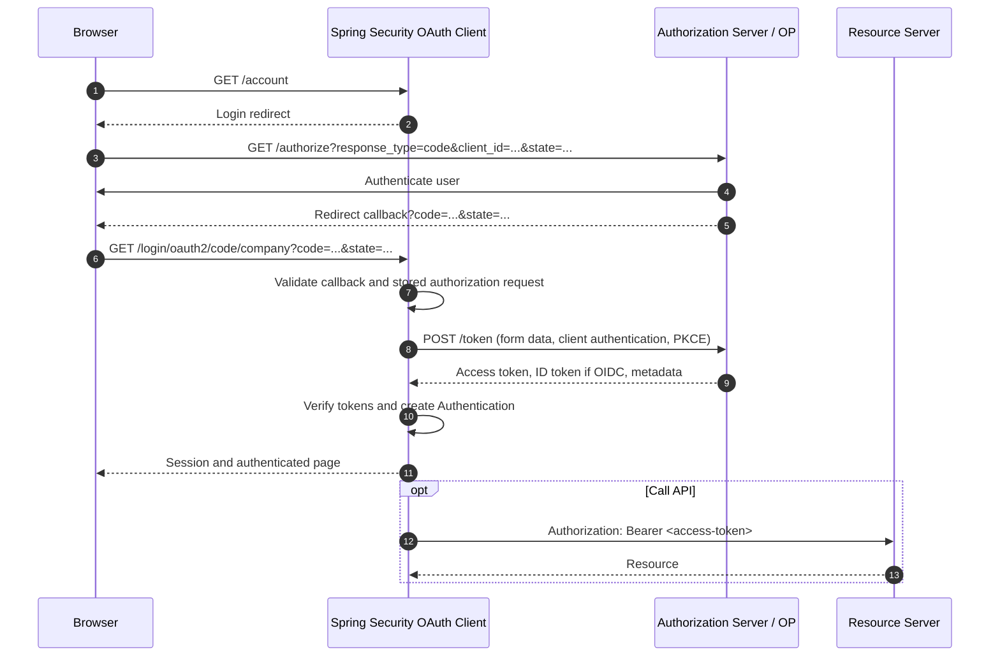
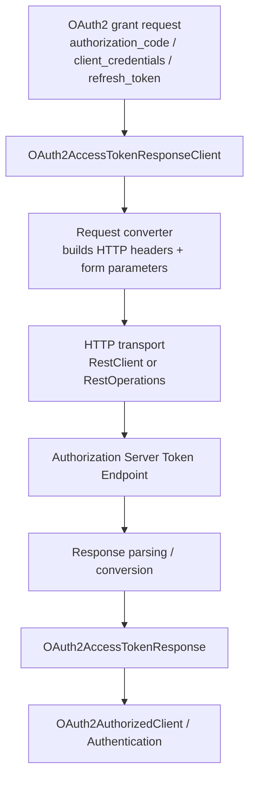

# 10.8. Customizing Headers, Parameters, and Request Conversion

In a **Spring Security OAuth 2.0/OIDC Client**, after the browser is redirected to the Authorization Server or OpenID Provider (OP) and returns with an authorization code, the application typically must perform an **HTTP request to the Token Endpoint** to exchange the code for tokens. Under other grants, such as `client_credentials` or `refresh_token`, the application also calls the Token Endpoint, but with a different set of parameters.

Spring Security already provides standard mechanics to build HTTP requests, authenticate clients, send form data, parse token responses, and handle errors. However, some Authorization Servers require extra provider-specific HTTP headers or parameters; some systems must connect through an HTTP proxy, apply custom TLS policies, or return token responses with extension fields. In those cases, you need to know how to **customize the right layer** while preserving OAuth 2.0/OIDC security invariants.

This lesson focuses on three extension points:

1. **Headers:** adjusting HTTP headers the client sends to the Token Endpoint.
2. **Parameters:** adding or adjusting form parameters in the HTTP body of a token request.
3. **Request conversion:** using converters/request builders to translate Spring's grant request into an HTTP request; and, when necessary, customizing the HTTP client used to send it or how token responses are decoded.

Key foundational principle: **The Token Endpoint is a direct communication channel from the OAuth Client to the Authorization Server**. It differs from the Authorization Endpoint that the browser navigates to, differs from the RP's callback, and differs from the Resource Server API where the application spends access tokens.

## 1. Where Does the Token Endpoint Fit in the OAuth 2.0/OIDC Flow?

### 1.1. Authorization Code Flow

For Spring MVC using `oauth2Login()`, the core flow is:



In this diagram, the operation being customized is **`POST /token` from the Spring backend to the AS**. It normally does not pass through the user's browser.

If the application requests the `openid` scope, the OIDC Authorization Code Flow token response also includes an **ID Token**; the RP must validate the ID token against `issuer`, `audience`, signature, expiration, and OIDC conditions.

### 1.2. Other Requests That Also Call the Token Endpoint

| Grant / Activity | Caller | Typical Token Request Contents | User Interactive? |
|---|---|---|---|
| `authorization_code` | RP exchanging an authorization code | `grant_type`, `code`, `redirect_uri`, `code_verifier` with PKCE; client authentication | Yes, in the preceding authorization step |
| `client_credentials` | Backend service requesting a workload token | `grant_type=client_credentials`, client authentication, optional `scope` | No |
| `refresh_token` | OAuth client requesting a new access token | `grant_type=refresh_token`, `refresh_token`, client authentication if needed, optional `scope` | No new login needed in this request |
| Device Authorization Grant | Device/CLI after user approval | `grant_type=urn:ietf:params:oauth:grant-type:device_code`, `device_code`, and matching params | User typically confirms on another device |

**Different grants require matching token response clients and request converters.** A converter taking `OAuth2AuthorizationCodeGrantRequest` is not the default place to handle `client_credentials` or `refresh_token`.

## 2. What Is the Structure of a Standard HTTP Token Request?

A confidential client's token request in the Authorization Code Flow typically uses `POST` over HTTPS with `Content-Type: application/x-www-form-urlencoded`.

Illustrative example when the AS requires `client_secret_basic`:

```http
POST /oauth2/token HTTP/1.1
Host: login.example.org
Content-Type: application/x-www-form-urlencoded
Accept: application/json
Authorization: Basic <base64url-not-used-here; standard-http-basic-credential>

grant_type=authorization_code&code=<one-time-code>&redirect_uri=https%3A%2F%2Fportal.example.org%2Flogin%2Foauth2%2Fcode%2Fcompany&code_verifier=<original-pkce-verifier>
```

The `Authorization: Basic ...` header represents **client authentication** at the Token Endpoint. In practice it uses standard Base64 per HTTP Basic syntax; **never Base64URL as in PKCE**. This is only an encoding of client ID and client secret, not secret encryption. **HTTPS/TLS** is mandatory to protect the request.

If the client is registered with `client_secret_post`, `client_id` and `client_secret` are sent as form parameters per AS rules; if registered as `none` (public client), no client secret is sent.

### 2.1. Classifying Headers and Parameters

| Component | Example | Source / Rule |
|---|---|---|
| HTTP method | `POST` | Token endpoint uses POST per OAuth 2.0 |
| `Content-Type` | `application/x-www-form-urlencoded` | Body is form-encoded |
| `Accept` | Usually `application/json` | Response format the client can parse |
| `Authorization` | `Basic ...` | Client authentication when using `client_secret_basic` |
| `grant_type` | `authorization_code` | Identifies the grant |
| `code` | Authorization code received from callback | Single-use, short-lived |
| `redirect_uri` | Callback URI matching authorization request | Must match per protocol |
| `code_verifier` | PKCE verifier from initial request | Binds the code exchange |
| `client_id` | Registered client ID | Appears in form body or authentication header depending on client type |
| Extension parameter | `resource`, `audience`, or custom field | Send only when supported/required by the AS |

A standard token response typically looks like:

```json
{
  "access_token": "<opaque-or-jwt-access-token>",
  "token_type": "Bearer",
  "expires_in": 3600,
  "scope": "orders.read"
}
```

In an OIDC Authorization Code Flow, a valid response may also contain:

```json
{
  "access_token": "<access-token>",
  "token_type": "Bearer",
  "expires_in": 3600,
  "id_token": "<signed-id-token>",
  "scope": "openid profile"
}
```

`refresh_token` may or may not be issued depending on grant, client, OP, and policy. Never confuse the **access token** sent to a Resource Server with the **ID token** meant for the Relying Party.

## 3. Three Customization Layers in Spring Security

To choose the right extension point, picture the pipeline:



In Spring Security, the key abstraction is:

```java
OAuth2AccessTokenResponseClient<T extends AbstractOAuth2AuthorizationGrantRequest>
```

The client receives a **strongly typed grant request**, executes the token request, and returns `OAuth2AccessTokenResponse`. Each grant has its own request type.

| Layer | Extension Tool | When to Use |
|---|---|---|
| Authorization request (before callback) | `OAuth2AuthorizationRequestResolver` / customizer | Adding `prompt`, `login_hint`, `resource` at the authorization endpoint |
| **Token request** | `OAuth2AccessTokenResponseClient` and parameter/header converters | Adding form parameters, headers, or custom HTTP handling for the token endpoint |
| HTTP transport | `RestClient` or `RestOperations` depending on version | Timeouts, proxies, TLS, observability, response conversion |
| Token response | Access token response converter / HTTP message converter | Provider returns non-standard responses or extension fields |
| Authorized client lifecycle | `OAuth2AuthorizedClientManager` and providers | Selecting `client_credentials`, `refresh_token`, `authorization_code` per flow |

**Do not customize the wrong layer:** If a provider requires `prompt=login` on the Authorization Endpoint, adding it to the token request will not achieve the goal. If a provider requires a custom form field at the Token Endpoint, adjusting `OAuth2AuthorizationRequestResolver` is not enough.

## 4. Declaring the Token Endpoint via `ClientRegistration`

### 4.1. Configuring with OIDC Discovery

For standard OPs with discovery metadata, Spring Boot can use `issuer-uri`:

```yaml
spring:
  security:
    oauth2:
      client:
        registration:
          company:
            provider: company
            client-id: ${OIDC_CLIENT_ID}
            client-secret: ${OIDC_CLIENT_SECRET}
            client-authentication-method: client_secret_basic
            authorization-grant-type: authorization_code
            redirect-uri: "{baseUrl}/login/oauth2/code/{registrationId}"
            scope:
              - openid
              - profile
              - email
        provider:
          company:
            issuer-uri: ${OIDC_ISSUER_URI}
```

When the OP serves valid discovery metadata, Spring automatically discovers `authorization_endpoint`, `token_endpoint`, `jwks_uri`, and other OIDC metadata.

**`token-uri` is the target URL; the converter decides how the request is constructed.** Simply declaring `token-uri` does not make Spring automatically send a special header or form parameter.

### 4.2. Manual `token-uri` Configuration

When the Authorization Server does not support discovery or uses custom endpoints:

```yaml
spring:
  security:
    oauth2:
      client:
        registration:
          partner:
            provider: partner
            client-id: ${PARTNER_CLIENT_ID}
            client-secret: ${PARTNER_CLIENT_SECRET}
            client-authentication-method: client_secret_basic
            authorization-grant-type: authorization_code
            redirect-uri: "{baseUrl}/login/oauth2/code/{registrationId}"
            scope:
              - profile.read
        provider:
          partner:
            authorization-uri: https://id.partner.example/authorize
            token-uri: https://id.partner.example/token
            user-info-uri: https://id.partner.example/profile
            user-name-attribute: id
```

Here, the example is **OAuth2 Login with a custom UserInfo API**, not assuming OIDC since there is no `openid` scope or ID token. If the provider is OIDC, configure the appropriate OIDC metadata and verification rules.

When customizing a token converter, still read the Token Endpoint from `ClientRegistration.getProviderDetails().getTokenUri()` or rely on the token response client's default. Never hardcode or dynamically route to another host from browser input.

## 5. Modern Implementation: `RestClientAuthorizationCodeTokenResponseClient`

Recent Spring Security versions in the **6.4+ branch** provide `RestClientAuthorizationCodeTokenResponseClient` to perform token exchanges with `RestClient`. This API allows extending headers and parameters using converters.

Older versions commonly use `DefaultAuthorizationCodeTokenResponseClient` paired with `OAuth2AuthorizationCodeGrantRequestEntityConverter`. Your choice must match your project's actual dependency version.

### 5.1. Example: Adding a Provider-Supported Form Parameter

Suppose the AS documents that its Token Endpoint accepts the **`resource`** parameter per OAuth 2.0 Resource Indicators (RFC 8707) to constrain the access token's audience.

```java
import org.springframework.context.annotation.Bean;
import org.springframework.security.oauth2.client.endpoint.RestClientAuthorizationCodeTokenResponseClient;
import org.springframework.util.LinkedMultiValueMap;
import org.springframework.util.MultiValueMap;

@Bean
RestClientAuthorizationCodeTokenResponseClient authorizationCodeTokenClient() {
    var client = new RestClientAuthorizationCodeTokenResponseClient();

    client.addParametersConverter(grantRequest -> {
        MultiValueMap<String, String> extras = new LinkedMultiValueMap<>();
        extras.add("resource", "https://orders-api.example.org");
        return extras;
    });

    return client;
}
```

`addParametersConverter(...)` appends parameters onto the default parameter set. Core fields like `grant_type`, `code`, `redirect_uri`, `code_verifier`, and client authentication remain handled by Spring's default mechanics.

**Requires an AS contract:** not every Authorization Server supports `resource` at the token endpoint; some handle it only at the authorization endpoint, some use a custom `audience` parameter name, and some reject unknown parameters. If unsupported by the AS, the request may fail with `invalid_request` or ignore the field.

When adding `audience` per a provider's specific docs, substitute the field name/value in the converter. Never let the browser choose an arbitrary audience.

### 5.2. Wiring the Token Client into `oauth2Login()`

Spring Security only invokes a token client's converters if **that token client is actually wired into the flow**.

Complete Servlet `SecurityFilterChain` integration example:

```java
import org.springframework.context.annotation.Bean;
import org.springframework.context.annotation.Configuration;
import org.springframework.security.config.annotation.web.builders.HttpSecurity;
import org.springframework.security.oauth2.client.endpoint.RestClientAuthorizationCodeTokenResponseClient;
import org.springframework.security.web.SecurityFilterChain;
import org.springframework.util.LinkedMultiValueMap;

@Configuration
public class OidcLoginSecurityConfig {

    @Bean
    SecurityFilterChain securityFilterChain(HttpSecurity http) throws Exception {

        var tokenClient = new RestClientAuthorizationCodeTokenResponseClient();

        tokenClient.addParametersConverter(grantRequest -> {
            var parameters = new LinkedMultiValueMap<String, String>();
            parameters.add("resource", "https://orders-api.example.org");
            return parameters;
        });

        http
            .authorizeHttpRequests(authorize -> authorize
                .requestMatchers("/", "/error").permitAll()
                .anyRequest().authenticated())
            .oauth2Login(oauth2 -> oauth2
                .tokenEndpoint(token -> token
                    .accessTokenResponseClient(tokenClient)));

        return http.build();
    }
}
```

Meaning:

- `oauth2Login()` runs Authorization Code Login in a Servlet web app.
- `tokenEndpoint()` configures how Spring exchanges authorization codes for tokens.
- `accessTokenResponseClient(tokenClient)` uses the token client with your converter attached.
- The request converter runs when the **backend** sends the HTTP request to the Token Endpoint.
- Remaining OAuth2/OIDC Login validations continue to be handled by the framework and its components.

If your application has multiple registrations sharing one filter chain, the converter will be invoked for all authorization-code token requests passing through this client. Respect each AS's contract to avoid sending one provider's custom parameters to another provider.

### 5.3. Adding Parameters for Only One Registration

`grantRequest` carries `ClientRegistration`, so you can branch on the trusted registration ID:

```java
tokenClient.addParametersConverter(grantRequest -> {
    var params = new LinkedMultiValueMap<String, String>();
    String id = grantRequest.getClientRegistration().getRegistrationId();

    if ("company".equals(id)) {
        params.add("resource", "https://orders-api.example.org");
    } else if ("partner".equals(id)) {
        params.add("audience", "partner-orders");
    }

    return params;
});
```

`company` and `partner` are **local registration IDs**, not hostnames or `client_id` values copied into URLs. Each registration can have its own Token Endpoint and client authentication method, so keep behavior aligned with each provider's contract.

Do not pick parameters from user-supplied HTTP query data when targeting a fixed internal API audience. If business logic must support multiple resource servers, map requests against an approved audience allowlist and enforce authorization on each API.

## 6. Customizing Token Request HTTP Headers

### 6.1. Adding Headers for Integration

Some AS instances or internal gateways require a header identifying an integration version, fixed tenant, or correlation ID. Use `addHeadersConverter(...)` to append headers:

```java
import org.springframework.http.HttpHeaders;
import org.springframework.security.oauth2.client.endpoint.RestClientAuthorizationCodeTokenResponseClient;

var tokenClient = new RestClientAuthorizationCodeTokenResponseClient();

tokenClient.addHeadersConverter(grantRequest -> {
    HttpHeaders headers = new HttpHeaders();
    headers.add("X-Integration-Version", "portal-v2");
    return headers;
});
```

In this example, `X-Integration-Version` is an **illustrative header**. Add it only when the token endpoint or gateway actually understands and expects it; custom system fields are not part of core OAuth 2.0.

You can combine both:

```java
tokenClient.addParametersConverter(grantRequest -> {
    var params = new LinkedMultiValueMap<String, String>();
    params.add("resource", "https://orders-api.example.org");
    return params;
});

tokenClient.addHeadersConverter(grantRequest -> {
    HttpHeaders headers = new HttpHeaders();
    headers.set("X-Integration-Version", "portal-v2");
    return headers;
});
```

**Prefer appending headers via converters rather than replacing all default headers.** The token response client must retain `Content-Type`, `Accept`, and client authentication headers as appropriate.

### 6.2. Headers You Should Not Modify Carelessly

| Header | Role | Risk If Altered Manually |
|---|---|---|
| `Content-Type` | Declares form-URL-encoded token request body | AS may reject if changed to JSON |
| `Authorization` | Client authentication, typically HTTP Basic | Can expose/corrupt credentials or replace Basic with an invalid Bearer |
| `Accept` | Indicates acceptable response formats | Decoder may fail to parse the returned response |
| `Host` | Controlled by URI and HTTP transport | Can violate TLS/Host checks or be rejected by the AS |
| `Origin` / `Referer` | Browser-oriented; not needed for server-to-server token requests | Should not be added just to spoof a browser |
| `Cookie` | Not a standard Token Endpoint client authentication mechanism | Risks leaking sessions if copied from the browser |

Specifically, never take the `Authorization` header **from the end user's request to the RP** and forward it to the token endpoint. The token endpoint authenticates the **OAuth client**; an API bearer token or browser session cookie belongs to a completely different context.

### 6.3. Client Authentication Method Must Match Registration

In `ClientRegistration`:

```yaml
client-authentication-method: client_secret_basic
```

normally sends HTTP Basic when calling the token endpoint. Meanwhile:

```yaml
client-authentication-method: client_secret_post
```

places client credentials in the form body if supported by the AS. For a public client:

```yaml
client-authentication-method: none
```

there is no client secret to send.

Never manually inject `Authorization: Basic` in a converter for a registration declared as `none`. Nor should you place `client_secret` into a custom header when the AS expects `client_secret_basic`. If a provider requires `private_key_jwt` or mTLS, integrate the proper standard client authentication mechanism—including keys/certs and token request converters; merely adding a header is insufficient.

## 7. Customizing Token Request Form Parameters

### 7.1. Standard Parameters Must Remain Intact

For the Authorization Code Flow:

```text
grant_type=authorization_code
code=<authorization-code>
redirect_uri=<matching-redirect-uri>
code_verifier=<original-pkce-verifier>   # when using PKCE
```

Depending on client type, `client_id` and client authentication are also included. `code`, `redirect_uri`, and `code_verifier` are bound to the initiated and stored authorization request—never places to inject arbitrary user values.

Mechanisms like `state` are verified by Spring on the **authorization response/callback** and are not default form parameters of an Authorization Code Grant token request. `nonce` belongs to OIDC/ID token validation and is never a replacement for `code_verifier`.

### 7.2. Why `addParametersConverter` Is Usually Safer Than Replacing the Converter

`addParametersConverter(...)` is designed for **appending** form fields to the standard request Spring already constructs:

```java
tokenClient.addParametersConverter(grantRequest -> {
    var extra = new LinkedMultiValueMap<String, String>();
    extra.add("resource", "https://reports-api.example.org");
    return extra;
});
```

APIs like `setParametersConverter(...)` or deeper extension points replace or override core conversion; if a replacement converter omits mandatory fields, requests can fail or lose protocol security guarantees.

Do not write a converter returning *only* `resource` while assuming Spring will always add every other field if the API you are calling **replaces** the default converter. Understand the exact method semantics in your Spring Security version. Whenever your goal is simply adding fields, prefer `add...` APIs.

### 7.3. `MultiValueMap` and Duplicate Parameters

Token requests are form-encoded; `MultiValueMap<String, String>` allows multiple values per key. That helps when a protocol extension permits multi-valued parameters, yet it can cause errors if you accidentally add two `grant_type` or two `client_id` parameters.

- Use `add` to append a value required by the provider.
- Use `set` only when intentionally replacing an existing value and permitted by the customization API.
- Never send multiple values for a parameter the AS expects to be single-valued.
- Never log `refresh_token`, `code`, or `client_secret` even though `MultiValueMap` is easy to print.

If a non-compliant provider forces you to remove a default parameter, weigh the risks carefully and verify the AS genuinely requires it. Preserve OAuth standard semantics wherever possible.

### 7.4. Example with Resource Indicators

RFC 8707 defines **`resource`** to indicate the target resource server. However, exact request details and supported scopes depend on the AS.

Example where a provider supports `resource` at the Token Endpoint:

```text
POST /token
grant_type=authorization_code
code=<code>
redirect_uri=https://portal.example.org/login/oauth2/code/company
code_verifier=<verifier>
resource=https://orders-api.example.org
```

The issued access token may be scoped/audienced to that API per AS policy. Do not assume sending `resource` guarantees a particular `aud` claim without checking the docs and verifying token/audience at the Resource Server.

If a provider only supports `resource` in the **authorization request**, add the parameter at the authorization endpoint using `OAuth2AuthorizationRequestResolver`. Do not blindly alter both requests.

## 8. Customizing Requests in Older Spring Security Versions

Before the `RestClient...TokenResponseClient` model, a common approach in Servlet OAuth2 Login used:

- `DefaultAuthorizationCodeTokenResponseClient`.
- `OAuth2AuthorizationCodeGrantRequestEntityConverter`.
- `setRequestEntityConverter(...)`.

Example for versions providing those APIs:

```java
import org.springframework.security.oauth2.client.endpoint.DefaultAuthorizationCodeTokenResponseClient;
import org.springframework.security.oauth2.client.endpoint.OAuth2AuthorizationCodeGrantRequestEntityConverter;
import org.springframework.util.LinkedMultiValueMap;

var entityConverter = new OAuth2AuthorizationCodeGrantRequestEntityConverter();

entityConverter.addParametersConverter(grantRequest -> {
    var extras = new LinkedMultiValueMap<String, String>();
    extras.add("resource", "https://orders-api.example.org");
    return extras;
});

var tokenClient = new DefaultAuthorizationCodeTokenResponseClient();
tokenClient.setRequestEntityConverter(entityConverter);
```

Then wire `tokenClient` into `oauth2Login().tokenEndpoint().accessTokenResponseClient(...)` just like in the earlier example.

Design comparison:

| Approach | HTTP Request Builder | When Encountered? |
|---|---|---|
| RestClient token response client | Built-in converters plus `addHeadersConverter`, `addParametersConverter`, and matching customizers | Modern Spring Security supporting `RestClient` |
| Legacy default token response client | `Converter<GrantRequest, RequestEntity<?>>`, e.g. `OAuth2AuthorizationCodeGrantRequestEntityConverter` | Codebases on older APIs |
| Custom `OAuth2AccessTokenResponseClient` implementation | Class implementing `OAuth2AccessTokenResponseClient<...>` | Only when extensions exceed built-in configuration hooks |

Avoid copying code from one Spring Security generation into a different version without checking API availability. Do not keep two competing token clients active for **one grant**; pick one matching implementation.

## 9. Customizing Token Requests for `client_credentials`

`client_credentials` is typically used when a backend job or service requests tokens representing **the application/workload itself**, with no browser or end user.

Minimal request:

```http
POST /oauth2/token HTTP/1.1
Host: auth.example.org
Content-Type: application/x-www-form-urlencoded
Authorization: Basic <client-credentials>

grant_type=client_credentials&scope=orders.read
```

With an AS supporting resource indicators:

```java
import org.springframework.security.oauth2.client.endpoint.RestClientClientCredentialsTokenResponseClient;
import org.springframework.util.LinkedMultiValueMap;

var tokenClient = new RestClientClientCredentialsTokenResponseClient();

tokenClient.addParametersConverter(grantRequest -> {
    var extras = new LinkedMultiValueMap<String, String>();
    extras.add("resource", "https://orders-api.example.org");
    return extras;
});
```

### 9.1. Integrating with `OAuth2AuthorizedClientManager` for Background Services

In backend code without an `HttpServletRequest` or user session, use `AuthorizedClientServiceOAuth2AuthorizedClientManager` paired with an authorized client service.

```java
import org.springframework.context.annotation.Bean;
import org.springframework.context.annotation.Configuration;
import org.springframework.security.oauth2.client.AuthorizedClientServiceOAuth2AuthorizedClientManager;
import org.springframework.security.oauth2.client.OAuth2AuthorizedClientManager;
import org.springframework.security.oauth2.client.OAuth2AuthorizedClientService;
import org.springframework.security.oauth2.client.endpoint.RestClientClientCredentialsTokenResponseClient;
import org.springframework.security.oauth2.client.registration.ClientRegistrationRepository;
import org.springframework.security.oauth2.client.OAuth2AuthorizedClientProviderBuilder;
import org.springframework.util.LinkedMultiValueMap;

@Configuration
public class WorkloadOAuthClientConfig {

    @Bean
    OAuth2AuthorizedClientManager workloadAuthorizedClientManager(
            ClientRegistrationRepository registrations,
            OAuth2AuthorizedClientService authorizedClients) {

        var tokenClient = new RestClientClientCredentialsTokenResponseClient();

        tokenClient.addParametersConverter(grantRequest -> {
            var extra = new LinkedMultiValueMap<String, String>();
            extra.add("resource", "https://orders-api.example.org");
            return extra;
        });

        var provider = OAuth2AuthorizedClientProviderBuilder.builder()
            .clientCredentials(config -> config
                .accessTokenResponseClient(tokenClient))
            .build();

        var manager = new AuthorizedClientServiceOAuth2AuthorizedClientManager(
            registrations, authorizedClients);
        manager.setAuthorizedClientProvider(provider);
        return manager;
    }
}
```

Registration configuration:

```yaml
spring:
  security:
    oauth2:
      client:
        registration:
          orders-worker:
            provider: internal-as
            client-id: ${WORKER_CLIENT_ID}
            client-secret: ${WORKER_CLIENT_SECRET}
            client-authentication-method: client_secret_basic
            authorization-grant-type: client_credentials
            scope:
              - orders.read
        provider:
          internal-as:
            token-uri: https://auth.example.org/oauth2/token
```

**Note:** Creating an `OAuth2AuthorizedClientManager` does not send token requests by itself. The application or HTTP client integration must call the manager with the right `clientRegistrationId` and technical principal. Do not confuse a background service manager with a manager handling web-user session-backed authorized clients.

Specifically, the OAuth2 Login token client customized in section 5 **is not automatically used for `client_credentials`**. That grant has its own independent provider and token response client.

## 10. Customizing `refresh_token` Requests

When an access token expires and the client holds a valid refresh token, an authorized client provider can send:

```http
POST /oauth2/token HTTP/1.1
Host: auth.example.org
Content-Type: application/x-www-form-urlencoded
Authorization: Basic <client-credentials>

grant_type=refresh_token&refresh_token=<refresh-token-value>
```

Parameters may include `scope` if permitted and the client wishes to narrow scopes per spec; refresh token rotation depends on the AS.

If the AS requires an extension parameter on refresh, Spring Security offers a `RestClient` refresh token client:

```java
import org.springframework.security.oauth2.client.endpoint.RestClientRefreshTokenTokenResponseClient;
import org.springframework.util.LinkedMultiValueMap;

var refreshClient = new RestClientRefreshTokenTokenResponseClient();

refreshClient.addParametersConverter(grantRequest -> {
    var extra = new LinkedMultiValueMap<String, String>();
    extra.add("resource", "https://orders-api.example.org");
    return extra;
});
```

You can wire this client into an authorized client provider that supports refresh:

```java
var provider = OAuth2AuthorizedClientProviderBuilder.builder()
    .refreshToken(config -> config
        .accessTokenResponseClient(refreshClient))
    .build();
```

In a manager serving multiple grants, assemble the provider with all required grants—such as `authorizationCode()`, `refreshToken()`, `clientCredentials()`—according to the application's role.

### 10.1. Never Swap Refresh Tokens Arbitrarily

`refresh_token` is a sensitive credential used to obtain new access tokens. Never read it from arbitrary browser query parameters, never write its value to logs, and never place it in URLs or non-protocol headers.

If the AS uses refresh token rotation, the token response may issue a new refresh token. Both the token client and authorized client storage must persist the new value as designed; never retain an old refresh token once replaced.

### 10.2. Refreshing Does Not Mean a New Login

A refresh token request does not replace End-User authentication at the OP. Once an RP session expires or a user is disabled, the application must enforce its own session and authorization policies. Never assume that holding a refresh token allows bypassing session or business checks.

## 11. Customizing HTTP Transport, Timeouts, and Connectivity

Sometimes the requirement is not a header or form parameter, but **how the HTTP request is sent**:

- The Token Endpoint sits behind a corporate outbound proxy.
- Infrastructure requires a custom TLS truststore or client certificate for mTLS.
- Connection/read timeouts must be tuned.
- Observability, correlation, and log redaction are required.
- The provider uses non-standard response content types.

With `RestClient` token response clients, Spring Security lets you supply a configured `RestClient` via `setRestClient(...)` on the corresponding implementation.

An illustrative setup enabling centralized transport control:

```java
import org.springframework.http.MediaType;
import org.springframework.security.oauth2.client.endpoint.RestClientAuthorizationCodeTokenResponseClient;
import org.springframework.web.client.RestClient;

RestClient restClient = RestClient.builder()
    .defaultHeader("X-Integration-Version", "portal-v2")
    .build();

var tokenClient = new RestClientAuthorizationCodeTokenResponseClient();
tokenClient.setRestClient(restClient);
```

This snippet shows **the hook point for supplying a custom `RestClient`**; for real token exchanges, the provided `RestClient` must have **message converters, error handling, and HTTP transport compatible** with Spring Security's token requests/responses. A hand-built `RestClient` with only Spring's generic defaults may not preserve OAuth token error parsing or the response decoding expected by the token client, depending on version. Therefore, when you only need to add a header or parameter, using the token client's converter APIs is usually simpler.

When TLS/mTLS or a proxy is required, configure a `ClientHttpRequestFactory` and SSL context matching AS requirements and pass it to `RestClient`. Never disable certificate or hostname verification to work around connection errors. Never set outbound HTTP logging to dump bodies when bodies carry `client_secret` or `refresh_token`.

### 11.1. Timeouts Must Align with Retry Behavior

The Token Endpoint can return transient errors or time out. Exchanging an **authorization code** is typically a single-use transaction; blindly retrying after a timeout can hit an already-consumed code, returning `invalid_grant` or leaving ambiguous state.

- Set reasonable timeouts aligned with SLAs.
- Distinguish connection errors, HTTP 429/5xx, and OAuth errors like `invalid_client`.
- Tailor retry policies per grant; never retry infinitely.
- Never embed raw requests containing secrets in error messages.
- Provide a friendly login error experience if code exchange fails.

When an HTTP proxy or load balancer alters requests, trace the exact path from the **Spring backend** to the Token Endpoint. The browser might reach the OP fine while the backend fails due to DNS, firewall, or TLS.

## 12. When Do You Need to Customize Token Response Handling?

Normally the Token Endpoint returns **JSON** per OAuth 2.0, and Spring Security's built-in converter decodes it into `OAuth2AccessTokenResponse`. With OIDC, the response includes `id_token`, which upstream login components process further.

Providers occasionally return extended responses:

```json
{
  "access_token": "<access-token>",
  "token_type": "Bearer",
  "expires_in": 3600,
  "scope": "orders.read",
  "tenant_id": "tenant-a",
  "issued_token_type": "urn:ietf:params:oauth:token-type:access_token"
}
```

Extra fields do not automatically have to enter your application's domain model. `OAuth2AccessTokenResponse` can carry **additional parameters**, depending on converter and response. If the application truly needs to read extension fields, define the contract and matching response conversion explicitly.

### 12.1. Do Not Confuse Request Converters with Response Converters

| Goal | Extension Point |
|---|---|
| Adding `resource` to the form POST to the AS | **Request parameters converter** |
| Adding `X-Integration-Version` to the AS | **Request headers converter** |
| Selecting request factory/proxy/TLS | **HTTP client transport** |
| Parsing JSON responses with unusual fields | **Response converter / message converter** |
| Verifying ID token issuer, audience, signature | **OIDC token validation**, not a form converter |
| Decoding/verifying access tokens at an API | **Resource Server**, not the RP's token request |

Spring Security provides HTTP message converters for OAuth token responses, such as `OAuth2AccessTokenResponseHttpMessageConverter` in configurations using response entity converters. When replacing a converter, preserve `access_token`, `token_type`, `expires_in`, `scope`, refresh token, and additional parameters per the AS contract.

Never parse the response into a raw `Map` and bypass framework error handling and validation just to extract one custom field. If the OP returns an invalid ID token, successfully parsing the JSON response **is never enough to authenticate a user**.

### 12.2. Token Error Responses

OAuth 2.0 defines an error model at the Token Endpoint, such as:

```json
{
  "error": "invalid_client",
  "error_description": "Client authentication failed"
}
```

The client must preserve error handling, avoiding turning an HTTP 4xx into a "successful" token response or swallowing errors. Descriptions from the AS may leak operational details and must be sanitized before displaying anything to end users.

Never echo raw `error_description` values or stack traces onto a public login page.

## 13. Customizing Requests via a Custom Implementation: When Is It Needed?

In rare cases where built-in converter APIs cannot meet requirements, you can implement:

```java
OAuth2AccessTokenResponseClient<OAuth2AuthorizationCodeGrantRequest>
```

or the corresponding grant type.

A proper implementation must:

1. Accept the grant request from Spring Security.
2. Look up the right `ClientRegistration` and trusted Token Endpoint.
3. Build the OAuth 2.0 form body with client authentication and required parameters.
4. Send the request over HTTPS with proper TLS/timeouts and safe logging.
5. Parse responses or OAuth errors per the standard.
6. Return a valid `OAuth2AccessTokenResponse` without losing tokens or metadata.
7. Preserve PKCE semantics, refresh token rotation, and required OIDC handling at the proper layers.
8. Never weaken authorization grant checks or token validation.

This path carries higher maintenance cost, especially as Spring Security or the OAuth provider evolves. If you only need an extra header or parameter, prefer `addHeadersConverter` and `addParametersConverter`.

**Do not reimplement the entire Authorization Code Flow** just to tweak the Token Endpoint request. Spring Security already manages `state`, the authorization request repository, callbacks, and token exchange; custom clients should stay scoped strictly to what needs extending.

## 14. Conditional Request Customization by Grant and Provider

An application can register multiple clients against multiple AS instances:

```yaml
spring:
  security:
    oauth2:
      client:
        registration:
          employee-login:
            provider: corporate
            client-id: ${EMPLOYEE_CLIENT_ID}
            client-secret: ${EMPLOYEE_CLIENT_SECRET}
            client-authentication-method: client_secret_basic
            authorization-grant-type: authorization_code
            redirect-uri: "{baseUrl}/login/oauth2/code/{registrationId}"
            scope: openid,profile
          reports-job:
            provider: reporting
            client-id: ${REPORTS_CLIENT_ID}
            client-secret: ${REPORTS_CLIENT_SECRET}
            client-authentication-method: client_secret_basic
            authorization-grant-type: client_credentials
            scope: reports.read
        provider:
          corporate:
            issuer-uri: ${CORPORATE_ISSUER}
          reporting:
            token-uri: https://reports-auth.example.org/token
```

Keep in mind:

- `employee-login` uses Authorization Code Login; customize its token client at `oauth2Login().tokenEndpoint()`.
- `reports-job` uses Client Credentials; customize its token client in the appropriate `OAuth2AuthorizedClientProvider`.
- If the two providers expect different parameters, branch inside converters by `registrationId`/registered contract.
- Never construct a token endpoint host from user requests or unverified JWT claims.
- Never use `client_credentials` to impersonate a logged-in end user.

### 14.1. Never Send Provider A's Credentials to Provider B

If an application talks to two AS instances, be very careful when reusing converters or transports with custom authorization headers.

A dangerous bug is calling `RestClient.builder().defaultHeader("Authorization", ...)` with AS A's credentials and then using that client to call AS B's token endpoint.

Better yet, let Spring Security generate client authentication from each request's **`ClientRegistration`**. If infrastructure forces a custom auth header, bind it strictly to a specific registration/AS and verify credentials never cross domains.

### 14.2. Never Customize Based on Unverified Input

The token request runs **after** the Authorization Code callback, yet before the application has necessarily finished verifying the ID token or creating a user session. Never use an unverified `tenant` request parameter to choose a token endpoint or client credential.

If supporting multiple tenants or identity providers, pre-select a registration/issuer from a trusted allowlist, bind the authorization request context via `state`, and validate the issuer/response properly. Multi-issuer security policies cannot be solved by letting a Token Endpoint converter point to arbitrary URLs.

## 15. Authorization Endpoint Parameters vs. Token Endpoint Parameters

A classic point of confusion occurs when a provider requires `audience` or `resource` without specifying **which step**.

| Parameter | Where to Send by Purpose | Spring Extension Point |
|---|---|---|
| `prompt=login` | Authorization request to force interactive OP re-authentication | `OAuth2AuthorizationRequestResolver` |
| `login_hint` | Authorization request to suggest an account | Authorization request customizer |
| `max_age`, `acr_values` | OIDC Authorization request | Authorization request customizer |
| `state` | Authorization request and callback correlation | Spring OAuth2 Login mechanics |
| `nonce` | OIDC authorization request / ID token correlation | Spring OIDC mechanics |
| `code_challenge` | Authorization request for PKCE | PKCE authorization request customizer |
| `code_verifier` | Token request when exchanging authorization code | Spring PKCE/token client mechanics |
| `grant_type` | Token request | Token response client |
| `code`, `refresh_token` | Token request per grant | Token response client |
| `resource` | Authorization request and/or token request per RFC 8707/AS support | Step-dependent: authorization resolver or token parameter converter |
| Provider-specific `audience` | Per integration contract | Authorization resolver or token converter, wherever required by provider |

Adding `prompt=login` to `POST /token` usually does nothing to make the OP re-prompt for a password during authentication. Likewise, putting `code_verifier` on the authorization request instead of the token request breaks PKCE.

Never write a custom converter that dumps every parameter into every request; read the AS contract and keep protocol phases distinct.

## 16. Troubleshooting Errors Related to Token Request Customization

| Error / Symptom | Possible Cause | Where to Investigate |
|---|---|---|
| `invalid_client` | Wrong client ID/secret, auth method, JWT assertion, mTLS, or rotated credentials | `ClientRegistration`, client authentication, custom headers |
| `invalid_grant` on code exchange | Code expired/used, `redirect_uri` mismatch, PKCE verifier mismatch | Authorization request, callback, token parameters |
| `invalid_request` | Missing `grant_type`, invalid field sent, duplicate parameter, or unsupported extension | Parameters converter |
| `unsupported_grant_type` | Grant type not enabled on AS or converter sent wrong value | Registration and token form |
| HTTP `415 Unsupported Media Type` | `Content-Type` changed to JSON or body not form-encoded | Headers converter / HTTP transport |
| HTTP `401` from token endpoint | Client credentials rejected | Auth method, HTTP Basic, secret, mTLS |
| HTTP `429` / `5xx` | Rate limiting or AS outage | Retries, timeouts, operational policy |
| TLS handshake failed | Truststore, TLS version, mTLS certificate, or proxy | `RestClient` transport |
| Unparseable token response | Content type/JSON structure differs from contract or bad response converter | Response conversion |
| Code exchanged yet OIDC Login still fails | ID token validation, issuer, audience, nonce, JWKS, or UserInfo | OIDC validation, not just token request |
| Custom field missing at AS | Converter not wired into the active flow or different grant used | `oauth2Login()` / `AuthorizedClientManager` wiring |
| Failure occurs for only one provider | Converter sends another provider's fields/headers | Branch by `registrationId` |
| Intermittent failures after secret rotation | Some instances still use old credentials | Config rollout / secret rotation |
| Some tokens carry wrong audience | AS ignores `resource`/`audience` at the step where client sends it | AS contract and Resource Server audience validation |

### 16.1. Verify Where the Request Is Actually Built

If users log in via OAuth2 Login, inspect the **authorization code token response client**. If a background job acquires tokens via client credentials, inspect the **authorized client provider** and its `ClientCredentialsTokenResponseClient`.

Adding a converter to a bean that Spring never invokes has no effect, even though the code compiles cleanly. If you have multiple `SecurityFilterChain` beans, verify the login request hits the chain configured with `oauth2Login()`.

### 16.2. Distinguish Client Authentication Errors from Grant Errors

Client authentication verifies **the application**; grant validation verifies **the token issuance conditions**.

- `invalid_client` usually points to client ID/secret, method, or client authentication proof.
- `invalid_grant` usually points to code, refresh token, PKCE, redirect URI, or grant lifetime.
- `invalid_request` can stem from invalid form parameters or malformed request structure.

An AS may intentionally return terse errors to avoid information disclosure. You do not need to log secrets to diagnose issues; grant type, registration ID, trusted endpoint, error code, and a non-sensitive correlation ID are sufficient.

## 17. Security When Customizing Headers, Parameters, and Requests

### 17.1. Keep Secrets Server-Side

The following values can be sensitive:

- `client_secret` or JWT client assertions.
- Authorization codes.
- PKCE `code_verifier` in code exchange requests.
- Access tokens, refresh tokens, and ID tokens.
- HTTP `Authorization` headers.
- Extension parameters carrying personal or business data.

Never log raw `HttpHeaders`, `MultiValueMap` instances, or HTTP request bodies directly. HTTP client, proxy, and APM DEBUG/TRACE modes also require proper masking.

### 17.2. Do Not Strip Standard Protective Parameters

When customizing requests, never drop:

- The right `grant_type`.
- `code` and `redirect_uri` matching the authorization transaction.
- `code_verifier` when PKCE is active.
- Client authentication matching the registration.
- The active `refresh_token` when refreshing.

A converter is only an extension point of token exchange; it must never weaken `state`, `nonce`, issuer, audience, or ID token signature checks.

### 17.3. HTTPS and Endpoint Restrictions

Never allow the browser or an unverified token response to steer `tokenUri` to an arbitrary host. An HTTP client holding a client secret that posts to an attacker-chosen URL causes **credential exfiltration** or SSRF.

Endpoints must come from trusted `ClientRegistration`/OIDC discovery configs. When supporting dynamic issuers/tenants, allowlist managed issuers only and enforce mix-up protections.

If mTLS is needed, use protected TLS client certificates and verify the AS's hostname and certificate chain. Never move secrets into query strings as a workaround.

### 17.4. Restrict Extension Permissions

If a provider allows `resource`/`audience` to request tokens scoped to a specific API, never let unvalidated input request broader permissions than required.

The Resource Server must still verify audience, scopes, and authorities. Successfully obtaining a token does not mean every API should accept it.

### 17.5. Controlled Observability

Useful observability fields look like:

```text
event=oauth2_token_exchange
registrationId=company
grantType=authorization_code
result=error
oauthError=invalid_grant
durationMs=<duration>
correlationId=<non-secret-id>
```

Never record:

```text
clientSecret=<secret>
Authorization: Basic <credential>
code=<authorization-code>
code_verifier=<pkce-verifier>
refresh_token=<refresh-token>
access_token=<access-token>
```

If HTTP tracing logs exist, enforce header/body redaction at **every layer**: servlet filters, HTTP clients, reverse proxies, service meshes, and observability exporters.

## 18. Real-World Integration Scenarios

### Scenario A — Provider Requires a Custom Form Field

The AS documents explicitly that token requests must include `resource=https://orders-api.example.org`.

**Approach:** Use `RestClientAuthorizationCodeTokenResponseClient.addParametersConverter(...)` for Authorization Code Login, or `RestClientClientCredentialsTokenResponseClient.addParametersConverter(...)` for background services. Ensure the converter is wired into the right flow.

**Unnecessary:** Rebuilding the callback controller or replacing the entire HTTP request entity.

### Scenario B — Gateway Requires `X-Integration-Version`

The Token Endpoint sits behind an internal gateway requiring `X-Integration-Version: portal-v2`.

**Approach:** Add a conditional `addHeadersConverter(...)` keyed by registration while keeping default `Authorization` and `Content-Type` headers intact.

**Avoid:** Altering client authentication headers or forwarding browser session cookies to the gateway.

### Scenario C — Provider Needs a Parameter at the Authorization Endpoint

The app wants the OP to prompt for re-entering the password on login.

**Approach:** Add `prompt=login` (or the appropriate OIDC parameter) to the **authorization request** and handle `auth_time`/`max_age` per security needs.

**Avoid:** Adding `prompt=login` to the token request expecting the OP to re-authenticate the user.

### Scenario D — OAuth2 Login Succeeds, Yet Access Token Audience Mismatches API

The RP receives a valid access token, yet the API returns `401` due to wrong audience/scopes.

**Approach:** Check AS policies, token audience, and API registration. If `resource` is needed, confirm whether it belongs on the authorization or token endpoint. The API must still verify audience, issuer, and permissions.

**Avoid:** Disabling audience checks on the Resource Server so any token passes.

### Scenario E — HTTP Proxy and Timeouts Required

A backend inside a private network cannot reach the Token Endpoint directly.

**Approach:** Configure HTTP transport (`RestClient` plus request factory/TLS) through a trusted proxy; preserve standard converters and OAuth error handling.

**Avoid:** Disabling TLS validation or routing requests through the browser to bypass egress rules.

### Scenario F — Legacy Authorization Server Returns Non-Standard JSON

The provider omits `token_type` or uses non-standard field names.

**Approach:** First check the protocol and ask the provider to fix its response. If impossible, use a response converter scoped explicitly to that provider while preserving token/error semantics—never apply global workarounds to compliant providers.

**Avoid:** Parsing only `access_token` as a string while discarding expiration, token type, refresh tokens, and OIDC validation.

### Scenario G — Migrating from `RestTemplate` to `RestClient`

An older project used `DefaultAuthorizationCodeTokenResponseClient` and `OAuth2AuthorizationCodeGrantRequestEntityConverter`; newer versions offer `RestClientAuthorizationCodeTokenResponseClient`.

**Approach:** Migrate parameter/header additions to the corresponding converter APIs, wire the right implementation for the authorization code grant, and configure transport/response conversion compatible with your Spring Security version.

**Avoid:** Leaving two token clients handling the same flow ambiguously or moving provider-specific logic into an unrestricted global `RestClient`.

## 19. Workflow for Choosing an Extension Point

When faced with "we need to modify the request sent to the identity provider," answer in order:

1. **Which request needs changing?** Authorization Endpoint (browser redirect), Token Endpoint (backend POST), UserInfo Endpoint, or Resource Server API?
2. **Which grant is in use?** Authorization Code, Client Credentials, or Refresh Token? Pick the matching `OAuth2AccessTokenResponseClient<GrantRequest>`.
3. **Does the provider need a header or a form parameter?** If only appending, use `addHeadersConverter`/`addParametersConverter` where supported by your version.
4. **Is it a standard field or an extension?** Never alter `grant_type`, `code`, `redirect_uri`, or `code_verifier` arbitrarily. Add extensions only per a clear AS contract.
5. **Are there multiple providers?** Scope logic by `registrationId`, keeping client secrets and endpoints isolated.
6. **Must the HTTP transport change?** Customize `RestClient`/request factory only when you genuinely need proxies, TLS, timeouts, or custom response handling.
7. **Is client authentication intact?** Keep `client_secret_basic`, `client_secret_post`, `none`, or JWT/mTLS aligned with the registration.
8. **Are secrets in the request?** Enforce redaction/secret handling across headers, bodies, logs, and traces.
9. **Is the token response standard-compliant?** If not, customize the response converter only for that specific provider while preserving error handling and token metadata.
10. **What checks happen after token exchange?** OIDC ID token validation at the RP; access token issuer/audience/permission checks at the Resource Server.

**Remember:** Spring Security already constructs standard Token Endpoint requests for each grant. **Header and parameter customizations should be small, well-scoped extensions that never drop required invariants.** When deeper HTTP request or response transformations are truly needed, preserve client authentication, PKCE, token validation, and OAuth/OIDC error handling boundaries.

## 20. References

- [RFC 6749 — The OAuth 2.0 Authorization Framework](https://www.rfc-editor.org/rfc/rfc6749): Token Endpoint, grant types, client authentication, token responses, and error responses.
- [RFC 7636 — Proof Key for Code Exchange](https://www.rfc-editor.org/rfc/rfc7636): `code_verifier` during authorization code exchange.
- [RFC 8707 — Resource Indicators for OAuth 2.0](https://www.rfc-editor.org/rfc/rfc8707): the `resource` parameter and identifying target Resource Servers.
- [RFC 7523 — JWT Profile for OAuth 2.0 Client Authentication and Authorization Grants](https://www.rfc-editor.org/rfc/rfc7523): JWT assertions in client authentication.
- [RFC 8705 — OAuth 2.0 Mutual-TLS Client Authentication](https://www.rfc-editor.org/rfc/rfc8705): mTLS and certificate-bound tokens.
- [RFC 9700 — Best Current Practice for OAuth 2.0 Security](https://www.rfc-editor.org/rfc/rfc9700): modern OAuth 2.0 security recommendations.
- [OpenID Connect Core 1.0](https://openid.net/specs/openid-connect-core-1_0.html): OIDC token responses, ID tokens, and client authentication.
- [Spring Security — OAuth 2.0 Client](https://docs.spring.io/spring-security/reference/servlet/oauth2/client/index.html): `OAuth2AuthorizedClientManager`, client providers, and token response clients.
- [Spring Security — OAuth 2.0 Login](https://docs.spring.io/spring-security/reference/servlet/oauth2/login/index.html): Servlet OAuth 2.0/OIDC login.
- [Spring Security — OAuth 2.0 Login Advanced Configuration](https://docs.spring.io/spring-security/reference/servlet/oauth2/login/advanced.html): Token Endpoint configuration and extension points.
