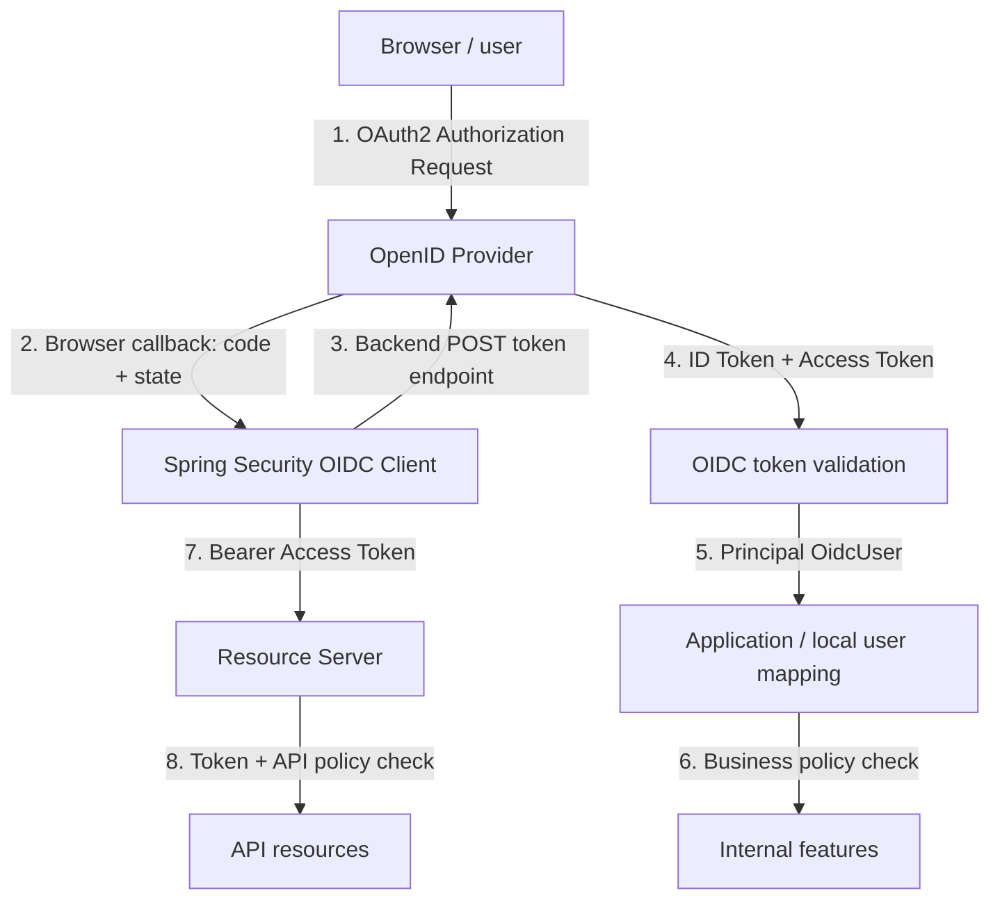
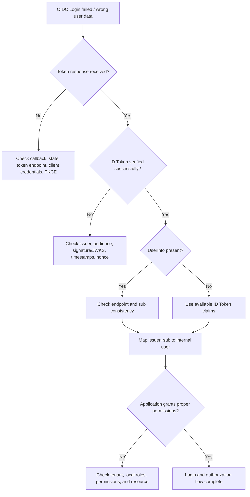

# 11.1. OidcIdToken, Claims, and Trust Boundaries

In a **Spring Security OAuth 2.0 / OpenID Connect (OIDC) Client** application, after completing the Authorization Code Flow, the OpenID Provider (OP) can return an **ID Token**. An ID Token is an authentication assertion intended for the **client that requested the login**: it states which identity provider authenticated which subject, for which client, and at what time. Spring Security represents this information with `OidcIdToken`, allowing the application to read OIDC claims through familiar Java APIs.

However, seeing a string that looks like a JWT, parsing JSON containing `sub`, or having an `OidcIdToken` object in code **is not enough to conclude that the data is trustworthy**. Trust is established only when the token passes through the proper verification flow: receiving the token from the expected provider, verifying the signature or agreed protection mechanism, checking issuer/audience/time/nonce constraints, and enforcing relevant OIDC conditions.

This lesson explains the structure of `OidcIdToken`, key claim groups, how Spring Security populates them into the user principal, and especially the **trust boundaries** between the browser, the OpenID Provider, the OAuth2 Client application, UserInfo, and the Resource Server. Understanding these boundaries helps prevent mistakes such as binding identities by email, mistakenly sending an ID Token to an API, or turning an unvalidated custom claim into administrative privileges.

## 1. What Is an ID Token and How Does It Differ from an Access Token?

OpenID Connect builds an identity layer on top of OAuth 2.0. When a client sends an authorization request with the `openid` scope, the token response of the OIDC Authorization Code Flow typically includes an `id_token`, alongside an `access_token` and possibly a `refresh_token`.

| Artifact | Primary Purpose | Who Is the Valid Recipient? |
|---|---|---|
| **ID Token** | Conveys authentication results and claims about the user to the OIDC Client | The OIDC Client application whose `client_id` matches the ID Token's audience |
| **Access Token** | Grants access to resources/APIs according to granted permissions | The Resource Server for which the access token was issued |
| **Refresh Token** | Requests a new access token according to the provider's grant and policy | The OAuth2 Client authorized to use the refresh token |
| **Session cookie** | Associates the browser with a session on the application | The application managing the session; not an OIDC token issued by the OP |

Example of a system consisting of an employee portal and a reporting API:

```text
Browser ----(redirect/login)----> OpenID Provider
   |                                 |
   | callback code                   | ID Token + Access Token
   v                                 v
Spring MVC BFF  <---- token endpoint response
   |
   | ID Token -> authenticates identity for the BFF
   | Access Token -> calls Reports API
   v
Reports Resource Server
```

An ID Token is usually a signed JWT, but its purpose is not "any JWT can be used to call an API." A Resource Server must receive a token with the right type, issuer, audience, and API policy. **Do not put an ID Token into the `Authorization: Bearer ...` header in place of an access token**, even if both the ID Token and access token are shaped like JWTs.

In a Backend for Frontend (BFF), the backend can keep the ID Token and access token on the server while the browser only uses a session cookie. The ID Token does not have to be passed back to browser JavaScript just to display the user's name.

## 2. OidcIdToken in the Spring Security Model

`OidcIdToken` is the Spring Security class representing an ID Token as a Java object. It carries:

- **`tokenValue`:** the raw ID Token string; this is a sensitive credential and must not be logged or displayed.
- **`issuedAt` and `expiresAt`:** the issuance and expiration timestamps of the token.
- **`claims`:** a key/value map, typically parsed from the JWT payload with corresponding Java types.

Key types in the OIDC Login flow:

| Spring Security Type | Role |
|---|---|
| `OidcIdToken` | Represents the ID Token and claims accessed via `IdTokenClaimAccessor`. |
| `OidcUser` | The OIDC principal recognized by the application after login; provides the ID Token, UserInfo (if present), and authorities. |
| `OidcUserInfo` | User information from the UserInfo endpoint or corresponding info object, which may supplement claims beyond the ID Token. |
| `OidcUserRequest` | Context used when loading user information: client registration, access token, and ID Token. |
| `OidcUserService` | Component that processes/loads OIDC user information after the ID Token verification step in the Spring Security flow. |
| `OidcIdTokenDecoderFactory` | Component that creates the decoder used to verify ID Tokens per client registration in the corresponding Spring Security versions. |
| `OAuth2AuthorizedClient` | Stores the client registration and access/refresh tokens so the client can call downstream APIs. |

`OidcIdToken` supports reading claims via the `IdTokenClaimAccessor` API, such as `getIssuer()`, `getSubject()`, `getAudience()`, or `getClaims()`. `getTokenValue()` returns the raw token string and should only be used when an explicitly designed integration requires it; most controllers and business logic only need the verified claims.

**Boundary point:** the constructor or parsing data into an `OidcIdToken` does not verify the signature by itself. The trustworthiness of the object depends on its origin and the flow that created it. An object manually constructed from untrusted data does not carry the same guarantees as an `OidcIdToken` inside an `OidcUser` produced by a valid `oauth2Login()` flow.

### 2.1. Example of Reading an ID Token After OIDC Login

In a Servlet controller, Spring Security can inject the authenticated principal:

```java
import java.net.URI;
import org.springframework.security.core.annotation.AuthenticationPrincipal;
import org.springframework.security.oauth2.core.oidc.OidcIdToken;
import org.springframework.security.oauth2.core.oidc.user.OidcUser;
import org.springframework.web.bind.annotation.GetMapping;
import org.springframework.web.bind.annotation.RestController;

@RestController
class AccountController {

    @GetMapping("/account/identity")
    IdentityView identity(@AuthenticationPrincipal OidcUser user) {
        OidcIdToken idToken = user.getIdToken();

        URI issuer = idToken.getIssuer();
        String subject = idToken.getSubject();

        return new IdentityView(
                issuer.toString(),
                subject,
                user.getFullName());
    }

    record IdentityView(String issuer, String subject, String displayName) {}
}
```

This snippet illustrates accessing claims from the principal **after Spring Security has completed OIDC Login**. Only apply this endpoint to authentications whose principal is of type `OidcUser`; applications that also allow form login or other authentication mechanisms need to design appropriate paths. In production, consider whether returning issuer/subject to the client is actually necessary or whether they should only be used for server-side user mapping. Do not return `idToken.getTokenValue()`.

### 2.2. OidcIdToken and OidcUser Are Not Synonymous

`OidcIdToken` carries the ID Token contents. `OidcUser` is the principal of a login session and can combine the ID Token with `OidcUserInfo`. Therefore:

```java
OidcIdToken token = user.getIdToken();
Map<String, Object> idTokenClaims = token.getClaims();
Map<String, Object> principalClaims = user.getClaims();
```

The two claim sets **are not necessarily identical** when UserInfo is used. If business logic requires a claim to originate from the **verified ID Token**, retrieve the claim from `user.getIdToken()`. If it is provided from UserInfo, you must understand the trustworthiness and contract of that endpoint rather than assuming every principal claim lives in the ID Token.

## 3. Structure of an ID Token

A typical ID Token uses the **JWT** format with three dot-separated JWS parts:

```text
BASE64URL(header).BASE64URL(payload).BASE64URL(signature)
```

The header specifies signing metadata such as the algorithm `alg` and key identifier `kid`. The payload contains the claims. The signature is verified using the appropriate key and algorithm from the provider. Depending on the OP, an ID Token may also be encrypted with JWE or follow a specific security profile; this example focuses on signed ID Tokens commonly seen in Spring Security OAuth2 Login.

An **illustrative payload with placeholder values**:

```json
{
  "iss": "https://idp.example.org/realms/company",
  "sub": "user-01b7f2",
  "aud": "portal-bff",
  "exp": 1795000000,
  "iat": 1794996400,
  "auth_time": 1794996380,
  "nonce": "random-nonce-for-this-authorization",
  "name": "Nguyen Example",
  "preferred_username": "nguyen.example",
  "email": "nguyen@example.org",
  "email_verified": true,
  "acr": "urn:example:assurance:employee",
  "amr": ["pwd", "otp"]
}
```

Do not treat the JSON example as a valid ID Token: it lacks a header/signature, the timestamps are illustrative, the issuer/client ID are synthetic, and it has not been verified. Simply parsing the payload or Base64URL-decoding does not prove the token was issued by the provider.

Common data types:

| Claim | Common Representation |
|---|---|
| `iss`, `sub`, `nonce`, `preferred_username` | JSON string |
| `aud` | JSON string or array of strings per the JWT spec |
| `exp`, `iat`, `auth_time` | NumericDate: seconds since the Unix epoch |
| `email_verified`, `phone_number_verified` | JSON boolean |
| `amr` | List of strings |
| `acr` | String describing the authentication level/context |

Spring Security's accessors help work with parsed claims. Avoid blindly casting from a raw `Map`: a provider may return a format different from the contract, optional claims may be absent, and `aud` is not always a single string.

## 4. Core Claims You Must Understand When Verifying an ID Token

### 4.1. `iss` — issuer

`iss` identifies **the issuer of the ID Token**. This value must match the expected issuer from `ClientRegistration` and the OP's metadata. Do not treat issuers as equivalent simply because they share the same hostname:

```text
https://idp.example.org/realms/employee
https://idp.example.org/realms/partner
```

These two URIs represent potentially different identity domains. The application must use the exact issuer configured for each registration. In multi-tenant systems, do not automatically trust an arbitrary `iss` self-declared by the token.

### 4.2. `sub` — subject

`sub` identifies the user subject at the issuer. This is the key claim used by the application to identify the logged-in user. `sub` can be an opaque value with no display meaning and is not necessarily an email or username.

**Account-linking identifier keys should usually be based on the (`iss`, `sub`) pair**. A `sub` value can appear in two different issuers and represent two different users. If an OP uses pairwise subject identifiers, the same user may have different `sub` values across different clients/sectors; the application must rely on the system's trusted account-linking policy.

Do not assume that `sub` is merely a username, and do not use `preferred_username` or `email` as a default long-term identifier instead.

### 4.3. `aud` — audience

`aud` contains the client ID (or audiences permitted by the protocol) for which the ID Token was issued. The OIDC Client must verify that **its own client ID** is in the audience. This check prevents application A from accepting an ID Token issued for application B.

Example:

```json
{
  "iss": "https://idp.example.org/realms/company",
  "sub": "user-123",
  "aud": ["portal-bff", "reporting-ui"],
  "azp": "portal-bff"
}
```

`aud` can be an array; `azp` is the authorized party, which matters in OIDC-defined cases, especially when multiple audiences are present. Accepting an ID Token must follow all audience/authorized party rules rather than only reading the first array element.

Do not confuse the `aud` of an **ID Token** (targeted at the client) with the audience of an **access token** (typically targeted at an API/Resource Server).

### 4.4. `exp`, `iat`, and Time Conditions

- `exp`: the expiration time of the ID Token; the token is no longer valid once past expiration according to the allowed clock-skew policy.
- `iat`: the time at which the token was issued; supports verifying timestamp sanity and custom policies.
- `nbf` (if present): the token must not be accepted before the specified time, depending on token type and validation mechanism.
- `auth_time` (if present/requested): the time when the user actually authenticated at the OP; especially important when the client requests `max_age` or needs proof of recent authentication.

Do not treat `iat` as `auth_time`: a token can be newly issued while the user still has an older SSO session at the provider. When an application requires recent authentication before a sensitive operation, it must design around the `auth_time`/`max_age` contract or the OP's step-up mechanism.

### 4.5. `nonce` — Binding the ID Token to the Authentication Request

In OIDC, a client can generate a random `nonce` for an Authorization Request, send it to the OP, and require the returned ID Token to contain the matching value. `nonce` helps prevent replay attacks and binds the token to the login attempt initiated by the client. It is **different** from OAuth 2.0's `state`:

| Value | Where Initiated/Used | Role |
|---|---|---|
| `state` | Authorization Request and authorization response/callback | Correlates the callback with the original request and protects against authorization flow forgery (CSRF). |
| `nonce` | Authorization Request and ID Token | Binds the ID Token to the authentication request and helps prevent replay. |
| `code_verifier` | Stored at the client and sent to the token endpoint when using PKCE | Proves that the party exchanging the code is the party that initiated the PKCE request. |

Do not use the same fixed constant string for `state`/`nonce` and do not skip nonce verification just because the token signature is valid. Whether `nonce` is required depends on the flow and protocol parameters; for the authorization-code flow, whether `nonce` is sent depends on choices and configuration, but **if a nonce was sent, its corresponding value must be verified**.

## 5. Additional Claims with Business Significance

An ID Token can also contain profile or authentication-assurance claims. They are useful, but they should not be elevated into business permissions without an explicit policy.

| Claim | Common Purpose | Boundary to Watch |
|---|---|---|
| `name`, `given_name`, `family_name` | Display name | Can change or be absent; do not use as an identity key. |
| `preferred_username` | Human-friendly login name | Can change per OP policy; not guaranteed globally unique. |
| `email` | Contact email address | Can change, be recycled, or be missing; do not automatically treat as a trusted account just because it appears. |
| `email_verified` | Indicates the OP verified the email according to the OP's process | Does not mean the user is allowed to join every organization or hold privileged roles. |
| `phone_number`, `phone_number_verified` | Contact information | Depends on scope/consent; limit storage and disclosure based on need. |
| `auth_time` | Actual authentication time | Used when recent authentication is required; must check time policy. |
| `acr` | Authentication Context Class Reference | Meaning depends on profile and agreement with the OP; do not assume "high acr means admin." |
| `amr` | Authentication Methods References | Describes the methods used, such as password/OTP; carries no universal access-control semantics. |
| `at_hash` | Hash value binding the access token in applicable OIDC flows | Requires validation per flow/algorithm when specified; not an API permission. |
| `c_hash` | Hash value binding the authorization code in applicable OIDC flows | Not always present in pure Authorization Code Flow. |
| Custom claims such as `groups`, `roles` | Organization or role info issued by the provider | Use only when the trust source, schema, audience, tenant, and permission mapping are clearly agreed upon. |

### 5.1. Why Email Is Not a Default Identity Key

Suppose two OpenID Providers both return:

```json
{
  "email": "employee@example.org",
  "email_verified": true
}
```

This **does not prove that both logins belong to the same internal account**. Each provider has its own verification process; emails can be reassigned or changed over time. Linking accounts across issuers requires an authorized, auditable process that protects against account takeover.

For an internal user table, a more controllable linking model is:

```text
local_user
    id
    display_name
    ...

external_identity
    local_user_id
    issuer
    subject
    linked_at
    ...

UNIQUE (issuer, subject)
```

The (`issuer`, `subject`) pair serves as the key for an external identity. Binding that identity to `local_user_id` is a **controlled business decision**, not automatically finding a user with the same email and logging them into that account.

### 5.2. `roles`/`groups` Claims Do Not Automatically Become Spring Authorities

An OP might issue:

```json
{
  "groups": ["report-readers", "finance"],
  "roles": ["manager"]
}
```

These claims have no uniform structure across providers. Spring Security does not by default treat every string in `roles` as a trusted `ROLE_*` for every system. If mapping to `GrantedAuthority` is needed, you must verify:

1. The claim comes from an **approved issuer and client registration**.
2. The claim has an agreed-upon schema and semantics; never read data sent directly by the browser.
3. Each group/role is mapped through an allowlist of permitted authorities, tenant boundaries, and application permissions.
4. Each API still checks specific permissions rather than treating the presence of an ID Token as sufficient.

For example, `groups=finance` may allow viewing the finance menu, but **does not by itself prove** the user is authorized to export reports for every department.

## 6. Trust Boundaries in OIDC Login

A trust boundary is the point at which data passes from one system or sender to another system with a different policy. Consider the flow:



| Boundary | Data Crossing | What Must Be Checked |
|---|---|---|
| Browser → application | Login URL, callback `code`/`state`, session cookie | State, stored Authorization Request, appropriate CSRF/session rules; do not trust query parameters or cookies as identity. |
| Application → OP | Token request including code, redirect URI, client authentication, PKCE verifier | Correct issuer/tenant endpoint, TLS, valid grant/client method, secret protection. |
| OP → application | ID Token, access token, metadata | Signature/algorithm, issuer, audience, timestamps, nonce, and OIDC conditions. |
| ID Token → principal | Claims placed by Spring into `OidcUser` | Token must be verified before trusting; understand ID Token vs. UserInfo claim sources. |
| Principal → internal account | `iss`, `sub`, profile attributes | Account-linking rules, tenant, user status, and business policy. |
| Client → Resource Server | Access token | Resource Server independently checks issuer, audience, expiration, scope/authority; do not accept ID Tokens as bearer access tokens. |

**The most important boundary:** The OpenID Provider asserts "subject `sub` was authenticated under the OP's conditions"; it **does not automatically assert** "this subject is an administrator of all data in your application." Internal access control must have its own policy.

### 6.1. The Browser Is Not a Trusted Identity Source

The browser can modify URLs, query parameters, local storage, and request bodies. Do not accept `sub`, `email`, or `roles` from the frontend and treat them as verified OIDC claims.

An unsafe mental model example:

```java
// Do not use browser-supplied parameters to assign identity!
@GetMapping("/admin")
String admin(@RequestParam String role) {
    if ("admin".equals(role)) {
        return "allowed";
    }
    return "denied";
}
```

The application must obtain `Authentication`/`OidcUser` from Spring Security after login and rely on its own policy for authorization, never taking client-declared roles. Even when a `roles` claim comes from a verified ID Token, the application still needs to validate the issuer/schema and map permitted authorities.

### 6.2. A Trusted Provider Still Has a Scope of Trust

Provider A may be trusted to authenticate employees, while provider B is only for partners. The fact that both return validly signed ID Tokens does not mean they are granted equal privileges. Registration, issuer, tenant, and allowed user populations are additional constraints.

In multi-tenant applications, users must be bound to the right organization according to the identity source. Do not rely solely on the `email` domain, because domains can be shared or changed.

### 6.3. UserInfo Is a Separate Source of Claims

OIDC allows the client to call the UserInfo endpoint with the access token to retrieve additional user information. The UserInfo response crosses a separate boundary:

```text
ID Token verified -> sub = user-123
UserInfo endpoint  -> sub = user-123, name, email, ...
```

According to OIDC, the `sub` in the UserInfo Response must match the `sub` in the ID Token; if they differ, the client **must not use** that UserInfo data. UserInfo data can supplement claims, but it does not replace ID Token verification. UserInfo must be fetched from the endpoint configured for the corresponding provider and obey TLS/token conditions.

Some display claims may appear in UserInfo while being absent from the ID Token. Do not assume `user.getClaims()` and `user.getIdToken().getClaims()` are always identical or that all of them came from a single JWT.

## 7. Where Does Spring Security Verify the ID Token?

In the Servlet `oauth2Login()` flow with `openid`, Spring Security coordinates the OAuth2 Login components, `OidcAuthorizationCodeAuthenticationProvider`, and the corresponding ID Token decoder/validator to verify the ID Token before building the OIDC principal. Applications usually **do not need to manually parse and verify signatures in controllers**.

```text
GET /login/oauth2/code/{registrationId}
       |
       v
OAuth2LoginAuthenticationFilter
       |
       +--> Look up and validate original Authorization Request
       |
       v
OAuth2 Authorization Code token exchange
       |
       v
ID Token received from token endpoint
       |
       v
OIDC ID Token verification/validation
       |  - signature/algorithm and keys
       |  - issuer, audience/clientId, exp, iat
       |  - nonce and other protocol conditions when applicable
       v
OidcUserService / OidcUser
       |
       v
Authentication -> SecurityContext
```

Core validation requirements:

1. **Accept only appropriate signing algorithms:** do not trust an `alg` self-declared by the token if it falls outside the client's policy. Only accept supported and configured algorithms/signatures.
2. **Verify the signature using keys for the right issuer:** public keys can be fetched from the provider's JWK Set URI; the key source must be restricted to trusted configuration, never fetched from an arbitrary URL specified inside the token.
3. **Verify exact `iss`:** the token must come from the OP configured for the registration.
4. **Verify `aud` and `azp` when applicable:** the ID Token must be intended for the current client and satisfy authorized-party constraints.
5. **Verify time validity:** `exp`, `iat`, and other time constraints per protocol/policy; system clocks must be synchronized.
6. **Verify `nonce` if sent:** a token must not be substituted for a token from a different authorization request.
7. **Verify other flow-specific OIDC conditions:** such as hash claims when present or required by the response/flow type.

Most security checks should be left to Spring Security through supported mechanisms. If an application writes a custom decoder/validator, the new policy must **add necessary checks**, not accidentally replace or drop standard validations.

### 7.1. Base64-Decoding the Payload Is Not Verification

A JWT payload can be decoded even if the signature has been tampered with. An example of flawed reasoning:

```java
// Trust-boundary mistake:
// 1) Receive an arbitrary JWT from the browser
// 2) Base64URL-decode the payload
// 3) Read "email" or "roles"
// 4) Allow login/admin access
```

A sender can craft a payload containing `"roles":["admin"]`. Only after the token is verified for the proper issuer, audience, signature, expiration, and OIDC context can its claims be used as identity assertions confirmed by the OP. Even then, application-level permissions must still be checked separately.

### 7.2. A JWT from Another Issuer Can Still Have a Valid Signature

Suppose a partner provider's token is completely validly signed, while the client is configured to log in via the employee issuer. If the application only checks "is the signature valid against some public key" without checking `iss`/`aud`, it could accept a token from the wrong trust domain.

In an OIDC Client, **issuer and audience are part of validation**, not two pieces of metadata to display after already trusting the token.

### 7.3. JWKS and Key Rotation

Providers typically publish a JWK Set containing public keys for clients to verify signatures. `kid` in the header helps select the right key, but it does not by itself prove the key is trustworthy. The JWK Set source must be tied to the configured OP over trusted TLS.

When a provider rotates its signing keys, Spring Security / the JWT decoder needs a mechanism to refresh keys according to the version and configuration support. If tokens suddenly fail verification after key rotation, check the metadata / JWK Set URI, cache, network connectivity, and signing algorithm. Never "fix" it by disabling signature verification.

## 8. Configuring OIDC Login to Use OidcIdToken

Example Servlet application with Spring Boot, Spring MVC, and OAuth2 Client:

```xml
<!-- Key dependencies in pom.xml -->
<dependency>
    <groupId>org.springframework.boot</groupId>
    <artifactId>spring-boot-starter-web</artifactId>
</dependency>
<dependency>
    <groupId>org.springframework.boot</groupId>
    <artifactId>spring-boot-starter-security</artifactId>
</dependency>
<dependency>
    <groupId>org.springframework.boot</groupId>
    <artifactId>spring-boot-starter-oauth2-client</artifactId>
</dependency>
```

```yaml
spring:
  security:
    oauth2:
      client:
        registration:
          company-login:
            provider: company
            client-id: "${OIDC_CLIENT_ID}"
            client-secret: "${OIDC_CLIENT_SECRET}"
            client-authentication-method: client_secret_basic
            authorization-grant-type: authorization_code
            redirect-uri: "{baseUrl}/login/oauth2/code/{registrationId}"
            scope:
              - openid
              - profile
              - email
        provider:
          company:
            issuer-uri: "https://idp.example.org/realms/company"
```

`issuer-uri` must match the actual issuer published by the OP in its metadata. If the provider supports OIDC discovery, Spring can fetch the necessary endpoints and JWK Set URI from metadata. In production, client ID/secret values should come from a controlled configuration source, and the callback URI must be registered accurately at the OP.

Servlet configuration:

```java
import org.springframework.context.annotation.Bean;
import org.springframework.context.annotation.Configuration;
import org.springframework.security.config.Customizer;
import org.springframework.security.config.annotation.web.builders.HttpSecurity;
import org.springframework.security.web.SecurityFilterChain;

@Configuration
class SecurityConfig {

    @Bean
    SecurityFilterChain securityFilterChain(HttpSecurity http) throws Exception {
        http
            .authorizeHttpRequests(authorize -> authorize
                .requestMatchers("/", "/error").permitAll()
                .anyRequest().authenticated()
            )
            .oauth2Login(Customizer.withDefaults());

        return http.build();
    }
}
```

With the `openid` scope and a valid OIDC provider, Spring Security uses the OIDC flow for login. Only after the token exchange, ID Token verification, and principal creation can the application access `OidcUser` through the security context.

**Do not manually construct an `OidcIdToken` from request parameters or a token sent by the frontend to substitute for a principal.** If your system receives JWTs from a browser or API caller via bearer authentication, that is a different boundary and authentication configuration (typically a Resource Server); you cannot arbitrarily misuse `oauth2Login()` to bypass token validation.

### 8.1. When There Is No ID Token

If an Authorization Server only supports OAuth 2.0 and does not support OIDC, or the registration does not request `openid`, the flow may be non-OIDC OAuth2 Login. In that case, the principal may be an `OAuth2User` and identity data comes from the provider's UserInfo/attributes; there is no `OidcIdToken` by default.

In an endpoint that serves only OIDC, state the authentication condition explicitly. If the application supports multiple login types, handle each principal type separately rather than casting `OAuth2User` to `OidcUser` without checking.

## 9. Mapping Verified Identity to an Internal Account

A business system typically has its own user table holding account status, organization, permission groups, and business data. An ID Token does not replace that data.

Example service building a linking identity key from the verified token:

```java
import java.net.URI;
import org.springframework.security.oauth2.core.oidc.OidcIdToken;
import org.springframework.security.oauth2.core.oidc.user.OidcUser;

record ExternalIdentity(URI issuer, String subject) {}

class IdentityMapping {
    ExternalIdentity identityOf(OidcUser principal) {
        OidcIdToken token = principal.getIdToken();
        return new ExternalIdentity(token.getIssuer(), token.getSubject());
    }
}
```

In a real application, this service must be called with an `OidcUser` from an authenticated Spring Security context, and looked up by (`issuer`, `subject`) in the internal database. If no link exists, decide whether to create a new account, require an invitation, or reject login based on policy.

Avoid designs such as:

```java
// Do not automatically use email as the internal login key!
String accountKey = principal.getEmail();
```

`getEmail()` can be useful for display or for proposing controlled account linking, but it is not universal proof of internal account ownership. When email matching is required, there must be a verification flow and handling for conflicts or email recycling.

### 9.1. Authorization Decisions Belong at the Application Layer

Example of a payroll-viewing feature:

```text
OIDC validation OK
  |
  v
issuer + subject -> internal user
  |
  v
user active? belongs to organization?
  |
  v
permission payroll.read for requested tenant?
  |
  v
allow or deny
```

Having an authenticated `OidcUser` only proves identity at the OP; it does not prove the user has permission to view payroll data. The application can use `@PreAuthorize`, service-level permission checks, and per-resource policies to make access decisions.

### 9.2. Customizing OidcUserService After Token Verification

When you need to link internal users or add authorities from an approved source, Spring Security lets you configure an `oidcUserService`:

```java
import org.springframework.context.annotation.Bean;
import org.springframework.security.oauth2.client.oidc.userinfo.OidcUserRequest;
import org.springframework.security.oauth2.client.oidc.userinfo.OidcUserService;
import org.springframework.security.oauth2.core.oidc.user.OidcUser;
import org.springframework.security.oauth2.client.userinfo.OAuth2UserService;

@Bean
OAuth2UserService<OidcUserRequest, OidcUser> mappedOidcUserService(
        LocalAccountLinker accountLinker) {

    OidcUserService delegate = new OidcUserService();

    return request -> {
        OidcUser user = delegate.loadUser(request);

        // Only use tokens that have passed through Spring's OIDC Login flow.
        String issuer = user.getIdToken().getIssuer().toString();
        String subject = user.getIdToken().getSubject();

        accountLinker.checkAllowedExternalIdentity(issuer, subject);
        return user;
    };
}
```

Then wire the service into `oauth2Login()`:

```java
http.oauth2Login(oauth2 -> oauth2
    .userInfoEndpoint(userInfo -> userInfo
        .oidcUserService(mappedOidcUserService)
    )
);
```

`LocalAccountLinker` is a **hypothetical** business interface/service in this example that must be implemented by the application; it can check the user, tenant, and account status or reject the login. The two snippets illustrate the integration approach and are not a ready-to-compile application without declaring the service and bean configuration.

If you need to add `GrantedAuthority` instances, implement a controlled mapping instead of turning a raw claim such as `groups` directly into privileges. Customizing the user service does not replace the signature and ID Token claim verification performed earlier by Spring Security.

## 10. ID Tokens Expire, but Sessions and Access Tokens Have Different Lifecycles

An ID Token having an `exp` does not mean the Spring Security session automatically disappears right at `exp` in every configuration. The session cookie, `SecurityContext`, authorized client, access token, and refresh token each have their own lifecycle.

Example:

```text
09:00  OIDC Login completes; ID Token exp = 10:00
09:30  Access token is refreshed by the authorized client mechanism
10:00  Initial ID Token expires
10:05  Web session may still exist per session policy
```

These timestamps are illustrative only. ID Token validity must be checked when the client accepts the token as authentication evidence. However, **requiring reauthentication/step-up for a new action** is a separate policy: for instance, the application might require the user to have authenticated within the past 5 minutes before changing payment details.

To enforce recent authentication, the application can use a policy based on `auth_time`/`max_age` or the OP's step-up authentication features, combined with application-side checks. Do not use the issuance time `iat` as proof that the user just entered a password/MFA.

### 10.1. When the Access Token Expires

The access token is used to call downstream APIs; when it expires, `OAuth2AuthorizedClientManager` or corresponding components can use the refresh token if one was issued and policy allows. Refreshing an access token does not mean the user just re-authenticated at the OP, nor does it necessarily yield a new ID Token.

Do not infer from an unexpired ID Token that the access token has sufficient scopes/audience to call an API. Conversely, having a valid refresh token does not elevate the user's authentication assurance level.

## 11. ID Token vs. Resource Server: Two Different Sides of Verification

A Spring application can be both an OAuth2 Client and a Resource Server, but these are two independent roles:

| Question | OIDC Client (`oauth2Login`) | Resource Server (`oauth2ResourceServer`) |
|---|---|---|
| Where is the token received from? | Token endpoint after authorization-code exchange | HTTP request to an API, usually via `Authorization: Bearer` |
| Primary token type to validate? | **ID Token** to authenticate the user to the client | **Access Token** to decide whether the request may call the API |
| Expected audience? | Client ID of the OIDC Client | Audience/resource accepted by the API |
| Typical outcome? | `OidcUser` principal and login session | `Authentication` for the API request, usually based on a JWT/opaque token |
| Ultimate purpose? | Establish login identity | Protect resources/APIs and enforce authorization |

Do not configure an API to accept another application's ID Token simply because that token has a valid signature. Their `aud`, intended purpose, and token profiles differ. An API should be configured to verify access tokens intended for it, even in systems where both tokens share the same issuer.

## 12. Diagnosing ID Token Verification Errors

| Symptom | Possible Cause | Troubleshooting Direction |
|---|---|---|
| `invalid_id_token` or validation error after token response | Missing ID Token when `openid` was requested, malformed ID Token / invalid signature / invalid claims | Inspect the token response and OP metadata with sensitive data redacted. |
| Issuer mismatch | Misconfigured `issuer-uri`, wrong realm/tenant, metadata does not match token | Compare the issuer in configuration/metadata with `iss`; do not disable the check. |
| Audience mismatch | Token issued for a different client ID or wrong registration | Check `client-id`, `aud`, and `azp` when applicable. |
| Signature/JWK verification failed | Wrong JWK Set URI, OP key rotation, TLS/cache error, disallowed algorithm | Check metadata, signing keys, and algorithm policy; never allow `alg=none` just to make it work. |
| Token expired | `exp` has passed, excessive clock skew, or wrong time configuration | Synchronize clocks, inspect allowed clock skew and elapsed time between issuance and processing. |
| Nonce mismatch | Original request lost or nonce not preserved properly | Check session, Authorization Request repository, custom resolvers, and callback flow. |
| UserInfo subject mismatch | UserInfo `sub` differs from ID Token `sub` | Reject the mismatched UserInfo data; inspect the provider/endpoint/access token. |
| `OidcUser` has empty `email` | Scope/consent does not grant email, provider omits some claims, or data is missing | Check the claims contract and handle missing data; do not turn email into a mandatory identifier if unnecessary. |
| `roles` claim present but `@PreAuthorize` denies access | Claim has not been mapped to authorities or application policy denies access | Define the schema and controlled authority mapping; keep API-side authorization intact. |
| Login succeeds, downstream API call returns 401/403 | Wrongly sending the ID Token, or access token lacks audience/scope | Use the right authorized client / access token; check the Resource Server. |
| An internal account was "taken over" after an email change | Identity linked by email instead of issuer+subject | Use external identity mapping and a controlled linking process. |

### 12.1. Stage-by-Stage Triage



This workflow helps distinguish failures in **token exchange**, **OIDC cryptographic validation**, **UserInfo**, **identity linking**, and **business authorization**. Do not change `client-secret`, issuer, and role mapping all at once before identifying which stage failed.

### 12.2. Safe Observability

To investigate failures in production, logs/traces can include:

- `registrationId`, environment, processing step name, and categorized error code.
- The **expected** issuer and configured provider/tenant name; avoid logging the received issuer if it may contain untrusted data.
- Server-generated transaction ID or correlation ID.
- Key rotation/discovery error details, without private keys or token contents.

Do not log **raw ID Tokens, Access Tokens, Refresh Tokens, authorization codes, client secrets, PKCE verifiers, or session cookies**. Avoid dumping full JWT claims because they may contain emails, names, phone numbers, and sensitive attributes.

## 13. Real-World Scenario: Corporate and Partner Logins

Suppose a contract management application supports two registrations:

```yaml
spring:
  security:
    oauth2:
      client:
        registration:
          employee:
            provider: corporate
            client-id: "${EMPLOYEE_CLIENT_ID}"
            client-secret: "${EMPLOYEE_CLIENT_SECRET}"
            authorization-grant-type: authorization_code
            scope: [openid, profile, email]
          partner:
            provider: partners
            client-id: "${PARTNER_CLIENT_ID}"
            client-secret: "${PARTNER_CLIENT_SECRET}"
            authorization-grant-type: authorization_code
            scope: [openid, profile]
        provider:
          corporate:
            issuer-uri: "https://idp.example.org/realms/employees"
          partners:
            issuer-uri: "https://idp.partner.example.org/realms/partners"
```

When a user logs in via `employee`, the token might contain:

```json
{
  "iss": "https://idp.example.org/realms/employees",
  "sub": "u-001",
  "aud": "employee-portal-client",
  "email": "person@example.org"
}
```

A user logging in via `partner` could also present the same email or the same `sub`, but issued by a different issuer. The application must:

1. Verify that the ID Token matches the issuer, audience, and policy of the registration used.
2. Construct the external identity key from **`(iss, sub)`**.
3. Map the external identity to a local user under separate policies for employees and partners.
4. Check permission groups: employees can view internal contracts, while partners can only view shared contracts.
5. When calling APIs, use an access token matching the Resource Server and permissions; do not send the ID Token instead.

This scenario illustrates three independent checks: **whom the OP authenticated**, **which internal account the application recognizes**, and **what that account is allowed to do**. A valid ID Token only solves the first part while supplying the data needed to perform the second part.

## 14. Common Mistakes

1. **Using email as a long-term user ID:** emails can change or be recycled; prefer the (`iss`, `sub`) key.
2. **Trusting a JWT just because its payload decodes:** decoding does not verify signature, issuer, audience, or expiration.
3. **Trusting any token signed by any provider in a list:** each registration must restrict accepted issuers, audiences, and tenants.
4. **Sending an ID Token to an API as an access token:** Resource Servers require an access token issued for the API.
5. **Ignoring `nonce` and `state`:** these bind different stages of the OIDC flow.
6. **Treating `email_verified` as a business permission:** OP email verification does not prove permission to access organizational data.
7. **Converting `groups` into admin rights without an allowlist:** custom claims depend on the issuer and schema; map them through internal policy.
8. **Confusing ID Token `exp` with session expiration:** token lifetime, login session, and reauthentication policy are distinct concepts.
9. **Assuming every claim in `OidcUser` comes from the ID Token:** UserInfo can supplement data.
10. **Disabling signature/issuer/audience validation on errors:** fix metadata, clocks, keys, or issuer configuration rather than removing security guardrails.

## 15. Review Questions

1. What kinds of information does `OidcIdToken` contain, and why does instantiating it directly not verify its signature?
2. How do an ID Token and an access token differ in intended recipient, usage purpose, and audience validation?
3. Why is the (`iss`, `sub`) pair usually safer than `email` for linking internal accounts?
4. When `aud` has multiple values, what is the role of the `azp` claim during OIDC validation?
5. How do `iat` and `auth_time` differ when an application requires reauthentication before a sensitive action?
6. Which stages of the Authorization Code Flow do `state`, `nonce`, and `code_verifier` protect?
7. Why might `user.getClaims()` differ from `user.getIdToken().getClaims()`?
8. Is a validly signed ID Token from a partner issuer enough for the application to trust it as an employee identity? Why or why not?
9. Once Spring Security OIDC Login has created an `OidcUser`, what additional checks must the application perform before allowing the user to read financial reports?
10. When OIDC Login succeeds but an API returns 403, why should you inspect the access token and Resource Server policy rather than modifying the ID Token?

## References

- [OpenID Connect Core 1.0 — ID Token](https://openid.net/specs/openid-connect-core-1_0.html#IDToken)
- [OpenID Connect Core 1.0 — ID Token Validation](https://openid.net/specs/openid-connect-core-1_0.html#IDTokenValidation)
- [OpenID Connect Core 1.0 — UserInfo Response Validation](https://openid.net/specs/openid-connect-core-1_0.html#UserInfoResponse)
- [RFC 7519 — JSON Web Token (JWT)](https://datatracker.ietf.org/doc/html/rfc7519)
- [RFC 7636 — Proof Key for Code Exchange (PKCE)](https://datatracker.ietf.org/doc/html/rfc7636)
- [Spring Security Reference — OAuth2 Login (Servlet)](https://docs.spring.io/spring-security/reference/servlet/oauth2/login/core.html)
- [Spring Security Reference — OAuth2 Login Advanced Configuration](https://docs.spring.io/spring-security/reference/servlet/oauth2/login/advanced.html)
- [Spring Security API — OidcIdToken](https://docs.spring.io/spring-security/reference/api/java/org/springframework/security/oauth2/core/oidc/OidcIdToken.html)
- [Spring Security API — OidcUser](https://docs.spring.io/spring-security/reference/api/java/org/springframework/security/oauth2/core/oidc/user/OidcUser.html)
