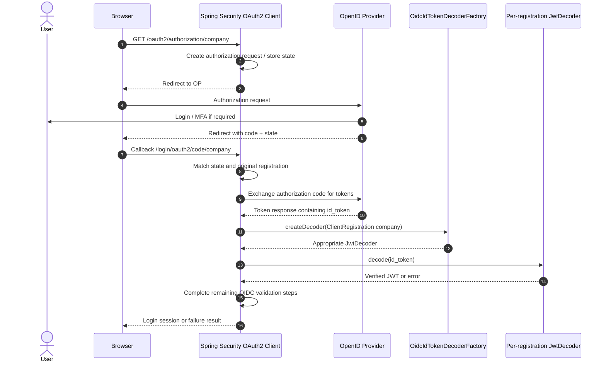
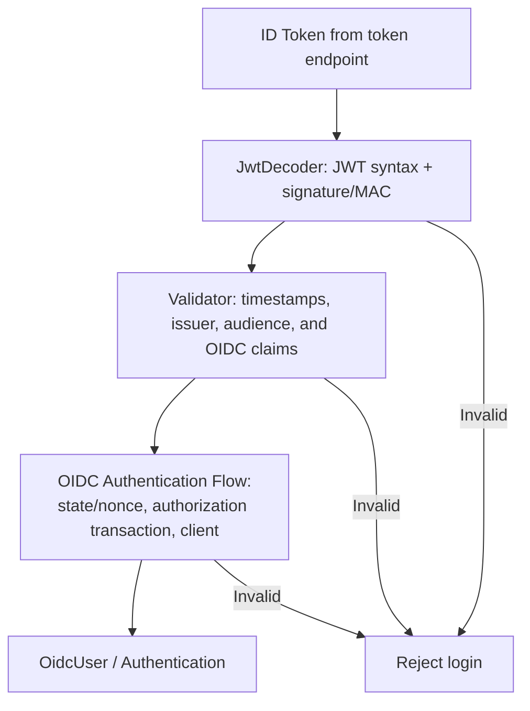
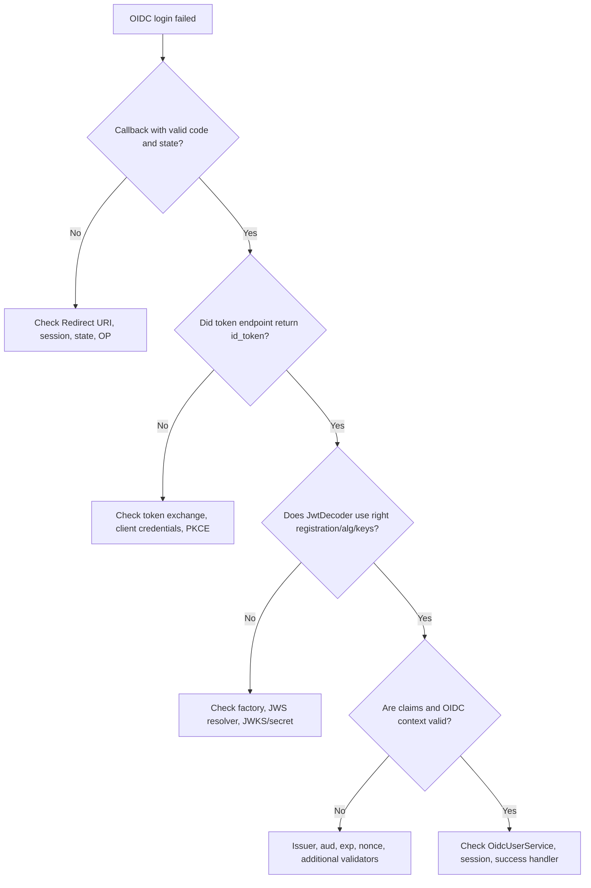

# 11.2. OidcIdTokenDecoderFactory and Per-Registration JwtDecoder Selection

A Spring Boot application may allow users to log in through multiple **OpenID Providers (OP)**: an internal SSO system, a partner, and another identity provider. Each provider may use a different **issuer**, **signature verification key set**, **client ID**, and **ID Token signing algorithm**. Therefore, when receiving an ID Token from the token endpoint, the application must select a JWT decoder and validator **matching the exact client registration that initiated the login transaction**.

In Spring Security OAuth 2.0 / OIDC Client (Servlet), the central component for making this selection is **`OidcIdTokenDecoderFactory`**. It implements `JwtDecoderFactory<ClientRegistration>` and supplies a `JwtDecoder` corresponding to the client configuration. The factory keeps ID Token verification logic within the right OIDC login context, especially when multiple registrations exist.

The goal of this lesson is to understand the exact place of the factory in the Authorization Code + OIDC Flow, how Spring Security selects a `JwtDecoder`, how to customize JWS algorithms and validators per registration, and how to avoid misconfigurations that cause valid ID Tokens to be rejected or tokens from the wrong source to be accepted.

> Examples use common Spring Security 6.x/7.x APIs on the **Servlet stack**. Paths, issuers, registration names, and keys in the examples are illustrative only. When applying them to a project, check the API documentation for the exact Spring Security version in use.

## 1. How Are ID Token, JwtDecoder, and ClientRegistration Related?

In **OpenID Connect (OIDC)**, an **ID Token** is a JWT containing claims about the user authentication event at the OP, issued for a specific client. In the Authorization Code Flow, the OAuth2 Client backend normally receives the ID Token from the **token endpoint** after exchanging the authorization code.

A signed ID Token has a three-part structure:

```text
BASE64URL(header).BASE64URL(payload).BASE64URL(signature)
```

A compact example, solely for illustrating the structure:

```json
// JOSE header (illustrative)
{
  "alg": "RS256",
  "typ": "JWT",
  "kid": "key-2026-11"
}

// Payload/claims (illustrative)
{
  "iss": "https://id.example.test/realms/company",
  "sub": "user-123",
  "aud": "company-web-client",
  "iat": 1790000000,
  "exp": 1790003600,
  "nonce": "nonce-from-authorization-request"
}
```

**An ID Token cannot be validated merely by Base64URL-decoding to read its payload.** The application must verify the signature/MAC, validate claims, and bind the result to the login request that was initiated.

Three related types:

| Component | Role | When Used |
| --- | --- | --- |
| **`ClientRegistration`** | OAuth2/OIDC client configuration: `registrationId`, `clientId`, client secret, issuer/JWK Set URI, token endpoint, scopes, etc. | When preparing the authorization request and when processing the ID Token |
| **`JwtDecoder`** | Decodes a JWT and performs signature/MAC verification and claim validation per validator configuration | When processing a JWT received from the OP |
| **`JwtDecoderFactory<ClientRegistration>`** | Creates/provides a `JwtDecoder` tailored to a specific registration | During the OIDC authentication process |

**`OidcIdTokenDecoderFactory` is a built-in implementation of `JwtDecoderFactory<ClientRegistration>`.** The factory does not represent the ID Token; it creates the decoder that the OIDC authentication layer will use.

## 2. Where the Factory Fits in the Servlet Login Flow

Suppose a user chooses to log in with `company`:

```text
GET /oauth2/authorization/company
```

Spring Security creates an authorization request based on `ClientRegistration(company)`, stores `state` and correlation information, and redirects the browser to the OP. After authentication, the OP sends the browser back to:

```text
GET /login/oauth2/code/company?code=...&state=...
```

Here, `OAuth2LoginAuthenticationFilter` restores the original authorization request and coordinates authentication. When this is an OIDC login, `OidcAuthorizationCodeAuthenticationProvider` and related components perform the token exchange and process the ID Token.



The diagram shows **logical responsibilities**. Actual calls across the authentication manager/provider, decoder, converter, and validator may be encapsulated within the framework; typical application code does not need to call `createDecoder(...)` directly during login.

Key takeaway: **the registration is determined from the initial authorization transaction and client configuration**, rather than arbitrarily chosen from unverified ID Token contents.

### 2.1. The Factory Does Not Handle the Entire OIDC Flow

`OidcIdTokenDecoderFactory` focuses on providing the decoder for the ID Token. Other responsibilities belong to other components:

- **`OAuth2AuthorizationRequestRedirectFilter`**: initiates authorization and redirects the browser.
- **`AuthorizationRequestRepository`**: stores the initial request and correlation context.
- **`OAuth2LoginAuthenticationFilter`**: receives the callback.
- **`OidcAuthorizationCodeAuthenticationProvider`**: coordinates OIDC authentication after token exchange and invokes the decoder factory.
- **`OidcIdTokenValidator`**: validates ID Token claims in the client context.
- **`OidcUserService`**: constructs the OIDC principal and may query UserInfo if needed.
- **`SecurityContext`**: holds the user's `Authentication` after successful login.

Do not write a custom callback controller to parse a JWT and call `SecurityContextHolder` while bypassing these validation steps.

## 3. Why Select a JwtDecoder Per Registration?

A multi-provider application may receive ID Tokens that look identical in JWT format but have **different trust and validity conditions**.

Example:

| Registration | Client ID at OP | Issuer | Expected ID Token Algorithm | Key Source |
| --- | --- | --- | --- | --- |
| `company` | `company-web` | `https://id.example.test/realms/company` | `RS256` | Internal OP's JWKS |
| `partner` | `partner-web` | `https://login.partner.example.test/tenant` | `RS256` | Partner OP's JWKS |
| `legacy-mac` | `legacy-web` | `https://legacy-id.example.test` | `HS256` by agreement | Corresponding client secret |

A decoder configured for `company` is not automatically suitable for `partner`:

1. Signature verification keys may come from a **different JWK Set URI**.
2. The `iss` claim must be verified in the **selected OP context**, not just against any trusted issuer.
3. The `aud` claim must correspond to the **client ID receiving the ID Token**.
4. Allowed JWS algorithms may differ across clients.
5. Some clients enforce additional claim requirements, such as `acr` or a tenant claim supplied by the OP.

Thus, **`ClientRegistration` is the contextual input** for creating an appropriately configured decoder. If you use a single shared decoder that only checks whether a JWT "has a valid signature somewhere," the application risks confusing issuers, confusing audiences, or accepting a token outside the expected transaction.

### 3.1. Do Not Use the JWT Header to Decide the Registration

A JWT header might contain:

```json
{
  "alg": "HS256",
  "kid": "some-key"
}
```

However, the header contents are unverified at the moment the decoder is selected. If an application automatically decides "whatever algorithm the token claims, accept that algorithm," an attacker can exploit **algorithm confusion** or force the application to use a weaker verification mechanism.

In Spring Security, **`setJwsAlgorithmResolver` receives `ClientRegistration`**, not the raw token header to trust arbitrarily. The application should return an algorithm **permitted by the trusted client configuration**.

## 4. Core API of OidcIdTokenDecoderFactory

Full type:

```java
package org.springframework.security.oauth2.client.oidc.authentication;

public final class OidcIdTokenDecoderFactory
        implements JwtDecoderFactory<ClientRegistration> {
    // Public methods illustrated below.
}
```

Factory method:

```java
JwtDecoder createDecoder(ClientRegistration clientRegistration)
```

Key extension points:

| API | Effect | When Needed |
| --- | --- | --- |
| `createDecoder(ClientRegistration)` | Creates/provides a decoder in the registration context | Called by the framework during OIDC login |
| `setJwsAlgorithmResolver(Function<ClientRegistration, JwsAlgorithm>)` | Selects the expected signature/MAC algorithm per client | Provider uses a non-default algorithm |
| `setJwtValidatorFactory(Function<ClientRegistration, OAuth2TokenValidator<Jwt>>)` | Selects the claim validator per client | Need to add/adjust claim validation rules |
| `setClaimTypeConverterFactory(...)` | Converts incoming claim data types per registration | Claims at an OP require additional type-conversion rules |
| `createDefaultClaimTypeConverter()` | Creates the default claim-type converter, useful when writing a custom decoder factory | Building your own decoder while preserving proper OIDC type conversion |

**Default behaviors to remember:**

- The expected JWS algorithm is **`RS256`**.
- The default validator combines **`JwtTimestampValidator`** and **`OidcIdTokenValidator`**.
- The default claim-type converter ensures claims have representations matching how Spring Security consumes them.
- The factory builds decoders based on **client registration** rather than forcing the application to map one fixed decoder for all OPs.

Every customization has security implications. In particular, when replacing `jwtValidatorFactory`, preserve the appropriate OIDC and timestamp checks; never let a custom validator check only a custom claim while accidentally dropping mandatory checks.

## 5. Simple Case: A Single OIDC Registration Using RS256

Most new systems do not need to declare a custom `OidcIdTokenDecoderFactory` bean. If the OP uses RSA signatures such as `RS256` and has a valid OIDC configuration, Spring Security provides a default decoder mechanism for the OAuth2 Login flow.

Example `application.yml`:

```yaml
spring:
  security:
    oauth2:
      client:
        registration:
          company:
            provider: company
            client-id: ${COMPANY_CLIENT_ID}
            client-secret: ${COMPANY_CLIENT_SECRET}
            authorization-grant-type: authorization_code
            redirect-uri: "{baseUrl}/login/oauth2/code/{registrationId}"
            scope:
              - openid
              - profile
              - email

        provider:
          company:
            issuer-uri: https://id.example.test/realms/company
```

When the OP provides valid OIDC discovery, the metadata typically includes `authorization_endpoint`, `token_endpoint`, `jwks_uri`, and the provider's algorithm capabilities.

Basic `SecurityFilterChain` configuration:

```java
import org.springframework.context.annotation.Bean;
import org.springframework.context.annotation.Configuration;
import org.springframework.security.config.Customizer;
import org.springframework.security.config.annotation.web.builders.HttpSecurity;
import org.springframework.security.web.SecurityFilterChain;

@Configuration
class LoginSecurityConfig {

    @Bean
    SecurityFilterChain securityFilterChain(HttpSecurity http) throws Exception {
        return http
            .authorizeHttpRequests(auth -> auth
                .requestMatchers("/", "/error").permitAll()
                .anyRequest().authenticated())
            .oauth2Login(Customizer.withDefaults())
            .build();
    }
}
```

The login flow starts at:

```text
/oauth2/authorization/company
```

Upon a successful callback, Spring Security receives the ID Token in the token response and verifies it according to the registration. **There is no need to manually read an ID Token from callback query parameters or create a `JwtDecoder` in a controller.**

### Requirements for the Default Case to Work

- The registration includes the `openid` scope to trigger OIDC login in the proper context.
- `client-id` and issuer are configured accurately.
- The OP issues an ID Token with a compatible signature and exposes a public key / JWKS source reachable by the client.
- The callback URI is registered accurately at the OP; `state` correlation and the session remain intact.
- The system clock and token timestamps are consistent enough to pass validation.

If any of these conditions fail, merely changing the JWS algorithm usually will not fix the error.

## 6. Configuring Multiple Registrations with Different Algorithms

Suppose the same application supports:

- `company`, an internal OP signing ID Tokens with `RS256`.
- `partner`, a partner OP also using `RS256` but with a different issuer/JWKS/client ID.
- `legacy-mac`, a legacy OP agreed to use `HS256` with the client secret as the MAC key.

Registration configuration:

```yaml
spring:
  security:
    oauth2:
      client:
        registration:
          company:
            provider: company
            client-id: ${COMPANY_CLIENT_ID}
            client-secret: ${COMPANY_CLIENT_SECRET}
            authorization-grant-type: authorization_code
            redirect-uri: "{baseUrl}/login/oauth2/code/{registrationId}"
            scope: openid, profile

          partner:
            provider: partner
            client-id: ${PARTNER_CLIENT_ID}
            client-secret: ${PARTNER_CLIENT_SECRET}
            authorization-grant-type: authorization_code
            redirect-uri: "{baseUrl}/login/oauth2/code/{registrationId}"
            scope: openid, email

          legacy-mac:
            provider: legacy
            client-id: ${LEGACY_CLIENT_ID}
            client-secret: ${LEGACY_CLIENT_SECRET}
            authorization-grant-type: authorization_code
            redirect-uri: "{baseUrl}/login/oauth2/code/{registrationId}"
            scope: openid

        provider:
          company:
            issuer-uri: https://id.example.test/realms/company
          partner:
            issuer-uri: https://login.partner.example.test/tenant
          legacy:
            issuer-uri: https://legacy-id.example.test
```

Each registration has a distinct `registrationId` while sharing the callback pattern. They are selected via the initiation URL:

```text
/oauth2/authorization/company
/oauth2/authorization/partner
/oauth2/authorization/legacy-mac
```

**Do not treat `client-secret` as a shared key across all registrations.** With HS256, the MAC key must be tied to the exact client registered at the OP and must meet the algorithm's strength/length requirements. Do not copy the `company` secret to verify tokens for `legacy-mac`.

## 7. Selecting the JWS Algorithm Per Registration

Spring Security lets you set a **`Function<ClientRegistration, JwsAlgorithm>`**. The factory calls the resolver with the identified `ClientRegistration` to determine the **allowed** ID Token algorithm.

Example bean:

```java
import org.springframework.context.annotation.Bean;
import org.springframework.context.annotation.Configuration;
import org.springframework.security.oauth2.client.oidc.authentication.OidcIdTokenDecoderFactory;
import org.springframework.security.oauth2.client.registration.ClientRegistration;
import org.springframework.security.oauth2.client.JwtDecoderFactory;
import org.springframework.security.oauth2.jose.jws.MacAlgorithm;
import org.springframework.security.oauth2.jose.jws.SignatureAlgorithm;

@Configuration
class IdTokenDecoderConfig {

    @Bean
    JwtDecoderFactory<ClientRegistration> idTokenDecoderFactory() {
        OidcIdTokenDecoderFactory factory = new OidcIdTokenDecoderFactory();

        factory.setJwsAlgorithmResolver(registration -> {
            String id = registration.getRegistrationId();

            if ("legacy-mac".equals(id)) {
                return MacAlgorithm.HS256;
            }

            if ("company".equals(id) || "partner".equals(id)) {
                return SignatureAlgorithm.RS256;
            }

            throw new IllegalArgumentException(
                "Unexpected OIDC registration: " + id);
        });

        return factory;
    }
}
```

Whenever a decoder is needed, the factory has full context to apply the corresponding algorithm:

| `registrationId` | Resolver Returns | Verification Method |
| --- | --- | --- |
| `company` | `SignatureAlgorithm.RS256` | RSA signature, internal OP's public key |
| `partner` | `SignatureAlgorithm.RS256` | RSA signature, partner OP's public key |
| `legacy-mac` | `MacAlgorithm.HS256` | HMAC MAC, corresponding registration's client secret |

**This example illustrates a case where HS256 is genuinely needed.** If all OPs already sign ID Tokens with `RS256` as required, there is no need to override the resolver just to repeat the default.

### 7.1. Explanation of Classes and Methods

- **`JwtDecoderFactory<ClientRegistration>`**: interface allowing Spring Security to create a `JwtDecoder` from a registration.
- **`OidcIdTokenDecoderFactory`**: built-in implementation.
- **`setJwsAlgorithmResolver(...)`**: maps client configuration to the expected algorithm.
- **`SignatureAlgorithm.RS256`**: verifies JWS using an RSA-SHA256 signature.
- **`MacAlgorithm.HS256`**: verifies JWS using HMAC-SHA256 with a symmetric key.
- **`getRegistrationId()`**: logical key declared under `spring.security.oauth2.client.registration.*`.

Using a `switch` on the registration ID is also fine if your Java version supports it. The design rule is **never return an arbitrary algorithm based on an unverified JWT header**.

### 7.2. What Not to Do with the Resolver

Do not write logic like:

```java
// Dangerous idea: never use the token header to automatically decide trust.
JwsAlgorithm selected = algorithmClaimedByUntrustedJwtHeader;
```

The header is data produced by the token sender. The decoder must verify the token based on the **algorithm configured** for the client. If a library is configured to accept any algorithm from the header, the trust boundary is weakened.

Do not fall back to returning `MacAlgorithm.HS256` just because RSA signature verification failed. **An RS256 verification failure must result in an error**, not trying a different algorithm family to "rescue" the login.

### 7.3. How HS256 Uses the Secret

For MAC algorithms (such as `HS256`), Spring Security uses the **client secret matching `client-id`** as the symmetric key to verify the ID Token. This is appropriate only when the OP is configured to issue ID Tokens with that MAC algorithm for this client.

Unlike RS256:

- **RS256**: the OP holds the private key; the client fetches trusted public keys via JWKS to verify.
- **HS256**: both the OP and the client share the same key; the client uses its secret to verify the MAC.
- Never expose the client secret to the browser.
- Never use HS256 for a public client that cannot protect a secret.
- Never generate weak secrets or reuse secrets across multiple clients.

If an OP states it only supports `RS256` yet the decoder reports a token using `HS256`, investigate the configuration/token-source mismatch rather than blindly accepting HS256.

## 8. How the Decoder Uses Public Keys and JWKS

For asymmetric signature algorithms such as `RS256`, the OP typically publishes a **JWK Set URI** in its metadata:

```json
{
  "issuer": "https://id.example.test/realms/company",
  "jwks_uri": "https://id.example.test/realms/company/protocol/openid-connect/certs"
}
```

A JWK Set may contain multiple public keys:

```json
{
  "keys": [
    {
      "kty": "RSA",
      "kid": "current-key",
      "use": "sig",
      "alg": "RS256",
      "n": "...",
      "e": "AQAB"
    }
  ]
}
```

The `n` value here is just an illustrative placeholder. In practice, it must be a valid RSA key modulus component.

Basic steps:

1. Spring Security obtains the issuer and provider details from **`ClientRegistration`**.
2. The decoder uses the configured key/JWKS source or retrieves it from appropriate discovery metadata.
3. When validating a JWT, the decoder selects the matching key, typically using `kid` and key attributes from the trusted key set.
4. The decoder verifies the signature according to the allowed algorithm.
5. The validator verifies claims according to the client registration.

**`kid` is not a URL for the decoder to fetch dynamically.** It is a key identifier within an already-trusted key set. Never allow an unverified token to specify an arbitrary JWKS endpoint to download new keys.

### 8.1. Key Rotation

An OP can rotate keys: adding a new public key, starting to sign with the new private key, and later retiring the old key on schedule. A new `kid` in the JWT header is a normal sign during this process.

The application should:

- Use the official JWKS endpoint of the configured issuer.
- Let the library manage key caching/refreshing within reasonable bounds.
- Monitor JWKS fetch errors, missing `kid` errors, and signature verification failures.
- Coordinate rotation schedules with the OP when changes have major impact.
- Never skip signature verification just to "get login working temporarily."

A failure while fetching JWKS is not the same as an audience mismatch: they require different diagnostic approaches.

## 9. ID Token Validation Is More Than Signature Verification

A token with a valid signature but invalid claims must still be rejected as login evidence for the client.

Core claims in an ID Token:

| Claim | Meaning | How It Must Be Constrained |
| --- | --- | --- |
| `iss` | Issuer that issued the ID Token | Must match the OP/issuer configured for the registration |
| `sub` | Subject identifier at the issuer | Must be present per OIDC rules; do not assume it is globally unique across OPs |
| `aud` | Audience of the ID Token | Must contain the `client_id` of the current registration |
| `exp` | Expiration time | Token must still be valid within acceptable clock skew |
| `iat` | Issued-at time | Must not violate checked timestamp rules |
| `nonce` | Binds token to authentication request when used | Must be verified against the original authorization request |
| `azp` | Authorized party in multi-audience scenarios | Must satisfy OIDC rules and client context |
| `acr`, `amr` | Authentication level/method info when returned | Apply business policy only when agreed with the OP |

**`OidcIdTokenValidator`** is Spring Security's dedicated validator for ID Token claims in a `ClientRegistration` context. Per the Spring Security API, the factory's default validator is built from **`JwtTimestampValidator` and `OidcIdTokenValidator`**.

`state` correlation and OIDC `nonce` checks belong to the **entire login flow**; never assume that simply calling `JwtDecoder.decode(...)` outside the authentication flow provides the same context to verify all relationships with the authorization request.

### 9.1. Layered Trust Levels



Verifying the signature only answers "was this JWT signed with a trusted key using the given algorithm?" Answering "can this JWT be used to log in to **this client, in this transaction**?" requires additional issuer, audience, expiration, and correlation checks.

### 9.2. An Example of a Token Rejected Despite a Valid Signature

`partner` and `company` both trust some public-key publishing system, yet the ID Token contains:

```json
{
  "iss": "https://id.example.test/realms/company",
  "aud": "company-web",
  "sub": "user-123",
  "exp": 1890000000
}
```

This token must not be accepted as an ID Token for `partner` simply because its signature is valid. Its `aud` and issuer do not belong to the client currently logging in. Per-registration decoders/validators prevent this mix-up.

## 10. Customizing the Validator Per Registration

Some systems require additional claims beyond the default conditions. For example, an internal OP uses the `acr` claim to represent authentication assurance level, and the application must ensure the `company-high` registration receives the required level.

The factory allows configuring:

```java
factory.setJwtValidatorFactory(registration -> /* validator for registration */);
```

**The biggest risk when customizing** is replacing the default validator with a function that only checks the custom claim, thereby dropping timestamp checks or basic OIDC claim validations.

### 10.1. Example of Adding an acr Check While Preserving Standard Validation

```java
import org.springframework.context.annotation.Bean;
import org.springframework.context.annotation.Configuration;
import org.springframework.security.oauth2.client.JwtDecoderFactory;
import org.springframework.security.oauth2.client.oidc.authentication.OidcIdTokenDecoderFactory;
import org.springframework.security.oauth2.client.oidc.authentication.OidcIdTokenValidator;
import org.springframework.security.oauth2.client.registration.ClientRegistration;
import org.springframework.security.oauth2.core.OAuth2Error;
import org.springframework.security.oauth2.core.OAuth2TokenValidator;
import org.springframework.security.oauth2.core.OAuth2TokenValidatorResult;
import org.springframework.security.oauth2.core.DelegatingOAuth2TokenValidator;
import org.springframework.security.oauth2.jwt.Jwt;
import org.springframework.security.oauth2.jwt.JwtTimestampValidator;

@Configuration
class StrictIdTokenValidationConfig {

    @Bean
    JwtDecoderFactory<ClientRegistration> idTokenDecoderFactory() {
        OidcIdTokenDecoderFactory factory = new OidcIdTokenDecoderFactory();

        factory.setJwtValidatorFactory(registration -> {
            OAuth2TokenValidator<Jwt> timestamp = new JwtTimestampValidator();
            OAuth2TokenValidator<Jwt> oidc = new OidcIdTokenValidator(registration);

            if (!"company-high".equals(registration.getRegistrationId())) {
                return new DelegatingOAuth2TokenValidator<>(timestamp, oidc);
            }

            OAuth2TokenValidator<Jwt> requiredAcr = jwt -> {
                if ("urn:example:loa:high".equals(jwt.getClaimAsString("acr"))) {
                    return OAuth2TokenValidatorResult.success();
                }
                return OAuth2TokenValidatorResult.failure(
                    new OAuth2Error(
                        "invalid_acr",
                        "Required authentication level is missing",
                        null));
            };

            return new DelegatingOAuth2TokenValidator<>(
                timestamp, oidc, requiredAcr);
        });

        return factory;
    }
}
```

The value `urn:example:loa:high` is an illustrative internal policy value. The OP must actually issue this claim with an explicitly agreed-upon meaning.

In the code:

1. **`JwtTimestampValidator`** preserves timestamp validation.
2. **`OidcIdTokenValidator(registration)`** preserves client-dependent OIDC claim validation.
3. **`requiredAcr`** adds the extra requirement only for `company-high`.
4. **`DelegatingOAuth2TokenValidator`** combines the validators so baseline checks are not dropped.

If you only need a specific algorithm without custom claim rules, use `setJwsAlgorithmResolver` and **keep the default validator**, because the configuration is simpler and less error-prone.

### 10.2. Never Write a Validator That Always Returns Success

Anti-pattern:

```java
// DO NOT use: skips all claim validation requirements.
factory.setJwtValidatorFactory(reg ->
    jwt -> OAuth2TokenValidatorResult.success());
```

This snippet can cause the decoder to skip essential ID Token constraints. A valid signature is **not enough** to prove the token matches the client and authentication session.

### 10.3. Note on Clock Skew

Clock drift between the client and the OP can cause `exp`/`iat` errors. Spring Security supports clock skew in the relevant validators (for example, `OidcIdTokenValidator`).

Do not solve clock errors by disabling expiration checks. Synchronize NTP across systems, verify actual issuance timestamps, and configure a small skew margin with an operational justification.

## 11. Claim Type Conversion: setClaimTypeConverterFactory

An ID Token JWT represents claims in JSON. Data types such as numbers, lists, or timestamps must be converted properly before Spring Security APIs consume them.

`OidcIdTokenDecoderFactory` provides the extension point:

```java
setClaimTypeConverterFactory(
    Function<ClientRegistration, Converter<Map<String, Object>, Map<String, Object>>>
)
```

Its purpose is to create a claim-type converter depending on the registration. The factory also provides:

```java
OidcIdTokenDecoderFactory.createDefaultClaimTypeConverter()
```

along with methods to build the default converter map for claims.

Example reasons this matters:

- OP A returns `aud` as a single string.
- OP B returns `aud` as an array of strings.
- Timestamp fields `iat`, `exp` must be converted into the types expected by validators and `Jwt`.
- A custom claim may have different JSON structures across two OPs.

**Type conversion is not claim validation.** It only transforms data into suitable types for processing; the validator must still decide whether the values are acceptable. Never use a converter to "rewrite" a wrong issuer/audience into an expected value, because doing so hides invalid tokens.

When customizing a converter, retain the default converter for standard OIDC claims and add only the rules truly needed for extension claims. If an OP emits non-standard data, prefer fixing the OP rather than forcing the client to accept arbitrary formats.

## 12. When OidcIdTokenDecoderFactory Is Not Enough: Custom JwtDecoderFactory

`OidcIdTokenDecoderFactory` intentionally has a concise customization API. If you need deeper control over how the decoder is built — such as the **HTTP client fetching JWKS, proxy, timeout, `RestOperations`, network policies, or caching** — Spring Security allows providing your own **`JwtDecoderFactory<ClientRegistration>` bean**.

This differs from merely adding a `@Bean JwtDecoder`: **OIDC Login uses a per-registration decoder factory**. A `JwtDecoder` bean for an OAuth2 Resource Server typically validates incoming API access tokens and does not replace the OIDC Login factory.

### 12.1. Example Factory Building NimbusJwtDecoder Manually

The following example injects a preconfigured `RestOperations` (with appropriate timeout, proxy, and TLS) and caches decoders by registration ID.

```java
import java.util.Map;
import java.util.concurrent.ConcurrentHashMap;

import org.springframework.context.annotation.Bean;
import org.springframework.context.annotation.Configuration;
import org.springframework.security.oauth2.client.JwtDecoderFactory;
import org.springframework.security.oauth2.client.oidc.authentication.OidcIdTokenDecoderFactory;
import org.springframework.security.oauth2.client.oidc.authentication.OidcIdTokenValidator;
import org.springframework.security.oauth2.client.registration.ClientRegistration;
import org.springframework.security.oauth2.jwt.JwtDecoder;
import org.springframework.security.oauth2.jwt.JwtValidators;
import org.springframework.security.oauth2.jwt.NimbusJwtDecoder;
import org.springframework.web.client.RestOperations;

@Configuration
class CustomIdTokenDecoderConfig {

    @Bean
    JwtDecoderFactory<ClientRegistration> idTokenDecoderFactory(
            RestOperations restOperations) {

        Map<String, JwtDecoder> cache = new ConcurrentHashMap<>();

        return registration -> cache.computeIfAbsent(
            registration.getRegistrationId(),
            ignored -> {
                String issuer = registration.getProviderDetails().getIssuerUri();
                if (issuer == null || issuer.isBlank()) {
                    throw new IllegalArgumentException(
                        "Missing issuer URI for " + registration.getRegistrationId());
                }

                NimbusJwtDecoder decoder =
                    NimbusJwtDecoder.withIssuerLocation(issuer)
                        .restOperations(restOperations)
                        .build();

                decoder.setJwtValidator(
                    JwtValidators.createDefaultWithValidators(
                        new OidcIdTokenValidator(registration)));

                decoder.setClaimTypeConverter(
                    OidcIdTokenDecoderFactory.createDefaultClaimTypeConverter());

                return decoder;
            });
    }
}
```

**Assumptions of the example:**

- Every registration using this factory has an issuer supporting proper discovery.
- Every OP in the example signs ID Tokens with the default signature algorithm compatible with the constructed decoder; if a client uses HS256 or another algorithm, you must build the decoder appropriately per registration rather than copying the RS256 setup.
- `RestOperations` is configured by the application and supplied via dependency injection.
- The cache lives for the lifetime of an application instance; if registration configurations are updated dynamically, a suitable mechanism to refresh/evict stale decoders is required.
- Using `JwtValidators.createDefaultWithValidators(new OidcIdTokenValidator(registration))` keeps OIDC validation alongside the default validators.
- Calling `setClaimTypeConverter(...)` preserves OIDC claim-type conversion rules.

**Never read the issuer from the `iss` field of an unverified token to decide which arbitrary discovery URL to fetch.** The issuer must come from a trusted, configured `ClientRegistration`.

### 12.2. Caching Decoders Per Registration

If a custom factory constructs a new decoder on every login, it can incur initialization overhead or unnecessary metadata/JWKS requests. For applications with multiple registrations, caching by:

```text
ClientRegistration.getRegistrationId()
```

is usually clear and ensures each registration keeps its own validator/audience.

**Do not cache solely by issuer** if multiple client IDs share the same OP. Two clients with the same issuer must validate different `aud` values; sharing one decoder whose validator is bound to client A can wrongly reject client B or risk mis-accepting tokens.

Caching the decoder is also distinct from the library's JWKS cache: a decoder can manage its own key cache and refresh on key rotation. Do not write custom key caching that disables the library's rotation handling.

### 12.3. What Must Deep Customization Preserve?

When writing a custom `JwtDecoderFactory`, ensure you:

1. Accept only algorithms permitted by trusted configuration.
2. Fetch verification keys from the configured OP/JWKS, never from a URL inside the token.
3. Verify signature/MAC, issuer, audience, and timestamps.
4. Keep the OIDC claim validator bound to the **exact registration**.
5. Apply appropriate claim-type conversion if the decoder requires it.
6. Preserve correlation and remaining OIDC checks in the authentication flow.
7. Configure HTTPS, TLS, timeouts, retries, and sensible caching for metadata/JWKS retrieval.
8. Never log raw JWTs, client secrets, or authorization codes.

## 13. Distinguishing an ID Token JwtDecoder from a Resource Server JwtDecoder

An application can simultaneously be:

- **OAuth2/OIDC Client**: logs users in via an OP and verifies the **ID Token**.
- **OAuth2 Resource Server**: receives API requests containing a bearer **access token** and validates the token to authorize API access.

Although both may use the `JwtDecoder` class, their contexts and validation rules **differ**.

| Criterion | ID Token Decoder in OIDC Client | Access Token Decoder in Resource Server |
| --- | --- | --- |
| Purpose | Verify the ID Token for a user authenticated by the OP | Validate the access token used to access an API |
| Trusted input | `ClientRegistration` selected from the login flow | API's issuer/audience/key policy |
| Creator/selector | `JwtDecoderFactory<ClientRegistration>`; default `OidcIdTokenDecoderFactory` | `JwtDecoder` and resource server configuration |
| Expected audience claim | Client ID of the OIDC client | API/resource audience accepted by the API |
| Verified data | `id_token` from the token response | Bearer access token on the incoming request |
| Usage context | `oauth2Login()` | `oauth2ResourceServer().jwt()` |

**Never send an ID Token as a bearer access token to call an API**, and never treat a Resource Server access token as an ID Token. Even when both are JWTs, their purposes and audience rules are different.

### 13.1. Example Resource Server Configuration Does Not Replace the OIDC Factory

```yaml
spring:
  security:
    oauth2:
      resourceserver:
        jwt:
          issuer-uri: https://api-issuer.example.test
```

This configuration is for verifying API Resource Server tokens. It **does not create a `company/partner` mapping to ID Token decoders** for OAuth2 Login. When you need to customize ID Token handling, provide a `JwtDecoderFactory<ClientRegistration>`, as shown in the examples above.

### 13.2. Multi-Issuer Does Not Mean Accepting Every Issuer

An application with three registrations should not build a "super decoder" that accepts whatever issuer appears in a JWT. The login context determines **one specific registration**, and the ID Token must be valid for that registration.

If OP A and OP B both sign valid JWTs with different keys, that does not make a token from OP B valid for a `company` transaction initiated at OP A.

## 14. Common Errors When Selecting the Wrong Decoder

| Symptom | Cause to Check | Resolution |
| --- | --- | --- |
| `Signed JWT rejected: Another algorithm expected` | OP signs with an algorithm not matching the resolver config, or wrong client registered | Compare the JWS `alg` with the algorithm assigned by the OP for that exact client; only change the resolver when justified |
| Signature verification failed | Wrong JWKS key, unknown `kid`, invalid signature, or token from another OP | Check issuer, JWKS metadata, key rotation, and registration |
| Unable to fetch JWKS | Unreachable URL, TLS/certificate issue, proxy, DNS, timeout | Check network connectivity from the **backend**, not just the browser |
| `invalid_issuer` / issuer mismatch | Token came from an issuer not matching the registration | Compare configured issuer, metadata, and `iss` claim |
| Audience mismatch | `aud` does not contain the expected client ID | Check `client-id` and OP configuration; never disable audience validation |
| ID Token expired | Clock skew, stale token, wrong system clock | Synchronize clocks, inspect `exp`, keep skew bounded |
| Missing token or wrong claim type | OP returns non-conforming format or custom converter broke it | Inspect metadata/test claims, retain the default converter |
| HS256 rejected | Resolver not configured properly or client secret mismatch | Confirm ID Token signing policy and the registration's secret |
| `company` login works, `partner` fails | `partner` registration has different issuer/JWKS/client ID/algorithm | Compare each registration; do not reuse `company`'s decoder/validator |
| `JwtDecoder` bean exists but OIDC login ignores it | Bean is for Resource Server, not the ID Token factory | Declare a `JwtDecoderFactory<ClientRegistration>` |
| Custom validator allows ID Token with wrong audience | New validator replaced the OIDC validator | Combine `OidcIdTokenValidator` and timestamp validator |
| Token decodes successfully yet login still fails | Correlation/nonce/userinfo/authentication provider error | Inspect the full OIDC flow; decoding is not the only validation step |

### 14.1. Scenario: partner Uses RS256, but the Bean Forces HS256 Everywhere

This is an incorrect configuration:

```java
factory.setJwsAlgorithmResolver(reg -> MacAlgorithm.HS256);
```

when only `legacy-mac` uses HS256 while `company` and `partner` use RS256. As a result, the two RS256 OPs are rejected.

Fix: choose the algorithm **per registration**, or keep the RS256 default if no MAC client exists.

### 14.2. Scenario: Same Issuer but Different Audience

Two applications registered at the same OP:

```text
Client A: client-id=admin-dashboard
Client B: client-id=customer-portal
Issuer:   https://id.example.test/realms/main
```

An ID Token for `admin-dashboard` is not automatically valid for `customer-portal`. In a custom factory, if you cache a decoder together with its validator solely by **issuer**, you may accidentally apply another client's audience rules.

Fix: create/key the decoder and validator per **registration**, even when sharing JWKS.

### 14.3. Scenario: JWKS Rotation

Login worked yesterday; today the OP rotated its key and the header contains a new `kid`. Do not change validation to "skip signature." Check metadata, JWKS/cache refresh capability, HTTPS connectivity, and key rollout status at the OP.

### 14.4. Scenario: Token Endpoint Returns an Already-Expired ID Token

If a token has `exp` in the past, it must be rejected beyond acceptable clock skew. The cause may be clock drift or a delayed/replayed token. Configuring a huge skew to let it pass weakens token lifetime controls; prioritize fixing the root cause.

## 15. Debugging Without Leaking the ID Token

You do not need to log the raw JWT to see whether the right decoder was chosen. Information that **can be logged in a controlled way** includes:

- `registrationId` from the configured `ClientRegistration`.
- The expected issuer of the registration (never arbitrarily taken from an unverified token).
- The JWS algorithm chosen by the resolver.
- Error category: signature, key fetch, invalid issuer, invalid audience, expired token, claim validation, etc.
- Internal HTTP request trace ID; environment (local/staging/production).
- Timestamp of the error, and latency of JWKS/token endpoint calls if observability tools are present.

**Do not log:**

- Raw `id_token`, `access_token`, `refresh_token` values.
- Authorization codes, `code_verifier`, session cookies, or client secrets.
- Full token responses/bodies or `Authorization` headers.
- ID Token payloads containing personal data in free-form logs.
- URLs with sensitive parameters or internal URLs extracted from unverified data.

You can observe the filter chain and OAuth client at `DEBUG` level in controlled environments:

```yaml
logging:
  level:
    org.springframework.security.oauth2.client: DEBUG
    org.springframework.security.oauth2.jwt: DEBUG
```

Enable diagnostic logging selectively and verify log formatters/interceptors so tokens are not accidentally printed. Do not enable blanket `TRACE` logging in production.

### 15.1. Checklist When Users Report "OIDC login failed"



This diagram helps pinpoint the failing step. If the callback failed on `state` or the provider never returned a token, modifying the decoder factory will not resolve the issue.

## 16. Security and Trust Boundaries in Multi-Provider Systems

### 16.1. Do Not Select a Decoder Based on an Unverified Issuer

An unsafe pattern is parsing a token, reading `iss`, and querying `{iss}/.well-known/openid-configuration` to fetch arbitrary JWKS. An attacker could cause the backend to query an attacker-controlled address (SSRF risk) or forge a fake trust chain.

Always take the issuer/JWKS **from controlled registration configuration**. During login, the correlation mechanism tells the client which registration initiated the authorization.

### 16.2. Do Not Disable Signature Verification

Being able to read a JWT payload does not mean it is verified. Unsigned algorithms such as `alg=none` must never be accepted in place of a registered JWS algorithm. Never use a decoder without signature verification in production, not even "temporarily."

### 16.3. Do Not Share Client Secrets Carelessly

If HS256 is used for a given OP, the secret must be strong, protected, and tied to the exact client ID. Separate secrets across local, staging, and production environments to limit blast radius. Never send secrets to SPAs or mobile clients that cannot keep secrets confidential.

### 16.4. Do Not Lower Standards When a Provider Is Misconfigured

If an OP issues tokens with the wrong issuer/audience/algorithm, prioritize fixing the OP or registration configuration. Do not drop audience validation or allow every algorithm "to make it work quickly"; doing so turns an integration bug into an authentication vulnerability.

### 16.5. Do Not Confuse an OIDC ID Token with an OAuth2 Access Token

An ID Token answers **who was authenticated by the OP for this client**. An access token answers **what access rights an API should accept**. Using the OIDC Login decoder to verify bearer access tokens on a Resource Server mixes two distinct audience and authorization models.

### 16.6. Preserve Correlation and Protect the Session

The factory is only one part of login. If the authorization response does not match `state`, lacks a stored session, or fails other OIDC checks, login must be rejected even if the ID Token signature is valid. Never bypass correlation to work around proxy/session bugs.

## 17. Practice Questions

**Q1.** An application has `company` and `partner`; both sign ID Tokens with RS256. Is it mandatory to create a custom `OidcIdTokenDecoderFactory`?

> No. When both registrations and provider metadata are valid, the default setup already supports selecting decoders per `ClientRegistration`. Customize only when you have specific algorithm, validator, or decoder-construction requirements.

**Q2.** Why shouldn't two registrations with different client IDs share a single decoder cached by `issuer`?

> Because audience rules and several validators depend on the client registration, not just the issuer. Caching a decoder containing client A's validator and applying it to client B can produce wrong results. Caching by registration ID preserves the right context.

**Q3.** The `legacy-mac` provider is configured to sign ID Tokens with HS256, while the other providers use RS256. Where should this be configured?

> In a `JwtDecoderFactory<ClientRegistration>` bean using `OidcIdTokenDecoderFactory`, configure `setJwsAlgorithmResolver(...)` to return `MacAlgorithm.HS256` for `legacy-mac` and `SignatureAlgorithm.RS256` for the remaining registrations.

**Q4.** Can we trust the JWT `alg` header to automatically choose the decoder?

> No. The header is unverified data before the decoder is chosen. The allowed algorithm must come from the trusted client registration configuration.

**Q5.** Why can a login still be rejected even when the signature is valid?

> Because the ID Token must also satisfy issuer, audience, expiration, and appropriate OIDC claims. Beyond the decoder, the login transaction also involves correlation/nonce and separate validation steps.

**Q6.** You added a custom validator that only checks `acr`, and afterward a token with the wrong audience was accepted. What went wrong?

> `setJwtValidatorFactory` likely replaced the default validator. You must combine `JwtTimestampValidator` and `OidcIdTokenValidator(registration)` with the `acr` validator rather than returning a result solely from `acr`.

**Q7.** You need custom HTTP proxy/timeout settings for fetching JWKS. Should you just declare `@Bean JwtDecoder`?

> For OIDC Login requiring per-registration decoder customization, the proper approach is to provide a custom `JwtDecoderFactory<ClientRegistration>`. A Resource Server `JwtDecoder` bean serves a different purpose.

**Q8.** An ID Token from provider B has a valid signature, yet the callback originated from a request to provider A. Can we pick B's decoder and succeed with the login?

> No. The authorization transaction was bound to registration A and must be verified against A's trust, issuer, audience, and correlation. "Trying every decoder until the token passes" breaks trust boundaries.

**Q9.** Is it safe to change `issuer-uri` to a different issuer while keeping the old client ID?

> That cannot be assumed. Client ID/secret, Redirect URI, scopes, and OP metadata must match the new issuer. Register and verify against the proper provider rather than trying to bypass issuer validation.

**Q10.** JWKS returns a network error; should the application temporarily skip signature verification so users can log in?

> No. If keys/signatures cannot be verified, there is no basis to trust the ID Token. Resolve the network, timeout, cache, or key-rotation issue and present a controlled login error to users.

## 18. Summary of How Decoder Selection Works

```text
Browser initiates OAuth2/OIDC Login
        |
        v
ClientRegistration selected by registrationId
        |
        v
Authorization request / state stored
        |
        v
Valid callback + token response containing id_token
        |
        v
JwtDecoderFactory<ClientRegistration>
        |
        +-- OidcIdTokenDecoderFactory (default)
        |       |
        |       +-- JWS algorithm per registration
        |       +-- Verification keys from JWKS or matching client secret
        |       +-- JwtTimestampValidator + OidcIdTokenValidator
        |
        +-- Custom factory if specialized HTTP/JWKS/cache/decoder is needed
        |
        v
JwtDecoder verifies JWT and claims
        |
        v
OIDC Authentication Flow completes remaining checks
        |
        v
OidcUser / SecurityContext / login succeeded
```

Most important principles:

- **`OidcIdTokenDecoderFactory` creates `JwtDecoder` instances per `ClientRegistration`**, enabling multi-OP applications to validate ID Tokens in the right context.
- **`setJwsAlgorithmResolver`** lets you choose the allowed JWS algorithm per registration; the default is `RS256`. Use `HS256` only when agreed with the OP/client and backed by a strong secret.
- **`setJwtValidatorFactory`** handles per-registration validation; retain standard timestamp and OIDC claim checks when adding custom rules.
- **A custom `JwtDecoderFactory<ClientRegistration>`** is appropriate when you need deep control over decoder construction, key fetching, and caching. It is distinct from a Resource Server's `JwtDecoder` bean.
- **Never select a decoder based on an unverified header/issuer**, and never disable signature, issuer, audience, or state validation just to make login succeed.

### Official Documentation for Further Reading

- [Spring Security API — OidcIdTokenDecoderFactory](https://docs.spring.io/spring-security/reference/api/java/org/springframework/security/oauth2/client/oidc/authentication/OidcIdTokenDecoderFactory.html)
- [Spring Security API — JwtDecoderFactory](https://docs.spring.io/spring-security/reference/api/java/org/springframework/security/oauth2/client/JwtDecoderFactory.html)
- [Spring Security API — OidcIdTokenValidator](https://docs.spring.io/spring-security/reference/api/java/org/springframework/security/oauth2/client/oidc/authentication/OidcIdTokenValidator.html)
- [Spring Security — OAuth 2.0 Login Advanced Configuration](https://docs.spring.io/spring-security/reference/servlet/oauth2/login/advanced.html)
- [OpenID Connect Core 1.0 — ID Token Validation](https://openid.net/specs/openid-connect-core-1_0.html#IDTokenValidation)
